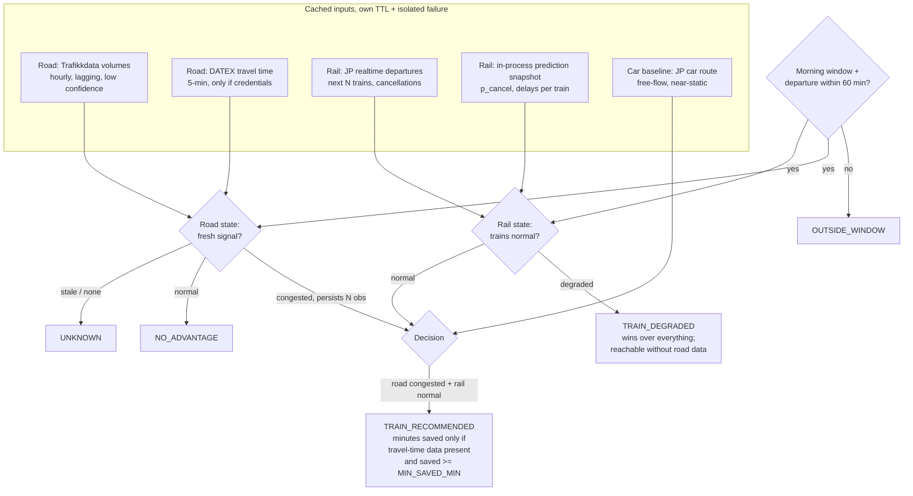
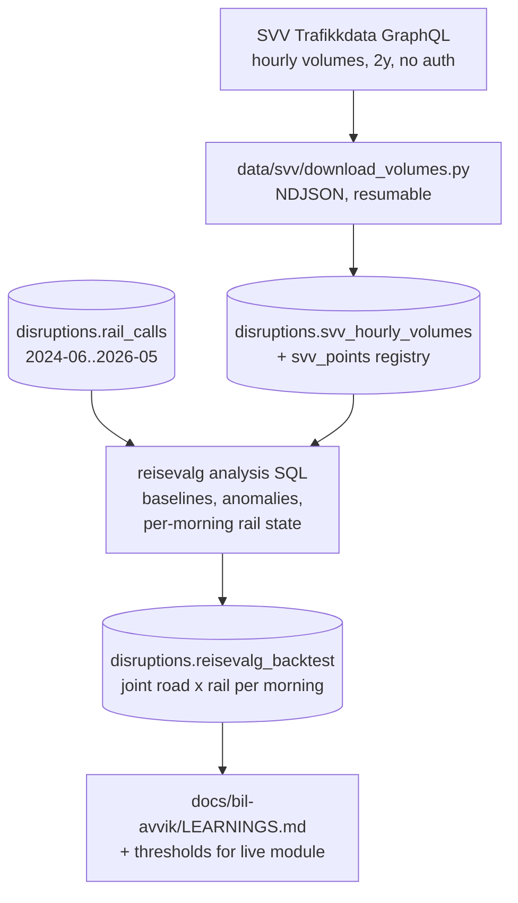

# feat: Reisevalg-varsel feasibility — car vs train on Lier–Drammen–Oslo S

## Summary

Investigate whether the concept in `docs/bil-avvik/Entur, fra bil til kollektivt.pdf` — a proactive nudge telling commuters "today the train beats the car" when E18 is congested and the parallel trains run normally — can be implemented with data that actually exists. The plan delivers three things: a BigQuery historical backtest of the Lier/Drammen → Oslo S corridor (how often would the nudge have fired, and would it have been right), a working prototype endpoint on the existing kix-avvik API that produces the recommendation live from open data, and a written feasibility report answering the PDF's four open questions honestly, including where the required data is not openly available.

## Problem Frame

The concept PDF claims "we already sit on the data that decides the choice": real-time train punctuality, open road congestion data (Statens vegvesen), and park-and-ride availability. Planning-time verification shows this is only partly true, and the gaps shape the whole design:

- **Rail side — strong.** This repo already predicts per-train cancellation and delay (`/journey`, backed by `disruptions.call_predictions_today`), Journey Planner v3 gives realtime expected times for upcoming departures, and `disruptions.rail_calls` holds two years of per-call history. Verified: at Lier, weekday mornings over the last 12 months show 1.7% cancellations, p90 departure delay 5 min — trains genuinely do run normally most mornings.
- **Road side — the crux.** SVV's open Trafikkdata GraphQL API (`trafikkdata-api.atlas.vegvesen.no`, no auth) serves hourly volumes per registration point with 2+ years of history and dense E18 coverage (verified: 18 points on the Lier stretch, 43 in Akershus/Oslo, per-direction "Oslo"/"Drammen" headings) — but **no speeds and no sub-hourly data**. SVV's real travel-time feed (DATEX II `GetTravelTimeData`, ~5-min updates, E18 Oslo–Aust-Agder covered) **requires a registered account** (web form, org details, fixed IP) and has **no historical archive**. Live queue detection from open data alone is therefore weak — this is exactly the PDF's own open question 02, and the feasibility analysis must answer it with data.
- **Park-and-ride — static only.** NSR/NeTEx carries static capacity for park-and-ride facilities; real-time occupancy lives only in Bane NOR's proprietary app backend. No open feed exists.
- **Car baseline — available.** Journey Planner v3 routes cars: Lier → Oslo S ≈ 36 min free-flow, 40.9 km (verified live).

---

## Requirements

**Feasibility evidence**

- R1. Quantify rail-side corridor reliability from `disruptions.rail_calls` at weekday-morning granularity over the full available window: per-morning classification (normal / degraded), cancellation and delay distributions for trains serving Lier and Drammen toward Oslo S.
- R2. Ingest ≥2 years of hourly per-direction traffic volumes for a fixed set of E18 registration points (Lier→Oslo direction) into BigQuery, and characterize congestion patterns: per point × weekday × hour baselines and anomaly detection, with an honest assessment of how well hourly volume works as a queue proxy (PDF question 02).
- R3. Backtest the nudge: on what fraction of weekday mornings was the road anomalous while the rail corridor was normal (the nudge opportunity), how often was rail degraded at the same time (the nudge must stay silent), and the break-even queue delay above which the train wins per departure headway (realized time saved is not computable without a travel-time archive — say so). The report states explicitly that "congested" means the anomaly reading (worse than a typical morning), not routine rush, and includes the routine-rush companion rate so the concept's authors see both interpretations.
- R4. Write a feasibility report at `docs/bil-avvik/LEARNINGS.md` answering the PDF's four questions with data or documented gaps, including the verified API access map (what is open, what requires registration, what does not exist openly).

**Prototype**

- R5. New endpoint `GET /reisevalg-api/recommendation` returns the corridor recommendation as one of five states — `TRAIN_RECOMMENDED`, `NO_ADVANTAGE`, `TRAIN_DEGRADED`, `OUTSIDE_WINDOW`, `UNKNOWN` — with Norwegian user-facing copy plus a machine-readable `reason` enum (e.g. `ROAD_DATA_STALE`, `NO_UPCOMING_DEPARTURE`, `RAIL_CANCELLATIONS`, `RAIL_CLOSURE`), per-source breakdown with each source's own `observed_at` and confidence, `state_since`/`valid_until` fields, and a `next_departures` list (aimed/expected/cancelled per train). Stale or missing input data must yield `UNKNOWN`, never a false nudge; a nudge requires an actual rail departure within ~60 min inside the weekday-morning window, else `OUTSIDE_WINDOW` — except when the window has zero rail-mode departures but rail-replacement services are present (planned closure): that is `TRAIN_DEGRADED` with reason `RAIL_CLOSURE`, not `OUTSIDE_WINDOW`. Volume-only road data may produce `TRAIN_RECOMMENDED` only if the U2 backtest shows the volume signature clears a named precision bar (default ≥80% of flagged rush mornings validated as genuinely congested); below the bar the volume signal maps to `UNKNOWN` for nudging purposes and the measured precision is recorded in the report next to the bar.
- R6. Road signal sits behind a provider interface (callables returning a frozen observation carrying source, state, `observed_at`, confidence, nullable travel time, backtested flag): a Trafikkdata volume-anomaly provider that works today (inherently lagged even when freshly fetched — the lag is part of the data timestamp, not hidden by the cache; staleness cutoffs are per-source, see KTDs), and a DATEX travel-time provider that ships as an interface-honoring stub — it activates only when `SVV_DATEX_USER`/`SVV_DATEX_PASSWORD` env vars are set, reports unavailable otherwise, and its real fetch/parse implementation is deferred until access is granted (it cannot be exercised against real data during this investigation). Strict priority — DATEX when fresh, else volumes, never blended — and the chosen `road_source` is echoed in the response. When implemented, DATEX credentials go in an `Authorization: Basic` header built from the env vars (never embedded in a URL), and provider failure logs carry exception type and HTTP status only — never the request URL or headers.
- R7. Rail signal reads the Journey Planner departure board (`stopPlace` `estimatedCalls` at Lier, filtered to the corridor lines toward Oslo S) — not the `trip` query, which omits cancelled journeys from itineraries and would make the "not cancelled" predicate vacuously true during a real stop. `estimatedCalls` carries cancellation state, aimed/expected times and `datedServiceJourney` refs for cancelled and running trains alike; rail-replacement buses must not pass the rail filter. The per-call prediction snapshot joins on the dated journey ref (format verified compatible). "Trains normal" default, anchored on what the passenger experiences: none of the next 3 departures cancelled, and expected **arrival at Oslo S** delay ≤ 5 min (delay accumulates after Lier on Norway's most congested rail segment — a departure-side gate at Lier would pass trains that arrive 10–15 min late), and no snapshot-predicted cancellation above the alert bar. The backtest classifies mornings on the same arrival-side predicate (`rail_calls` arrival delay at Oslo S). Precedence: JP realtime is the primary gate; the snapshot can only demote (never promote) — a predicted-degraded departure yields `TRAIN_DEGRADED` even when JP still shows on-time. `TRAIN_DEGRADED` is reachable from rail data alone, without any road signal, and wins over `NO_ADVANTAGE`: rail degraded + road normal → `TRAIN_DEGRADED` (the honest "don't count on the train today" answer), per the stated state precedence.
- R8. All external fetches are TTL-cached, failure-isolated per repo convention (a failing subsystem degrades only itself), and add zero per-request BigQuery cost.
- R9. Hermetic tests cover the decision logic and the endpoint (fake providers, no network, standalone-or-pytest).
- R10. Total spend for the investigation stays far under the $100 cap; every BigQuery step documents its estimated cost before running (repo convention: ask before anything over $10).

---

## Key Technical Decisions

- **Two-track design (historical backtest + live prototype with pluggable road providers):** the only open live road signal is hourly and volume-only, while the good signal (DATEX travel times) is registration-gated with no archive. The backtest uses what has history (volumes + rail_calls); the live endpoint is built so the DATEX provider drops in without redesign. This is the honest shape of "is this implementable?"
- **Volume-anomaly baselines in plain SQL, not BQML:** congestion detection from hourly volumes is a percentile-versus-baseline comparison per point × weekday × hour. A BQML model adds nothing a `APPROX_QUANTILES` table doesn't; "create models as necessary" resolves to *not necessary* for feasibility. Revisit only if the backtest shows plain baselines can't separate congested from normal mornings.
- **Live rail check via Journey Planner + in-process snapshot, not per-request BigQuery:** JP gives realtime expected times and cancellations for the next departures free of charge; the poller-maintained call-prediction snapshot adds kix-avvik's predictive layer (a train not in the snapshot has no active disruption). Zero marginal BQ cost per request (R8).
- **Car baseline from Journey Planner car routing:** verified working (36 min free-flow Lier→Oslo S). No Google/HERE dependency. Free-flow only — the *time-saved* number is only claimable when a travel-time provider supplies the congested drive time; without it the nudge omits the number (R5's honesty rule).
- **Sibling-module pattern copied from `varsel.py`:** new `disruptions/api/reisevalg.py` with its own `APIRouter`, module-level TTL caches with per-cache locks, graceful no-op when unconfigured. Only the call-prediction snapshot is injected from `main.py` via `configure()` (the cycle-avoidance pattern), as a by-(operator, jkey) lookup mirroring `/journey`'s resolution; road/JP providers are constructed inside the module and overridable via `configure()` kwargs for tests. `main.py` changes stay minimal — the strongest repo convention (isolated try/except per subsystem) is preserved.
- **External HTTP fetches happen on the request path in the threadpool, never in the SX poller tick and never on the event loop:** a hung SVV/JP call inside `_on_ingestion_change` would delay the varsel matcher — but equally, blocking `urllib` inside an `async def` handler would freeze the single-worker event loop (every existing endpoint, `/health` probes included). The reisevalg endpoint is therefore plain `def` (FastAPI runs it in the anyio threadpool) — a deliberate deviation from the otherwise-mirrored varsel template. Every external call gets a timeout ≤ ~3 s, the endpoint documents its worst-case cold-cache latency, refreshes are single-flight (concurrent requests serve the previous observation rather than stacking duplicate fetches), and JP calls carry `ET-Client-Name`. These are the first outbound non-Google HTTP calls from this workload.
- **State precedence is explicit and the decision is a pure function:** `TRAIN_DEGRADED` > `TRAIN_RECOMMENDED` > `NO_ADVANTAGE` > `UNKNOWN`, with `OUTSIDE_WINDOW` short-circuiting first (rail degraded beats road-normal — the endpoint warns even when the road is fine). Anti-flap is observation-based, not process-state-based: "congested" requires the volume deficit to hold over the last N hourly observations (fetched as a trailing window in one Trafikkdata call) — stateless per request, restart-proof (single replica redeploys on every push to main), backtestable by construction, and hermetically testable with fake observation lists. `state_since` derives from the same observation history. Inputs are cached; the recommendation itself is recomputed per request — so "never serve a stale nudge" is automatic, not a rule to remember.
- **Staleness cutoffs are per-source, and the timing arithmetic must be confronted, not hidden:** hourly volumes are inherently old when published — a single 90-min cutoff would make the volume provider stale-by-rule at every fetch. Defaults: volume observations usable up to ~180 min old (always confidence "low"), DATEX up to ~15 min. U1 measures the actual current-hour publication lag; the volume cutoff is then set to worst-case observed lag + 60 min. The earliest possible `TRAIN_RECOMMENDED` fire time follows from publication lag + persistence N — if that lands late in the 06:00–09:30 window (data for 07:00 arriving ~08:00 means firing ~08:30 at best), the honest conclusion is that the volume provider is backtest evidence only and any live nudge requires DATEX (or the bus-probe signal below); the report states this arithmetic explicitly either way.
- **Structural-drift guards on the volume signal:** a lane reconfiguration (E18 Vestkorridoren roadwork is active through the corridor) creates a volume deficit that persists for weeks — persistence-N would amplify it into a standing false nudge. Two guards: the deficit must hold against both the long-run baseline and a trailing ~4-week same-weekday-hour median (week-scale structural shifts stop firing), and `disruptions.svv_baselines` rows carry a `built_at` so the provider degrades the road side to unknown when baselines exceed a stated age (default 6 months) — the offline re-derivation loop is enforced, not remembered.
- **Entur's own buses on E18 are probe vehicles — evaluate them before treating DATEX as the only unlock:** scheduled buses driving the corridor carry realized run-time inflation (a direct travel-time congestion measure) with ~2 years of all-operator history in the `last_recorded` ET table for cents, and a live SIRI feed. U2 evaluates this as (a) historical ground truth for validating the volume-anomaly signature and (b) a candidate third road provider behind the same interface. If it works, the "registration-gated DATEX is the single most valuable unlock" framing softens considerably.
- **Threshold handoff is a table plus named constants:** the offline analysis lands per point × direction × hour-of-week baselines in `disruptions.svv_baselines`, loaded like the existing lookup-table precedent `refresh_impact_lookup` (`disruptions.category_line_hour_impact`): eager tolerant load in `lifespan`, isolated refresh in the poller tick — not on the request path, keeping R8's zero-per-request-BigQuery promise literal. Decision constants (`CONGESTION_VOLUME_DEFICIT`, `RAIL_NORMAL_MAX_ARR_DELAY_MIN`, `MIN_SAVED_MIN`, `MORNING_WINDOW`, persistence N, the volume-precision bar, per-source staleness cutoffs) are literals-in-code with rationale comments (the `varsel.threshold_for` precedent), and `LEARNINGS.md` must emit each constant with the backtest evidence that produced it. **prd wiring is gated on a positive verdict:** `disruptions.svv_baselines` is deliberately NOT added to `data/queries/copy_runtime_to_prd.sh` during the investigation — prd (which only sees copied tables) serves `UNKNOWN` for the road side until the feasibility verdict is positive and the table is consciously added; this keeps an unvalidated experiment out of the production data path while the tolerant-load design keeps prd deploys safe.
- **Ingestion script follows the Frost precedent:** `data/svv/` mirrors `data/frost/` (stdlib `urllib`, exponential backoff, resumable writes, then `bq load`). No new Python dependencies in the API image.
- **Corridor is fixed (Lier/Drammen → Oslo S morning direction)** as in the PDF; the point registry and stop IDs are data, not code, so a second corridor later is configuration work.

Verified identifiers the implementation should use: Lier = `NSR:StopPlace:426` (rail_calls) / `NSR:StopPlace:58835` (JP), Drammen = `NSR:StopPlace:11`, Oslo S = `NSR:StopPlace:337`; corridor lines `VYG:Line:L1`, `R12`, `R13`, `RE11`; E18 candidate points e.g. `97858V180819` (Kjellstad nordgående), `38517V180819` (Tranby), `28285V444233` (Holmen), `33438V444232` (Høvik), `04925V444232` (Lysakerlokket).

---

## High-Level Technical Design

Directional guidance, not implementation specification.

**Live recommendation flow** — every input degrades independently; the decision gate only fires the nudge when both signals are fresh and agree:

Minutes saved, when claimable, is `car_time_now − (wait_to_next_departure + rail_time)` — the wait counts, because the user is deciding now.

**Offline pipeline** — one-shot ingestion, then SQL analysis feeding both the report and the live thresholds:

The handoff between tracks: baselines live in `disruptions.svv_baselines` (read by the live provider on a slow TTL), decision constants live in code with the backtest evidence recorded in the report — derived offline, applied online, re-derived by re-running the analysis, never fitted in the serving path. The backtest and the live module must use the same "trains normal" predicate (R7's definition) over their respective sources, and the report states the residual mismatch between instruments (rail_calls actuals vs JP realtime + snapshot).

---

## Implementation Units

### U1. SVV traffic-volume ingestion into BigQuery

- **Goal:** Two years of hourly per-direction volumes for the fixed E18 corridor point set, in `disruptions.svv_hourly_volumes`, plus a `disruptions.svv_points` registry (id, name, road ref, lat/lon, direction toward Oslo).
- **Requirements:** R2, R10
- **Dependencies:** none
- **Files:** `data/svv/download_volumes.py` (new), `data/svv/points.json` (new, curated point set), `data/queries/create_svv_hourly_volumes.sql` (new; documents schema + cost header per repo convention)
- **Approach:** GraphQL `trafficData … volume.byHour` per point with 100-hour pagination, stdlib `urllib` + backoff, NDJSON to `data/svv/volumes/` (resumable, `.tmp`-then-rename), then `bq load` into a date-partitioned table. **Schema keeps `byDirection` rows** (the "Oslo"/"Drammen" headings — summing directions destroys the rush signal) and `coverage.percentage` (low-coverage hours must be excludable). Hours are local time — store UTC + Oslo-local hour explicitly so DST days join cleanly with `rail_calls`. Ingestion window matches the rail_calls window (2024-06-01..2026-05-31). API is free/NLOD; include the contact User-Agent header. Volume of data is trivial (~10 points × ~17k hours × 2 directions).
- **Patterns to follow:** `data/frost/download_observations.py` (backoff, resume), `data/queries/create_rail_calls.sql` (header comment style, partitioning).
- **Test scenarios:** Test expectation: none — one-shot offline ingestion script; correctness is verified by the U2 sanity checks on the loaded table (row counts per point/day, coverage distribution, rush-hour profile shape).
- **Verification:** table exists with expected row count (≈ points × days × 24 ± gaps), a spot-checked morning matches the API's own numbers, and a rush-hour profile plot/query shows the expected weekday double peak. Also measure the **current-hour publication lag** (query the latest available `byHour` row for one corridor point, record `now − hour_end`) — this number sets the live volume-staleness cutoff (KTDs) and goes in the report.
- **Day-1 parallel action (zero cost):** prepare the DATEX access-request materials (org details, fixed-IP question for the GKE egress NAT, stated purpose) and hand them to the Entur owner on day 1 — the registration lead time is weeks, there is no historical archive, and every unfiled week is travel-time data lost forever. The request runs concurrently with the investigation, not after it.

### U2. Corridor backtest analysis in BigQuery

- **Goal:** The numbers the feasibility verdict rests on: per-morning road state × rail state joint table and its summary.
- **Requirements:** R1, R2, R3, R10
- **Dependencies:** U1
- **Files:** `data/queries/reisevalg_rail_mornings.sql` (new), `data/queries/reisevalg_road_baseline.sql` (new; also lands `disruptions.svv_baselines` for the live provider), `data/queries/reisevalg_backtest.sql` (new)
- **Approach:** (a) **Ground truth first:** before any anomaly analysis, build and size the road-incident ground-truth set — E18-corridor road-relevant SX categories, manually collected incident dates, and the bus-probe signal below — with an explicit minimum bar (≥15 incident mornings in the window). If the bar is unmet, R3's deliverable is reworded from "would it have been right" to "how often it would have fired — precision unquantifiable from open data", and that becomes the empirical answer to PDF question 02. (b) **Bus probe:** identify scheduled bus lines traversing the E18 stretch (Lier/Asker → Oslo) in the all-operator `last_recorded` ET history (cents to scan) and evaluate realized run-time inflation as historical congestion ground truth and as a candidate live road provider; record the result either way. (c) Rail: define the parallel service precisely — trains calling Lier `NSR:StopPlace:426` (and, decided in-unit, Drammen `NSR:StopPlace:11` for trains skipping Lier) with Oslo S `NSR:StopPlace:337` later in `stop_order` (no direction column exists; direction is derivable only this way). Classify each weekday morning (06:00–09:30 Europe/Oslo) normal/degraded on the **arrival-side predicate** (R7: cancellations + arrival delay at Oslo S); exclude planned engineering-closure periods (mass-cancellation days — Drammenbanen summer work) from headline numbers, reporting them separately. (d) Road: per point × **direction** × weekday × hour baselines (median, p10, p90 via `APPROX_QUANTILES`, excluding low-coverage hours and a **hardcoded literal date list** of public holidays/inneklemte dager/fellesferie weeks embedded in `reisevalg_road_baseline.sql` with a derivation comment — the `create_rail_calls.sql` literal-bounds convention, so reruns reproduce). Note the physics: queues push volume *below* baseline downstream of the bottleneck (throughput collapse) — test the "rush-hour volume significantly below same-weekday-hour baseline" signature against the ground-truth set from (a)/(b) before trusting it. Watch per-point baseline drift from multi-year E18 roadwork. (e) Join to a per-morning grid: opportunity rate (road anomalous ∧ rail normal), conflict rate (both degraded), **computed twice — with hindsight hours and with only data available by 07:00 (the hourly lag simulated)**; the gap between the two is the quantified case for DATEX/bus-probe travel times. (f) Instead of a vacuous "time-saved range" (queue-delay magnitude has no open historical source), compute the **break-even queue delay** per departure headway — `queue_delay > wait + rail_time − car_freeflow` is the claim the nudge implicitly makes — and state that quantifying realized savings requires the travel-time archive that starts only when DATEX access lands. All queries carry cost headers; expected total scan well under $1.
- **Patterns to follow:** `data/queries/category_predictiveness.sql` (analysis-query shape, header docs).
- **Test scenarios:** In-query sanity assertions rather than pytest: baseline table has rows for every point × direction × weekday × rush-hour; no morning classified from <50% coverage data; rail mornings count ≈ weekday count in window minus excluded closure days; backtest grid has one row per weekday morning in the overlap window; sensitivity block showing opportunity rate at 2–3 threshold choices; hindsight vs available-at-07:00 numbers both present.
- **Verification:** `disruptions.reisevalg_backtest` and `disruptions.svv_baselines` exist; summary numbers (ground-truth set size vs the ≥15 bar, opportunity rate, conflict rate, rail-normal rate, hindsight-vs-lagged gap, volume-signature precision vs the R5 bar, break-even queue delays, bus-probe result) are in the report with the thresholds that produced them; `disruptions.svv_baselines` is deliberately NOT in `data/queries/copy_runtime_to_prd.sh` (prd wiring gated on a positive verdict, per KTDs).

### U3. Live recommendation module `reisevalg.py`

- **Goal:** `GET /reisevalg-api/recommendation` serving the four-state recommendation for the corridor from live inputs, wired into the app without disturbing existing subsystems.
- **Requirements:** R5, R6, R7, R8
- **Dependencies:** U2 (thresholds), but the module skeleton can proceed in parallel
- **Files:** `disruptions/api/reisevalg.py` (new), `disruptions/api/main.py` (edit: `include_router`, `configure(...)` injection of the by-(operator, jkey) call-prediction snapshot lookup, plus the `svv_baselines` eager load in `lifespan` and isolated refresh in `_on_ingestion_change`)
- **Approach:** Module mirrors `varsel.py` — with one deliberate deviation: the endpoint is plain `def`, not `async def`, so blocking `urllib` runs in the anyio threadpool instead of freezing the single-worker event loop (which would stall `/journey`, `/varsel-api`, and the `/health` probes). `APIRouter(prefix="/reisevalg-api")`; module-level input caches (road observations, JP departures, car baseline) each with a lock, a TTL, single-flight refresh (concurrent callers serve the previous observation), and the *source* `observed_at` kept distinct from `fetched_at` (the volume provider's data is inherently old when just fetched — the state machine thresholds on data age with per-source cutoffs — volumes ~180 min per the KTD arithmetic, DATEX ~15 min). Every external call has a timeout ≤ ~3 s; stdlib `urllib` (no new deps in `requirements.txt`); JP calls carry `ET-Client-Name`. Road providers are callables constructed inside the module (overridable via `configure()` kwargs for tests) returning a frozen `RoadObservation | None` dataclass — `source, state, observed_at, confidence ("low"/"high"), travel_time_min (nullable), backtested` — aggregated as an ordered list: first fresh observation wins (DATEX before volumes, never blended); DATEX ships `backtested: false` since the offline analysis can only validate the volume family. The volume provider fetches a trailing window of hours in one Trafikkdata call and applies the persistence-N deficit rule against `disruptions.svv_baselines`, which is loaded eagerly in `lifespan` and refreshed in `_on_ingestion_change` under its own isolated try/except (the `refresh_impact_lookup` precedent) — no BigQuery on the request path. From `main.py`, inject only the call-prediction snapshot as a **by-(operator, jkey) lookup** mirroring `/journey`'s codespace-prefix resolution (not the situation-keyed `_varsel_snapshot`), treated strictly read-only. Rail state per R7 (rail-mode filter — replacement buses excluded; snapshot only demotes). Decision gate per the HTD diagram with the `MIN_SAVED_MIN` floor; the recommendation is recomputed per request as a pure function of (cached observations, now). Response model in Pydantic with `Field(description=...)` everywhere: state, `reason` enum, Norwegian copy (`"Bedre å ta toget i dag"`, …), nullable `car_delay_min`/`saved_min` (numbers only from a travel-time source), `next_departures`, per-source freshness block, `state_since`/`valid_until` (derived from observation history), corridor self-description (from/to NSR IDs, "E18 retning Oslo"). Parking: static capacity only, field description states it must not be rendered as live availability (no open occupancy feed exists).
- **Patterns to follow:** `disruptions/api/varsel.py` (router, configure, env-at-import, graceful no-op), `main.py` cache pattern (build outside lock, swap under lock, `*_refreshed_at`), logging via `extra={"fields": {"event": ...}}`, cost/TTL justification comments (`main.py:330`-style).
- **Test scenarios:** covered in U4.
- **Verification:** with no env vars and network blocked, endpoint returns `UNKNOWN` with reasons; locally with live APIs it returns a coherent state; concurrent requests during a slow (mocked) fetch do not stack duplicate fetches and other endpoints stay responsive; `uv run ruff check .` passes; no new entries in `requirements.txt`. After the first dev deploy: hit the endpoint on `kix-avvik.dev.entur.io` and confirm the per-source freshness block shows successful road/JP fetches from inside the cluster (egress to non-Google hosts is unverified until then).

### U4. Hermetic tests for decision logic and endpoint

- **Goal:** The decision matrix and endpoint contract are pinned before any live-data tuning.
- **Requirements:** R9, R5
- **Dependencies:** U3
- **Files:** `disruptions/api/test_reisevalg.py` (new)
- **Approach:** Follow `test_varsel_api.py`: set env before import, inject fake providers via `configure()`, drive with `fastapi.testclient.TestClient` on a fresh `FastAPI()`, standalone-or-pytest shim. Documented run: `uv run --with httpx python disruptions/api/test_reisevalg.py`.
- **Test scenarios:**
  - Happy path: road congested (deficit holds over the trailing N observations) + rail normal (fresh) → `TRAIN_RECOMMENDED`; minutes-saved present only when the road provider supplies a travel time and the saving clears `MIN_SAVED_MIN`, absent for the volume provider.
  - Anti-flap: a deficit in only the latest observation (persistence < N) does not enter `TRAIN_RECOMMENDED`; `state_since` reflects the first observation of the current run.
  - Road normal + rail normal → `NO_ADVANTAGE`.
  - Road normal + rail degraded → `TRAIN_DEGRADED` (rail-degraded wins over road-normal, per the stated precedence — the endpoint warns even when the road is fine).
  - Rail degraded (next departure cancelled via fake departure-board data) → `TRAIN_DEGRADED` even when road is congested.
  - Rail degraded via arrival delay only (departures leave Lier on time but expected Oslo S arrival delay exceeds the threshold) → `TRAIN_DEGRADED` — the gate is arrival-side.
  - Rail degraded via snapshot only (JP says on-time but snapshot has `p_cancel` above threshold for a next departure) → `TRAIN_DEGRADED` — the predictive layer vetoes; and the inverse (snapshot silent, JP shows cancellation) also degrades.
  - Rail-replacement bus in the departure board is not counted as a normal rail departure; a morning window with zero rail departures but replacement services present → `TRAIN_DEGRADED` with `RAIL_CLOSURE` reason, not `OUTSIDE_WINDOW`.
  - Staleness: road `observed_at` older than the per-source cutoff (even after a successful fetch) → road side unknown → `UNKNOWN` with `ROAD_DATA_STALE` reason; same family for rail.
  - Timing arithmetic: the volume path CAN produce `TRAIN_RECOMMENDED` at 08:30 from observations with `observed_at` 07:00 (within the ~180 min volume cutoff) — pins that the per-source cutoff makes the provider usable at all.
  - Outside window / no departure within 60 min (night, weekend) → `OUTSIDE_WINDOW` with `NO_UPCOMING_DEPARTURE` reason, not an exception, and `TRAIN_DEGRADED` still reachable on rail data alone inside the window when road data is absent.
  - Provider raises (network error/timeout) → state computed from remaining signals degrades to `UNKNOWN`, endpoint still 200, error logged with `event` field.
  - DATEX env vars unset → provider reports unavailable, volume provider still consulted; when both available, DATEX wins and `road_source` says so.
  - Response contract: all five states serialize with copy text, `reason` enum, per-source freshness block, `state_since`/`valid_until`, `next_departures`; freshness fields ISO-8601 UTC.
- **Verification:** file passes standalone and under pytest with no network.

### U5. Feasibility report and operational notes

- **Goal:** The written answer to "is this implementable?" — the deliverable the PDF's authors need.
- **Requirements:** R4, R3, R10
- **Dependencies:** U2, U3 (live-endpoint experience feeds the verdict)
- **Files:** `docs/bil-avvik/LEARNINGS.md` (new), `CLAUDE.md` + `AGENTS.md` (edit: short deployment note for the new endpoint and optional DATEX env vars)
- **Approach:** **Open with the executive verdict** — one of "possible now (volume/bus-probe signal, no minutes claim, precision per backtest) / possible with DATEX access (minutes claimable, requires prospective archiving from day of access) / not possible" — followed by a line per claim in the PDF's mock notification ("kø på E18", "togene går som normalt", "du sparer ca. 20 min", "ledig plass på innfartsparkering") stating which are supportable from open data today. Then the four questions, scoped honestly: (02) is queue data precise and forward-looking enough — answered *empirically* from U2 (ground-truth set size, volume-signature precision vs the bar, hindsight-vs-lagged gap, bus-probe result, publication-lag arithmetic); (01) who drives, (03) rail capacity headroom, (04) conversion measurement — state precisely what data would be required and from whom (Bane NOR/Jernbanedirektoratet sources per r4), no pretend answers. Embed 2–3 captured real endpoint responses (a fired nudge if one occurs, an `UNKNOWN`/stale morning, a `TRAIN_DEGRADED` case) with one-line explanations so decision-makers can evaluate the prototype without live access — with the caveat that live-behavior conclusions require at least one normal-traffic, non-closure week (the build window falls in fellesferie/summer-work season). End with the named live constants (`CONGESTION_VOLUME_DEFICIT`, `RAIL_NORMAL_MAX_ARR_DELAY_MIN`, `MIN_SAVED_MIN`, `MORNING_WINDOW`, persistence N, volume-precision bar, per-source staleness cutoffs) each tied to the backtest evidence that produced it, the definition-parity note (backtest predicate vs live instruments), the cost ledger (BQ + API spend, target ≪ $10 against the $100 cap), and next steps (DATEX request status — prepared on day 1 per U1; start archiving travel times the day access lands; when credentials are provisioned, wire `SVV_DATEX_USER`/`SVV_DATEX_PASSWORD` via the same Secret Manager + ExternalSecret convention as the VAPID keypair, never a plaintext Helm values entry). Keep helm untouched in this plan.
- **Test scenarios:** Test expectation: none — documentation unit.
- **Verification:** the executive verdict and per-mock-claim supportability lines open the report; question 02 is answered with data and 01/03/04 are scoped to required-data statements; the named constants section exists; captured endpoint responses are embedded; every claim about API availability carries its verification date; cost ledger totals actual spend.

---

## Scope Boundaries

**In scope:** the fixed Lier/Drammen → Oslo S morning corridor; historical backtest; live prototype endpoint; feasibility report.

**Deferred to follow-up work:**
- The DATEX provider's real fetch/parse implementation and its going live (the access request itself is a day-1 parallel action in U1; the provider ships as an interface-honoring stub until credentials exist; the eventual implementation must also settle its XML-parsing hardening posture, e.g. whether `defusedxml` warrants a one-off dependency exception).
- Continuous archiving of DATEX travel times once access exists (needed to ever backtest with real queue data).
- Wiring `disruptions.svv_baselines` (and the endpoint's prd data path generally) into `data/queries/copy_runtime_to_prd.sh` — gated on a positive feasibility verdict.
- A consumer-facing UI or push notification (the varsel PWA is the natural home if the feasibility verdict is positive).
- Additional corridors (Asker→Oslo, Ski→Oslo E6/E18 south…).

**Outside this investigation's identity:**
- Personalization / knowing who drives today (PDF question 01) — requires data Entur does not hold; report addresses it qualitatively.
- Rail capacity headroom (PDF question 03) — Bane NOR/Jernbanedirektoratet data, not this repo's.
- Conversion measurement (PDF question 04) — product analytics, sketched in the report only.
- Real-time park-and-ride occupancy — no open feed exists (verified); static capacity only.

---

## Assumptions

Inferred choices this plan proceeds on (headless run — no user confirmation was possible):

- "Investigate whether it is possible to implement this" is best served by a working prototype plus evidence, not a paper study — hence the prototype units, kept small.
- The deliverable set (backtest + endpoint + report) matches the user's intent behind "run BigQuery queries and create models as necessary"; no new BQML model is created because none is necessary (plain SQL baselines suffice — documented as a KTD).
- The prototype lives on the existing kix-avvik API rather than a new service (single-replica poller app, sibling-module precedent, zero deploy overhead).
- No UI is built; the endpoint's JSON carries everything the PDF's mock notification needs (copy, minutes saved when claimable, parking note, departures).
- The $100 budget is a hard cap with large headroom by design: all planned BQ scans total well under $10; the expensive anshar tables are not touched.

---

## Risks & Dependencies

- **Hourly volumes may not separate queue mornings from normal ones** (throughput collapse cuts volume; demand dips look similar). This is a finding either way: the backtest (U2) is designed to answer PDF question 02, and the live volume provider is explicitly low-confidence. Mitigation: the endpoint's honesty rule (no nudge without fresh, confident signal) and the DATEX path.
- **DATEX access is not self-service** — registration with fixed IP (does the GKE egress NAT present a stable allowlistable IP? — resolve while preparing the request); may take weeks or stall. The plan never blocks on it: the request is prepared on day 1 (U1), the provider ships as a stub, and the bus-probe evaluation (U2) may soften how much the verdict depends on DATEX at all.
- **JP rate limits / schema drift:** all JP calls are TTL-cached (departures ~1–2 min, car baseline hours); `ET-Client-Name` set per policy. Field names verified against the live schema at planning time (`datedServiceJourney.id`, `expectedStartTime`).
- **rail_calls ends 2026-05-31** (fixed window) — fine for the backtest; the live rail signal uses JP + snapshot, not rail_calls. The volume ingestion window should match the rail window for the join.
- **Summer/holiday distortion:** the backtest window includes two summers; baselines are same-weekday percentiles and the analysis excludes school-holiday weeks from the headline numbers (kept as a sensitivity slice).
- **Trafikkdata terms:** NLOD, open, no key — but include a descriptive User-Agent and stay far below any rate concern (a one-shot 2-year backfill plus one poll every ~15 min live).
- **Cluster egress to non-Google hosts is unverified:** this workload has never called `trafikkdata-api.atlas.vegvesen.no` or `api.entur.io` from inside GKE; the common chart's network posture may block it. U3's verification includes a post-deploy live check on dev before the report claims "works live".
- **Event-loop safety is the one channel through which this feature could degrade everything else** (single uvicorn worker; `/health` is the liveness probe). The plain-`def` endpoint + threadpool decision (KTDs) removes it; the U4 concurrency scenario guards the regression.

---

## Open Questions

- Does the volume-anomaly signal clear the R5 precision bar (default ≥80%) against the U2 ground-truth set, or does the live nudge stay `UNKNOWN`-biased until DATEX credentials (or the bus-probe provider) arrive? U2 decides; both outcomes are valid feasibility findings, and the defined failure path is fire-rate-only reporting.
- Can the trailing multi-point volume window be fetched in one Trafikkdata call (GraphQL aliases per point), or does the live provider need one request per point per refresh? Implementation-time detail; either fits the TTL budget.
- Exact E18 point set and per-point direction filters (the "Oslo"-heading lane groups) — implementation-time selection from `svv_points`, starting from the verified candidates in KTDs.
- Whether Drammen→Oslo should be scored as a separate sub-corridor in the backtest (R13/RE11 skip Lier) — decide in U2 when the rail morning classification is built; the endpoint serves the merged corridor either way.

---

## Sources & Research

- Concept: `docs/bil-avvik/Entur, fra bil til kollektivt.pdf` (9 pages, read in full).
- Context: `docs/kix-docs` repo → `Kix-share/docs/Context/r2-entur-teknisk-deep-dive.md` (JP v3 API, SIRI, NeTEx parking model), `r4-tilstotende-datakilder.md` (SVV source catalog: Trafikkdata GraphQL, Vegtrafikksentralen DATEX II, NVDB).
- Verified live at planning time (2026-07-11): Trafikkdata GraphQL open access, hourly volumes, per-direction headings, 2024 history present, E18 point coverage (18 Buskerud + 43 Akershus/Oslo points); JP v3 rail trip Lier→Oslo S (R13, 30 min) with `datedServiceJourney.id` in `/journey`-compatible format; JP car routing 36 min/40.9 km; rail_calls corridor stats (Lier weekday mornings: 1.7% cancelled, p90 5 min).
- External docs (web-verified 2026-07): `dataut.vegvesen.no/en/dataset/reisetider` (DATEX II GetTravelTimeData, 5-min cadence, E18 covered, registration required, no archive); `vegvesen.no … /what-is-datex/get-access/` (access process); `github.com/trafikkdata/trafikkdata.no-dokumentasjon` (API usage, hourly minimum, privacy aggregation); `developer.entur.org/pages-journeyplanner-journeyplanner-v3` + OTP2 docs (`CAR_TO_PARK` exists but depends on OSM tagging — not load-bearing here); Entur NeTEx profile examples (static `Parking` capacity model); Bane NOR commuter-parking pages (occupancy app-only, no API).
- Repo integration points: `disruptions/api/varsel.py` (sibling-module template), `disruptions/api/main.py` `_on_ingestion_change` + cache/lock pattern, `data/frost/download_observations.py` (ingestion precedent), `disruptions/api/test_varsel_api.py` (hermetic test template).
