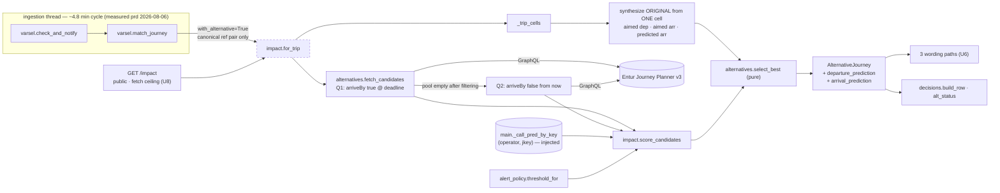
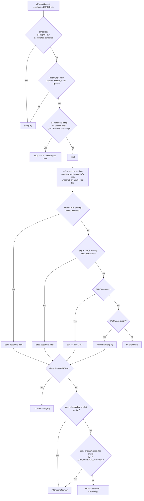

# feat: Always offer the best alternative journey when we alert

**Target repo:** `kix-avvik` (this repo)

## Goal Capsule

When Avviksvarsel alerts a traveller, the single most useful thing we can add is *what to take
instead*. Today we look for one, but the rule we look with — "the earliest-arriving journey that
beats the disrupted train's predicted arrival by at least 3 minutes" — almost never fires, and it
fires least in the case that matters most: a cancelled train, where nothing arrives earlier than a
train that is not running at all.

This plan replaces that rule with the traveller's actual question ("what still gets me there in
time, and how late can I leave?"), makes the candidates cancellation- and delay-aware by scoring
them against our own per-call models, and returns `departure_prediction` / `arrival_prediction` for
whatever we pick.

**This is a positioning change, made deliberately.** Avviksvarsel moves from telling a traveller
what is likely to happen to their train, to telling them which specific departure to take instead —
prescriptive advice, under Entur branding, on a public host. The trust bar and the failure cost are
both different. Two commitments follow from naming it: the wording must never present a Journey
Planner suggestion as our own prediction (R9), and an alternative that is not meaningfully better
than the traveller's own train is not offered at all (R7).

---

## Problem Frame

`disruptions/api/alternatives.py` asks the Journey Planner (JP) for trip patterns and keeps the
**earliest-arriving** one that arrives at least `_MIN_MINUTES_SAVED = 3` minutes before
`reference_arrival` (the disrupted train's *predicted* arrival). Four things follow, and all four
are wrong for the traveller:

1. **A cancelled train yields no alternative.** For an ET-declared cancellation,
   `impact._cancelled_prediction` drops every delay figure, so `impact._reference_arrival` reduces
   to the *scheduled* arrival. Every real replacement departs later and arrives later, so it fails
   the "≥ 3 minutes earlier" bar and is discarded. `decisions._alternative_fields` records the
   consequence in its own docstring: *"Measured 2026-08-04, the answer today is 'effectively
   never'"*.
2. **The bar is the wrong quantity.** Beating a *predicted* arrival is stricter and less meaningful
   than arriving by the time the traveller planned to be there.
3. **Earliest arrival is the wrong objective.** A traveller who can still make their appointment
   would rather leave later than arrive earlier.
4. **Candidates are unscored.** `_rides_the_disruption` excludes the whole affected **line**, which
   throws away "ta neste tog" — the operator's own advice in the 2026-08-05 Vy RE10 case — while
   nothing checks whether the journey we *do* suggest is itself about to be cancelled.

---

## Product Contract

### Requirements

| ID | Requirement |
|----|-------------|
| R1 | Whenever an alert is produced — ET-declared cancellation, high cancellation probability, or predicted delay — an alternative-journey lookup runs for that trip, unless the deadline lies beyond the searchable horizon (U2) or the public-endpoint fetch ceiling is in force (U8). Neither exception ever suppresses the alert itself. |
| R2 | Candidates run from `from_place` to `to_place` (the traveller's own trip), not the geography named in the SX message. |
| R3 | **Primary rule:** among candidates whose departure is still in the future and whose arrival is before `original_arrival_time`, choose the one with the **latest departure**. |
| R4 | **Fallback rule:** when no candidate satisfies R3, choose the candidate with the **earliest arrival** among those whose departure has not yet passed. |
| R5 | A candidate already declared cancelled — by JP *or* by our own ET-derived cache — is never chosen. |
| R6 | Where possible, prefer a candidate that would not itself trigger an alert; fall back to the full non-cancelled pool only when the preferred subset is empty at that tier. |
| R7 | The original journey competes under the same rules. If it wins — not expected to be cancelled, and still the best arrival despite its delay — **no alternative is returned**. An alternative that does not beat the original's predicted arrival by at least `_MIN_MATERIAL_MINUTES` is likewise not offered, unless the original is cancelled or itself alert-worthy. |
| R8 | The chosen alternative carries `departure_prediction` and `arrival_prediction` in the response. |
| R9 | The traveller-facing wording names the alternative in **every** wording path (LLM, deterministic template, and the degraded `_message_input_from_alert` path), and states when it arrives *after* the original's scheduled arrival. prd runs with `VARSEL_LLM_ENABLED=false`, so the template is the wording real travellers get. |
| R10 | The decision log records, on every decision row, **why** the row has the alternative outcome it has — offered, nothing found, no lookup issued, or suppressed — so an offer rate has a defined denominator across the change. |
| R11 | The Journey Planner dependency is observable in logs, and its cost on the public request path is bounded. |

### Key Decisions

**KD1 — Two bars, both read off the train the alert is about.** `original_arrival_time` (aimed)
answers "do I still make it?" (R3); that same train's *predicted* arrival answers "is this better
than what I have?" (R7, `minutes_saved`). Both come from the **same cell** as the synthesized
original's departure. `impact.py:185-188` documents that `arrival_prediction` is picked worst-first
over arrivals *independently and may come from a different train* — under the old rule a wrong bar
only shifted a filter; under R3 it decides which candidate wins.

*Which train is "the original"?* A registration is a recurring **window**, not a departure, so there
is no train the traveller declared. The train the alert is about — `select="worst"`'s cell, the one
the push and the card already name — is the only defensible answer, and it keeps the alternative
relative to the same train every other surface is talking about. Its consequence is bounded by U3's
window cut: a candidate departing after the registered window (plus the existing catch-up grace) is
never offered, so a deadline synthesized from a late-window train cannot drag the recommendation
past what the traveller signed up for. *Governs R3, R7.*

**KD2 — The original journey is synthesized from our own scoring, not read out of JP's list.** R7
compares against what we *expect* of the original ("not expected to be cancelled … despite being
delayed"), which is a model output; JP knows only its published realtime picture. Where JP *also*
returns the original's own pattern, take the **later** of the two arrivals — a disagreement between
our p50 and JP's published expectation should not be resolved in favour of the more optimistic one
when the cost of being wrong is telling the traveller to stay put. *Governs R7.*

**KD3 — "Cancelled" is a hard exclusion; "would trigger an alert" is a soft preference.** R5 removes
a candidate from the pool. R6 orders within it. *Governs R5, R6.*

---

## Planning Contract

### KTD1. Tier ordering: arrival-feasibility outranks risk-avoidance

R3/R4 (in-time vs. not) is the **outer** loop; R6 (safe vs. any) the **inner** one:

```
for tier in (arrives_before_original, any):
    for group in (not_risky, all):
        if group has a candidate in this tier: return it
```

Chosen over risk-avoidance-outside, which would let a *safe* journey arriving two hours late beat a
slightly-risky one that still gets the traveller there on time. "Where possible" in R6 reads as a
preference, not a veto. *Governs R3, R4, R6.*

### KTD2. `arriveBy: true` is the primary query; `searchWindow` stays unset

**Rewritten on live measurement, 2026-08-06** (Oslo S `NSR:StopPlace:337` → Drammen
`NSR:StopPlace:60`). The earlier reasoning here — that reach is `numTripPatterns × headway` and a
wide `searchWindow` buys nothing — is **false**, and the clamp it produced would have been a
regression against the query the code issues today:

| query | patterns returned | departure span |
|---|---|---|
| `numTripPatterns: 10`, `searchWindow` unset | 5 | 11:16–13:16 |
| `numTripPatterns: 10`, `searchWindow: 120` | 4 | narrower |
| `numTripPatterns: 10`, `searchWindow: 60` | 2 | 11:16–11:46 |
| `numTripPatterns: 3`, `searchWindow: 120` | 3 | count binds only below ~5 |

Reach is governed by `searchWindow` and OTP2's density-aware dynamic default, **not** by the pattern
count — so raising 6 → 10 is nearly inert, and any clamp shrinks the pool R3 chooses from. Today's
code sets no `searchWindow`; keep it that way.

More decisively, the same measurement showed `arriveBy: true` anchored at `original_arrival_time`
returns **the latest-departing in-time patterns by construction** (15:16, 14:46, 14:16, 13:46 for a
16:00 deadline) — which *is* R3's answer, with no local search over a truncated pool.

Settled:

- **Query 1 — `arriveBy: true` at `original_arrival_time`, `numTripPatterns: 10`, no `searchWindow`.**
  Answers R3 directly.
- **Query 2 — `arriveBy: false` from `now`, same shape — issued only when the pool from query 1 is
  empty after R5/R6/window filtering.** That is exactly the R4 case, and it is the case where the
  traveller most needs *something*.

The earlier one-query-on-cost argument does not survive review: the plan does **not** increase how
often the lookup fires (U5 step 7 leaves `_worth_an_alternative` untouched), and query 2 fires only
in the fallback branch. Correctness over a speculative saving.

**Skip rule:** when `original_arrival_time - now` exceeds **6 hours**, issue neither query — a
tomorrow-window lookup cannot contain a train in tomorrow's window. This is R1's stated exception.

### KTD3. Alert-gate policy moves to its own module; poller-owned state stays injected

`impact.py` needs `threshold_for()` for R6, but `varsel` imports `impact`, so importing back is a
cycle. The two mechanisms are not interchangeable and the split is principled:

- **Injection** (`impact.configure(...)`) is for **state the poller owns** — `impact.py:13-15` says
  so explicitly. The call-prediction reader in KTD6 qualifies.
- **A shared module** is for **constants**. Today `main.py` reaches *through* `varsel` for policy
  (`main.py:1766, 2011, 2100`), a surface-to-surface dependency; `alert_policy.py` removes it.

### KTD4. `AlternativePrediction` is a new model, and it lives in `alternatives.py`

*New model, not a reused `StopPrediction`:* `StopPrediction.cancel_probability` is a required,
calibrated model output. The per-call cache only holds calls belonging to journeys a **live
situation touches**, so most alternatives have no model score at all, and filling `0.0` would assert
certainty we do not have — the fact-vs-forecast confusion this codebase spent 2026-08-05 removing.
The new model carries `scored: bool` and nullable probabilities.

*In `alternatives.py`, not `impact.py`:* `impact.py:26-27` already imports `alternatives`. Hanging
an impact-owned type on `AlternativeJourney` would require the reverse import, and pydantic resolves
field annotations at class-build time — `from __future__ import annotations` does **not** save it.
That is an ImportError at startup, i.e. the cycle KTD3 exists to prevent. `impact.score_candidates`
remains its only constructor.

### KTD5. `depart_after` is `now`, but the pool is bounded by the traveller's own window

R3/R4 say only "the departure is still in the future", which admits a departure *earlier* than the
original — legitimate and useful when the original is cancelled. But taken alone it makes "leave
right now" the systematic recommendation: an alert fired 40 minutes before an 07:00–09:00 window
would offer the 06:35. Two bounds keep the literal rule honest:

- **Upper:** no candidate departing after the registered window's end plus the existing catch-up
  grace (U3). `window_end` is already in scope in `for_trip`.
- **Lower:** R7's materiality gate — an earlier departure that does not beat the original's
  predicted arrival by `_MIN_MATERIAL_MINUTES` is not an alternative, it is noise.

Note the asymmetry this leaves, deliberately: `catchable_after=now` drops an *original* whose
`_expected_departure` has passed, while an alternative may depart at `now + ε`. OQ1 owns the
lead-time question.

### KTD6. Scoring reads `main`'s existing `(operator, jkey)` index, injected — it does not scan

`main.py:324-327` already maintains `_call_pred_by_key: dict[(operator, jkey), list[CallPred]]`,
rebuilt once per refresh. JP returns refs carrying their codespace, which is exactly
`(operator, jkey)` after stripping. Scanning the snapshot per `for_trip` would be O(situations ×
calls) on the ingestion thread for data already indexed two modules away.
`main._reisevalg_call_predictions` (`main.py:756-769`) is the existing precedent. Extends
`impact.configure()` with a second reader — poller-owned state, so injection is right per KTD3.

---

## High-Level Technical Design

### Where the pieces sit



The dashed border on `for_trip` marks the **new fail-open boundary**: fetch → score → select all sit
inside one guard there (U5), because the guard that used to own this lives inside `find_faster`,
which this plan deletes.

### The selection rule



*Directional guidance for review — the prose is authoritative where they disagree.*

**Why the materiality gate exists.** Without it R7 is unreachable for a delay alert: the original's
arrival is aimed **+ a non-negative delay**, while the R3 deadline is that same train's aimed
arrival, so the original can never sit in the in-time tier and any earlier train wins. Rail alerts
are "mostly delay-driven" (`varsel.py` module docstring), so the systematic advice would become
"abandon your train and run for an earlier one" — including when the delay is two minutes. The gate
restores what `_MIN_MINUTES_SAVED` was doing, at the one place it belongs.

---

## System-Wide Impact

The lookup is a blocking 3 s HTTPS call **on the ingestion thread that also rebuilds every BigQuery
cache**, in a service pinned to a **single replica** (`deployment.forceReplicas: 1`). Delay there
makes `/disruptions`, `/journey`, `/demo` and `/reisevalg` serve staler data and postpones the next
round of alerts.

**Measured baseline (prd Cloud Logging, 2026-08-06 08:45–10:45 CEST):** the ingestion rebuild fires
every **~4.8 minutes**. The prediction snapshot holds ~94 `(operator, journey)` keys across ~137
situations. Dev varsel state is 3 devices / 10 journeys. Note the cadence is set by how often the
upstream SIRI-SX ingestion timestamp changes — a property of an external table's write rate, not of
this service — so no constant should be tuned to it more tightly than an order of magnitude.

**This plan does not increase how often the lookup fires.** U5 step 7 leaves `_worth_an_alternative`
and its `min_threshold()` = 0.50 gate untouched, so the poller issues the same number of lookups per
cycle before and after. What changes is the cost *per* lookup (a richer selection set, and a second
query in the R4 branch) and the correctness of what comes back. Any pre-existing capacity gap at
higher journey counts is therefore **not created by this change**, and is not this plan's to close —
see the Deferred list.

**What the review found wrong with the caches, and what U8 actually fixes**

`_TTL` and `_FAILURE_COOLDOWN` are both 2 minutes (`alternatives.py:48,51`) — shorter than the
~4.8 min cycle — so the cooldown never suppresses a retry between cycles despite its comment
claiming it exists "so a degraded JP is not hammered once per poller cycle". But **raising the TTL
alone cannot fix this**: the cache key derives from `int(depart_after.timestamp() // 300)` and KTD5
makes `depart_after` a moving `now`, so two cycles 4.8 minutes apart share a key roughly 4% of the
time. The key must become cycle-stable before any TTL raise means anything (U8 step 1).

**Entry points and what changes at each**

| Surface | Change |
|---|---|
| `GET /impact` (`main.py:1702`) — public, unauthenticated, no auth dependency, `CORSMiddleware` with `allow_origins=["*"]` | `with_alternative` defaults True and `min_impact` 0.0, so every `?to_stop=` request turns one inbound request into a blocking outbound JP call in the ~40-slot anyio threadpool. Already true; now heavier, and with a second query in the R4 branch. **U8 adds the ceiling.** |
| `main._varsel_impact` → poller | `with_alternative=True`. Unchanged call volume. |
| `main._varsel_impact` → `GET /varsel-api/journeys` | `with_alternative=False` — **stays** false. The request path must never call JP. |

**Caches**

| Cache | Effect |
|---|---|
| `alternatives._KeyedTTLCache` | Key must become cycle-stable (U8 step 1) before the TTL raise helps. The 500-entry cap reasoning (`alternatives.py:199-203`) needs restating for the new key. |
| `varsel._alternatives` | **Latches.** Written only when an alternative exists (`varsel.py:1494`, no else branch), and the write sits *below* `if worst is None or not push_on: continue` (`varsel.py:1486-1488`) — so the commonest staleness path (the situation improves, nothing is alert-worthy) never reaches it. U9. |
| `varsel._messages` | A cached message now names a specific departure and is reused for the situation's whole 12 h life (`ok_cached`). U9. |
| `main._call_pred_by_key` | Read-only new consumer (KTD6). |

**Failure propagation**

| Source | Behaviour |
|---|---|
| JP fetch | cache failure path → previous value or `None` (unchanged) |
| Parse | guard **moves** out of `find_faster` into `fetch_candidates` (U2) |
| Score / select | **new** raise path — must be guarded in `for_trip` (U5), else a 500 on public `/impact` and a whole-journey alert loss on the poller, reopening the 2026-07-29 incident |
| BigQuery write | partial rejection logged every cycle if the ALTER is missed |
| LLM | unchanged; the deterministic body is longer in prd |

---

## Implementation Units

### U1. Share the alert-gate policy between the matcher and the alternative-risk check

**Goal:** one definition of "would this trigger an alert", reachable from `impact.py` without a
cycle.

**Requirements:** R6. Implements KTD3.

**Dependencies:** none.

**Files:** `disruptions/api/alert_policy.py` (new) · `disruptions/api/varsel.py` ·
`disruptions/api/main.py` · `disruptions/api/test_alert_policy.py` (new)

**Approach:**
1. Move `_ALERT_THRESHOLD`, `_OPERATOR_ALERT_THRESHOLD`, `TROUBLE_DELAY_MIN` and `threshold_for()`
   into `alert_policy.py`, carrying their comments verbatim — the tuning provenance
   (`eval/tune_alert_thresholds.py`, 2026-07-07) and the "no cancellation-probability fallback" note
   are load-bearing.
2. Expose the floor as a **named policy fact** (`min_threshold()`), not a `min()` over a private
   dict imported across modules. `varsel._impact` (`varsel.py:511`) computes that `min()` today;
   re-exporting only `threshold_for` and `TROUBLE_DELAY_MIN` would leave a `NameError` inside the
   matcher — precisely where `check_and_notify`'s per-journey guard swallows it.
3. Re-point `main.py:1766, 2011, 2100` at `alert_policy` directly. Keep the `varsel` re-export for
   backwards compatibility only.

**Execution note:** the new test file **must** end with the repo's `_run()` collector over
`globals()` plus `if __name__ == "__main__": _run()`. CI globs `test_*.py` and runs each as its own
process; without that block the file exits 0 having executed nothing — a green tick over a suite
that never ran.

**Patterns to follow:** `deployment.py` — a small module holding one derivation shared by several
surfaces, imported rather than injected.

**Test scenarios:**
- `threshold_for("GOA")` → 0.50; `threshold_for("VYG")` and `threshold_for(None)` → the 0.65 default
  (rail has no entry, by design).
- `min_threshold()` returns 0.50 and equals the minimum of the table.
- `varsel.threshold_for` and `alert_policy.threshold_for` are the same object.
- `varsel.TROUBLE_DELAY_MIN` still resolves (`main`'s `/demo` verdict bar).
- Importing `impact` and `varsel` in either order raises no `ImportError`.

**Verification:** the existing `test_varsel*.py` suites pass untouched under CI's per-file
invocation; `uv run ruff check .` clean.

---

### U2. Fetch richer Journey Planner candidates, with both anchors

**Goal:** every field the new rules need, both queries KTD2 settles on, and the fetch-side guards
`find_faster` used to own.

**Requirements:** R2, R5, R8. Implements KTD2, KTD4.

**Dependencies:** none.

**Files:** `disruptions/api/alternatives.py` · `disruptions/api/test_alternatives.py`

**Approach:**
1. Extend `_TRIP_QUERY`: parameterize `arriveBy`; `numTripPatterns: 10`; **no `searchWindow`**
   (KTD2 — OTP2's dynamic window is density-aware and wider than any clamp we would pick);
   `aimedStartTime`/`aimedEndTime` on the pattern; per-leg `aimedStartTime`/`aimedEndTime`,
   `realtime`, `fromPlace { quay { stopPlace { id } } }`, `toPlace { quay { stopPlace { id } } }`,
   `fromEstimatedCall { cancellation realtime aimedDepartureTime expectedDepartureTime }`,
   `toEstimatedCall { cancellation aimedArrivalTime expectedArrivalTime }`.
   **`estimatedCalls` and `intermediateEstimatedCalls` are forbidden** — a 30-call Bergen train × 10
   patterns is a two-order-of-magnitude payload change from a one-word edit.
2. Leave `includeRealtimeCancellations` at its default. **Resolve which half of R5 is load-bearing
   during the live curl:** query a corridor with a known cancellation both with and without the
   flag, record which surfaces `cancellation: true`, and write the answer into the module note. If
   the default already excludes cancelled departures, R5's JP half is belt-and-braces and our ET
   cache is the working guard — worth knowing before relying on it.
3. Update the "verified live with curl" note to **2026-08-06** and record the measurement table from
   KTD2 beside it.
4. Add `AlternativeCandidate`: expected and aimed departure/arrival, `duration_min`, `legs`,
   `cancelled`, `transit_refs` (ordered `(operator, jkey)` pairs — **both halves**, see U4),
   `lines`, `board_stop_place`, `alight_stop_place`, **`ordinal`** (position in the JP reply, which
   U3's tie-break reads), plus caller-set `is_original` and `risky`.
5. Add `AlternativePrediction` here (KTD4), constructed only by `impact.score_candidates`.
6. Add the codespace-preserving sibling of `_strip_codespace` here, where `transit_refs` is built —
   nothing in the repo exposes one (`main.py:1574` has it inline).
7. `fetch_candidates(from_stop, to_stop, *, arrive_by, date_time, now)` replaces `_fetch_patterns` +
   parsing, and **absorbs the two guards `find_faster` owned**: the `_is_stop_ref` refusal
   (`alternatives.py:379-390` — both refs are spliced into a hand-built GraphQL literal and
   originate in unauthenticated input) and the parse `try/except`. `now` is passed in, never
   defaulted internally, so `for_trip`'s single sampled instant governs everything.
8. **Skip both queries** when `date_time - now` exceeds **6 hours** (KTD2's skip rule, stated in
   minutes so it is not a judgment call at implementation time).

**Execution note:** the GraphQL document is hand-built and a brace slip has cost a fix commit here
before (PR #22). Pin the parser against a **recorded** payload captured from the live query, not a
hand-written fixture, and assert its byte size so a future field addition is visible in review.

**Test scenarios:**
- A recorded payload parses into candidates with correct aimed vs. expected times,
  `board_stop_place`/`alight_stop_place` from `quay.stopPlace.id`, `ordinal` in reply order, and
  foot legs excluded from `transit_refs`.
- `fromEstimatedCall.cancellation` true → `candidate.cancelled`; `toEstimatedCall.cancellation` true
  → likewise.
- `transit_refs` carries **both** halves: `VYG:DatedServiceJourney:65_OSL-BRG_26-08-06` →
  `("VYG", "DatedServiceJourney:65_OSL-BRG_26-08-06")`; a bus `serviceJourney.id` likewise.
- Missing `quay`/`stopPlace` yields `None` refs rather than raising.
- A malformed pattern (non-dict leg, naive timestamp, absent `duration`) is skipped, not fatal.
- `arrive_by=True` and `arrive_by=False` each produce a syntactically valid document (assert against
  the recorded shape, not by calling out).
- *R2:* `fetch_candidates` is called with the journey's own `from_stop`/`to_stop`, never a stop named
  in the situation text.
- A `date_time` 7 hours out skips the fetch entirely (assert zero calls); one 5 hours out does not.
- A non-NSR stop ref is refused **before any fetch** — the existing guard test, re-pointed.
- The existing fail-open tests hold: a raising fetch, a GraphQL `errors` envelope, and an empty
  `tripPatterns` each yield no candidates and never propagate.

**Verification:** `test_alternatives.py` passes under CI's per-file invocation; a live curl of both
anchors returns data, recorded in the module note.

---

### U3. Replace the selection rule

**Goal:** `select_best` implements R3–R7 exactly, as a pure function.

**Requirements:** R3, R4, R5, R6, R7. Implements KTD1, KTD5.

**Dependencies:** U2.

**Files:** `disruptions/api/alternatives.py` · `disruptions/api/test_alternatives.py`

**Approach:**
1. `select_best(candidates, *, original, original_arrival_time, original_predicted_arrival, now,
   window_end, affected_refs)`. The last two are **not optional**: without `window_end` KTD5's upper
   bound cannot be applied, and without `affected_refs` step 2 cannot run. `select_faster`, the
   function this replaces, already carries `excluded_jkeys` / `excluded_lines` for the same reason
   (`alternatives.py:334-340`) — keep that contract rather than inventing a narrower one.
2. Build the pool: drop `cancelled` (R5); drop `departure_time <= now` or
   `> window_end + catch-up grace` (KTD5); and drop **non-original** candidates whose `transit_refs`
   intersect `affected_refs`. That last check is not optional and its exemption is not either: KD2
   synthesizes the original rather than reading it from JP, so JP's own pattern for the *same
   disrupted train* is still in the reply as `is_original=False` and would win outright — while the
   synthesized original rides an affected jkey by construction and must survive for R7 to be
   reachable at all.
3. Partition into `safe` (`not risky`) and the full pool; apply the tiers per KTD1.
4. Ties break on earlier arrival, then on `ordinal`, so a refresh cannot flip the winner — the same
   stability concern `varsel._alert_rank` documents for tied cancellations.
5. If the winner `is_original`, return `None` (R7).
6. **Materiality gate (R7, second clause):** when the original is neither cancelled nor itself
   alert-worthy, return `None` unless the winner's arrival beats `original_predicted_arrival` by at
   least `_MIN_MATERIAL_MINUTES` (reuse the deleted `_MIN_MINUTES_SAVED`'s value of 3 as the
   starting point). Without this, R7 is unreachable for every delay alert — see the HTD note.
7. **Delete `_MIN_MINUTES_SAVED` as a *filter* and `select_faster` entirely.** `minutes_saved`
   survives as informational, computed against `original_predicted_arrival`, and may be zero or
   negative in the R4 tier. Add `arrives_before_original: bool` and `at_risk: bool`.

**Patterns to follow:** the existing `select_faster` — pure, no I/O, exercised against recorded
payloads.

**Test scenarios:**
- *R3:* three candidates arrive before the deadline; the **latest-departing** wins, not the
  earliest-arriving.
- *R4:* none arrives in time; the **earliest-arriving** wins.
- *R4 arriving later:* the winner arrives after the original's predicted arrival; `minutes_saved` is
  negative, `arrives_before_original` false, and it is still returned (original cancelled).
- *R5 (JP flag):* a cancelled candidate that would win under R3 is dropped.
- *R5 (original cancelled):* the original is excluded, so a later, slower candidate wins and an
  alternative **is** returned — today's headline failure.
- *Self-exclusion:* JP returns the disrupted train among its patterns; `select_best` does not offer
  it. A second test asserts the **synthesized original is not** dropped by the same rule.
- *KTD5 upper bound:* a candidate departing 20 minutes after `window_end + grace` is excluded even
  when it would win R3.
- *R6 preference:* a risky and a safe candidate both arrive in time, the risky one departing later —
  the **safe** one wins.
- *R6 fallback:* every in-time candidate is risky; a risky one is still returned rather than falling
  through to a much later safe one.
- *R7:* original not cancelled, not risky, earliest arrival despite delay → `None`.
- *R7 materiality:* the original is 2 minutes late and a candidate arrives 1 minute earlier →
  `None`. The same setup with the original 40 minutes late → the candidate is returned.
- *R7 materiality bypass:* the original is cancelled, and a candidate arriving 1 minute earlier is
  still returned.
- *R7 tie:* the original ties a non-original on arrival; the result is stable across two identical
  calls.
- A candidate departing exactly at `now` is excluded (`> now`, not `>=`).
- Empty candidate list with a viable original → `None`; with a cancelled original → `None`.

**Verification:** `test_alternatives.py` passes; each removed `select_faster` test has a successor
or is explicitly recorded as intentionally dropped.

---

### U4. Score candidates against the per-call prediction index

**Goal:** `risky`, plus the `departure_prediction` / `arrival_prediction` R8 asks for.

**Requirements:** R5, R6, R8. Implements KTD6.

**Dependencies:** U1, U2.

**Files:** `disruptions/api/impact.py` · `disruptions/api/main.py` ·
`disruptions/api/test_impact.py` · `disruptions/api/test_varsel.py` ·
`disruptions/api/test_varsel_api.py`

**Approach:**
1. Extend `impact.configure()` with a second injected reader over `main._call_pred_by_key` (KTD6),
   wired in `main.lifespan`. **Keyword-only with a `None` default**, because three existing call
   sites configure `snapshot_provider` alone (`test_impact.py:26`, `test_varsel.py:103`,
   `test_varsel_api.py:90`) and a required parameter would break them at import. A `None` reader
   means `scored=False` for every candidate and logs **once** at WARNING under a distinct `event`,
   so missing wiring is visible rather than indistinguishable from "JP had nothing" — the silent
   contract break `impact.py` was extracted to prevent.
2. **Key on `(operator, jkey, stop_place)` — never `(jkey, stop_place)`.** `impact.py:469-473`
   documents why in the matcher's hot path: *"bus ServiceJourney refs are not date-scoped, so one
   situation can carry the same jkey for two operators' journeys — keying on jkey alone would merge
   them."* `main.py:324` keys the same cache on `(operator, jkey)`, `/journey` returns **409** for an
   ambiguous jkey, and `test_impact.py:190` pins it. U2's `transit_refs` keeps both halves for this.
3. `score_candidates(candidates, *, affected_refs, affected_lines)` — both sets passed explicitly, as
   `for_trip` already does for `find_faster` (`impact.py:772-773`):
   - Resolve **every** transit leg's boarding call plus the last transit leg's alighting call.
     `departure_prediction` comes from the first boarding call, `arrival_prediction` from the last
     alighting call — but `risky` reads every leg, so a connection about to be cancelled is not
     scored as safe.
   - Found → build via `_departure_prediction` / `_arrival_prediction`, honouring
     `_cancelled_prediction`'s certainty rule for free; `scored=True`. A call touched by two
     situations appears twice; pick worst-by-`_call_severity`.
   - Not found → the JP-only shape, null probabilities, `scored=False`.
   - **`cancelled`** when JP says so **or** a resolved call carries `et_declared_cancelled` (R5).
   - **`risky`**: a **scored** leg is risky when its `impact_probability` meets
     `alert_policy.threshold_for(call.operator)` — the *found call's* operator, not the JP
     codespace. An **unscored** leg is risky when it runs on a line in `affected_lines`.
4. **The scored/unscored asymmetry in step 3 is deliberate and is the whole of RK4's mitigation.**
   Marking every affected-line leg risky regardless of score would reinstate the whole-line veto the
   Problem Frame set out to remove — a next train our own models score at 0.02 would lose to a
   candidate we know nothing about. Marking unscored legs safe would do the opposite, letting an
   unknown sibling on the disrupted line beat a scored clean one. Score first where we have one;
   fall back to line membership only where we do not.
5. `score_candidates` sits **between** the two existing fail-open boundaries and needs its own guard,
   so one bad candidate costs the candidate rather than the lookup.

**Test scenarios:**
- A candidate whose boarding call is in the index gets `scored=True` with the cache's
  `p_impact_dep` / `p_cancel`.
- A candidate absent from the index gets `scored=False` and **null** probabilities — not `0.0`.
- *Operator collision:* two operators' journeys share a jkey; each candidate resolves to its own
  call. Mirrors `test_operator_collision_keeps_journeys_separate`.
- A boarding call with `et_declared_cancelled` sets `cancelled=True`, `cancel_probability=1.0`,
  `impact_probability=1.0` and **null delay figures** — even when JP reports `cancellation: false`.
- *Multi-leg:* a two-leg candidate whose **second** leg's boarding call is alert-worthy is `risky`.
- `risky` fires for a scored GOA leg at 0.55 (threshold 0.50), not for a scored VYG leg at 0.55
  (threshold 0.65).
- An **unscored** leg on an affected line is `risky`; a **scored** leg on an affected line with
  `impact_probability` 0.02 is **not**.
- `delay_min` is expected − aimed, clamping an early vehicle to 0.
- `arrival_prediction` is null when no alighting call resolves — never borrowing the departure's
  numbers.
- The snapshot is **never scanned** (assert the injected reader is the only access path).
- With no reader configured, scoring returns `scored=False` for all candidates, logs once, and does
  not raise.
- A candidate that raises during scoring is dropped; the others still score.

**Verification:** `test_impact.py` passes, extending the existing `FakeCall` dataclass imported from
`test_varsel` rather than introducing a second fake.

---

### U5. Wire the new selection into `/impact` and expose the predictions

**Goal:** `for_trip` supplies the original and both bars, guards the whole block, and returns what
R8 requires.

**Requirements:** R1, R2, R7, R8. Implements KD1, KD2, KTD2, KTD5.

**Dependencies:** U3, U4.

**Files:** `disruptions/api/impact.py` · `disruptions/api/alternatives.py` ·
`disruptions/api/test_impact.py` · `disruptions/api/test_varsel.py` ·
`disruptions/api/test_varsel_api.py`

**Approach:**
1. Replace `_reference_arrival` with helpers derived from the **same cell** (KD1): take
   `_worst([c.departure …])`'s cell, then read *that cell's* aimed departure, aimed arrival, and
   predicted arrival. Do **not** run an independent `_worst` over arrivals — `impact.py:185-188`
   documents that it may land on a different train.
2. In `for_trip`: synthesize the original candidate; issue KTD2's query 1 (`arriveBy: true` at the
   aimed arrival); score and filter; if the pool is empty, issue query 2 (`arriveBy: false` from
   `now`) and score again; then `select_best` with `window_end`, `affected_refs` and
   `affected_lines`. Where query 1 returned the original's *own* pattern, take the later of its
   expected arrival and our predicted arrival as the original's arrival (KD2) and log both.
3. **Wrap the whole fetch → score → select block in one `try/except`** logging
   `event="alternatives_error"` and yielding `alternative=None`. Not optional bookkeeping: the guard
   at `alternatives.py:401-415` exists because *"one malformed pattern raised out of here, through
   main._impact_for_trip, into varsel.check_and_notify — where the per-journey guard turned it into
   every alert for that journey being silently dropped for the cycle."* This plan deletes that
   function and adds new raise sources, so the guard must be re-homed here.
4. Extend `AlternativeJourney` (in `alternatives.py`): `departure_prediction`, `arrival_prediction`,
   `arrives_before_original`, `at_risk`. Update `minutes_saved`'s description — signed and
   informational, never a filter. Update `ImpactResponse.alternative_journey`'s description: no
   longer "a faster way" but "the best remaining way".
5. **Apply R7 where the per-train data is (OQ3's fix, adopted).** `for_trip` returns the winner
   plus an `is_original` verdict on an internal field (`exclude=True`, the pattern `varsel.py:802`
   already uses), suppressing it for the public response; `match_journey` applies R7 per alert during
   its back-fill loop. Without this, a `None` computed on the canonical ref pair would assert "your
   original train is still best" about a *different, milder* train than a collapsed-ref alert is
   about — a new claim the old "nothing was faster" meaning never made.
6. **Re-point every `find_faster` stub. There are seven, not three** — and the one most easily
   missed is module-level:
   `test_varsel.py:154` · `test_impact.py:156` · `test_impact.py:391` · `test_impact.py:462` ·
   **`test_varsel_api.py:116` (module-level, suite-wide)** · `test_varsel_api.py:1341` ·
   `test_varsel_api.py:1401`.
   Plus `test_alternatives.py:12`, which imports `find_faster` and `select_faster` by name, and its
   `_fetch_patterns` stubs at lines 126, 190, 210, 236, 294. `test_varsel_api.py:112-116` explains
   the stakes in its own comment: *"Individual tests stubbing find_faster is not enough … it would
   issue a live HTTPS request to api.entur.io from CI and eat the 3 s timeout, failing open so
   nobody would notice."* Re-point all of them at `alternatives.fetch_candidates`, and add a
   belt-and-braces guard so a future miss fails loudly: `_post_json` raises unless an explicit
   opt-in env flag is set.
7. Leave `_worth_an_alternative` **unchanged**: varsel passes `min_threshold()` = 0.50, at or below
   every per-operator gate, and an ET-declared cancellation scores 1.0. R1 is met by fixing
   selection, not by widening the gate — record that in the comment so nobody "fixes" it twice.

**Test scenarios:**
- ET-declared-cancelled worst train → an `alternative_journey` for a candidate arriving *after* the
  original's scheduled arrival (R5 + R4 end to end).
- Original merely delayed by 2 minutes and still best → `alternative_journey is None` (R7 materiality
  end to end).
- Original delayed 40 minutes with an earlier arrival available → an alternative **is** returned.
- *KD1 pinning:* two cells where the worst **departure** and worst **arrival** are different trains;
  all three original fields come from one cell.
- *KTD2 two-query:* query 1 returning a usable pool issues exactly one fetch; query 1 returning an
  empty pool issues exactly two.
- *R1:* an alert-worthy trip at the `min_threshold()` gate issues a lookup; a sub-threshold trip
  issues none; a deadline 7 hours out issues none.
- The alternative carries a non-null `departure_prediction` whose `stop_place` is the candidate's
  boarding stop, and `arrives_before_original` matching the arrival comparison.
- `to_stop=None` → `alternative_journey is None`, no JP call.
- A raising `fetch_candidates`, a raising `score_candidates`, and a raising `select_best` each leave
  the rest of the `/impact` response intact with `alternative_journey` null.
- *R7 per-alert (step 5):* two alerts on one trip, one from a collapsed ref, where the original is
  best for the canonical pair but not for the other — each alert gets its own R7 verdict.
- `test_the_real_provider_signature_matches` (`test_varsel.py:137`) still passes.

**Verification:** `test_impact.py`, `test_varsel.py` and `test_varsel_api.py` each pass under CI's
per-file invocation, with no live network call from any suite.

---

### U6. Say it to the traveller — all three wording paths

**Goal:** the alternative reaches the message wherever the message comes from, framed for the tier
that produced it.

**Requirements:** R9.

**Dependencies:** U5.

**Files:** `disruptions/api/llm_message.py` · `disruptions/api/varsel.py` ·
`disruptions/api/test_llm_message.py` · `disruptions/api/test_varsel.py`

**Approach:**
1. `build_message_input`'s `alternativ_reise`: keep `avgang_kl`, `ankomst_kl`, `reisevei`; carry
   `minutter_spart` **only when positive** — the same discipline `innstilling_prosent` follows;
   quoting "spart −18 minutter" is the 2026-07-27 regression in a new costume. Add
   `ankommer_i_tide` (from `arrives_before_original`) and `egen_risiko` (from `at_risk`).
2. One prompt rule: when `ankommer_i_tide` is false the alternative is the **next possibility**, not
   a time saving — do not claim the traveller arrives on time. `PROMPT_VERSION` re-derives
   automatically (`llm_message.py:160`).
3. `varsel._deterministic_body`: append an alternative clause when `alternativ_reise` is present, and
   **read `ankommer_i_tide` and `egen_risiko`** so the late case says so. This is the wording prd
   ships (`VARSEL_LLM_ENABLED=false`); giving the caveat only to the LLM would put a named departure
   in front of real travellers as if it got them there on time when it does not. Keep the existing
   "assemble from the parts that exist" discipline — every field optional, no blind interpolation.
4. **The third path:** `_message_input_from_alert` (`varsel.py:1247-1275`). Set `alternativ_reise`
   **before** the `if alert.cancelled: body["innstilt"] = True; return body` early return at
   `varsel.py:1266-1270` — appending at the end would drop the advice for exactly the ET-declared
   cancellation this plan exists to serve.

**Test scenarios:**
- 12 minutes earlier → `minutter_spart: 12`; 18 minutes later → key absent and
  `ankommer_i_tide: false`.
- `ankommer_i_tide` is true whenever the alternative beats `original_arrival_time`, independent of
  the sign of `minutter_spart`.
- Foot legs stay excluded from `reisevei`.
- `message_input_json` output is byte-identical to what the prompt receives and to what the decision
  row stores.
- `_deterministic_body` with an in-time alternative names its departure time; **with a late one, the
  pinned string states that it arrives after the planned arrival**; with none, output is
  byte-identical to today.
- `_deterministic_body` with `innstilt: true` **and** an alternative states the cancellation first
  and quotes no probability anywhere.
- `_message_input_from_alert` on a **cancelled** alert carrying an alternative still produces
  `alternativ_reise`.

**Verification:** `test_llm_message.py` and `test_varsel.py` pass under CI's per-file invocation.

---

### U7. Keep the decision log interpretable, and make the advice labellable

**Goal:** an offer rate with a defined denominator, and a join key so a later pass can score whether
the advice was any good.

**Requirements:** R10.

**Dependencies:** U5.

**Files:** `disruptions/api/decisions.py` · `disruptions/api/create_varsel_decisions.sql` ·
`disruptions/api/test_decisions.py` · `disruptions/api/test_historikk.py`

**Approach:**
1. Add **`alt_status` (STRING), written on every decision row regardless of outcome**, mirroring the
   vocabulary `message_status` already uses: `offered` / `none_found` / `not_worth_lookup` /
   `beyond_horizon` / `suppressed` / `error`, and NULL for rows written before this change. A
   single-valued marker column would not do: a non-NULL constant cannot separate "a lookup ran and
   found nothing" from "no lookup was issued" — and ~83 % of decision rows are sub-threshold, so
   that is most of the denominator R10 exists to define.
2. Add `alt_arrives_before_original`, `alt_at_risk`, `alt_scored` (BOOL) on the alternative branch.
   `alt_scored` reads through the prediction, not the journey:
   `getattr(getattr(alt, "departure_prediction", None), "scored", None)` — `scored` lives on
   `AlternativePrediction` (KTD4), so a flat read would ship a permanently-NULL column.
3. Add `alt_operator`, `alt_jkey`, `alt_stop_order` from the alternative's resolved boarding call
   (U4 already resolves it). Without them the one new traveller-facing claim — "take this instead" —
   is the only thing in this repo nothing can ever label: `label_varsel_decisions.sql` joins
   `last_recorded` on `(operator, jkey, call_date, stop_order)`, and the row would carry no such key
   for the recommended train. The labelling job itself stays unchanged here; this only makes the
   later pass possible.
4. Read every new field with `getattr(..., None)`. `decisions.py` is deliberately not pydantic and
   imports varsel only under `TYPE_CHECKING` — *"what keeps a renamed `Alert` field from silently
   becoming a column of NULLs"*. Attribute access would raise on the poller thread.
5. `create_varsel_decisions.sql` — **three** blocks, not two:
   - `CREATE TABLE IF NOT EXISTS`: new columns **last**, after `snapshot_refreshed_at`. The file
     states the rule at its outcomes table (line 223).
   - `ALTER TABLE … ADD COLUMN IF NOT EXISTS`: append to the end, **after** the `EXECUTE IMMEDIATE`
     rename guard. No inner semicolons — the validator splits on them.
   - `ALTER TABLE … ALTER COLUMN … SET OPTIONS`, **one statement per column**: this unit changes the
     meaning of two *existing* columns (`has_alternative`, `alt_minutes_saved`), and an edited
     `OPTIONS(description=…)` reaches a fresh environment but **no** existing one (measured
     2026-08-05).
6. **Do not touch** `varsel_decision_outcomes` or the `varsel_decision_groups` view. The registered
   `varsel-label-daily` config holds a *copy* of its SQL; the view names its columns explicitly, so a
   new column on `varsel_decisions` changes nothing downstream. The corollary worth writing down:
   `label_varsel_decisions.sql` does `SELECT *` over the **view**, so adding a column *there* would
   break the registered config — which is what OQ5's coverage panel would require.

**Execution note:** no `.sql` here is executed by CI and CI has no GCP credentials, so a SQL defect
ships green. Dry-run **`data/queries/validate_varsel_sql.sh`** (not `disruptions/api/`) before
committing — it validates statement by statement, and it also dry-runs
`label_varsel_decisions.sql`, `historikk_decisions.sql` and `historikk_summary.sql`, which is what
*proves* step 6's claim. Takes an optional project (default `ent-kixavvik-dev`) and needs live ADC
— see A6.

**Test scenarios:**
- Every decision row carries `alt_status`, including sub-threshold rows (`not_worth_lookup`) and
  rows where a lookup found nothing (`none_found`).
- An alert with an alternative records all three booleans plus `alt_operator`/`alt_jkey`/
  `alt_stop_order`; one without records `has_alternative: False` and omits them.
- `alt_scored` is `True` for a scored alternative — not `None` (the nested read).
- `alt_minutes_saved` records a negative value rather than clamping or dropping the row.
- An `Alert` missing the new attributes records `None`, not an `AttributeError`.
- The recorded field set is a subset of the table's columns — guarding the silent "N of M rows
  rejected by BigQuery" failure.
- `historikk.Decision` (`historikk.py:75`, **not** `decisions.py`, which has no pydantic model)
  remains `extra="forbid"` and none of the new columns is served by `/historikk-api`.

**Verification:** `test_decisions.py` and `test_historikk.py` pass;
`data/queries/validate_varsel_sql.sh` reports every statement valid.

---

### U8. Make the Journey Planner dependency cache-effective, bounded and observable

**Goal:** the cache actually caches, the public endpoint cannot amplify, and a slow-but-healthy JP is
visible.

**Requirements:** R11.

**Dependencies:** U5.

**Files:** `disruptions/api/alternatives.py` · `disruptions/api/test_alternatives.py`

**Approach:**
1. **Make the cache key cycle-stable, then raise the TTL.** Raising `_TTL` alone does nothing: the
   key is `int(depart_after.timestamp() // 300)` and KTD5 makes `depart_after` a moving `now`, so
   consecutive cycles ~4.8 minutes apart share a key ~4 % of the time. Key instead on
   `(from, to, arrive_by, quantized date_time)` with a **coarse** quantum (30 min), and only then
   raise `_TTL` / `_FAILURE_COOLDOWN` above the observed cadence. Restate the 500-entry cap
   reasoning (`alternatives.py:199-203`) for the new key.
2. **A fetch ceiling on distinct keys per minute**, modelled directly on the repo's existing
   `main._CONNECTIVITY_MAX_PER_MIN = 30`, whose comment states the identical problem:
   *"/varsel-api is unauthenticated, and the cache cannot bound the cost of a caller that keeps
   inventing pairs."* `GET /impact` is public, has no auth dependency and no rate limit, runs `plain
   def` in the ~40-slot anyio threadpool, and turns one inbound request into a blocking 3 s outbound
   call — so a caller varying `at` can saturate the pod and degrade `/journey`, `/demo-api` and
   `/reisevalg-api` with it. Past the ceiling, `fetch_candidates` returns no candidates so `/impact`
   degrades to `alternative_journey: null` rather than degrading the pod. **Reserve the poller's
   share**: count request-path and poller-path fetches separately so request traffic can never
   consume the poller's budget.
3. **Success logging.** `alternatives.py` logs only `alternatives_error` today, and dev recorded none
   in 24 h — so a JP that is 2.9 s slow but healthy is invisible. Add
   `event="alternatives_fetch"` with `duration_ms`, `bytes`, `n_patterns`, `arrive_by` and cache
   hit/miss. **Carry a `pair_digest` (`llm_message.key_digest` over the cache key), never the raw
   stop refs** — on the poller path those refs are a registered traveller's own journey, and a
   per-cycle success log of origin + destination + departure time is exactly the trio
   `/historikk-api` refuses to serve and `llm_message` keeps out of logs by default. Re-point the
   existing `alternatives_error` warnings (`alternatives.py:182-187`, `409-414`, which interpolate
   the raw key today) at the same digest so both events share one convention.

**What this unit deliberately does *not* add.** An earlier draft carried a per-cycle poller budget
with rotation and a global circuit breaker. Both are dropped: this plan does not change how often the
poller issues lookups (U5 step 7), so a starvation mechanism would defeat R1 — the user's primary
ask — to bound a pre-existing capacity gap that does not bite at the current 10 registered journeys.
A global breaker is worse than useless here: `alternatives._cache` is one module global shared by the
public endpoint and the poller, so request-path failures would suppress push alternatives, and an
unauthenticated caller could trip it deliberately. See Deferred.

**Test scenarios:**
- Two lookups 4 minutes apart with the same stop pair and deadline share **one** fetch (the
  cycle-stable key) — the regression test for the defect this unit exists to fix.
- Two lookups with deadlines 40 minutes apart issue two fetches.
- Past the per-minute ceiling, `fetch_candidates` returns no candidates **without issuing a request**;
  after the window rolls, one request is issued again.
- Request-path fetches at the ceiling do not prevent a poller-path fetch (the reservation).
- A successful fetch emits `alternatives_fetch` with non-null `duration_ms` and `n_patterns`, and
  with a `pair_digest` rather than either stop ref.
- No log record emitted by this module contains a raw `NSR:` ref.

**Verification:** `test_alternatives.py` passes; grep the module for `from_stop`/`to_stop` inside
logging calls returns nothing.

---

### U9. Stop serving a superseded alternative

**Goal:** R7 returning `None` must clear the card, not leave the last alternative latched for the
situation's 12-hour life.

**Requirements:** R7, R9.

**Dependencies:** U5.

**Files:** `disruptions/api/varsel.py` · `disruptions/api/test_varsel.py` ·
`disruptions/api/test_varsel_api.py`

**Approach:**
1. **Move the reconciliation above the early return.** `check_and_notify` writes
   `_alternatives[message_key]` only when one exists (`varsel.py:1494`, no else branch) — and that
   write sits *below* `if worst is None or not push_on: continue` (`varsel.py:1486-1488`). So the
   commonest staleness path, the situation improving until nothing is alert-worthy, never reaches
   any pop, while the liveness prune (`varsel.py:1442-1443`) leaves the entry alone for the
   situation's full 12 h. Reconcile `_alternatives` and `_messages` **before** that `continue`,
   keyed on every alert produced for the journey this cycle.
2. Invalidate the cached `_messages` entry when the alternative it was written from has departed or
   changed — a cached message now names a specific departure and is reused for the whole situation
   (`ok_cached`).
3. Align the stale-drop comparison in `_journey_model` (`varsel.py:1858`) with U3: it uses
   `alt.departure_time >= now` where the selection rule uses `> now`. One rule, one operator.

**Test scenarios:**
- Cycle 1 produces an alternative, cycle 2 returns `None` under R7 → the card shows no alternative.
- Cycle 1 alert-worthy with an alternative, cycle 2 sub-threshold (taking the `continue`) → the card
  carries neither the alternative nor the cached message.
- A cached message whose alternative has departed is not reused; a fresh one is written.
- A cached message whose alternative is unchanged and still in the future **is** reused (`ok_cached`
  still works — this must not become a per-cycle LLM call).
- An alternative departing exactly at `now` is dropped, matching U3's `>` boundary.

**Verification:** `test_varsel.py` and `test_varsel_api.py` pass under CI's per-file invocation.

---

## Verification Contract

| Gate | How |
|------|-----|
| Unit tests | **Per file, from `disruptions/api`** — `uv run pytest disruptions/api` is known-broken. CI (`.github/workflows/ci.yml`, "Run API test suites") runs each `test_*.py` as its own process because *"they are NOT collection-safe together … a bare `pytest` over the directory fails 16 of 18 checks in `test_varsel_api.py`."* There is no `pytest.ini`, no `conftest.py`, and pytest is not a declared dependency. Match CI's `uv run --with …` invocation. |
| Lint | `uv run ruff check .` from the repo root (ruff 0.16 defaults). |
| SQL | `data/queries/validate_varsel_sql.sh` — statement by statement; needs live ADC (A6). |
| JP contract | One live curl of each anchor (`arriveBy` true and false), date recorded in the module note, plus the `includeRealtimeCancellations` determination from U2 step 2. |
| **JP reach + latency probe** | `arriveBy ∈ {true, false} × numTripPatterns ∈ {6, 10}`, `searchWindow` unset, on one dense corridor (Oslo S → Drammen) and one sparse (Oslo S → Bergen). Record p50/p95 latency, payload bytes, **pattern count and departure span** — reach is the thing KTD2 got wrong the first time, so it is measured, not derived. The measured p50 sets the load model; a p95 above 2.5 s (within `_HTTP_TIMEOUT_S = 3.0`) reverts `numTripPatterns` to 6 and re-probes. Failure is an input, not a veto. |
| **Offer-rate replay** | Replay the last ~30 days of `varsel_decisions` rows — which carry `from_stop`, `to_stop` and `departure_time` in the table even though `/historikk-api` redacts them — through `fetch_candidates` + `select_best` offline, and record the resulting offer rate and in-time share beside the "effectively never" baseline. **This is the only gate that can fail for the reason the plan exists.** Every other gate is a unit test over payloads the implementer writes, so all eleven requirements could pass while the production offer rate stays near zero. |

No BigQuery spend beyond the replay's own scan. No model retraining, no `copy_runtime_to_prd.sh`
run, no scheduled-query re-registration.

---

## Definition of Done

- R1–R11 each have at least one passing test named in the units above.
- `find_faster`, `select_faster` and `_MIN_MINUTES_SAVED`-as-a-filter are gone, each removed test
  succeeded or explicitly recorded as dropped, and **no `find_faster` reference remains under
  `disruptions/api/`**.
- No test suite issues a live network call (the `_post_json` opt-in guard, U5 step 6).
- `alternative_journey` returns a value for an ET-declared-cancelled trip with a viable replacement.
- `alternative_journey` returns `None` when the original is still best **and** when the best
  candidate is not materially better; the card stops showing the previous one (U9).
- No import cycle: `impact` and `varsel` import cleanly in either order; `alternatives` imports
  neither.
- All three wording paths name the alternative, and the deterministic template states when it
  arrives late.
- The reach + latency probe is recorded; the offer-rate replay is recorded beside the baseline.
- `data/queries/validate_varsel_sql.sh` clean; the registered `varsel-label-daily` config untouched.

---

## Scope Boundaries

**In scope:** the shared alert-gate policy module, the reworked Journey Planner query and its two
anchors, the selection rule, candidate scoring, the `/impact` response shape, all three wording
paths, the cache-key fix and public-endpoint ceiling, the stale-alternative invalidation, and the
`varsel_decisions` columns that keep the change measurable and the advice labellable.

### Deferred to Follow-Up Work
- **A per-cycle poller budget and a circuit breaker for the JP dependency.** Justified only once
  registered journeys approach the ~100 mark where the projection exceeds the cycle; a budget today
  would defeat R1 to bound a gap this plan does not widen. If added, the breaker must be scoped per
  caller path, not global.
- **Labelling the alternative's realized outcome.** U7 adds the join key; the nightly pass and the
  `/historikk` panel are separate work — and the panel needs a *view* change, which does require
  re-registering the scheduled query.
- **`/journey` still serves the model's probability for a known-cancelled call** (CLAUDE.md records
  this separately). Same defect family, different endpoint.
- **Re-tuning the operator alert thresholds** now that a sub-threshold trip can still surface an
  alternative.

### Non-goals
- Multi-modal or door-to-door routing beyond JP's `transportModes`.
- Scoring alternatives when **no** live situation touches them — the cache holds no such calls.
- Any change to `/demo` or `/eval`.

### Rejected alternatives
- **A deep link into Entur's own journey search instead of computing a recommendation.** It would
  cost the ingestion thread nothing and always be live. Rejected because it cannot answer R3 — "how
  late can I leave and still arrive in time" is not expressible as a URL, and the traveller would
  have to do the comparison we exist to do for them. Worth revisiting as the degraded path when the
  U8 ceiling suppresses a lookup.

---

## Assumptions

Recorded because this plan was written headless (LFG pipeline) with no confirmation step:

- **A1.** R3/R4's "departure still in the future" is implemented literally as `> now` (KTD5), bounded
  above by the registered window. A traveller may be offered a departure 4 minutes away. See OQ1.
- **A2.** Risk-avoidance (R6) nests *inside* the in-time/fallback tiers (KTD1).
- **A3.** Seven columns are added to `varsel_decisions` (U7) although the request did not ask for
  them: four to keep `has_alternative` interpretable across the change, three so the advice can be
  labelled later. Both follow this repo's documented discipline that a metric whose meaning changes
  without a segmenting column moves with the population mix rather than with the system.
- **A4.** All three wording paths are extended (U6), because prd runs with the LLM disabled and would
  otherwise never tell a traveller about the alternative the plan exists to find.
- **A5.** R7's materiality gate (`_MIN_MATERIAL_MINUTES`) is an addition to the user's stated rules,
  not a restatement of them. It is here because without it R7 is structurally unreachable for delay
  alerts — the original's arrival always exceeds its own aimed arrival — so the plan would ship
  "abandon your train" as the standing advice for a 2-minute delay. Starting value 3 minutes,
  inherited from the deleted `_MIN_MINUTES_SAVED`. See OQ2.
- **A6.** The "effectively never" baseline is taken from the measurement recorded in
  `decisions._alternative_fields`' docstring (2026-08-04). It could **not** be re-measured during
  planning: `bq` returned `Reauthentication failed` (expired ADC), which also blocks the SQL gate and
  the offer-rate replay until re-auth.

---

## Open Questions

- **OQ1.** Should a minimum lead time (say 5 minutes) be required before offering a departure? The
  spec says only "in the future"; `catchable_after` already applies a stricter rule to the original
  train. A1 ships the literal rule with the window bound.
- **OQ2.** Should the materiality gate be a flat 3 minutes, or should R3's winner additionally be
  required to arrive some margin *before* `original_arrival_time` (e.g. `TROUBLE_DELAY_MIN` = 10)?
  The latter would stop "latest departure" from systematically selecting the thinnest-margin option
  on a corridor that is already disrupted — a real failure mode, but one that trades away part of
  what the user asked for. Ships flat; revisit against `alt_arrives_before_original` outcomes.
- **OQ3.** *Resolved during review* — R7 is now applied per alert in `match_journey` (U5 step 5)
  rather than once on the canonical ref pair.
- **OQ4.** Should `GET /impact` also get a non-zero default `min_impact`? U8's ceiling bounds the
  amplification; a non-zero default would remove most of it at the cost of changing a public
  contract. Also unverified: whether the Entur `trafficType: public` ingress applies platform-level
  rate limiting in front of `kix-avvik.entur.io` — the plan asserts "no rate limit" from the app's
  own code only.
- **OQ5.** A `/historikk` panel for alternative coverage and outcome. Needs the deferred view change.

---

## Risks

- **RK1 — Cache ineffectiveness, not raw latency.** The measured ~4.8 min cadence against a 5-minute
  key bucket over a moving `now` means the poller fetches cold nearly every cycle today. U8 step 1
  fixes the key first and only then raises the TTL; raising the TTL alone would have recorded the
  risk as mitigated while changing nothing.
- **RK2 — KTD2 was wrong once already.** The first draft derived reach from `numTripPatterns ×
  headway` and clamped `searchWindow` to [60, 120]; live measurement showed reach is governed by
  `searchWindow` and that the clamp shrinks the pool below today's. The rewritten KTD2 rests on that
  measurement, and the Verification Contract's probe now measures **pattern count and departure
  span**, not just latency, so a second wrong derivation is caught by the gate rather than by
  production.
- **RK3 — More advice can be wrong advice.** An unscored candidate carries no model opinion.
  *Mitigation:* unscored legs on affected lines are risky (U4 step 3), `egen_risiko` reaches the
  model and `ankommer_i_tide` the template (U6), `alt_at_risk`/`alt_scored`/`alt_status` reach the
  log (U7), and R5 hard-excludes anything cancelled by either source.
- **RK4 — Removing the whole-line exclusion.** "Ta neste tog" becomes offerable, which is the intent.
  *Mitigation:* the scored/unscored asymmetry in U4 step 3 — a scored clean sibling is not penalised
  for its line, an unscored one is.
- **RK5 — Re-homing the fail-open guard.** Deleting `find_faster` orphans the stop-ref validation and
  the parse guard, and turns **seven** stub sites into no-ops — including the module-level one in
  `test_varsel_api.py:116` whose omission is silent and would put live CI traffic on
  `api.entur.io` under prd's own `ET-Client-Name`. U2 step 7, U5 step 3 and U5 step 6 each own one
  part; all three must land together, and the `_post_json` opt-in guard is the backstop.
- **RK6 — The JP codespace join is verified for one operator.** KTD6 assumes JP's
  `datedServiceJourney.id` / `serviceJourney.id` codespace equals the SIRI ref codespace
  `_call_pred_by_key` keys on; that was confirmed for VYG only. If it diverges for any of the ten
  other live-servable codespaces, scoring silently resolves nothing for them — and U4 defines an
  unresolved candidate as normal, so the failure is indistinguishable from ordinary operation except
  through `alt_scored`. *Mitigation:* run the live curl on one bus corridor as well as the rail one,
  and watch `alt_scored` by operator after deploy.

---

## Sources & Research

- **Live Journey Planner introspection and queries, 2026-08-06** (unauthenticated): `trip()` accepts
  `arriveBy`, `searchWindow`, `numTripPatterns`, `includeRealtimeCancellations`. `TripPattern`
  carries `aimedStartTime` / `aimedEndTime`; `Leg` carries `realtime`, `fromEstimatedCall`,
  `toEstimatedCall`; `EstimatedCall` carries `cancellation`, `realtimeState`, and
  aimed/expected/actual times. `fromPlace.quay.stopPlace.id` returns the NSR StopPlace ref — the join
  key to `CallPred.stop_place` — and `datedServiceJourney.id` strips to the cache's jkey form with
  its codespace intact. **Reach measurement (Oslo S → Drammen):** `searchWindow` governs the returned
  departure span; `numTripPatterns` binds only below ~5; `arriveBy: true` returns the latest-departing
  in-time patterns by construction. This measurement reversed KTD2.
- **prd Cloud Logging, 2026-08-06 08:45–10:45 CEST:** ingestion rebuild cadence ~4.8 min; prediction
  snapshot ~94 `(operator, journey)` keys / ~137 situations; no `alternatives_error` in dev over 24 h.
- `disruptions/api/alternatives.py` — the module's design notes, including the 2026-07-29 incident
  where one malformed pattern silently dropped every alert for a journey.
- `disruptions/api/impact.py:469-473, 185-188` — the `(operator, jkey)` collision invariant and the
  independent worst-arrival selection, which drive U4 step 2 and KD1.
- `disruptions/api/varsel.py:1266-1270, 1486-1495` — the early returns that U6 step 4 and U9 step 1
  must be placed relative to.
- `disruptions/api/test_varsel_api.py:112-116` — why the module-level `find_faster` stub exists.
- `main.py:629-633` — `_CONNECTIVITY_MAX_PER_MIN = 30`, the repo's existing answer to an
  unauthenticated caller inventing stop pairs; U8 step 2 follows it.
- `.github/workflows/ci.yml` — the per-suite test invocation and why `pytest` over the directory fails.
- `CLAUDE.md` — `_cancelled_prediction`'s certainty rule, the `pair_index == 0` back-fill contract,
  segment-don't-filter, and the scheduled-query fragility U7 is shaped to avoid.

**Research method and confidence.** Initial research ran inline. The plan was then reviewed by three
dispatched research agents (architecture, performance, repo-patterns) and, separately, by six
dispatched document reviewers (coherence, feasibility, scope, security, product, adversarial) in
independent contexts. Cross-checked by two or more independent reviewers, and therefore
highest-confidence: the `AlternativePrediction` import cycle, the `(operator, jkey)` key defect, the
seven-site stub undercount, the cache-key/TTL interaction, and the missing `select_best` /
`score_candidates` parameters. First-hand measurements: the JP reach table and the prd cadence
figures. Single-source but verified against cited file locations: KD1's same-cell rule, R7's
materiality gap, U9's early-return placement, and U7's `alt_status`. **Not run:** the cross-model
peer pass — `codex` and `grok` are on this machine, but no cross-model route was exercised in this
pipeline run, so no finding here carries different-model corroboration.
