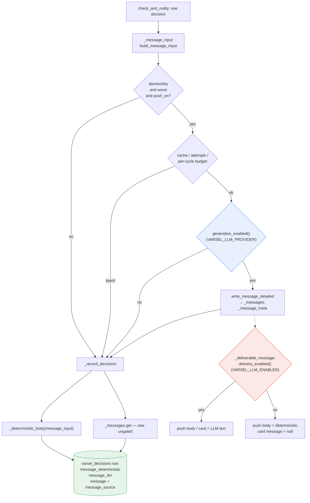

# Write both wordings, send one - Plan

**Target repo:** `kix-avvik` (this repo)

## Goal Capsule

Every Avviksvarsel decision that gets a message should produce **both** the LLM-written wording and
the deterministic template wording, and record both on its `disruptions.varsel_decisions` row.
`VARSEL_LLM_ENABLED` stops being a generation gate and becomes a send-time selector: it decides
which of the two already-written wordings the traveller receives.

**Authority:** the Requirements below win on behavior; the Key Technical Decisions win on
mechanism. `ce-work` executes units in dependency order.

**Stop conditions.** Stop and report rather than guessing if: the LLM cannot be reached from `prd`
at all (that is a provisioning finding, not a code change); or a new column on
`disruptions.varsel_decisions` turns out to require touching `disruptions.varsel_decision_groups`
(that would drag in re-registering the `varsel-label-daily` scheduled query in two projects, which
this plan deliberately avoids — see KTD4).

**Execution profile.** Behavior-changing on a traveller-facing path. U1-U3 are covered by the
existing hermetic suites; U3's DDL is covered by a dry run, not by tests; U4 (a query file) is
verified by its own per-statement dry run and U5 (docs and Helm comments) by `helm-lint` — neither
carries hermetic-suite coverage.

**Tail:** the caller owns commit/push/PR.

---

## Product Contract

### Summary

Decouple *which wording we wrote* from *which wording we sent*. The decision log gains
`message_llm` and `message_deterministic` beside the existing `message`, so the two wordings for
one decision can be read side by side afterwards — including in `prd`, where the LLM message is
written but not delivered.

### Problem Frame

`VARSEL_LLM_ENABLED` currently gates generation. `llm_message.llm_enabled()` folds it together with
"is a backend reachable", and `varsel._write_message` returns early on it, so with the flag off no
prompt is ever built and no reply ever exists. `prd` runs with `VARSEL_LLM_ENABLED=false`
(`helm/kix-avvik/env/values-kub-ent-prd.yaml`), so every `prd` row carries the template wording and
there is nothing to compare it against.

That makes the one question worth asking about the LLM wording — *is it better than the template on
the decisions that actually happened?* — unanswerable exactly where it matters. `dev` has
LLM-written rows and `prd` has template rows, but they are different journeys, different
disruptions, and different days. A comparison across them measures the two environments, not the
two writers.

The log already has the right shape for the answer: `message_input` is the verbatim document both
writers work from, `prompt_version` pins the brief in force, and `message_status` says why the
stored wording has the source it does. What is missing is the second wording on the same row.

### Key Decisions

- KD1. **Both wordings are produced for every decision a message is written for, whatever
  `VARSEL_LLM_ENABLED` says.** (session-settled: user-directed — chosen over producing only the
  wording that will be sent: a side-by-side comparison needs both wordings for the same decision,
  and most of all in `prd`, where the LLM one is not sent.) Governs R1, R4, R5.
- KD2. **`VARSEL_LLM_ENABLED` selects which wording reaches the traveller, and nothing else.**
  (session-settled: user-directed — chosen over keeping it as a generation gate: gating generation
  is what makes the comparison impossible in the environment where it matters.) Governs R2, R3.
- KD3. **Both wordings are recorded on the `varsel_decisions` row.** (session-settled:
  user-directed — chosen over a separate table or Cloud Logging only: that row is already the
  joinable record, carrying `message_input`, `message_status`, `llm_provider`/`llm_model` and
  `prompt_version`.) Governs R6, R7, R8.

### Requirements

**Generation and delivery**

- R1. Every decision the alert path writes a message for produces both an LLM attempt and a
  deterministic body, independent of `VARSEL_LLM_ENABLED` (per KD1).
- R2. `VARSEL_LLM_ENABLED` decides only which of the two wordings the traveller receives (per KD2).
- R3. Both traveller-facing surfaces honour R2 identically: the Web Push body and the in-app
  journey card served by `GET /varsel-api/journeys`.
- R4. Generation stays inside the existing per-cycle budgets — `_MAX_LLM_CALLS_PER_CYCLE`,
  `_MAX_LLM_SECONDS_PER_CYCLE`, `_MAX_MESSAGE_ATTEMPTS`, the `_messages` cache, and the "no message
  writing without push" gate — unchanged.
- R5. No LLM outcome changes the *content* a traveller receives when delivery is off: with
  `VARSEL_LLM_ENABLED=false` the push body and card text are byte-identical to today's. Timing is
  not covered by this requirement — generation runs ahead of the delivery loop, so the push can
  arrive later than it does today (see the Risks table).

**The record**

- R6. `disruptions.varsel_decisions` carries the LLM wording and the deterministic wording as
  separate columns on the same row, beside the existing `message` (what was sent) and
  `message_source` (which one that was).
- R7. A reader can separate "no LLM wording exists for this decision" from "an LLM wording exists
  and we chose not to send it", using columns alone.
- R8. Rows written before this change stay valid: a NULL in a new column reads as "not recorded
  then", never as "no wording".

**Blast radius**

- R9. The registered `varsel-label-daily` scheduled query keeps working without being
  re-registered.
- R10. `/historikk-api` serves no new field, and its redaction contract is unchanged.

### Scope Boundaries

- The alert gate is unchanged. Only the worst alert-worthy situation per journey definition gets an
  LLM attempt, exactly as today; the ~83 % sub-threshold decisions get a deterministic wording and
  no LLM attempt.
- The system prompt, the deterministic template, and `build_message_input` are unchanged. Changing
  any of them would move both wordings and make the first comparison window unreadable.
- No automated scoring or judging of the two wordings.
- Neither `impact.py` nor `alternatives.py` is touched.

#### Deferred to Follow-Up Work

- Showing both wordings side by side in the `/historikk` UI. Two gates, not one. It needs the
  columns projected through `disruptions.varsel_decision_groups`, which forces re-registering
  `varsel-label-daily` in both `dev` and `prd` (KTD4) — and it is a **redaction decision**:
  `message_llm` is unconstrained prose that the prompt instructs to advise on `reise.fra` →
  `reise.til`, so it routinely names both ends of the traveller's trip, unlike the deterministic
  body served today, which names only the situation summary and times. Publishing it beside
  `departure_time` and `n_devices` on an unauthenticated host is the inference R10 exists to
  prevent. The follow-up must either keep it behind an authenticated surface or establish that the
  wording is safe to publish. Worth doing once the comparison query has shown the columns populate
  as expected.
- Turning `VARSEL_LLM_ENABLED=true` on in `prd`. That is a judgement about message quality this
  change exists to inform, not a step in it.

---

## Planning Contract

### Key Technical Decisions

- KTD1. **Split `llm_message.llm_enabled()` into `generation_enabled()` and `delivery_enabled()`,
  and remove the old name.** `generation_enabled()` answers "could a backend be tried" — provider
  not `off`, a GCP project configured, at least one candidate not latched off.
  `delivery_enabled()` reads `VARSEL_LLM_ENABLED` alone. Two names beat one name with a changed
  meaning: every existing call site has to be re-read against the new contract, and a rename makes
  the compiler and the test suite ask for it. Instantiates KD2; governs R2. (session-settled:
  user-directed — chosen over keeping `llm_enabled()` as a generation gate: see KD2.)
- KTD2. **`llm_message.delivery_enabled()` is the single owner of "what the traveller gets", and
  `varsel._deliverable_message(message_key)` is its cache-reading form.** `_messages` is read at
  four places, and they split two and two. The two **delivery** reads go through the helper:
  `_deliver_device` (the push body) and `_journey_model` (the card). The two **generation-side**
  reads stay raw: `check_and_notify`'s `already_written = message_key in _messages` cache probe,
  and `_record_decisions`' read that fills `message_llm` — the log must record what was written
  whether or not it was sent. `_record_decisions` also needs the delivery answer, for
  `message`/`message_source` (KTD7); it applies `delivery_enabled()` to the value it already holds
  rather than re-reading through the helper. Gating each reader separately was rejected:
  `_journey_model` is the one an implementer would miss, and missing it means `prd`'s card silently
  starts showing LLM prose the push does not carry.
- KTD3. **Two additive columns, `message_llm` and `message_deterministic`; `message` and
  `message_source` keep their present contract.** `message` stays "the body that was sent (or would
  have been)" and `message_source` stays `'llm' | 'deterministic'`, so
  `disruptions.varsel_decision_groups`, `disruptions.varsel_decision_outcomes`,
  `data/queries/label_varsel_decisions.sql` and `/historikk-api` all keep working untouched.
  Renaming `message` was rejected on that blast radius alone. R7 is then a two-column read:
  `message_source = 'deterministic' AND message_llm IS NOT NULL` is exactly "written, withheld by
  policy". Instantiates KD3; governs R6, R7, R8, R9, R10.
- KTD7. **The sent wording is chosen on `delivery_enabled()`, never on "an LLM wording exists".**
  `message` and `message_source` answer "what did the traveller get", and after this change those
  are different questions: with delivery off the cache holds an LLM wording the push did not carry.
  So `_record_decisions` computes `delivered = written if delivery_enabled() else None`, then
  `message = delivered or deterministic` and `message_source = "llm" if delivered else
  "deterministic"`. Keeping today's `message = written or deterministic` was rejected because it is
  wrong three ways at once: `/historikk` labels the row "Skrevet av modellen" for a push that
  carried the template, `label_varsel_decisions.sql` copies the pair into
  `varsel_decision_outcomes` where it is immutable once labelled, and R7's discriminator could
  never match a single row. Governs R2, R3, R6, R7.
- KTD8. **A post-change row is one where `message_deterministic IS NOT NULL`.** That column is
  written on every decision from this change onward, so its presence dates the row; `message_llm`
  alone cannot, because a NULL there means either "the LLM produced nothing" or "written before the
  column existed" — and the log holds many of the latter (measured 2026-08-07: 932 `prd` rows and
  561 `dev` rows in one week carry a NULL `message_status` from before the previous column
  addition). Every coverage or rate query carries the predicate, so pre-change rows form their own
  bucket instead of inflating a generation-failure rate. This is the `n_unsegmented` rule from
  `/historikk`, one column over. Governs R7, R8.
- KTD4. **Nothing is added to `disruptions.varsel_decision_groups`.** The view's own header states
  the asymmetry: a column added to `varsel_decisions` is free, while one added to the view changes
  the shape `label_varsel_decisions.sql`'s `SELECT *` sees — and the registered scheduled query
  holds a *copy* of that SQL in each project, so it is an operator step in two environments, not an
  edit. The 2026-08-06 `alt_*` columns were added table-only for this reason; follow that
  precedent. Governs R9.
- KTD5. **`VARSEL_LLM_PROVIDER=off` is the generation kill switch; no new environment variable.**
  It already means "do not try a backend", which is precisely the capability
  `VARSEL_LLM_ENABLED=false` is giving up. Adding a third flag to express what two already express
  was rejected. Note it is a Helm values edit plus a dispatch-only `prd` deploy, not a runtime
  toggle — mean time to revert is a deploy cycle.
- KTD9. **`prd` ships with `VARSEL_LLM_PROVIDER: off`; enabling generation there is a separate
  one-value deploy.** `prd` already carries `VARSEL_LLM_PROVIDER: auto`, so without this the deploy
  that splits the gates is also `prd`'s first-ever Vertex call — on a single always-on pod, with no
  verified intermediate state, and the plan's own stop condition ("the LLM cannot be reached from
  `prd`") can only fire after that deploy, protecting nothing during implementation. Staging it
  costs nothing the plan needs: `dev` runs generation and delivery, so the same-row pairing KD1
  exists for is available there the day this lands. Shipping generation to `prd` in the same change
  was rejected because it couples a mechanism change to an unanswered data-residency question
  (KTD10) and to a latency change on the environment where lead time is the product. Does **not**
  weaken KD1 or KD2 — the flag semantics are unchanged, only when `prd` starts generating.
- KTD10. **What `prd` will send to Vertex, and where, is decided on the record before generation is
  enabled there.** The prompt carries the traveller's origin, destination and departure time
  (`llm_message.build_message_input`) — the same quasi-identifying trio `journey_digest` hashing,
  `VARSEL_LLM_LOG_PROMPTS=false` and the `/historikk` redaction contract all exist to contain — and
  `prd` pins `VERTEX_LOCATION: global`, which is not region-bound. The existing
  `roles/aiplatform.user` precedent does not cover this: `AI.CLASSIFY` in `update_categories.sql`
  sends operator-authored SX text, not a real traveller's commute. Inheriting `global` by silence
  was rejected — the project treats this trio as sensitive everywhere else, so the residency call
  belongs where its other decisions live. The measured constraint is real (`gemini-3.5-flash` 404s
  at `europe-west1`, 2026-07-29), so if no EU region serves the configured models the answer may
  legitimately be `global` as an accepted exception with a named owner — recorded, not assumed.
  Governs R1.
- KTD6. **`message_status` keeps its vocabulary; two values change meaning and are re-documented in
  place.** `llm_disabled` now means *generation* is off (provider `off`, no project, every backend
  latched) rather than "the flag is false", and `message_source = 'deterministic'` now covers a
  second case — an LLM wording that exists but was withheld. Both are description edits, carried to
  existing tables by the `ALTER COLUMN ... SET OPTIONS` block that already exists in
  `create_varsel_decisions.sql`. Inventing a new status value was rejected: it would split the
  vocabulary across a date with no way to read old rows under the new scheme.

### Assumptions

Bets made without confirmation. Each is cheap to reverse before implementation and expensive
afterwards.

- The `push_on` gate on message writing is kept. Where no push can be delivered (no VAPID keys),
  nothing is written and nothing is compared. This costs the comparison nothing in `dev` or `prd`,
  where push is on.
- Generation is not extended to sub-threshold decisions. Doing so would multiply Vertex calls by
  roughly six for wordings no traveller ever sees.
- The comparison window opens in `dev`, not `prd`. `dev` runs generation and delivery, so it
  produces paired rows immediately; `prd` produces them once KTD9's follow-up deploy lands. Volume
  is thin either way — measured 2026-08-07, `dev` produced 7 subjects at `message_status = 'ok'`
  over three days — so "non-zero" is the post-deploy smoke check, not evidence.
- `prd` keeps `VARSEL_LLM_ENABLED: "false"`, which after this change means "write it, do not send
  it". The runtime SA already holds `roles/aiplatform.user` (granted for `AI.CLASSIFY`, verified
  2026-07-09), so no new grant is needed when KTD9's follow-up enables generation there.
- Spend is bounded by the existing per-cycle caps and the per-situation `_messages` cache — a few
  short calls per disruption, not per cycle. Wall clock is bounded but not free; see the Risks
  table.
- The comparison ships as a query file under `data/queries/`, following the
  `alternative_offer_rate.sql` precedent, rather than as UI.

### High-Level Technical Design

**Where each gate sits.** The two gates are at different depths, and that is the whole change: the
generation gate is inside the writer, the delivery gate is in front of the two traveller-facing
readers.



The dotted edge is the point of the plan: today it does not exist, because `E` and `P` are the same
check and a `no` at `E` means nothing ever reaches `P`.

**What each flag combination produces.** The two flags are independent after this change, and the
table is the contract a reviewer should check the tests against.

| `VARSEL_LLM_PROVIDER` | `VARSEL_LLM_ENABLED` | Vertex called | `message_llm` | Traveller gets | `message_source` | `message_status` |
|---|---|---|---|---|---|---|
| `auto` / `claude` / `gemini` | `true` (dev today) | yes | the reply | LLM wording | `llm` | `ok` / `ok_cached` |
| `auto` / `claude` / `gemini` | `false` (prd today) | **yes — new** | the reply | template wording | `deterministic` | `ok` / `ok_cached` |
| `auto` / `claude` / `gemini` | either | yes, failed | NULL | template wording | `deterministic` | `rejected` / `ungrounded` / `error` / `capped` |
| `auto` / `claude` / `gemini` | either | no — budget spent | NULL | template wording | `deterministic` | `attempts_exhausted` |
| `off` | either | no | NULL | template wording | `deterministic` | `llm_disabled` |

Row 2 is the new state and the one the comparison is made of. Rows 3-5 are why R7 needs
`message_llm IS NOT NULL` and not `message_source` alone.

Row 4 is its own row because `attempts_exhausted` does not mean "the model was asked and failed".
`_write_message` returns `None` on every path, including the ones that never call a backend, and
the caller increments `_message_attempts` on any `None` — so after `_MAX_MESSAGE_ATTEMPTS` cycles a
situation stops being offered to the writer at all. Measured in `prd` on 2026-08-07, where
generation has never run: 753 rows at `llm_disabled` and 693 rows at `attempts_exhausted` across
the same 11 subjects. Read it as "no backend was reachable or usable for three cycles", and note
that a backend latched off for `llm_message._LATCH_TTL` (30 min) can spend the budget before the
latch expires.

### Sequencing

U1 → U2 → U3 are a chain: U2 needs U1's two gate functions, and U3 records what U2 produces. U4 and
U5 depend on U3's columns existing but not on each other.

---

## Implementation Units

### U1. Split the LLM gate into generation and delivery

**Goal:** `llm_message` exposes two independent questions — can a wording be written, and should a
written wording be sent.

**Requirements:** R2 (per KD2, KTD1).

**Dependencies:** none.

**Files:**
- `disruptions/api/llm_message.py`
- `disruptions/api/test_llm_message.py`

**Approach:**
1. Replace `llm_enabled()` with `generation_enabled()` — same body minus the `_ENABLED` term, so it
   tests `_PROVIDER != "off"`, `_PROJECT` set, and `bool(_candidates())`.
2. Add `delivery_enabled()` returning `_ENABLED` alone. It reads no other state: a project that
   cannot serve a model is a generation problem, not a delivery policy.
3. Point `write_message_detailed`'s early return at `generation_enabled()`. Its `"disabled"` status
   now means generation is off.
4. Update the module docstring's configuration bullet to state the split, and reword the
   `_ENABLED` comment at the top of the file — it currently reads as a master switch.

**Patterns to follow:** keep both functions non-constructing, matching `llm_enabled()`'s existing
note that an un-provisioned deploy should degrade at the point of use rather than at import — the
same shape as `varsel.push_enabled`.

**Test scenarios:**
- `VARSEL_LLM_ENABLED=false` with a project and a live backend: `generation_enabled()` is True and
  `delivery_enabled()` is False. This is the case the whole plan turns on.
- `VARSEL_LLM_ENABLED` unset: `delivery_enabled()` is True (the documented default).
- `VARSEL_LLM_PROVIDER=off`: `generation_enabled()` is False regardless of `VARSEL_LLM_ENABLED`,
  and `write_message_detailed` returns `status="disabled"` with no backend call.
- No `GOOGLE_CLOUD_PROJECT`: `generation_enabled()` is False.
- Both backends latched off: `generation_enabled()` is False (port the existing assertion at
  `test_llm_message.py:645`).
- `write_message_detailed` still returns an `ok` result with `VARSEL_LLM_ENABLED=false` and a
  stubbed backend — proving delivery policy never reaches the writer. This **replaces**
  `test_llm_message.py:109` (`test_disabled_by_flag`), which asserts the opposite. Delete it rather
  than leaving it: it would keep passing after this change only because `anthropic` and
  `google-genai` are absent from the suite's dependency set and the ImportError is swallowed as
  `status="error"` — a green assertion for a reason that has nothing to do with the gate.

**Verification:** `test_llm_message.py` passes; no reference to `llm_enabled` remains anywhere
under `disruptions/api/`.

---

### U2. Always write the message; gate only delivery

**Goal:** the alert path writes an LLM message whenever a backend can be tried, and
`VARSEL_LLM_ENABLED` decides only what the push and the card carry.

**Requirements:** R1, R2, R3, R4, R5 (per KD1, KD2, KTD2).

**Dependencies:** U1.

**Files:**
- `disruptions/api/varsel.py`
- `disruptions/api/test_varsel.py`
- `disruptions/api/test_varsel_api.py`

**Approach:**
1. In `_write_message`, swap the `llm_message.llm_enabled()` early return for
   `generation_enabled()`. Nothing else in that function changes.
2. Add `_deliverable_message(message_key) -> str | None`: the cached LLM text when
   `llm_message.delivery_enabled()`, else `None`. Import `llm_message` locally and guard it the way
   `_write_message` does — a deploy without the Vertex dependencies must still push.
3. Call it in `_deliver_device` (replacing the `_messages.get` at the push path) and in
   `_journey_model` (replacing the `alert.message = _messages.get(cache_key)` assignment). Leave
   `_alternatives` alone in `_journey_model`; only the message read is gated.
4. Leave `_record_decisions`' `_messages.get` raw and say why in a comment — that read fills
   `message_llm`, which records what was *written*. The sent wording beside it is chosen on
   delivery; U3 wires that.
5. In `_record_decisions`, the `status is None` fallback's `elif not llm_on` branch now asks
   `generation_enabled()`; rename the local from `llm_on` to something that says generation.
6. Update `check_and_notify`'s docstring, which currently states the LLM is gated on push *and*
   implies the flag gates writing.
7. Reword the `Alert.message` field description (`varsel.py:819`): null now also means "written but
   not delivered in this environment", which is the ordinary `prd` case rather than a failure.
8. Repoint the four `monkeypatch.setattr(llm_message, "llm_enabled", ...)` calls in
   `test_varsel_api.py` (lines 1165, 1230, 1257, 1276) at the new gate they mean. The last of the
   four patches it to `False` to assert deterministic wording — that test now has two distinct
   successors, one per gate, and writing only one of them silently drops the delivery-off case.

**Execution note:** write the `_journey_model` gating test first. It is the surface an implementer
would leave ungated, and the failure is silent — `prd`'s card starts showing prose its push does
not carry.

**Patterns to follow:** `_deliverable_message` mirrors `_write_message`'s local-import-and-swallow
shape. `Alert.message = None` is already the documented "no written message" state the PWA handles,
so the delivery-off card needs no frontend change.

**Test scenarios:**
- Delivery off, generation on: `_messages` holds the LLM text after a cycle, the push payload body
  equals `_deterministic_body(message_input)`, and `GET /varsel-api/journeys` returns
  `alert.message` as null.
- Delivery on: push body and card both carry the LLM text (today's behavior, unchanged).
- Generation off (`VARSEL_LLM_PROVIDER=off`): no backend is called, `_messages` stays empty, push
  and card carry the deterministic wording.
- Delivery off and the LLM write raises: push body still equals the deterministic wording; no
  exception escapes `check_and_notify`.
- Budget paths with delivery off: cap reached, `attempts_exhausted`, and `push_on` false each still
  suppress the write exactly as today — the flag change must not widen any of the three.
- Two devices on one journey definition still drive one write, and both receive identical text.

**Verification:** `test_varsel.py` and `test_varsel_api.py` pass; with `VARSEL_LLM_ENABLED=false`
the push and card assertions are byte-identical to their pre-change expectations.

---

### U3. Record both wordings on the decision row

**Goal:** each `varsel_decisions` row carries the LLM wording and the deterministic wording beside
what was sent.

**Requirements:** R6, R7, R8, R9, R10 (per KD3, KTD3, KTD4, KTD6, KTD7, KTD8).

**Dependencies:** U2.

**Files:**
- `disruptions/api/decisions.py`
- `disruptions/api/create_varsel_decisions.sql`
- `disruptions/api/varsel.py`
- `disruptions/api/test_decisions.py`
- `disruptions/api/test_varsel.py`

**Approach:**
1. `decisions.build_row` gains `message_llm` and `message_deterministic` keyword arguments,
   defaulting to `None` like the other optional provenance arguments, and emits them as columns.
2. In `varsel._record_decisions`, compute the deterministic body unconditionally instead of only as
   a fallback, and select the sent wording on delivery rather than on existence (KTD7):
   `delivered = written if llm_message.delivery_enabled() else None`, then
   `message = delivered or deterministic`. Pass `message_llm=written` (the raw cache read, so the
   row records what was written) and `message_deterministic=deterministic`.
3. Change `message_source` at `varsel.py:1476` from `"llm" if written else "deterministic"` to key
   off `delivered`. No other step touches that line, and left alone it labels a template push
   `llm` — which `/historikk` renders as "Skrevet av modellen" and
   `label_varsel_decisions.sql` copies into `varsel_decision_outcomes`, where it is immutable once
   labelled.
4. In `create_varsel_decisions.sql`, add both columns **last** in the `CREATE TABLE` body (the
   stated rule: a fresh environment and an ALTERed one must agree on order) and add matching
   `ADD COLUMN IF NOT EXISTS` entries to the existing `ALTER TABLE ... ADD COLUMN` block.
5. In the same file's `ALTER COLUMN ... SET OPTIONS` block, reword `message_source` and
   `message_status` per KTD6 — one `ALTER TABLE` statement per column, matching the existing shape,
   and keep the `CREATE TABLE` descriptions in step with them.
6. Document in both new column descriptions that when `message_status` is `ok_cached`, the LLM
   wording came from an earlier cycle's `message_input` while the deterministic one is this
   cycle's — so a same-input comparison filters on `message_status = 'ok'`. Say in
   `message_deterministic`'s description that its presence is what dates a row as post-change
   (KTD8).
7. Add the reasoning to the `decisions` module docstring: the row now records both wordings because
   the flag no longer decides which one exists, and `message`/`message_source` therefore describe
   delivery rather than availability.

**Patterns to follow:** `_alternative_fields` and its docstring are the model for how a new column
carries its own reading. The `ALTER COLUMN ... SET OPTIONS` block already exists for exactly the
"the column did not change, its meaning did" case (the 2026-08-06 `has_alternative` rewording).

**Test scenarios:**
- LLM produced text and delivery is on: `message_llm` equals `message`, `message_deterministic` is
  the template body, `message_source` is `llm`.
- LLM produced text and delivery is off: `message_llm` holds the reply, `message` equals
  `message_deterministic`, `message_source` is `deterministic` — the R7 discriminator.
- LLM produced nothing: `message_llm` is None, `message` equals `message_deterministic`.
- Sub-threshold decision: `message_deterministic` is populated, `message_llm` is None,
  `message_status` is `not_alertworthy`.
- `message_input` could not be built: `message_deterministic` still comes from
  `_message_input_from_alert` (as `message` does today) and the recorded `message_input` stays
  NULL — the degraded wording is never presented as a recorded input.
- `build_row` called without the two new keyword arguments still returns a valid row (the
  documented default-to-None contract).

**Verification:** `test_decisions.py` and `test_varsel.py` pass. Then
`data/queries/validate_varsel_sql.sh` against `ent-kixavvik-dev` — it dry-runs
`create_varsel_decisions.sql` statement by statement, which is the only check that catches a broken
`ALTER` before it reaches a startup path (a multi-statement dry run validates only the first
statement).

That script only dry-runs, so it leaves `dev` without the new columns and U4's dry run has nothing
to resolve against. Apply the DDL to `dev` once by hand —
`bq --project_id=ent-kixavvik-dev query --use_legacy_sql=false <
disruptions/api/create_varsel_decisions.sql` — which is idempotent (`ADD COLUMN IF NOT EXISTS`) and
is what the app does at startup anyway. U4 is then verifiable before the PR rather than after
deploy.

---

### U4. A query that puts the two wordings side by side

**Goal:** the comparison the change exists for is one command, not a hand-written scrape.

**Requirements:** R6 (the deliverable KD3 enables).

**Dependencies:** U3.

**Files:**
- `data/queries/message_wording_comparison.sql`

**Approach:** one file, two queries, following `alternative_offer_rate.sql` for **file shape and
header discipline only** — a header stating how to run it per environment and what it costs, then a
coverage query (how many subjects have both wordings, split by `message_status`) and the
side-by-side query itself (one row per decision subject with both wordings, the situation, and the
verdict where one exists).

**Take the grain from `disruptions.varsel_decision_groups`, not from the precedent's `GROUP BY`.**
`alternative_offer_rate.sql` groups on `(DATE(decided_at), journey_digest, situation_number,
departure_time)`, which shares no key with `varsel_decision_outcomes` — copied as-is, the verdict
join silently returns nothing and the subject counts disagree with `/historikk`'s. Join the view for
the subject grain and `varsel_decision_outcomes` for the verdict, and read the two wordings off the
`varsel_decisions` rows where `message_status = 'ok'`. KTD4 keeps the new columns off the view, so
this query is the one place the two are stitched together; hand-rolling a third copy of that
`GROUP BY` is what the view's own header warns against.

Five properties the header must state, because each is a way to read the result wrongly:
- **Subjects, not rows.** `varsel_decisions` holds ~10 rows per subject; comparing rows weights
  long-lived situations ten times heavier.
- **Filter to `message_status = 'ok'` for a same-input comparison.** Under `ok_cached` the two
  wordings were written from different cycles' inputs.
- **`message_deterministic IS NOT NULL` marks a post-change row** (KTD8). Without it, rows written
  before this change — a NULL `message_llm` by construction — are counted as generation failures.
- **`attempts_exhausted` means no backend was reachable for three cycles**, not that the model was
  asked and failed. `_write_message` returns `None` without calling anything on several paths and
  the caller still spends an attempt.
- **Segment on `et_cancelled`.** A declared cancellation removes every probability from the payload,
  so both writers have a much narrower job and the wordings converge — blending those subjects with
  delay alerts flatters the template.

The header also states the handling rule the rest of this system follows: the query selects none of
`journey_digest`, `from_stop`, `to_stop` or `message_input`, and its output — which includes wording
that names both ends of a traveller's trip — does not go into a public artefact.

**Test scenarios:** `Test expectation: none -- a query file; no SQL in this repo is executed by any
test.` Correctness is established by the dry run below.

**Verification:** dry-run **each query separately** against `ent-kixavvik-dev`, once U3's DDL has
been applied there. A whole-file dry run is not a check: BigQuery validates a script lazily and
reports `numChildJobs: 1`, so piping both statements in validates only the coverage query and
leaves the side-by-side one — the query this plan exists to produce — unvalidated. This is the same
rule `validate_varsel_sql.sh` was built around; split the file's statements and run
`bq --project_id=ent-kixavvik-dev query --dry_run --use_legacy_sql=false` on each.

---

### U5. Document the split and stage the `prd` rollout

**Goal:** the repo states that `VARSEL_LLM_ENABLED` is a send switch, and `prd` does not begin
calling Vertex in the same deploy that splits the gates.

**Requirements:** R1, R2, R6 (per KTD9, KTD10).

**Dependencies:** U3.

**Files:**
- `CLAUDE.md`
- `helm/kix-avvik/env/values-kub-ent-dev.yaml`
- `helm/kix-avvik/env/values-kub-ent-prd.yaml`

**Approach:**
1. In `CLAUDE.md`'s `VARSEL_LLM_ENABLED` bullet (~line 167), replace "**Off in prd** … until
   validated in dev" with the new contract: the message is written in every environment, and the
   flag decides which wording is delivered; `VARSEL_LLM_PROVIDER=off` is the generation kill switch.
2. In the `/historikk` section (~line 251), extend the `message_status` paragraph: `deterministic`
   now covers a withheld LLM wording as well as an absent one, and `message_llm` is what separates
   them.
3. Add the two new columns to the same section's list of what the row records, with the
   `ok_cached` caveat.
4. Correct the comment in `values-kub-ent-dev.yaml:25` — `VARSEL_LLM_ENABLED=false` no longer falls
   back "everywhere", only on delivery.
5. Set `VARSEL_LLM_PROVIDER: off` in `values-kub-ent-prd.yaml` (KTD9), and **rewrite** — not append
   to — the comment block above `VARSEL_LLM_ENABLED` there. It currently reads "LLM-written push
   text is OFF in prd … the other three vars are set so enabling it is a one-value change", which
   under the new semantics is actively misleading: the flag no longer stops generation, and the
   one-value change is now `VARSEL_LLM_PROVIDER`. State both switches and which one this file is
   using.
6. Record the residency decision (KTD10) beside `VERTEX_LOCATION` in the `prd` values file: what the
   prompt carries, which endpoint serves it, and either a regional value or `global` named as an
   accepted exception with an owner. This is a **blocker for enabling generation in `prd`**, not for
   merging U1-U5 — with `VARSEL_LLM_PROVIDER: off` shipped, no traveller data leaves `prd`.

**Test scenarios:** `Test expectation: none -- documentation and Helm values; the one behavioral
value (VARSEL_LLM_PROVIDER: off in prd) is verified by helm-lint and by prd emitting no
event="llm_message" records after deploy.`

**Verification:** the `helm-lint` job passes for all three environments (comment-only edits must not
disturb YAML structure); no line in `CLAUDE.md` still describes `VARSEL_LLM_ENABLED` as disabling
the LLM path; and `values-kub-ent-prd.yaml` carries `VARSEL_LLM_PROVIDER: off`.

---

## Verification Contract

Run from the repo root unless stated otherwise.

- **Lint:** `uv run ruff check .`
- **Suites** — one process each, as CI does. A bare `pytest` over the directory is not equivalent:
  `test_varsel_api.py` sets VAPID env vars at import and import order leaks between files.
  ```sh
  cd disruptions/api && for suite in test_*.py; do
    uv run --with fastapi --with httpx --with pydantic \
           --with google-cloud-bigquery --with google-cloud-storage \
           --with pywebpush python "$suite"
  done
  ```
- **DDL:** `data/queries/validate_varsel_sql.sh` (defaults to `ent-kixavvik-dev`). Required for U3
  — no `.sql` in this repo is executed by any test, and CI has no GCP credentials, so a broken
  `ALTER` ships green and kills the decision log at the next deploy.
- **Helm lint:** the `helm-lint` job passes for all three environments — required for U5, because a
  comment-only edit can still break YAML structure.
- **Post-deploy check (U4, after `dev` has the columns):** the coverage query in
  `message_wording_comparison.sql` returns a non-zero count of subjects with both wordings.

Gates: lint clean, every suite exits zero, the DDL dry run reports no failures, `helm-lint` passes.

---

## Definition of Done

**Global**

- `disruptions/api/` contains no reference to `llm_enabled`.
- With `VARSEL_LLM_ENABLED=false`, the push body and the `/varsel-api/journeys` card text are
  byte-identical to their pre-change values; `message_llm` is populated on rows where a backend
  answered, and `message_source` reads `deterministic` on every one of them.
- `disruptions.varsel_decision_groups`, `data/queries/label_varsel_decisions.sql` and
  `disruptions/api/historikk*.sql` are unmodified, and `historikk.Decision` gains no field.
- The Verification Contract's gates all pass.
- No dead-end or experimental code from abandoned approaches remains in the diff — in particular,
  no compatibility shim aliasing the removed `llm_enabled`.

**Per unit**

- U1: both gate functions exist, `llm_enabled` is gone, and a test pins
  `generation_enabled() and not delivery_enabled()` under `VARSEL_LLM_ENABLED=false`.
- U2: all four `_messages` readers are accounted for — `_deliver_device` and `_journey_model`
  through `_deliverable_message`, and the two generation-side reads (`_record_decisions`' fill of
  `message_llm`, `check_and_notify`'s `already_written` probe) left raw with a comment saying why.
- U3: both columns appear in the `CREATE TABLE` body (last), in the `ADD COLUMN IF NOT EXISTS`
  block, and in `build_row`'s output; `message_source` is derived from `delivered`, not from
  `written`; `validate_varsel_sql.sh` passes.
- U4: the file exists, joins `varsel_decision_groups` for its grain, and each of its two queries
  dry-runs clean against `dev`.
- U5: `CLAUDE.md` and both Helm values files describe the flag as a delivery switch, and `prd`
  carries `VARSEL_LLM_PROVIDER: off`.

---

## Risks & Dependencies

| Risk | Why it matters | Mitigation |
|---|---|---|
| `prd` sends traveller origin, destination and departure time to Vertex | The prompt carries the quasi-identifying trio the rest of the system works to contain, and `prd` pins a non-region-bound endpoint. The `AI.CLASSIFY` precedent covers operator-authored SX text, not a commute. | KTD10 makes the residency call explicit, and KTD9 ships `prd` with generation off so nothing egresses until that call is made. Neither blocks merging U1-U5. |
| `prd` starts calling Vertex for the first time | A permission or Model Garden gap surfaces on the traveller-facing path rather than in `dev`. | Staged: KTD9 defers it to a separate one-value deploy, after `dev` has shown paired rows. Every failure path already falls back to the deterministic wording, and `prd` delivers that wording regardless — so a `prd` LLM failure costs a NULL `message_llm`, never a lost push. Confirm via `jsonPayload.event="llm_message"` and a non-zero `message_llm` count. |
| Generation delays the pushes it does not write for | `check_and_notify` writes in loop 1 and delivers in loop 2, on the single poller thread, so a cycle spending its full `_MAX_LLM_SECONDS_PER_CYCLE` (30 s) delays the traveller's push *and* the next rebuild of `/disruptions`, `/journey`, `/demo` and `/reisevalg`. On the environment where lead time is the product, that is spent writing text the environment will not deliver. R5 covers content, not timing. | The deadline is already the ceiling. `dev` absorbs it first (KTD9), and the post-deploy check includes cycle duration, not just row counts — if the ingestion-change interval moves materially, `VARSEL_LLM_PROVIDER=off` reverts it. |
| The card leaks LLM prose in `prd` | `_journey_model` is the least obvious of the three `_messages` readers, and the failure is silent — the card would say something the push did not. | KTD2 puts the rule in one function; U2's execution note writes that test first; the Definition of Done requires all three readers be accounted for. |
| A comparison run on `ok_cached` rows | The two wordings then come from different cycles' inputs, so the comparison measures staleness, not the writers. | Stated in both column descriptions (U3) and in the query header (U4); the query filters on `message_status = 'ok'`. |
| A broken `ALTER` in `create_varsel_decisions.sql` | `decisions.ensure_table` treats any failure in that file as "table not ready" and stops recording decisions entirely. | `validate_varsel_sql.sh` is a required gate for U3; it splits the file and dry-runs each statement, which a whole-file dry run does not. |
| `prd` spend grows unbounded | Generation is new there. | Bounded by `_MAX_LLM_CALLS_PER_CYCLE` (8), `_MAX_LLM_SECONDS_PER_CYCLE` (30 s) and the per-situation `_messages` cache — a few short calls per disruption, not per cycle. `VARSEL_LLM_PROVIDER=off` reverts generation without a code change (KTD5). |

---

## Sources & Research

- `disruptions/api/llm_message.py:343` — `llm_enabled()`, the conflated gate this plan splits.
- `disruptions/api/varsel.py:1287` — `_write_message`'s early return, the generation gate.
- `disruptions/api/varsel.py:1442`, `:1792`, `:2060` — the three `_messages` readers (log, push,
  card). Only the last two are delivery.
- `disruptions/api/varsel.py:1465` — where the deterministic body is computed today, as a fallback
  only; `:1476` is the `message_source` line KTD7 changes.
- `disruptions/api/varsel.py:1702` — `already_written`, the fourth `_messages` reader and the one
  that must stay ungated.
- `demo/varselhistorikk/src/components/DecisionCard.tsx:78` — renders `message_source == 'llm'` as
  "Skrevet av modellen", which is why KTD7 is a correctness issue and not a labelling nicety.
- `disruptions/api/create_varsel_decisions.sql:296-302` — the view header stating why a column on
  the table is free and one on the view is an operator step in two projects (KTD4).
- `disruptions/api/create_varsel_decisions.sql:184-198` — the `SET OPTIONS` block and why an edited
  description otherwise reaches only fresh environments (KTD6).
- `helm/kix-avvik/env/values-kub-ent-prd.yaml:27` — `VARSEL_LLM_ENABLED: "false"`, the setting whose
  meaning this plan changes.
- `data/queries/alternative_offer_rate.sql` — the precedent U4 follows, including its own account of
  how an unmeasured claim went stale in two days.
- `docs/plans/2026-07-29-001-feat-varsel-impact-llm-message-plan.md` — the plan that introduced the
  LLM message and `VARSEL_LLM_ENABLED` as a generation gate.
