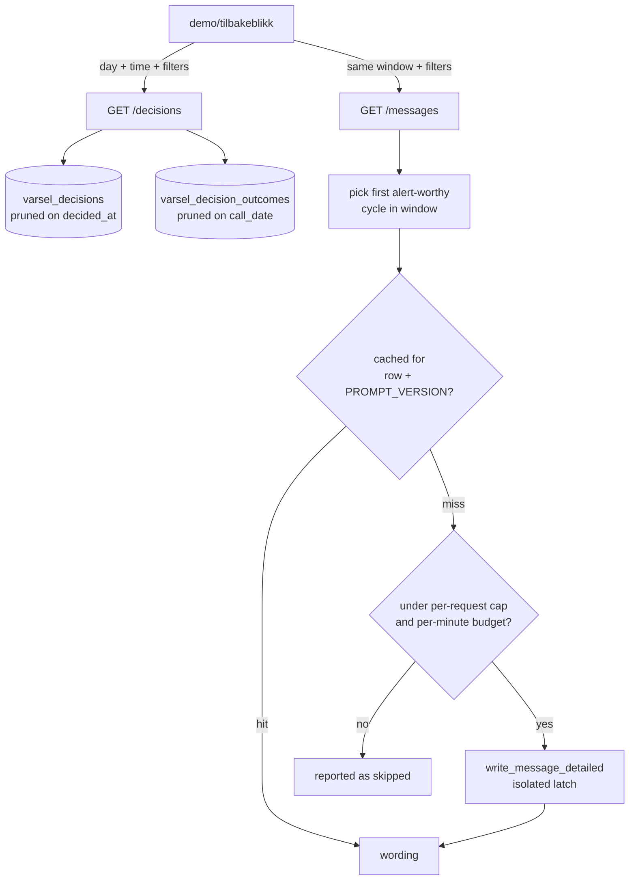

# Tilbakeblikk - Plan

## Goal Capsule

- **Objective:** Ship `/tilbakeblikk`, a surface that replays a chosen window of past alert decisions and shows what the *current* LLM prompt would write for each one, beside the same filters, stats and cards `/historikk` shows.
- **Authority:** This plan. Where it conflicts with repo conventions, `CLAUDE.md` wins on privacy, caching and BigQuery-cost rules; raise the conflict rather than resolving it silently.
- **Execution profile:** Deep. Seven units across a new API module, four query files, one `llm_message` change, a fourth front-end app, and build wiring.
- **Stop conditions:** Stop and report if regeneration cannot be isolated from the live push path (U3), or if any change would require adding a column to `varsel_decision_outcomes` or `varsel_decision_groups`.
- **Tail:** The caller owns commit, PR and CI.

---

## Product Contract

### Summary

`/tilbakeblikk` is a wording-iteration loop. `/historikk` answers "what did we send, and was it right"; `/tilbakeblikk` answers "what would today's prompt say about the same disruptions". It reads the `message_input` document already stored on every decision row, re-runs the current prompt over it, and renders the result in `/historikk`'s card. The window control is a single day plus a from/to time of day, because the question is asked about a specific stretch of a specific day rather than about weeks in aggregate.

### Problem Frame

The prompt in `llm_message._SYSTEM_PROMPT` is edited regularly, and nothing shows the effect of an edit against real journeys. Note what is *not* true today: prd runs `VARSEL_LLM_ENABLED=false`, so no prompt edit currently reaches a traveller — prd writes the model's wording and sends the template. The value of this surface is therefore to de-risk enabling delivery in prd, and to make prompt edits reviewable before that decision, rather than to catch something already going out.

`data/queries/message_wording_comparison.sql` compares two *writers* on the same prompt (`message_llm` against `message_deterministic`); no surface compares two *prompts* on the same writer. The inputs to do so are already recorded — `message_input` is written for every decision and is byte-identical to the prompt that was used — but nothing reads them back.

### Key Decisions

- KD1. Wordings are generated fresh at request time from the stored `message_input`, with the delivery gate bypassed. (session-settled: user-directed — chosen over rendering the stored `message`/`message_llm` columns: a stored wording cannot show what today's prompt produces.) Governs R5, R6, R7.
- KD2. The window is one calendar day plus a from/to time of day, defaulting to today and all day. (session-settled: user-directed — chosen over `/historikk`'s 7/14/30-day period picker: generation is per-decision work and the surface is for inspecting a window closely.) Governs R1, R2, R3.
- KD3. Filters, stats and cards mirror `/historikk`. (session-settled: user-directed — chosen over a bespoke minimal layout: comparability with `/historikk` is the point.) Governs R10, R11, R12.
- KD4. "Varsel kl. HH:MM" shows when the message could have been sent. (session-settled: user-directed — chosen over `/historikk`'s existing meaning for that label: nothing was sent on a replay surface, so the honest reading is when it would have gone out.) Governs R4, R8.

### Requirements

**Window and filters**

- R1. The page offers a single-day date picker, defaulting to today (Europe/Oslo).
- R2. The page offers a from/to time-of-day picker, defaulting to the whole day.
- R3. The window selects decisions by `decided_at` — when the decision was taken — not by the operating day of the train.
- R4. The window bounds which *cycle* is replayed: only a decision cycle inside the window may be chosen.

**Message replay**

- R5. For each replayed subject the page shows the wording the current prompt produces, from the stored `message_input`.
- R6. Regeneration asks `llm_message.generation_enabled()` and never consults `delivery_enabled()` or `varsel._deliverable_message`.
- R7. A subject with no replayable cycle — no alert-worthy cycle in the window recorded a `message_input` — is reported as its own state, never as "no message".
- R8. Each card states the time the message could have been sent — the `decided_at` of the replayed cycle.
- R9. The page marks rows decided under a different prompt version from the current one. It does not claim to separate a prompt change from sampling variance — each wording is a single draw from a non-deterministic decoder.

**Page parity**

- R10. The filter set matches `/historikk`: Utfall, Operatør, Linje, Fra, Til, plus the alerted/resolved/SX narrowings.
- R11. A stats section reports the same figures and provenance segments as `/historikk`, narrowed by the *population* filters only — the day, the time range, Operatør, Linje, Fra, Til — and never by Utfall, `alerted_only` or `resolved_only`, which narrow by outcome and would make precision read 100 %.
- R12. Cards carry the same decision fields as `/historikk`'s, including verdict badges and the ET/no-SX tags. The stored wording is not among them; this page shows the regenerated one.
- R20. The stats section surfaces the labelled/unlabelled split prominently, because on a same-day window most rows are still `venter` and the rates describe a small subset.

**Safety**

- R13. No decision **row** carries `journey_digest`, `from_stop`, `to_stop` or `message_input`, and the decision model is `extra="forbid"`. The `/filters` response publishes place refs as the dropdown vocabulary, exactly as `/historikk`'s does — the redaction is per row, not per response, or the Fra/Til filters R10 requires could not exist.
- R14. Regeneration is bounded per request, per minute, by a per-request wall-clock deadline, and by a cache keyed on the replayed row and the prompt version.
- R15. Regeneration cannot latch an LLM backend off for the live push path.
- R16. Replay calls are distinguishable from live calls in the audit log.
- R17. The surface is disabled by default in prd, pending the redaction decision in Q1. `trafficType: public` is set once in the chart and inherited everywhere, so dev and tst are equally unauthenticated: shipping on-by-default there is a deliberate acceptance, recorded in Q1, that dev's own registered journeys get regenerated prose — including for subjects `/historikk` never showed prose for.

**Build and deploy**

- R18. The app is built into the image the way the other three front-ends are, and mounted with `main._VersionedStaticFiles`.
- R19. New query files are registered in `data/queries/validate_varsel_sql.sh`.

### Scope Boundaries

- The stored wordings stay untouched; `/tilbakeblikk` writes nothing to `varsel_decisions`.
- No column is added to `varsel_decision_outcomes` or `varsel_decision_groups`. Adding one breaks the registered `varsel-label-daily` transfer config in both projects.
- `/historikk` is not modified. The cost of that is a fork: `tilbakeblikk_{decisions,summary,filters}.sql` are clones of `/historikk`'s on a different window axis, so a fix to one side — the 2026-08-21 pushed-wording fix is exactly the shape — must be mirrored to the other. Only `historikk_stop_places.sql` is genuinely shared.
- Replay measures a *prompt* change. It cannot show the effect of a `build_message_input` change, because the stored input was built by the builder of that day.
- A same-day window is dominated by `venter`: verdicts arrive from the 04:00 UTC labelling job the following night, so precision, recall and lead on the default view are computed over a small labelled subset. `/historikk` avoids this by defaulting to 14 days on `call_date`; this page cannot, and says so rather than showing confident-looking rates.

#### Deferred to Follow-Up Work

- Enabling the surface in prd, and the access-control question behind it (Q1).
- Persisting regenerated wordings for longitudinal comparison.
- Side-by-side rendering of the stored wording beside the regenerated one.

### Outstanding Questions

- Q1 (blocking for prd value, not for implementation). Should `/tilbakeblikk` be access-controlled before it is enabled in prd — and is dev/tst on-by-default accepted on the same reasoning? The 2026-08-07 dual-message plan deferred this exact feature and named the gate: model-written prose is instructed to advise on the traveller's own route, so it routinely names both ends of a trip, and publishing it beside `departure_time` and `n_devices` on an unauthenticated host is the inference the redaction layer exists to prevent. prd's public `/historikk` today shows only template wordings, because prd does not deliver the model's. Be clear about what this costs: prd holds the journeys that matter (36 registered against dev's ~3), so a surface off in prd answers the prompt question on thin data. Implementation is unblocked, but the feature's value is not realised until this is answered. U7 records the condition that would resolve it.
- Q2 (deferred). Whether the per-request cap and the per-minute budget in KTD6 are the right numbers. Both are self-imposed — the project's Vertex QPM is unmeasured — and should be revisited once the page has been used and the quota read.
- Q3 (deferred). Whether `/tilbakeblikk-api/messages` should take an offset so a reader can reach wordings past the per-request cap in one sitting, rather than relying on successive refreshes filling the cache (U4 step 2).

---

## Planning Contract

### Key Technical Decisions

- KTD1. **Replay by calling `llm_message.write_message_detailed` with the parsed stored dict.** Instantiates KD1; governs R5, R6. `write_message_detailed(message_input: dict, *, journey_key, situation_number)` takes a plain dict — no `ImpactResponse`, no `varsel.Alert`, no live caches — and `message_input_json(json.loads(s)) == s`, so the replay prompt is the recorded prompt. `varsel._deterministic_body(dict)` is the same shape and supplies the template arm. Rejected: rebuilding inputs from `/impact`, which would need journey state that no longer exists.
- KTD2. **The two LLM switches are not interchangeable, and only one applies.** Instantiates KD1; governs R6. `generation_enabled()` reads `VARSEL_LLM_PROVIDER` plus the project and the latch; `delivery_enabled()` reads `VARSEL_LLM_ENABLED` alone and decides only what a *traveller* receives. The request for "`VARSEL_LLM_ENABLED=True`" means "show the model's wording", which on a replay surface is achieved by not consulting the delivery gate at all — no environment change, and prd already has generation on. Rejected: setting `VARSEL_LLM_ENABLED=true`, which would change what real travellers are sent.
- KTD3. **Window on `decided_at`, and prune the partition explicitly.** Instantiates KD2; governs R1, R2, R3. `varsel_decisions` is `PARTITION BY DATE(decided_at)`, so a day-and-time window prunes to a single partition — the first query in this stack that does. The partition column is a UTC date while the window is an Oslo day, so the pruning predicate must span `@day - 1 day` to `@day + 1 day` with the exact Oslo predicate applied on top. Rejected: windowing on `call_date` like `/historikk`, which cannot prune here and would answer a different question.
- KTD4. **Read `disruptions.varsel_decisions` directly, not `varsel_decision_groups`.** Governs R3, R5. The view carries neither `message_input` nor a `decided_at` bound, and it aggregates before any filter reaches it. Reading the table directly is both the only way to get the input and the reason the pruning in KTD3 is available.
- KTD5. **Subject grain, replaying the first alert-worthy cycle inside the window.** Instantiates KD4; governs R4, R8. Cards stay at `/historikk`'s subject grain — `(journey_digest, operator, jkey, call_date, stop_order, situation_number)` — so the cards and rates stay comparable (KD3). Within that subject, replay the first alert-worthy cycle in the window: it is the moment a message could first have gone out, so its `decided_at` is what "Varsel kl. HH:MM" means and its `message_input` is the honest counterfactual. Select it with one `ARRAY_AGG(... IGNORE NULLS ORDER BY decided_at LIMIT 1)` `STRUCT` carrying input and timestamp together — two aggregates "picking the same row" is a promise `ORDER BY` cannot keep, and its failure mode is a card showing one cycle's text under another cycle's time. Rejected: the last cycle, which the 2026-08-21 fix showed is a different row in 41 % of cases. Also rejected: per-cycle grain, where `decided_at` would be the row's own timestamp with no selection needed — it multiplies cards roughly tenfold and makes the rates describe a different population from `/historikk`'s, which KD3 rules out. The label changes name (`would_send_at`, not `first_alert_at`) because its meaning changes; that rename is what KD4 asks for.

  Two honesty constraints follow, and neither is optional. First, "first opportunity" is only true when the subject's earliest alert-worthy cycle is itself inside the window; for a subject that was already alerting before the window opened, the pick is merely the earliest cycle the window happens to contain, and narrowing the picker would silently move the claimed send time later. U2 therefore computes the subject's earliest alert-worthy `decided_at` over the whole ±1-day span it already scans and returns `first_in_window`, and U5 labels the card accordingly. Second, the card's per-cycle aggregates are computed over the windowed rows only while the verdict comes whole from the nightly job, so a subject can read `ever_alerted: false` beside `verdict: 'hit'` — U2 and U5 mark those figures as window-scoped rather than letting them read as `/historikk`'s.
- KTD6. **Regeneration is bounded four ways and never on the `/decisions` path.** Governs R14. Cards come from `/tilbakeblikk-api/decisions` (BigQuery only); wordings come from `/tilbakeblikk-api/messages`, which takes the *same* allow-listed window and filters rather than caller-supplied keys. The four bounds, every one with a number so it can be checked. **A per-request cap of 12 backend calls** — calls, not subjects: under `auto` one subject can cost two, because an empty or ungrounded reply `continue`s to the next backend, and a prompt edit that trips the grounding check or the 300-character cap trips it for every subject at once. **A per-minute budget of 24 replay calls**, one full request's worth inside the 30 s deadline, so it binds on a second concurrent request rather than never; it is tallied by caller in the shape of `alternatives._fetch_calls`' `{_REQUEST_PATH, _POLLER_PATH}` keying. **A cache** keyed on the replayed row identity plus `llm_message.PROMPT_VERSION` — the row identity includes the replayed `decided_at`, so narrowing the window picks a different cycle and correctly misses. **A per-request wall-clock deadline of 30 s** that *reserves* the worst case rather than checking elapsed time — `monotonic() + 16 s >= deadline` stops a new call starting, the shape `varsel`'s `_WORST_CASE_CALL_S` uses; with a pool the check runs inside the worker as its task starts, never at submit time, or all 12 tasks queue before the deadline is consulted and the bound guarantees nothing.

  16 s is the reachable worst case per subject, by this path only: a first backend that returns an empty or ungrounded reply near `_TIMEOUT_S` and `continue`s, then a second that times out. A timeout on its own does **not** reach the second backend — the generic `except Exception` returns `status="error"` immediately — and prd is the *cheapest* path, not the worst, because an unserved Claude 404s in well under a second. Pool width **4** (the shape of `varsel._PUSH_WORKERS`, which is 8; 4 is chosen here to leave room beside the poller), so the cap costs three rounds — about 7 s typically, and the deadline truncates the pathological case. On the deadline the request returns 200 with the subjects it answered and the bounded-out status for the rest; nothing downstream is known to cut a hang off, since the chart sets no ingress timeout and any fronting load balancer is outside it. Rejected: one endpoint, which would make a Vertex failure 503 the whole page. Rejected: bounding call count alone, which bounds when the last call *starts*, not when the pass ends. Rejected: counting subjects, which bounds the wrong resource — Vertex calls are what couple this surface to the poller.
- KTD7. **Replay must not share the backend latch — or its lock — with the live push path.** Governs R15. `llm_message._active`, `_active_at` and `_latched_off` are module globals guarded by one module-global `_lock`, and `check_and_notify` consults `generation_enabled()` before reaching the writer — so a replay burst that drives both backends into a configuration error would strip model wordings from real pushes for 30 minutes and spend an attempt slot per subject on each `None`. Move all four into an explicit holder, the module keeping one global instance, and let the replay path pass its own. The lock moves with the state: leaving it behind would serialize the replay pool against the poller on the one lock and make the isolation weaker than it reads. Seed the replay holder's `_latched_off` one-way from the global at construction, so replay does not re-discover a 404 the poller already paid for — `_active` pins only on success, so a cold holder otherwise pays the full claude-then-gemini path on its first call every TTL window. A replay-discovered failure still never propagates back. Rejected: accepting the coupling, because its failure is silent on the traveller-facing side.
- KTD8. **Replay calls are marked in the audit log.** Governs R16. `write_message_detailed` logs `event="llm_message"` with `provider`, `model` and `result`, and operators are told to read `jsonPayload.provider` there to learn which backend answered in prd. Replay traffic carries a `replay` field on the same event so it can be excluded, rather than a new event name that existing queries would miss.
- KTD9. **The surface is off by default in prd.** Governs R17. A single `TILBAKEBLIKK_ENABLED` config value decides whether the router and the static mount are registered; dev and tst default on, prd defaults off. `cd.yml` deploys only dev on merge and prd is dispatch-only, so this makes prd exposure a deliberate act rather than a consequence of merging, and leaves Q1 answerable without reverting anything. Conflict call-out on KD3: mirroring `/historikk` exactly would mean the same public exposure in prd, which two independent findings and the 2026-08-07 deferral all flag; the page mirrors `/historikk` in every respect except where it is served.
- KTD10. **The per-row redaction is inherited verbatim.** Governs R13. `message_input` is read server-side and never leaves it; only the generated text does. The decision model is `extra="forbid"`, and the test that pins `/historikk`'s row redaction is duplicated for this surface, scoped to the decision and summary queries — `/filters` publishes place refs as vocabulary, as `/historikk`'s does. This keeps the literal contract while Q1 settles the derived-text question.
- KTD11. **Replay runs live on a request path, not as an offline render.** Governs R14, R17. The repo has the alternative: `/eval` renders marimo notebooks offline under a developer's ADC and ships them as committed static HTML, precisely because their queries cannot run in the image — and that shape would dissolve the public-endpoint exposure, the Vertex bounds and Q1 entirely. It is rejected because an offline snapshot cannot be re-run against a freshly edited prompt without a developer running a script and committing the output, which is the loop this surface exists to close. The cost of that choice is everything in System-Wide Impact and R13-R17; it is recorded here so the trade is visible rather than implicit.

### Assumptions

- The decision log holds rows in the requested window. A fresh environment returns an empty page, which is the same state `/historikk` already renders.
- `message_input` is NULL on rows written before 2026-08-05 and on rows where the builder failed. Both are the same third bucket for R7 and neither is a default.
- A newer prompt asking for a figure the older payload lacks is rejected as `ungrounded` rather than surfaced as a prompt bug; the status is shown rather than hidden.
- Vertex-side quota is not documented in this repo, so the per-minute budget in KTD6 is a self-imposed bound rather than a measured ceiling.

### High-Level Technical Design

The two request paths are independent on purpose: a Vertex outage empties the wordings and leaves every card, filter and statistic intact.

### Sequencing

U1 and U2 are the API and its queries and go together. U3 is independent and can land first. U4 depends on U1, U2 and U3. U5 depends on the response shapes from U1 and U4. U6 depends on U5 existing. U7 is last.

---

## System-Wide Impact

This surface adds blocking network calls to a request path inside a process that also runs the live poller. Three shared resources are affected, and one commonly-assumed risk is not.

**The liveness probe is not the exposure, but the worker threadpool is.** `/health` is `async def` and touches nothing, so it is served on the event loop rather than the anyio worker threadpool; occupying threadpool slots cannot fail it, and the probe allows 30 s of consecutive failures before a restart. Do not spend effort defending the probe. The pool itself is a different matter: every other route in this process is a plain `def` and does share it — `/impact`, the `/varsel-api` device and journey writes, and the `/historikk` routes U1 mirrors. A `/tilbakeblikk-api/messages` that can hold a slot for its full 30 s deadline would starve traveller-facing registration on a public unauthenticated endpoint, and with no ingress cutoff nothing reclaims the slot. The route is therefore declared `async def`, which keeps it on the event loop and confines the fan-out to its own `ThreadPoolExecutor`.

**Memory is the binding constraint.** The chart sets no CPU limit, so there is no CFS throttle, but it always sets a memory limit — 1228 Mi in dev. The pod is `forceReplicas: 1` with a Recreate strategy, and uvicorn binds only after `lifespan`'s eager BigQuery loads, so an OOMKill is zero capacity for the length of a cold start. Both new caches therefore carry explicit numbers rather than adjectives: the BigQuery response cache holds **100** entries, each up to `limit` hydrated rows (200 by default); the wording cache holds **2 000** entries, each one wording of at most 300 characters plus its metadata.

**Vertex quota is what actually couples replay to the traveller.** The latch isolation in KTD7 is necessary but not sufficient: a replay burst that consumes per-project QPM in the `eu` multi-region makes the poller's calls 429, and a 429 is a *transient* failure that returns `status="error"` immediately without trying the other backend — so a real traveller silently receives the template. This is why KTD6's per-minute budget is split by caller rather than shared, following `alternatives._fetch_calls`, and why it is sized from the poller's headroom rather than from page responsiveness.

**BigQuery quota is shared with the poller too.** Both surfaces draw on the same project daily query quota that `_on_ingestion_change`'s roughly eight jobs per tick depend on. A public endpoint that exhausts it does not degrade `/tilbakeblikk` — it stops predictions and push alerting.

**What a restart costs.** `varsel` persists only `devices`, `journeys` and `notified` to its state bucket. `notified` being persisted is what keeps a restart from re-pushing, so that failure is already handled. The rest is lost:

| Lost on restart | Consequence |
|---|---|
| `_messages` | The in-app card falls back to the template until the next cycle rewrites it. Intended — a redeploy rewrites rather than restoring stale advice. |
| `_alternatives` | `alternative_journey` goes null on `/varsel-api` until the poller refills, because the request path never calls the Journey Planner itself. One cycle without escape-route advice. |
| `_message_attempts` | The give-up counter resets, reopening the bounded-retry hole `_MAX_MESSAGE_ATTEMPTS` exists to close, for the remaining life of every open situation. This is the damaging one, and it compounds the quota coupling above. |
| `_message_meta` | Post-restart rows are re-attributed rather than filed `ok_cached`. Cosmetic. |

---

## Implementation Units

### U1. `/tilbakeblikk-api` module: window, filters, cache, config

- **Goal:** A new API module serving `config`, `filters`, `decisions` and `summary` over a day-and-time window.
- **Requirements:** R1, R2, R3, R10, R11, R13
- **Dependencies:** U2's query files must exist before this module can be imported; U1 and U2 land together (see Sequencing).
- **Files:** `disruptions/api/tilbakeblikk.py`, `disruptions/api/test_tilbakeblikk.py`
- **Approach:**
  1. Mirror `disruptions/api/historikk.py`'s structure: module-level `configure(*, bq_client)`, a TTL response cache with expiry-then-cap eviction, `APIRouter(prefix="/tilbakeblikk-api")`, and a `config` route reading `deployment.environment_label()`.
  2. Replace `_window(from_date, to_date)` with a day-and-time resolver: a `date` defaulting to today in Europe/Oslo, and two optional `time` values defaulting to the whole day. Reject `to_time` before `from_time` with a 400, the shape `_window` already uses. Bound the day as well — reject a future day, and one further back than `historikk._MAX_WINDOW_DAYS` — so the key space is bounded in both dimensions.
  3. **Quantize both times to 15-minute steps and make the range half-open `[from, to)`**: `from_time` rounds down to its step, `to_time` rounds up to the next one, so a narrowed range never drops a minute the caller asked for. The whole-day default is then 00:00 to the following midnight, which *is* on the grid — 23:59:59.999999 is not, and quantizing it down would silently drop the last quarter-hour of every default request. Quantizing at all is what bounds the key space: two free-form second-resolution times are on the order of a billion distinct keys per day, each a cache entry and a BigQuery query on a public unauthenticated endpoint, which is the exposure `_checked_operator` exists to close.
  4. Carry the allow-list discipline verbatim: `/filters` is the vocabulary *and* the allow-list, an unknown value is a 400, and place options are groups of refs expanded server-side.
  5. `/summary` takes only the population filters — the day, the time range, Operatør, Linje, Fra, Til — and refuses Utfall, `alerted_only` and `resolved_only`, exactly as `historikk.summary` does and for the same reason (R11).
  6. Put every query parameter — the day, both quantized times, and every filter — into the response-cache key.
  7. Set `maximum_bytes_billed` on the job config. Nothing in this repo sets it today, and KTD3's whole cost argument is a pruning claim that no test can check — with the cap, a pruning regression fails one request loudly instead of draining the quota the poller needs.
  8. Response models copy `/historikk`'s field lists and stay `extra="forbid"`. Add `would_send_at`, `first_in_window` and `prompt_version` to the decision model; add nothing that carries the redacted trio. Mark the per-cycle aggregates (`n_decisions`, the `*_decided_at` pair, `ever_alerted`, `first_alert_at`, `max_impact_probability`, the `final_*` figures) as window-scoped in their field descriptions, since KTD5's second constraint means they are.
  9. Query files are `read_text()` at import, as `historikk.py` does. That makes a missing `.sql` an import error that stops the whole app, so U2's files must exist before this module is imported anywhere.
  10. The module reads only, and never imports `main`; `main` injects the client through `configure`.
- **Patterns to follow:** `historikk.py`'s `_query`, `_checked_operator`, `_checked_choice`, `_place_refs`, `_place_groups`; `historikk.ConfigResponse`. For the suite, `test_historikk.py`'s hermetic setup: stub `bigquery.Client` *before* importing the module, import the module rather than `main`, dispatch the fake on SQL string identity, and clear the cache at the top of every test. Where a test needs `main`, follow `test_demo_api.py` and do not enter `TestClient(main.app)` as a context manager — that runs the lifespan and starts the poller.
- **Test scenarios:**
  - The day defaults to today in Europe/Oslo when no day is given.
  - The time range defaults to the whole day, and the query receives 00:00:00 and the following midnight as a half-open range, rather than NULLs.
  - `from_time` rounds down to its 15-minute step and `to_time` rounds up to the next one, so a 14:07-14:22 request queries 14:00-14:30 and drops no minute the caller asked for.
  - `to_time` earlier than `from_time` returns 400; a future day and a day beyond the lookback each return 400 and spend no BigQuery call.
  - `/summary` refuses `verdict`, `alerted_only` and `resolved_only`, while accepting the population filters.
  - A day and a narrower time range produce different cache entries; two identical requests produce one BigQuery call.
  - Two times inside the same 15-minute step resolve to one cache entry and one BigQuery call — the key-space bound, asserted rather than assumed.
  - The job config carries `maximum_bytes_billed`.
  - Each of `operator`, `line`, `from_place`, `to_place`, `verdict` produces its own cache entry rather than sharing the unfiltered one.
  - An operator, line or place not in `/filters` returns 400, not an empty list, and spends no BigQuery call.
  - An unfiltered request spends no query on the allow-list.
  - `limit` above the cap is rejected by FastAPI's own validation as 422, distinct from the 400s this module raises.
  - The decisions response key set equals the expected field list exactly, so an added field fails here; constructing the model with `journey_digest`, `from_stop`, `to_stop` or `message_input` raises `ValidationError`.
  - A BigQuery failure returns 503 with the decision-log message, and `/config` still answers.
- **Verification:** `uv run --with fastapi --with httpx --with pydantic --with google-cloud-bigquery --with google-cloud-storage --with pywebpush python test_tilbakeblikk.py` passes from `disruptions/api`, with the hermetic fake client and no network.

### U2. The four query files

- **Goal:** SQL that selects decisions by `decided_at`, picks the replayable cycle, and reports the same rates and segments as `/historikk` over the same slice.
- **Requirements:** R3, R4, R5, R7, R8, R11, R13, R19
- **Dependencies:** none; U1 and U2 land together (see Sequencing).
- **Files:** `disruptions/api/tilbakeblikk_decisions.sql`, `disruptions/api/tilbakeblikk_summary.sql`, `disruptions/api/tilbakeblikk_filters.sql`, `disruptions/api/tilbakeblikk_messages.sql`, `data/queries/validate_varsel_sql.sh`, `disruptions/api/test_tilbakeblikk.py`
- **Approach:**
  1. Read `disruptions.varsel_decisions` directly (KTD4) and bound it on `DATE(decided_at)` between `@day - 1 day` and `@day + 1 day` so the partition prunes, then apply the exact Europe/Oslo day and time-of-day predicate on top (KTD3).
  2. Aggregate to the same subject grain `varsel_decision_groups` uses — `(journey_digest, operator, jkey, call_date, stop_order, situation_number)` — but over the windowed rows only, so a subject enters the page because it was decided in the window.
  3. Split the replay input into its own file. `tilbakeblikk_decisions.sql` feeds the public card model and therefore **never selects `message_input`**; `tilbakeblikk_messages.sql` selects the subject key, `message_input`, `would_send_at` and `prompt_version`, and only the server reads it. Structural rather than tested: the query behind the public model cannot leak a column it does not name (R13).
  4. In both, pick the replay cycle with one `ARRAY_AGG(IF(alertworthy AND message_input IS NOT NULL, STRUCT(...), NULL) IGNORE NULLS ORDER BY decided_at LIMIT 1)[SAFE_OFFSET(0)]`, carrying the fields of that one row in a single `STRUCT` (KTD5). The decisions file takes `decided_at` and `prompt_version` from it; the messages file also takes `message_input`. Note what the `message_input IS NOT NULL` guard makes this: the first alert-worthy cycle that *recorded an input*, so a subject with no such cycle has no replayable cycle at all rather than a chosen cycle with a null input — which is the state R7 names.
  5. Compute each subject's earliest alert-worthy `decided_at` over the whole ±1-day span rather than the windowed rows, compare it to the pick, and return `first_in_window` (KTD5). It costs no extra partition — the span is already scanned — and it is what keeps "Varsel kl." from claiming a first opportunity the window cannot support.
  6. Reuse `historikk_stop_places.sql` as-is for the place registry. It takes only `@refs`, has no window, and fails open to bare refs — cloning it would give two copies to keep in step for no gain.
  7. Join realized outcomes from `varsel_decision_outcomes` on the subject key, and bound that side on `call_date` too. It is `PARTITION BY call_date`, which a `decided_at` bound does not prune — so without this the outcomes read is strictly *more* expensive than `/historikk`'s, which does prune it, while the query overall claims to be cheaper. **Measure the bound rather than reasoning to it**: run `SELECT MAX(ABS(DATE_DIFF(call_date, DATE(decided_at, 'Europe/Oslo'), DAY)))` over `varsel_decisions` in dev once, record the observed maximum in the file header, and set the bound from it (±1 day if the measurement supports it). A too-narrow bound drops outcome rows *silently* — the subjects just read as unresolved — and the byte counts `validate_varsel_sql.sh` prints would report that loss as a cheaper query, i.e. as success. Cost is not a correctness check here.
  8. Keep `venter` and `ukjent` distinct on the same 10-day retry boundary `historikk_decisions.sql` uses, and keep `sx_only` as a namespace cut (`NOT STARTS_WITH(situation_number, 'KIX:')`) rather than a list of kinds.
  9. Segment provenance with the same `CASE` as `historikk_summary.sql` — `NULL` first as its own bucket, then `et_cancelled` to `relayed`, then the `KIX:NoSituation:` prefix, else `predicted`. The order matters: `relayed` wins over `no_sx`.
  10. All four files move to the `decided_at` axis together. A filters or summary query left on `call_date` would offer a vocabulary, and rates, for a different population than the cards beside them.
  11. Every array parameter's emptiness test is `IFNULL(ARRAY_LENGTH(@refs), 0) = 0`. The bare form reads NULL for an empty array from the Python client and drops every row.
  12. Register all four files in `data/queries/validate_varsel_sql.sh` with a `check` line *and* a matching parameter array. A parameter the file uses and the list omits makes `bq` refuse to parse the query at all, so the check reports FAILED and the file goes unvalidated — how the 2026-08-21 filter parameters slipped through.
- **Patterns to follow:** `historikk_decisions.sql`, `historikk_summary.sql`, `historikk_filters.sql`; the `delivered` aggregate in `create_varsel_decisions.sql`.
- **Test scenarios:**
  - `test_tilbakeblikk.py` greps each query string for a bare `(ARRAY_LENGTH(@... ) = 0 OR` and asserts none, and asserts `IFNULL(ARRAY_LENGTH(` is present — the same guard `test_the_no_filter_array_test_is_null_safe` applies to `/historikk`.
  - The decisions query text contains a `DATE(decided_at)` bound, so the partition filter cannot be dropped silently.
  - The replay pick is a single `ARRAY_AGG` `STRUCT`, asserted by grepping for two separate aggregates over `message_input` and failing if found — the shape `test_the_quoted_wording_is_the_one_that_was_pushed` already uses on the view.
  - The decisions and summary query texts contain no `from_stop` or `to_stop` in any `SELECT` projection, and the string `message_input` appears in none of the three card-facing files — only in `tilbakeblikk_messages.sql`. The filters query is deliberately exempt: it must project `from_stop`/`to_stop` as the dropdown vocabulary, exactly as `historikk_filters.sql` does (R13).
  - The outcomes join carries a `call_date BETWEEN` bound, asserted on the query text, so the partition guard cannot be dropped silently.
  - `Test expectation: none for query execution — no SQL in this repo is executed by any test; correctness is checked by `validate_varsel_sql.sh` against a dry run, statement by statement.`
- **Verification:** `data/queries/validate_varsel_sql.sh` reports each new file valid, run statement by statement; the grep-level assertions in `test_tilbakeblikk.py` pass.

### U3. Isolate the backend latch, and mark replay calls

- **Goal:** Make a replay burst unable to disable the live push path's wording, and make replay traffic filterable in the log.
- **Requirements:** R15, R16
- **Dependencies:** none
- **Files:** `disruptions/api/llm_message.py`, `disruptions/api/test_llm_message.py`
- **Approach:**
  1. Move `_active`, `_active_at`, `_latched_off` **and the `_lock` that guards them** into an explicit holder object, with the module keeping one global instance so existing callers behave exactly as before. The lock must move with the state: left behind, the replay pool would serialize against the poller on the one lock and the isolation would be nominal.
  2. Give `generation_enabled`, `_candidates` and `write_message_detailed` an optional holder argument defaulting to the module-global one.
  3. Seed a new holder's `_latched_off` one-way from the global at construction, so replay does not re-discover a configuration error the poller already paid for — a wasted round trip and a spurious `latched_off` log line per TTL window. Failures discovered through the replay holder never propagate back.
  4. Give the holder an optional client cache so the **replay** path reuses one Vertex client per backend, and leave the live push path constructing per call exactly as today. Both backends build a fresh client per call, each resolving ADC and fetching a metadata-server token; at eight calls per minute on the poller that never mattered, but fanned out on a request path it is an amplifier. Scoping the reuse to the replay holder gets the saving without changing poller behaviour — a process-lifetime singleton on the live path would keep a poisoned client for every later push wording, which is the silent traveller-facing failure class this unit exists to close.
  5. Return the discarded reply text on `MessageResult` for the `ungrounded` and `rejected` paths. Today it survives only in a log warning, and those are the two statuses a prompt edit most plausibly produces — a developer iterating on the prompt would otherwise get a badge and no text at exactly the moment they need to read what the model wrote. Existing callers ignore the field.
  6. Add an optional `replay` flag that adds `"replay": true` to the `event="llm_message"` log fields without changing the event name, and suppress the `event="llm_message_prompt"` record on the replay path regardless of `VARSEL_LLM_LOG_PROMPTS`. dev sets that variable true today; without the suppression every anonymous page load would write the traveller's origin, destination and departure time to Cloud Logging at page-load volume rather than at the poller's eight-per-cycle rate.
  7. Change no default: every existing call site keeps the global holder, per-call client construction, and an unmarked log record.
  8. Update `test_llm_message.py`'s `_reset()` helper and the TTL test, which rebind `_active`, `_active_at` and `_latched_off` as module globals directly. After the move those rebindings no longer reach `_candidates`, so the pre-existing latch tests fail until the helper writes to the holder instead.
- **Execution note:** Write the isolation test first. The failure this prevents is silent on the traveller-facing side, so a passing suite is not evidence on its own.
- **Patterns to follow:** the existing `_lock`-guarded latch reads in `_candidates`; the `extra={"fields": {...}}` log shape.
- **Test scenarios:**
  - Latching a backend off in a replay-owned holder leaves `generation_enabled()` true for the module-global holder.
  - Latching a backend off in the global holder still suppresses it for the global holder, unchanged from today.
  - A configuration error raised through the replay holder does not appear in the module-global `_latched_off`.
  - A backend already latched off in the global holder is latched off in a replay holder constructed afterwards — the seeding direction, which the replay-to-global assertions above do not cover.
  - Each holder carries its own lock, so no module-global lock object is shared between them.
  - Two replay calls to the same backend construct one client; two calls through the global holder still construct two, unchanged.
  - The pinned-backend and TTL-expiry behaviours are unchanged for the global holder, and the pre-existing latch tests still pass against the updated reset helper.
  - A call made with `replay=True` logs `replay` true on `event="llm_message"`; a normal call omits the field entirely.
  - A `replay=True` call logs no `event="llm_message_prompt"` record even with prompt logging patched on, while a normal call still does.
  - An ungrounded reply and an over-long reply each return their discarded text on the result alongside the status, while `text` stays `None`.
  - `write_message_detailed` with no holder argument behaves exactly as before, including `status="disabled"` when generation is off.
- **Verification:** `python test_llm_message.py` passes, including the pre-existing latch and grounding tests.

### U4. The bounded replay service and `/tilbakeblikk-api/messages`

- **Goal:** Turn stored inputs into current-prompt wordings, under a per-request cap, a per-minute budget, a wall-clock deadline and a prompt-version cache.
- **Requirements:** R5, R6, R7, R9, R13, R14, R15
- **Dependencies:** U1, U2, U3
- **Files:** `disruptions/api/tilbakeblikk.py`, `disruptions/api/test_tilbakeblikk.py`
- **Approach:**
  1. Add `/tilbakeblikk-api/messages`, taking the same window and the same allow-listed filters as `/decisions` plus a bounded limit. It never accepts caller-supplied row keys (KTD6). Declare it `async def` so it is served on the event loop and its fan-out stays inside its own pool, rather than holding anyio worker slots that `/impact` and the `/varsel-api` writes share.
  2. Resolve the same ordered subject list and walk **all** of it: serve every cached wording free, and spend the per-request cap and the per-minute budget on cache misses only. Successive requests therefore fill the page progressively instead of re-serving the same first twelve forever — which is what the cache-before-budget order in the design diagram means, and what keeps a day's worth of subjects reachable at all. Q3 tracks whether an explicit offset is worth adding on top.
  3. Cache each wording on `(subject identity, replayed decided_at, PROMPT_VERSION)`, capped at 2 000 entries with its own TTL, separate from the BigQuery response cache.
  4. Decrement both the per-request cap and the per-minute budget once per **backend call**, not once per subject — under `auto` one subject can spend two. Tally the per-minute budget by caller, the shape `alternatives._fetch_calls` uses for `{_REQUEST_PATH, _POLLER_PATH}`, so replay is throttled against its own allowance rather than silently spending the poller's. Log once when either binds, and report bounded-out subjects with an explicit status rather than an absent entry.
  5. Enforce the per-request wall-clock deadline by *reserving* the worst case — stop starting a call when `monotonic() + 16 s` would pass the deadline — rather than checking elapsed time. The check runs **inside the worker as its task starts**, never at submit time: submitted all at once, every task queues before the deadline is consulted and the bound guarantees nothing. On the deadline, return 200 with what was answered and the bounded-out status for the rest.
  6. Fan out over a `ThreadPoolExecutor` of width 4 (`varsel._PUSH_WORKERS` is the shape, not the number — it is 8).
  7. Return per subject: the generated text, the deterministic wording for the same input, the `MessageResult` status, the discarded reply when the status is `ungrounded` or `rejected`, the provider and model, the row's `prompt_version`, and the current `PROMPT_VERSION`.
  8. Take the deterministic writer by injection through this module's `configure`, the way `historikk`, `impact` and `reisevalg` all take their dependencies — `main` passes `varsel._deterministic_body`. Importing `varsel` directly would pull a 147 KB module carrying the poller's mutable state onto a request path for one pure function.
  9. A subject with no replayable cycle — no alert-worthy cycle in the window recorded a `message_input` — returns its own status (R7), never an empty wording and never a generation attempt.
  10. Ask `generation_enabled()` and never `delivery_enabled()` or `varsel._deliverable_message` (KTD2).
  11. Pass the row's `journey_digest` through to the log record unhashed rather than through `key_digest`, which would hash an already-hashed value and leave replay records unable to join the live `event="llm_message"` trail.
- **Patterns to follow:** `alternatives`' per-minute tally; `historikk._query`'s cache eviction; `test_llm_message.py`'s `_BACKENDS` stubbing.
- **Test scenarios:**
  - A stored input round-trips: the stubbed backend receives exactly the recorded JSON string.
  - A second identical request makes no further backend call; changing `PROMPT_VERSION` invalidates the entry and makes one.
  - The per-request cap counts calls, not subjects: with a stub whose first backend returns an ungrounded reply, the backend is called at most cap times even though that is fewer than cap subjects.
  - A second request with the cap already spent generates the *next* subjects rather than re-serving the first ones, and cached wordings are served without spending budget.
  - The per-minute budget binds across requests at its stated number, is logged once, and draws on the replay caller's allowance rather than the poller's.
  - The deadline reserves the worst case: with a stubbed backend that sleeps past it, no further call is started and the request returns 200 with the answered subjects plus bounded-out entries — never a hang and never a 5xx.
  - The route is a coroutine function, so the fan-out cannot occupy anyio worker slots shared with `/impact` and the `/varsel-api` writes.
  - `generation_enabled()` false yields `status="disabled"` for every subject and zero backend calls.
  - `delivery_enabled()` false does not suppress any wording — the assertion that separates this surface from `varsel`.
  - A subject whose chosen cycle has NULL `message_input` reports the missing-input status and is not counted against the cap.
  - A backend raising a configuration error latches only the replay holder; a subsequent module-global `generation_enabled()` stays true.
  - A backend raising transiently yields `status="error"` for that subject and leaves the others answered.
  - The deterministic arm is returned beside the generated one and is produced from the same input.
  - The response carries no `message_input` and no redacted identifier.
- **Verification:** `python test_tilbakeblikk.py` passes with no network; every backend interaction is a stub.

### U5. The `demo/tilbakeblikk` front-end

- **Goal:** The `/historikk` page with a day-and-time picker and regenerated wordings.
- **Requirements:** R1, R2, R8, R9, R10, R11, R12, R20
- **Dependencies:** U1, U4
- **Files:** `demo/tilbakeblikk/package.json`, `demo/tilbakeblikk/package-lock.json`, `demo/tilbakeblikk/tsconfig.json`, `demo/tilbakeblikk/vite.config.ts`, `demo/tilbakeblikk/index.html`, `demo/tilbakeblikk/build.sh`, `demo/tilbakeblikk/README.md`, `demo/tilbakeblikk/src/main.tsx`, `demo/tilbakeblikk/src/App.tsx`, `demo/tilbakeblikk/src/api.ts`, `demo/tilbakeblikk/src/format.ts`, `demo/tilbakeblikk/src/styles.css`, `demo/tilbakeblikk/src/vite-env.d.ts`, `demo/tilbakeblikk/src/components/DecisionCard.tsx`, `demo/tilbakeblikk/src/components/SummaryStrip.tsx`
- **Approach:**
  1. Start from `demo/varselhistorikk/`, keeping `SummaryStrip`, the verdict badges, the ET and no-SX tags, and the filter row unchanged.
  2. Replace the `WINDOW_OPTIONS` control with a date input defaulting to today and two time inputs defaulting to the whole day, both carrying `step={900}` so the picker offers exactly the 15-minute boundaries the server honours. A minute-resolution input the server silently snaps is a control that misreports itself. Keep the stale-response guard and the clear-a-selection-the-window-no-longer-contains behaviour, both of which the filters depend on.
  3. Fetch decisions first and render the cards, then fetch wordings and fill them in. A failed wording fetch shows a notice above the list and leaves the cards intact.
  4. In the card header, render `Varsel {fmtWhen(would_send_at, call_date)}` when `first_in_window` is true. When it is false the subject was already alerting before the window opened, so label the time as the earliest cycle *in the selected window* rather than as the first opportunity. Fall back to `/historikk`'s `Sist vurdert` line when no cycle was replayable at all.
  5. In the message block, show the regenerated wording with a source line naming the model, and beneath it the deterministic wording labelled as the template — the same input, the other writer, which is what makes a regenerated wording judgeable at a glance. Mark the row when its `prompt_version` differs from the current one. Keep `white-space: pre-line` on both: the wording is newline-joined and collapses into one nonsense sentence without it.
  6. Render every non-`ok` status as its own visible state — no replayable cycle, bounded out, generation disabled, `ungrounded`, `rejected`, `unavailable`, `error` — rather than an empty quote, and show the discarded reply text for `ungrounded` and `rejected`. Those two are the statuses a prompt edit most plausibly produces, and a badge with no text at that moment defeats the loop the page exists to close.
  7. State plainly, on the page, that each wording is a single draw from a non-deterministic decoder cached per row and prompt version — so a difference between two rows, or between two prompt versions, is confounded with sampling variance (R9). A reader who reloads and sees identical text would otherwise conclude the output is deterministic.
  8. Label the card's decision figures as window-scoped. They are computed over the cycles inside the window while the verdict comes whole from the nightly job, so a subject can legitimately read `ever_alerted: false` beside a `hit`.
  9. Do not put the stored `message`/`message_source` on the card (R12). Showing the pushed wording beside one replayed from a different cycle would reintroduce exactly the mismatch the 2026-08-21 fix removed.
  10. Title the page and tab `Tilbakeblikk`, suffixed from `/tilbakeblikk-api/config` as the other pages are.
  11. Keep the list keyed on position. Nothing served identifies a decision uniquely, since the real grain includes `journey_digest`, which R13 redacts; content keys collide in practice and leave orphaned cards when the list shrinks.
- **Patterns to follow:** `demo/varselhistorikk/src/App.tsx`'s effect, its `cancelled` stale-response guard, and its fetch-options-then-reconcile-then-return sequence; `DecisionCard.tsx`'s header; `SummaryStrip.tsx`'s collapsed segment split; the `vh-` class naming, renamed for this app. The stylesheet's warning holds: colours come from `--basecolors-*`, not the legacy `--colors-greys-*` ramp, which runs the opposite direction from the convention it resembles.
- **Test scenarios:** `Test expectation: none for unit tests — this repo has no front-end test runner. Type safety is enforced by `tsc -b` in the image build, and behaviour is verified by the browser pass in the Verification Contract.`
- **Verification:** `demo/tilbakeblikk/build.sh` completes; `tsc -b` reports no errors; the page loads against a local API, defaults to today and all day, narrows on a time range, and renders wordings, statuses and stats.

### U6. Build, mount and deploy wiring

- **Goal:** The app ships in the image and is served, with prd off by default.
- **Requirements:** R17, R18
- **Dependencies:** U5
- **Files:** `Dockerfile`, `.gitignore`, `.dockerignore`, `disruptions/api/main.py`, `helm/kix-avvik/env/values-kub-ent-dev.yaml`, `helm/kix-avvik/env/values-kub-ent-tst.yaml`, `helm/kix-avvik/env/values-kub-ent-prd.yaml`, `disruptions/api/test_tilbakeblikk.py`
- **Approach:**
  1. Add a fourth block to the Dockerfile's node stage — `WORKDIR`, `COPY package.json package-lock.json`, `npm ci`, `COPY`, `npm run build` — and copy `tilbakeblikk_static` into the python stage.
  2. Add `disruptions/api/tilbakeblikk_static/` to `.gitignore` and `.dockerignore`, and add `demo/tilbakeblikk/node_modules/` and `demo/tilbakeblikk/tsconfig.tsbuildinfo` to `.gitignore`. There is no global `node_modules` rule — the file carries one block per app — so without the new block the dependency tree is one `git add -A` from being committed. `.dockerignore` already covers both globally.
  3. In `main.py`: import the module, call `tilbakeblikk.configure(bq_client=...)` beside the `historikk` call, `include_router` before the static mounts, and mount `/tilbakeblikk` with `_VersionedStaticFiles(..., html=True)` guarded on the directory existing.
  4. Gate both the router and the mount on `TILBAKEBLIKK_ENABLED` (KTD9). It is **off when unset or unrecognised**, and only `true`/`1`/`yes`/`on` turn it on — the parsing `VARSEL_LLM_ENABLED` uses, for the same reason: a near miss must withhold the surface rather than publish it. Log which way it resolved at startup.
  5. Set the value explicitly in all three Helm environment files and in `values.yaml`, rather than relying on the code default, so a locally-run uvicorn and any future fourth environment resolve to a defined state.
- **Patterns to follow:** the `_HISTORIKK_STATIC_DIR` block in `main.py`; the existing three node-stage blocks.
- **Test scenarios:**
  - With the flag off, neither `/tilbakeblikk-api/config` nor the static mount is registered.
  - An unset flag and a misspelled value both leave the router and mount unregistered — the fail-closed direction, asserted rather than assumed.
  - With the flag on, both are, and the mount uses `_VersionedStaticFiles` — already enforced for every real mount by `test_static_cache.py`.
  - `test_static_cache.py` still passes, including the assertion that no mount opts out of the caching subclass.
- **Verification:** `docker build .` succeeds and the image contains `tilbakeblikk_static`; `python test_static_cache.py` and `python test_tilbakeblikk.py` pass; `helm lint` passes for all three environments.

### U7. Documentation

- **Goal:** `CLAUDE.md` describes the surface, its bounds and the open redaction question.
- **Requirements:** R17, and the reasoning behind R14 and R15
- **Dependencies:** U1 through U6
- **Files:** `CLAUDE.md`, `AGENTS.md`
- **Approach:** Add a `/tilbakeblikk` section beside `/historikk` covering: what it replays and from which cycle; that generation is the gate and delivery is not; the four bounds on regeneration; the latch isolation and why it exists; the prd default and Q1; and that a replay measures a prompt change, not a builder change. Add the same section to `AGENTS.md`. That file has drifted far from `CLAUDE.md` and reconciling it is out of scope, but leaving the new surface out of it entirely would widen the gap at exactly the point where the two files disagree about what exists.
- **Test scenarios:** `Test expectation: none -- documentation.`
- **Verification:** A reader who has not seen this plan can tell from `CLAUDE.md` why prd is off and what would have to be true to turn it on.

---

## Verification Contract

| Gate | Command | Applies to |
|---|---|---|
| Lint | `uv run ruff check .` from the repo root | U1-U4, U6 |
| New suite | `uv run --with fastapi --with httpx --with pydantic --with google-cloud-bigquery --with google-cloud-storage --with pywebpush python test_tilbakeblikk.py` from `disruptions/api` | U1, U2, U4, U6 |
| Extended suite | The same invocation for `test_llm_message.py`, which U3 both edits and adds to | U3 |
| Untouched suites | The same invocation for `test_historikk.py`, `test_static_cache.py`, `test_varsel_api.py`, `test_decisions.py` | U3, U6 |
| SQL | `data/queries/validate_varsel_sql.sh`, statement by statement | U2 |
| Front-end types | `tsc -b` via `demo/tilbakeblikk/build.sh` | U5 |
| Image | `docker build .` | U6 |
| Charts | `helm lint` per environment | U6 |

CI runs each `test_*.py` as its own process over a glob, so the new suite is picked up automatically but must be runnable as `python test_tilbakeblikk.py` — end it with the `_run()` plus `if __name__ == "__main__":` block every suite here uses. There is no front-end CI job; a TypeScript error fails the image build.

Browser pass for U5: load `/tilbakeblikk`, confirm it defaults to today and all day, narrow to a time range and confirm the card list and the stats move together, apply an operator and a from/to filter, and confirm a card shows a regenerated wording, a `would_send_at` time and a prompt-version marker.

---

## Definition of Done

**Global**

- Every requirement R1-R20 is met or explicitly deferred in this document.
- No column was added to `varsel_decision_outcomes` or `varsel_decision_groups`.
- `/historikk` behaves exactly as before.
- No decision row from `/tilbakeblikk-api` carries `journey_digest`, `from_stop`, `to_stop` or `message_input`. `/filters` publishes place refs as vocabulary, as `/historikk`'s does.
- prd defaults to the surface being off.
- Every gate in the Verification Contract passes.
- Abandoned or experimental code from approaches that did not work is removed, not left in the diff.

**Per unit**

| Unit | Done when |
|---|---|
| U1 | The four routes answer, every parameter is in the cache key, the window is quantized and bounded in both dimensions, `/summary` refuses the outcome filters, unknown filter values 400, and the decision model rejects a redacted field. |
| U2 | Four query files dry-run clean statement by statement, are registered in the validator, prune on `decided_at`, and pick the replay cycle with one aggregate. |
| U3 | A replay-held latch cannot affect the module-global one, defaults are unchanged, replay calls are marked and log no prompt record, discarded replies are returned, and the existing latch tests pass against the updated reset helper. |
| U4 | Wordings regenerate from stored inputs under all four bounds, the delivery gate is provably not consulted, and every non-`ok` status is reported distinctly. |
| U5 | The page mirrors `/historikk` with a day-and-time picker on 15-minute steps, renders every status including the discarded reply, labels the send time from `would_send_at` and qualifies it when `first_in_window` is false, and marks the window-scoped figures. |
| U6 | The image builds with the app, the mount uses `_VersionedStaticFiles`, and the flag is set explicitly in all three environments. |
| U7 | `CLAUDE.md` and `AGENTS.md` carry the section, including Q1. |

---

## Risks & Dependencies

| Risk | Consequence | Mitigation |
|---|---|---|
| Publishing regenerated prose on an unauthenticated host | Model prose advises on the traveller's own route, so it names both ends of a trip beside `departure_time` — the inference the redaction layer exists to prevent | KTD9 keeps prd off by default; Q1 records the decision; KTD10 keeps the per-row redaction and `extra="forbid"` |
| Replay latching a backend off for the live push path | Real traveller pushes silently fall back to template wordings for 30 minutes, and each subject also spends an attempt slot | KTD7, with the isolation test written first |
| Unbounded Vertex calls from a public endpoint | Cost and PII egress scale with page views, and `VARSEL_LLM_PROVIDER=off` would also stop the live path | KTD6's four bounds and the no-caller-supplied-keys rule |
| Replay traffic polluting the audit log | `jsonPayload.provider` on `event="llm_message"` is how operators learn which backend answered in prd | KTD8 |
| Picking the wrong decision cycle | The card shows one cycle's wording under another cycle's time — the defect measured at 41 % of `/historikk` on 2026-08-21 | KTD5's single-`STRUCT` aggregate |
| A bare `ARRAY_LENGTH` emptiness test | Every row is filtered away and the page reads zeros; a dry run and `bq --parameter` both pass | The `IFNULL` rule in U2 plus the grep-level test |
| Reading `message_input` for a window that predates it | NULL treated as "no message" rather than "not recorded" | R7's distinct state, and the third-bucket rule |
| Replay fan-out or cache growth OOMKills the single pod | Predictions and push alerting stop for a cold start, since uvicorn binds only after `lifespan`'s eager loads; `_alternatives` is lost for a cycle and `_message_attempts` resets, reopening the bounded-retry hole | The entry caps in System-Wide Impact and the wall-clock deadline in KTD6 |
| Replay consuming Vertex QPM the poller needs | The poller's calls 429, and a 429 returns `status="error"` without trying the other backend — a traveller silently gets the template | KTD6's caller-split per-minute budget, sized to stay small against the poller's own demand; the project QPM is unmeasured (Q2) |
| The outcomes join left unpruned | The `decided_at` window does not prune a `call_date` partition, making the read more expensive than `/historikk`'s while claiming to be cheaper | U2's derived `call_date` bound, plus `maximum_bytes_billed` as the backstop |

**Dependencies:** `llm_message` generation must be enabled in the environment serving the page (`VARSEL_LLM_PROVIDER`, a project, an un-latched backend). `varsel_decision_outcomes` must exist; it is created at startup, so a fresh environment renders an empty page rather than 503.

---

## Sources & Research

- `disruptions/api/llm_message.py` — `write_message_detailed` takes a plain dict; `message_input_json` round-trips byte-identically; `generation_enabled` and `delivery_enabled` are separate gates; `PROMPT_VERSION` is derived from the system prompt; `_MAX_CHARS = 300` discards over-long replies; `_LATCH_TTL` is 30 minutes and the latch state is module-global.
- `disruptions/api/varsel.py` — `_deterministic_body(dict)` is a pure function of the input and its docstring already names a replayed decision row; `_deliverable_message` is the sole delivery gate; `_MAX_LLM_CALLS_PER_CYCLE`, `_MAX_MESSAGES_PER_JOURNEY` and `_MAX_LLM_SECONDS_PER_CYCLE` are the only LLM bounds in the repo.
- `disruptions/api/create_varsel_decisions.sql` — `PARTITION BY DATE(decided_at) CLUSTER BY operator, situation_number`; `message_input` is a `STRING`; the `delivered` aggregate is the single-`STRUCT` pattern KTD5 copies.
- `disruptions/api/historikk_decisions.sql` — states that the groups side cannot prune and that a `decided_at` bound is the fix if it grows, which KTD3 takes.
- `disruptions/api/historikk.py` — `_window`, `_query`, the cache constants, and the allow-list reasoning for a public unauthenticated endpoint.
- `docs/plans/2026-08-07-001-feat-dual-message-logging-plan.md` — deferred this feature and named the two acceptable resolutions: authenticate, or establish the wording is safe to publish.
- `data/queries/message_wording_comparison.sql` — compares two writers on one prompt, and carries the handling warning that regenerated prose names both ends of a trip.
- `.github/workflows/ci.yml` — suites run as separate processes over a glob; there is no front-end job; no GCP credentials, so no SQL is executed in CI.
- `disruptions/api/main.py` and `Dockerfile` — one uvicorn worker, the poller started as a daemon thread inside `lifespan`, and `/health` as an `async def` served on the event loop rather than the worker threadpool.
- `helm/kix-avvik/values.yaml` and the common chart — no CPU limit, a memory limit of `memory × 6/5` (1228 Mi in dev), `forceReplicas: 1` with Recreate, and no ingress annotation setting a request timeout.
- `disruptions/api/alternatives.py` — `_fetch_calls` keyed by `{_REQUEST_PATH, _POLLER_PATH}`, so an unwired caller is throttled by the public budget rather than silently spending the poller's; the pattern KTD6's budget copies.
- `disruptions/api/varsel.py` — `_gcs_blob`'s comment on why per-call client construction was hoisted off the request path, the precedent for U3's client singleton.
