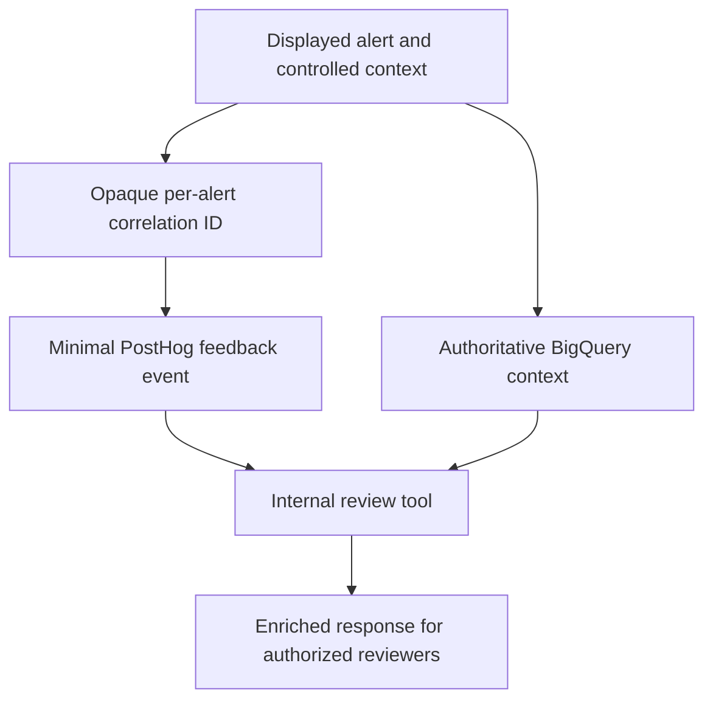
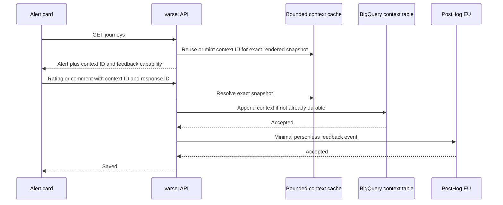
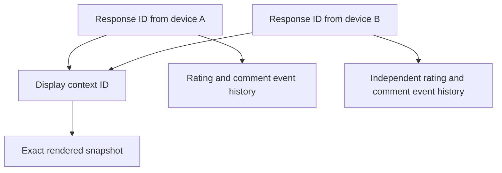

# Varselfeedback per alert - Plan

## Goal Capsule

- **Objective:** Travellers can tell the kix-avvik team whether a specific disruption alert was useful, and reviewers can inspect that feedback with the alert context needed to improve wording, policy, and usability.
- **Means:** Collect minimal, isolated feedback in PostHog and join it to controlled alert context in BigQuery through an opaque per-alert correlation ID.
- **Product authority:** This plan governs immediate usefulness feedback on active `/varsel` alerts and the internal review workflow. It does not change prediction evaluation or alert delivery policy.
- **Open blockers:** None for implementation or for shipping disabled code. Production enablement is blocked until the intended Entur PostHog EU project passes capture, read-back, retention, deletion, access, and privacy approval gates.

---

## Product Contract

### Summary

Add thumbs up/down and an optional comment to each active `/varsel` alert. PostHog holds only the isolated response and an opaque correlation ID; an internal review tool joins that ID to the complete alert context in BigQuery.

### Problem Frame

Kix-avvik developers and product management can measure realized alert outcomes, but they cannot learn whether the wording helped a traveller understand and act on a disruption. Reviewing usefulness requires the exact displayed wording together with its prompt, model, journey, prediction, and delivery context. Sending that context directly to PostHog would unnecessarily copy route-bearing and potentially identifying data into a third-party analytics system.

### Actors

- A1. **Traveller:** Rates the usefulness of a specific active alert and may explain the rating.
- A2. **Reviewer:** A kix-avvik developer or product manager who retrieves responses and examines them with controlled alert context.
- A3. **Feedback service:** Accepts public feedback, enforces the payload boundary, and forwards minimal events to PostHog.
- A4. **Context store:** Retains the authoritative alert wording and decision context needed for internal review.

### Key Decisions

- **Feedback evaluates immediate usefulness, not eventual correctness.** (session-settled: user-directed — chosen over prediction-correctness feedback: the team wants to improve prompt wording, alert policy, and usability.) Governs R1, R10.
- **Both ratings may receive comments.** (session-settled: user-directed — chosen over comments only after negative ratings: positive explanations can reveal what made an alert useful.) Governs R2, R3.
- **Capture goes through the kix-avvik backend.** (session-settled: user-approved — chosen over direct browser capture and embedded PostHog surveys: the backend can enforce the public endpoint's privacy and abuse boundaries.) Governs R5, R6, R7.
- **PostHog responses are isolated.** (session-settled: user-directed — chosen over device-level correlation: repeat-user analysis is unnecessary for the stated review goals.) Governs R6, R8.
- **Sensitive context remains in BigQuery.** (session-settled: user-approved — chosen over sending exact alert wording to PostHog: an opaque join preserves review value with less sensitive SaaS data.) Governs R4, R7, R9.
- **The first release supports manual review only.** (session-settled: user-directed — chosen over dashboards and automated analysis: collecting and viewing individual enriched responses is sufficient initial value.) Governs R9.

### Requirements

**Traveller interaction**

- R1. Each active alert asks whether that specific alert was useful and offers accessible thumbs up and thumbs down controls.
- R2. Selecting either thumb records the rating immediately and then reveals an optional free-text comment field.
- R3. A submitted comment enriches the existing response, and the traveller may change the rating during the accepted response's 24-hour update window while the alert remains available in the mounted interaction. A reload/remount intentionally starts an isolated new response.
- R4. Each feedback control remains bound to the exact displayed alert wording and context even when multiple departures share one situation or the alert refreshes.

**Capture and privacy boundary**

- R5. Feedback submission is mediated by the kix-avvik backend and failure never hides, changes, or delays the alert.
- R6. PostHog receives only the rating, optional comment, opaque context, response, and event IDs, revision, context date, environment, and submission time; it receives no device, route, wording, session, or reusable person or journey identifier. Several isolated responses may share a context ID only when they rate the same exact displayed snapshot.
- R7. The public feedback path validates and bounds input, limits abuse and cost, and prevents caller-supplied properties from expanding the PostHog payload.
- R8. Feedback capture does not enable PostHog autocapture, cookies, persistent anonymous identity, person profiles, session replay, or general `/varsel` analytics.

**Review workflow**

- R9. An authorized reviewer can retrieve individual PostHog responses and enrich them through the correlation ID with the exact displayed wording, journey context, prompt input and version, model, prediction, policy, and delivery context held in BigQuery.
- R10. Usefulness feedback remains analytically separate from hit, false-alarm, miss, and correct-reject outcome metrics.
- R11. The comment interaction warns users not to enter personal information, and production enablement requires approved access, retention, and tested deletion rules for feedback and its enriched context.

The correlation boundary is the load-bearing relationship:

### Key Flows

- F1. Rate an alert
  - **Trigger:** A traveller sees an active disruption alert.
  - **Actors:** A1, A3
  - **Steps:** The traveller selects a thumb; the rating is recorded immediately; the optional comment field appears; confirmation is announced without removing the rating controls needed for revision, while duplicate submission is suppressed only during an in-flight request.
  - **Outcome:** One isolated response exists for the exact displayed alert.
  - **Covered by:** R1, R2, R4, R5, R6
- F2. Add or revise feedback
  - **Trigger:** A traveller has rated an alert that remains visible.
  - **Actors:** A1, A3
  - **Steps:** The traveller may add a comment or change the thumb; the existing response is updated rather than duplicated.
  - **Outcome:** Reviewers see the traveller's latest feedback for that interaction.
  - **Covered by:** R3, R7, R11
- F3. Review enriched feedback
  - **Trigger:** A reviewer wants to assess collected usefulness feedback.
  - **Actors:** A2, A4
  - **Steps:** The reviewer retrieves responses from PostHog; the internal tool joins correlation IDs to controlled context; unmatched or ambiguous IDs are reported instead of guessed.
  - **Outcome:** The reviewer can evaluate wording, prompt, model, policy, and usability without storing that context in PostHog.
  - **Covered by:** R4, R6, R9, R10

### Acceptance Examples

- AE1. **Covers R1, R2, R5.** Given an active alert, when a traveller selects thumbs down, then the rating is recorded without interrupting the alert and an optional comment field appears.
- AE2. **Covers R2, R3.** Given a recorded thumbs up response, when the traveller adds a comment, then the comment updates that response rather than creating a second response.
- AE3. **Covers R3.** Given a recorded thumbs down response, when the traveller changes it to thumbs up while the alert remains visible, then review shows the revised rating as the current response.
- AE4. **Covers R4, R9.** Given two departures covered by the same situation, when both receive feedback, then each correlation ID resolves to the wording and decision context actually displayed for that departure.
- AE5. **Covers R5.** Given PostHog or the feedback service is unavailable, when the traveller rates an alert, then the alert remains readable and functional and the user receives a proportionate feedback-submission state.
- AE6. **Covers R6, R8.** Given a successful response, when its PostHog event is inspected, then it contains the approved minimal fields and cannot be linked by device, person, session, or reusable journey identity; sharing an exact context ID means only that responses rated the same displayed snapshot.
- AE7. **Covers R7, R11.** Given an oversized or malformed comment, when it is submitted, then it is rejected or bounded before PostHog capture and no extra caller-supplied fields are forwarded.
- AE8. **Covers R9.** Given an authorized reviewer runs the review workflow, when a valid correlation ID is joined, then the result contains the exact displayed wording and the relevant BigQuery context.
- AE9. **Covers R9.** Given a correlation ID cannot resolve uniquely, when the review workflow runs, then that response is marked unresolved and no contextual row is inferred.
- AE10. **Covers R10.** Given usefulness feedback has been collected, when existing outcome metrics are calculated, then the feedback does not alter their classifications or denominators.

### Success Criteria

- Reviewers can inspect individual feedback together with sufficient context to decide whether prompt wording, alert policy, or UI needs investigation.
- Every accepted PostHog event conforms to the minimal payload boundary. Responses can be grouped only by their exact shared display context, never by device, person, session, or reusable journey identity.
- Every accepted response either joins uniquely to the exact displayed context or is visibly reported as unresolved.
- Feedback-system failures do not degrade alert display or notification behavior.

### Scope Boundaries

- No dashboards, automated categorization, alerts, scheduled exports, sentiment analysis, or direct feedback-to-model loop in the first release.
- No prediction-correctness question and no reinterpretation of usefulness as a realized outcome label.
- No general product analytics or behavioural tracking through PostHog.
- No public API for retrieving enriched feedback or sensitive BigQuery context.
- No requirement to preserve a traveller's feedback after the corresponding alert leaves the UI, beyond the submitted response already recorded for review.

### Dependencies / Assumptions

- Entur provides an approved PostHog project and credentials suitable for server-side event capture.
- PostHog project access and retention are restricted appropriately for free-text comments, which may contain personal information despite the warning.
- The authoritative context store can retain a unique opaque correlation ID alongside the exact displayed alert instance without reusing device, journey, or journey-definition identity.
- Authorized reviewers already have, or can be granted, the PostHog and BigQuery access needed for the manual workflow.

### Outstanding Questions

**Deferred to Planning**

- How should the opaque ID be generated and propagated so it identifies the exact displayed content across cached wording and repeated refresh cycles?
- What bounded comment length, request-rate policy, and update window best fit the public unauthenticated endpoint?
- Which exact Entur PostHog project ID, scoped reviewer credential, consistency delay, and personless-event deletion or retention-only procedure satisfy KTD8's Query API contract?
- What user-facing success and failure states best fit the existing Entur component patterns and accessibility requirements?

### Sources / Research

- `demo/avviksvarsel/src/components/JourneyCard.tsx` renders each active departure as a distinct alert and shows why a situation number alone is not a unique alert identity.
- `demo/avviksvarsel/src/App.tsx` and `demo/avviksvarsel/src/api.ts` establish the stable device/journey identities that feedback must exclude.
- `disruptions/api/varsel.py` provides the existing same-origin, unauthenticated `/varsel-api` pattern and a client-log precedent.
- `disruptions/api/create_varsel_decisions.sql` defines the authoritative per-cycle wording, prompt, model, prediction, policy, and delivery context available for enrichment.
- `disruptions/api/decisions.py` documents the existing privacy boundary and fail-open decision-recording behavior.
- `helm/kix-avvik/values.yaml` confirms that the deployed ingress is public.

---

## Planning Contract

**Product Contract preservation:** Restructured, no scope change: R6 clarifies the non-person protocol fields required for isolated, idempotent revisions. R7 and R11 make the confirmed public-write and privacy boundaries testable.

### Key Technical Decisions

- KTD1. **Mint a random short-lived display-context capability from a bounded server cache.** The ID identifies one literal alert rendering and never derives from device, journey, route, situation, or decision fields. Persist the context only after a traveller submits feedback, and reject expired capabilities. Governs R4, R6, R7, R9.
- KTD2. **Store minimal feedback display contexts in a separate append-only BigQuery table.** An allow-listed schema records the literal rendered text and provenance that cannot be recovered truthfully from existing decision rows. It does not widen `varsel_decisions`, `varsel_decision_groups`, or outcome tables. Governs R4, R9, R10, R11.
- KTD3. **Use separate random response and event IDs with ordered complete revisions.** Bind a response ID to one environment and context on first acceptance. Each full response snapshot increments a client sequence and uses a stable event ID as the downstream deduplication key, so late retries cannot replace newer state. Governs R3, R6, R7, R8.
- KTD4. **Send PostHog events through its EU ingestion API without a browser SDK.** The backend uses an allow-listed event body, a short timeout, the response ID as `distinct_id`, and `$process_person_profile=false`. Governs R5, R6, R8.
- KTD5. **Persist context before PostHog capture and make both boundaries idempotent.** A failed context write makes feedback retryable. Retries reuse stable insertion IDs, and duplicate context rows are valid only when their protected fields are byte-equivalent. Governs R5, R7, R9.
- KTD6. **Collapse event history by bound response and monotonic revision.** PostHog remains append-only, so the greatest accepted revision for each environment, context, and response is current. Event ID breaks ties and earlier events remain audit history. Governs R3, R9.
- KTD7. **Use a signed, short-lived response receipt after first acceptance.** The first accepted revision returns a server-signed receipt binding the cryptographically random response ID to its environment, context ID, and a 24-hour update expiry. Later revisions require that receipt; they remain valid across API restarts and display-capability expiry. The server need not remember the highest revision because PostHog is append-only and review deterministically selects the greatest complete revision. Governs R3, R5, R7.
- KTD8. **Read feedback through PostHog's official project Query API.** The reviewer tool uses `POST /api/projects/{project_id}/query/` with a read-only personal API key and a parameter-bounded HogQL query over the named event and server-derived time window. Pagination/limit, late-arrival, and completeness behaviour must be proven against the approved Entur EU project before capture is enabled. JSON is the sole v1 export. Governs R9, R11.

### High-Level Technical Design

The display path and submission path have different lifetimes. The display path creates an opaque handle for an exact snapshot. The submission path makes that snapshot durable before emitting minimal feedback.

The two random identifiers have different scopes:

The context cache must treat the rendered string as part of its identity. A change from an LLM message to summary fallback, or any wording change, produces a new context ID. For cached LLM wording, the snapshot carries the input and provider metadata from the cycle that created the cached message rather than the newest poller decision. For summary fallback, it records `summary` as the displayed source and the request-time alert context without claiming an LLM prompt produced that text.

### Assumptions

- The PostHog project uses EU ingestion and has IP capture disabled. Backend mediation means PostHog sees the service egress address, not a traveller IP.
- A 15-minute in-process display-context lease is acceptable and is renewed when an unchanged alert is served. Returning a foreground tab refreshes `/journeys` before a first submission. A redeploy can expire an unsubmitted control, but an accepted response can be revised for 24 hours with its signed response receipt.
- The API remains a single replica with no HPA while feedback contexts and abuse ledgers are in-process. Scaling requires a shared store or a stateless signed display capability first.
- A 500-character comment cap is sufficient for the initial qualitative review workflow.
- A low hard daily capture budget plus bounded global and per-context limits is sufficient for the pilot. Residual distributed spam is accepted only within that budget because per-person enforcement would violate the no-correlation decision.
- PostHog feedback events are retained for 30 days (the project's data-retention setting, its default) and BigQuery display contexts for 45 days — the 30-day export window plus the exporter's one-day reach and slack. Local enriched exports are owner-only and removed within 30 days unless an approved analysis requires less.
- PostHog project access, retention, deletion, and the lawful basis for free-text processing are approved before the feature is enabled in production.

### System-Wide Impact

- **Data lifecycle:** A new append-only BigQuery context table contains allow-listed route-bearing wording and irreducible provenance. It is partitioned by server persistence date, clustered by context ID, retained for 45 days (PostHog's 30-day event retention plus the exporter's reach and slack), environment-local, and excluded from runtime copy scripts.
- **Privacy:** PostHog receives comments, which can still contain personal data. All other sensitive context stays behind BigQuery access controls.
- **Availability:** BigQuery and PostHog are optional to alert delivery. Feedback errors remain local to the feedback control.
- **Capacity:** The public endpoint adds bounded memory state and bounded external calls to the single API replica. Cache size, request rate, parsed and pre-parse body size, daily capture budget, and network time all have fixed ceilings.
- **Compatibility:** New alert response fields are optional so old and new frontend/backend images tolerate rolling deployment order.

### Risks & Dependencies

- **Context drift:** Current `/journeys` requests and poller decisions are independent, and cached messages can originate from older prompt inputs. Mitigation: snapshot the literal display and its true origin when issuing the context ID.
- **Unjoinable feedback:** Either downstream can accept a request whose response is lost. Mitigation: use stable insertion IDs at both boundaries, persist context first, and reject conflicting duplicate context rows.
- **Cross-device overwrite:** Several devices can share a displayed message. Mitigation: keep display-context ID and response ID separate per KTD3.
- **Public abuse:** Attackers can harvest live capabilities or exhaust shared quotas. Mitigation: short-lived high-entropy capabilities, response-to-context binding, pre-parse body limits, global and per-context limits that reserve legitimate capacity, and a hard daily circuit breaker.
- **Third-party latency:** PostHog calls can consume request threads. Mitigation: a short fixed timeout and no background retry loop in the first release.
- **External setup:** Shipping depends on an Entur-approved PostHog EU project, verified IP-capture settings, a capture project token in Secret Manager, and a separate reviewer credential for export.
- **Sensitive exports:** Attacker-controlled comments can contain terminal/control characters or bidirectional text. Mitigation: JSON-only output, owner-only files, escaped serialization, and no stdout or implicit overwrite.
- **Write-only capture:** The approved PostHog project may not expose complete bounded retrieval or per-event deletion for personless events. Mitigation: capture remains disabled until a synthetic event can be captured, read back completely, and deleted or covered by an approved retention-only procedure.
- **Interactive latency:** First capture performs a BigQuery insert followed by PostHog capture. Mitigation: use short timeouts, measure the path in dev, and require p95 under 3 seconds with retryable UI state before enablement; adopt an outbox before production if the bound is missed.

### Documentation / Operational Notes

- Add the PostHog host, capture-token secret, enablement behavior, retention/access prerequisites, and failure logging fields to `demo/avviksvarsel/README.md` and deployment comments.
- Capture is disabled gracefully when configuration is absent. `/varsel-api/config` reports the capability so the frontend does not render a dead control.
- Operational logs record result codes and bounded counts only. They do not include comments, displayed wording, prompt input, route data, device ID, journey ID, or response ID.
- Treat enriched review output as sensitive local data. Do not serve it from the public API or commit generated exports.
- Roll out dev to tst to prd. Each environment must prove synthetic submit, raw PostHog payload, context join, budget telemetry, and kill-switch behavior before promotion.
- The privacy release gate names the owning access group and proves event/context/export deletion. Disabling new capture must leave alert delivery healthy and accepted data reviewable through its retention period.
- The privacy owner must approve a real anonymous subject-rights procedure. Because feedback is intentionally unlinkable to a traveller, this must either use a per-response deletion receipt kept only by that interaction or explicitly document and approve the limitations and time-window/retention fallback.

---

## Implementation Units

### U1. Preserve exact display context

- **Goal:** Create an opaque context handle that resolves to the exact alert text and supporting context shown by `/journeys`.
- **Requirements:** R4, R6, R9; F1, F3; AE4, AE8, AE9; KTD1, KTD2.
- **Dependencies:** None.
- **Files:**
  - `disruptions/api/varsel.py`
  - `disruptions/api/feedback_contexts.py` (new)
  - `disruptions/api/create_varsel_feedback_contexts.sql` (new)
  - `disruptions/api/test_varsel.py`
  - `disruptions/api/test_varsel_api.py`
  - `disruptions/api/test_feedback_contexts.py` (new)
- **Approach:**
  1. Extend the alert response with optional feedback capability and context ID fields.
  2. Add a bounded, lock-protected cache keyed by the exact display identity and content version. Reuse an ID only while the rendered snapshot is byte-equivalent and its 15-minute lease is live.
  3. Retain the originating message input and model metadata when an LLM message enters the message cache. Represent summary fallback as its own display source.
  4. Add an append-only, 45-day context table created with `CREATE TABLE IF NOT EXISTS`. Partition on server persistence date, cluster by context ID, and persist with a stable insertion ID when feedback first uses the capability. Make each row self-contained with the exact rendered lines plus allow-listed prompt/model, prediction, policy, and delivery fields required by R9; do not depend on a later join to a non-unique decision row.
  5. Keep the new table out of `varsel_decision_groups`, outcome labelling, and environment-copy scripts.
- **Execution note:** Add characterization tests for current cached-message and summary-fallback rendering before extending the cache structures.
- **Patterns to follow:** `_message_key`, `_message_meta`, `_reconcile_caches`, `_journey_model`, and the fail-open table setup in `disruptions/api/decisions.py`.
- **Test scenarios:**
  - Covers AE4. Two departures under one situation receive different context IDs and resolve to their own displayed text.
  - An unchanged alert across `/journeys` polls reuses its context ID so feedback UI state survives refresh.
  - A wording or display-source change creates a new context ID and leaves the old cached snapshot resolvable until expiry.
  - Cached LLM text retains the prompt input, provider, model, and prompt version from its originating generation cycle.
  - Summary fallback records the literal summary and does not claim LLM provenance.
  - Covers AE8. Persisting a live context creates one uniquely joinable row with the exact display snapshot.
  - Covers AE9. Unknown, expired, and ambiguous context IDs cannot persist an inferred row.
  - Eviction or restart before first submission expires the capability and directs the client to refresh; restart after persistence leaves the context joinable.
  - A duplicate context insert with identical protected fields remains one logical context, while conflicting fields make enrichment unresolved.
  - The table schema excludes device ID, journey ID, and reusable journey digest, while explicitly containing every allow-listed field the reviewer needs so enrichment is unique without guessing a decision-row key.
  - Cache admission evicts expired leases before live leases and caps new contexts per window; unrelated minting cannot evict an already-live capability.
  - BigQuery setup or insert failure does not change `/journeys` or alert delivery behavior.
- **Verification:** The API can return stable context IDs for unchanged alerts, and each persisted ID resolves to one exact display snapshot with truthful provenance.

### U2. Capture minimal personless feedback

- **Goal:** Accept bounded public feedback and send only the approved event fields to PostHog.
- **Requirements:** R2, R3, R5, R6, R7, R8, R10, R11; F1, F2; AE1, AE2, AE3, AE5, AE6, AE7, AE10; KTD3, KTD4, KTD5, KTD6.
- **Dependencies:** U1.
- **Files:**
  - `disruptions/api/varsel.py`
  - `disruptions/api/feedback.py` (new)
  - `disruptions/api/test_varsel_api.py`
  - `disruptions/api/test_feedback.py` (new)
  - `disruptions/api/requirements.txt`
  - `pyproject.toml`
- **Approach:**
  1. Add a strict request model with forbidden extra fields, a fixed rating vocabulary, UUIDv4 (or equivalent 128-bit cryptographically random) context, response, and event IDs, a monotonic revision, a signed response receipt after first acceptance, and a 500-character optional comment.
  2. Resolve the context and persist it through U1 before capture. Make repeated persistence and repeated client submissions safe.
  3. Send one allow-listed complete response snapshot to the EU ingestion host. Derive environment, context date, and timestamp on the server, use the event ID as the ingestion deduplication key, and force person-profile processing off.
  4. Read `Request.stream()` through a byte-counting helper before JSON decoding and strict model validation; use `Content-Length` only for early rejection. Apply bounded global and per-context trailing-window limits and a low hard daily capture budget. Bind later revisions with the signed response receipt so restart cannot lose the binding.
  5. Return distinct saved, disabled, expired, throttled, and retryable-downstream states without logging submitted text or sensitive identifiers.
- **Patterns to follow:** The strict public models and bounded ledgers in `disruptions/api/meldinger.py`, blocking-route convention in `disruptions/api/varsel.py`, and bounded external HTTP in `disruptions/api/alternatives.py`.
- **Test scenarios:**
  - Covers AE1. A valid rating persists context first, sends one event, and returns saved.
  - Covers AE2. A later complete snapshot with the same response ID and a greater revision produces history that collapses to one logical response.
  - Covers AE3. A changed rating with the same response ID and a greater revision becomes the current logical response.
  - Covers AE6. The outbound event contains only the R6 fields, the PostHog project token, the ingestion deduplication property, and `$process_person_profile=false`.
  - The outbound event never contains device, journey, route, wording, prompt, user-agent, caller timestamp, or unknown request properties.
  - Covers AE7. Invalid ratings, malformed IDs, extra fields, and comments above the cap are rejected before any downstream call.
  - Unknown or expired context IDs return a retryable state and do not reach PostHog.
  - A response ID cannot bind to a second context, and a delayed lower revision cannot erase a greater accepted revision.
  - Restart between revisions preserves response binding through the signed receipt; an old lower revision may append but cannot become current during review.
  - Missing, false, oversized, and chunked `Content-Length` cases cannot exceed the pre-parse byte ceiling.
  - BigQuery failure prevents PostHog capture and returns retryable failure.
  - A timeout after either downstream accepted is retried with the same insertion ID and produces one logical context and event.
  - Global, per-context, body-size, and daily-budget limits reject excess traffic without unbounded ledger growth or allowing one context flood to consume all legitimate capacity.
  - Missing configuration disables capture and makes the capability false.
  - Covers AE10. Existing outcome queries and tables remain unchanged.
- **Verification:** Contract tests prove ordering, payload minimization, personless capture, bounded abuse handling, and isolation from alert and outcome paths.

### U3. Add accessible per-alert feedback UI

- **Goal:** Let a traveller rate an alert immediately, add an optional comment, revise the rating, and recover from submission failures.
- **Requirements:** R1, R2, R3, R5, R11; A1; F1, F2; AE1, AE2, AE3, AE5, AE7; KTD3, KTD7.
- **Dependencies:** U1, U2.
- **Files:**
  - `demo/avviksvarsel/src/api.ts`
  - `demo/avviksvarsel/src/components/JourneyCard.tsx`
  - `demo/avviksvarsel/src/components/AlertFeedback.tsx` (new)
  - `demo/avviksvarsel/src/components/alertFeedbackState.ts` (new)
  - `demo/avviksvarsel/src/styles.css`
  - `demo/avviksvarsel/test/feedback.test.mjs` (new)
  - `demo/avviksvarsel/package.json`
- **Approach:**
  1. Add optional alert feedback fields and a typed submission client while preserving rolling-deploy compatibility.
  2. Render the focused feedback component below the alert content only when the server reports capability and a context ID.
  3. Model idle, rating-submit, rated, comment-submit, saved, retryable-downstream, throttled, expired, and disabled states. For each, define visible text, retained input, enabled controls, and retry/refresh/dismiss transition. Preserve state when polling returns the same context ID and reset it when the displayed context changes.
  4. Create one response ID per mounted alert interaction and one event ID per complete revision. Keep IDs and the response receipt out of localStorage, sessionStorage, cookies, and stores shared across alerts or reloads. Serialize submissions; keep the controls editable with a clear pending state, queue the newest complete snapshot, and retry an unchanged revision with its original event ID.
  5. Give both controls textual names and pressed state. Reveal a labelled comment field without moving focus from the chosen thumb, associate validation text with the field, and announce submitting/saved/error state through a non-disruptive live region. Include the personal-information warning, character limit, logical tab order, Entur-compliant touch targets, and retry affordance.
- **Execution note:** Implement the pure state transition model test-first, then bind it to the React component and verify the rendered flow in a browser.
- **Patterns to follow:** Existing Entur button, form, typography, alert, and icon packages; the optional-field compatibility convention in `demo/avviksvarsel/src/api.ts`.
- **Test scenarios:**
  - Covers AE1. Either thumb submits immediately and reveals the optional comment field after success.
  - Covers AE2. Submitting a comment keeps the current rating and response ID.
  - Covers AE3. Changing thumbs sends the revised rating with the same response ID and updates pressed state.
  - Covers AE5. Network, timeout, throttled, expired-context, and disabled responses leave the alert readable and offer an appropriate retry or refresh path.
  - Covers AE7. The comment count and warning are visible, and input beyond the supported limit cannot be submitted.
  - A poll with the same context ID preserves rated/comment state, while a changed ID resets to idle with a new response ID.
  - An expired capability refreshes the alert context, resets unsaved interaction state, and states that the prior action was not recorded.
  - A slow earlier request cannot overwrite a later rating/comment revision.
  - Two alert lines with the same situation number keep independent state and response IDs.
  - Reload/remount intentionally starts a fresh isolated response and does not restore earlier feedback; reviewers retain both responses under the shared exact context.
  - No identifier or receipt is written to browser storage shared across reloads or alert instances.
  - Keyboard and screen-reader users can identify, activate, and understand both rating controls and comment status.
- **Verification:** Automated state tests, a production frontend build, and browser evidence cover both successful and retryable flows without changing alert readability.

### U4. Provide internal review and deployment setup

- **Goal:** Let authorized reviewers retrieve minimal PostHog feedback and enrich it safely from partition-bounded BigQuery context.
- **Requirements:** R6, R9, R10, R11; A2, A4; F3; AE6, AE8, AE9, AE10; KTD6, KTD8.
- **Dependencies:** U1, U2.
- **Files:**
  - `data/feedback/export_varsel_feedback.py` (new)
  - `data/feedback/README.md` (new)
  - `data/queries/validate_varsel_sql.sh`
  - `disruptions/api/test_feedback_contexts.py`
  - `data/feedback/test_export_varsel_feedback.py` (new)
  - `demo/avviksvarsel/README.md`
  - `helm/kix-avvik/values.yaml`
  - `helm/kix-avvik/env/values-kub-ent-dev.yaml`
  - `helm/kix-avvik/env/values-kub-ent-tst.yaml`
  - `helm/kix-avvik/env/values-kub-ent-prd.yaml`
- **Approach:**
  1. Add explicit environment and date-window inputs. Query the official PostHog project Query API with a parameter-bounded HogQL query and a read-only personal API key obtained from an approved secret-manager or authenticated-CLI flow, never a command-line argument.
  2. Collapse complete snapshots by environment, context, response, revision, and event ID. Deduplicate context IDs before a parameterized join bounded by the server-derived context dates.
  3. Report missing, identical-duplicate, conflicting-duplicate, expired, malformed, and out-of-horizon identifiers without guessing. Write owner-only JSON only; refuse stdout, symlinks, and implicit overwrite.
  4. Configure the EU ingestion host as non-secret deployment data and the capture token through the existing ExternalSecret pattern. Keep reviewer credentials out of the workload.
  5. Document staged enablement, privacy prerequisites, named least-privilege BigQuery and PostHog access groups/roles, credential rotation and offboarding revocation, 30-day PostHog and 45-day BigQuery service retention, 30-day export cleanup, tested deletion or approved retention-only limitation, local review usage, budgets, telemetry, and rollback by disabling new capture. The runtime may append contexts but must not expose a public context-read route.
  6. Before enabling capture, prove on the intended Entur EU project that a synthetic personless event can be captured, retrieved completely after the documented consistency delay, and removed through the named mechanism (or covered by an explicitly approved retention-only rule). Record pagination/limits, time-bound semantics, credential scopes, and project-tier constraints.
- **Execution note:** Prove query bytes with dry runs only. Do not run a BigQuery operation estimated above the repository's $10 approval threshold.
- **Patterns to follow:** `uv` scripts under `data/`, partition-bounded queries in the meldinger feature, and environment-specific Helm secret mappings.
- **Test scenarios:**
  - Covers AE8. One valid response enriches with literal display text, source, prompt/model provenance when applicable, prediction, policy, and delivery context.
  - Covers AE9. Unmatched or duplicate context IDs appear in a dedicated error report and never receive inferred context.
  - Multiple and out-of-order PostHog events collapse by bound monotonic revision; a late retry of an older event cannot erase a newer snapshot.
  - An explicit narrow window constrains both PostHog retrieval and BigQuery partitions.
  - The tool refuses an unbounded window, missing reviewer credentials, or an output path that would overwrite unexpectedly.
  - Malicious comments with control characters, bidirectional text, and newlines remain inert in JSON output.
  - Given a known response/deletion receipt, that response and an exclusively referenced context can be located and deleted from PostHog, BigQuery, and generated exports; shared contexts remain until no retained response references them. The approved anonymous subject-rights procedure is tested separately.
  - Shared contexts remain until their final referencing response expires or is deleted.
  - Capture tokens are present only in secret mappings, and reviewer credentials are absent from deployment manifests.
  - SQL validation and dry-run checks cover the new context table/query without mutating production data.
- **Verification:** A fixture-backed export joins and collapses correctly, deployment configuration exposes no secret values, and the documented command works through `uv` with explicit bounds.

---

## Verification Contract

| Gate | Scope | Evidence |
|---|---|---|
| Python static checks | U1, U2, U4 | Ruff and type-relevant checks pass for all changed Python files. |
| API and persistence tests | U1, U2 | Relevant varsel, decision, feedback, and context suites pass independently. |
| Frontend tests and build | U3 | Node feedback-state tests, existing service-worker tests, TypeScript compilation, and Vite production build pass. |
| SQL validation | U1, U4 | The repository SQL validator includes the new SQL, and partition-bounded dry runs succeed within the cost policy. |
| Browser validation | U3 | Rating, comment, revision, refresh preservation, retry, narrow viewport, keyboard, and accessible-name flows work against the local app. |
| Payload audit | U2, U4 | Captured fixtures contain only approved PostHog fields and deployment manifests contain no secret values. |
| Privacy release gate | U1, U2, U3, U4 | Raw EU PostHog events show no person profile, IP, user-agent, geo, library, route, or prompt fields; browser storage is clean; least-privilege access, retention, and the approved deletion/subject-rights procedure are verified. |
| Abuse and budget gate | U2 | Capability harvesting, oversized bodies, quota exhaustion, and restart tests stay within the hard daily budget and preserve alert health. |
| Regression | All | Existing `/varsel`, `/historikk`, `/meldinger`, push, decision logging, and outcome tests remain green. |

---

## Definition of Done

- Every active alert with feedback capability has accessible thumbs up/down controls and an optional comment path.
- Unchanged display contexts survive polling, while changed wording cannot inherit earlier feedback state.
- Each accepted response resolves uniquely to the exact displayed snapshot and truthful prompt/model provenance where applicable.
- PostHog contains only minimal anonymous event data plus free text, with person-profile creation disabled.
- Public capture is strictly validated, rate-limited, bounded, and isolated from alert availability.
- Retries and out-of-order revisions produce one deterministic current response without orphaned or conflicting context.
- The internal `uv` review workflow collapses revisions, performs partition-bounded enrichment, and reports unresolved joins.
- No stable device, journey, route, wording, prompt, session, or reusable person identity reaches PostHog.
- Existing outcome metrics, decision grouping, environment-copy behavior, push delivery, and alert display remain unchanged outside the feedback addition.
- Production enablement is documented and remains off until PostHog access, retention, deletion, and privacy approval are complete.
- Dev and tst synthetic evidence confirms raw payload minimization, enrichment, monitoring, budget, deletion, and kill-switch behavior before prd enablement.
