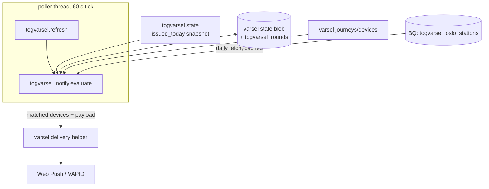
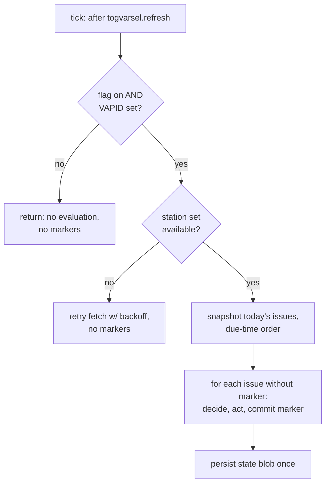
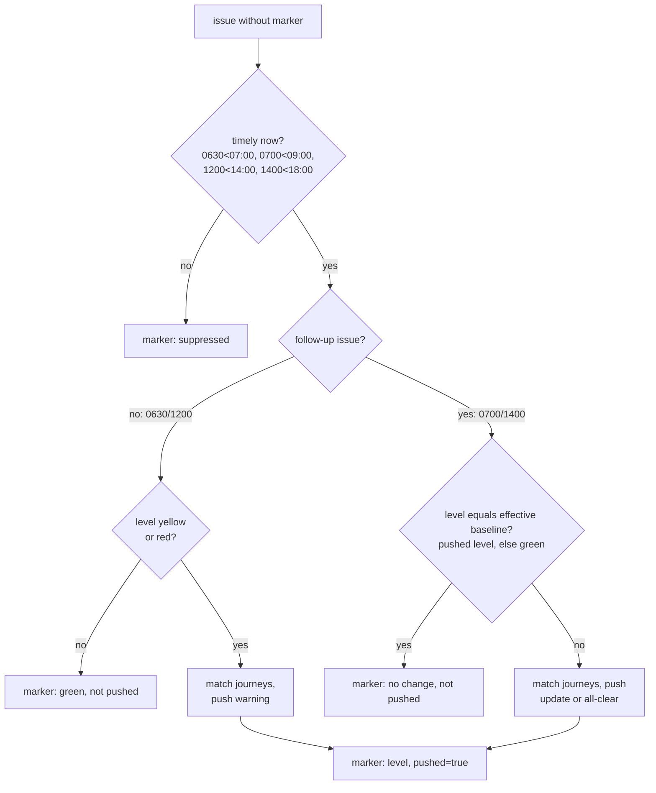

# Togvarsel Push Notifications - Plan

## Goal Capsule

- **Objective:** Extend `/varsel` so subscribers whose registered journey is on the Oslo local network during rush hour receive a Web Push when a togvarsel prognosis (`/togmelding`, PR #107) is yellow or red — plus an all-clear when a pushed warning drops back to green — with the 07:00 and 14:00 issues gated on significant change from the 06:30 and 12:00 rounds.
- **Authority:** The user request governs product behavior; this plan governs implementation shape; repo conventions (CLAUDE.md, module seams, test style) govern code idiom. On conflict, surface — don't guess.
- **Execution profile:** Implement policy logic test-first as pure functions with injectable `now`; hermetic standalone test files per repo convention. No new BigQuery schema; no LLM involvement.
- **Stop conditions:** Stop if togvarsel or varsel cannot expose the accessor seams in U4 without breaking their existing tests, or if the persisted-state shape cannot round-trip safely.
- **Tail ownership:** The calling pipeline owns commit, PR, and CI.

---

## Product Contract

### Summary

Togvarsel already computes four weekday rush prognoses for the Oslo local network — issues `0630` and `0700` (morning), `1200` and `1400` (afternoon) — each a green/yellow/red level, refreshed wall-clock on the poller tick and audited to `disruptions.togvarsel_issued`. This feature adds a notification policy on top: when an issue is yellow or red, push to devices whose registered `/varsel` journey runs within the Oslo local network (both endpoints in its station set, per R5) in that issue's rush window. Follow-up issues (`0700`, `1400`) push only when the level changed from what the baseline round (`0630`, `1200`) pushed. No new prognosis machinery; the existing Web Push infrastructure delivers.

### Problem Frame

`/varsel` subscribers today get pushes only for train-specific SIRI-SX situations on their journey. Rush-hour trouble on the Oslo local network is often systemic — visible to the togvarsel model before (or without) per-train situations. Subscribers who commute through the network get no early warning, even though the forecast exists and is already published on `/togmelding`.

### Requirements

**Triggering**

- R1. When a weekday togvarsel issue (`0630`, `0700`, `1200`, `1400`) is issued and its round decides to push (baselines per this rule, follow-ups per R2), send one Web Push per device that has an affected registered journey (per R5). Baseline issues (`0630`, `1200`) push iff the level is yellow or red.
- R2. Follow-up issues (`0700`, `1400`) push iff the level differs from the effective baseline: the level their baseline round (`0630`, `1200`) pushed, or green when that round pushed nothing (not issued, suppressed, or green). This covers escalation to yellow or red, change between yellow and red, and the all-clear: a green follow-up after a pushed yellow/red baseline sends a "friskmelding" — the one case where green pushes.
- R3. Timeliness: an issue notifies only while timely at evaluation time (Europe/Oslo): `0630` before 07:00, `0700` before 09:00, `1200` before 14:00, `1400` before 18:00. An untimely round is recorded as suppressed and never revisited. This covers restart back-fills flagged `late`.
- R4. No repeats: at most one togvarsel push per device per issue, and a completed round never re-fires — including across process restarts — with one accepted exception: the crash-mid-round duplicate window per KTD2 (a push is at-most-once only after its marker is durably persisted).

**Affected journey**

- R5. A registered journey is affected by an issue iff: both `from_stop` and `to_stop` (expanded through `place_refs` aliases) are in the Oslo local-network station set (`disruptions.togvarsel_oslo_stations`, 39 NSR StopPlace refs); today's Oslo weekday is in the journey's `days`; and the journey's registered window — stored inclusive `[begin, end]` per varsel's documented window contract — overlaps, compared half-open, the live part of the issue's scope window: `[max(scope start, evaluation time), scope end)`. Scope windows: `0630` 06:30–09:00, `0700` 07:00–09:00, `1200` and `1400` 15:00–18:00. The evaluation-time bound means a late evaluation never notifies a journey whose travel window has already ended — warnings, updates, and all-clears alike.
- R6. A device with several affected journeys gets one push per round.

**Message**

- R7. Wording is deterministic Norwegian built from the issue's own fields (level, scope, rule-based `reasons`). The title identifies it as a rush forecast (not a train alert) and carries the level; non-prod titles get the environment prefix via the existing tagging helper. When a baseline round was pushed, follow-up wording says the forecast is updated ("oppdatert"); an all-clear says the forecast dropped back to green for the rush window ("friskmelding" framing), never warning language. Wording must not claim journey-, line-, or corridor-specific knowledge — the model's grain is the whole network.
- R8. Brand contract: icon per device `brand` as today; click-through URL is `/togmelding` for the `entur` brand and the existing unbranded varsel URL for `none`-brand devices (the body carries the essentials, so no click-through is required to get the message).

**Safety and operations**

- R9. Delivery is gated by a new env flag `TOGVARSEL_NOTIFY_ENABLED` (delivery-flag parse convention: only `true/1/yes/on` count as on; unset is off) and degrades to a no-op when VAPID keys are unset. While disabled, the evaluator writes no markers, so an enable-restart inside a timeliness window still delivers that round.
- R10. Poller safety: the notify step is isolated per issue and per journey (one failure never drops other issues, journeys, or phases) and logs one structured event per round with issue, level, decision, and matched/sent/error/gone counts.
- R11. A dev-only test trigger (following the `/varsel-api/test` pattern) can exercise the full pipe — wording, icon, click-through — for one device with a synthetic round. Served only when the environment label is dev: tst, prd, and unset/unrecognized labels are refused, so the gate fails closed.

### Acceptance Examples

- AE1. **Covers R1, R5, R7.** Given Monday and a subscriber with journey Asker → Oslo S, window 07:00–08:30, all weekdays; when `0630` is issued at 06:31 with level yellow; then the device gets exactly one push, titled as a rush forecast with the level, body carrying the rush window and togvarsel reasons.
- AE2. **Covers R2.** Given AE1 delivered yellow; when `0700` is issued at 07:01 with level yellow; then no push.
- AE3. **Covers R2, R7.** Given AE1 delivered yellow; when `0700` is issued red; then one push whose wording marks it as an update.
- AE4. **Covers R2, R3.** Given a process restart at 07:30 back-fills `0630` (late, red) and issues `0700` (red) in the same tick; then `0630` is suppressed (untimely) and `0700` pushes (baseline pushed nothing).
- AE5. **Covers R1.** Given Saturday; then no issues exist and the evaluator is a natural no-op.
- AE6. **Covers R9.** Given the flag was off all morning and a restart at 06:50 enables it; when the tick evaluates `0630` (yellow); then it pushes. Given instead the restart happens at 07:10; then `0630` is suppressed as untimely.
- AE7. **Covers R2, R7.** Given AE1 delivered yellow; when `0700` is issued green at 07:01; then one push with all-clear framing. Given instead `0630` was green (nothing pushed) and `0700` is green; then no push.

### Scope Boundaries

**Deferred to Follow-Up Work**

- Per-user notification level (red-only opt-in) and any per-corridor personalization (corridor-level forecasts are togvarsel's own documented next step).
- Rows in `disruptions.varsel_decisions` for togvarsel pushes (see KTD7).
- Per-device retry of transient send errors within a round (see KTD8).
- Surfacing "your subscription now includes rush forecasts" in the `/varsel` UI. Deferred from v1 code, but a precondition for enabling `TOGVARSEL_NOTIFY_ENABLED` outside dev: existing subscribers opted into train-specific alerts and must get notice before a new push class reaches them.

**Outside this product's identity**

- Changing togvarsel's models, issue schedule, level cuts, or weekend/holiday gates.
- Coupling suppression between SX pushes and togvarsel pushes (a red morning legitimately produces both; distinct title framing per R7 is the mitigation).

---

## Planning Contract

### Key Technical Decisions

- KTD1. **Significant change is a level transition, never a probability delta.** The `0630`/`0700` pair are different models answering different questions (whole rush vs rest-of-rush) with different calibration; raw p is not comparable across them. Levels at the fixed cuts are the product surface and are comparable. Governs R2.
- KTD2. **Round markers are the single state primitive: `{date: {issue: {level, pushed}}}`, persisted in the varsel state blob.** Markers double as dedup (R4) and as the follow-up baseline (R2 compares against what was pushed, not what was recomputed). Ordering: set the in-memory marker before fan-out, persist after; a crash mid-round that restarts inside the timeliness window may duplicate one round — accepted. Never reuse `_notified`: it is pruned against the live SX snapshot and would evict synthetic keys immediately.
- KTD3. **Yellow-or-red threshold, as requested** — with a flag: the measured level bins make yellow-or-red fire on roughly 56 % of weekday mornings, and the repo has previously raised an alert bar because unexplained alerts read as noise. Mitigations already in the design: the change gate caps a rush at two pushes, reasons ride in the body, and delivery starts dev-only (R9). Red-only or per-user levels stay deferred. Governs R1.
- KTD4. **New module `disruptions/api/togvarsel_notify.py`, wired by `main` via `configure()`.** It imports neither `varsel`, `togvarsel`, nor `main`; main injects callables: an issued-today snapshot (from togvarsel), journey/device accessors, the delivery helper, marker load/store, and a clock. This honors the package rule (no module imports `main`) and keeps the module hermetic for tests.
- KTD5. **The station set is fetched from `disruptions.togvarsel_oslo_stations`, never duplicated in Python.** That table defines the product's geography. Fetch once per Oslo day in the notify step; on failure, retry on every tick with no cooldown and no daily give-up (the table is 39 rows — a retry is one trivial scan). While unavailable, evaluate nothing and write no markers (the timeliness cutoff then suppresses honestly); log the fetched count as a sanity check and at most one ERROR per day on persistent failure. On prd the table exists only after `copy_runtime_to_prd.sh` — the fetch-failure path is a real launch state, not an edge case.
- KTD6. **Deterministic template only; no LLM.** Togvarsel's `reasons` are rule-based Norwegian by design. Skipping the LLM avoids the generation/delivery switch matrix, cycle budgets, and the DPIA surface of model-written pushes.
- KTD7. **Audit is structured logs + `disruptions.togvarsel_issued` + persisted markers; no `varsel_decisions` rows in v1.** The push decision is a deterministic function of durable inputs (issued level, marker state, clock), so it is reconstructable — unlike LLM varsel decisions, which needed rows. Adding columns to the decisions/outcomes tables is a documented trap (silent insert rejection; a new outcomes column breaks the registered scheduled query in both envs). If rows are added later, discriminate by a synthetic `situationNumber` prefix (`KIX:Togvarsel:<date>:<issue>`), never a new column.
- KTD8. **Transient send errors are not retried within a round.** The round-level `pushed` marker forfeits per-device retry; a forecast is lower-stakes than a train alert. Log sent/error/gone counts per round.
- KTD9. **Within a tick, issues are evaluated in due-time order, and each round's marker is committed before the next round reads its baseline.** This makes the restart-at-07:30 case (back-filled `0630` + fresh `0700` in one tick) resolve deterministically.
- KTD10. **All time logic is Europe/Oslo wall-clock; no UTC-hour arithmetic.** DST transitions land on weekends, which are never forecast days — a one-sentence non-event, not a test surface.
- KTD11. **Green follow-ups after a pushed warning send an all-clear.** (session-settled: user-directed — chosen over staying silent on improvement: a drop back to green is a significant change, and the all-clear is the trust-building update after a warning.) Governs R2. The marker records it like any push (`{level: green, pushed: true}`); no later issue reads a follow-up's marker, so the effect is dedup only.

### High-Level Technical Design

Component topology — everything new hangs off seams main already owns:

Per-tick evaluation protocol:

Per-issue decision gates:

### Assumptions

Recorded judgment calls; each is cheap to reverse.

- Both journey endpoints must be in the station set (not just one): the forecast covers the network between them; one-endpoint journeys extend beyond the model's grain.
- PM issues notify journeys in the 15:00–18:00 window even though issued at 12:00 — advance warning is the product's point.
- Bus commutes between two listed train stations may match (registrations carry no mode; `place_refs` collapses bus-side refs onto station primaries) — accepted imprecision; R7's network-level wording keeps it honest.
- The follow-up baseline is fleet-global, not per-device: a device registered at 06:45 misses the `0630` push and is still gated by it at 07:00. Accepted; no solo catch-up pushes.
- R5's evaluation-time bound applies uniformly: a device whose travel window has passed gets neither a late warning nor the all-clear for that rush. Accepted — a push about a rush window the traveller has exited is noise, friskmelding included.
- Flag posture at launch: dev on, tst/prd off. prd additionally requires `copy_runtime_to_prd.sh` and a deliberate dispatch.
- Rollback insurance: serialize/apply will round-trip unknown top-level state keys so future features survive rollbacks, but a rollback to pre-feature code that rewrites the blob may re-push after roll-forward — accepted, rare.

---

## Implementation Units

### U1. Notification policy core

- **Goal:** Pure, hermetic policy: given today's issues (due-time-ordered), the marker map, and `now`, decide per issue — push (warning, update, or all-clear) / suppress (untimely, no significant change) — and produce updated markers.
- **Requirements:** R1, R2, R3, R4 (round level); KTD1, KTD2, KTD9, KTD10, KTD11.
- **Dependencies:** none.
- **Files:** `disruptions/api/togvarsel_notify.py`, `disruptions/api/test_togvarsel_notify.py`.
- **Approach:** Policy functions take plain data (issue dicts with `issue`, `level`, `late`, `computed_at`; marker dict; `now` as an Oslo-aware datetime) and return decisions plus new marker entries. No I/O in this unit. Timeliness bounds and follow-up→baseline pairs live in one spec table beside togvarsel's `ISSUE_SPECS` shape. Each issue's evaluation is wrapped in its own try/except: a failure records no marker, logs with issue context, and never stops later issues in the tick (R10).
- **Execution note:** Test-first; every scenario is a pure-function call with an explicit `now` (repo convention — no freezegun).
- **Test scenarios:**
  - Covers AE1. Baseline `0630` yellow at 06:31, no marker → push decision, marker `{level: yellow, pushed: true}`.
  - Baseline green → no push, marker `{level: green, pushed: false}`.
  - Covers AE2. `0700` yellow, `0630` marker pushed yellow → suppressed (no change).
  - Covers AE3. `0700` red, `0630` marker pushed yellow → push.
  - `0700` yellow, `0630` marker `{green, pushed: false}` → push (baseline pushed nothing).
  - `0700` red, no `0630` marker at all (gave up after 8 fails) → push.
  - Covers AE7. `0700` green, `0630` marker pushed yellow → push (all-clear), marker `{level: green, pushed: true}`.
  - `0700` green, `0630` marker `{green, pushed: false}` → no push.
  - `1400` green after `1200` pushed red → push (all-clear).
  - Covers AE4. Same tick: `0630` (late, red, now 07:30) then `0700` (red) — `0630` suppressed untimely, `0700` pushed; assert evaluation order and that `0700` read the just-committed `0630` marker.
  - `1200` back-fill evaluated 14:00:30 → suppressed (strictly-before cutoff).
  - `1200` pushed 13:59 red, `1400` red at 14:01 → suppressed (no change); `1400` yellow → pushed as update.
  - Marker already present → issue never re-evaluated (idempotent across ticks).
  - Covers AE5. Empty issue list (weekend/holiday — nothing issued) → no decisions, no markers.
  - One issue's evaluation raising → the remaining issues in the same tick are still evaluated and marked (per-issue isolation); the failed issue records no marker and is retried next tick within its timeliness window.
- **Verification:** Suite passes standalone and under pytest; policy covers every gate in the decision flowchart.

### U2. Journey matching and station set

- **Goal:** Decide which registrations an issue affects (R5) and which devices get the push (R6), with the station set fetched and cached per Oslo day.
- **Requirements:** R5, R6, R10 (per-journey isolation); KTD5.
- **Dependencies:** none.
- **Files:** `disruptions/api/togvarsel_notify.py`, `disruptions/api/test_togvarsel_notify.py`.
- **Approach:**
  1. Station fetch: one query of `disruptions.togvarsel_oslo_stations` via the injected BQ client; cache refs for the current Oslo date; on failure, retry on the next tick (no cooldown, no daily give-up — deliberately unlike togvarsel's `_FAIL_COOLDOWN`, whose 15-minute cooldown and 8-fails give-up would keep rounds dark after a morning outage recovers), signal "unavailable" so U1 evaluation is skipped entirely (no markers), log count on success and at most one ERROR per day on persistent failure.
  2. Matching: expand both endpoints through the injected alias expander (`place_refs`); require both in the set; check `days` and half-open window overlap against the issue's scope window.
  3. Collapse matched journeys to unique devices.
  4. Per-journey try/except: one malformed legacy record (bad `begin`/`end`) is skipped and logged, never kills a round.
- **Patterns to follow:** `varsel.check_and_notify` loop 1's per-journey guard.
- **Test scenarios:**
  - Both endpoints in set, weekday and window match → affected.
  - One endpoint outside the set → not affected.
  - Alias ref (non-primary StopPlace of a listed station) matches through expansion.
  - `days` excludes today → not affected.
  - Window 05:30–06:30 vs scope 06:30–09:00 → no match (half-open); 06:00–06:31 → match.
  - Journey window 06:30–06:50 vs `0700` scope 07:00–09:00 → not affected by the follow-up.
  - Evaluation-time bound: journey window 07:00–07:40, `0700` evaluated at 07:50 → not affected (travel window passed); a journey 07:00–08:30 at the same evaluation → affected.
  - PM: window 16:00–17:00 matches `1200` and `1400` scope 15:00–18:00.
  - Two journeys on one device → one device in the result.
  - Station fetch fails at 06:30, succeeds 06:40 → no markers written meanwhile; `0630` still pushes at 06:40.
  - Malformed record among healthy ones → healthy ones still match; error logged.
- **Verification:** Suite green; fetch-failure path proven to write no markers.

### U3. Message composition and delivery

- **Goal:** Compose the deterministic push payload and deliver it to matched devices through the existing Web Push machinery.
- **Requirements:** R6, R7, R8; KTD6, KTD8.
- **Dependencies:** U1, U2.
- **Files:** `disruptions/api/varsel.py` (extract shared delivery helper), `disruptions/api/togvarsel_notify.py`, `disruptions/api/test_togvarsel_notify.py`, `disruptions/api/test_varsel_api.py` (regression: existing SX delivery unchanged).
- **Approach:**
  1. Extract a per-device delivery helper from `check_and_notify` loop 2 (parallel fan-out with the existing worker/timeout bounds, `gone` → freshness grace → drop device) and have both the SX path and this path call it. Behavior-preserving for the SX path.
  2. Payload: title identifies a rush forecast with the level (e.g. "Rushvarsel: gult nivå for morgenrushet"), environment-prefixed via the existing tagging helper; body from the issue's `scope` + leading `reasons`, follow-up variant says "oppdatert"; icon per device brand; URL per R8; no `situation_number` (precedent: the `/varsel-api/test` push already omits it).
  3. Log one structured round event with matched/sent/error/gone counts (KTD8).
- **Patterns to follow:** `_notification_payload` / `_tag_environment` / `_BRAND_ASSETS`; `test_push` for the standalone-push shape.
- **Test scenarios:**
  - Payload has forecast-framed title with level, env prefix in non-prod, reasons in body, brand icon, correct URL per brand (`entur` → `/togmelding`, `none` → unbranded varsel URL), and no `situation_number`.
  - Follow-up payload wording marked as update when baseline was pushed.
  - All-clear payload: title and body carry friskmelding framing (dropped to green for the rush window), no warning language.
  - Gone device inside the new path → dropped after grace, round completes.
  - One device erroring → other devices still delivered; counts logged; round marker still `pushed`.
  - Existing SX push tests still pass after the helper extraction (no behavior change).
- **Verification:** New suite green; `test_varsel_api.py` green (extraction is behavior-preserving).

### U4. State persistence, poller wiring, and feature flag

- **Goal:** Wire the evaluator into the every-tick path, persist round markers in the varsel state blob, expose the two accessor seams, and gate everything behind the flag.
- **Requirements:** R3, R4 (durability), R9, R10; KTD2, KTD4, KTD9.
- **Dependencies:** U1, U2, U3.
- **Files:** `disruptions/api/varsel.py`, `disruptions/api/togvarsel.py`, `disruptions/api/main.py`, `disruptions/api/togvarsel_notify.py`, `helm/kix-avvik/values.yaml`, `helm/kix-avvik/env/values-kub-ent-dev.yaml`, `disruptions/api/test_varsel.py`, `disruptions/api/test_poller_refresh.py`, `disruptions/api/test_togvarsel_notify.py`.
- **Approach:**
  1. varsel state: add `togvarsel_rounds` to `_serialize_state`/`_apply_state` plus a mutate-and-save accessor under `_state_lock`; round-trip unknown top-level keys (rollback insurance); prune markers to the current Oslo date on write. `togvarsel_notify` never touches varsel globals.
  2. togvarsel: add an `issued_today()` snapshot accessor under `_lock`; `togvarsel_notify` never reads `togvarsel._state` directly.
  3. main: call `togvarsel_notify.evaluate()` right after `togvarsel.refresh()` on the every-tick wall-clock path (not the SX-ingestion rebuild), in its own try/except with a structured log — mirroring how the refresh call is isolated. `configure()` injects: issued snapshot, journeys/devices accessors, delivery helper, marker accessor, BQ client, clock.
  4. Flag: `TOGVARSEL_NOTIFY_ENABLED` parsed with the delivery-flag truthy convention, but with unset parsing as off (an empty-string default — deliberately unlike `VARSEL_LLM_ENABLED`'s default-"true" read), so the code default matches R9's closed gate instead of relying on helm values alone; base values off, dev on. Disabled ⇒ evaluate nothing, write nothing (R9).
- **Patterns to follow:** main's `togvarsel.refresh()` call-site isolation (main.py ~1376); `VARSEL_LLM_ENABLED` flag plumbing; `VARSEL_STATE_BUCKET` write-through.
- **Test scenarios:**
  - Covers AE6. State round-trip: markers survive serialize→apply; unknown keys survive too.
  - Save failure (GCS write raises) → in-memory marker still prevents re-push this process; restart without persisted marker re-evaluates and is bounded by the timeliness cutoff.
  - Flag off → evaluator not invoked, zero markers; flag on after restart at 06:50 → `0630` delivers (AE6).
  - Evaluator raising → poller tick continues; togvarsel refresh and other phases unaffected (extend `test_poller_refresh.py` pins).
  - Poller wiring order: `togvarsel.refresh()` runs before `togvarsel_notify.evaluate()` on the wall-clock tick, and `evaluate()` is never called from the SX-ingestion `_rebuild_all` path.
  - VAPID unset → no-op, no markers.
  - Day rollover prunes yesterday's markers.
- **Verification:** All three touched suites green standalone; helm values lint (existing CI).

### U5. Test trigger and documentation

- **Goal:** A dev-gated way to fire one synthetic togvarsel push end-to-end (R11), and a CLAUDE.md section documenting the feature's operational shape.
- **Requirements:** R11.
- **Dependencies:** U4.
- **Files:** `disruptions/api/main.py` (or router wiring in `togvarsel_notify.py`), `disruptions/api/test_togvarsel_notify.py`, `CLAUDE.md`.
- **Approach:** Endpoint mirrors `/varsel-api/test`: takes a device, builds a synthetic round (fixed level + reasons), sends through the real payload/delivery path, never touches markers; served only when `environment_label()` returns dev — refusing tst, prd, and unset/unrecognized labels (fails closed). CLAUDE.md gets a short section under the togvarsel/varsel material: flag, marker semantics, timeliness rule, fatigue rationale (KTD3), and the prd launch prerequisite (`copy_runtime_to_prd.sh`).
- **Test scenarios:**
  - Trigger sends through the real composition path (payload asserted) without writing markers.
  - Trigger outside dev (tst, prd, unset/unrecognized env label) → rejected.
- **Verification:** Suite green; CLAUDE.md section reads accurately against the shipped behavior.

---

## Verification Contract

| Gate | Command | Applies to |
|---|---|---|
| New suite, standalone | `uv run --with fastapi --with httpx python disruptions/api/test_togvarsel_notify.py` (match the header convention of sibling suites) | U1–U5 |
| Touched suites, standalone | same runner for `test_varsel.py`, `test_varsel_api.py`, `test_poller_refresh.py`, `test_togvarsel.py` | U3, U4 |
| Full API tests | CI's per-file glob over `disruptions/api/test_*.py` (each file its own process) | all |
| Lint | `ruff check .` | all |

The new test file must run both standalone (`__main__` block) and under pytest, per repo convention; CI picks it up via the glob automatically.

---

## Definition of Done

- All five units landed; every gate in the Verification Contract green.
- `TOGVARSEL_NOTIFY_ENABLED` off in base values, on in dev values; tst/prd untouched.
- Existing SX push behavior byte-identical in tests after the U3 helper extraction.
- CLAUDE.md documents flag, marker semantics, timeliness rule, and prd prerequisites.
- No abandoned experimental code in the diff.
- Norwegian wording reviewed against R7: forecast-framed, network-level, no per-line claims.
