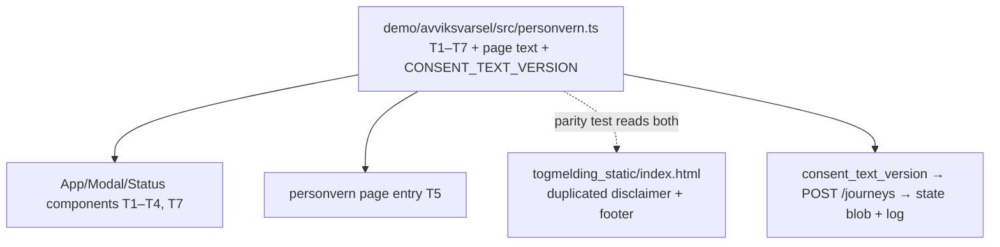

# Avviksvarsel Privacy Texts, Consent, and Deletion - Plan

## Goal Capsule

- **Objective:** Implement the privacy PRD (A2 information, A3 consent, A4 deletion, A7 unbranded variant) on `/varsel`, with text reuse on `/togmelding`: texts T1–T7, a new `/varsel/personvern` page, a «Slett alt» flow, and a versioned consent text. The PRD's seven acceptance criteria (its section 6) define done.
- **Authority:** The PRD at `docs/personvern/prd-avviksvarsel-personvern-tekster.md` is the product authority. The final texts in the Appendix of this plan are the published wording — they resolve every bracketed placeholder in the PRD and are adjusted only where verified code behavior contradicted a PRD draft claim (see KTD6). Session-settled decisions (KTD1–KTD3) are not re-litigated.
- **Stop conditions:** Stop and surface if implementation finds evidence that a settled decision (KTD1–KTD3) cannot work, or if satisfying a text claim would require destructive changes to user state beyond the delete-all endpoint specified here.
- **Execution profile:** Frontend (React/Vite, no component-test harness — texts live in a plain testable module), backend (FastAPI additions to `disruptions/api/varsel.py`), one committed static HTML page, Python + Node tests per repo conventions.

---

## Product Contract

### Summary

The Avviksvarsel PWA collects a commute pattern (route, weekdays, time window) and a push subscription with no privacy information, no controller identity, no privacy page, and no way to delete everything. This plan adds the GDPR art. 12/13 information at the points of collection (T1–T4), a privacy page at `/varsel/personvern` (T5), a one-action deletion flow (T6) that also clears `localStorage`, a sender line visible in every brand variant (T7), and version tracking for the consent text. The same disclaimer and sender line are added to `/togmelding`.

### Problem Frame

Verified against the running service (PRD section 1): `/varsel` shows no privacy text anywhere, `/varsel/personvern` is a 404, registration collects a commute pattern with no information, `localStorage` is never cleared, no delete-all exists, and under `?brand=none` the word «Entur» appears nowhere while registration stays fully operational. Art. 13(1) information must be given where the data is collected; art. 7(3) requires withdrawal to be as easy as consent; art. 13(1)(a) requires the controller's identity in every variant.

### Requirements

**On-page information (A2)**

- R1. `/varsel` shows the T1 experiment disclaimer at the top of the page, above the intro sentence, visible without scrolling or clicking, in both brand variants.
- R2. `/varsel` shows the T2 privacy line directly under the intro sentence, linking to the privacy page.
- R3. The «Legg til reise» modal shows T3 above the button row, in both brand variants.
- R4. The notification card («Slå på varsler» / «Skru av») shows T4 below the status line.
- R5. `/varsel/personvern` serves the T5 privacy page: 200 in a browser, all T5 sections present, both brand variants render correctly, and the page carries a back link to the app (the PWA opens it in-app with no browser back button).

**Consent (A3)**

- R6. Registration stays confirmation-style — no checkbox, no «ved å trykke lagre samtykker du»-phrasing; T3 is the information that makes the confirmation informed (PRD section 3).
- R7. The consent text shown at registration is versioned in code; the version is sent with the registration, persisted on the journey record, and logged, so which text version was live at any time is provable.

**Deletion (A4)**

- R8. A «Slett alt» action with the T6 confirmation dialog deletes, in order: all of the device's journeys and the device record (server-side), then — only after the server confirms — the push subscription (client-side, best-effort) and `localStorage`'s `avviksvarsel.device_id`. Server-first ordering makes the failure path a true no-op: on an API error nothing client-side has changed yet. Afterwards `GET /varsel-api/journeys?device_id=<old>` returns an empty list and `localStorage.getItem('avviksvarsel.device_id')` is `null`.
- R9. Delete-all also removes the device's `_notified` dedup entries, so nothing keyed to the deleted journeys remains in the persisted state blob.

**Sender identity (A7)**

- R10. The T7 sender line («Tjenesten leveres av Entur AS …») renders at the bottom of the page in **all** brand variants, including `?brand=none`, linking to the privacy page.

**Reuse on /togmelding**

- R11. `/togmelding` shows an adapted experiment disclaimer and the same sender/privacy footer; the strings shared between the two surfaces are guarded by a parity test.

**Truthfulness**

- R12. Every claim in the published texts is verified or verifiable from this repo: retention wording matches actual behavior (KTD6), the encryption claim is backed by pywebpush's RFC 8291 payload encryption (`disruptions/api/varsel.py` `_send_push`), and the Google/EU claims are guarded by a Helm-pin test (KTD2).
- R13. No bracketed placeholder text (`[…]`) remains in any published text (PRD acceptance criterion 7).

### Acceptance Examples

The PRD's section 6 criteria, browser-checked:

- AE1. **Covers R1, R2.** Open `/varsel`: T1 and T2 are visible without scrolling or clicking.
- AE2. **Covers R5, R13.** `GET /varsel/personvern` answers 200 in a browser and the page contains every T5 section, with no bracketed text.
- AE3. **Covers R3.** Open «Legg til reise» in both brand variants: T3 renders above the button row.
- AE4. **Covers R4.** The notification card shows T4.
- AE5. **Covers R8.** Use «Slett alt»: afterwards `localStorage.getItem('avviksvarsel.device_id')` is `null` and `GET /varsel-api/journeys?device_id=<the old id>` returns an empty list.
- AE6. **Covers R10.** On `/varsel/?brand=none`, «Entur AS» is visible in the page text.
- AE7. **Covers R13.** No bracketed placeholder remains in production texts.

### Scope Boundaries

**In scope:** everything under Requirements, plus the README and docs updates those changes force.

**Deferred to Follow-Up Work**

- An inactivity purge for journeys/devices (e.g. `last_seen`-based sweep). No retention mechanism exists today; the published text states actual behavior instead (KTD6). If the team wants the 90-day claim, the purge is its own change with its own risk review.
- Access control in front of `/historikk` and `/meldinger` if `/varsel` ever takes registrations from the public (existing documented condition, unchanged by this plan).
- Narrowing `llm_message.py`'s `provider="auto"` code default (the Helm-pin test in U8 guards the published claim instead).

**Outside this product's identity**

- A1 (access control), A5 (`/eval`), A6 (`device_id` transport), A8–A12 from the handlingsliste — explicitly out of the PRD's scope.
- Any change to the `varsel_decisions` / `varsel_decision_outcomes` BigQuery schema. The consent version rides the state blob and logs only — adding an outcomes column breaks the registered scheduled query (documented trap).

---

## Planning Contract

### Key Technical Decisions

- KTD1. **A7 is resolved as the always-visible sender line (T7), in all brand variants.** (session-settled: user-directed — chosen over Alternativ 2, disabling registration under `?brand=none`: preserves the demo, costs one line, and satisfies art. 13(1)(a) without conditional logic in two screens.) This deliberately breaks `demo/avviksvarsel/README.md`'s stated invariant that «Entur» appears nowhere under `?brand=none`; the README is updated to state the new invariant (page text names the sender; notifications and manifest stay unbranded).
- KTD2. **The T5 claim that the alert text is written by a language model at Google in the EU stays in the published text.** (session-settled: user-directed — chosen over removal under the PRD's unconfirmable-claims rule: the user confirmed the fact.) Verified in repo: every Helm env pins `VARSEL_LLM_PROVIDER: gemini` + `VERTEX_GEMINI_LOCATION: eu` (`helm/kix-avvik/env/values-kub-ent-*.yaml`). Because the *code* default is `provider="auto"` (would try Claude at `global`), the claim rests on Helm values — U8 adds a test that pins those values so a values regression fails a test instead of falsifying the published text.
- KTD3. **The T5 claim that Google Cloud operates the service for Entur in the EU stays; «Overføring ut av EØS» resolves to «Behandlingen skjer i EU/EØS.»** (session-settled: user-directed — chosen over removal under the same rule: the user confirmed the platform fact.)
- KTD4. **`/varsel/personvern` is a second Vite entry (`personvern/index.html`), not a client route and not a FastAPI route.** The app has no router, and `main._VersionedStaticFiles` has no SPA fallback, so a client route would 404 server-side. With the directory entry, Starlette's `html=True` serves `personvern/index.html` at `/varsel/personvern/` and answers the slash-less `GET /varsel/personvern` with a 307 redirect to it — browsers follow transparently, satisfying the browser-checked criterion. All in-app links use the trailing-slash form to skip the redirect. Rejected: an explicit FastAPI `FileResponse` route — it must be registered before the mounts at `disruptions/api/main.py:1340` (every other route sits after them and would be shadowed dead code), and it would sit outside `test_static_cache.py`'s cache-header guard.
- KTD5. **Delete-all is one new endpoint, `DELETE /varsel-api/devices/{device_id}/data`,** which under a single `_state_lock` acquisition pops the device record, every journey whose `device_id` matches, and every `_notified` entry belonging to those journeys, then calls `_save_state()` once. Plain `def`, not `async def` — `_save_state` blocks on GCS (repo rule restated in `upsert_device`'s docstring). Idempotent: an unknown `device_id` returns ok with zero deletions. Rejected: a client-side loop over `DELETE /journeys/{id}` + `DELETE /devices/{id}` — non-atomic, N round trips, and it strands `_notified` entries (R9).
- KTD6. **Retention texts state verified behavior instead of implementing retention.** No expiry, purge, TTL, or `last_seen` exists anywhere in `varsel.py`, and neither BigQuery decisions table has `partition_expiration_days` — so the PRD's draft «fjernes automatisk etter [90] dager uten aktivitet» and «lagres i [X] dager» are unpublishable as written. Per the PRD's own rule («En påstand som ikke lar seg bekrefte, skal ut av teksten»), the published text says: journeys are stored until the user deletes them; the decision log is kept for the life of the experiment and does not identify the device; feedback is kept up to 45 days (the one repo-verified retention: `create_varsel_feedback_contexts.sql` pins `partition_expiration_days=45`). The purge itself is deferred follow-up work.
- KTD7. **Consent versioning: a `CONSENT_TEXT_VERSION` constant in the frontend text module, sent as `consent_text_version` on `POST /varsel-api/journeys`, persisted on the journey record, and logged.** Pydantic's default `extra="ignore"` on `JourneyIn` makes the rollout safe in both directions (old API ignores the field; new API accepts old clients). The journey record is a free-form dict serialized wholesale into the state blob, so the field round-trips with no migration. It must **not** become a `varsel_decisions`/outcomes column (see Scope Boundaries).
- KTD8. **`/togmelding` gets duplicated strings guarded by a parity test, not a shared component and not API-served texts.** The page is committed vanilla HTML with no build step — a React component cannot be reused there, and API-served texts would blank the disclaimer exactly when the API is down (the page shell deliberately renders through data failures). A Python test reads both `demo/avviksvarsel/src/personvern.ts` and `disruptions/api/togmelding_static/index.html` and asserts the shared strings match.
- KTD9. **All published texts live in one frontend module, `demo/avviksvarsel/src/personvern.ts`.** The repo has no component-test harness (`node --test` on `.mjs` files only, Node type-stripping for direct `.ts` imports — the `alertFeedbackState.ts` pattern), so a plain module is the only unit-testable home for the texts, the version constant, and the brand-preserving URL helper. Components render what the module exports; tests assert content rules (no brackets, required phrases) against the module.

### High-Level Technical Design

Delete-all flow (R8/R9) — the ordering is load-bearing: `localStorage` is cleared only after the server confirms, so a failed delete keeps the key needed to retry:

```mermaid
sequenceDiagram
    participant U as User
    participant FE as VarselStatus (client)
    participant SW as Push subscription
    participant API as varsel-api
    U->>FE: «Slett alt» → confirm dialog (T6)
    FE->>API: DELETE /varsel-api/devices/{id}/data
    API->>API: one _state_lock: pop device, journeys, _notified; _save_state()
    API-->>FE: 200 {status: ok, journeys_deleted: n}
    FE->>SW: unsubscribe() (best-effort, skip if none)
    FE->>FE: localStorage.removeItem('avviksvarsel.device_id'); device id state → null
    FE->>U: «Alt er slettet …» + empty journey list
    Note over FE: on API error: nothing client-side has changed yet — show error, retry stays possible
```

Text ownership — one source, three consumers, one parity guard:



### Assumptions

Decided here in pipeline mode; each is reversible text- or naming-level, none changes product scope:

- The retention wording (KTD6) is the PM-assigned bracket decision, resolved to honest-actual-behavior rather than new purge infrastructure.
- The delete-all endpoint path is `DELETE /varsel-api/devices/{device_id}/data`; any rename is cosmetic.
- The `/togmelding` disclaimer adapts T1's wording to that surface («Togmeldingen er et eksperiment … prognosene er anslag») since T1 names Avviksvarsel and its push alerts.
- T5 gains sentences beyond the PRD draft, all accuracy-driven, so the recipients and retention enumerations match verified behavior: operational logs exist and carry the device key (push sends via `varsel.py` `_log_push`, plus U1's «Slett alt» receipt event); feedback is kept up to 45 days (BigQuery contexts pin `partition_expiration_days=45`; PostHog holds ~30 — 45 is the honest ceiling) and is processed by PostHog in the EU (`POSTHOG_HOST: https://eu.i.posthog.com` in prd Helm values); and the open evaluation pages `/historikk` and `/meldinger` show which routes and departures alerts concerned — the SSO gate (PR #111) exists but is `SSO_REQUIRED: "false"` in every environment, so the pages are publicly readable and the recipients sentence must say so or R12 fails at ship time. Stating these avoids the overstatement the PRD warns against.
- T5's «Hva vi lagrer» notes that the technical key is stored with registered journeys too (verified: the journey record carries `device_id`), not only when notifications are on.

---

## Implementation Units

### U1. Backend delete-all endpoint

- **Goal:** Atomic server-side deletion of everything keyed to a device.
- **Requirements:** R8, R9 (KTD5)
- **Dependencies:** none
- **Files:** `disruptions/api/varsel.py`, `disruptions/api/test_varsel_api.py`
- **Approach:**
  1. Add `DELETE /varsel-api/devices/{device_id}/data` next to `delete_device` (~`varsel.py:2927`): under one `with _state_lock:`, pop the device, collect and pop journeys with matching `device_id`, drop `_notified` keys whose `journey_id` prefix (`key.split("|", 1)[0]`) is one of the popped journey ids, call `_save_state()` once.
  2. **Skip `_save_state()` when nothing was popped** — an unknown-id no-op must do zero I/O. Every existing mutation holds `_state_lock` across a blocking GCS upload, so an unauthenticated endpoint that uploads on every random UUID is free write amplification and lock starvation for the poller and registration paths.
  3. Declare the path param with `Path(min_length=8, max_length=100)`, mirroring the `device_id` constraints every body model already carries (`DeviceIn`, `JourneyIn`, `TestIn`, `ClientLogIn`); FastAPI validates path params only when constraints are declared. No charset pattern — the legacy fallback id shape `dev-<ts>-<rand>` must stay legal.
  4. Log one structured `event="varsel_delete_all"` line with `device_id` and `journeys_deleted` on real deletions (the art. 17 execution record; the no-op fast path logs nothing).
  5. Return `{"status": "ok", "journeys_deleted": <n>}`.
- **Patterns to follow:** `delete_device` (`varsel.py:2927–2936`) for lock shape, the plain-`def` rule, **and** 200-on-missing idempotency (`pop` with default, always 200). `delete_journey` deliberately 404s on missing and is *not* the idempotency pattern here. `_log_push` for the structured-log shape. Note `Path` must be added to `varsel.py`'s fastapi import (currently only `APIRouter`/`HTTPException`/`Query`/`Request`).
- **Test scenarios:**
  - Covers AE5 (server half). Device with a device record, two journeys, and `_notified` entries for both: DELETE data → 200 with `journeys_deleted: 2`; `GET /journeys?device_id=` returns `[]`; the device record and both journeys' `_notified` keys are gone from module state and from the reloaded state file.
  - A second device's journeys and `_notified` entries are untouched by the first device's delete-all.
  - Unknown `device_id` → 200, `journeys_deleted: 0` (idempotent); calling twice → both 200; **the unknown-id path performs no state save** (stub `_save_state` and assert it was not called).
  - Over-long `device_id` (>100 chars) → 422.
  - Device with journeys but no device record (push never enabled) → journeys still deleted.
  - Pin existing semantics: first-ever test for `DELETE /devices/{device_id}` asserting journeys are **kept** (documents the difference between «Skru av» and «Slett alt»).
  - Note, not a defect: module caches keyed on the journey *definition* (`_messages`, `_message_attempts`) survive deletion until their situation dies, so a re-registered identical journey inherits cached wordings and half-spent retry budgets — expected sharing by design, not a deletion failure.
- **Verification:** `test_varsel_api.py` passes standalone (`__main__` runner) and under pytest.

### U2. Backend consent version persistence

- **Goal:** The consent text version shown at registration is provable after the fact.
- **Requirements:** R7 (KTD7)
- **Dependencies:** none
- **Files:** `disruptions/api/varsel.py`, `disruptions/api/test_varsel_api.py`
- **Approach:**
  1. Add optional `consent_text_version: str | None = None` to `JourneyIn` (~`varsel.py:2784`) and `Journey` (~`2820`), **constrained** (`max_length=40`, pattern `^\d{4}-\d{2}-\d{2}\.\d+$`) — every sibling string field on these models carries constraints, and an unbounded client-controlled string would ride the state blob on every `_save_state` and land in a structured log field.
  2. In `create_journey`, copy it into the journey record dict (~`3163–3179`) and include it in `_journey_model`.
  3. Log a structured `event="journey_registered"` line carrying `consent_text_version` and `journey_digest` (`llm_message.key_digest`) — **never** `from_stop`/`to_stop`: keeping the commute pattern out of Cloud Logging is that digest's documented purpose, and this event sits beside `device_id`-bearing records.
- **Patterns to follow:** `_log_push` (`varsel.py:1600–1641`) for structured logging; the existing optional-field style on `ConfigResponse` for backward-compatible model additions.
- **Test scenarios:**
  - POST journey with `consent_text_version: "2026-08-31.1"` → stored on the record, echoed by `GET /journeys`, survives a `_serialize_state`/`_apply_state` round trip.
  - POST journey without the field → 200, journey created, field `None`/absent (old-client compatibility).
  - POST journey with an over-long or non-matching version string → 422.
  - Unknown extra fields on POST are still ignored (pydantic default unchanged).
- **Verification:** suite green standalone and under pytest.

### U3. Frontend text module

- **Goal:** One testable source for every published text, the version constant, and the privacy-page URL helper.
- **Requirements:** R12, R13 (KTD9); feeds R1–R5, R10, R11
- **Dependencies:** none
- **Files:** `demo/avviksvarsel/src/personvern.ts` (new), `demo/avviksvarsel/test/personvern.test.mjs` (new)
- **Approach:**
  1. Export the final texts from the Appendix: T1–T4, T6 (button, dialog title/body, done-notice), T7, the T5 page sections, `CONSENT_TEXT_VERSION` (initial value `2026-08-31.1`), and the strings shared with `/togmelding` (sender line, privacy URL, disclaimer heading).
  2. Link-bearing texts (T2, T3, T7) are exported as structured pieces — prose string + link text + href built from `personvernUrl` — never as markdown strings; the Appendix's `[…](…)` notation denotes the rendered `Link` component. The bracket guard then applies to every exported string unchanged.
  3. Export `personvernUrl(brandId)` → `/varsel/personvern/` plus `?brand=none` when the brand is `none` (brand must survive navigation — the PWA has no address bar).
  4. Bump `CONSENT_TEXT_VERSION` whenever a text a registering user sees changes — and the bump is **test-enforced**, not remembered: the suite pins a content hash (sha256[:8]) of the registration-visible texts next to the version, the same derived-version reasoning as `llm_message.PROMPT_VERSION` («so nobody has to remember to bump it»). Editing T3 (or any registration-visible text) without bumping both fails the suite; R7's provability claim rests on this.
- **Patterns to follow:** `demo/avviksvarsel/src/components/alertFeedbackState.ts` + `test/feedback.test.mjs` (plain module imported directly by `node --test` via type-stripping).
- **Test scenarios:**
  - Covers AE7. No exported text contains `[` or `]` (the bracket-placeholder guard).
  - `CONSENT_TEXT_VERSION` matches `^\d{4}-\d{2}-\d{2}\.\d+$`.
  - The sender line contains «Entur AS»; T1 contains «eksperiment»; the T5 sections include Behandlingsansvarlig / Hva vi lagrer / Hvorfor / Rettslig grunnlag / Hvem som kan se opplysningene / Hvor lenge / Rettighetene dine / Klage / Overføring ut av EØS.
  - T4 wording guard: T4 claims «Skru av» deletes the *varselabonnement*, and does **not** claim it deletes the technical key (the key survives «Skru av» in `localStorage` and on every journey record — claiming otherwise is the overstatement the PRD rule forbids).
  - T6 dialog stays enumerative: it names exactly the three things deleted (reiser, varselabonnement, teknisk nøkkel) — the scope that keeps «Alt er slettet» true while logs and the decision log survive.
  - Version-bump enforcement: the pinned sha256[:8] hash of the registration-visible texts matches; changing those texts without updating both the hash and `CONSENT_TEXT_VERSION` fails the suite.
  - `personvernUrl('entur')` → `/varsel/personvern/`; `personvernUrl('none')` → `/varsel/personvern/?brand=none`.
- **Verification:** `npm test` green in `demo/avviksvarsel/`.

### U4. On-page notices T1–T4 and consent wiring

- **Goal:** The art. 13 information appears at every collection point.
- **Requirements:** R1, R2, R3, R4, R6, R7
- **Dependencies:** U2, U3
- **Files:** `demo/avviksvarsel/src/App.tsx`, `demo/avviksvarsel/src/components/AddJourneyModal.tsx`, `demo/avviksvarsel/src/components/VarselStatus.tsx`, `demo/avviksvarsel/src/components/PersonvernNotis.tsx` (new), `demo/avviksvarsel/src/api.ts`, `demo/avviksvarsel/src/styles.css`
- **Approach:**
  1. `PersonvernNotis.tsx`: small component family over `SmallAlertBox variant="information"` (T1) and `Paragraph`/`SmallText` + `Link` (T2–T4), texts imported from `personvern.ts`, links via `personvernUrl(brand.id)`.
  2. `App.tsx`: T1 above the intro `LeadParagraph` (~line 167), T2 directly under it — both above the fold per AE1.
  3. `AddJourneyModal.tsx`: T3 immediately above the `.av-form-actions` row (~line 252); include `consent_text_version: CONSENT_TEXT_VERSION` in the create payload (`api.ts` `NewJourney` type + request body).
  4. `VarselStatus.tsx`: T4 renders once, **unconditionally, below all of the component's per-state branches** (mirroring the existing `notice`/`error` paragraph placement) — so the push-collection notice is visible *before* the user ever taps «Slå på varsler», not only after subscribing.
  5. Token-driven CSS only (`var(--…)`), or the `brand=none` reskin leaves Entur-colored details behind. No new `@entur/*` packages — `SmallAlertBox`, `Modal`, typography are already imported, so `make_brand_css.py` does not need a re-run.
- **Patterns to follow:** the `togvarsel_notify` `SmallAlertBox` in `App.tsx:185–197`; `Link` from `@entur/typography` as in `App.tsx:193`; `.av-status-note` for subdued text color (`styles.css:94–97`).
- **Test scenarios:** Text content is covered by U3's module tests; component rendering has no unit harness in this repo.
  - `npm run build` (`tsc -b`) passes — the only type gate.
  - Browser: AE1, AE3, AE4 in both brand variants (pipeline browser-test step).
  - Registration round trip: a journey created through the UI carries `consent_text_version` (assertable via U2's API test; browser spot-check optional).
- **Verification:** build green; AE1/AE3/AE4 hold in the browser.

### U5. Privacy page at /varsel/personvern

- **Goal:** T5 served at a stable URL in both brand variants.
- **Requirements:** R5, R13 (KTD4)
- **Dependencies:** U3
- **Files:** `demo/avviksvarsel/personvern/index.html` (new), `demo/avviksvarsel/src/personvern-page.tsx` (new entry), `demo/avviksvarsel/vite.config.ts`, `demo/avviksvarsel/src/styles.css`, `disruptions/api/test_static_cache.py`
- **Approach:**
  1. `vite.config.ts`: add `build.rollupOptions.input = { main: 'index.html', personvern: 'personvern/index.html' }` — emits `varsel_static/personvern/index.html`; the Dockerfile copies `varsel_static/` wholesale, so nothing else ships it.
  2. `personvern/index.html` duplicates the root `index.html`'s inline brand script and head links (required — without it `?brand=none` paints the Entur palette on this page), then loads `src/personvern-page.tsx`.
  3. The entry renders the T5 sections from `personvern.ts` with `@entur/typography` components — each of the nine section titles as a **semantic heading** (e.g. `Heading2`), never bold paragraph text, so the page is navigable by screen reader — plus a «Tilbake til Avviksvarsel» link to `/varsel/` preserving `?brand=none` (the PWA opens the page in-app with no back button). The duplicated brand script is drift-guarded by U8's parity suite.
  4. Serving needs no backend change: `_VersionedStaticFiles(html=True)` serves the directory index; the slash-less URL 307-redirects to the slash form. New file sits outside `assets/` → `no-cache` automatically.
- **Patterns to follow:** root `index.html:15–26` (inline brand script) and `:32–45` (head links); `src/main.tsx` for entry bootstrap and CSS imports.
- **Test scenarios:**
  - Covers AE2 (transport half; content half is U3 + browser). In `test_static_cache.py`'s temp-tree fixture: `GET /x/personvern` → 307 with `location` ending `/x/personvern/` (assert with `follow_redirects=False` — `TestClient` follows redirects by default); following it → 200.
  - `GET /x/personvern/` → 200 with `Cache-Control: no-cache` (the deploy-visibility rule for non-hashed files).
  - Existing cache-header tests stay green (the mount subclass is unchanged).
- **Verification:** `test_static_cache.py` green; `npm run build` emits `varsel_static/personvern/index.html`; browser AE2 in both brands.

### U6. «Slett alt» UI flow

- **Goal:** Withdrawal as easy as consent — one action deletes everything, T6 wording.
- **Requirements:** R8 (client half), R13
- **Dependencies:** U1, U3
- **Files:** `demo/avviksvarsel/src/components/VarselStatus.tsx`, `demo/avviksvarsel/src/api.ts`, `demo/avviksvarsel/src/App.tsx`, `demo/avviksvarsel/src/styles.css`
- **Approach:**
  1. `api.ts`: `deleteAllData(deviceId)` → `DELETE /varsel-api/devices/{id}/data`.
  2. «Slett alt» button in the `VarselStatus` card (T6 button text), rendered **unconditionally, outside all six `state === …` branches** (like the existing `notice`/`error` paragraphs) — nesting it in the subscribed-only branch would hide it from exactly the push-never-enabled user the test scenarios require to succeed. It opens a confirmation `Modal` copied from `AddJourneyModal`'s pattern (`size="medium"`, `.av-form-actions` row: Avbryt / Slett alt).
  3. Confirmed flow per the HTD sequence — **server first**: `deleteAllData` (the DELETE), then on success `disablePush()` best-effort (skip when no subscription — push-disabled deployments must still delete; a browser subscription with no server record receives no pushes, so a failed unsubscribe is tolerable), then `localStorage.removeItem('avviksvarsel.device_id')`, then clear journey state and show the T6 done-notice («Alt er slettet …»).
  4. On API failure: nothing client-side has changed yet — show the error; `localStorage`, the subscription, and app state are intact for retry.
  5. **The device id becomes nullable app state.** `App.tsx` freezes the id at mount (`useRef(getDeviceId()).current`) and feeds it to more than the registration flow: the 60 s journey poll, the `focus`/`visibilitychange` listeners, and the `VarselStatus` prop. «Slett alt» sets the state to `null`, which suspends the poll and the `VarselStatus` flows; the next registration action mints a new id via the getter, writes it to `localStorage` and state, and the poll, `handleCreate`/`handleDelete`, and `VarselStatus` all resume on the new id. The poll and focus listeners **never call the minting getter** — a getter that mints on every caller would re-mint seconds after deletion (the focus listener fires when the user returns from devtools during the AE5 check itself) and fail AE5's literal `localStorage.getItem(...) === null`; a mount-frozen id would recreate data under the *deleted* key on the invited next action and orphan it on the next reload.
  6. Busy handling: set a busy state before the chain, pass `loading={busy}` to the confirm button and disable «Avbryt» while busy (mirroring `disable()`'s busy handling and `AddJourneyModal`'s saving-gated submit) — a double-tap must not race two overlapping teardowns.
- **Patterns to follow:** `disable` in `VarselStatus.tsx:112–126` (busy/error handling and push teardown); `AddJourneyModal.tsx:182, 252–259` (the repo's only `@entur/modal` usage).
- **Test scenarios:** No component harness; the deletion semantics are pinned server-side in U1.
  - `npm run build` passes.
  - Browser: AE5 end-to-end — after «Slett alt», `localStorage.getItem('avviksvarsel.device_id')` is `null` and the old id's journey list is empty; the confirmation dialog's Avbryt leaves everything intact.
  - Browser: «Slett alt» works when notifications were never enabled (no subscription present).
  - Browser: «Slett alt» → register a new journey **without reloading** → the journey is visible, owned by a **new** `device_id`, and `localStorage` holds that new id (the same-session re-registration path the done-notice invites).
- **Verification:** AE5 holds in the browser; U1's API tests green.

### U7. Sender footer (T7) in all brands

- **Goal:** Controller identity visible in every variant.
- **Requirements:** R10 (KTD1)
- **Dependencies:** U3
- **Files:** `demo/avviksvarsel/src/App.tsx`, `demo/avviksvarsel/src/styles.css`, `demo/avviksvarsel/README.md`
- **Approach:**
  1. Footer element after `</main>` (~`App.tsx:239`), unconditional on brand: T7 text + `Link` to `personvernUrl(brand.id)`.
  2. Style with tokens only (`.av-footer`, subdued text).
  3. README: update the brand section — the old promise `/entur/i.test(document.body.innerText) === false` under `?brand=none` no longer holds by design (art. 13(1)(a)); notifications, manifest, and icons stay unbranded.
- **Patterns to follow:** `.av-status-note` token usage; `Link` as elsewhere.
- **Test scenarios:**
  - Covers AE6. Browser: «Entur AS» visible at the bottom on `/varsel/` and on `/varsel/?brand=none`; the footer link on the `none` variant carries `?brand=none`.
  - U3's module test already pins the sender-line wording.
- **Verification:** build green; AE6 holds in the browser.

### U8. /togmelding texts and claim-guard tests

- **Goal:** The disclaimer and sender line reach `/togmelding`; shared strings and the EU claims cannot silently drift.
- **Requirements:** R11, R12 (KTD2, KTD8)
- **Dependencies:** U3, U5
- **Files:** `disruptions/api/togmelding_static/index.html`, `disruptions/api/test_personvern_texts.py` (new)
- **Approach:**
  1. `togmelding_static/index.html`: adapted experiment disclaimer after the `.sub` paragraph (~line 63) using the page's own `.card`/`.note` classes and CSS variables; footer after `</main>` (~line 67) with the sender line and a link to `/varsel/personvern/` (~4 new CSS lines, page stays self-contained). The new texts are **static markup only** — never routed through a JS-populated `id`/fill helper; the page currently has zero `innerHTML` sinks and these additions must not create the first interpolation on it.
  2. `test_personvern_texts.py` (with a `__main__` runner — CI never runs a suite without one):
     - Parity: extract the shared string constants from `demo/avviksvarsel/src/personvern.ts` (regex on the export) and assert `togmelding_static/index.html` contains the sender line and the `/varsel/personvern/` href. The extraction step first asserts **every expected constant name was found** — a missing or unparseable constant fails loudly, never a vacuous pass over zero extracted strings (the `__main__`-runner lesson, one layer down).
     - Brand-script parity: the inline brand-detection script block in `demo/avviksvarsel/personvern/index.html` is byte-identical to the one in `demo/avviksvarsel/index.html` — the duplicated copy is what keeps `?brand=none` correct on the privacy page, and nothing else detects its drift.
     - Claim guard: assert **every** `helm/kix-avvik/env/values-kub-ent-*.yaml` pins `VARSEL_LLM_PROVIDER: gemini` **and explicitly sets `VERTEX_GEMINI_LOCATION: eu`** — not merely "eu wherever set": the effective Gemini location is `VERTEX_GEMINI_LOCATION or VERTEX_LOCATION or "eu"` (`llm_message.py:124`), and dev/prd already carry `VERTEX_LOCATION: global`, so deleting the Gemini pin would silently move processing to `global` while the guard stayed green. Also assert the prd file pins `POSTHOG_HOST: https://eu.i.posthog.com` — the T5 PostHog-in-EU sentence rests on it.
     - Bracket guard on the static page: the added texts contain no `[`/`]` placeholders.
- **Patterns to follow:** `test_static_cache.py`'s standalone `_run()` runner shape; plain file reads, no new dependencies.
- **Test scenarios:** (the file *is* the tests; enumerated above)
  - Parity failure mode: editing the sender line in `personvern.ts` without touching the static page fails the suite; renaming or reformatting a constant so extraction finds nothing also fails (no vacuous pass).
  - Brand-script failure mode: editing the root `index.html` brand script without updating the personvern copy fails the suite.
  - Helm failure mode: switching any env to `VARSEL_LLM_PROVIDER: claude`, removing any env's explicit `VERTEX_GEMINI_LOCATION: eu`, or changing prd's `POSTHOG_HOST` fails the suite.
- **Verification:** new suite green standalone and under pytest; `/togmelding` renders the texts in the browser.

### U9. Decision record in docs

- **Goal:** The personvernvurdering can be updated from one authoritative record of what was published (PRD task 10 is PM-owned; this unit leaves the evidence).
- **Requirements:** R12, R13 trace
- **Dependencies:** U1–U8 (records their outcome)
- **Files:** `docs/personvern/2026-08-31-avviksvarsel-personvern-tekster-beslutninger.md` (new)
- **Approach:** Short record: the final texts as shipped, `CONSENT_TEXT_VERSION`, the A7 choice (Alternativ 1), the retention resolution (KTD6 — what the brackets became and why), the two confirmed Google/EU claims and their Helm guard, and the delete-all endpoint contract. Plus two **rollout verification items** the repo cannot answer, recorded as open until platform confirms:
  1. The two GCS state buckets' versioning/soft-delete configuration — if noncurrent state generations are retained beyond the default soft-delete window, pre-deletion journeys remain restorable and T6's claim needs a lifecycle bound or softer wording.
  2. The actual Cloud Logging retention in `ent-kixavvik-{dev,prd}` — T5 ships the criteria-based sentence (logs auto-delete after a fixed period, not covered by «Slett alt»); replace with the verified number once known.
  3. The PostHog project's configured event retention in the EU instance — T5's «inntil 45 dager» is repo-verified only for the BigQuery contexts table; confirm PostHog stays at or below 45 days, else the sentence needs the verified number.
  Also note: a re-registered identical journey yields the same `journey_digest`, so decision-log rows join across a deletion — by design, worth stating for the personvernvurdering. And note the T5 sentence about open evaluation pages is scoped to today's `SSO_REQUIRED: "false"`: if the SSO gate is later enabled for `/historikk`/`/meldinger`, that sentence should be re-scoped to Entur staff in the same change — no owner keeps the published recipients list in step with the gate otherwise.
- **Test scenarios:** Test expectation: none — documentation unit.
- **Verification:** File exists, states the shipped `CONSENT_TEXT_VERSION`, lists the two rollout verification items, and contains no bracketed placeholders.

---

## System-Wide Impact

- **Brand contract:** the `?brand=none` «no Entur anywhere» invariant narrows to «no Entur branding except the legally required sender line» (KTD1). Push payloads, manifest, and icons are untouched, so notification identity is unchanged.
- **State blob:** journey records gain an optional `consent_text_version` key. `_serialize_state`/`_apply_state` round-trip free-form dict keys already; old blobs load unchanged. No BigQuery schema is touched (the scheduled-query trap stays untriggered).
- **PWA scope:** `/varsel/personvern/` is inside the service-worker scope but the SW has no fetch handler and no cache — no conflict. The page opens in-app when installed, hence the mandatory back link (R5).
- **Serving:** one more static directory under `varsel_static/`; cache headers fall out of the existing `_VersionedStaticFiles` rules (`no-cache` for non-hashed files). No new env vars, no Helm change, no image-build change (Dockerfile copies `varsel_static/` wholesale).
- **Public API surface:** one new unauthenticated DELETE endpoint. Its data exposure equals the existing `DELETE /devices/{id}` and `DELETE /journeys/{id}` (anyone holding the UUID can already delete piecewise); it adds no new disclosure, only removal. The added abuse surface is write amplification — every existing mutation uploads the full state to GCS while holding `_state_lock` — which U1's no-op fast path (no save, no log on unknown ids) removes.
- **Erasure boundaries:** «Slett alt» deletes the stored records (journeys, device, `_notified`). It does not reach Cloud Logging (push logs carry `device_id` + alert text until log retention expires), the BigQuery decision log (no `device_id`; journey definition under `journey_digest`), PostHog feedback events (~30 days), or in-memory definition-keyed caches (die with their situations). The shipped T5/T6 texts are scoped to stay true across all of these: T6's dialog enumerates exactly what is deleted, and T5 discloses the logs and the decision log with their retention criteria.

## Risks & Dependencies

- **307 vs literal 200 (R5):** the slash-less URL redirects. Mitigation: in-app links use the slash form; the static test asserts the redirect chain; the browser criterion («svarer 200») is satisfied by the followed redirect. If a literal first-hop 200 is later required, the explicit-route option in KTD4 is the fallback — registered before the mounts, with an explicit `Cache-Control` header.
- **Text drift on /togmelding:** guarded by U8's parity test; residual risk is strings the test doesn't cover (kept to two shared strings by design).
- **Claim regression via Helm:** guarded by U8's pin test. Residual: the GCS state bucket's region is not declared in this repo; the user-confirmed claim covers it, and the docs record (U9) notes the confirmation for the personvernvurdering rather than re-deriving it.
- **State-blob history:** the state buckets' versioning/soft-delete configuration is invisible to this repo. If noncurrent versions are retained, pre-deletion state generations (journeys included) outlive «Slett alt». U9 records the verification item; only unbounded versioning would force softer T6 wording.
- **Same-session re-registration after delete-all:** without a device-identity reset, the flow would recreate data under the deleted key and orphan it on next load — handled in U6 (lazy re-mint) and pinned by a browser scenario.
- **Delete-all mid-poll:** `check_and_notify` snapshots under the same `_state_lock` discipline as all mutations; a journey deleted mid-cycle stops matching next cycle. No new race beyond existing journey deletion.
- **Consent version omitted by cached clients:** old bundles post without the field until their `index.html` revalidates (`no-cache` is already in place); rows registered in that window have `consent_text_version: None`, which reads as «pre-versioning» — acceptable and honest.

---

## Verification Contract

| Gate | Command | Proves |
|---|---|---|
| Frontend tests | `cd demo/avviksvarsel && npm test` | U3 text rules, bracket guard, URL helper |
| Frontend build/types | `cd demo/avviksvarsel && npm run build` | `tsc -b` type gate + MPA output incl. `personvern/index.html` |
| Varsel API suite | `cd disruptions/api && uv run --with fastapi --with httpx --with pydantic --with google-cloud-bigquery --with google-cloud-storage --with pywebpush python test_varsel_api.py` | U1 delete-all, U2 consent version |
| Static serving | `cd disruptions/api && uv run --with fastapi --with httpx --with pydantic python test_static_cache.py` | U5 personvern serving + cache headers |
| Texts/claims suite | `cd disruptions/api && uv run python test_personvern_texts.py` | U8 parity, Helm pins, bracket guard |
| Lint | `uv run ruff check .` (repo root) | Python style |
| Browser | pipeline browser-test step | AE1–AE7 (the PRD's section 6, checked in a browser, both brands) |

Every new/changed Python suite keeps a `__main__` runner — CI globs `test_*.py` and runs each as its own process; a file without the runner is silently never run.

## Definition of Done

- All seven acceptance examples (AE1–AE7) hold in a browser, in both brand variants where they apply.
- All Verification Contract gates green.
- No bracketed placeholder in any shipped text (`personvern.ts`, the personvern page, `togmelding_static/index.html`).
- `demo/avviksvarsel/README.md` states the new brand invariant.
- The docs decision record (U9) exists and matches what shipped.
- No dead-end or experimental code remains in the diff.

---

## Appendix: Final texts

The published wording. Norwegian, verbatim as shipped; brackets resolved per KTD2/KTD3/KTD6. Components must render these exactly (source: `personvern.ts`).

**T1 — Eksperimentforbehold** (top of `/varsel`)

> **Dette er et eksperiment**
> Avviksvarsel er et eksperiment fra Enturs KI-lab. Vi tester om varsler før avviket rammer er til nytte. Tjenesten kan endres eller avsluttes på kort varsel, og varslene er anslag som ikke alltid treffer — ikke planlegg reisen din på dem alene.

**T2 — Personvernlinje** (under the intro)

> Entur AS lagrer reisene du registrerer, slik at vi kan varsle deg. [Slik behandler vi opplysningene](/varsel/personvern/)

**T3 — Registreringstekst** (in «Legg til reise», above the buttons)

> Vi lagrer holdeplassene, ukedagene og tidsrommet du velger her. Vi trenger dem for å vite hvilke avvik som gjelder deg. Du kan slette reisen når som helst. [Slik behandler vi opplysningene](/varsel/personvern/)

**T4 — Varselkort** (notification card)

> For å sende varsler lagrer vi et varselabonnement for denne nettleseren. Det brukes bare til å varsle om reisene dine, og slettes når du trykker «Skru av». Den tekniske nøkkelen som knytter reisene til nettleseren slettes med «Slett alt». Innholdet i varselet er kryptert, slik at tjenesten som frakter det ikke kan lese det.

(Reworded from the PRD draft: «Skru av» deletes only the push subscription — the technical key survives in the browser and on every journey record, so claiming its deletion there would be the overstatement the PRD's own rule forbids. U3 pins this wording.)

**T5 — Personvernsiden** (`/varsel/personvern/`)

> # Personvern i Avviksvarsel
>
> Avviksvarsel er et eksperiment fra Enturs KI-lab. Denne siden forklarer hvilke opplysninger vi behandler når du bruker tjenesten.
>
> **Behandlingsansvarlig**
> Entur AS, Postboks 1800, 0048 Oslo. Personvernombudet nås på personvern@entur.org.
>
> **Hva vi lagrer**
> Reisene du registrerer: holdeplass du reiser fra, holdeplass du reiser til, transportmiddel, tidsrom og ukedager — sammen med en teknisk nøkkel som knytter dem til nettleseren din. Slår du på varsler, lagrer vi i tillegg et varselabonnement for nettleseren. Når vi sender et varsel, lagres det som ble sendt, sammen med den tekniske nøkkelen, i driftsloggene våre; det samme gjelder som kvittering når du bruker «Slett alt». Vi lagrer ikke navn, e-postadresse eller telefonnummer, og du trenger ingen bruker for å bruke tjenesten.
>
> **Hvorfor**
> For å varsle deg når et avvik kan ramme en reise du har registrert, og for å forbedre varslene.
>
> **Rettslig grunnlag**
> Registrering av reiser og varsler behandles på grunnlag av ditt samtykke, jf. personvernforordningen art. 6 nr. 1 bokstav a. Du gir samtykket ved å registrere en reise, og trekker det tilbake ved å slette den. Forbedring av varslene skjer på grunnlag av vår berettigede interesse i å vite om tjenesten er til nytte, jf. art. 6 nr. 1 bokstav f.
>
> **Hvem som kan se opplysningene**
> Ansatte i Entur som arbeider med tjenesten kan se hvilke reiser som er registrert, for å vurdere om varslene treffer. Vurderingene av varslene — med strekning og avgangstid, men uten noe som identifiserer deg eller enheten din — vises også på åpne evalueringssider. Google Cloud drifter tjenesten på Enturs vegne, i EU. Varselteksten skrives av en språkmodell hos Google i EU, som får vite hvilken strekning og avgang varselet gjelder. Tilbakemeldinger du sender behandles i analyseverktøyet PostHog i EU, på Enturs vegne. Tjenesten som leverer varselet til telefonen din ser ikke innholdet — det er kryptert.
>
> **Hvor lenge**
> Reiser du har registrert lagres til du sletter dem. Varselabonnementet slettes når du skrur av varsler eller bruker «Slett alt». Loggen over varsler vi har vurdert å sende lagres så lenge eksperimentet pågår; den identifiserer ikke enheten din. Driftslogger slettes automatisk etter en fast periode og omfattes ikke av «Slett alt». Tilbakemeldinger du sender lagres i inntil 45 dager.
>
> **Rettighetene dine**
> Du kan slette reisene dine og varselabonnementet direkte i appen, med «Slett alt» eller reise for reise. Du har også rett til innsyn, retting, begrensning, protest og dataportabilitet, jf. art. 15 til 21. Fordi tjenesten ikke vet hvem du er, må du bruke enheten du registrerte reisene fra for at vi skal kunne finne dem.
>
> **Klage**
> Mener du at vi behandler opplysningene dine i strid med regelverket, kan du klage til Datatilsynet.
>
> **Overføring ut av EØS**
> Behandlingen skjer i EU/EØS.

**T6 — Sletteflyt** (button / dialog / done-notice)

> Slett alt

> **Slette alt?**
> Dette sletter de registrerte reisene dine, varselabonnementet og den tekniske nøkkelen til denne nettleseren. Det kan ikke angres.
> [Avbryt] [Slett alt]

> Alt er slettet. Du kan registrere en ny reise når som helst.

(The `[Avbryt] [Slett alt]` line denotes the two dialog buttons, not bracketed placeholder text.)

**T7 — Avsenderlinje** (footer, all brands; also on `/togmelding`)

> Tjenesten leveres av Entur AS. [Slik behandler vi opplysningene](/varsel/personvern/)

**Togmelding disclaimer** (adapted T1)

> **Dette er et eksperiment**
> Togmeldingen er et eksperiment fra Enturs KI-lab. Prognosene er anslag som ikke alltid treffer — ikke planlegg reisen din på dem alene. Tjenesten kan endres eller avsluttes på kort varsel.
