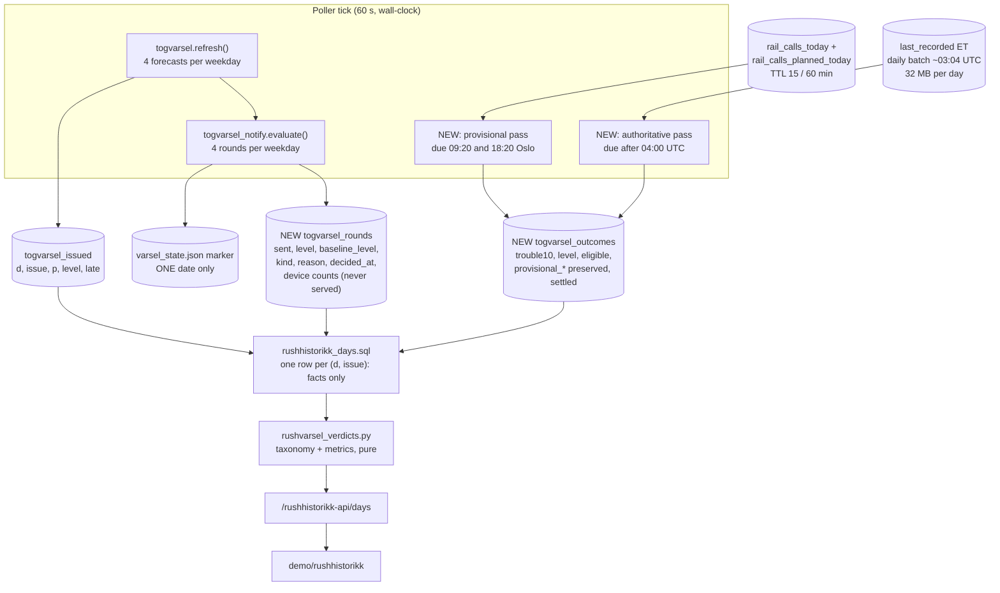
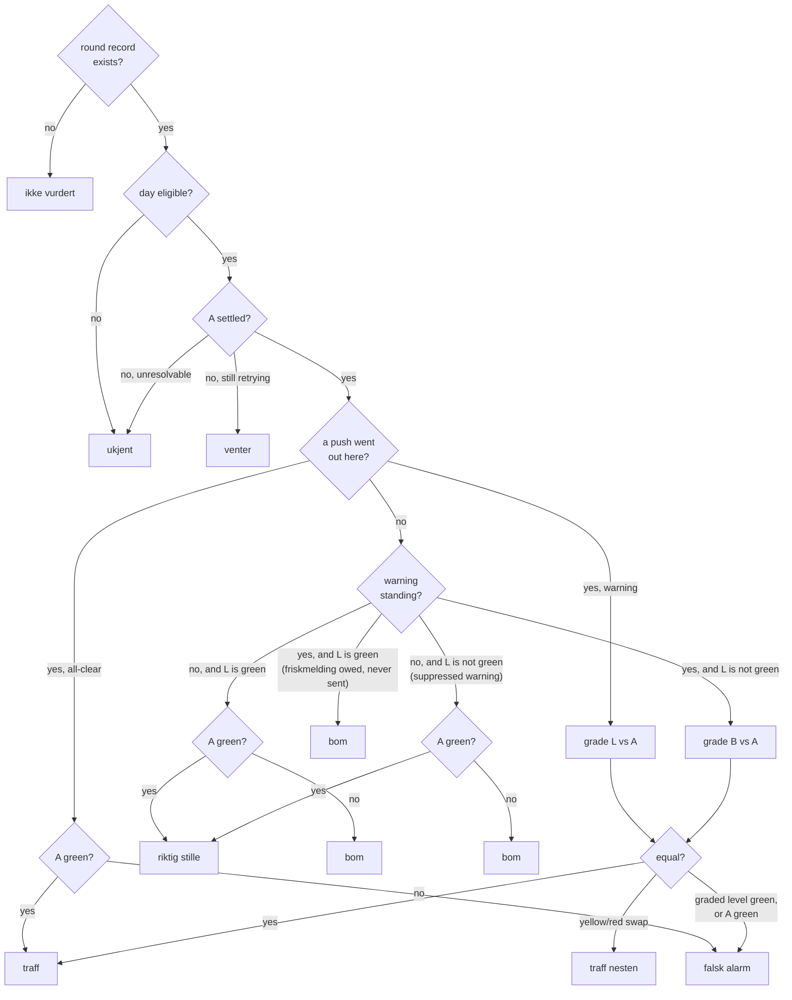

# Rushhistorikk - Plan

## Goal Capsule

**Objective.** Ship `/rushhistorikk`: a day-grained feedback loop for Rushvarsel that scores each of the four daily forecast issues against what the rush actually did, and against what was communicated to the traveller.

**Authority hierarchy.** Product behaviour: the R-IDs. Implementation mechanism: the KTD-IDs. The labelled Key Decisions KD1-KD6 are settled and are not reopened; KD3 carries a research conflict call-out and is implemented as settled. Where research contradicts a KTD, the KTD loses; where it contradicts a KD, report the conflict rather than re-deciding.

**Execution profile.** Six units. **Land U1 and U2 first and deploy them before U3 begins** (KTD11): notification history cannot be reconstructed, so every weekday spent building the page is a weekday permanently unscoreable. U3 is a pure function and is the one place the verdict taxonomy exists.

**Stop conditions.** Stop and report if: `togvarsel_notify` cannot record a round without changing when markers commit (that ordering bounds the accepted duplicate-push window); or the settled query cannot reproduce each scope's own label expression per KTD3 (then the page and the models disagree about what a bad rush is).

**Tail ownership.** The caller owns branch, commit, PR and CI.

---

## Product Contract

### Summary

Rushvarsel issues four weekday forecasts and pushes some of them, and nothing records what was communicated or whether it was right. `/rushhistorikk` adds that: one row per day showing the four issues and the realized morning and afternoon rush level, a segmented "Slik har varslene truffet" table, and the two records the scoring needs — a durable note of every notification round as it is decided, and a resolution of what the rush actually did that runs after each rush and settles overnight.

### Problem Frame

`/historikk` closed this loop for `/varsel` and became the surface that found real defects: the sub-threshold rows that make a `miss` visible, the 41 % of cards quoting text nobody received. Rushvarsel has no equivalent, and what is missing is specifically the **notification half**. The level-versus-outcome half already exists: the study measured it over the full window (`02-findings` §14a — forecast green 36 % of days at 6 % bad, yellow 51 % at 21 %, red 13 % at 55 %), so a red-only gate can already be argued on forecast skill. What cannot be argued is whether a traveller was told, because the notification decision survives only as a `{level, pushed}` marker in the `/varsel` state blob and `store_togvarsel_rounds` replaces that whole map with a single date — yesterday's is destroyed after midnight. The realized outcome is no better placed: it exists only as `togvarsel_days`, a `CREATE OR REPLACE` training artefact rebuilt monthly by `retrain.sh`, and one that does not exist in prd at all. `togvarsel_issued` has no reader anywhere in the repo; this page would be its first.

### Key Decisions

KD1. **One row per day, all four issues and both realized outcomes side by side** (session-settled: user-directed - chosen over `/historikk`'s one-card-per-decision listing: the unit of this product is a day's rush, and the four issues about one rush are only interpretable next to each other). Governs R1, R2.

KD2. **The verdict taxonomy is notification-based, not level-based** (session-settled: user-directed - chosen over a plain forecast-level-versus-realized-level classification: the product's failure mode is what reached the traveller, so silence has to be scoreable both as a success and as a failure). Governs R7, R8, R9, R10, R11, R12, R13.

KD3. **The realized outcome is checked after each rush, twice per weekday** (session-settled: user-directed - chosen over the existing 04:00 UTC `varsel-label-daily` nightly pattern: a morning verdict knowable by 09:00 should not wait until the next night on a page whose purpose is the feedback loop). Governs R19, R21, R23.

> Conflict call-out, from research: the source the training label reads, `realtime_siri_et_last_recorded`, is a **once-daily batch**. Measured 2026-09-01 from `INFORMATION_SCHEMA.PARTITIONS`, every partition shares one `last_modified_time` of ~03:04 UTC, and the current day's partition held 115 k rows against 1.81 M for the previous full day. A twice-daily job cannot read the morning rush from it, and `01_calls.sql` codifies that by stopping at `CURRENT_DATE() - 1`. The decision is implemented as settled via two passes (KTD2): a same-day provisional check after each rush from tables the poller already builds, and a nightly authoritative pass that settles the value. What this concedes is that the figure shown at 09:20 can move overnight, which is why R23 marks it and why the stats table excludes it.

KD4. **A time-range picker is the only control** (session-settled: user-directed - chosen over `/historikk`'s five dropdowns: a rush forecast is one product-wide prognosis over a fixed 39-station geography, with no operator, line or from/to dimension to slice). Governs R4.

KD5. **The page reuses `/historikk`'s visual language** (session-settled: user-directed - chosen over a fresh design or `/togmelding`'s Linje card language: this is the same feedback-loop surface family and should read as its sibling). Governs R5, R5a.

KD6. **The stats table is segmented: a total row plus one row per issue slot** (session-settled: user-directed - chosen over a single blended headline: the baselines push on level and the follow-ups push on level change, so a blended figure moves with the mix rather than with the product). Governs R14, R15, R16.

### Requirements

**The page**

R1. `/rushhistorikk` lists one row per day, newest first, each row carrying that day's four issues (0630, 0700, 1200, 1400) and the realized morning and afternoon rush level.

R2. Each issue cell shows the forecast level, its probability, what was communicated (a push and its kind, a standing warning, or nothing), and the issue's verdict.

R3. An issue whose realized outcome is not yet established shows `venter`; one whose outcome can no longer be established, or whose day or forecast disqualifies it, shows `ukjent`; one for which no notification round was ever recorded shows `ikke vurdert`.

R4. The only control is a time-range picker over exactly four values: 7 days, 14 days, 30 days, all time.

R5. The page reuses `/historikk`'s layout primitives, chip palette and card language, under its own `rh-` class prefix.

R5a. Rush **level** badges are the exception to R5: they use `/togmelding`'s Linje validation tokens, because they are the same product's levels and the two rush surfaces must not disagree about what red looks like. Verdict chips stay `/historikk`'s.

R6. Non-prod deployments label the heading and the tab title from a dedicated `/config` endpoint that reads no BigQuery.

**The verdict taxonomy**

R7. `Traff` - what was communicated at this issue was correct: a warning whose level matched the realized level, or an all-clear on a rush that was green.

R8. `Traff nesten` - a warning was in force and said red while the rush was yellow, or said yellow while the rush was red.

R9. `Falsk alarm` - what was communicated was wrong: a warning on a green rush, or an all-clear on a rush that was not green.

R10. `Bom` - a notification that should have gone out did not: green was forecast and the rush was not green, or a warned rush turned green and no friskmelding went out, or a warning was warranted and none was in force.

R11. `Riktig stille` - nothing was communicated, nothing was warranted.

R12. `Venter` - the realized level for this issue's window is not yet settled.

R13. The taxonomy is total and disjoint: every recorded issue receives exactly one verdict, including the states R7-R11 do not name (KTD6).

**The stats table**

R14. A section headed "Slik har varslene truffet" carries a total row plus one row for each of 0630, 0700, 1200 and 1400.

R15. Each row shows Presisjon (samlet), Presisjon (varslet), Dekning, Varslingstid and Avgjørelser, each over the population its own definition names (KTD5), with that population stated on the page.

R16. Each row shows a colour-coded 3x3 confusion matrix of forecast level against realized level over that row's scored issues, each cell carrying its count as text.

R17. A rate whose denominator is empty renders as an en dash, never as 0 %. Counts default to 0; rates stay null.

**Recording and resolving**

R18. Every notification round is recorded durably and queryably at the moment it is decided, including the rounds that decided not to push and why, and including the level a standing warning left in force.

R19. The realized rush level is checked after each rush period, twice per weekday, and is settled against the same source the models were trained on.

R20. An issue's realized level is computed over the same window and product bar the model behind that issue was trained on, using that scope's own label expression, and its green boundary is exactly that model's own label threshold.

R21. A realized outcome that cannot yet be established is left unresolved and retried for 10 days; one the source can never establish is settled as `ukjent` immediately.

R22. A day whose call volume fails the training chain's day-level eligibility test is reported as `ukjent` rather than scored.

R23. A provisional outcome is marked as provisional on the day row, its value is preserved when the settled pass overwrites the authoritative one, and the stats table is computed over settled outcomes only.

### Scope Boundaries

**Deferred to follow-up work**

- Acting on what the page shows. The documented follow-ups to Rushvarsel's fatigue problem - a red-only gate, per-user levels - are threshold changes this page exists to inform, not part of it.
- A notification-volume figure. The fatigue problem is about how often a traveller is pushed, and U1 records `sent` per round, so the figure is one column away - but R15's five figures are the specified set and a sixth is the user's call (Open Questions).
- Registering `data/queries/togvarsel/*.sql` and `togvarsel_features_today.sql` in the SQL validator. None of the twelve is validated today. This plan adds only its own files; the rest is a cheap, separate, overdue pass.

**Outside this product's identity**

- Backfilling notification rounds. Not deferred - impossible. The marker store keeps one date, and the `togvarsel_notify_round` log event carries no Oslo date and has no BigQuery sink.
- Scoring hypothetical forecasts. The models' out-of-sample predictions over the 343 eligible training weekdays already exist in the study, and §14a already reports what they show. Rendering them here would answer a model question while this page's question is what we issued and what we sent.
- Per-journey or per-line attribution. Rushvarsel forecasts one geography; `/historikk` is where per-journey alerting is scored.

---

## Planning Contract

### Key Technical Decisions

KTD1. **A new `disruptions.togvarsel_rounds` table records each round as it is decided, including the level left in force; the decision is never re-derived at query time.** `decide_issue` is a pure function of level, marker state and the evaluation clock, so reconstruction looks feasible and is not: it cannot see a round the gate closed before evaluating (no markers are written at all then), cannot see the `untimely` verdict on a back-filled round, and cannot see how many devices matched. This is `/meldinger`'s own rule — `pushed` is looked up, never re-derived. The row also carries `baseline_level`, the value `_effective_baseline` computed, because reading it off the *baseline's* row instead would make one swallowed best-effort write invert a verdict: a 06:30 red that pushed and was right reads `bom` if only its own MERGE failed. Cites R18.

KTD2. **The realized outcome is resolved by two passes: a provisional check after each rush, and a nightly authoritative pass that settles it.** Per KD3's call-out, no single source serves both same-day timeliness and training-identical semantics.
  - **Provisional**, due 09:20 and 18:20 Oslo, reads `disruptions.rail_calls_today` for delays and dedupes in `rail_calls_planned_today`'s ET-declared cancellations. Not free of caveats, and naming them is the point — there are **four**: `rail_calls_today` carries **departure** delay where the label prefers arrival; it is built from `recordedCalls`, where declared cancellations live in `estimatedCalls` (hence the union); both sources are **TTL-gated off the SX-ingestion rebuild**, not rebuilt every tick (`_RAIL_CALLS_TTL` 15 min, `_PLANNED_TTL` 60 min — which is why the due times are :20 and not :05); and `rail_calls_today` has no `extraJourney` column, so `03_day_windows.sql`'s exclusion cannot be reproduced. It writes `settled = FALSE`.
  - **Authoritative**, due after 04:00 UTC, reads `realtime_siri_et_last_recorded` and reproduces each scope's own label expression (KTD3), for the previous day and for any unsettled day inside the retry window. Measured at 32 MB per day, about $0.0002.
  Both run on the poller's wall-clock tick rather than as transfer configs: `togvarsel.refresh()` already establishes that pattern, and a transfer config would mean two schedules times two environments each holding its own copy of the SQL — the documented drift trap — on a fixed UTC time that drifts an hour against Oslo twice a year, with no ability to self-heal a missed run. The rejected same-day alternative is not a semantics impossibility: `togvarsel_features_today.sql` already computes this shape off the live anshar feed with arrival-preferred delay, `estimatedCalls` cancellations and extra journeys excluded — it was rejected on cost (~$0.11 a run, two runs per weekday per environment), not on fidelity. Inherits KD3's settlement; cites R19, R21, R23.

KTD3. **The realized level is green below the bar, yellow from the bar to twice the bar, and red at or above twice the bar — and only the green boundary follows from the training label.** Nothing in the repo defines a realized green/yellow/red: the cuts 0.10/0.30 apply to the *probability*, while the truth is the binary `trouble10 >= bar`. A 3x3 matrix needs a third band. What keeps this from minting a second definition of "a bad rush" is that **realized level is non-green exactly when the training label is true** — the green boundary *is* the bar. Twice-the-bar is a **display convention chosen for class balance**, not a derived threshold: measured over 345 non-holiday weekdays (2025-04-10 to 2026-08-28, `togvarsel_days`) it gives 82.0 / 11.6 / 6.4 % for the morning and 82.9 / 12.8 / 4.3 % for the afternoon, the same shape either side. Two consequences to carry onto the page rather than bury: the matrix diagonal compares two differently-scaled categoricals (forecast red on 13 % of days against realized red on 6.4 %), so a well-calibrated red forecast lands in `traff nesten` more often than in `traff` — §14a's expected bad-day rate per forecast level (6 / 21 / 55 %) is printed beside the matrix as the reference. And the comparison is **pinned per scope to that scope's own label source**, because they round differently: `am` and `pm` come from `03_day_windows.sql`'s `ROUND(...,4)` carried through `04_days.sql`, while `amrest` is a **raw** `SAFE_DIVIDE` in `08_features_cat.sql` — which is also the only file defining the 07:00-09:00 window at all. One rounding rule for all three breaks the identity in one direction or the other. Cites R16, R20.

KTD4. **Each issue is scored against its own trained window; the day row displays the whole-rush level.** `10_train_models.sql` gives 0630 the label `y_am10` over 06:30-09:00 and 0700 the label `y_amrest10` over 07:00-09:00. Scoring 0700 against the whole morning would hand it 30 minutes that had already happened when it was issued, inflating its skill. So three realized figures are resolved per day — `am`, `amrest`, `pm` — the verdict picks the issue's own, and the row header shows `am` and `pm` as the morning and the afternoon rush. The `amrest` figure is shown in the row detail so the two cannot silently disagree. Cites R20.

KTD5. **The SQL returns facts and Python classifies and aggregates: one query per request, the stats table derived in process.** The population is four rows per weekday, so a year is about a thousand rows and the summary cannot drift from the list it describes. `/historikk` splits decisions and summary because its decision log is large and its list is capped at 200; neither holds here. The decisive reason is the taxonomy: the decision table below has seventeen branches and three named populations, and it exists once, in a pure module, unit-testable without BigQuery. Expressing it a second time in SQL is how two definitions of "traff" get shipped. Cites R13, R14, R15, R16, R17.

KTD6. **The verdict grades what was communicated, which is not the same as what this issue forecast — and the states R7-R11 leave unnamed are resolved here.** Three facts come off the round records: `sent` (a push was issued at this issue), `level` (what it said), and `baseline_level` (what a standing warning still says). Four resolutions:
  - A follow-up that confirms its baseline (`reason = no_change`) sends nothing, yet the traveller is warned — at the **baseline's** level, which is what gets graded. Grading this issue's own level instead would credit a red forecast nobody received: 12:00 pushes yellow, the 14:00 round is suppressed `untimely` with a red forecast, the rush is yellow, and grading the red gives `traff nesten` where the yellow the traveller actually holds was exactly right. Without this resolution at all, 0700 and 1400 would read `bom` on every warned day and their Dekning would be near zero.
  - A warning that was warranted with none in force is `bom`, whatever suppressed it. That includes an `untimely` round, whose cause is infrastructural rather than a forecast error — so `n_untimely` is counted and shown separately rather than the rows being filtered out. Segment, never filter.
  - **`sent` records the policy decision, not delivery.** `push_round` legitimately fans out to zero matched devices, so a round can score as notified with nobody notified. The device counts are recorded and surfaced on the issue cell so that case is visible.
  - An issue with **no round record at all** is `ikke vurdert` and enters no rate — the gate was closed, VAPID was absent, or the day predates U1. Defaulting those to `bom` would manufacture failures out of a deployment setting. Because `_record_round` swallows its errors, this class must not hide a write regression: it is split on the earliest `decided_at` in `togvarsel_rounds`, and issues on or after that date are counted separately and shown as a data-health line.
  Cites R3, R7, R8, R9, R10, R11, R13.

KTD7. **`late`, `untimely` and ineligible are three different exclusions with three different scopes.** They are not interchangeable, and the widely-believed shortcut — that a late forecast never pushed — is false: `late` is `now > due + 10 min` while `untimely` is `now >= deadline`, and the gap is 30 min for 0630, 120 for 0700 and 1200, and 240 for 1400. So a 14:12 forecast is `late` and its 14:13 round pushes normally.
  - A **late** forecast saw post-cutoff reality; `03-implementasjon.md` says such forecasts "skal utelates fra etterprøving av treffsikkerhet". It is excluded from **Presisjon only**. It stays in Dekning, because a rush nobody was warned about is a coverage miss whatever contaminated the forecast, and dropping it from both halves of that ratio would hide exactly the misses.
  - An **untimely** round is excluded from Presisjon on the same reasoning and kept in Dekning.
  - An **ineligible** day fails the training chain's day-level test and is excluded from everything: its realized share means nothing.
  All three counts sit beside the rates. Cites R15, R22.

KTD8. **Varslingstid is measured from each issue's own scored-window start, which is `NOTIFY_SPECS.scope_start_h`.** Those values are 6.5 / 7.0 / 15.0 / 15.0 — **identical** to each model's own label window, so there is no second source to choose between and no discrepancy with KTD4. A 07:01 push on 0700 therefore leads by about −1 minute, not −31. The morning issues still land at or just after their rush begins while 1200 leads by about 180 minutes and 1400 by about 60; that is a product finding worth seeing rather than a number to massage, so the page states the reference point beside the figure. Slot rows take the median lead of that slot's own pushes; the total row takes the median lead of the **last push per rush**, which is the requirement's own phrasing and is not an aggregate of the slot rows. This needs a real push timestamp, which is why `decided_at` is on the round record. Cites R15.

KTD9. **`/rushhistorikk` registers the SSO prefixes its siblings use, and ships publicly readable anyway.** `sso.PROTECTED_PREFIXES` gets `/rushhistorikk` and `/rushhistorikk-api` — both entries, each with a leading slash, because matching is per path segment (`path == p or path.startswith(p + "/")`) so one does not claim the other, and an unslashed entry matches nothing. But `SSO_REQUIRED` is `"false"` in `helm/kix-avvik/values.yaml`, is overridden in no environment file, and no environment wires the OAuth client — so `sso.required()` returns False, the middleware short-circuits before `_is_protected`, and **the registration gates nothing today**. `trafficType: public` is set once in the chart and inherited, so the page and its API are readable by anyone on all three hosts the day this ships. That is the same posture as `/historikk` and `/meldinger` and it is a known gap, not a new one; the follow-up that closes it is the flag plus a per-environment OAuth client, which is a console resource. What follows for this plan is a projection rule, not a gate: KTD10.

KTD10. **The forecast and verdict fields carry no traveller data; the five subscriber-derived columns are recorded for audit and never served.** `matched_journeys`, `matched_devices`, `n_sent`, `n_error` and `n_gone` are day-grained counts over a subscriber population currently numbering a handful — on an unauthenticated endpoint (KTD9) they would publish its size and its changes at k=1. `rushhistorikk_days.sql` never names them, which is `meldinger_decisions.sql`'s rule that a query which cannot name a column cannot leak it, and a test asserts they appear in neither the query text nor the response model. The two counts KTD6 puts on the issue cell are the per-issue `matched_devices`/`n_sent` for a *scored* issue; if that proves too fine on a small population, drop them from the projection before shipping — they are a diagnostic, not a requirement. Cites R2.

KTD11. **U1 and U2 land and deploy before U3 begins.** Notification history cannot be reconstructed, so every weekday spent building the page is a weekday permanently stuck at `ikke vurdert`. Both units are dependency-free, both writes are best-effort, both tables are created at startup, and nothing reads them until U4 exists — so landing them alone is safe and starts the clock immediately. The Definition of Done is a two-stage gate for the same reason.

KTD12. **Forked from `/historikk`, not shared.** `/historikk` and `/meldinger` share only `historikk_stop_places.sql`; everything else is duplicated deliberately. This page needs no stop-place resolution at all, so it imports nothing and the fork is total. The file headers say so, and a fix to a shared idiom has to be mirrored by hand. The hosting choice is the same fork: `/rushhistorikk` ships as its own Vite app and deployable rather than a second route inside `demo/varselhistorikk`, which is what U6 pays for — a node stage, four ignore lists, a mount, a `/config` endpoint — and it sets the precedent that each scoring surface gets its own app. Recorded because it is a real recurring cost, not because the alternative is better.

### High-Level Technical Design

Where each fact comes from, and which three records are new:

The verdict decision, in the order the code takes it. `L` is this issue's forecast level, `B` the level a standing warning leaves in force, `A` the realized level for this issue's own window.

"Grade X vs A" is one rule used twice: equal is `traff`, a yellow/red swap is `traff nesten`, anything else is `falsk alarm`.

The same thing as a table, which is what U3 implements. First match wins.

| # | Record | Eligible | A | sent | L | Standing | Verdict |
|---|---|---|---|---|---|---|---|
| 1 | absent | - | - | - | - | - | ikke vurdert |
| 2 | present | no | - | - | - | - | ukjent |
| 3 | present | yes | unresolvable | - | - | - | ukjent |
| 4 | present | yes | not settled | - | - | - | venter |
| 5 | present | yes | known | yes | yellow or red | - | grade L vs A |
| 6 | present | yes | green | yes | green | - | traff |
| 7 | present | yes | yellow or red | yes | green | - | falsk alarm |
| 8 | present | yes | known | no | yellow or red | yes | grade B vs A |
| 9 | present | yes | green | no | green | yes | bom |
| 10 | present | yes | yellow or red | no | green | yes | bom |
| 11 | present | yes | green | no | green | no | riktig stille |
| 12 | present | yes | yellow or red | no | green | no | bom |
| 13 | present | yes | green | no | yellow or red | no | riktig stille |
| 14 | present | yes | yellow or red | no | yellow or red | no | bom |

Row 8 is the common one — it is every confirming follow-up, and it grades the **standing** level, not this issue's. Rows 9 and 10 are the owed-but-unsent friskmelding, reachable only on an `untimely` round; before the deadline a green follow-up after a warned baseline always pushes. Rows 13 and 14 are a suppressed warning. `Standing` is undefined for the two baseline slots, which have no baseline, and is `false` there by construction.

**Three named populations.** Every figure states which it uses, and the page states it too.

- **scored** — record present, day eligible, outcome settled and resolvable, forecast not late, round not untimely. This is Presisjon's and the confusion matrix's population.
- **delivered** — record present, day eligible, outcome settled and resolvable. Late and untimely included. This is Dekning's population (KTD7).
- **recorded** — every issue in the window. This is Avgjørelser's.

| Figure | Numerator | Denominator | Population |
|---|---|---|---|
| Presisjon (samlet) | traff | every verdict | scored |
| Presisjon (varslet) | traff + traff nesten | traff + traff nesten + falsk alarm, all-clear pushes excluded | scored |
| Dekning | rushes yellow or red with a warning in force | rushes yellow or red | delivered, **per rush** on the total row |
| Varslingstid | median (push time − scope start) | pushes; the last push per rush on the total row | pushes on settled eligible days |
| Avgjørelser | - | every issue | recorded |

Two exclusions that are easy to get backwards. An **all-clear** push leaves Presisjon (varslet) and Dekning: it is not a warning, so counting a correct friskmelding as a correct warning would let a month of 20 right friskmeldinger and 20 wrong red warnings read 50 %, and counting a wrong one in Dekning's numerator would credit "all clear" with having warned about a red rush. And Dekning's total row counts **rushes, not issues**: a confirming follow-up is notified only because its baseline pushed, so counting per issue makes the 0700 and 1400 rows restate the baseline's coverage — those two rows are labelled as inherited on the page.

**The exclusion counts are disjoint and reconcile.** Resolved in the table's own order, first match wins: `n_ikke_vurdert`, `n_ineligible`, `n_ukjent`, `n_venter`, `n_late`, `n_untimely`, then `n_scored`. Their sum is `n`, and the enumeration test asserts it.

### Assumptions

- "All time" is a bounded 365 days. The picker stays a four-value allow-list so the response-cache key space is four entries, and the tables it reads are kilobytes. The label outlives its meaning once the product has more than a year of weekdays.
- `settled` means "confirmed against `last_recorded`", never a heuristic. That is what makes KTD2's four provisional caveats tolerable.
- Resolution gives up after 10 days, matching `label_varsel_decisions.sql`'s retry window. A day whose resolved denominator is zero *after* the batch has landed is settled `ukjent` immediately rather than retried for ten days to reach the same answer.

### Sequencing

U1 and U2 are independent, both write tables U4 reads, and both ship first (KTD11). U3 depends on nothing. U4 needs U1, U2 and U3, and carries the SSO prefix edit so the prefixes land in the same commit as the router that starts serving. U5 needs U4's response shape. U6 registers the front-end.

---

## Implementation Units

### U1. Record every notification round in BigQuery

**Goal.** Give the page a durable, queryable answer to what was communicated at each round and why, written when the round is decided.

**Requirements.** R18; KTD1, KTD6, KTD10.

**Dependencies.** None.

**Files.**
- `disruptions/api/togvarsel_notify.py` - DDL, MERGE, `ensure_table`, a best-effort `_record_round`
- `disruptions/api/main.py` - `ensure_table()` in `lifespan`
- `disruptions/api/test_togvarsel_notify.py` - new checks

**Approach.**
1. Add `_ROUNDS_DDL` / `_ROUNDS_MERGE` beside the existing module constants, mirroring `togvarsel._ISSUED_DDL`'s in-Python shape. Columns: `d DATE, issue STRING, level STRING, baseline_level STRING, sent BOOL, kind STRING, reason STRING, decided_at TIMESTAMP, matched_journeys INT64, matched_devices INT64, n_sent INT64, n_error INT64, n_gone INT64`. `baseline_level` is the value `_effective_baseline` returned, so no reader has to consult a sibling row (KTD1); NULL for the two baseline slots.
2. `PARTITION BY d`, and set `partition_expiration_days` the way `create_varsel_feedback_contexts.sql` does for its own per-day subscriber series — the table is a day-grained count series over a small subscriber population and should not accumulate forever.
3. MERGE on `(d, issue)` with `WHEN NOT MATCHED THEN INSERT` and no `WHEN MATCHED`, matching `togvarsel_issued`'s first-write-wins semantics. A marked round never re-fires, so a second write means a duplicate.
4. **Expose `ensure_table()` and call it from `main.lifespan`** beside `decisions.ensure_table()`. Lazy creation is not enough: `_evaluate` returns before deciding anything while the notify gate is off — permanently true in tst — so the table would never exist there and U4's LEFT JOIN would 503 the whole page. Keep the per-write readiness latch as a fallback.
5. **Record from one `for decision in decisions:` loop at the very end of `_evaluate`**, after both existing `store_markers` sites. The two sites that persist markers today are inside the `pushes` loop and the `not pushes` branch, and neither iterates the suppressed decisions — so on a mixed pass (a restart back-fill that suppresses 0630 as `untimely` and pushes 0700 in one tick, the case the module's own docstring explains the marker ordering for) "after the marker is persisted" names no reachable hook for the suppressions. Capture each pushing round's `push_round` summary, which `_evaluate` currently discards.
6. **Never call `_record_round` from `push_round`.** `POST /togmelding-api/test-notify` reaches `push_round` directly on the public dev host with a caller-supplied `device_id` and a synthetic yellow `0630` decision; on a first-write-wins MERGE that write would win the day and the real 06:30 round would be lost forever.
7. Wrap in `try/except` that logs and swallows — a BigQuery problem must never cost a push. Note in the module what a swallowed write costs the page: the issue reads `ikke vurdert`, which KTD6 splits on `decided_at` so it is not mistaken for the pre-U1 backlog.
8. Store `reason` and `kind` as `decide_issue` produced them, unmapped. They are the discriminators U3 reads.

**Patterns to follow.** `togvarsel._record_issue` and `_ISSUED_MERGE` for the DDL, MERGE, latch and swallow shape. `decisions.ensure_table` for the startup call. `create_varsel_feedback_contexts.sql` for partition expiry on a subscriber-derived series.

**Test scenarios.**
- A pushing round writes one row with `sent = True`, the `kind` `decide_issue` returned, and the device counts from the fan-out.
- A round suppressed as `no_change` writes a row with `sent = False`, `reason = "no_change"` and the baseline's level in `baseline_level`.
- `untimely` and `green_baseline` suppressions each write a row.
- **A mixed pass — 0630 suppressed `untimely`, 0700 pushed, one tick — writes both rows.** This is the regression the placement exists for.
- A baseline slot writes `baseline_level = NULL`.
- No MERGE is issued for an issue that already carries a marker.
- A raising BigQuery client does not prevent the push, and does not prevent markers persisting.
- With the notify gate off, no row is written and no query runs — the existing `fake.queries == []` assertion extended.
- `ensure_table()` creates the table with the gate off, so the page has something to join to in tst.
- `POST /togmelding-api/test-notify` issues no `togvarsel_rounds` MERGE.
- The DDL is issued once across two evaluations.

**Verification.** `test_togvarsel_notify.py` passes standalone, with the new rows visible in the fake's recorded queries and parameters.

### U2. Resolve the realized rush level after each rush, and settle it overnight

**Goal.** Establish what each rush actually did — over the same window and label expression the models were trained on — as a provisional figure within minutes of the rush ending and a settled one by the next morning.

**Requirements.** R19, R20, R21, R22, R23; KTD2, KTD3, KTD4.

**Dependencies.** None.

**Files.**
- `disruptions/api/togvarsel_outcomes.py` - due gates, both passes, the MERGE, `ensure_table`
- `disruptions/api/togvarsel_outcomes_provisional.sql`, `disruptions/api/togvarsel_outcomes_settled.sql`
- `disruptions/api/main.py` - `configure` and `ensure_table()` in `lifespan`, the call on the poller tick
- `disruptions/api/test_togvarsel_outcomes.py` - new suite
- `data/queries/validate_varsel_sql.sh` - register both files

**Approach.**
1. Both queries return one row per `(d, scope)` for `scope` in `am` (06:30-09:00), `amrest` (07:00-09:00), `pm` (15:00-18:00), each with `trouble10`, `n_resolved`, `n_unresolved` and `n_calls`. Windows are half-open on the **aimed** time in Europe/Oslo; the day key is the Oslo-local date of the aimed time, not `operatingDate`.
2. **Settled query** reproduces each scope's own label expression per KTD3 — `ROUND(SAFE_DIVIDE(...), 4)` for `am` and `pm` after `03_day_windows.sql`, and a **raw** `SAFE_DIVIDE` for `amrest` after `08_features_cat.sql`, which is the only file that defines the 07:00-09:00 window. `delay_min = COALESCE(arr_delay_min, dep_delay_min)`, denominator `COUNTIF(cancelled OR has_actual)`, over `last_recorded` joined through `quays_last_version` to `togvarsel_oslo_stations`, `dataSource = 'VYG' AND vehicleMode = 'rail'`, extra journeys excluded. Prune `operatingDate` a day either side, then filter the Oslo aimed date.
3. **Provisional query** reads `rail_calls_today` and **dedupes** `rail_calls_planned_today`'s declared cancellations on `(jkey, stop_order)`, preferring the `rail_calls_today` row. A plain union double-counts: `rail_calls_today` already admits `cancellation OR journey_cancelled OR actualDepartureTime IS NOT NULL`, so a cancelled recorded call would land in both the numerator and the denominator twice, and ten duplicates in a hundred resolved calls moves 0.10 to roughly 0.18 — a different published level.
4. Level from `trouble10` per KTD3: bar 0.10 for `am` and `amrest`, 0.15 for `pm`; green below, yellow to twice the bar, red at or above. One dict holds the bars.
5. Table `disruptions.togvarsel_outcomes`, `PARTITION BY d`: `d DATE, scope STRING, trouble10 FLOAT64, level STRING, n_resolved INT64, n_unresolved INT64, n_calls INT64, eligible BOOL, settled BOOL, unresolvable BOOL, provisional_trouble10 FLOAT64, provisional_level STRING, provisional_at TIMESTAMP, resolved_at TIMESTAMP`. MERGE on `(d, scope)` **with** `WHEN MATCHED THEN UPDATE` guarded on `NOT t.settled`. The settled pass **must leave the three `provisional_*` columns untouched**: overwriting them would destroy the only record of what the page showed at 09:20, and "how often does the level move overnight?" is the measurement Open Questions needs to retire the provisional pass. That is the defect this plan diagnoses in the marker store; do not repeat it here.
6. `eligible` is the training chain's **day-level** test, not a per-scope one: `am` and `pm` counts both above 300, applied to all three scopes with `amrest` inheriting the morning verdict. `09_training.sql` has no `amrest` term, and `amrest`'s window is a strict subset of `am`'s, so a per-scope test would mark 0700 `ukjent` on days the chain scored happily. The **provisional pass writes `eligible = NULL`**: `rail_calls_today` holds resolved calls only, so its `n_calls` is a strictly smaller quantity than `COUNT(*)` and `n_unresolved` is structurally zero.
7. Set `maximum_bytes_billed` from one module constant on both passes — a blast-radius bound on an unattended query against an upstream ET table, the reason `meldinger._MAX_BYTES_BILLED` exists.
8. `ensure_table()` called from `main.lifespan`, for U1's reason.
9. Due gates on the poller tick. Provisional: **09:20** for `am` and `amrest`, **18:20** for `pm`, today only — :20 rather than :05 because the actuals table is TTL-gated at 15 minutes off the SX rebuild and would otherwise routinely miss the last quarter-hour of the rush. Authoritative: after 04:00 UTC, over the dates in `togvarsel_issued` within the retry window with an unsettled or missing row for a scope whose rush has ended.
10. `unresolvable` distinguishes "the batch landed and the resolved denominator is zero" — settle immediately as `ukjent` — from "the partition is not readable yet", which stays unsettled and retries. Without the split, a feed outage burns all ten retry days re-running an immutable query to get the same NULL while the page shows `venter`.
11. Failure backoff and a per-day give-up count, mirroring `togvarsel._note_failure`.

**Execution note.** Write the level-mapping, eligibility and due-gate tests first. They are pure, and they are where the bar constants and the per-scope rounding get pinned.

**Patterns to follow.** `data/queries/togvarsel/03_day_windows.sql` for `am`/`pm` and `08_features_cat.sql` for `amrest` — cross-reference both from both file headers, since the settled query must not restate either differently. `togvarsel.refresh()` for the wall-clock due gate, backoff and day rollover.

**Test scenarios.**
- `trouble10` of 0.09, 0.10, 0.19, 0.20 maps to green, yellow, yellow, red for `am`; 0.14, 0.15, 0.29, 0.30 likewise for `pm` — both bounds inclusive.
- `amrest` uses the morning bar and the **raw** (unrounded) comparison; `am` uses the 4-dp rounded one. A share of 0.0999510 is yellow under `am` and green under `amrest`.
- A non-green realized level always coincides with the training label being true, over values spanning both bars in both rounding conventions — KTD3's claim, asserted directly.
- Nothing is due at 09:19 Oslo; `am` and `amrest` are due at 09:20; `pm` is not due at 09:20 but is at 18:20.
- The authoritative pass is due after 04:00 UTC and resolves the previous day.
- The settled pass overwrites `trouble10` and `level` and **leaves `provisional_trouble10`, `provisional_level` and `provisional_at` unchanged**, including when the level changes.
- A settled row is not re-resolved; an unsettled one is; one past the retry window is not.
- A cancelled call present in both provisional sources is counted once.
- The provisional pass writes `eligible = NULL`; the settled pass writes one day-level verdict shared by all three scopes.
- `am_n` 1500 with `pm_n` 250 is ineligible for all three scopes.
- Zero resolved calls with the batch landed settles `unresolvable = TRUE`; with the batch absent it stays unsettled.
- A raising BigQuery client charges the backoff and does not raise out of the tick; eight failures stop further attempts that day.
- A date with no issued forecast is never resolved.

**Verification.** New suite passes standalone. Both files dry-run clean through `data/queries/validate_varsel_sql.sh`.

### U3. The verdict taxonomy and the metrics, as pure functions

**Goal.** One implementation of R7-R13 and R15-R17, with no I/O, so the branch table and the three populations can be tested exhaustively.

**Requirements.** R7, R8, R9, R10, R11, R12, R13, R15, R16, R17, R22; KTD5, KTD6, KTD7, KTD8.

**Dependencies.** None (but ships after U1 and U2 per KTD11).

**Files.**
- `disruptions/api/rushvarsel_verdicts.py` - new module
- `disruptions/api/test_rushvarsel_verdicts.py` - new suite

**Approach.**
1. `classify(...) -> str` implementing the fourteen-row table verbatim, in that order. The order is the specification.
2. `grade(level, actual) -> str` — the one rule used by rows 5 and 8: equal is `traff`, a yellow/red swap is `traff nesten`, else `falsk alarm`. Row 8 passes `baseline_level`, row 5 passes `level`.
3. `population(...) -> str` returning `scored` / `delivered_only` / one of the six exclusion buckets, resolved in the table's order so the buckets are disjoint.
4. `summarize(issues) -> Stats` returning, per slot and in total: the five figures, the nine confusion cells with counts, and the seven counts. Dekning's total row aggregates per rush; Varslingstid's total row takes the last push per rush. Counts default to 0; rates are `None` on an empty denominator (R17).
5. `lead_minutes(issue, decided_at)` from that issue's own `scope_start_h` (6.5 / 7.0 / 15.0 / 15.0), signed. A round that never pushed has no lead.
6. The Norwegian labels live here and the front-end mirrors them.

**Execution note.** Drive this from the table and the population definitions in the plan: one test per row, named for the row. It is the artefact most likely to be got subtly wrong and the cheapest place to prove right.

**Test scenarios.**
- One test per row of the fourteen-row table.
- Every reachable combination yields exactly one verdict and never raises — R13's totality, asserted by enumeration; the enumeration also asserts the seven counts sum to `n`.
- A confirming follow-up (`no_change`, standing yellow, own forecast red, rush yellow) is **`traff`** on the standing yellow — not `traff nesten` on its own red. The KTD6 case.
- A confirming follow-up whose rush was green is `falsk alarm`.
- An owed-but-unsent friskmelding is `bom` whether the rush was green or not (rows 9, 10).
- A suppressed warning is `bom` on a bad rush and `riktig stille` on a green one (rows 13, 14).
- An issue with no round record is `ikke vurdert` whatever the levels, and enters no denominator.
- A late issue is excluded from both Presisjon figures and **kept in Dekning**; an untimely round likewise; an ineligible day is excluded from everything.
- A correct all-clear does not enter Presisjon (varslet)'s denominator; a wrong one does not enter Dekning's numerator.
- Dekning's total row counts a rush once when both its issues had a warning in force.
- Presisjon (samlet) over a window of only `riktig stille` returns 0.0 with a non-empty denominator — the degenerate reading Open Questions flags, pinned so it cannot change silently.
- Every rate is `None`, not 0.0, on an empty denominator.
- Lead minutes: 1200 pushed at 12:01 is about 179; **0700 pushed at 07:01 is about −1**; 0630 pushed at 06:31 is about −1.
- The total row's Varslingstid uses the last push per rush and is not the median of the slot rows.

**Verification.** New suite passes standalone; the enumeration test proves totality and reconciliation.

### U4. `/rushhistorikk-api`

**Goal.** Serve the day rows and the stats table from one query per request.

**Requirements.** R1, R2, R3, R4, R6, R14, R17, R23; KTD5, KTD9, KTD10, KTD12.

**Dependencies.** U1, U2, U3.

**Files.**
- `disruptions/api/rushhistorikk.py`, `disruptions/api/rushhistorikk_days.sql`
- `disruptions/api/main.py` - `configure`, `include_router`
- `disruptions/api/sso.py`, `disruptions/api/test_sso.py`
- `disruptions/api/test_rushhistorikk.py`
- `data/queries/validate_varsel_sql.sh`

**Approach.**
1. `router = APIRouter(prefix="/rushhistorikk-api", tags=["rushhistorikk"])`. Two routes, both plain `def`: `GET /config` and `GET /days`. `/days` carries rows and stats together, because they come from one query and must describe the same population.
2. `days(days: int = Query(default=14))` validated against `{7, 14, 30, 365}`; anything else is a 400 that reaches no BigQuery.
3. `rushhistorikk_days.sql` returns one row per `(d, issue)`: the issue's `p`, `level`, `late`, `computed_at`; its round record's `sent`, `level`, `baseline_level`, `kind`, `reason`, `decided_at`; and the day's three realized tuples. LEFT JOIN both new tables from `togvarsel_issued`, the spine — an issue with no round record and no outcome must still produce a row (R3). **The five subscriber-derived columns are never named** (KTD10).
4. Bound the outcomes join inside the `ON`, never the `WHERE`: in the `WHERE` it turns the LEFT JOIN into an inner one and drops every unresolved day.
5. Python pivots into days, calls `classify` and `summarize`, and returns `DaysResponse`. Stats over `scored`/`delivered` per the population table; day rows show everything, marked.
6. Copy `historikk._query` verbatim, plus `maximum_bytes_billed`.
7. Cache key `("days", days)`. One varying element, and the positional-tuple trap still applies to any future parameter.
8. Models `extra="forbid"`, every `Field` with a description. The file header states the projection rule of KTD10 and KTD9's posture — a reader should not have to infer either.
9. **Add both SSO prefixes here**, extending `test_sso.py`'s existing exact-tuple assertion from six entries to eight and keeping its "a seventh must be added here deliberately" comment. The prefixes land in the same commit as the `include_router` that starts serving, so no deploy serves the API with no entry. Do not replace the equality pin with a containment check — that pin is the only thing that catches a later accidental removal, and `test_prefixes_are_absolute_paths` already covers the leading slash.

**Patterns to follow.** `disruptions/api/historikk.py` for the module skeleton, `_query`, allow-list validation and `/config`. `disruptions/api/meldinger.py` for `maximum_bytes_billed` and its projection-rule header.

**Test scenarios.**
- A day with four issues, round records and settled outcomes returns one day row with four verdicts.
- An issue with no round record returns `ikke vurdert`; a day with no outcome row returns `venter`; one past the retry window or `unresolvable` returns `ukjent`.
- A provisional outcome is served with its marker set, excluded from the stats, present on the day row, and carries its `provisional_level` beside the settled one once both exist.
- `days=14` is accepted; `days=13` and `days=1000` are 400 and reach no BigQuery.
- `/config` returns 200 while `/days` 503s on an unreadable client, and touches no BigQuery.
- A missing table surfaces as 503 with a readable detail, not a traceback.
- The response key set is pinned whole.
- **None of `matched_journeys`, `matched_devices`, `n_sent`, `n_error`, `n_gone` appears in the query text**, and the response model rejects each.
- The 0700 verdict uses the `amrest` realized level, asserted with an `am`/`amrest` pair that disagree.
- Two requests inside the TTL run one query; the cache is bounded.
- `sso.PROTECTED_PREFIXES` equals the eight-entry tuple.
- Grep tests: the outcomes bound is in an `ON` and not a `WHERE`; every `@param` the file uses is supplied by `validate_varsel_sql.sh`.

**Verification.** New suite passes standalone; the validator dry-runs the file clean (see the Verification Contract's prerequisite).

### U5. The page

**Goal.** Render the day rows and the stats table in `/historikk`'s visual language.

**Requirements.** R1, R2, R3, R4, R5, R5a, R6, R16, R17, R23.

**Dependencies.** U4.

**Files.**
- `demo/rushhistorikk/{package.json,package-lock.json,tsconfig.json,vite.config.ts,index.html,build.sh,README.md}`
- `demo/rushhistorikk/src/{main.tsx,App.tsx,api.ts,format.ts,styles.css,vite-env.d.ts}`
- `demo/rushhistorikk/src/components/{DayRow.tsx,HitTable.tsx,ConfusionMatrix.tsx}`

**Approach.**
1. Scaffold from `demo/varselhistorikk/`: same dependency set, same `tsconfig.json`, same `main.tsx` Linje import order with `./styles.css` last. `base: '/rushhistorikk/'`, `outDir: '../../disruptions/api/rushhistorikk_static'`, dev proxy `'/rushhistorikk-api': 'http://localhost:8000'`.
2. `styles.css` forked from `demo/varselhistorikk/src/styles.css` under an `rh-` prefix, keeping its `--basecolors-*` role tokens with original-intent hex fallbacks. Do not reach for `--colors-greys-*`: that ramp runs the opposite way from how it reads.
3. The day list is a real table, which `/historikk` does not have — it sits in its own `overflow-x: auto` container so the page body never scrolls sideways. Columns: date, four issue cells, morning, afternoon. "All time" can return ~250 rows; check render cost and cap or virtualize if it bites.
4. **Issue cell hierarchy is stated, not left to the implementer**: the verdict badge is primary and bolded — it answers the page's question — with the level chip, probability and communicated-kind marker on one smaller subordinate line. Four same-weight fragments across four cells and hundreds of rows is an unreadable wall.
5. Verdict chips reuse `/historikk`'s hex, with **`traff nesten` visually distinct from `falsk alarm`**: an outlined warning variant (stroke, no fill) against the solid warning fill. They are a near-success and an outright failure, and `/historikk`'s own `VERDICT_VARIANT` gives every verdict its own variant; sharing one colour collapses the distinction the taxonomy exists for. `bom` negative, `riktig stille` neutral, `venter`/`ikke vurdert`/`ukjent` muted with their distinct text labels.
6. Rush level badges use `/togmelding`'s Linje validation tokens, keeping its bordered-pill shape (tint fill plus stroke ring) so the two chip families read as deliberately different — level ringed, verdict flat. State both choices in the stylesheet header (R5a).
7. A **provisional marker** beside the affected level chip and any verdict computed from it: `/historikk`'s outlined `.vh-tag` convention, which exists precisely so a note about a decision cannot be mistaken for the outcome chip next to it (R23).
8. `HitTable` is five rows. `ConfusionMatrix` is a 3x3 grid per row, forecast down and realized across, both axes labelled, **each cell printing its count as text** inside the tint — colour marks direction, the number carries magnitude, and two structurally different misses otherwise render identically. §14a's expected bad-day rate per forecast level (6 / 21 / 55 %) prints beside it as the calibration reference (KTD3).
9. Each stats row names its population (R15).
10. Time picker as `/historikk`'s `vh-toggle` group, four buttons. `format.ts` mirrors U3's labels, `fmtPct` renders null as an en dash, `tabular-nums` on numeric columns. `/config` fetched in its own effect with a swallowed error; data effect with the stale-response guard.
11. Say the five things a reader will otherwise get wrong, in prose at the top rather than in tooltips: that the page is mostly `ikke vurdert` and the stats table empty for the first weeks because round history only starts at U1's deploy, and this is expected rather than a broken join; that Varslingstid is measured from each issue's own rush-window start so the morning figures are near zero by construction; that `ikke vurdert` means no round was evaluated rather than no push being warranted; that a provisional outcome can change overnight; and that the stats table covers settled days only.

**Patterns to follow.** `demo/varselhistorikk/` throughout. `demo/togmelding/src/styles.css` for the level tokens only.

**Test scenarios.** Test expectation: none — no front-end here has a test script except `demo/avviksvarsel`, and the gate is `tsc -b` inside the image build. Covered by U6's probe and the manual render below.

**Verification.** `cd demo/rushhistorikk && npm install && npm run build` succeeds, and `npm run dev` against a stub on `:8000` renders rows, the stats table and all four picker values.

### U6. Front-end wiring and registration

**Goal.** Serve the page and close the four lists that fail silently.

**Requirements.** R5, R6.

**Dependencies.** U4, U5.

**Files.**
- `disruptions/api/main.py` - the static mount
- `Dockerfile`, `.gitignore`, `.dockerignore`
- `CLAUDE.md`, `AGENTS.md`
- `disruptions/api/test_rushhistorikk.py` - the served-surface probe

**Approach.**
1. Mount with `_VersionedStaticFiles(directory=..., html=True)`, guarded on `is_dir()`, **after** `include_router`. Plain `StaticFiles` sends no `Cache-Control`, and a deploy then never reaches a returning browser.
2. Dockerfile node-stage block in the established four-line shape (lockfile COPY, `npm ci`, full COPY, `npm run build`), the `COPY --from=frontends` line, and **all six** front-end enumerations the hadolint-linted file carries — the image header, the build-context note, the gitignored-bundles note, the node-stage `{demo,varsel,historikk,meldinger,togmelding}_static` comment, the API-dir COPY note and the `COPY --from=frontends` note. Four of the six are easy to miss and go stale silently.
3. `.gitignore` three-line stanza and **both** `.dockerignore` edits — the "Kept" header list and the generated-bundle list. Missing the second leaks a stale local bundle into the image via `COPY disruptions/api/ .`.
4. A bullet in `CLAUDE.md` and `AGENTS.md`, extending the front-end enumerations in both Deployment sections, recording the two new tables, both passes' schedules and costs, KTD9's real posture and the `ikke vurdert` state. `test_static_cache.py` needs no edit but its "a fifth front-end" docstring is now stale at six.
5. The served-surface probe from `test_meldinger.py`: a child interpreter importing `main`, asserting `/rushhistorikk-api/config` is 200 and `/rushhistorikk` is mounted with `_VersionedStaticFiles`, with a context manager creating the static dir because it is absent in CI.

**Test scenarios.**
- The probe sees `/rushhistorikk-api/config` at 200 and a sibling's config too, proving the probe is wired.
- The mount is `_VersionedStaticFiles` by type, not `StaticFiles`.
- A grep test asserting `.dockerignore` and `.gitignore` both name `disruptions/api/rushhistorikk_static/`.

**Verification.** `uv run ruff check .` clean; every `disruptions/api/test_*.py` passes; the image builds.

---

## Verification Contract

| Gate | Command | Applies to |
|---|---|---|
| Lint | `uv run ruff check .` | all |
| Python suites | `cd disruptions/api && for s in test_*.py; do uv run --with fastapi --with httpx --with pydantic --with google-cloud-bigquery --with google-cloud-storage --with pywebpush python "$s"; done` | U1-U4, U6 |
| SQL dry run | `data/queries/validate_varsel_sql.sh` (needs ADC; not run in CI) | U2, U4 |
| Front-end typecheck and build | `cd demo/rushhistorikk && npm install && npm run build` | U5 |
| Page renders | `npm run dev` against a stub on `:8000`, all four picker values | U5 |

**Prerequisite for the SQL dry run:** `disruptions.togvarsel_rounds` and `disruptions.togvarsel_outcomes` must exist in the validation project before `rushhistorikk_days.sql` can be validated — a dry run resolves table references, and both are created from Python at runtime. Deploy U1 and U2 to dev first (which KTD11 does anyway) or run their DDL by hand. Otherwise the check reports FAILED and the file goes unvalidated, which is the failure mode that script exists to prevent.

Every new suite needs the `if __name__ == "__main__": _run()` block. CI runs `python <suite>.py` and never pytest, so a suite without it collects nothing and exits 0 — this repo has shipped that mistake, with 27 checks that had never run.

Three things a clean dry run does not prove, all of which fail silently and *cheaply*, so a smaller byte count reads as success: an empty array parameter from the Python client; a too-narrow date bound; and, for any multi-statement file, the statements after the first — BigQuery dry-runs a script lazily and validates only statement one, which is what `check_each_statement` exists for. Cost is not a correctness check here.

---

## Definition of Done

**Stage 1 — U1 and U2 (KTD11), deployed to dev and prd before U3 begins.**
- Every round, pushed or suppressed, appears in `togvarsel_rounds` in both environments, including on a mixed pass.
- Both rushes of one weekday resolve provisionally and settle to `last_recorded` values the following morning, with the `provisional_*` columns preserved.
- Both tables exist in tst, where the notify gate is off.

**Stage 2 — U3 to U6.**
- `ruff` clean; every `disruptions/api/test_*.py` passes standalone.
- **One dev weekday where all four issues carry round records and at least one resolves to a verdict other than `ikke vurdert`, `venter` or `ukjent`, with the 0700 verdict confirmed against the `amrest` scope.** Nothing else proves the three records key together; the rest is fakes.
- `/rushhistorikk` renders day rows and the stats table against a real dev deployment; `/rushhistorikk-api/days` returns all four picker windows.
- All three new SQL files registered in `data/queries/validate_varsel_sql.sh` and dry-run clean.
- `sso.PROTECTED_PREFIXES` equals the eight-entry tuple and `test_sso.py`'s equality pin is extended, not weakened.
- `CLAUDE.md` and `AGENTS.md` updated per U6.
- No dead-end or experimental code remains in the diff.

---

## Risks & Dependencies

- **The page starts almost empty, and this is not a defect.** `togvarsel_issued` holds 8 rows in dev and 8 in prd (2026-08-31, 2026-09-01), and none can have a round record. KTD11 exists to shorten this; even so, roughly four weeks of weekdays gives about 80 issues, and against KTD3's measured 18 % bad-morning base rate Dekning's denominator is then about four. The page says so in prose (U5 step 11).
- **No notification history can be recovered.** The marker store keeps one date; the log event carries no Oslo date and no BigQuery sink.
- **The provisional figure can differ from the settled one, by construction** — four named caveats in KTD2. `provisional_*` is preserved so the disagreement rate is a GROUP BY. Open Questions names the decision it feeds; no threshold for retiring the pass has been set.
- **`SSO_REQUIRED` is false everywhere, so this ships publicly readable** (KTD9). Same posture as its two siblings, closed by a flag plus a per-environment OAuth client.
- **prd has no part of the training label chain.** `togvarsel_calls`, `togvarsel_day_windows` and `togvarsel_days` exist only in dev and are `copy_runtime_to_prd.sh`-excluded by design. Both queries read upstream tables directly, which is the same code path in both environments. Neither new table belongs in that script: each environment records its own history and `bq cp -f` overwrites.
- **`togvarsel_oslo_stations` must exist in the environment.** Both queries join it; it reaches prd through `copy_runtime_to_prd.sh`, already true for togvarsel pushes.
- **`last_recorded` restates history, and a settled row is never rewritten.** `retrain.sh` rebuilds `togvarsel_days` monthly from a fresh scan, so the page's settled level and the next retrain's label for the same day can diverge with nothing to detect it. Add a parity check to `retrain.sh` after `04_days.sql`: compare settled `am`/`pm` levels against the rebuilt `togvarsel_days` for overlapping days and report divergence.
- **The `trouble10` expression is now in three places** — `03_day_windows.sql`, `08_features_cat.sql` and the settled query. If a bar moves, all three move; the file headers must point at each other.
- **The poller tick gains BigQuery work.** A round MERGE of at most four rows, a provisional pass twice a weekday, and a 32 MB authoritative pass once. All sit outside `_rebuild_all`, so none appears in the `poller_phase` breakdown — as `togvarsel.refresh()` already does not.
- **The accepted duplicate-push window leaves no trace.** Markers commit in memory before fan-out and persist after, so a crash mid-round can duplicate one round; the first-write-wins MERGE records one row with one `n_sent`. This page cannot detect it the way `/meldinger` detects the `_notified` gap.

---

## System-Wide Impact

- **A third copy of the `/historikk` idioms**, and a fifth deployable front-end (KTD12). Fork deliberately, mirror by hand, and say so in the file headers.
- **`togvarsel_notify` gains a BigQuery dependency.** It had none. The write is best-effort and lands after the markers persist, so the module's failure model is unchanged, but its suite now needs a BigQuery fake and `main.lifespan` gains an `ensure_table` call.
- **The v1 "no `varsel_decisions` rows" decision stands.** Adding a column to `varsel_decision_outcomes` breaks the registered scheduled query. Two dedicated tables keep that trap untouched.
- **A new publicly readable surface** carrying no traveller data in its projection (KTD10), which is the one way this surface is simpler than its two siblings.
- **`togvarsel_issued` acquires its first reader.** Its `late` flag and its best-effort write now matter to a user-visible surface rather than to an audit nobody runs — and a forecast whose write failed produces no spine row, so its round record is invisible on the page rather than showing as unresolved.

---

## Open Questions

The first is the one worth a decision before U3; the rest are deferred with stated defaults.

- **Presisjon (samlet) reads 0 % on a good month, and that follows from the specified definition.** "Percentage traff" with every verdict in the denominator gives 0/80 on a calm month, because `traff` requires a notification and a green rush correctly gets none — and KTD3's measurement says green is 82 % of days. It is also insensitive to the change the page exists to inform: a red-only gate converts `falsk alarm` into `riktig stille` and leaves the figure untouched. Three ways out: put `riktig stille` in the numerator and rename to «Andel riktige (samlet)»; restrict the denominator to issues where something was communicated; or keep it and label it. **Default if unanswered: keep the specified definition, pin the degenerate reading in a test (U3), and label the denominator on the page.**
- **A sixth figure for notification volume.** The fatigue problem is about how often a traveller is pushed, and no listed figure measures it — `Avgjørelser` is four per weekday whether or not anything was sent. U1 records `sent`, so a «Varslingsrate» is one column away. Left out because R15's five figures are the specified set.
- **Varslingstid's denominator on a slot row.** The median lead of that slot's own pushes, with the total row using the last push per rush. The alternative — only rushes where this slot produced the last push — shrinks as the follow-ups fire.
- **Whether `traff nesten` should count as coverage.** Dekning counts any warning in force, so a yellow warning on a red rush counts as covered, matching "percentage of actual red + yellow that we notified for". If a yellow warning is judged to under-warn a red rush, Dekning splits in two.
- **Whether twice-a-day provisional resolution earns its keep,** and at what overnight-disagreement rate it should be retired. It satisfies KD3 literally and costs almost nothing; `provisional_*` makes the rate measurable, but no threshold is set.
- **Whether the confusion matrix should also be computed per rush,** given 0630/0700 and 1200/1400 are two readings of one rush and KD1 settles the day's rush as the unit.

---

## Sources & Research

- `data/queries/togvarsel/03_day_windows.sql` — the `trouble10` bar, `COALESCE(arr_delay_min, dep_delay_min)`, the resolved-only denominator, `ROUND(...,4)`, and the half-open `am_rush` [06:30, 09:00) / `pm_rush` [15:00, 18:00) windows on the Oslo aimed time. Defines `am` and `pm`.
- `data/queries/togvarsel/08_features_cat.sql` line 33 — `am_t10_rest0700`, a **raw** `SAFE_DIVIDE` over `h >= 7 AND h < 9`. The only definition of the `amrest` scope, and the reason KTD3 pins rounding per scope.
- `data/queries/togvarsel/09_training.sql` lines 5-7, 87-89 — the three labels (`am_t10 >= 0.10`, `am_t10_rest0700 >= 0.10`, `pm_t10 >= 0.15`) and the day-level eligibility `weekday AND NOT holiday AND am_n > 300 AND pm_n > 300`, which has no `amrest` term. `10_train_models.sql` lines 48-68 maps each model to one label.
- `docs/togvarsel/02-findings-2026-08-27.md` §1 (the 39-station geography, VYG rail from 2025-04-10), §13.1 (the bar is >= 10 min), **§14a** (forecast green 36 % of days at 6 % bad, yellow 51 % at 21 %, red 13 % at 55 % — the calibration reference the matrix prints), §14k.1. `03-implementasjon.md`: a `late` forecast "skal utelates fra etterprøving av treffsikkerhet".
- `disruptions/api/togvarsel.py` — `GREEN_MAX`/`RED_MIN` are cuts on the **probability**, not a realized share, and `_GRACE_H = 10/60` defines `late`.
- `disruptions/api/togvarsel_notify.py` lines 111-116 — `NOTIFY_SPECS` scope starts are **6.5 / 7.0 / 15.0 / 15.0**, identical to the label windows (KTD8), and `deadline_h` defines `untimely`, which is 30-240 minutes later than `late` (KTD7). `decide_issue` and `_effective_baseline` give six outcomes, three of them pushes.
- `disruptions/api/rail_calls_today.sql` — poller-built from anshar over `recordedCalls` only, `dep_delay_min` only, no `extraJourney`. `main.py` `_RAIL_CALLS_TTL` 15 min, `_PLANNED_TTL` 60 min, both inside `_rebuild_all`. The origin of KTD2's four provisional caveats and of the :20 due times.
- `disruptions/api/varsel.py`, the `togvarsel_rounds` state key — `store_togvarsel_rounds` replaces the whole dict with a single date.
- `disruptions/api/togvarsel.py` `_ISSUED_DDL`/`_ISSUED_MERGE` (U1's template); `decisions.ensure_table` + its `main.lifespan` call site (U1/U2 step for startup creation); `create_varsel_feedback_contexts.sql` for partition expiry.
- `disruptions/api/historikk.py` (U4's template); `meldinger.py` for `maximum_bytes_billed`, the projection-rule header and the served-surface probe.
- `disruptions/api/sso.py` `_is_protected` (`path == p or path.startswith(p + "/")`); `helm/kix-avvik/values.yaml:57` `SSO_REQUIRED: "false"`, overridden nowhere; `test_sso.py:368` pins the exact six-tuple.
- `demo/varselhistorikk/src/styles.css` — the `--basecolors-*` role tokens and why `--colors-greys-*` runs backwards; `VERDICT_VARIANT`'s one-variant-per-verdict convention.
- `data/queries/label_varsel_decisions.sql` — the 10-day retry window and the explicit-column INSERT. `data/queries/copy_runtime_to_prd.sh` lines 25-37 — per-environment history is never copied.
- `.github/workflows/ci.yml` `test` job — `python <suite>.py`, one process each, globbed. No pytest.
- Measured 2026-09-01 against `ent-kixavvik-dev`. `togvarsel_days` over 345 non-holiday weekdays: median `am_t10` 0.043, p90 0.166; the bar fires on 18.0 % of mornings and 17.1 % of afternoons; twice the bar on 6.4 % and 4.3 % — KTD3's evidence. The settled query dry-runs at 32 MB for one day; a 17-month backfill is 7.55 GB (~$0.04); the same shape from anshar is 39 GB (~$0.22). `last_recorded` partitions all share one `last_modified_time` of ~03:04 UTC, the current day's holding 115 k rows against 1.81 M — KD3's conflict call-out. `togvarsel_issued` holds 8 rows in each environment; `togvarsel_calls`, `togvarsel_day_windows` and `togvarsel_days` do not exist in prd.
