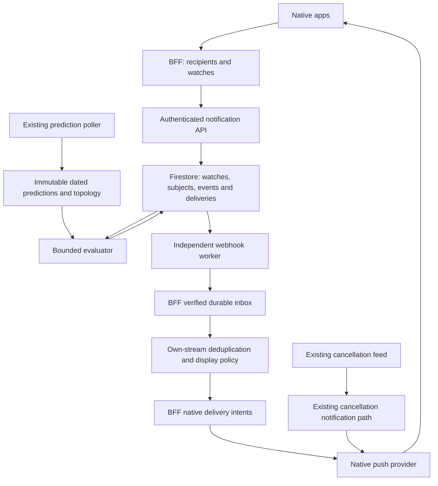
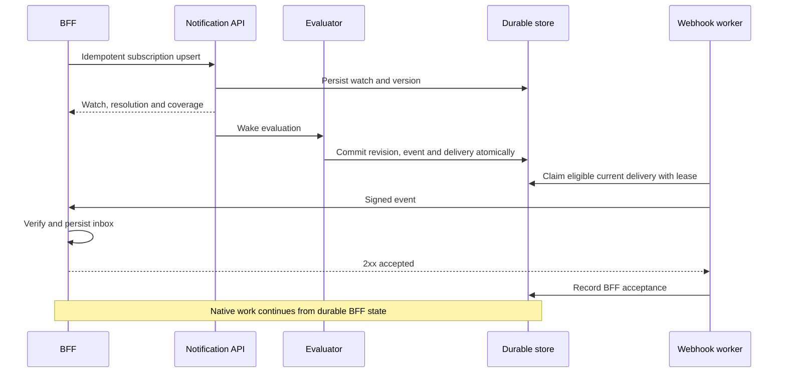
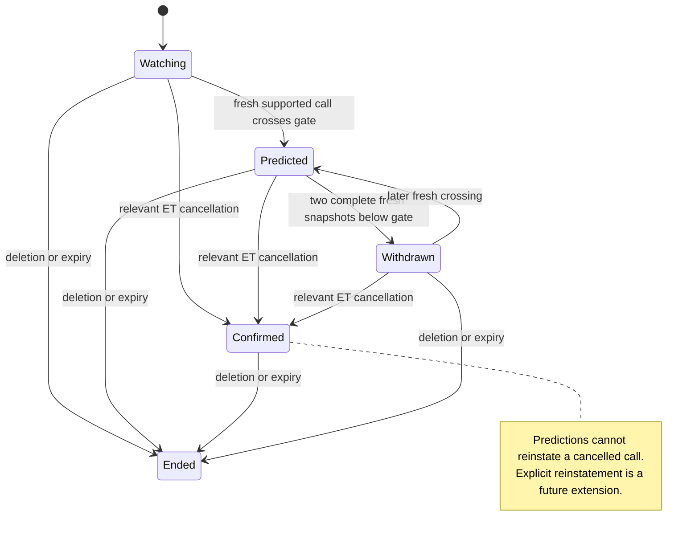
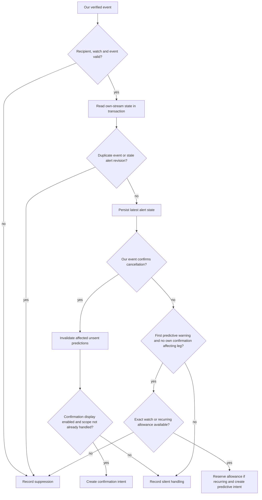

# Journey Notification Webhooks - Plan

## Goal Capsule

- **Objective:** Partner apps can warn travellers about predicted disruption to an exact journey or recurring commute, with little BFF integration work. Existing cancellation notifications can continue independently.
- **Means:** A versioned subscription API, durable HTTPS webhooks and a supplied TypeScript/Firebase adapter with duplicate prevention within our notification stream and configurable native confirmation display (KTD1–KTD10).
- **Authority:** The user request governs scope. Requirements own product behavior; KTDs own implementation mechanisms. Repository instructions govern code and deployment conventions.
- **Execution profile:** Characterize the current matcher before extracting shared functions. Prove identity, lifecycle and crash recovery with fixtures, pure tests and emulator integration before live callbacks.
- **Stop conditions:** Do not enable a provider whose exact identity cannot be proved. Never substitute nearby departures, expose partner records through public history pages, or equate webhook acknowledgement with phone delivery.
- **Tail ownership:** Our implementation includes this repository and a companion integration in `entur/entur-clients`, including the small native enrollment changes needed for the pilot. The partner reviews product copy/preferences and owns its deployment. Production enablement is a separate rollout action after the gates below.

---

## Product Contract

### Summary

A partner configures one callback destination per environment and registers exact journeys or recurring origin–destination windows. Our service monitors those subscriptions and delivers complete notification events. The BFF retains its user/device mapping and owns native delivery.

The first integration includes a Firebase receiver and durable event handling for our stream. It displays predictive warnings and processes our confirmed-cancellation events silently; existing Ukur cancellation notifications continue independently. Cross-source arbitration is optional follow-up work. Other BFFs can implement the HTTPS contract without a Google Cloud account and can opt in to displaying our confirmed cancellations.

### Problem Frame

The current `/varsel-api` supports browser subscriptions and recurring journeys, but not partner callbacks or dated itineraries. Supply registration, ready-to-display events and reliable receipt so the engineering-constrained partner need not implement prediction interpretation, webhook cryptography or delivery recovery. Integrating the existing cancellation feed is not an onboarding prerequisite.

### Key Decisions

- **Deliver through the BFF.** HTTPS callbacks preserve native delivery ownership across hosting platforms. Governs R1, R9, R16. (session-settled: user-approved — chosen over polling and direct native delivery after their tradeoffs were discussed.)
- **Support both exact journeys and recurring windows.** These require different selection rules. Governs R2–R5. (session-settled: user-directed — chosen over offering only the recurring registration available in `/varsel`.)
- **Defer mandatory cross-source arbitration.** Prevent duplicates within our stream and preserve identity/source metadata for future integration. The first partner displays our predictions and handles our confirmations silently alongside its existing cancellation notifications; independent streams may overlap or arrive out of order. Governs R11–R13. (session-settled: user-approved scope reduction, 2026-09-07 — supersedes the earlier mandatory shared-arbitration decision.)

### Actors

- A1. Traveller: watches journeys through a partner app and receives native notifications.
- A2. Partner BFF: owns consent, recipient mapping, watch lifecycle and notification presentation.
- A3. Notification service: resolves journeys, evaluates predictions, writes messages and delivers events.
- A4. Operator: provisions partners/destinations and manages delivery health, revocation and rollout.

### Requirements

**Subscriptions and matching**

- R1. An operator provisions a destination for the partner; an authenticated partner manages only its own subscriptions. Credentials and records are isolated by environment.
- R2. An exact subscription identifies one or more ordered transit legs with full journey references, dated occurrence information, boarding/alighting stops and aimed timestamps; matching must never switch to a nearby departure.
- R3. Each exact leg is evaluated against the same vehicle journey at both ends; partial itinerary coverage must not imply that uncovered legs are safe.
- R4. A recurring subscription defines origin, destination, timezone, weekdays and a daily boarding window, with optional effective dates; each matching dated departure is a separate alert subject.
- R5. Registration supports safe retry, amendment, deletion and automatic expiry; new/amended subscriptions are evaluated promptly even when the disruption feed is unchanged.
- R6. Resolution/coverage expose `pending`, `supported`, `unsupported` or `ambiguous`, reasons and source freshness; missing or stale data never produces an all-clear.
- R7. Reuse existing calibrated predictions, observed cancellation facts and operator/population thresholds; model coverage stays within currently trained services.
- R8. Respect direction, boarding/alighting restrictions, repeated stop visits, partial cancellations, stop aliases and operating days crossing midnight.

**Events and delivery**

- R9. Deliver structured facts and ready-to-display Norwegian title/body with the BFF's opaque reference; normal receipt needs no extra prediction query.
- R10. Persist accepted subscriptions and generated events across restarts; retry delivery until accepted or expired, expose terminal failure and isolate slow destinations.
- R11. Distinguish predicted disruption from confirmed cancellation; include stable affected-departure identity, immutable event ID, ordered alert revision, source references/timestamps and affected call/segment scope so BFFs can add cross-source reconciliation later.
- R12. The supplied adapter prevents duplicate decisions from retries, concurrent delivery and overlapping subscriptions within our stream. Our confirmed cancellations invalidate obsolete predictions only for affected legs. Matching, deduplication and ordering against a separate cancellation source are not v1 guarantees.
- R13. The first partner displays predictive warnings and processes our confirmed cancellations silently, leaving existing cancellation notifications independent. Other BFFs can explicitly enable native confirmation display; that policy does not depend on whether a prediction was delivered. Both modes consume our complete event lifecycle.
- R14. Deletion, expiry or replacement prevents later claims for that registration version; an already-in-flight request may complete, so the BFF rechecks local eligibility before native dispatch.
- R15. Distinguish event creation, durable BFF acceptance and native provider acceptance; do not promise exactly-once phone display.

**Integration and operations**

- R16. Supply a typed HTTP client, verification helper, Firebase adapter, shared identity fixtures and an end-to-end example; the partner supplies recipient lookup and native presentation choices.
- R17. Supply signed synthetic test events and authenticated delivery diagnostics/retry for valid events; identify test traffic and restrict it to test subscriptions.
- R18. Keep credentials, recipient references, journey patterns and prose out of public history/replay surfaces and routine logs; deletion/retention cover routing data, events and BFF mappings.
- R19. Keep existing `/varsel`, `/impact`, `/journey` and rush policies compatible; partner evaluation, generation and delivery do not depend on VAPID or browser registrations.
- R20. Supply a recurring-prediction interruption budget shared across duplicate registrations; retain every webhook and suppression decision even when native delivery is capped.
- R21. The companion integration includes usable native creation/edit/deletion paths for pilot exact and recurring watches; missing destination capture must not become an unassigned prerequisite for the partner.

### Acceptance Examples

| ID | Given / when | Expected result | Covers |
|---|---|---|---|
| AE1 | Exact 07:18 watch; nearby 07:12 is cancelled | No 07:12 alert; predictions use 07:18 at both endpoints | R2, R3 |
| AE2 | Two-leg itinerary; only leg 2 is disrupted | Identify leg 2; no invented missed-connection probability | R3, R7 |
| AE3 | Recurring window has three affected trains; two SX messages describe one | Separate subject for every dated departure; consolidate duplicate situations | R4, R11 |
| AE4 | Same bus ServiceJourney on two days, one boarding after midnight | Distinct occurrences; operating date is not inferred from boarding date | R2, R8 |
| AE5 | Repeated stop visit or cancellation only at destination | Select intended visit and retain relevant cancellation even without another endpoint's prediction | R8 |
| AE6 | Same webhook delivered concurrently and again after restart | One inbox record and one normal native decision | R10–R12 |
| AE7 | Same prediction reaches a recipient through overlapping exact/recurring watches and concurrent retries | One predictive native intent for that recipient/departure within our stream | R12, R20 |
| AE8 | Prediction first, then our confirmation and an existing Ukur cancellation | First-partner mode handles our confirmation silently; Ukur follows its existing path. A BFF with confirmation display enabled can create one own-stream confirmation intent for the affected scope | R11–R13 |
| AE9 | Our confirmation revision arrives before our older prediction | Confirmation updates state even in silent mode; no predictive downgrade for the affected leg | R11–R13 |
| AE10 | Cache loses a train or becomes stale after warning | Expose missing coverage; no inferred withdrawal/reinstatement | R6 |
| AE11 | Callback 503, then watch deleted before retry | Cancel retry; other partners continue | R10, R14 |
| AE12 | Register already-disrupted journey while SX stays unchanged | Mutation/clock wakeup evaluates it | R5 |
| AE13 | Crash after FCM acceptance before success record | Mark ambiguous delivery; no exactly-once claim or blind resend | R15 |
| AE14 | Partner B requests A's event, or anonymous reader opens history | No A data; partner prose never enters public history/replay | R1, R18 |
| AE15 | Same boarding departure, two destinations; only the farther destination is cancelled | Confirm the affected leg; its cancellation does not suppress a prediction for the shorter, operating leg | R8, R12 |
| AE16 | Prediction is queued or definitively rejected when our confirmation arrives | Supersede affected unsent prediction; handle confirmation silently for the first partner or notify if explicitly enabled, regardless of prior prediction delivery outcome | R12–R15 |
| AE17 | A line suspension affects thirteen departures in one recurring definition | All thirteen remain visible as events; supplied native prediction policy admits at most four interruptions that Oslo day, shared across duplicate registrations | R20 |
| AE18 | Traveller enables ticket-journey alerts or registers a recurring origin/destination window, then disables it | Native inputs reach the BFF intact; disabling invalidates pending work, with no API credentials in the app | R2, R4, R14, R21 |
| AE19 | Ukur cancellation is delivered before predictive enrollment or before our delayed prediction | No legacy-history import or reconciliation gate. Our confirmation is silent in first-partner mode; a prediction may still appear before our path learns the cancellation or if already in flight. The independent-stream ordering limitation is documented | R12, R13 |

### Scope Boundaries

**Included:** exact transit legs, recurring direct origin–destination windows, coverage status, predictive/confirmed lifecycle events, duplicate prevention within our stream, configurable native confirmation display, minimal pilot enrollment wiring and managed-pilot operations.

**Deferred to Follow-Up Work:** cross-source cancellation arbitration, Ukur identity normalization/history import, policies conditional on prior prediction delivery, missed-connection/end-to-end arrival modelling, automatic replanning, additional languages, self-service onboarding UI, new model/operator coverage and new native itinerary-detail screens. Initially reuse the existing stop-departures tap action. Cross-source work is not a prerequisite for the pilot or for another BFF to adopt the API.

**Outside this product's identity:** partner device/account management in kix, native FCM/APNs delivery from kix, and replacing the authoritative cancellation feed.

### Success Criteria

A Firebase BFF developer follows the supplied quickstart, registers each subscription kind and sees a synthetic notification on a test phone without implementing prediction logic, webhook cryptography or duplicate prevention within our stream. AE1–AE19 have evidence, including silent confirmation handling, independent cancellation behavior and native enrollment. A non-Firebase HTTPS receiver passes the wire-contract suite and consumes the same pure notification policy; a production BFF on another stack supplies transactional persistence through the documented adapter contract. A second production database adapter is follow-up work.

Publish supported identity/operator coverage and measured evaluation-to-callback latency. Source age and delivery latency are separate measures so fast callbacks cannot disguise old predictions.

Before real-user enablement, compare the new dated-leg selection against realized outcomes on a bounded historical replay and inspect pilot false alarms. Report resolved/unknown counts, precision, recall within the evaluated population and lead time per provider/population; missing outcomes are never successes. Use the current calibration's population-specific acceptance bars as the baseline, recording the comparison and go/no-go before enabling that population. Synthetic callback tests alone do not establish useful predictions, and a forecast withdrawal is not an outcome label.

---

## Planning Contract

### Assumptions

- Managed onboarding and one destination per partner/environment suffice initially; additional destinations can be provisioned explicitly.
- The BFF supplies ordered transit legs. Walk legs need no monitoring; connection feasibility is not inferred.
- Recurring windows initially use `Europe/Oslo`, named weekdays and `/varsel`'s inclusive minute boundaries. Reject overnight recurring windows in v1; support exact journeys crossing midnight.
- Native confirmation display defaults to `silent` in the supplied adapter and is pinned to `silent` for the first partner. Other BFFs can opt in to `notify`: one own-stream confirmation intent for equivalent affected scope, regardless of prior prediction delivery. Both modes persist confirmations and invalidate affected obsolete predictions. Changing modes does not replay historical confirmations.
- The pilot accepts a predictive warning followed by an existing cancellation alert, and possible reverse ordering while the two streams disagree or delivery is delayed. No cross-source exactly-once or ordering guarantee is made. Identity metadata enables future integration but does not itself prove equality with another source.
- The supplied BFF adapter initially permits four recurring predictive interruptions per recipient and normalized recurring definition per Oslo day, following the existing `/varsel` cap. Duplicate registrations share the allowance; exact watches and authoritative cancellations keep their separate policies.
- Firestore Native is new internal infrastructure, with provisioning, IAM, indexes and worker deployment included. The public contract exposes no Google SDK or identity requirement.
- Initial admission ceilings are planning defaults, not measured capacity: 1,000 active watches per partner and 5,000 total. Qualify evaluation lag against the full simultaneously active distinct-definition population; a 100-definition microbenchmark does not establish a 5,000-watch envelope. Start with lower measured admission limits and require a full active-population revisit within 30 seconds under the admitted load before raising them.

### Key Technical Decisions

- KTD1. **New authenticated `/notification-api/v1` surface.** Use opaque bearer API keys with IDs and hashed stored verifiers, separate from outbound signing secrets. Support overlapping current/replacement keys with explicit expiry/revocation. Managed onboarding provisions secrets in Secret Manager; ownership comes from the authenticated partner. Existing SSO and `device_id` are not partner authorization. Governs R1, R18, R19.
- KTD2. **Shared unaggregated dated-leg matching below current summary views.** `/impact` selects one train per situation/line and can choose independent departure/arrival worst cases; a narrow `at` window does not implement exact matching. Preserve legacy selection through adapters. Governs R2–R8, R19.
- KTD3. **Separate routing, subject and transport identities.** `subscription_id` routes a watch; `departure_id` identifies a dated boarding visit; `event_id` identifies an immutable event. `alert_id` identifies the subscription-version/leg/departure lifecycle and `revision` orders it. No key depends on SX number, wording or probability. Governs R11–R13.
- KTD4. **Share decisions and wording, separate delivery state.** Extract typed evaluation/message-input/deterministic-rendering functions from `varsel`. Browser dedup/caps/branding remain in its adapter. Partner model calls have a separate bounded allowance/latch and never use `push_enabled()` as a gate. Governs R7, R9, R19.
- KTD5. **Transactional Firestore subject/event/outbox persistence.** Commit the next revision, immutable event and delivery record together, with no HTTP or LLM calls inside retryable transactions. Do not extend the GCS registration blob or use BigQuery as a queue. [Transaction semantics](https://firebase.google.com/docs/firestore/manage-data/transactions). Governs R5, R10, R14.
- KTD6. **Independent evaluation and HTTP delivery.** A bounded API-process evaluator reads immutable prediction/topology snapshots and wakes on snapshot, watch and clock changes. It stays beside the in-memory cache to avoid adding a separate prediction transport/store. A separate Kubernetes worker leases outbox records and imports no prediction poller. Keep the API at one replica with its existing recreate deployment. Bound partner request rate and concurrent work separately from public endpoints. Governs R5, R10, R19.
- KTD7. **Standard Webhooks signing.** Sign immutable raw bytes with a fresh attempt timestamp and stable `webhook-id`; supply Python/TypeScript verification vectors and overlapping rotation keys. The operator transfers initial/replacement signing secrets through the partner's agreed secret channel, and the BFF stores them in its own secret manager. Verify a test delivery signed with the new key before retiring the old key; overlapping signatures alone do not prove the receiver installed the replacement. Persistent event dedup outlives signature tolerance. [Specification](https://github.com/standard-webhooks/standard-webhooks/blob/main/spec/standard-webhooks.md). Governs R10, R11, R16.
- KTD8. **Duplicate prevention and display policy within our stream.** Use service-issued departure IDs and per-alert revisions directly; a Firestore transaction keyed by recipient plus departure records the own-stream decision and native intent, reserving recurring interruption allowance when applicable. Persist our confirmations and suppress affected obsolete predictions even when confirmation display is silent. Existing Ukur ingress, identity/history and notification decisions do not enter this transaction. Keep native provider outcomes for delivery recovery, without using prior prediction delivery to choose confirmation behavior. Governs R12, R13, R15, R20.
- KTD9. **Durable Firebase acceptance and recoverable processing.** Verify and persist an inbox record before 2xx. Retry-enabled Firestore processing and a recovery sweep handle native work. Never finish the HTTP function with unawaited work remaining. [Function lifetime](https://firebase.google.com/docs/functions/tips), [retries](https://firebase.google.com/docs/functions/retries). Governs R10, R15, R16.
- KTD10. **Small portable TypeScript package plus real BFF integration.** Keep HTTP/schema/signature helpers and the pure own-stream notification policy independent of Firebase; add a Firebase persistence adapter implementing the transaction/claim contract. U8 supplies watch mapping and native integration, consuming the shared implementation. A pinned workspace-vendored package is acceptable for the first pilot if publication is not ready, with one contract source and a CI version/content check. Governs R12, R13, R16, R17, R20.
- KTD11. **Constrained managed destinations.** Require verified HTTPS hosts; reject redirects, userinfo, fragments and arbitrary headers. Validate all IPv4/IPv6 results at each connection and connect to a validated address with original TLS hostname verification. Block private/link-local/metadata addresses and bound responses. [SSRF guidance](https://cheatsheetseries.owasp.org/cheatsheets/Server_Side_Request_Forgery_Prevention_Cheat_Sheet.html). Governs R1, R10, R18.
- KTD12. **Separate protected partner audit.** Do not place partner input/prose in `varsel_decisions`, `/meldinger`, feedback contexts or static exports. Use partner collections, prompt logging off and the existing EU Vertex endpoint when model wording is enabled. Governs R18, R19.

### High-Level Technical Design

These sketches define responsibilities and externally observable behavior; internal module boundaries may change while preserving the contracts.

**Components and ownership (KTD4–KTD9)**



**Registration and acceptance (R5, R10, R14)**



**Alert lifecycle (R6, R11; distinct from delivery attempts)**



**BFF decision order for our events (R12, R13)**



**API shape (directional payload sketches; U1 fixes schemas and fixtures before publication)**

| Method/path under `/notification-api/v1` | Purpose |
|---|---|
| `PUT /subscriptions/{client_reference}` | Idempotent create/replace; return immutable subscription ID and monotonic version |
| `GET /subscriptions` and `GET /subscriptions/{client_reference}` | Paginated watches, coverage/resolution and current alert state |
| `DELETE /subscriptions/{client_reference}` | Tombstone watch and cancel unclaimed delivery; repeated deletion succeeds |
| `GET /destinations/current` | Destination readiness/key IDs, never secrets |
| `POST /departures:resolve` | Bounded batch canonicalization of source aliases; no per-request BigQuery |
| `GET /events` and `GET /events/{event_id}` | Partner-scoped event/delivery diagnostics with bounded pagination/retention |
| `POST /events/{event_id}:retry` | Retry same still-valid event ID and bytes |
| `POST /test-events` | Signed synthetic event to designated test watch |

Exact registration:

```json
{
  "kind": "exact",
  "monitor_from": "2026-09-08T04:00:00Z",
  "monitor_until": "2026-09-08T08:00:00Z",
  "journey": {"legs": [{
    "client_leg_reference": "outbound-1",
    "journey_ref": "VYG:DatedServiceJourney:example",
    "service_date": "2026-09-08",
    "from_stop": "NSR:StopPlace:example-a",
    "to_stop": "NSR:StopPlace:example-b",
    "aimed_departure": "2026-09-08T05:18:00Z",
    "aimed_arrival": "2026-09-08T05:50:00Z"
  }]}
}
```

Recurring registration:

```json
{
  "kind": "recurring",
  "from_stop": "NSR:StopPlace:example-a",
  "to_stop": "NSR:StopPlace:example-b",
  "schedule": {
    "timezone": "Europe/Oslo",
    "weekdays": ["mon", "tue", "wed", "thu", "fri"],
    "begin": "07:00",
    "end": "08:30",
    "valid_from": "2026-09-08",
    "valid_until": "2026-12-18"
  }
}
```

The path reference is a random BFF routing identifier, not its current `subscriptionType-customerNumber` ID. Optional explicit visit selectors and both known service/dated-service aliases complete ambiguous exact inputs. Use strict input/output models and versioned schema fixtures. Reject non-Oslo recurrence timezones in v1. A create-only `test: true` flag designates synthetic-only watches; reject `/test-events` for normal watches, and never let test events reach real-recipient mappings. Manual retry remains available for valid real events.

Rate-limit partner traffic before expensive resolution/database work. Initial configurable defaults: 10 requests/second per partner (burst 20), at most 2 expensive requests in flight per partner and 8 globally; synthetic events/manual retries share an additional 10/minute per-partner and 50/minute global budget. Reject excess work with 429 and bounded `Retry-After` before creating events or requeueing. Qualify these defaults alongside the full active-definition population. Active-watch limits do not bound request traffic.

### Dated Identity and Matching Contract

Implement KTD2–KTD3 before exposing exact watches:

1. Preserve full codespaced refs, raw frame identity, authoritative operating date when available, raw quay, stable place identity and stop visit/order through planned calls, scoring and `CallPred`. A call's local date is distinct from the service operating date. Do not infer date from arbitrary ref suffixes or remap VYG to NSB for identity.
2. Prefer a proven dated ref. An undated ServiceJourney needs authoritative occurrence disambiguation and the selected call. Preserve and fixture-validate `dataFrameRef`; do not assume every provider uses it as a date.
3. Resolve both endpoints from the same dated topology. Without visit selectors, the full journey/date, explicit aimed timestamp and stop must identify exactly one visit. Ambiguity is a resolution result, never closest-time matching.
4. Assign opaque `departure_id` to the resolved run and boarding visit. Preserve original/current aimed timestamps and quays as aliases only where verified continuity proves identity. A platform change does not create a new subject; unexplained ref/sequence changes remain unresolved. A traffic-dependent picker-primary StopPlace is not the sole durable key.
5. Join planned topology to predictions and ET facts. Cancellation-only UNION rows must not lose a cancelled destination because the boarding prediction is absent. Do not generalize a cancellation outside the ridden segment to the subscribed leg.
6. Enumerate every eligible dated departure for recurring watches and consolidate contributing situations per departure. Keep each departure's own destination facts; legacy adapters retain their current summary choice.
7. Return available source aliases, authoritative occurrence/visit fields, affected scope and source timestamps with events/resolution. Shared Python/TypeScript fixtures define our identity contract. Exact registration must preserve its source references through BFF order conversion; normal webhook receipt uses our issued IDs directly and needs no external-feed resolution. Future cross-source integrations must prove alias equality; line plus approximate time never authorizes suppression. Ukur mapping/fixture support is deferred.

Future exact registrations can persist as `pending` before entering the realtime horizon. Syntactic validity does not imply supported coverage. Service-ref plus service-date inputs require a verified bridge to the dated cache; never fabricate one from train numbers.

### Event and Notification Contract

The envelope contains `schema_version`, `event_id`, `type`, `occurred_at`, `expires_at`, subscription ID/version, opaque client/leg references, `alert_id`, `revision`, `departure_id`, source aliases and source timestamps. Payloads include affected call/segment, probabilities, delay intervals, `phase`, `effect`, contributing situations and `notification` title/body/action. Partial stop cancellations are worded as such.

Use `journey.alert.created`, `journey.alert.updated` and `journey.alert.withdrawn`. `phase` distinguishes `predicted` from `confirmed`; `effect` identifies the actual cancellation or predicted delay/cancellation risk. Small probability/wording changes do not mint events. Confirmation is material. Withdrawal requires two complete fresh below-threshold snapshots at least two minutes apart, updates BFF state silently and means the forecast changed, not guaranteed normal service. Missing/stale snapshots update coverage only.

The first Predicted or Confirmed state emits `created`; subsequent material transitions, including Withdrawn→Confirmed, emit `updated`; Predicted→Withdrawn emits `withdrawn`. Ended emits no advice event. The BFF records withdrawal and renewed prediction silently, preserving earlier interruption history; v1 has no traveller-facing all-clear or renewed-forecast banner.

Default user-facing bounds within our stream are one prediction per recipient/departure and no native confirmations. With confirmation display explicitly set to `notify`, create at most one confirmation intent for equivalent affected cancellation scope; equivalent or subsumed already-handled facts are duplicates, while newly affected scope can produce a new confirmation. A renewed forecast after withdrawal updates state without another predictive native notification. Neither policy consults the existing cancellation feed or prior prediction delivery outcomes.

Keep own-stream event deduplication, latest per-alert revisions and recipient/departure interruption state durable. Our confirmed events carry normalized affected call visits/segments; invalidate only predictions whose ridden segment is affected. A cancelled destination beyond a shorter leg cannot suppress that leg. Silent confirmations must update this state before acknowledgement of processing, and withdrawal/expiry must not erase it while advice for that dated departure can still arrive. This uses our event identities directly; no Ukur resolver, raw-evidence store or historical feed import is required.

| BFF state | Incoming candidate | Default decision |
|---|---|---|
| No prior predictive intent; no relevant own confirmation | Eligible first prediction | Reserve recurring allowance when applicable and create one predictive intent |
| Any valid state | Our confirmed cancellation | Record affected scope and invalidate obsolete unsent predictions; handle silently by default, or create one confirmation intent if display is enabled and that scope has not been handled |
| Prediction intent exists | Retry, another situation or overlapping watch | Reuse existing decision; no duplicate intent |
| Prediction queued or definitively rejected | Our relevant confirmation | Supersede affected unsent prediction; confirmation display follows configuration |
| Prediction accepted or outcome unknown | Our relevant confirmation | Confirmation display still follows configuration; prior prediction delivery does not change the decision |
| Our scoped confirmation recorded | Our prediction, withdrawal or older event in that scope | Suppress predictive downgrade |
| Our scope already handled | Equivalent/subsumed own confirmation, retry or mode change | No new intent; changing display mode does not replay previously handled confirmations |
| Our scoped confirmation recorded | Candidate outside that affected scope | Evaluate normally; no departure-wide suppression |
| Any | Inactive watch or expired event | Suppress |
| Any | Existing Ukur cancellation | Outside this policy; follows the existing cancellation path |

Normal receipt needs no extra cancellation lookup. Order revisions within each of our alerts and use our normalized scope for own-stream suppression; do not compare those revision numbers with another feed. Keep per-target provider results solely for reliable native delivery and budget accounting, so accepted targets are not retried because another target failed.

Registration persists valid input with consent and can remain pending until supported coverage becomes available; activation has no existing-cancellation-history reconciliation gate. The first partner handles our confirmations silently even if the previous Ukur notification predates enrollment. A prediction can still arrive after an independent cancellation if our service has not observed it or the prediction is already in flight. Each component invalidates affected pending work it still controls when it learns the relevant cancellation; no ordering or deduplication guarantee spans the independent paths. Future cross-source arbitration can consume retained identity/source metadata, but implementing it and proving source equivalence are separate work.

For recurring predictions, reserve the daily interruption allowance in the same own-stream decision transaction as the intent. Identical origin/destination/schedule definitions share a budget across registrations; a batch spends it on the soonest still-useful departures first. Retries reuse the reservation. Release it only when every target is provably unsent or definitively rejected; an accepted or unknown target consumes it conservatively. Reaching the cap suppresses native prediction work, not events or confirmation-state processing. Keep this policy configurable in the supplied adapter.

### Persistence, Delivery and Deletion

**Our store:** a named Firestore Native database per environment stores partners/destinations, subscriptions, identity aliases, subject state, immutable events and delivery records. Use top-level collections with partner ownership and explicit TTL fields. TTL is eventual cleanup, not expiry enforcement; [expired documents can remain queryable](https://firebase.google.com/docs/firestore/ttl).

Replacement increments a subscription version; conditional updates use its version/ETag, while identical retry has no side effects. Tombstones block stale replay after deletion: PUT against a tombstoned reference returns 410 and deliberate re-registration uses a fresh random reference. Persist canonical request fingerprints/idempotency records. Event transactions validate the current watch version and monotonic evaluation generation, so slow evaluation cannot emit obsolete work.

The evaluator wakes within 30 seconds of successful mutation and on source/clock changes. Group equivalent definitions, use fair per-partner cursors and checkpoint progress. All database RPCs/retries have bounded deadlines. Source-specific freshness reflects underlying ET/planned observations, not merely rerunning prediction SQL. Admission limits and overload diagnostics bound work. Durability begins at committed events: an outage may lose a transient prediction before commit; failed evaluations retry fresh input, without promising a durable record of every intermediate snapshot.

**Webhook worker:** query indexed due records and claim with a transaction/lease token. Lease duration exceeds the HTTP deadline; completions are fenced by token and expired leases recover after crash. Initially deploy one worker replica with recreate deployment/no autoscaling, so process-wide bounds mean 16 requests globally and 2 per destination. Use a 5-second total and 2-second connect timeout. Scaling workers requires shared concurrency limits first. Retry at 5 seconds with exponential backoff/jitter up to a 5-minute interval; honor bounded `Retry-After` before expiry. Retry network failure, timeout, 408, 429 and 5xx. Other 4xx are terminal/configuration failures; 410 pauses the destination and alerts its owner. Refuse redirects and cap response bytes.

Event validity is capped by watch lifetime and the last useful advice time. For a boarding warning use the current expected departure; for confirmed cancellation use aimed departure; cap exact legs by `monitor_until`. Recurring departures can remain catchable within the existing 90-minute grace after the boarding window. A newer own-stream confirmation supersedes affected older unaccepted predictions. Recheck current watch/destination/revision before claim and send; the adapter handles requests already in flight.

Manual retry preserves ID/bytes and cannot resurrect expired, deleted or superseded advice. Test events get fresh IDs and short expiry. Delivery states are `pending`, `leased`, `accepted`, `expired`, `superseded`, `cancelled` and `failed`; acceptance means the BFF persisted the event.

**BFF processing:** persist inbox before acknowledgement, including confirmed/withdrawn events that will not display. Transactionally verify validity, recipient membership, local watch version and own-stream revision/duplicate state, then apply display policy and create native intent when eligible. Enable trigger retries and sweep abandoned pending records after retry exhaustion. Both paths use the same exclusive per-target dispatch claims and fenced completions; a unique intent alone does not stop concurrent sends. Inspect each FCM target result; retry known transient failures only and retire invalid tokens through existing token management. The existing cancellation sender does not enter this processing path.

Native targets progress through `pending → claimed → dispatching → accepted / rejected / unknown`. Persist `dispatching` before provider I/O. Recover expired claims that never reached dispatching; abandoned dispatching attempts become unknown and must not be blindly resent. Immediately before that transition, transactionally recheck watch/version/recipient/expiry and our latest alert/affected-scope state, cancelling obsolete pending predictions. A request already in provider I/O may still complete; retain that boundary explicitly.

Record per-target intent before network I/O. A crash/transport failure after dispatch without a definitive provider result is `unknown`. Default to no automatic blind resend of unknown targets, with diagnostics; known rejection may retry before expiry. Native collapse IDs help presentation but do not guarantee no repeated banner. Set Android TTL and APNs expiration from event validity, rechecking eligibility immediately before sending. [FCM lifespan](https://firebase.google.com/docs/cloud-messaging/customize-messages/setting-message-lifespan), [ordering/collapse behavior](https://firebase.google.com/docs/cloud-messaging/customize-messages/collapsible-message-types).

**Retention:** planning defaults are seven days for complete event/delivery history, and canonical identity/own-stream deduplication tombstones until 48 hours after the last relevant event expires. Active recurring watches persist until deletion/effective end. Deletion immediately disables routing and starts an explicit purge, with a 24-hour completion target for that watch's prose, routing references and event payloads and reference-aware cleanup for shared identity records. Do not rely on Firestore TTL to meet that target. A non-sensitive purge status remains queryable; minimal non-reversible tombstones block replay. BFF unsubscribe/account deletion performs corresponding mapping/inbox cleanup. No additional legacy cancellation history is collected for this integration. Retention/purge targets must match the documented implementation before real-user onboarding.

Use separate partner evaluation/delivery/model-wording switches and per-partner suspension. Delivery-off pauses claims; resume only current valid events. Durable-store failure rejects partner mutations without harming existing public read services. No browser push fallback.

### Integration Constraints and Risks

- BFF weekdays currently use Sunday=0 and half-open windows; `/varsel` uses Monday=0 and inclusive minutes. Use named weekdays publicly. Translate existing minute-granularity half-open windows to an inclusive last minute with tests; do not include the formerly excluded departure. Existing line-only watches lack a destination and cannot be forwarded unchanged.
- BFF order-leg conversion drops dated refs/destination. Preserve them at creation and add compatible predictive-watch input when a client lacks them. Do not reconstruct exact itineraries from line/origin/minute.
- ET frame/service-day semantics differ by provider; U1 fixtures must prove mapping. Unsupported mappings remain visible rather than being repaired with train-number heuristics.
- `varsel` message generation is coupled to browser delivery. Extract typed seams under characterization coverage and keep partner inputs out of public decision tables.
- The BFF sender currently ignores settled-promise/per-token failures. Supply a result-aware native sender for our stream; wrapping `sendMessageToCustomer` unchanged is insufficient. An additive helper may reuse transport settings, but the existing cancellation path need not adopt the new outbox or change its notification decisions.
- Independent streams can overlap or arrive out of order. Silent handling of our confirmations prevents a second cancellation notification from our stream in the first partner's configuration, but cannot stop a late predictive warning after an Ukur alert. Keep this limitation in onboarding and pilot expectations.
- Every unresolved/new definition has potential resolution cost. Bound resolver batches, aliases, request size, pagination and repeated unavailable lookups. Measure the admission envelope before expanding it.

### Alternatives Considered

The GCS state blob would be a small initial diff but cannot provide concurrent transactional subject/outbox state. Firestore is the bounded operational addition. Cloud Tasks/Pub/Sub can later transport work behind the repository interface; the initial worker reads the transactional outbox directly, avoiding a second enqueue transaction and its recovery path.

Callbacks inside `check_and_notify` would inherit browser gating and expose the poller to partner outages. A narrow `/impact?at=` lookup still has lossy selection. KTD2 and KTD6 address these limitations without changing public summary contracts.

Mandatory shared cancellation arbitration would coordinate identity, scope, history and delivery decisions across Ukur and our service. The user deferred it to reduce integration work. V1 supplies ordinary own-stream duplicate prevention and silent confirmations for the first partner; cross-source reconciliation remains possible through the event metadata and a future integration.

---

## Implementation Units

Prepare the enrollment input examples and SDK contract first, so the partner can review its small integration surface while server work proceeds. After U1 fixes identity and U4 fixes API schemas, the client/example portion of U7 can proceed alongside U3–U6; U7's final delivery qualification still depends on U6. U10 starts with native input tracing at that same contract checkpoint and finishes after the BFF integration in U8. Qualify our receiver, duplicate prevention and silent-confirmation mode before the pilot; no Ukur migration or cancellation-history gate is required.

### U1. Preserve and resolve dated journey/call identity

**Goal:** Exact registration, evaluation and event consumers identify the same dated boarding call without approximation.

**Requirements:** R2, R3, R6–R8, R11; KTD2, KTD3. **Dependencies:** None.

**Files:** `disruptions/api/{rail_calls_planned_today,bus_calls_planned_today,predict_calls,predict_calls_bus}.sql`; `disruptions/api/{main,impact,alternatives}.py`; new `disruptions/api/departure_identity.py`, `test_departure_identity.py`; existing `test_impact.py`, `test_alternatives.py`; new `contracts/notifications/v1/identity-fixtures.json` and fixture README.

**Approach:** Preserve occurrence/visit metadata before upstream dedup discards it, including every scoring join and cancellation UNION. Publish immutable dated topology/prediction indexes. Implement the identity contract and legacy lookup adapters. Follow `demo_journeys.sql` for service-day/call-date distinction.

**Execution note:** Begin with characterization and failing identity fixtures. Verify sanitized representative rail, GOA and bus/overnight ET/OTP and exact-registration payloads during implementation. Use `bq` schema/dry-run operations before bounded SQL execution. Ukur feed mapping is not a provider-enablement prerequisite.

**Test scenarios:**

1. Covers AE1/AE4: nearby trains and repeated service IDs on different days/operators never merge.
2. Covers AE5: repeated stop, quay change and destination-only cancellation retain the intended identity/fact.
3. Conflicting aliases, missing frame/day and ambiguous visit selectors return unresolved state.
4. Missing scoring preserves topology and unknown probability; no manufactured zero risk.
5. Amended aimed timestamps share identity only with proven call continuity; alternative lookups retain date disambiguation.

**Verification:** Shared vectors prove source equality/inequality, existing endpoint shapes pass, and resolver coverage/unknown reasons are published per provider.

### U2. Extract shared leg evaluation and wording

**Goal:** Reuse model meaning and messages without browser delivery state.

**Requirements:** R3, R4, R7–R9, R18, R19; KTD2, KTD4, KTD12. **Dependencies:** U1.

**Files:** `disruptions/api/{impact,varsel,llm_message,alert_policy,main}.py`; new `notification_evaluation.py`, `notification_wording.py`, `test_notification_evaluation.py`, `test_notification_wording.py` under `disruptions/api`; existing `test_varsel.py`, `test_varsel_api.py`, `test_llm_message.py`, `test_impact.py`.

**Approach:** Expose unaggregated dated-leg results and preserve legacy summary selection. Extract typed message input and deterministic fallback. Isolate partner generation budget/latch; bounded alternative lookup is optional and cannot remove an alert.

**Test scenarios:**

1. Covers AE2/AE3: separate facts for each leg/departure and consolidated duplicate SX.
2. Existing rail/bus/no-SX thresholds remain unchanged for equivalent `/varsel` subjects.
3. Direction, boarding/alighting restrictions and catchability apply before selection.
4. VAPID absent or model unavailable still produces partner deterministic messages.
5. Partner generation exhaustion cannot consume browser allowance or write public audit data.

**Verification:** Compatibility coverage passes and there is one shared threshold/wording contract with explicit surface policy adapters.

### U3. Add durable partner store and infrastructure

**Goal:** Store watches, subject state and delivery work safely across processes/restarts.

**Requirements:** R1, R5, R10, R14, R18; KTD1, KTD5, KTD12. **Dependencies:** U1 schema.

**Files:** New `disruptions/api/partner_store.py`, `test_partner_store.py`; `disruptions/api/requirements.txt`, `pyproject.toml`, `uv.lock`; new `terraform/partner_notifications.tf`; `terraform/{variables,providers}.tf`, `terraform/env/{dev,tst,prd}.tfvars`; new event/subscription schemas in `contracts/notifications/v1/`.

**Approach:** Provision an EU-region named Firestore Native database, indexes/TTL and least-privilege runtime identities per environment through Terraform. Keep secret values out of Terraform state/repo. Implement transactional repositories and supported store/schema versions with an injectable clock and emulator integration.

**Test scenarios:**

1. Concurrent transaction retries do not emit duplicate events or perform external effects.
2. Crash/ambiguous commit produces both subject revision and outbox or neither.
3. Replace/delete racing with emission rejects obsolete versions.
4. Expired but not TTL-deleted records cannot become active/claimable.
5. Tenant isolation, pagination and shared-alias cleanup cannot affect another partner/watch.

**Verification:** Emulator crash/concurrency tests pass; infrastructure plans show explicit project/region and no replacement of existing state. Supported rollback can read persisted schema.

### U4. Implement authenticated subscription/resolution APIs

**Goal:** Manage exact and recurring watches through a stable small interface.

**Requirements:** R1–R6, R14, R16, R17; KTD1–KTD3. **Dependencies:** U1, U3.

**Files:** New `disruptions/api/partner_notifications.py`, `partner_auth.py`, `test_partner_notifications.py`, `test_partner_auth.py`; new `scripts/manage_notification_partner.py`; `main.py`; `contracts/notifications/v1/openapi.json`; Helm environment configuration/secret references.

**Approach:** Implement the API table with strict models, ownership, optimistic concurrency and bounded inputs. Return per-leg coverage/resolution. Build the managed operator tool for partner/destination creation, HTTPS ownership verification, credential issue/rotation/revocation, suspension and switches. It uses operator ADC/IAM authorization distinct from partner keys; server processes cannot impersonate an operator. Record actor/time/partner/key IDs and old/new hosts in protected append-only administrative audit records, excluding secret values and callback query strings. Document the out-of-band signing-secret handoff and test new-key acceptance. Mutation records a durable changed-version marker and sends a local evaluator wakeup hint.

**Test scenarios:**

1. Covers AE12: registration persists/schedules evaluation with unchanged source generation.
2. Offset-less exact timestamps and invalid recurrence/DST inputs fail clearly; legacy calendar semantics stay unchanged.
3. Identical retry is stable; conflicting update fails; stale replay after deletion cannot resurrect.
4. Covers AE14: missing, revoked or foreign credentials cannot expose records.
5. Future unresolved input stays pending; ambiguity never selects a neighbor.
6. Storage outage/capacity/resolver timeout leaves no partial watch and returns actionable error.
7. Repeated synthetic/retry requests against one watch reach their budgets; rejected requests add no events or outbox work.
8. Operator onboarding/rotation/suspension leave audit records; non-operator access fails. Both API keys work during cutover and only the replacement works after retirement; the receiver accepts a new-key-only test delivery.
9. Tombstoned PUT returns 410, fresh-reference creation succeeds, and synthetic events cannot target a normal watch.

**Verification:** Route responses match published schemas; clients need no device ID, Google SDK or browser subscription.

### U5. Implement evaluator scheduling and alert lifecycle

**Goal:** Produce durable events promptly from current supported snapshots.

**Requirements:** R5–R11, R14, R18, R19; KTD3–KTD6. **Dependencies:** U2–U4.

**Files:** New `disruptions/api/partner_evaluator.py`, `notification_events.py`, `test_partner_evaluator.py`, `test_notification_events.py`; `main.py`, `test_poller_refresh.py`.

**Approach:** Add lifecycle-managed snapshot/watch/clock wakeups, fair cursors and bounded work/message budgets. Implement event transitions and transactional emission. Update coverage independently; failure must not advance a subject's completed-evaluation marker.

**Test scenarios:**

1. Covers AE3/AE12: all recurring departures and new watches evaluate without new SX.
2. Covers AE9/AE10: stale evaluation cannot overwrite confirmation or infer recovery from missing data.
3. Confirmed endpoint cancellation survives absent SX/other endpoint scores with precise wording.
4. Two fresh complete below-threshold snapshots withdraw silently; probability/text noise does not mint events.
5. Restart recovers pending definitions; one partner/LLM/database timeout cannot stall ingestion or others.
6. Partner switches remain independent of browser/rush delivery.

**Verification:** Synthetic qualification meets the scheduling target with accurate source age; message failures leave deterministic events.

### U6. Deliver signed events from an independent worker

**Goal:** Bounded reliable callbacks with diagnostics and correct expiry/deletion.

**Requirements:** R10, R11, R14, R15, R17, R18; KTD5–KTD7, KTD11. **Dependencies:** U3, U5.

**Files:** New `disruptions/api/webhook_worker.py`, `webhook_delivery.py`, `webhook_signing.py`, `test_webhook_delivery.py`, `test_webhook_signing.py`; new `helm/kix-avvik/templates/partner-webhook-worker.yaml`; base/environment values; `Dockerfile`, `.github/workflows/ci.yml` where required.

**Approach:** Run the existing built image with a worker-specific Python entrypoint, separate runtime identity/config/health and matching image tag. Never import `main` or start ingestion. Implement leased claims, immutable signing, retry/terminal transitions and destination connection rules.

**Test scenarios:**

1. Covers AE11: 503 followed by deletion/expiry cancels retry while other partners continue.
2. Lost acknowledgement, worker death and late lease completion preserve ID and fencing.
3. Cross-language signatures, tampered bytes, stale timestamp and key rotation behave as specified.
4. Redirects, mixed DNS answers, IPv6/private/metadata addresses and rebinding cannot bypass validation.
5. 429/Retry-After, bounded response, timeout, terminal 4xx and 410 pause are observable.
6. Our new confirmation supersedes affected pending prediction; an already-in-flight old event is rejected downstream if the receiver has processed the newer state. No ordering against Ukur is assumed.

**Verification:** Generic HTTPS receiver passes retry/rotation/failure tests. Helm shows one ingestion replica and independent worker with correct image/SA/secrets.

### U7. Ship typed client and Firebase durable receiver

**Goal:** Make callback integration a configured adapter.

**Requirements:** R9–R17, R20; KTD7–KTD10. **Dependencies:** U4, U6 for completed qualification; schema/policy work starts at the early contract checkpoint.

**Files:** New `integrations/notifications-client/{package.json,src/client.ts,src/contracts.ts,src/verify.ts,src/identity.ts,src/notificationPolicy.ts,src/ledger.ts,src/*.test.ts}`; `integrations/firebase-notifications/{package.json,src/receiver.ts,src/inbox.ts,src/ledger.ts,src/recovery.ts,src/*.test.ts,README.md}`; `.github/workflows/ci.yml` for package/emulator coverage.

**Approach:** Generate types from versioned schemas and reuse signed identity fixtures. Supply the own-stream duplicate/revision/budget policy, `silent`/`notify` native confirmation configuration, an explicit transactional ledger/claim contract and its Firebase implementation, receiver configuration, persistence, retry-enabled processing, recovery sweep, expiry/cleanup and test routing. Always process our complete lifecycle, even when native confirmations are silent. No existing-feed adapter, cross-source policy or legacy-history import is included. Keep Firebase dependency out of the base client. Deny mobile-client access to inbox, ledger and native-outbox collections; verification secrets live only in the BFF secret manager.

**Test scenarios:**

1. Covers AE6: concurrent retries/restart create one inbox event and processing decision.
2. Persist before acknowledgement; storage failure stays retryable.
3. Invalid signature/body/partner or expired test event produces no native work.
4. Recovery sweep processes valid pending work after trigger retry exhaustion.
5. Deleted watch or old version is suppressed before native handoff.
6. Shared policy vectors cover overlapping watches, concurrent/older own events, scoped invalidation, silent/notify confirmation display and recurring allowance; the BFF consumes this implementation without reimplementing those decisions.
7. Silent confirmations update state and supersede affected pending predictions; `notify` creates at most one intent for equivalent own-stream scope. Prior prediction acceptance, rejection or ambiguity does not alter the configured display policy, and mode changes do not replay handled confirmations.

**Verification:** Firebase example uses the BFF's supported current versions; generic Node receiver passes the same contract without Firebase. Package publication is not a pilot dependency.

### U8. Integrate subscriptions and predictive notifications in the partner BFF

**Goal:** The partner can register watches and display our predictions through a supplied reliable receiver, while its existing cancellation notifications continue independently.

**Requirements:** R2–R5, R8, R11–R16, R20; KTD3, KTD8–KTD10. **Dependencies:** U1, U4, U7.

**Files in `entur/entur-clients`:** `bff/domains/pushSubscription/src/{pushSubscription.model,logic,service,timeWindows}.ts` and corresponding tests; `bff/functionGroups/pushSubscriptions/src/functions.ts`; `bff/domains/pushNotification/src/{service,message,pushNotificationMessage.model,types}.ts` and tests only as needed for an additive result-aware sender; `bff/utils/firestore/src/types.ts`; new `bff/domains/predictedDisruptions/src/{subscriptions,notifications,nativeOutbox}.ts` and tests; new `bff/functionGroups/predictedDisruptions/src/functions.ts`; function discovery, indexes/TTL and Apigee routes. Existing deviation/Ukur ingress needs no implementation changes; its current tests remain compatibility evidence.

**Approach:**

1. Preserve source refs/visits/destination/legs through exact watch creation and order conversion. Add compatible predictive-watch input where current line watches lack destination. Keep customer/device IDs only in BFF mappings.
2. Integrate the supplied package with opaque references and durable reconciliation of failed registration/deletion. Tombstone local mapping first on unsubscribe/account deletion.
3. Route our webhook events through the supplied adapter, using issued departure IDs directly, and pin confirmation display to `silent`. Persist confirmations/withdrawals and own-stream suppression decisions without creating native banners. The local `notifications.ts` is integration wiring, consuming the shared policy. Registration does not wait for existing cancellation history.
4. Supply result-aware native sending for our intents. Retain Android deviation channel, APNs settings and existing stop-departures tap action. Store notification history consistently with the intent. Existing cancellation ingress, deduplication and sending remain on their current path.

**Test scenarios:**

1. Covers AE7–AE9: duplicate situations, concurrent retries, stale own-stream revisions and overlapping watches yield one predictive intent; our confirmations are silent and still update state.
2. Our partial cancellation scope, nearby departure, next-day bus and different recipient do not contaminate each other.
3. Named weekday/end-minute conversion matches BFF selection, including Sunday and DST.
4. Resolution outage exposes pending/unavailable predictive coverage without blocking existing cancellation behavior; successful resolution requires no Ukur import or lookup.
5. Covers AE13: crash after provider acceptance, ambiguous request and partial multicast failures are distinct; retries target known failures only.
6. Expiry/deletion/recipient removal/version changes invalidate unsent native work; Android/APNs lifetimes match event expiry.
7. Existing cancellation-only users keep behavior; existing clients can test the supported tap action.
8. Covers AE15/AE16: same boarding visit with different destinations retains own-event cancellation scope; our confirmation supersedes affected queued/rejected prediction work and remains silent regardless of prior provider outcome. Exercise opt-in confirmation display in the supplied adapter example.
9. Trigger and sweeper race for one target; only one reaches dispatching. Pre-dispatch crash recovers; post-dispatch crash becomes unknown, and our newly confirmed cancellation supersedes affected pending predictive work.
10. Covers AE17: thirteen recurring departures, concurrent duplicate registrations and restart share the four-interruption allowance; retries do not spend twice, and authoritative cancellation behavior is preserved.
11. Covers AE19: an existing cancellation before enrollment or before our delayed prediction adds no registration gate/history import. Our confirmation stays silent; the test records the allowed late-prediction sequence rather than asserting cross-source suppression.

**Verification:** Firebase emulator tests exercise actual registration/HTTP/Firestore/new-sender wiring; existing cancellation compatibility checks pass. Test iOS/Android devices receive the intended own-stream sequence; document independent-stream ordering and platform display/ambiguous-send limitations.

### U10. Complete minimal native enrollment wiring

**Goal:** A traveller can supply the input both subscription kinds require through existing native interactions.

**Requirements:** R2, R4, R5, R14, R21. **Dependencies:** U1/U4 input contract for the early checkpoint; U8 for completion. This unit was added during review; stable unit IDs are retained.

**Files in `entur/entur-clients`:** `app/components/Notifications/src/pushSubscriptions.native.ts`, `app/components/Notifications/types/index.ts`, `app/packages/entur-client-commons/src/types/LineSubscription.ts`, `app/components/Notifications/src/scenarios/TravelDeviation/native.tsx`, and `app/components/Notifications/src/scenarios/LineSubscriptions/SubscriptionModal/{AddSubscription.native.tsx,EditSubscription.native.tsx,hooks.ts,helper.ts,texts.ts}` with relevant existing component tests.

**Approach:** At the early contract checkpoint, trace one purchased multi-leg journey from the existing travel-deviation preference/order flow and one recurring form payload to the BFF. Preserve exact journey refs/endpoints in the BFF's order conversion. Add an opt-in predictive recurring variant with destination capture using the existing stop-search component; retain existing line-only registrations as cancellation-only. Use existing permission, authentication and edit/delete patterns; show pending/unsupported coverage without claiming the watch is actively protected. Our companion change includes the input mapping/form adjustment; the partner reviews copy and native release. Arbitrary exact itineraries remain available through the API/SDK even though the first native proof uses a ticketed journey.

The predictive variant asks for origin, destination and schedule, with no line selector, and explains that it monitors supported direct departures between those stops. The cancellation-only variant retains line selection. Switching variants preserves draft inputs but never silently converts an existing registration. Saving shows progress; a failed save retains inputs and offers retry. Saved-pending confirms storage and automatic future checking; unsupported/ambiguous or partial ticket coverage identifies unavailable legs while preserving existing cancellation preferences. Keep enablement separate from coverage and refresh status on reopening.

**Test scenarios:**

1. Covers AE18: exact ticket legs and recurring destination/weekdays/window survive app→BFF→API; both can be disabled without a script.
2. Denied notification permission, missing destination, ambiguous/unsupported coverage and failed save have clear existing-style feedback.
3. Editing, deleting or disabling a watch invalidates unsent work; older clients and cancellation-only line subscriptions retain behavior.

**Verification:** Capture creation/edit/deletion evidence on iOS and Android, including a cold app restart. No new itinerary-detail screen or native device service is required.

### U9. Qualify, document and stage rollout

**Goal:** Hand the team a tested integration with a clear operating contract.

**Requirements:** R1–R21. **Dependencies:** U1–U8, U10.

**Files:** New `docs/integrations/notification-api.md`, `docs/integrations/firebase-bff.md`, `docs/operations/partner-notifications.md`; `README.md`, `AGENTS.md`; new `disruptions/api/test_partner_notification_contract.py`, `integrations/firebase-notifications/src/endToEnd.test.ts`, `eval/evaluate_partner_alerts.py`; both repositories' relevant CI/deploy configuration.

**Approach:** Publish onboarding, examples, policy/coverage semantics and a synthetic test flow. Document own-stream duplicate prevention, first-partner silent confirmations, opt-in confirmation display for other BFFs and the absence of cross-source ordering/deduplication guarantees. Implement the named operational metrics in the service/worker/adapter, including request rejection and purge lag. Qualify load and delivery faults before dev-phone testing and managed pilot. Run the bounded dated-leg outcome replay against the documented calibration populations; keep partner audit/results private. Test the cloud-neutral wire contract and own-stream policy with a generic HTTPS receiver.

**Test scenarios:**

1. Both watch kinds produce a signed event and native notification without a real disruption.
2. Covers AE14: partner data is absent from public APIs/replay/logs/exports.
3. Store/worker/BFF outages recover without repeated decisions or expired advice; account purge meets its documented target.
4. Partner overload/slow callbacks leave others and existing `/varsel` within measured envelope.
5. Delivery-off rollback preserves registrations and does not replay obsolete events after resume.

**Verification:** Acceptance examples have evidence and docs match schemas. No missing own-stream adapter/dedup prerequisite is left as partner homework; cross-source coordination is explicitly optional follow-up work.

---

## Verification Contract

These checks belong to implementation; none is claimed executed during planning.

| Check | Execution and pass condition |
|---|---|
| Python lint | `uv run ruff check .`; no new violations |
| API behavior | Run each `disruptions/api/test_*.py` in its own `uv run python` process per `.github/workflows/ci.yml`; shared pytest collection leaks module-level VAPID stubs |
| Persistence | Firestore emulator tests use real transactions/concurrent claims/crash injection; mocks alone do not establish atomicity |
| Identity/wire contract | Python/TypeScript consume identical sanitized vectors; schema/types and signed raw bytes agree |
| TypeScript/Firebase | `npm test` in integration packages; targeted partner `pnpm test` and Firebase emulator suites via current workspace scripts |
| SQL | `bq` schema reads/dry runs, bounded representative dev executions and provider/date/topology comparisons; byte cost is not a correctness result |
| Infrastructure | Terraform format/validate/plan through current workflow; Helm lint/render dev/tst/prd; worker entrypoint/tag and IAM/secret references verified |
| Compatibility | Existing matcher, browser notification, SSO tuple, redaction, LLM fallback and poller suites pass; frontend builds retain behavior |
| Delivery faults | Retry/expiry/delete races, duplicate/concurrent/out-of-order events, signing/rotation and per-token FCM failures |
| Partner trial | Exact and recurring test-phone evidence, silent confirmations, own-stream ordering/deduplication, independent cancellation coexistence and a generic HTTPS receiver outside Firebase with opt-in confirmation display |

### Operational and Rollout Notes

Begin with managed test partners in dev and deterministic wording. Enable model wording separately after matching/delivery qualify, with EU endpoint and prompt logging pinned. Qualify identity per provider; do not silently enable ambiguous mappings.

Deploy and qualify our BFF receiver, own-stream duplicate prevention and native delivery before admitting predictive notifications, with confirmation display pinned to `silent`. The existing Ukur path needs no migration or evidence collection, and enrollment has no legacy-history reconciliation gate. Demonstrate that our confirmations update state without a second cancellation banner, and document that a prediction may arrive after an independent cancellation alert. Partner consent and native preferences remain BFF-owned.

Measure resolver coverage/source age, evaluation lag, oldest eligible outbox work, callback result, own-stream suppression reason, silent confirmation handling, native rejection/unknown state, request rejection, operator changes and purge lag. Application logs use route templates and partner/event IDs, without bodies, callback secrets or recipient references. Gateway access logs can contain the random opaque watch reference in the URL; it must never contain a customer/device ID, and follows the gateway's restricted access/retention policy. Administrative audit uses the same seven-day pilot retention as delivery history. Do not count BFF 2xx as phone display or claim measured cross-source deduplication without an integration.

Rollback stops partner delivery claims first and preserves durable state. Resume only eligible current events. Revocation/destination suspension are independent. A schema-incompatible binary must fail the partner component closed without stopping public prediction service.

### Deferred Execution Checks

- U1: validate provider frame/service-day and OTP/exact-registration aliases with representative fixtures; this evidence gates provider enablement. Ukur source mapping is deferred.
- U3/U6: verify named Firestore availability, permitted EU region, runtime IAM and chart worker/image wiring; provision through repository conventions.
- U8: verify supported BFF/native versions and deployment flags; clients missing exact refs/destination need compatible input before that watch is offered.
- U9: measure capacity, source freshness, purge timing, prediction quality and phone outcomes; record settings as observed results rather than inferred guarantees. Real-user enablement requires a documented comparison against existing per-population calibration bars; sparse/unknown outcomes do not pass that gate by default.

---

## Definition of Done

- U1–U10 meet verification outcomes; AE1–AE19 have test or dev evidence.
- Both subscription kinds work; exact matching never chooses a neighbor and recurring matching retains every relevant departure.
- Companion BFF changes are reviewable/tested, including watch mapping, our durable receiver, own-stream duplicate prevention, silent confirmation handling and result-aware native sending; existing cancellation behavior remains compatible without an ingress migration.
- Minimal native enrollment changes cover both pilot watch kinds; recurring bursts obey the supplied interruption policy without dropping webhook facts.
- Partner auth, signing, durable recovery, expiry/deletion and rotation are implemented and documented.
- Existing public interfaces remain compatible and partner data stays out of experiment history/replay surfaces.
- The Firebase quickstart/adapter needs no partner implementation of missing own-stream reliability logic. The generic HTTPS example proves wire interoperability/own-stream policy, including opt-in confirmation display, and documents the transactional persistence adapter required outside Firebase.
- Stable departure/event IDs, alert revisions, source references/timestamps and affected scope remain available for future cross-source reconciliation. Shared arbitration/history import is optional follow-up work, and independent-stream overlap/ordering limitations are documented.
- Guarantees distinguish durable acceptance, provider acceptance and display; unresolved identity and ambiguous sends stay visible.
- Remove abandoned prototypes, dead extraction paths, experimental credentials and unused dependencies. Record production enablement separately from code completion.

---

## Sources and Research

- `disruptions/api/impact.py`: `CallPred`, `_trip_cells`, `_impact_response`, `_lookup_journey_calls`; summary selection and endpoint restrictions.
- `disruptions/api/varsel.py`: `match_journey`, `one_alert_per_train`, `check_and_notify`, `JourneyIn`; recurring semantics, browser gating and compute/delivery split.
- `disruptions/api/main.py`: row mapping, cache refresh, ingestion rebuild and lifespan; current snapshot ownership/scheduling.
- `disruptions/api/{rail_calls_planned_today,bus_calls_planned_today,predict_calls,predict_calls_bus}.sql`: upstream occurrence loss and cancellation-only rows.
- `disruptions/api/demo_journeys.sql`, `data/queries/create_bus_calls.sql`: operating date versus call date.
- `disruptions/api/alternatives.py`: retention of both service/dated-service refs.
- `docs/LEARNINGS.md`, `AGENTS.md`: namespace, missing-data, public exposure and persistence lessons.
- `docs/plans/2026-08-30-001-feat-togvarsel-push-notifications-plan.md`: blob crash window and notification boundaries; later Rushhistorikk audit supersedes its no-audit-table decision.
- `docs/plans/2026-08-31-001-feat-varsel-personvern-tekster-plan.md`: published deletion/retention must match actual storage.
- Partner source inspected at [`a86154e87d6131ea9f019fbf08fcc8261690d89b`](https://github.com/entur/entur-clients/tree/a86154e87d6131ea9f019fbf08fcc8261690d89b/bff): deviation, pushNotification, pushSubscription, Ukur and Firestore modules. Deployment flags were not verified.
- Native enrollment at the same revision: [`TravelDeviation`](https://github.com/entur/entur-clients/blob/a86154e87d6131ea9f019fbf08fcc8261690d89b/app/components/Notifications/src/scenarios/TravelDeviation/native.tsx) is a ticket-journey preference; [`AddSubscription`](https://github.com/entur/entur-clients/blob/a86154e87d6131ea9f019fbf08fcc8261690d89b/app/components/Notifications/src/scenarios/LineSubscriptions/SubscriptionModal/AddSubscription.native.tsx) captures origin, lines and schedule, but no destination.
- [Firebase HTTP](https://firebase.google.com/docs/functions/http-events), [transactions](https://firebase.google.com/docs/firestore/manage-data/transactions), [TTL](https://firebase.google.com/docs/firestore/ttl), [retries](https://firebase.google.com/docs/functions/retries), [function lifetime](https://firebase.google.com/docs/functions/tips), [FCM expiry](https://firebase.google.com/docs/cloud-messaging/customize-messages/setting-message-lifespan): persistence and acceptance boundaries.
- [Standard Webhooks](https://github.com/standard-webhooks/standard-webhooks/blob/main/spec/standard-webhooks.md), [Stripe webhook guidance](https://docs.stripe.com/webhooks), [OWASP SSRF](https://cheatsheetseries.owasp.org/cheatsheets/Server_Side_Request_Forgery_Prevention_Cheat_Sheet.html): signing, duplicate delivery and outbound URL constraints.
