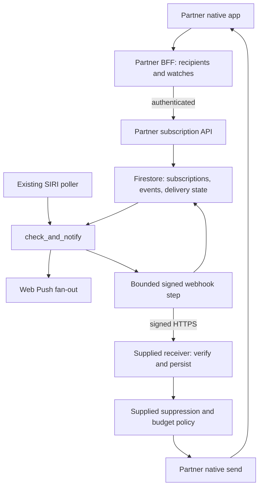
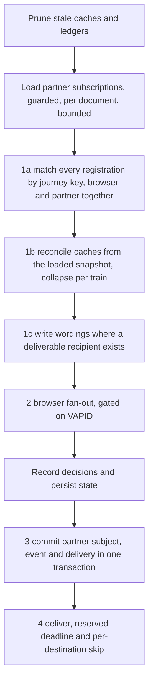
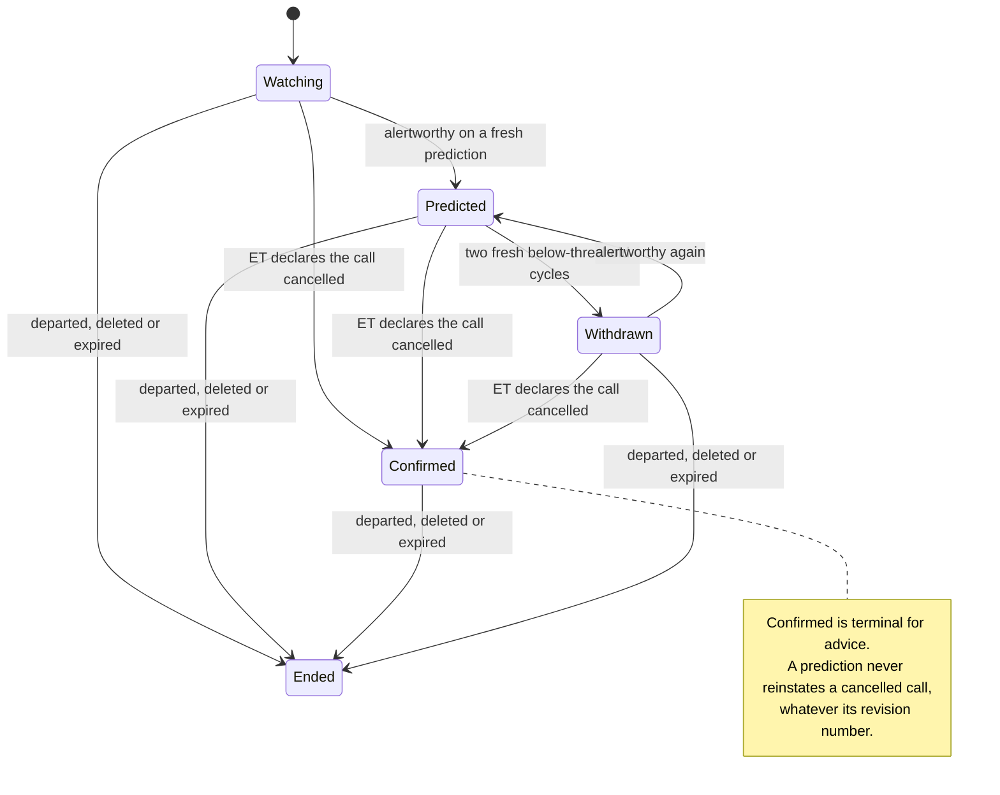
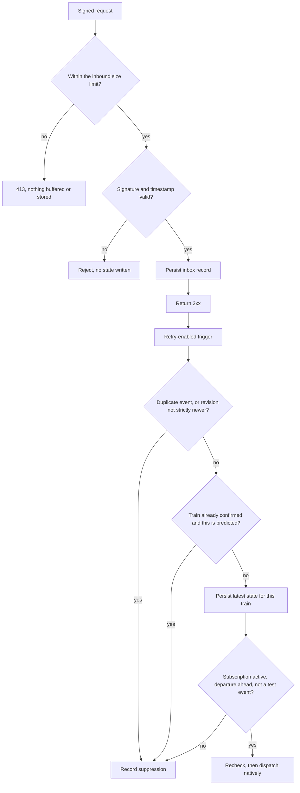

> **Naming note (2026-09-09).** This plan is the dated record of what was decided and keeps its
> vocabulary. The code shipped under different names, renamed on the branch before merge because
> the first consumer is the Entur app and "partner" is Entur's word for an external party: the
> credentialed caller is a **client** (`client_id`, `external_ref`, `clientKey`), the channel is
> **webhook** (`webhook_delivery.py`, `webhook_sender.py`, `WEBHOOK_SIGNING_ROOT`), the shared
> machinery is **notification** (`notification_store.py`, `notification_api.py`,
> `notification_auth.py`, `notification_events.py`, `notification_servability.py`,
> `NOTIFICATION_WEBHOOKS_ENABLED`), the Firestore database is `notifications` and its collections
> carry no prefix. `docs/operations/notification-webhooks.md` is the operating contract.

# Partner Notification Webhooks - Plan

## Goal Capsule

- **Objective:** An external partner's BFF receives the alerts `/varsel` already sends its own browsers, as signed HTTPS webhooks, and turns them into native notifications with almost no integration work.
- **Means:** `/varsel`'s matcher, threshold, per-train collapse, wording and daily cap reused by extraction; partner subscriptions and delivery state in Firestore; a TypeScript helper package with a Firebase Functions receiver.
- **Authority:** The user request governs scope. Requirements own product behavior; KTDs own implementation mechanism. `CLAUDE.md` governs code and deployment conventions.
- **Execution profile:** Land the wording seam first, under the existing suites as characterization coverage. Prove signing, SSRF and idempotency with fixtures and pure tests before any live callback.
- **Stop conditions:** Do not invent selection logic — if a decision cannot be traced to `/varsel`'s existing path, stop. Never write partner routes or prose into `varsel_decisions`. Never place partner work upstream of the pass's durable writes, and never let a partner endpoint block ingestion. Never treat a 2xx from the BFF as a notification on a phone. Do not enable a partner for an operator whose alert quality nothing has measured.
- **Tail ownership:** This repository only. The helper package ships from here; the partner integrates it, owns its recipient mapping, its native presentation and its deployment. Production enablement is a separate action after the gates below.

---

## Product Contract

### Summary

A partner registers the same kind of watch a traveller registers in `/varsel` — origin, destination, weekdays and a boarding window — and receives one signed webhook per disrupted train, carrying the ready-to-display Norwegian title and body `/varsel` would have pushed. The supplied TypeScript package verifies the signature, records the event idempotently and applies duplicate suppression, so the BFF only maps a subscription to its own recipients and sends.

This plan deliberately reuses `/varsel`'s notification logic rather than extending it: no exact dated itineraries, no dated-departure identity contract, no widened alert gate.

### Problem Frame

`/varsel` can only reach a browser it holds a Web Push subscription for. A partner app cannot use it: the partner owns consent, the recipient mapping and native delivery, and it cannot hand those to us. The prediction stack, the threshold calibration, the per-train collapse and the Norwegian wording are the parts a partner would otherwise have to rebuild, and they are the parts already measured on `/historikk`.

An earlier plan (see origin) answered the same problem by adding exact dated itinerary subscriptions. That drove a dated-departure identity contract, a widened alert gate, extra columns through four prediction queries at +99.2 MB per bus run, and a historical replay gate whose recorded verdict was NO-GO. Reusing `/varsel`'s logic removes all four.

The grain matches the traveller. The recipient is a commuter on a monthly pass who registers a journey in the partner app — origin, destination, weekdays and hours — exactly as a traveller registers one in `/varsel`. So the recurring window is not a compromise the simplification forced; it is the shape the notification is about. Tying notifications to a specific ticket is a possible later extension, and the deferred exact-itinerary work is what it would build on.

### Key Decisions

- **Reuse `/varsel`'s notification logic unchanged.** Which trains alert, which alerts clear the bar, and what the text says are `/varsel`'s. Governs R3, R4, R7, R11. (session-settled: user-directed — chosen over the origin plan's exact dated legs and unaggregated leg evaluation: it removes the identity contract, the query cost and the replay gate at once.)
- **Deliver through the partner's BFF over HTTPS.** Callbacks keep native delivery ownership with the partner and work on any hosting platform. Governs R1, R7, R14. (session-settled: user-approved — chosen over polling and over pushing to devices ourselves.)
- **Firestore holds partner state.** Governs R9. (session-settled: user-directed — chosen over extending `/varsel`'s GCS state blob, which is a whole-blob rewrite with no compare-and-set.)
- **Cross-source arbitration against the existing Ukur cancellation feed stays deferred**, and the supplied policy defaults confirmation display to `silent` so the deferral costs no duplicate notification. Governs R8, R12, R14. (session-settled: user-approved scope reduction, carried from origin — as is the silent default, which the origin paired with it.)

### Actors

- A1. Traveller: watches a journey through a partner app and receives a native notification.
- A2. Partner BFF: owns consent, recipient mapping, watch lifecycle and presentation.
- A3. Notification service: matches subscriptions, writes wording and delivers events.
- A4. Operator: provisions partners and destinations, rotates credentials, manages delivery health and rollout.

### Requirements

**Subscriptions and matching**

- R1. An operator provisions a partner and one callback destination per environment. An authenticated partner manages only its own subscriptions. Records and credentials are isolated by environment, which each environment being its own GCP project with its own runtime identity is what enforces.
- R2. A subscription carries origin place, destination place, weekdays, a daily boarding window in `Europe/Oslo`, and an opaque partner reference. It is `/varsel`'s registration shape; overnight windows are rejected as they are there.
- R3. Which dated departures a subscription alerts on, and which alerts clear the bar, is `/varsel`'s matcher and `/varsel`'s per-operator threshold, unchanged. A partner subscription and a browser registration with the same definition see the same trains and cost one match and one wording between them.
- R4. One alert per train, not per SIRI-SX message. The survivor is the most severe, tie-broken deterministically so it cannot flip between cycles.
- R5. Registration supports safe retry, amendment, deletion and automatic expiry. A subscription expires at the earlier of a maximum lifetime and an inactivity horizon, both stated as numbers and both enforced on read rather than by TTL alone. A subscription no direct trip can serve carries that caveat and is never refused.
- R6. Resolution exposes whether a subscription is servable and how fresh the answer is. Missing or stale data never reads as an all-clear.

**Events and delivery**

- R7. An event carries structured facts plus the Norwegian title and body `/varsel` would have pushed, and the partner's opaque reference. Normal receipt needs no second request to us.
- R8. An event distinguishes a predicted disruption from a confirmed cancellation, and carries an immutable event id, an ordered revision, the affected train's identity, the contributing situations and source timestamps.
- R9. Accepted subscriptions and delivery state survive a restart. Delivery is re-attempted while the departure is still ahead, then marked expired rather than failed.
- R10. Each attempt is signed over the exact bytes sent with a fresh timestamp, under a delivery id stable across attempts. Signing secrets are per destination, and two generations are valid at once so one can be rotated without a flag day and revoked without touching another partner.
- R11. At most four alert notifications per subscription per Oslo day, spent soonest-departure-first, with a confirmation that replaces an earlier forecast about the same train exempt. A suppressed alert is recorded and re-offered. The counter lives on the **subscription** document, keyed by subscription and Oslo day, and is spent when a delivery succeeds — the grain the cap is defined at, and `/varsel`'s own (`_daily_pushes` keys on the registration and increments inside a successful send). A per-train counter could not bind at all: thirteen cancelled departures are thirteen alert subjects, so a per-day count held on the subject would read one. The per-train record the exemption reads and the consecutive-below-threshold count that drives withdrawal live on the alert subject. All three are Firestore and are written in the transaction that commits the state they describe — split across two stores they disagree after a restart, and the exemption failing open would suppress a confirmed cancellation. Per subscription is `/varsel`'s own grain and therefore the whole of R3's parity: a commuter who registers a morning and an evening journey has an allowance for each, exactly as they would in `/varsel`. Bounding a traveller's total across their registrations is the partner's to add if it wants one; it is not `/varsel` behaviour and this plan does not require it.
- R12. Delivery is at-least-once with no ordering guarantee. The published contract is one attempt per notification pass while the event is valid — validity being the earlier of a 60-minute horizon, the departure, and the subscription's lifetime — after which the event is expired. The horizon is a number; the interval is the pass period, which is measured rather than fixed because the pass is driven by SIRI ingestion changes. Duplicate suppression and revision ordering within our stream are supplied to the partner, not left as homework.
- R13. Deletion or expiry stops later claims for that subscription. A request already in flight may complete, so the receiver rechecks eligibility immediately before native dispatch.

**Integration and operations**

- R14. Supply a typed client, a signature verifier, an idempotent inbox, a Firebase Functions receiver, and a suppression policy that enforces three rules before native dispatch: drop a duplicate event id; drop a revision not strictly newer than the highest applied for that train; and never dispatch a `predicted` revision for a train already `confirmed`, whatever its revision. Confirmation display defaults to `silent`. The partner supplies recipient lookup and presentation choices.
- R15. Supply signed synthetic test events, restricted to subscriptions marked test-only at creation. The marker is immutable — changing it requires delete and re-create — and it rides inside the signed event body so the receiver refuses a test event before native dispatch unless the adapter has opted into an isolated test recipient map.
- R16. Keep partner records, credentials, callback URLs and generated prose out of `/historikk`, `/meldinger`, `/rushhistorikk`, routine logs and the LLM prompt audit record.
- R17. Keep `/varsel`, `/impact`, `/journey` and the rush policies compatible. Partner matching, wording and delivery do not depend on a VAPID keypair or on a browser registration existing. A journey with no deliverable recipient on any channel still writes no wording.
- R18. A partner outage, a slow endpoint, a slow store or a delivery backlog cannot delay SIRI ingestion or browser alerting.
- R19. Published retention and deletion behavior matches what the code does, including the maximum residual window where cleanup falls back to TTL.
- R20. Every partner step in the notification pass fails closed: a store outage, an unreadable document or a schema the running binary does not know suppresses that partner's work and nothing else. Reading partner state, emitting events and delivering them are each guarded, and an unreadable document is skipped rather than failing its collection.
- R21. Per-partner and per-destination quotas bound active subscriptions, pending events and delivery attempts per cycle. A create past the ceiling is refused before any store write, the per-cycle read cannot exceed the ceiling, and a breach is visible to an operator.
- R22. Operator provisioning authorizes against a named least-privilege group with environment-scoped IAM, separately for production. Every provisioning, credential, destination and suspension action lands in an append-only audit record no partner credential can read.

### Acceptance Examples

| ID | Given / when | Expected result | Covers |
|---|---|---|---|
| AE1 | A partner subscription and a browser registration share the same origin, destination, window and weekdays | Identical trains, identical threshold verdicts, and an asserted count of one matcher call and one written wording between them | R3, R7 |
| AE2 | Two SIRI-SX messages describe one cancelled departure | One event for that train, from the most severe alert; the winner is the same on every cycle | R4 |
| AE3 | A line suspension cancels thirteen departures inside one subscription's window | Thirteen events, and at most four notifications that Oslo day, spent on the soonest departures; the other nine are recorded as suppressed | R11 |
| AE4 | ET declares a cancellation for a train an earlier event forecast at 91 % | A `confirmed` revision for the same train, exempt from the daily cap, superseding the forecast, and silent by default | R8, R11, R14 |
| AE5 | The same event is delivered twice, concurrently and again after a restart | One inbox record and one native decision in the supplied receiver | R12, R14 |
| AE6 | The callback returns 503, then the subscription is deleted before the next cycle | No further attempt for it; other destinations unaffected | R9, R13 |
| AE7 | The callback hangs, and thirty events are pending for it | The pass stops attempting that destination for the rest of the cycle and ends inside its reserved deadline; the poller cycle and browser alerting are unaffected | R18 |
| AE8 | A retry goes out four minutes after the first attempt | A fresh `webhook-timestamp` and signature under the unchanged `webhook-id`, so a receiver enforcing a five-minute replay window accepts it | R10 |
| AE9 | The destination resolves to a private, link-local, ULA, IPv4-mapped, NAT64-encoded metadata or multicast address, in either address family | Rejected at connect time against the resolved address, with the original TLS hostname still verified | R1 |
| AE10 | The deployment has no VAPID keypair | Partner subscriptions still match, wordings are still written, events are still delivered | R17 |
| AE11 | A partner requests another partner's event, or an anonymous reader opens `/historikk` or `/meldinger` | No cross-partner data; no partner route, reference or prose on either page | R1, R16 |
| AE12 | The train departs while an event is still undelivered | The event is marked expired, not failed, and is not retried | R9 |
| AE13 | A subscription names a stop pair no single direct trip serves | The subscription is stored and returns that caveat; it is re-checked as service appears | R5, R6 |
| AE14 | The partner store is unreachable, slow, or returns one unparseable document | Browser matching, wording, delivery, decision recording and state persistence all complete inside the cycle's budget; only the unreadable document is skipped | R18, R20 |
| AE15 | The process restarts between an event's commit and its delivery | The event is re-sent under its original id and revision, and the receiver suppresses the duplicate; no new revision is minted for facts that have not changed | R9, R12 |
| AE16 | A confirmed revision arrives before the older forecast it supersedes | The forecast is dropped before native dispatch; no cancelled train is presented as an active forecast | R12, R14 |
| AE17 | A commuter registers a morning journey and an evening journey, and both are disrupted the same day | Each subscription has its own four-per-day allowance, exactly as two `/varsel` registrations would | R2, R11 |
| AE18 | A synthetic test event is delivered for a test-only subscription, and a replace tries to clear the test marker | The event reaches no real recipient mapping, and the replace is refused | R15 |

### Scope Boundaries

**Included:** partner provisioning and credentials, `/varsel`-shaped subscriptions, the predicted and confirmed event lifecycle, signed bounded delivery with retry and expiry, per-partner quotas, duplicate suppression and revision ordering inside our stream, a TypeScript client with a Firebase Functions receiver and a generic Node receiver exercised by the wire-contract suite, and managed-pilot operations.

**Deferred to Follow-Up Work:** exact dated itinerary subscriptions and the dated-departure identity contract; cross-source arbitration and identity normalization against the existing Ukur feed; the companion BFF integration and any native enrollment work in `entur/entur-clients` — the partner owns the surface a commuter registers a journey on, and R2 assumes it captures origin, destination, weekdays and hours as `/varsel`'s does; notifications tied to a specific ticket rather than a registered journey; publishing the helper package to a registry; a separate delivery deployment; a delivery-status API or dashboard for partners; scored outcomes for partner-only route definitions, which `/historikk` cannot reach because no `varsel_decisions` row exists for them; destination-ownership verification; additional languages; self-service onboarding; new model or operator coverage.

**Outside this product's identity:** partner device or account management in this repo; native FCM/APNs delivery from this repo; replacing the authoritative cancellation feed.

### Success Criteria

These criteria qualify the integration, not traveller enrollment — the partner owns the surface its commuters register a journey on.

A Firebase BFF developer follows the quickstart on the declared supported runtime, registers a subscription, and sees a synthetic notification on a test phone without writing signature verification, idempotency, revision ordering or duplicate suppression. A generic Node receiver passes the same wire-contract suite with no Firebase dependency. AE1-AE18 have test or device evidence.

What the pilot measures is delivery: the webhook phase's share of the poller cycle against the measured headroom, evaluation-to-callback latency, and source age reported separately from delivery latency so a fast callback cannot disguise an old prediction.

What it does not measure is alert quality on its own routes. `/historikk` scores the decision logic per R3, and only for journey definitions a browser registration also holds — a partner-only route produces no decision row at all, so its alerts get no verdict anywhere. KTD12 states the four limitations that follow. Nothing here is a per-route claim, and nothing is a claim about any operator but Vy rail.

---

## Planning Contract

### Assumptions

- Managed onboarding with one destination per partner per environment is enough initially. More destinations can be provisioned explicitly.
- The Firestore database is created by this repo's own Terraform, one per environment, in `europe-west1`, and applied before the code that reads it deploys. KTD5 carries the measurement that says this is self-service.
- Pilot volume is a few hundred events a day across one partner. At that rate the store costs cents a month whether or not Firestore's no-cost quota reaches a named non-default database, so the choice of a named database is not a cost decision; the deferred check records the measured figure rather than gating on it.
- The partner's receiver answers inside the per-attempt ceiling. A destination whose cold start exceeds it is **never delivered to at all**, not merely a cycle late: the first failure skips it for the rest of the cycle, there is one attempt per cycle, the next cycle repeats the cold start, and the events end as `expired`, which reads like ordinary expiry rather than a stuck destination. Measuring that latency before enablement is a deferred check, and `minInstances: 1` on the receiver is the partner-side fix.
- The partner's runtime accepts the helper package as shipped. KTD11 declares the supported runtime and consumption shape; a partner outside it needs a build step the quickstart does not cover.

### Key Technical Decisions

- KTD1. **Reuse by extraction, not reimplementation.** Cherry-pick `disruptions/api/notification_wording.py` and its suite from `feat/journey-notification-webhooks` onto a fresh branch off `main`, together with the `llm_message`/`alert_policy` additions it needs. The module already imports only the standard library, already carries a per-surface `WordingPolicy` with `BROWSER` and `PARTNER` instances, a caller-keyed generation budget and an isolated Vertex latch. That branch's `gate` — the single statement of `alert_policy.threshold_for` plus the comparison — moves into `alert_policy.py`, which already owns the threshold, rather than dragging in a near-empty `notification_evaluation.py`. Leave `departure_identity.py`, `impact.dated_legs`, the identity fixtures, the four SQL files and the replay harness behind; close the open PR unmerged. Governs R3, R4, R7. (session-settled: user-directed — chosen over narrowing that branch in place or merging it first: the dated half is ~2500 lines and +99.2 MB per bus prediction run that the next change would delete.)
- KTD2. **The partner gate is `alertworthy`.** One function states the threshold and the comparison, so both surfaces read one gate. Do not carry `is_material`, the branch's widening of that gate by a declared cancellation anywhere on the ridden segment: it makes a partner recipient see alerts a `/varsel` user does not, which R3 forbids and which nothing in the decision log can score. Governs R3.
- KTD3. **A subscription is a registration with a channel, grouped by `varsel.journey_key`.** The per-recipient ledgers in `varsel.py` key on `journey_id`, not `device_id`, and a `journey_id` routinely exists with no push subscription behind it — 79 of prd's 186 registrations. So a partner subscription enters the existing pass as another registration whose channel is a webhook, grouped with browser registrations under `journey_key` — which already excludes device and journey identity and is therefore the canonical fan-out key. One match and one wording per group fan out to both channels, which is what R3 buys and what AE1 asserts by call count. It is a **view merged at match time, never a materialization**: `_journeys`, `_notified` and the GCS state blob never carry a partner id, and Firestore is the only dedup ledger for the partner channel. That invariant is what makes a rollback to pre-feature code safe — `_save_state` writes known keys, so `_state_extra`'s round-trip could not protect partner state that had leaked into the blob. A rollback between two feature-carrying versions is outside that argument and is covered by R20 instead. Governs R2, R3, R17, R20.
- KTD4. **Wording depends on a deliverable recipient, not on a VAPID keypair.** `varsel.py:2672` skips the whole writing pass when no keypair is loaded, and its docstring gives the reason — writing prose nobody can receive is spend with no reader. That reason is right and the gate is wrong: it reads "no keypair" as "no reader", so a webhook-only deployment, and tst which has no keypair, writes nothing. Replace it with the condition it was reaching for — at least one deliverable recipient on any channel, browser push enabled or a partner subscription with a pending delivery for that train. **A browser recipient is not pending when `push_enabled()` is false**, which is the other half of the same move: `_pending_pushes` derives pending-ness from `_notified`, and `_notified` only grows on a successful browser send, so without that clause a keypair-less deployment leaves every alert-worthy train pending for every browser registration on every cycle and spends the write budget re-wording trains it can never deliver — competing with the partner subjects this KTD exists to serve. A journey with no deliverable channel still writes nothing, so `message_status='push_disabled'` keeps its meaning for browser subjects. Governs R17.
- KTD5. **Firestore Native, one named database per environment, created by this repo's own Terraform — and the IAM grant is the one part that cannot go there.** Measured against all three projects on 2026-09-08, every resource U3 needs is already inside what the CD service account may do, so there is no Team Plattform request: `gh-kix-avvik-f849-{dev,tst,prd}@ent-github-shr` holds `datastore.databases.create` and `datastore.backupSchedules.*` through `roles/firebase.admin`; a composite index and a TTL field config cost `datastore.schemas.*` — **not** `datastore.indexes.*`, the name the permission no longer has — held through `roles/firebase.admin` and `roles/datastore.indexAdmin`; and enabling `firestore.googleapis.com`, which none of the three projects has today, costs `serviceusage.services.enable`, held through `roles/monitoring.editor` — the only one of that account's 56 roles that carries it, and the last place anyone would look. `constraints/gcp.restrictServiceUsage` is effectively `allValues: ALLOW`. Ten Entur repos already create their database from their own `terraform/`; `entur/abt-referencedata` is the closest worked example, a golden-path app on `module.init`. This is the first non-IAM resource this directory has created. **The `roles/datastore.user` grant still goes in `.entur/application.yaml`, because the two paths meet two different guards.** A `google_project_iam_member` in `terraform/` runs under a `roles/resourcemanager.projectIamAdmin` that is **conditioned** by `only_assignable_roles`, a CEL `hasOnly()` over the platform's `assignable_iam_roles` list — which carries no `roles/datastore.*` at all. That condition, not an org deny policy, is what actually parked `oauth_iam.tf` (`roles/oauthconfig.editor` is absent from the same list, and a conditioned grant refuses with the same 403 wording), and it governs IAM grants only — which is precisely why it does not reach a database, an API enablement or an index. The manifest's `additionalRoles` is granted by the platform's own Terraform and filtered only against `bad_roles_regex` (`^(roles/owner|roles/editor|roles/resourcemanager.*|roles/iam.*)$`), which `roles/datastore.user` passes. That filter is a comprehension guard rather than a validation: a matching role is **silently dropped**, no error and no binding, so the binding is verified after `entur apply` instead of assumed. Each environment is a separate GCP project with its own runtime service account, so the one declaration grants each identity access to its own project only — which is what R1's isolation rests on, and what a negative access test pins. `roles/datastore.user` is project-scoped and there is no narrower predefined role: Firestore has no per-collection granularity, a limit `entur/platform-orchestrator` records in its own variables ("Firestore usage, project level access only :-("). Location is immutable after creation — `europe-west1`, co-located with the GKE cluster and the BigQuery datasets, because the poller reads this store on the ingestion thread. Governs R1, R9.
- KTD6. **Decide in the pass, deliver in the pass, after the browser cycle is already durable.** Every partner step that **writes or sends** — emit and deliver — runs after `_record_decisions` and `_save_state`, which are `check_and_notify`'s last two statements today. Ordering them before would put store and network I/O upstream of the cycle's only durable writes: a raise unwinds the whole function, so the decision log gains a hole and the blob stops advancing, and the next restart re-pushes every alert delivered since the last successful save. The read-only load step necessarily precedes pass 1a, because that is what partner subscriptions are matched from. Each partner step is individually guarded in the shape of the `_reconcile_caches` guard at `varsel.py:2662-2670`, whose comment already states that blast radius.
  **Every partner step is bounded, not only the outbound call.** The load step and the emit transactions each carry a per-call Firestore deadline and a whole-step budget reserved the way the delivery deadline is; delivery runs a **4-wide pool** — `/meldinger`'s width, the repo's narrowest, and the right precedent for blocking HTTP on a path the poller shares — with a per-attempt ceiling of 5 s total and 2 s connect, skips a destination for the rest of the cycle after its first failure in pass-local state, and reserves its worst case — the attempt plus the durable `sent` write that follows it — against a 20 s deadline in the shape of `varsel._WriteBudget.claim`, whose docstring records the naive elapsed-time check overshooting a 30 s ceiling by 16 s. One attempt per pending event per cycle; the next cycle is the retry, as it is everywhere else in this repo, so no outbox lease or fence token is needed. What makes that safe is a single writer, and the mechanism is nameable rather than assumed: one poller thread calls the pass, no route invokes it, and the deployment is one replica under the Recreate strategy, so two cycles cannot overlap. No Firestore call is made while `_state_lock` is held, following `_prepare_alert`'s rule of taking it for two dict lookups and never across a send. Governs R9, R18, R20, R21.
  (session-settled: user-approved — chosen over a separate Kubernetes worker: at one partner and a few hundred events a day the worker solves an isolation problem these bounds already close, and `check_and_notify` is the cycle's last phase, so its tail delays nothing else. The reversal trigger is a number, not a judgement: move delivery out when the webhook phase exceeds 30 s of measured phase time on any cycle in a week, when a second replica appears, or when partners pass single digits.)
- KTD7. **Standard Webhooks signing, fresh per attempt, per destination.** HMAC-SHA256 over `webhook-id.webhook-timestamp.<raw body>`, with the body bytes stored once and signed unmodified. The `webhook-id` is stable across attempts so a receiver can dedupe on it; the timestamp and signature are regenerated per attempt, or a retry crossing a cycle boundary lands outside the receiver's replay window and a correct receiver drops our own retry. Each destination's secret is derived as HMAC-SHA256 of a root secret over `destination_id || generation`, so the store holds no signing material and one partner's leaked receiver secret forges nothing for another; the active and retiring generation are both emitted as space-delimited `v1,<sig>` entries and each is revocable alone. Signing uses stdlib `hmac`, following `sso.py:127-149`'s purpose-tagged shape; no new crypto dependency. Governs R10.
- KTD8. **Opaque two-part API key, verified by our own middleware, several live at once.** A prefixed `key-id` plus secret; the secret hashed at rest with HMAC-SHA256 under a pepper held in Secret Manager, never bcrypt or Argon2 — those are sized for low-entropy human passwords, and a measured ~100 ms per comparison would be paid on every partner request for no gain against a 256-bit random secret. Compare with `hmac.compare_digest`; look up by `key-id` so the secret never appears in a query; log the `key-id` and never the secret. A partner may hold several active `key-id`s, so rotation issues a new credential and revokes the old one after cutover rather than taking the partner down. Authenticate on a bearer header, never a cookie: this app has one global `CORSMiddleware` with `allow_origins=["*"]`, so any new endpoint is reachable from every origin. Do **not** add the partner prefix to `sso.PROTECTED_PREFIXES` — that gate answers an unconfigured deployment with 503 and an unauthenticated browser with a 302, both wrong for a machine caller.
  **The limiter is two-tier, because credential verification is itself store work.** A global pre-lookup ceiling plus a short-TTL negative cache of unknown `key-id`s means a repeated bad credential costs no Firestore read; a per-partner ceiling then applies after authentication so anonymous traffic cannot spend a partner's budget. An anonymous flood can still exhaust the global tier, which is the accepted trade `/impact`'s limiter already makes. Governs R1, R16, R21.
- KTD9. **Hardened outbound client: a positive address test, no ownership challenge.** HTTPS only; reject userinfo, fragments and non-default ports; resolve the host once, validate every returned address, and connect to a validated literal while still sending the original SNI and Host — a validate-then-request-by-hostname check is a time-of-check race, which is how CVE-2026-27129 and SVIXSEC-2026-0001 both happened this year. **Accept an address only when it is globally routable and not multicast, rather than denying a list of ranges**, and additionally decode the IPv4-embedding prefixes `64:ff9b::/96` and `2002::/16` and re-run the same test on the embedded address. A deny-list is the wrong shape for the claim: `64:ff9b::a9fe:a9fe` NAT64-encodes the metadata address and reports as global and non-private, so it passes every named range — private, loopback, link-local, ULA `fc00::/7` and IPv4-mapped `::ffff:0:0/96` — and OWASP's own table omits three of those anyway. Keep the named ranges as documented rationale. Refuse redirects and cap the response body. Skip destination-ownership verification: its documented threat is an untrusted self-service registrant, and an operator provisions each destination out of band — self-service onboarding would need a fresh trust-boundary review. Governs R1, R18.
- KTD10. **Partner decisions and deliveries are recorded in Firestore, never in `varsel_decisions`.** That table is written for every match including sub-threshold ones, and `/historikk` and `/meldinger` publish it on public hosts — including resolved origin and destination names since 2026-08-22, accepted then because prd's registrations are test users. Partner-app travellers are members of the public, and `/meldinger` measured 21 of 31 stop pairs isolating exactly one journey. Its `pushed` column is also journey-definition grain and cannot tell a webhook from a Web Push, so writing partner deliveries there would corrupt both pages' meaning as well as their privacy claim. Governs R16.
- KTD11. **A TypeScript helper package, vendored for the pilot, with a declared runtime.** `integrations/notifications-client/` holds the typed client, the verifier, the inbox contract and the suppression policy with no Firebase dependency; `integrations/firebase-notifications/` adds the Firestore-backed adapter, the receiver and its security rules. Test them with `node:test` importing `.ts` directly, as `demo/avviksvarsel` does — Node 24's type stripping means no build tooling for our unit tests — and copy its `pretest` guard that fails on an empty glob. That is a test convenience and not the partner's contract: declare the supported consumption shape as compiled CommonJS plus type declarations on the Node major the partner's Functions runtime actually pins, and run the quickstart and wire-contract suite under exactly that. Depend on the `standardwebhooks` npm package for verification rather than hand-rolling HMAC. Vendor the package into the partner's repo for the pilot; publishing is follow-up work. Governs R12, R14.
- KTD12. **Enablement is conditional on `/historikk`'s per-operator verdicts instead of a dated-leg replay.** This is a change of what the gate is conditional on, not the removal of a gate — the second option the replay document itself names. R3 removes the dated-leg selection that document was written to score, so that particular replay has no subject; what survives it are three limitations, and only one is about the dated path. `/historikk`'s rows are one per subject **per cycle**, the repeats being the lead-time series, while a notification fires on the first threshold crossing. A subject nobody was notified about has no row at all, so capped and missed subjects must be returned to the denominator by hand — and this plan manufactures capped subjects by design, nine of thirteen in AE3, so that limitation binds harder here than in the origin. And 21 308 of 21 331 replayed subjects were VYG, so the evidence is a statement about Vy rail.
  **A fourth limitation is created by this plan rather than inherited.** `_record_decisions` iterates `by_journey_key`, so once KTD10 keeps partner subjects out, a partner-only route — one no browser registration shares — produces no `varsel_decisions` row at all. `/historikk` therefore scores the shared definitions and nothing else, and prd's registrations are the team's own test users, so a partner's route mix overlaps them only by accident. Partner-only routes are not thinly evidenced; they are unscored, deliberately, and scoring them is deferred work.
  Therefore: no generalized alert-quality claim, no per-route claim, and no partner enabled for an operator `/historikk`'s own verdicts do not cover without that gap being recorded and signed off. Governs R3.

### High-Level Technical Design

These sketches fix responsibilities and observable behavior. Internal module boundaries may move while the contracts hold.

**Components and ownership (KTD3, KTD5, KTD6)**

**The notification pass, with the partner steps (KTD3, KTD4, KTD6)**

**Alert lifecycle per subscription and train (R8)**

**Receiver decision order (R12, R14)**

**API shape under `/notification-api/v1`** — schemas and fixtures are fixed in U4 before anything consumes them.

| Method and path | Purpose |
|---|---|
| `POST /subscriptions` | Create or replace by the partner's opaque reference; idempotent; returns the subscription id, version and servability caveat. The test-only marker is immutable across replace |
| `GET /subscriptions` and `GET /subscriptions/{reference}` | Paginated watches with servability and current alert state |
| `DELETE /subscriptions/{reference}` | Tombstone, then durable cleanup; repeated deletion succeeds |
| `GET /destinations/current` | Destination readiness and signing key ids, never secrets |
| `POST /test-events` | Signed synthetic event to a subscription created with `test: true` |

`POST` rather than `PUT` because `PUT` is not in this app's global CORS `allow_methods`; a machine caller does not preflight, but there is no reason to differ from the surface the browser rules already permit.

### Event contract

The envelope carries `schema_version`, `event_id`, `type`, `occurred_at`, `expires_at`, the subscription id and version, the partner's opaque reference, `alert_id`, `revision`, `test`, the train's `operator`, `line`, `journey_ref`, `call_date` and boarding stop, and source timestamps. The payload carries the affected call, probabilities, delay figures, `phase`, `effect`, the contributing situations and the `notification` title, body and action.

**`alert_id` is the canonical per-train subject key**, and the only key the supplied policy deduplicates and orders on. The train's own fields ride along for display and for a partner's own joins; they are not the identity.

Types are `journey.alert.created`, `journey.alert.updated` and `journey.alert.withdrawn`; `phase` is `predicted` or `confirmed`. `event_id` is deterministic over the subject and revision. The pending set is **read from Firestore, never re-derived from a cycle's decisions**, and a subject already holding a committed event for its current facts mints no new revision: re-derivation would mint a fresh revision and therefore a fresh `event_id`, which the receiver cannot recognise as a duplicate and would turn into a second notification about the same train.

`revision` is monotonic per `alert_id`, and monotonicity is structural rather than a property of the clock. Derive it from a **UTC** instant captured once outside the transaction body, then clamp it inside to `max(stored + 1, derived)` using the subject read the transaction already performs. A revision formatted from the Oslo decision timestamp would go backwards for an hour at every autumn DST fall-back and the receiver would silently discard every event for those subjects, a confirmed cancellation included; an NTP step backwards does the same for an unbounded stretch; and a clock read *inside* a body that may run more than once makes `event_id` irreproducible. Seeding from a timestamp is still what stops a fresh process restarting at 0.

**A new revision is minted only on the alert lifecycle diagram's transitions** — predicted to confirmed, and withdrawn back to predicted. A changed probability, delay figure or wording mints nothing, at any size: there is no materiality threshold to tune, because minting on any changed figure would turn every poller cycle into a fresh revision and a second notification about the same train. `journey.alert.updated` carries those transitions and nothing else. Withdrawal means the forecast changed, not that normal service is guaranteed.

Delivery states are `pending`, `sent`, `expired`, `superseded`, `cancelled` and `failed`. Dedup is on success, as `/varsel`'s is: an attempt that errors leaves no mark and is re-offered next cycle, and R11's cap slot is spent on success for the same reason — otherwise a dead destination burns a subscription's four for the Oslo day with nothing delivered. **An event's validity is the earlier of a 60-minute horizon, the departure, and the subscription's lifetime**; U6, U8, AE12 and the partner documentation all quote that horizon. The retry *interval* is one attempt per notification pass and is not a constant — the pass runs on SIRI ingestion changes, measured at a ~296 s period — so the documentation publishes the horizon as a number and the interval as a measurement, rather than implying a fixed schedule. A destination is paused on 410 until an operator resumes it; other 4xx are terminal for that event; network errors, timeouts, 408, 429 and 5xx are retryable, as is an exhausted Firestore transaction — the client raises `ValueError` after five attempts rather than a Google API error, so a handler keyed on API exceptions misses it and a contended subject would be marked `failed` and never delivered. `Retry-After` is honoured by persisting a `retry_not_before` on the delivery record, capped at the lesser of the header, the time to departure, and five minutes; the delivery query excludes records before that time, so the backoff survives a cycle boundary and a restart rather than lasting only the current pass.

### Retention and deletion

Deletion is ordered and durable. Tombstone the subscription first, in a single transactional write that stops routing; then delete its events, deliveries and prose through a **retryable cleanup task with an auditable completion state**, batched. Reversed, a partial delete leaves a routable subscription whose events are already gone; best-effort alone would leave partner data queryable while the published text said otherwise, which is exactly the failure R19 exists to prevent. Where cleanup has not completed, TTL is the fallback and the **maximum residual window is published** rather than implied.

Events and deliveries are **top-level collections carrying a subscription id**, not subcollections: a document delete does not remove subcollections and a TTL field does not cascade into them, so subcollections would be orphaned and the delivery query would keep returning them. History is kept seven days by a TTL field, and every read path tests that field itself, because TTL deletes within roughly 24 hours of expiry and expired documents stay queryable until it does. Subscriptions carry R5's own lifetime and inactivity horizons, tested the same way.

Two things deletion does not reach, and both are published rather than implied. The in-process wording caches key on the journey definition, which under KTD3 is exactly what a partner subscription shares with a browser registration on the same route, so removing one subscription's wording would remove the other's; those entries expire with their situation. And the partner and event identifiers in cluster logs and metrics have their own retention and access policy, which the operating contract states.

### Integration constraints and risks

- The webhook step is the first outbound HTTP in `check_and_notify` with a client-supplied host. `varsel.py:1715-1717` records the same threat model for Web Push: an unresponsive host with no timeout hangs the poller thread and stops ingestion for every other feature. KTD6's bounds are what prevent it, and they cover the store steps as well as the attempt.
- A blocking pass costs at least `ceil(destinations / 4) x timeout`, and more when one destination has several pending events, since each is a separate attempt. The 20 s reservation is what actually binds, which is why it is the bound and the formula is only an intuition. With one partner this is comfortable against a cycle measured at 50-63 s on a period measured at ~296 s, and `check_and_notify` is the cycle's last phase. Those are measurements from 2026-08-21 and 2026-09-08, not constants — re-measure before raising any ceiling.
- `_notified` is mutated in memory per delivery and persisted once at the end of the pass, so a crash inside the fan-out window re-sends. That is the existing accepted boundary and it bounds what the receiver must tolerate: at-least-once within one cycle.
- Firestore's emulator does not mirror production concurrency — it uses "a simple locking approach" and does not track composite indexes. Emulator tests are useful for shape and idempotency; they do not establish atomicity, and the Verification Contract says so rather than claiming otherwise.
- A missing composite index is a runtime `FailedPrecondition`, not a deploy-time error. Every query the delivery step runs needs its index declared before that step ships, checked statically because no emulator test can catch it. Materialising those declarations as Terraform resources moves the failure forward to `terraform plan` drift on the PR that adds the query, which is the earliest anything can catch it, and takes the per-collection TTL configs out of the console at the same time. That property depends on one config line: `terraform.yml` triggers on `paths: ['terraform/**', ...]`, so `firestore.indexes.json` must be added to both of its `paths:` lists — kept at the repo root because that is where the Firebase CLI expects it — or a PR adding a query and its index entry touches neither `terraform/` nor the workflow, passes the static test, merges, applies nothing, and lands the `FailedPrecondition` in production anyway.
- `varsel_decisions` is written for every match. A partner subscription whose definition is new to the deployment creates rows with a route nobody registered in `/varsel`, so KTD10's split is a condition on the pass, not only on a new table.
- The daily cap and the write budget are per-registration in `/varsel` and stay so here. Both must keep `/varsel`'s soonest-departure-first ordering across registrations; insertion order handed the whole budget to the earliest-registered travellers every busy morning.
- The helper package's suppression must key on `alert_id`, the identity our events carry. A client-side key looser than the server's silently undoes a server decision, which is how a picker bug hid three stations in 2026-09.
- Every Firestore read that passes 1a and 1b depend on happens in the single guarded load step, and 1b reads that snapshot — 1b is sequential precisely because it mutates module state and blocks on nothing. The emit transactions and the delivery step read the store themselves, after the durable writes: emit reads the subject to clamp the revision, and delivery reads the committed pending set rather than re-deriving it.
- The partner API adds the first authenticated routes to a process where every other route is a plain `def` sharing one anyio worker pool. Firestore latency on those routes is new pressure on the pool that `/impact` and `/varsel-api` registration also draw from. Authentication, quotas and the two-tier limiter are what bound it; `/meldinger`'s `async def` inversion is the precedent if a route ever needs to hold a slot longer.
- Every new module-level ledger must be added to both `check_and_notify`'s per-cycle stale sweep and `test_varsel_api._reset_state`. A leaked half-spent budget reads exactly like the give-up bug. The per-destination skip is the exception and must be **pass-local**: made module-level and swept, one failure would pause a destination permanently, which is indistinguishable from the intended 410 pause.
- The seven-day event TTL is shorter than the ten-day retry window the nightly labelling job uses, so retrospectively scoring partner alerts is foreclosed by this retention choice — and R19 publishes it, so lengthening it later is a published-contract change. An outcome-labelling path is deferred work; this is the constraint it would have to lift.

### Alternatives Considered

A separate delivery deployment is the origin plan's choice and remains the right answer at scale; KTD6 records the numeric trigger that reverses the decision. The transactional outbox with leased claims and fence tokens defends against a second writer taking over mid-lease, which one always-on replica under a Recreate strategy cannot produce.

A **managed push transport** — a Pub/Sub push subscription delivering to the partner's HTTPS endpoint — sits inside the settled BFF-over-HTTPS decision rather than against it, and would remove U5 entirely along with KTD7's signing and KTD9's hardened opener: Google would own the connection, the retries and the backoff. It is rejected because it moves authenticity from an HMAC the partner verifies with a two-line library call to OIDC token validation against Google, couples the partner's receiver to GCP where the contract is meant to work for any HTTPS receiver, and leaves the event contract and the whole suppression policy ours to supply anyway — so it trades a bounded, testable piece of our own code for a platform dependency without shrinking the part the partner integrates.

A **stateless per-train alert feed** — pushing alert-worthy trains over the same signed callback and letting the partner match them against watches it already holds — would drop the subscription store, the delivery and expiry state and the daily cap from the first increment. It is rejected because it moves matching to the partner, which is the specific work this product exists to remove, and because the cap and the suppression policy would then have no server-side home.

Reimplementing selection for partners — the origin plan's unaggregated dated-leg evaluation — buys exact itinerary support and costs a dated-identity contract, four changed prediction queries, a widened gate and an unanswerable quality gate. R3 is the trade the user chose instead.

---

## Implementation Units

### U1. Lift the shared wording seam onto main

**Goal:** `/varsel`'s wording, generation budget and Vertex latch are callable by a second surface without importing `varsel`.

**Requirements:** R3, R4, R7, R16; KTD1, KTD2. **Dependencies:** None.

**Files:** New `disruptions/api/notification_wording.py`, `test_notification_wording.py` (cherry-picked); `disruptions/api/{varsel,llm_message,alert_policy}.py`; existing `test_varsel.py`, `test_varsel_api.py`, `test_llm_message.py`, `test_impact.py`.

**Approach:**

1. Branch from `main`. Take `notification_wording.py` and its suite, `llm_message.new_partner_state` with the caller-aware logging fields, and `alert_policy`'s export addition.
2. Put the branch's `Gate` and `gate` into `alert_policy.py` beside `threshold_for`, and route `varsel._collect_alerts` through it so one function states the threshold and the comparison. Do not port `notification_evaluation.py`, and change `varsel`'s module-level `import notification_evaluation` accordingly — on the branch that import is how `varsel` reaches `gate`, and the module imports `departure_identity` at module level, which KTD1 leaves behind.
3. Move `_code_names` into `test_notification_wording.py`. The cherry-picked suite imports it from `test_notification_evaluation`, which is not lifted and which imports `departure_identity`, `impact` and `varsel` — so without this the suite fails to import and U1 fails its own verification before anything else is built.
4. Keep the re-exports `varsel` needs under their existing private names, so `main`'s injection into `/meldinger` and the byte-for-byte body assertions in two suites keep resolving.
5. Suppress the LLM prompt audit record on the partner wording path regardless of `VARSEL_LLM_LOG_PROMPTS`, in the shape `/meldinger`'s replay path uses — that record carries origin, destination and departure time.
6. State which budget partner wording draws on: partner subjects run through pass 1c, so they share its wall-clock deadline, while the *call* allowance is `notification_wording`'s caller-keyed one rather than `varsel._MAX_LLM_CALLS_PER_CYCLE`.

**Execution note:** the existing suites are the characterization coverage — run them before and after and compare check counts, not just pass/fail.

**Test scenarios:**

1. Covers AE1: an identical `message_input` yields byte-identical title and body through the extracted module and through `varsel`'s old path.
2. The gate returns the same threshold and verdict as `alert_policy.threshold_for` for rail, bus and no-SX subjects at, just below and just above the bar.
3. The partner generation budget and latch are independent: exhausting the partner path leaves the browser path's allowance and latch untouched, and vice versa.
4. A configuration failure on the partner path does not latch the browser path off for the latch TTL.
5. `is_material` is absent from the tree — a grep test, because reintroducing the widening would be silent and would break R3.
6. A partner-caller generation writes no prompt record with `VARSEL_LLM_LOG_PROMPTS` on.
7. The module exposes a reset seam, wired into `test_varsel_api._reset_state` beside the existing `llm_message._STATE` reset.

**Verification:** `uv run ruff check .` clean; every `disruptions/api/test_*.py` passes as its own process with check counts equal or higher than before the lift.

### U2. Make the recipient a registration with a channel

**Goal:** A registration with no browser subscription is a first-class recipient, and wording depends on a deliverable recipient rather than a keypair.

**Requirements:** R3, R11, R17, R20; KTD3, KTD4. **Dependencies:** U1.

**Files:** `disruptions/api/varsel.py`, `main.py`; existing `test_varsel.py`, `test_varsel_api.py`, `test_poller_refresh.py`.

**Approach:**

1. Replace the `push_on` gate on the writing pass with KTD4's deliverable-recipient condition. Browser delivery keeps `push_enabled()`; `message_status='push_disabled'` keeps its current meaning for browser subjects.
2. Give `check_and_notify` a channel-neutral registration view grouped on `varsel.journey_key`, so partner subscriptions join pass 1a alongside `_journeys`. Load them once, in a guarded and bounded step, per document — a single unreadable record is skipped and logged, never allowed to fail its collection. Per KTD3 this is a view: nothing writes a partner id into `_journeys`, `_notified` or the state blob.
3. Extend `_pending_pushes`' pending-ness to partner recipients, reading the loaded snapshot rather than the store, so a train only a partner still needs a wording for is written for rather than falling through to the worst-train fallback and its template.
4. Add the partner flag following `main._togvarsel_notify_enabled`: read at call time, allow-list membership, unset means off. Register every new module-level ledger in both the stale sweep and `test_varsel_api._reset_state`.

**Execution note:** characterize the current behavior of a registration with no device record first — it already exists in prd at scale and the matcher already runs for it.

**Test scenarios:**

1. Covers AE10: with no VAPID keypair, a partner registration matches, gets a written wording and produces an event, and no browser delivery is attempted.
2. Covers AE1: a browser and a partner registration with one definition produce **exactly one** matcher call and **exactly one** written wording, asserted by call count, with identical verdicts.
3. A train pending only for a partner recipient receives a written wording rather than the deterministic template.
4. A journey with no deliverable recipient on any channel writes no wording, and a keypair-less deployment with the partner flag unset spends no Vertex call.
5. With the partner flag unset, the pass behaves exactly as today and touches no Firestore.
6. `/varsel`, `/impact`, `/journey` and the rush outlook are unchanged; the poller cycle's phase set gains one step and no existing step's isolation changes.
7. Covers AE14: the store raises on load, is slow, and separately returns one unparseable document — browser matching, wording, delivery, decision recording and state persistence all complete inside the budget, and only the bad document is dropped.
8. After a cycle in which partner subscriptions matched and delivered, the serialized state blob is byte-identical to the same cycle with none.

**Verification:** the full API suite passes; `test_poller_refresh.py` still proves a failing step degrades one feature; a run with the partner flag unset is behaviorally identical to `main`.

### U3. Partner store and infrastructure

**Goal:** Subscriptions, events and delivery state survive restarts and concurrent writers, inside per-partner quotas.

**Requirements:** R1, R9, R13, R19, R20, R21; KTD5, KTD7, KTD10. **Dependencies:** None. The subscription and event JSON schemas are authored here; U4 renders them as OpenAPI rather than redefining them.

**Files:** New `disruptions/api/partner_store.py`, `test_partner_store.py`; `disruptions/api/requirements.txt`, `pyproject.toml`, `uv.lock`; `.github/workflows/ci.yml`, `.github/workflows/terraform.yml`; `.entur/application.yaml`; new `terraform/firestore.tf`; `helm/kix-avvik/values.yaml`, `helm/kix-avvik/env/values-kub-ent-{dev,tst,prd}.yaml`; new `contracts/notifications/v1/{subscription,event}.schema.json`; new `firestore.indexes.json`.

**Approach:**

1. Add `google-cloud-firestore` in all three places a dependency must appear: `requirements.txt` (the only file the image's Python stage installs from), `pyproject.toml`'s `api` group, and `ci.yml`'s inline `--with` list.
2. Implement transactional repositories with an injectable clock. Reads precede writes; no HTTP, Vertex or logging side effect goes inside a transaction body, because a transaction function can run more than once.
3. Declare the composite indexes the delivery query needs in `firestore.indexes.json` — the Firebase CLI's own format, so one file serves the emulator, the static test and Terraform, which materialises each entry with `for_each` over `jsondecode(file(...))`. Key each resource on the index's own content (collection plus ordered field paths), never on its position in the array, or reordering the file destroys and recreates every index. One TTL field per collection group, and the quota counters R21 bounds. Every read path tests the expiry field itself.
4. Enforce R21's ceilings in the store: a create past a partner's active-subscription ceiling fails before any write, and the per-cycle load cannot read more than the ceiling.
5. Add `roles/datastore.user` to `.entur/application.yaml`'s `additionalRoles`. Add the database id and the partner flag to the Helm config, and the signing root and pepper to a **separate** secrets group from `varsel` — one unresolvable name fails an ExternalSecret whole, and sharing the group would take the VAPID keys down with it.
6. Add `terraform/firestore.tf`: `google_project_service` for `firestore.googleapis.com` with `disable_on_destroy = false`; the named `google_firestore_database` depending on it, `FIRESTORE_NATIVE`, `location_id = "europe-west1"`, `app_engine_integration_mode = "DISABLED"`, `lifecycle { ignore_changes = [etag] }` (`entur/abt-referencedata`'s, against a field the API rewrites), `deletion_policy = "ABANDON"` so a `terraform destroy` cannot take the subscriptions with it, and PITR plus `DELETE_PROTECTION_ENABLED` in prd; the indexes and TTL fields from step 3; and a daily `google_firestore_backup_schedule` with five-week retention gated `count = var.environment == "prd" ? 1 : 0`, the shape `entur/skoleskyss` uses. Nothing in the file touches project IAM, which is what keeps it clear of the `only_assignable_roles` condition that parked `oauth_iam.tf`.

**Execution note:** create the Secret Manager secrets before naming them in Helm, write their payloads with `printf '%s'`, and verify with `wc -c` and `tail -c1 | xxd -p` — a trailing newline in a 49-byte token dropped eight submissions silently once, and every hash check missed it.

**Test scenarios:**

1. Invoking a transaction callable twice with one captured clock produces identical writes and zero external calls — the body may genuinely run more than once, and this is the test that catches a clock read or a side effect inside it.
2. Concurrent transactions produce no duplicate event.
3. A replace or delete racing an emission rejects the obsolete version.
4. An expired but not yet TTL-deleted document is neither active nor claimable, for events, deliveries and subscriptions alike.
5. One partner cannot read or affect another's records through any repository method, and a dev-environment credential cannot reach prd data.
6. A store outage surfaces as a failure that leaves no partial subscription, and does not affect the public read endpoints.
7. An exhausted transaction — five attempts, then a `ValueError` from the client rather than a Google API error — is classified retryable, not terminal.
8. Every query in the store module is covered by an index in `firestore.indexes.json`, asserted statically, and every entry in that file is materialised by `terraform/firestore.tf`. The emulator tracks no composite indexes, so a query missing its production index succeeds there — and an index declared but never applied fails in exactly the same way.
9. A partner at its subscription ceiling is refused before any write, and the load step's read stays bounded by the ceiling.

**Verification:** emulator tests pass for shape, idempotency, quota and tenant isolation — and the suite states in its header that the emulator does not mirror production concurrency, so atomicity is argued from the transaction contract rather than claimed from these tests. `terraform plan` for dev shows the API, the database, every index in `firestore.indexes.json` and the TTL fields, and no IAM change. After `entur apply`, `gcloud projects get-iam-policy ent-kixavvik-<env>` names `application@` under `roles/datastore.user` — the binding is checked, not assumed, because a filtered role is dropped without an error. Helm renders for all three environments; no secret name contains a dash.

### U4. Authenticated partner subscription API

**Goal:** A partner manages its own subscriptions through a small stable interface, inside quotas, under an audited operator boundary.

**Requirements:** R1, R2, R5, R6, R13, R15, R16, R21, R22; KTD8. **Dependencies:** U3.

**Files:** New `disruptions/api/partner_api.py`, `partner_auth.py`, `test_partner_api.py`, `test_partner_auth.py`; new `scripts/manage_notification_partner.py`; `disruptions/api/main.py`; existing `test_sso.py`; new `contracts/notifications/v1/openapi.json`.

**Approach:**

1. Implement the API table with strict models, ownership from the authenticated key, optimistic concurrency and bounded inputs. Routes that touch Firestore are plain `def`, following the rule that blocking I/O belongs in the anyio pool. The test-only marker is immutable across replace.
2. Verify credentials in the router's own dependency per KTD8, including the two-tier limiter and the negative cache. Reuse `/varsel`'s validators for the window, weekdays and stop refs so R2's shape cannot drift, and return R5's servability caveat from `main._varsel_connectivity`.
3. Build the operator tool for partner and destination creation, credential issue, rotation and revocation, and per-partner suspension. It authorizes against R22's named group with environment-scoped IAM, distinct from partner keys and separate for production, and writes an append-only audit record — actor, action, partner, `key-id`, timestamp — into a collection no partner credential can read.
4. Reject excess with 429 and a bounded `Retry-After` before creating anything.

**Test scenarios:**

1. Covers AE11: a missing, revoked or foreign credential cannot read or write another partner's records; the response body names nothing about the other partner.
2. Covers AE13: a stop pair no direct trip serves is stored and returns the caveat; a provider timeout returns no caveat rather than a false one.
3. An identical retry is stable; a conflicting update fails; a tombstoned reference cannot be resurrected.
4. Overnight windows, invalid weekdays and a `from` equal to `to` are rejected with the same verdicts `/varsel` gives.
5. Covers AE18: a synthetic event request against a non-test subscription is refused, and a replace that tries to clear the test marker is refused.
6. Both a retiring and a replacement `key-id` authenticate during overlap; revoking one leaves the other working.
7. A repeated unknown `key-id` costs no store read, and an anonymous flood cannot spend an authenticated partner's per-partner budget.
8. Covers AE9 indirectly: a destination whose host fails KTD9's address test is refused at provisioning, and the refusal is audited.
9. `test_sso.py`'s prefix tuple is unchanged — the partner surface is deliberately not behind the browser gate.
10. A store outage or a rate-limit rejection leaves no partial subscription and no event; an operator action without R22's group membership is refused and audited.

**Verification:** responses match the published schema; a client needs no device id, no Google SDK and no browser subscription. Every enumerated parameter is allow-listed.

### U5. Hardened signed outbound client

**Goal:** An outbound request to a partner-supplied host is safe, signed per destination, and bounded.

**Requirements:** R10, R18; KTD7, KTD9. **Dependencies:** None.

**Files:** New `disruptions/api/webhook_signing.py`, `webhook_client.py`, `test_webhook_signing.py`, `test_webhook_client.py`; new `contracts/notifications/v1/signing-vectors.json`.

**Approach:**

1. Sign with stdlib `hmac` over `webhook-id.webhook-timestamp.<raw body>`, deriving each destination's secret per KTD7 and emitting one `v1,<sig>` entry per active generation. Store the body bytes once and sign exactly those bytes.
2. Build the client on `urllib.request`, the house outbound client, with a custom opener that resolves the host, applies KTD9's positive globally-routable test to every returned address in both families, decodes the IPv4-embedding prefixes and re-tests, then connects to a validated literal while preserving SNI and Host. Refuse redirects; cap response bytes; 5 s total and 2 s connect.
3. Add the test-network fence in the shape of `alternatives._network_allowed`, raising before a socket opens when a test runner is detected — without it a suite that forgets to stub the sender dials a real partner endpoint from CI.
4. Publish cross-language signing vectors for the helper package to verify against.

**Test scenarios:**

1. Covers AE8: two attempts for one event carry the same `webhook-id` and different timestamps and signatures, and both verify.
2. Covers AE9: loopback, private, link-local, IPv6 ULA, IPv4-mapped, **NAT64-encoded metadata (`64:ff9b::a9fe:a9fe`)**, `2002::`-encoded and multicast addresses are all refused, and refusal happens against the resolved address rather than the hostname string.
3. A host whose second resolution differs from the first cannot reach the unvalidated address.
4. Redirects, an oversized response body and a hung connection are each refused inside the per-attempt ceiling.
5. Tampered bytes, a stale timestamp and a rotated generation behave as specified; both the retiring and the replacement generation verify during overlap, and revoking one destination's key leaves another's working.
6. The network fence raises under a test runner, and a test asserting that is present.

**Verification:** the Python vectors and the TypeScript verifier agree on every vector; `ruff` clean; no new dependency.

### U6. Event lifecycle and bounded delivery

**Goal:** Events are produced from `/varsel`'s decisions and delivered without endangering the cycle.

**Requirements:** R7, R8, R9, R11, R12, R13, R16, R18, R20; KTD6, KTD10. **Dependencies:** U2, U3, U5.

**Files:** New `disruptions/api/partner_events.py`, `partner_delivery.py`, `test_partner_events.py`, `test_partner_delivery.py`; `disruptions/api/varsel.py`, `main.py`; existing `test_varsel.py`, `test_poller_refresh.py`, `test_historikk.py`, `test_meldinger.py`.

**Approach:**

1. Build events from the collapsed per-train alerts and the written wording, one subject per subscription and train. Derive `event_id` and `revision` as the event contract specifies — the UTC instant captured once outside the transaction, clamped inside it against the stored revision.
2. Commit the subject revision, the immutable event and its delivery record in one transaction, validating the subscription version so a slow pass cannot emit obsolete work. The committed delivery record is the pending set; nothing re-derives it from a cycle's decisions.
3. Run every partner step after `_record_decisions` and `_save_state`, each guarded and bounded per KTD6. Deliver last: reserve the attempt plus its durable `sent` write against the 20 s deadline before starting each one, one attempt per pending event per cycle, skip a destination for the rest of the cycle after its first failure in pass-local state, and honour a persisted `retry_not_before`. Apply the retry, terminal, pause and expiry rules and the 60-minute horizon from the event contract. Take no Firestore call under `_state_lock`.
4. Apply R11's cap and ordering by reusing `/varsel`'s: the daily counter on the subscription document keyed by subscription and Oslo day, spent in the transaction that records a successful delivery; the per-train exemption record and the withdrawal counter on the alert subject, written with the event. Record every suppression.
5. Keep partner subjects out of `_record_decisions` entirely, and keep partner deliveries out of `pushed_keys` — that set is journey-definition grain, so a partner delivery for a definition a browser registration shares would mark the browser's row pushed with no browser push behind it, and `varsel_decision_groups` picks the wording `/historikk` quotes off the first pushed row. Add the grep guards that keep partner fields out of `historikk_*.sql` and `meldinger_*.sql`.

**Execution note:** prove the deadline is a ceiling on when the pass *ends* — a test with a hanging destination and more pending events than the deadline allows, and a second with a slow store rather than a hanging socket.

**Test scenarios:**

1. Covers AE2 and AE4: two situations about one train yield one event; a later ET cancellation yields a `confirmed` revision for the same `alert_id`, exempt from the cap.
2. Covers AE3: thirteen departures produce thirteen events and at most four notifications that Oslo day, spent on the soonest, with nine suppressions recorded.
3. Covers AE7 and AE14: a hanging destination and, separately, a slow store cannot extend the pass past its deadline; the remaining pending events for that destination are skipped rather than attempted.
4. Covers AE6 and AE12: a 503 then a deletion cancels further attempts; a departed train's event becomes expired, not failed; a 410 pauses the destination; an event past the 60-minute horizon is not retried.
5. Covers AE11: no partner reference, route, callback URL or prose reaches `varsel_decisions`, `/historikk`, `/meldinger` or a routine log line, and no partner delivery enters `pushed_keys` even when a browser registration shares the definition.
6. Covers AE15: a restart between commit and delivery re-sends under the original id and revision, mints **no** new revision for unchanged facts, and never sends an event past its expiry.
7. Two fresh below-threshold cycles produce one `withdrawn`; probability noise mints nothing; the counter that drives it survives a restart.
8. A raise in the emit or deliver step leaves the decision log and the state blob already written for that cycle; the cap counter and its exemption both survive a restart, so a `confirmed` revision still reaches a subscription whose four are spent.
9. A destination that fails in one cycle is attempted again in the next; a 429 with `Retry-After` is still deferred after a restart.
10. The revision holds across an Oslo DST fall-back and across a clock step backwards.

**Verification:** the poller cycle gains one phase whose measured share is reported; existing `/historikk` and `/meldinger` suites pass unchanged; a partner outage or a slow store leaves browser alerting, decision recording, state persistence and ingestion within their existing envelope.

### U7. TypeScript client and Firebase receiver

**Goal:** Integration is configuring an adapter, not implementing a protocol.

**Requirements:** R12, R14, R15; KTD11. **Dependencies:** U4 schemas, U5 vectors; final qualification needs U6.

**Files:** New `integrations/notifications-client/{package.json,package-lock.json,tsconfig.json,src/{client,contracts,verify,policy,ledger}.ts,test/*.test.mjs}`; new `integrations/firebase-notifications/{package.json,package-lock.json,tsconfig.json,firestore.rules,src/{receiver,inbox,ledger,recovery}.ts,test/*.test.mjs,README.md}`; `.github/workflows/ci.yml`; `.dockerignore`.

**Approach:**

1. Generate types from the versioned schemas; verify with the `standardwebhooks` package against U5's vectors.
2. Supply R14's three suppression rules as pure functions with no Firebase dependency, keyed on `alert_id`, and the Firestore-backed ledger and inbox as the adapter. Confirmation display defaults to `silent`.
3. Implement the receiver as a bare `onRequest` handler that rejects oversized requests with 413 **before buffering or verifying**, then reads `rawBody`, persists the inbox record before responding, and lets a retry-enabled Firestore trigger do the native work. Never leave unawaited work after the response: it cannot access the CPU and may resume inside a later request. Add a sweep for records the trigger's 24-hour retry window abandoned, and an own staleness cutoff so a permanent bug cannot retry for a full day.
4. Ship `firestore.rules` denying all client-SDK access to the inbox, ledger and suppression collections — server SDK only. Without it any signed-in app user can read every event and forge a processed or inbox record, which suppresses a real cancellation or injects a notification. Require the rules in the README's install steps, alongside the statement that the verification secret lives in the functions runtime config and never in the mobile bundle.
5. Add a `working-directory: integrations/...` step to CI beside the `demo/avviksvarsel` one — a suite in a new top-level directory is invisible to the existing loops — and copy that app's `pretest` empty-glob guard. Commit a lockfile per package, since that CI step runs `npm ci` and fails without one, and add `integrations/` to `.dockerignore`'s "areas the image never needs" block, since that file enumerates by name and the package ships to the partner rather than into the image. Build and publish the package in KTD11's declared consumption shape, and run the quickstart under it.

**Test scenarios:**

1. Covers AE5: concurrent deliveries and a redelivery after restart produce one inbox record and one native decision.
2. The inbox is persisted before the 2xx; a storage failure leaves the request retryable rather than acknowledged; an oversized request returns 413 and reaches neither the verifier nor Firestore.
3. An invalid signature, a stale timestamp, an unknown partner or an expired test event produces no native work.
4. Covers AE16: a revision not strictly newer is discarded, and a `predicted` revision for a train already `confirmed` is suppressed **whatever its revision number**.
5. A deleted subscription or a departed train is suppressed before native handoff; a test event reaches no real recipient map.
6. Covers AE17: two subscriptions mapping to one recipient each carry their own allowance, and neither suppresses the other.
7. The recovery sweep processes valid pending work after the trigger's retries are exhausted, and the staleness cutoff stops it processing anything past expiry.
8. `firestore.rules` denies client-SDK read and write on the inbox, ledger and suppression collections, asserted in the emulator.
9. Tests run under `node --test` with no build step, the `pretest` guard fails on an empty glob, and the published package loads in KTD11's declared runtime.

**Verification:** a generic Node receiver passes the same policy and wire tests with no Firebase dependency; the Firebase example runs against the emulator suite with a `demo-` project and no credentials.

### U8. Qualify, document and stage rollout

**Goal:** A tested integration with an operating contract the team can run.

**Requirements:** R1-R22. **Dependencies:** U1-U7.

**Files:** New `docs/integrations/notification-api.md`, `docs/integrations/firebase-bff.md`, `docs/operations/partner-notifications.md`; `CLAUDE.md`, `AGENTS.md`, `README.md`; new `disruptions/api/test_partner_contract.py`; `integrations/firebase-notifications/test/endToEnd.test.mjs`.

**Approach:**

1. Publish the quickstart, the event contract, the servability semantics and the synthetic-test flow. State at-least-once, no ordering, the 60-minute retry horizon, the retention and residual windows, and the log-identifier retention policy.
2. Implement and record the operational measurements Success Criteria names, plus suppression reasons, per-destination outcomes, quota breaches, request rejections and credential changes. Logs carry route templates, partner ids and event ids — never bodies, callback URLs, credentials or recipient references. App logs live in the cluster project, not the app project.
3. Document the rollout order — dev with deterministic wording, then model wording, then a test partner, then the pilot — with KTD12's population condition on the last two steps: a partner is enabled only for operators `/historikk`'s own verdicts cover, and any subscription set reaching another operator is recorded as explicitly unmeasured and signed off before enablement.
4. Update `CLAUDE.md`. `AGENTS.md` is a stale copy of it — bring the two into step or reduce it to a pointer rather than adding a third divergence.

**Test scenarios:**

1. A subscription produces a signed event and a native notification with no real disruption, on the declared partner runtime.
2. Covers AE11: partner data is absent from every public API, page, export and routine log.
3. A store, delivery or receiver outage recovers without a duplicate native decision or an expired notification; a deletion completes or reports its incomplete state.
4. A slow partner leaves `/varsel` and ingestion inside their measured envelope.
5. Turning the partner flag off preserves subscriptions and replays no obsolete event on resume, and the first cycle after resume stays inside its deadline.

**Verification:** AE1-AE18 have evidence; the docs match the published schemas. Retention and deletion are checked as text against code per R19 — read each published clause and name the code implementing it, including the residual window and the two things deletion does not reach.

---

## Verification Contract

None of these is claimed executed during planning.

| Check | Command and pass condition |
|---|---|
| Python lint | `uv run ruff check .`; no new violations. `mypy` is a dev dependency with no configuration and never runs in CI, so it is not a gate |
| API behavior | Each `disruptions/api/test_*.py` in its own `uv run python` process, as `.github/workflows/ci.yml` does; a shared interpreter leaks import-time VAPID stubs. Check counts must be equal or higher than before each unit |
| Suite reachability | Every new suite has an end-of-file `__main__` runner and sits in a directory a CI loop enters; a runner placed mid-file prints a passing count while skipping everything below it |
| Persistence | Firestore emulator with a `demo-` project and no credentials, for shape, idempotency, quota and tenant isolation. The emulator uses a simple locking approach and does not mirror production concurrency, so atomicity is argued from the transaction contract, not from these tests |
| Index coverage | A static check that every query in the store module has a checked-in composite index declaration. The emulator does not track indexes, so no runtime test can stand in for this |
| Pass isolation | A raise injected into each partner step in turn leaves the decision log, the state blob and browser delivery for that cycle intact |
| Cycle budget | The new phase's `ms` from `poller_phase` stays inside the measured headroom under three injected faults: a hanging destination, a slow store, and a backlog larger than one deadline allows |
| Signing | Python and TypeScript consume identical vectors; signatures are computed over stored raw bytes; per-destination derivation and generation overlap both covered |
| Outbound safety | Both address families, the positive globally-routable test, NAT64 and `2002::` decoding, multicast, DNS-answer changes between resolutions, redirects, oversized bodies and hangs; the test-network fence raises under a test runner |
| TypeScript | `npm test` in each `integrations/*` package: `node --test` over `.ts` sources, plus the `pretest` empty-glob guard; and the packaged artifact loads in the declared runtime |
| Firebase | Emulator suite via `firebase emulators:exec` with a `demo-` project, including the `firestore.rules` deny assertions; confirm the installed `firebase-functions` version's `retry` option signature |
| Infrastructure | `helm lint` and render for dev, tst and prd; no dashed secret names; the partner secrets group is separate from `varsel`; `terraform plan` shows the API, the database, every declared index and the TTL fields and no IAM change; `.entur/application.yaml` carries `roles/datastore.user` and the applied policy confirms the binding landed |
| Compatibility | The matcher, browser notification, SSO prefix tuple, redaction, LLM fallback, poller-refresh and front-end suites pass unchanged |
| Partner trial | A test-phone notification for both a predicted and a confirmed event, plus a generic HTTPS receiver outside Firebase |

### Operational and rollout notes

Enable the partner flag in dev first, with deterministic wording, then model wording once matching and delivery qualify. Apply `terraform/` before the code that reads the store deploys: merging to `main` applies dev, while tst and prd are `gh workflow run terraform.yml -f environment=<env>`, dispatch-only exactly as `cd.yml` is. The manifest is different in kind — `entur apply` on that PR grants `roles/datastore.user` in all three projects at once, before any of them has a database, which is harmless and is why it need not be sequenced. Create each Secret Manager secret before naming it in Helm. Credential rotation needs both an ExternalSecret re-sync, which is hourly, and a pod restart; the pepper is the exception — it cannot be rotated without reissuing every partner credential, since the stored hashes cannot be re-derived.

Measure evaluation-to-callback latency, source age separately from delivery latency, the webhook phase's share of the cycle against KTD6's 30 s reversal trigger, oldest pending event, per-destination outcomes, suppression reasons, quota breaches and request rejections. Do not count a 2xx from the BFF as a notification on a phone.

### Deferred execution checks

- U3: on the first `terraform plan` over the new file, confirm the CI account can plan it — its read side is `roles/viewer` plus the custom org role `entur.githubCiTerraformPlanReader`, whose contents an ordinary developer cannot describe, so this is the one permission in KTD5's chain that was not measured. And expect the first apply in each project to need a re-run if `firestore.googleapis.com` has not finished propagating by the time the database resource is created: the platform's own project module sleeps 60 s after enabling APIs for that reason.
- U3: record the store's measured monthly cost once the pilot is running, and whether Firestore's no-cost quota reached the named database — expected to be cents either way at pilot volume, so this is a figure to know rather than a gate.
- U6: measure the pass's share of the cycle under a hanging destination, a slow store and a backlog before enabling any partner in prd.
- U7: smoke-test the installed `firebase-functions` and `firebase-functions-test` pair before relying on trigger tests.
- U8: measure the pilot destination's cold-start latency against the 5 s per-attempt ceiling before that partner is enabled — a receiver slower than the ceiling is never delivered to at all.
- U8: record `/historikk`'s verdict counts for every operator the pilot's subscriptions reach, and a go/no-go per operator, before enablement.

---

## Definition of Done

- U1-U8 meet their verification outcomes, and AE1-AE18 have test or device evidence.
- A partner subscription and a browser registration with one definition demonstrably see the same trains, the same threshold verdicts and the same text, at one matcher call and one wording — R3 is the plan's whole premise and the thing most likely to drift silently.
- Wording and partner delivery work in a deployment with no VAPID keypair, and a journey with no deliverable recipient still writes nothing.
- Every partner step fails closed per R20, proven by injected failure rather than by inspection: the decision log, the state blob and browser delivery for that cycle are untouched.
- A restart between commit and delivery produces no duplicate notification and no new revision for unchanged facts; a persisted backoff survives it.
- The daily cap, its confirmation exemption and the withdrawal counter survive a restart together.
- No partner reference, route, callback URL or prose reaches `varsel_decisions`, `/historikk`, `/meldinger`, `/rushhistorikk`, an export, a routine log or the LLM prompt record; no partner delivery enters `pushed_keys`.
- Partner auth with overlapping keys, per-destination signing with rotation, the quota ceilings, the audited operator boundary, the hardened outbound client, expiry and durable deletion are implemented and documented, and the published retention text has been checked clause by clause against the code.
- The helper package needs no partner-side implementation of signature verification, idempotency, revision ordering or duplicate suppression; its Firestore rules deny client-SDK access; and a generic HTTPS receiver passes the same wire and policy suites with no Firebase dependency.
- The webhook phase's measured share of the poller cycle is recorded against KTD6's reversal trigger, with a hanging destination, a slow store and a backlog as the worst cases.
- No partner is enabled for an operator `/historikk`'s verdicts do not cover without that gap recorded and signed off.
- Guarantees distinguish a durable receipt at the BFF from a notification on a phone, and the docs say so.
- Abandoned prototypes, dead extraction paths from the cherry-pick, experimental credentials and unused dependencies are removed. Production enablement is recorded separately from code completion.

---

## Open Questions

One remains, and it is deferred rather than blocking: implementation can start on U1, U2, U5 and the U3 code before it is answered. The Firestore provisioning question was answered on 2026-09-08 — self-service, from this repo's own Terraform; the measurement is in KTD5.

- **Who is the controller for partner-path data, and is a processing agreement needed?** The partner owns consent per A2, which makes us a processor for the same origin-destination-window trio `/varsel` holds for its own users — and `/varsel`'s privacy texts name Entur AS because that registration is ours. No agreement, legal basis or published notice for the partner path is in scope for any unit here. This is a decision for the team and the DPO, not a planning question, and it gates real-user enablement rather than implementation.

---

## System-Wide Impact

- **The poller cycle** gains a phase that performs store and network I/O with a client-supplied host. It is the cycle's last step, so its tail delays nothing else, but it is the first step whose duration a third party influences.
- **The auth boundary** changes shape: this app authenticates no inbound request today, and this adds the first credential-verifying surface, on a process whose global CORS policy allows every origin.
- **The shared anyio worker pool** gains the partner API's routes, which block on Firestore. Every other route in the process is a plain `def` drawing on the same pool.
- **Public surfaces** are unchanged by design. KTD10 is what keeps `/historikk`, `/meldinger` and `/rushhistorikk` describing only `/varsel`'s own registrations, and the privacy claim those pages rest on assumes exactly that.
- **Shared infrastructure** gains Firestore and one runtime role declared once for all three environments, each granted inside its own project.
- **`/varsel`'s own behavior** must not move, with one deliberate exception: KTD4 replaces the keypair gate on wording with a deliverable-recipient gate. `test_varsel*.py`, `test_poller_refresh.py` and the byte-for-byte wording assertions are the contract for everything else.

---

## Risks and Dependencies

- **A revision that moves backwards silently discards events, a confirmed cancellation included.** Two directions: a reset on restart, and — scheduled twice a year — an Oslo-timestamped revision going backwards for an hour at DST fall-back. Mitigated by the UTC-plus-clamp derivation, and by tests at both DST offsets and across a simulated restart.
- **A partner failure landing upstream of the pass's durable writes.** The most damaging shape available here, because it is silent: the decision log gains holes and a restart re-pushes to real travellers. Mitigated by KTD6's ordering and per-step guards, and proven by AE14 rather than argued.
- **A slow store rather than a slow socket.** Distinct from a hanging destination and not caught by the same test; mitigated by KTD6 bounding the load and emit steps and by the Cycle budget row's second injected fault.
- **A receiver whose cold start exceeds the per-attempt ceiling is never delivered to**, and its events expire looking like ordinary expiry. Mitigated by the pre-enablement latency check and by the partner setting `minInstances`.
- **A rollback or a partial rollout meets a document shape the running binary does not know.** Rolling backwards to pre-feature code is benign for the data — Firestore is schemaless per document and an older binary neither reads nor rewrites the partner collections — but a rollout between two feature-carrying versions is not covered by that argument, and either way the parse failure lands in the load step, which is why R20 exists as a requirement with a named mechanism.
- **Two supplied dependencies carry known caveats.** `standardwebhooks` is spec-canonical and dependency-light but single-maintainer and CommonJS-only, so pin the lockfile and import it through default interop; `firebase-functions`' trigger `retry` option signature has shifted across majors, so confirm it against the installed version rather than the docs.
- **The partner surface is publicly reachable**, because `trafficType: public` is set once in the chart and inherited. The bearer credential, the two-tier limiter and the quotas are what stand in front of it; an ingress allow-list or mTLS would be defence in depth and is not planned.
- **Alert quality is a Vy rail statement, and `/historikk` scores no partner-only route.** KTD12 states what the evidence covers; the per-operator enablement condition is the mitigation, and it is in the Definition of Done rather than only in prose.
- **The relay's multiplicity is inherited.** A line suspension produces one alert per cancelled train, so a partner receives N events for one disruption. This is an open, deliberately-watched behavior in `/varsel`; R11's cap bounds the notifications, not the events, and it bounds them exactly as `/varsel` does.
- **The pilot has no traveller feedback path back to us.** `/varsel` carries a feedback widget; a partner's traveller has none, so the only learning signals are the partner's own report and delivery telemetry.
- **Maintenance surface grows by three things at once** — a third datastore beside the GCS blob and BigQuery, TypeScript packages in a Python and BigQuery repo, and the process's first credential-verifying surface — for a small team.

---

## Sources and Research

- `disruptions/api/varsel.py`: `journey_key` (:943), `match_journey` (:1106), `_collect_alerts` (:1210), `_pending_pushes` (:1306), `_train_key` (:1288), `one_alert_per_train` (:1336), `_WriteBudget` (:2464), `check_and_notify` (:2506) and its five phases, the `push_on` gate and its docstring rationale (:2672, :2864), `_record_decisions` and `_save_state` as the final statements (:2992-2997), `_daily_pushes` keyed on the registration (:760), the thirteen module-level ledgers (:703-777), and the poller-hang note on a client-supplied host (:1715-1717).
- `disruptions/api/togvarsel_notify.py`: a second notification product reusing `varsel`'s delivery seams without importing it — thirteen injections from `main.lifespan` (`main.py:1173-1188`), and a partial wiring that makes evaluation a silent no-op.
- `disruptions/api/{sso,feedback,feedback_contexts}.py`: the three stdlib-`hmac` token precedents, including `sso.py:127-149`'s purpose tag; `sso.py:68-77`'s prefix tuple, pinned exactly by `test_sso.py:382`.
- `disruptions/api/alternatives.py`: the reference for bounded outbound HTTP from the poller — TTL cache with single-flight, per-caller reserved budgets, failure-path release, and the `_network_allowed` test fence (:864-895).
- `disruptions/api/decisions.py`: the two-halves `ensure_table` convention (:75-85) and the column-addition traps.
- `terraform/oauth_iam.tf:29-41`: the parked `roles/oauthconfig.editor` grant — why the Firestore grant goes in `.entur/application.yaml:12-19` instead. Note its header diagnoses the 403 as an org-level deny policy, and KTD5's reading of `github_iam.tf` says it is the `only_assignable_roles` condition on the CD account's own `projectIamAdmin`. Correcting that header is a one-line follow-up outside this plan; the conclusion it reaches is unchanged either way.
- `entur/tf-gcp-apps`, [`app_gcp_base/github_iam.tf`](https://github.com/entur/tf-gcp-apps/blob/main/terraform/modules/modules/app_gcp_base/github_iam.tf): the CD account's `github_roles`, and the `only_assignable_roles` CEL condition chunked into `hasOnly()` groups of ten. [`app_gcp_base/serviceaccounts_iam.tf`](https://github.com/entur/tf-gcp-apps/blob/main/terraform/modules/modules/app_gcp_base/serviceaccounts_iam.tf): `additionalRoles` filtered by `bad_roles_regex` inside a comprehension, hence silently. [`app_gcp_base/variables.tf`](https://github.com/entur/tf-gcp-apps/blob/main/terraform/modules/modules/app_gcp_base/variables.tf): `assignable_iam_roles` with no `roles/datastore.*`, and `bad_roles_regex`. [`project/variables.tf`](https://github.com/entur/tf-gcp-apps/blob/main/terraform/modules/modules/project/variables.tf): `firestore.googleapis.com` reaches only the `firebase` project type, not `app` or `kubernetes` — which is why our projects have it disabled. [`project/main.tf`](https://github.com/entur/tf-gcp-apps/blob/main/terraform/modules/modules/project/main.tf): the platform's own `google_firestore_database` is commented out, its App Engine route sets an irreversible `database_type`, and it sleeps 60 s after enabling APIs.
- Worked examples from a team's own `terraform/` — the first two create the database, the third is cited for the TTL and prd-only-backup shape on an existing one: [`entur/abt-referencedata`](https://github.com/entur/abt-referencedata/blob/main/terraform/firestore.tf) (golden-path on `module.init`, `ignore_changes = [etag]`, index and weekly backup, with `firestore.googleapis.com` enabled from `terraform/api.tf`), [`entur/nunamnir`](https://github.com/entur/nunamnir/blob/main/terraform/main.tf) (its own `google_project_service`, delete protection, `app_engine_integration_mode = "DISABLED"`) and [`entur/skoleskyss`](https://github.com/entur/skoleskyss/blob/main/terraform/firestore.tf) (prd-only backup schedule, `ttl_config {}` per collection). `entur/platform-orchestrator`'s `orchestrator-configuration/variables.tf` records Firestore's project-level-only access as its own limitation.
- `gcloud` measurements, 2026-09-08: the live project IAM policies of `ent-kixavvik-{dev,tst,prd}` (the CD account's 56 roles, `roles/viewer`, and `projectIamAdmin` carrying the `only_assignable_roles` condition); `gcloud iam roles describe` for `roles/firebase.admin` (`datastore.databases.create`, `datastore.schemas.*`, `datastore.backupSchedules.*`), `roles/datastore.indexAdmin` (`datastore.schemas.*`, no `entities`), `roles/monitoring.editor` (the sole holder of `serviceusage.services.enable`) and `roles/datastore.user`; `gcloud services list --enabled` showing no Firestore, Datastore, App Engine or Firebase API in dev or prd; and `constraints/gcp.restrictServiceUsage` effectively `allValues: ALLOW`.
- `helm/kix-avvik/env/values-kub-ent-prd.yaml:156-159` and the vendored `common-1.22.0.tgz`: the name-only secrets list, and why a separate group matters. `values.yaml:24-26` pins one replica under Recreate, which is what KTD6's single-writer claim rests on.
- `.github/workflows/ci.yml`: the per-directory suite loops, the inline `--with` dependency list (:83-85), Node 24 (:59), and the record of import-time env leakage under a shared interpreter (:68-73).
- `demo/avviksvarsel/package.json`: `node --test` over `.ts` sources with no build step, and the `pretest` empty-glob guard.
- `docs/plans/2026-09-07-1506-feat-journey-notification-webhooks-plan.md`: the superseded plan. Its partner auth, signing, Firestore transaction, admission-ceiling, admin-audit, silent-confirmation and retention reasoning is reused; its dated-identity half, widened gate and replay gate are not.
- `feat/journey-notification-webhooks`: `notification_wording.py` and the `gate` function are lifted (KTD1); `docs/eval/partner-alert-replay.md` records the three limitations KTD12 carries forward and the option KTD12 takes; `docs/residual-review-findings/feat-journey-notification-webhooks.md` records that an opaque derived id "must never become a lookup capability or a bearer credential" — which is why `event_id`'s determinism is for dedup only.
- [Standard Webhooks](https://github.com/standard-webhooks/standard-webhooks/blob/main/spec/standard-webhooks.md) and the `standardwebhooks` npm package (1.1.1, MIT, CommonJS only): the signing shape, the replay window, and why the verifier is a dependency rather than thirty lines.
- [OWASP SSRF prevention](https://cheatsheetseries.owasp.org/cheatsheets/Server_Side_Request_Forgery_Prevention_Cheat_Sheet.html), CVE-2026-27129 (Craft CMS, 2026-02-23) and SVIXSEC-2026-0001 (2026-07): the time-of-check race, and the ULA, link-local and IPv4-mapped gaps in the cheat sheet's own deny-list. Python's `ipaddress` reports `64:ff9b::a9fe:a9fe` as globally routable, which is why KTD9 inverts to a positive test. SSRF moved into A01 in OWASP Top 10:2025.
- [Firestore transactions](https://firebase.google.com/docs/firestore/manage-data/transactions), [TTL](https://docs.cloud.google.com/firestore/native/docs/ttl), [locations](https://docs.cloud.google.com/firestore/native/docs/locations), [emulator](https://docs.cloud.google.com/firestore/native/docs/emulator): reads before writes, a transaction body that may run twice, five attempts then a client-raised `ValueError`, TTL's ~24-hour delay and still-queryable expired documents, immutable location, and the emulator's simple locking.
- [Firebase Functions lifetime](https://firebase.google.com/docs/functions/terminate-functions) and [retries](https://firebase.google.com/docs/functions/retries): work after termination cannot access the CPU, and trigger retries are opt-in with a 24-hour horizon.
