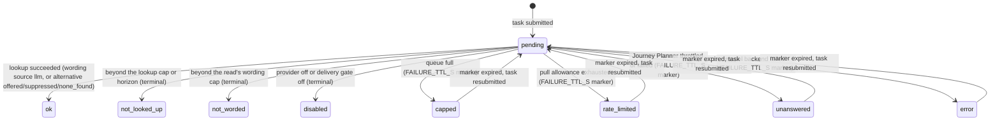

# Journey Alert Pull Read - Plan

## Goal Capsule

- **Objective:** The Entur app's favorites panel can read, for one saved route, alerts in the webhook channel's shape and selection: one entry per alert-worthy train ahead, each with the notification payload, the model's wording where one exists or can be written, and the alternative journey where one was found.
- **Means:** A public read on `/notification-api/v1`, keyed on a journey definition, served from the poller's in-process caches plus on-request wording and Journey Planner lookups under the read's own allowances, with a per-request wait budget and background completion.
- **Authority:** The user request governs scope. Requirements own product behavior; KTDs own mechanism. `CLAUDE.md` governs code, test and deployment conventions. The origin webhook plan's R16 (no client data in routine logs) and KTD10 (never `varsel_decisions`) bind this read.
- **Execution profile:** Land the seams first (the fetch path through the matcher, the gate helper, the pull wording policy) under the existing suites as characterization coverage. Build the read without enrichment, land it in dev and read its volume, then add enrichment behind the wait budget. Every bound is a number in this plan and in the operations document before the read is documented for clients.
- **Stop conditions:** Never write into `varsel._messages`, `varsel._alternatives`, `varsel._notified` or `varsel_decisions` from the read. Never spend the poller's or the webhook channel's wording allowance, Journey Planner budget or backend latch. Never answer an empty list for a cold prediction cache. Never add `/notification-api` to `sso.PROTECTED_PREFIXES`. Do not start `disruptions/api/main.py` and run no BigQuery.
- **Tail ownership:** This repository only. The app's BFF integrates the read and owns its own caching; the client contract tells it how.

---

## Product Contract

### Summary

Add `GET /notification-api/v1/journey-alerts`, a public read of the current alert state for one journey definition. It returns one entry per alert-worthy train ahead, soonest first, carrying the webhook event's payload shape with the model's wording and the alternative journey fetched on request. A per-request wait budget lets a caller take an incomplete answer at once and a complete one on the next read.

### Problem Frame

The webhook channel reaches a traveller only through a subscription: a client registers a journey, the notification pass matches it and pushes a signed event. The Entur app's front page shows a favorites panel when a user opens the app. The app keeps three kinds of favorite: a stop place, a departure (a line at a stop) and a route (origin, destination, transport mode). Only a route carries the pair this read is keyed on, so the read serves favourite routes and nothing else in the panel; the other two kinds are named in Scope Boundaries so the app team plans the panel against that scope.

A favourite route is a saved journey nobody registered. Registering every favorite as a subscription would make every notification pass word every alert-worthy train for thousands of definitions to serve a panel most users glance at once a day; the matching itself is cheap, the per-cycle wording spend is not. The alert-state read the API already has serves only what a subscription minted.

The matcher does not need a subscription. `varsel.match_journey` takes a journey definition and answers from the poller's prediction cache in milliseconds, which is how the in-app journey card already works. What the panel lacks is a public way to ask it, with the wording and the alternative journey the webhook event carries, under limits that cannot touch the push channels.

### Key Decisions

- **Key the read on a journey definition, never a subscription.** Origin, destination, an optional period today and optional weekdays. Governs R1, R3. (session-settled: user-directed — chosen over a per-subscription pull behind an unguessable token: a favorite is not a registration, and the subscription-keyed shape was dropped rather than built beside this.)
- **No credential on the read.** A stop pair holds nothing personal, and the public `/impact` route already answers it for anyone. Governs R1, R7. (session-settled: user-directed — chosen over the bearer credential every other route on this prefix requires.)
- **No daily cap.** Nothing is delivered, so nothing is spent. Governs R2. (session-settled: user-directed — chosen over mirroring the push channel's four-per-day suppression.)
- **The model's wording and the alternative journey are fetched on request, under the read's own allowances.** Governs R4, R8. (session-settled: user-directed — chosen over template-only and over sharing the poller's allowances; the Gemini cost is accepted and bounded by a separate limit.)
- **A fast incomplete answer is the caller's choice.** Governs R5. (session-settled: user-directed — chosen over one fixed wait for everybody.)
- **The wording is byte-identical to the webhook event's where the definition is registered, and the read's own draw elsewhere.** Governs R3. (session-settled: user-approved — the user accepted that a wording is one draw from a non-deterministic model, so identity holds only where the read serves the poller's cached text. Conflict call-out from review: identity is claimed for the notification wording only. The event's figures are its mint-time snapshot and a revision is minted only on a lifecycle transition, so the read's live figures differ whenever the model's numbers moved, and the alternative can differ where this cycle's pass established none while the cache keeps last cycle's; KTD6 publishes both.)
- **An unavailable source is an error.** Governs R6. (session-settled: user-directed — chosen over fail-open or an empty list read as all-clear.)

### Actors

- A1. **The favorites panel**, through the Entur app's BFF: reads one definition per favourite route when a user opens the app, prefers a fast answer, and can read again.
- A2. **A patient client**: a BFF or an operator's tool that waits for the complete answer in one request.
- A3. **The operator**: reads the log table and the constants table to size the read and to see when an allowance binds.

### Requirements

**The read**

- R1. `GET /notification-api/v1/journey-alerts` takes `from_stop` and `to_stop` (refs matching `NSR:StopPlace:<digits>`, canonicalized as `/varsel` canonicalizes a submitted ref), an optional period `begin` and `end` (Oslo `HH:MM`, both or neither, `begin` before `end`), optional `days` (weekdays 0 to 6), `wait` (seconds, 0 to `MAX_WAIT_S`, default the maximum) and `limit` (1 to `MAX_LIMIT`, default `DEFAULT_LIMIT`). No period means the whole day; no days means today's and tomorrow's weekday. No credential is required.
- R2. The answer lists one entry per alert-worthy train ahead, soonest expected departure first, bounded by `limit`, with the total in `n_alerts` and `truncated` set when the list was cut. Each entry carries its severity rank so a client can re-sort worst first. Alert-worthy is the per-train collapse followed by the push gate, in the notification pass's own order. A train no longer over the gate, or whose expected departure has passed, is absent; there is no withdrawn entry.
- R3. Each entry carries the train's identity, `phase` (`predicted` or `confirmed`), the aimed and expected departure, the contributing situations, and `payload` in the webhook event's payload shape, built by the assembly the webhook event goes through. When the caller passes a registered definition's five fields verbatim and the poller holds a wording for that train, the entry serves it and the payload's notification is byte-identical to the event's; the figures are live where the event's were its mint-time snapshot, and the alternative journey is the poller's cached one and can differ from the event's in the one case KTD6 publishes. Otherwise the wording is the read's own draw or the template. The entry says whether its wording is the model's or the template, never whether the definition is registered.
- R4. The model's wording and the alternative journey are fetched on request. Each is charged to the read's own per-minute, hourly and daily wording allowance, the read's own Journey Planner budget and the read's own backend latch, never to the browser's, the webhook channel's or the poller's. The model's wording is best effort; the template is the floor and a client renders it.
- R5. The read returns when complete or when `wait` seconds have passed, whichever is first. What is not ready is served as the template and no alternative, with a per-entry status for the wording and for the alternative. `complete` is false while any entry's lookup is pending or transiently refused, and true only when every lookup reached a terminal status. Work that was not ready continues in the background so a later read of the same definition completes. Transient statuses (`pending`, `unanswered`, `error`, `rate_limited`, a queue-full `capped`) expire and are retried; terminal statuses (`ok`, `not_worded` past the read's wording cap, `not_looked_up` past the lookup cap, `disabled`) are not.
- R6. A prediction cache the poller has not loaded answers 503 with `Retry-After`, never an empty list. A loaded cache is served whatever its age, with `refreshed_at` on the answer, because the poller rebuilds it only when the SIRI-SX ingestion timestamp moves and a quiet feed leaves a correct cache old. A matcher failure answers 503. Malformed input answers 422. A bound answers 429 with `Retry-After`.
- R7. The read has its own limiter: a global per-minute ceiling and a per-stop-pair per-minute ceiling, independent of the credentialed tiers. Under key churn the per-pair tier is advisory and the global ceiling is the bound, shared by every anonymous caller including the app's BFF.
- R8. A warm read within a poller cycle runs no matcher, no Journey Planner call and no model call. The figures are cached per definition for the cycle, the wording per train for the situation's life, the alternative per train for the Journey Planner cache's life, and the answer is assembled per request from those caches.
- R9. A complete answer carries `Cache-Control: public, max-age=60`; an incomplete one `no-store`. Both carry `as_of`, the prediction cache's `refreshed_at`, the canonical definition, the windows asked about as UTC instants, and a `coverage` block naming the served operator codes and whether each stop appears in today's timetable.

**Boundaries the read keeps**

- R10. The read never writes the poller's wording or alternative caches, its notified ledger, its decision log, Firestore, or any subscription or delivery state. The one shared write is the Journey Planner candidate cache through the ordinary fetch path, whose in-flight wait the poller's own pass can join for up to one fetch timeout per key.
- R11. No log record the read emits carries a stop ref, a stop name, a departure time, any prose or any field derived from the definition beyond the salted per-process pair digest `alternatives` already logs; the read passes that digest as the wording subject id, so the model-call record carries no unsalted definition digest either. The prompt and reply record is suppressed in code. The process's HTTP access log redacts the query string for this path, so the definition does not land in Cloud Logging through the request line; `/impact`'s refs remain logged there today, and request logs outside the process are not covered by this plan.
- R12. The read is mounted unconditionally in every environment, like the rest of the prefix. Whether an entry's wording is the model's follows `NOTIFICATION_WEBHOOK_LLM_ENABLED`, which this plan sets in dev.
- R13. The client contract, the operations document, the OpenAPI file and `CLAUDE.md` describe the read, its bounds, the BFF's caching rule, and its limitations: the read serves favourite routes only; it alerts on direct trips by the served operators only and a transfer never alerts, so an empty list means no alert-worthy train among the trains the service scores and never all-clear; a definition nobody registered produces no decision row and is unscored; the completeness of a first read reveals whether the poller already held a wording for that exact definition; the global ceiling and the allowances are shared with every anonymous caller; and the bad-text revert is two switches.

### Acceptance Examples

- AE1. **Patient read, cold definition.** Covers R1, R3, R4, R5. Given a definition with two alert-worthy trains, no cached wording and no cached alternative, when a client reads with the default `wait`, then the answer arrives complete: two entries, each with an `llm` wording and an alternative status, `complete: true`, and the wording allowance charged to the pull path only.
- AE2. **Zero wait, then a second read.** Covers R5, R8. Given the same cold definition, when a client reads with `wait=0`, then the answer arrives within the matcher's own time with template wording, both statuses `pending` and `complete: false`; when it reads again after the lookups finish, then the answer is complete and no lookup ran twice.
- AE3. **Registered definition.** Covers R3, R10. Given a browser registration whose definition the notification pass has already worded, when a client reads the same five fields, then the entry's notification serialized by the webhook's own serializer equals the pass's subject payload's notification for that train byte for byte, no pull lookup ran, and `varsel._messages` and `varsel._alternatives` are unchanged after the read.
- AE4. **Cold prediction cache.** Covers R6. Given a process whose poller has not completed a load, when any client reads, then the answer is 503 with `Retry-After`, and no entry list is served.
- AE5. **Own allowances.** Covers R4, R7. Given a burst of reads that exhausts the pull wording allowance, when the notification pass runs, then the webhook and browser ledgers and the poller's Journey Planner ledger read as before the burst, and the burst's entries carry `rate_limited` rather than a 5xx.
- AE6. **Declared cancellation.** Covers R3. Given a train ET has declared cancelled, when read, then the entry is `confirmed`, its probabilities are 1.0, its delay figures null, its title says the train is cancelled, and a cached forecast wording for the train is refused.
- AE7. **Evening read.** Covers R1, R2. Given a read at 22:00 for a definition with no period, when the prediction cache holds a departure after midnight, then the entry is listed with `departs_tomorrow` true.
- AE8. **Wait slots exhausted or queue full.** Covers R5. Given every waiting slot is held, when a client reads with a positive `wait`, then it receives the zero-wait answer at once with 200; given the enrichment queue is full, then the figures are still served, every entry's lookups read `capped`, `complete` is false and the answer is `no-store`.
- AE9. **Two definitions on one pair.** Covers R7, R8. Given a morning and an evening favourite on one stop pair read together, when both are cold, then each is enriched for its own trains, no train's wording or alternative was fetched twice, and three hundred distinct periods on that pair within a minute are bound by the per-pair ceiling.

### Scope Boundaries

- The read serves favourite routes. A favourite departure (a line at a stop) and a favourite stop place carry no destination and are out of scope.
- The read serves alert-worthy trains only. Every scored departure with its figures is a different product and is not offered here.
- No servability caveat. `main._varsel_connectivity` costs one BigQuery query per anonymous pair and writes both refs into a log line under `/varsel`'s event name, neither of which belongs on a public unauthenticated path. What the answer carries instead is the `coverage` block: the served operator codes, and whether each canonical stop appears in today's timetable, so a BFF renders an uncovered or unknown favourite as unverified rather than calm.
- No decision rows and no scoring for a definition nobody registered (origin KTD10). The limitation is published.
- **Three accepted exposures, published rather than closed.** The completeness and latency of a first read reveal whether a browser or webhook registration with exactly those five fields exists and is alert-worthy now; the mitigation is that no status ever says so. The read's global ceiling and its wording and Journey Planner allowances are shared by every anonymous caller, so one source at the ceiling holds the panel at 429 and one source at the daily allowance holds it template-only for the trailing day; the BFF treats both as ordinary states and serves its cached answer. And the definition rides in a query string, which the process redacts from its own access log but which any log outside the process may keep.

#### Deferred to Follow-Up Work

- A pull helper in `integrations/notifications-client/`; the answer parses with the event types the package already ships.
- A dedicated flag for the read's prose, if the product owner wants the read and the webhook channel switched apart.
- The per-subscription pull with an unguessable token, if a client ever needs the full event envelope rather than the payload.
- A departure-shaped read (a line at a stop) for the panel's favourite departures.
- An index of the prediction cache by boarding stop, if the peak measurement in the Verification Contract shows the figures cost binding; `impact._trip_cells` scans every situation's calls per match today.
- A time-of-day panel that shows every scored departure.

### Success Criteria

- A cold favourite with one alert-worthy train reads complete within one `MAX_WAIT_S` typically, and warm within a few milliseconds.
- A zero-wait read followed by a second read within the cycle yields a complete answer with each lookup run once.
- No read, however many, changes any ledger the poller or the webhook channel's next pass reads, beyond the shared Journey Planner candidate cache R10 names.
- At the peak measurement, the share of panel reads answered 200 and complete by the second read meets a number the app team confirms before the panel goes live; the plan's default is nine in ten.
- Every constant the read introduces has a value in this plan's Bounds table, in the operations document, and in a pin.

---

## Planning Contract

### Key Technical Decisions

- KTD1. **A new module, `disruptions/api/notification_pull.py`, with its own `APIRouter` under `notification_api.PREFIX` and no router-level dependency.** `notification_api.router` carries `_authenticated` and `_throttled` at router level and FastAPI merges router dependencies onto every route at `add_api_route`, so a public route cannot live on it. The new router is mounted in `main` beside the existing one. The module imports `varsel` at module level, the `main._service_verdict` precedent for using its underscored helpers, and takes only a `refreshed_at` provider through `configure`. It joins `test_notification_contract.NOTIFICATION_MODULES` and `MODULES_BY_NAME`, and `notification_wording` and `alternatives` join `MODULES_BY_NAME` too, since the Bounds table publishes rows for them and the parser refuses a row whose module it does not know. It stays off the seven-module import-forbidden tuple with the reason stated there: that tuple keeps an event from reaching the VAPID keypair and the device registry, and a read delivers nothing. `notification_auth.claim_window` pulls `notification_store` into the import graph; the Firestore client is lazy, so that is harmless and named. It is not a mode of `/impact`: the read has window semantics over a period and weekdays, the collapse-then-gate selection, the webhook payload shape and the wording, none of which `/impact`'s nearest-train contract carries. Governs R1, R7, R11. (session-settled: user-directed — unauthenticated, chosen over the bearer credential: a stop pair is what `/impact` already answers for anyone.)
- KTD2. **The definition is `varsel._parse_webhook_recipient`'s five-key dict, canonicalized.** `from_stop` and `to_stop` must match `NSR:StopPlace:<digits>` before canonicalization through `varsel.canonical_stop`, and are refused with 422 when equal afterwards, as `create_journey` refuses them; `begin`/`end` through the same `HH:MM` rule; `days` a subset of 0 to 6. Defaults: `begin` `00:00`, `end` `23:59`, `days` today's and tomorrow's weekday, so `varsel.journey_windows` offers today's remaining window and tomorrow's, with `catchable_after=now` cutting departed trains. The canonical definition and the windows are echoed in the answer so a BFF keys its own cache on them. Governs R1. (session-settled: user-directed — the journey definition as key, chosen over a subscription id or token.)
- KTD3. **Two phases, three caches, three lifetimes, one assembly per request.** Phase 1 is the figures: `varsel.match_journey` without alternatives, then the gate helper (KTD7), then soonest-first order with the severity rank carried. Its result is cached per `(journey_key, refreshed_at, Oslo day)` with single-flight per key and evicted whenever `refreshed_at` moves or at `FIGURES_CACHE_MAX`: the poller's rebuild timestamp is the cycle, so no TTL is invented, and the Oslo day is in the key because `journey_windows` derives its windows from the local date. Assembly re-applies the expected-departure cut with `varsel._expected_departure_of`, since `catchable_after` is match time and a cached figure can outlive a departure by a cycle. Phase 2 is the enrichment, per train. A wording is cached on `(canonical pair, situation_number, departure, cancelled, i_morgen, alternative identity, llm_message.PROMPT_VERSION)` for the situation's life (`WORDING_TTL_S`, an LRU of `WORDING_CACHE_MAX`); the identity term is `varsel._alternative_identity` computed after `varsel._still_catchable`, and `i_morgen` is in the key so a 23:00 wording does not say "i morgen" about tomorrow's train for twelve hours. The poller's third forget rule is adopted too: when a figures refresh no longer lists a train the read worded, its wording and alternative are evicted, so a train that dips under the gate and re-crosses is re-worded as the pass would. An alternative outcome is cached per train for the Journey Planner cache's own `alternatives._TTL`, so a changed alternative re-words once. A transient outcome (`unanswered`, `error`, `rate_limited`, a queue-full `capped`) is a `FAILURE_TTL_S` marker and is resubmitted on expiry; a per-read-cap outcome is terminal for the wording's life under its own names, `not_worded` and `not_looked_up`. Keying the wording on the cycle would re-word every warm favorite every five minutes and exhaust the allowance by construction. The answer is assembled per request from the three caches and never cached whole, which is what lets a zero-wait read's successor be complete, and `complete` is computed from the statuses at assembly, which is also what decides the caching header and the echoed metadata. Governs R5, R8, R9.
- KTD4. **Enrichment runs under the read's own allowances, and that needs three plumbing changes.** A third `notification_wording.WordingPolicy` instance, `PULL` (`name="pull"`, `path="pull"`, a truthy `caller="pull"` so `llm_message` suppresses the prompt record, its own latch through a function-local-import factory `_new_pull_state` in `_new_webhook_state`'s shape, and `deliver` the webhook channel's gate), seeded in `notification_wording._calls` (an unseeded path is a `KeyError`) and listed in `_POLICIES` so `reset_state` clears it. `WordingPolicy` gains per-policy ceilings, since `_spend` reads module constants for every path today: `PULL` carries `WORDINGS_PER_MIN`, `WORDINGS_PER_HOUR` and `WORDINGS_PER_DAY`, and the browser and webhook policies keep the module's numbers, so an hour's allowance drains over minutes rather than in one burst. The read passes `alternatives.pair_digest` of the canonical pair as the wording subject id, so the `llm_message` record for a pull call carries a digest of a salted value rather than of the definition. A third `alternatives.FetchPath`, `"pull"`, seeded in `_fetch_calls`, with its own ceiling `_PULL_FETCH_MAX_PER_MIN`, the ternary in `_reserve_fetch` replaced by a lookup so a fourth path cannot silently share a number, and `wait_for_refresh` true since the read runs on its own executor. `path` does not reach the matcher today: `varsel.ImpactProvider`, `varsel._impact` and `varsel.match_journey` carry none and `main._varsel_impact` hard-codes `"poller"`, so the read would spend the poller's budget. `path` is added to all four, keyword-only and defaulted to the poller's value so every existing caller is unchanged, and `_impact` passes it on every call, so every hand-written provider in the suites must accept it. CI runs no type checker, so the Protocol is documentation; the pin that catches a provider accepting and ignoring the keyword is a test asserting the pull ledger was charged. `answered` travels the whole path from `fetch_candidates`' outcome to the alert the read consumes: onto `impact.AlternativeOutcome`, onto an excluded field of `SituationImpact` and `ImpactResponse`, through `_impact_response`, through `varsel._collect_alerts`' projection and `match_journey`'s back-fill, with the fallback fetch and `_alternatives_by_situation`'s failure branch both reporting unanswered, so a throttled or failed lookup is `unanswered` and never `none_found`. The fetch ceiling is the cold-path throughput bound: at 30 a minute and two to six fetches per cold definition, five to fifteen cold definitions a minute, with the rest reading `unanswered`. Governs R4, R5. (session-settled: user-directed — wording and alternative on the read under separate limits, chosen over template-only and over sharing the poller's allowances.)
- KTD5. **The wait budget is a module-level executor, single-flight per definition, that the request joins rather than owns.** A cold definition's enrichment is submitted once, keyed on `(journey_key, Oslo day)`, to a bounded pool of `WORKERS` with `QUEUE_MAX` queued; a full queue marks every entry `capped` as a transient. The task matches exactly the caller's definition, so its trains are the entries the caller sees; cross-definition dedup is the per-train wording cache, a per-train in-flight map in `meldinger._wording_inflight`'s shape, and `alternatives._KeyedTTLCache`'s single-flight, so two favourites on one pair spend nothing twice for a shared train. Inside a task, one `match_journey` with alternatives on the pull path, then the wording calls `WORDING_WORKERS` wide for the first `MAX_WORDINGS_PER_READ` entries in the response's order. A task ends in 3 to 6 s typically for one alert-worthy train, about 3 s more per further train up to the cap since the lookups inside the matcher run sequentially, and under about 56 s worst: up to `impact._MAX_ALTERNATIVE_LOOKUPS` (3) lookups per window and two windows near midnight, two fetches per lookup at 3 s plus the 1 s waiter margin, then the model's 8 s timeout; `MAX_WAIT_S` bounds the request, never the task. The concurrency product is `WORKERS` times `WORDING_WORKERS` model calls beside the poller's sixteen. Meldinger's per-request pool is joined at request end and every other request-spawned thread in the repo is abandon-on-timeout; this is the first shape that consumes a background result on a later request, and the plan says so. The executor is shut down without waiting in `main.lifespan`; a Recreate deploy loses in-flight work, and the next read restarts it. Every suite's reset replaces the executor and stamps the three caches with an epoch, or a task from one test writes into the next test's cache from a thread the reset cannot see. Governs R5, R7. (session-settled: user-directed — a fast incomplete answer by choice, chosen over one fixed wait.)
- KTD6. **Byte-identity has one boundary and the read is read-only against poller state.** `varsel.journey_key` embeds `begin|end|days`, and `varsel._messages` and `varsel._alternatives` are keyed on `(journey_key, situation_number, departure)`, so the read finds the poller's wording and alternative only when the caller's five fields serialize to the registration's key. A new read-only accessor in `varsel` returns both under one `_state_lock` read with `_webhook_wording`'s rules (raw, not through the browser delivery gate; no wording for a cancelled train), and a registered key with a cached wording spends no pull lookup. It never writes: pass 1c records `ok_cached` for a key already in `_messages`, so a pull-written entry would land on `/historikk` under the browser's attribution, the wrong author on the decision log. Three residuals, published. The event's figures are the mint cycle's snapshot and a revision is minted only on a lifecycle transition, while the read's figures are this cycle's, so identity is claimed for the notification only; where this cycle's pass established no alternative, the event carried `null` while `_alternatives` keeps last cycle's; and a registered key the poller has not worded yet is drawn by the read, then written again by the poller, so the panel's text can change once. The payload is built by `varsel._webhook_payload` from the same `llm_message.build_message_input` document, so identity is by construction where the wording matches. Governs R3, R10. (session-settled: user-approved — identity where registered, a fresh draw elsewhere.)
- KTD7. **The collapse, then the gate, through a helper for the read; the pass's loop is untouched.** Every call site of the notification pass runs `varsel.one_alert_per_train` first and tests `Alert.alertworthy` after; only the card filters first, on the wider `has_situation or alertworthy`. Gate-first with the push gate would list a train the event never emitted: where a sub-gate no-SX situation outranks an over-gate published one on the same train, the pass withdraws that train while a gate-first read lists it. `_subjects_for_key` cannot move onto a collapse-then-filter helper, because its non-alert-worthy winners are the withdrawal subjects; so `varsel.alert_worthy_trains(alerts)` is the alert-worthy subset of `one_alert_per_train`'s output for the read, and a test pins it equal to the alert-worthy subset of what `_subjects_for_key` iterates on a fixture with a sub-gate collapse winner. Entries are ordered by expected departure, `_alert_rank` as the tie-break and carried as each entry's severity, because the push channel spends its cap and its write budget soonest-first and a panel opened on the platform needs the next train first; the wording cap `MAX_WORDINGS_PER_READ` is spent in that order. The alternatives inside `match_journey` are spent soonest-first too and capped at `impact._MAX_ALTERNATIVE_LOOKUPS`, so an entry past that cap is worded with no alternative and says `not_looked_up`. Governs R2.
- KTD8. **Cold is a seam, not a match result, and age is reported rather than refused.** `ImpactResponse.refreshed_at` is `None` until the poller's first load; the alerts `match_journey` returns carry a copy of the response, but an empty match carries nothing to read it from, so the read takes a `refreshed_at` provider through `configure`, wired from `main._impact_snapshot`, and answers 503 `predictions_not_loaded` with `Retry-After` when it is `None`. There is no staleness 503: `main._poll_loop` calls the rebuild only when `get_last_ingestion_time` moves, and `_call_pred_refreshed_at` advances only inside that rebuild, so a quiet SIRI-SX feed leaves a correct cache unrefreshed for as long as the feed is quiet, and a threshold would refuse correct data at night. The answer carries `refreshed_at` and the client judges. Governs R6. (session-settled: user-directed — an error for a cache that was never loaded, chosen over an empty list.)
- KTD9. **`async def`; figures on the request pool; waiters hold no thread.** Every route on the prefix is a plain `def` and shares the anyio pool; a handler holding a slot for 20 s would starve traveller registration, so the read is `async def`. Phase 1 runs through `run_in_threadpool`, the `list_journeys` precedent, and never on the enrichment executor, so a full queue still answers figures. A waiter awaits the task's wrapped Future with a timeout under a shield, so the timeout cannot cancel the background task and no thread is pinned per waiter; `MAX_CONCURRENT_WAITERS` bounds memory only. Where meldinger answers 503 when its slots are locked, the read answers as if `wait=0`: a front-page panel is better served by an incomplete 200 than a 503, and the work is queued either way. Governs R5, R7.
- KTD11. **Two sliding-window ceilings, the credentialed limiter's primitive.** `notification_auth.claim_window` over a global bucket (`MAX_PER_MIN`) and over a per-pair bucket keyed on the canonical stop pair (`PER_PAIR_PER_MIN`) in a map bounded at `LIMITER_KEYS_MAX` by dropping the insertion-oldest, `feedback._claim`'s shape. Per pair and not per definition, so period churn on one pair cannot mint a fresh key per request; under churn across pairs the per-key tier is advisory and the global ceiling is the bound, and that bound is shared with the app's BFF, which has no reserved allowance. No per-address tier: nothing in the repo trusts a forwarded address header. A bound answers 429 `rate_limited` with `Retry-After: 60`. An exhausted wording or Journey Planner allowance is a per-entry status, never a 429. Governs R7.
- KTD12. **The contract is published in the existing OpenAPI file with operation-level `security: []`.** The file is hand-authored and declares `clientKey` globally; the read overrides it per operation and adds a fourth tag, `notification-journey-alerts`, since the tag pin requires the `notification-` prefix. `test_the_openapi_paths_are_exactly_the_routers_routes` and `test_the_openapi_tags_are_the_routers_own` enumerate `notification_api.router` alone and pin six routes; both widen to the union of the two routers and seven routes. `test_every_route_is_gated_at_router_level_as_well_as_by_its_parameter` and `test_every_route_is_a_plain_def` keep enumerating the authenticated router only, and a new test pins that the pull router carries no dependency and that its route set is exactly the one path, so a second public route is a deliberate test change. Governs R13.
- KTD13. **No servability, no decision rows, no Firestore, and a redacted access log.** The servability question is BigQuery per anonymous pair plus the ref-carrying `varsel_service_check` line; the decision log is public and journey-definition grain (origin KTD10); nothing here is subscription state. The process's uvicorn access log propagates to the JSON handler with the full request line, so a `logging.Filter` in `logging_setup` replaces the query string with a redaction marker for this path, pinned by a test that formats an access record for the path and finds no stop ref in it. Governs R10, R11, R13.
- KTD14. **The read's prose follows `NOTIFICATION_WEBHOOK_LLM_ENABLED`, and this plan sets it in dev.** One switch decides whether a client-facing surface carries the model's text. The flag is import-time and in no Helm file, so without a rollout step the read would ship template-only and defeat the decision behind KTD4; setting it in dev is safe because the webhook channel's own flag is off there and nothing emits. The bad-text revert is now two switches: `VARSEL_LLM_ENABLED=false` returns the browser push to the template but leaves the read serving the poller's cached text under the webhook gate, so `NOTIFICATION_WEBHOOK_LLM_ENABLED=false` plus a restart is the read's and the webhook event's revert, and `VARSEL_LLM_PROVIDER=off` remains the one switch that stops every surface. Whether the read should have its own switch is an open question for the product owner. Governs R12.

### Bounds

| constant | value | bounds |
|---|---|---|
| `notification_pull.MAX_PER_MIN` | 300 | reads per minute, process-wide, the one hard bound |
| `notification_pull.PER_PAIR_PER_MIN` | 30 | reads per minute per canonical stop pair |
| `notification_pull.LIMITER_KEYS_MAX` | 10000 | per-pair buckets kept |
| `notification_pull.MAX_WAIT_S` | 20 | the longest a request holds on |
| `notification_pull.DEFAULT_LIMIT` | 10 | entries per answer by default |
| `notification_pull.MAX_LIMIT` | 20 | entries per answer at most |
| `notification_pull.MAX_WORDINGS_PER_READ` | 4 | model calls one task may spend, soonest first |
| `notification_pull.WORKERS` | 4 | enrichment tasks in flight |
| `notification_pull.QUEUE_MAX` | 16 | enrichment tasks queued before `capped` |
| `notification_pull.WORDING_WORKERS` | 4 | model calls in flight per task |
| `notification_pull.MAX_CONCURRENT_WAITERS` | 64 | requests holding on at once |
| `notification_pull.FIGURES_CACHE_MAX` | 512 | definitions cached per cycle |
| `notification_pull.WORDING_CACHE_MAX` | 10000 | per-train wordings kept |
| `notification_pull.WORDING_TTL_S` | 43200 | a wording's life, the situation horizon |
| `notification_pull.FAILURE_TTL_S` | 60 | a transient outcome's marker |
| `notification_wording.WORDINGS_PER_MIN` | 30 | pull model calls per minute |
| `notification_wording.WORDINGS_PER_HOUR` | 500 | pull model calls per trailing hour |
| `notification_wording.WORDINGS_PER_DAY` | 2000 | pull model calls per trailing day |
| `alternatives._PULL_FETCH_MAX_PER_MIN` | 30 | pull Journey Planner fetches per minute |

Every row is published in the operations document's constants table and pinned by its parser. The allowances are pilot numbers: at two to six fetches and one to four model calls per cold definition they complete five to fifteen cold favourites a minute and about eight an hour sustained, so at app scale the model's wording and the alternative reach a minority of first reads until the app team's expected peak read rate is known and the allowances are derived from it, with pair-and-train sharing across favourites as the stated assumption.

### High-Level Technical Design

The read in one request, cold definition, positive wait:

```mermaid
sequenceDiagram
  participant C as Client (BFF)
  participant R as notification_pull route (async)
  participant P as request pool (run_in_threadpool)
  participant X as pull executor (single-flight per definition)
  participant A as alternatives (path "pull")
  participant W as notification_wording PULL policy
  C->>R: GET /journey-alerts?from_stop&to_stop[&begin&end&days][&wait][&limit]
  R->>R: validate, canonicalize, refreshed_at None -> 503
  R->>R: claim global + per-pair slot (429 when refused)
  R->>P: figures for (journey_key, refreshed_at, Oslo day) on a miss
  P-->>R: match_journey -> alert_worthy_trains -> soonest first
  R->>X: ensure task for (journey_key, Oslo day); join its Future if running
  X->>A: match_journey(definition, with_alternative=True, path="pull")
  X->>W: write_wording per train, WORDING_WORKERS wide, per-train single-flight
  R->>R: await the Future for min(wait, MAX_WAIT_S), shielded
  R->>R: assemble entries from the three caches, re-apply the departure cut, statuses, complete
  R-->>C: 200 JSON, Cache-Control by completeness
```

An entry's enrichment status, per lookup (wording and alternative each carry one):



The answer, directional rather than a schema:

```text
as_of, refreshed_at, complete, n_alerts, truncated,
journey { from_stop, to_stop, begin, end, days }   -- canonical, echoed
windows [ { start, end } ]                          -- what was asked, UTC instants
coverage { operators [ ... ], from_stop_in_timetable_today, to_stop_in_timetable_today }
alerts [
  severity, phase, train { operator, line, journey_ref, call_date, stop_place, stop_order },
  aimed_departure_time, expected_departure_time, situations [ ... ],
  payload { notification, call, probabilities, delay, effect, situations, alternative_journey },
  wording { source, status }, alternative { status }
]
```

`payload` is the dict `varsel._webhook_payload` returns, unchanged. `train` follows `notification_events.train_ref_of`. `wording.source` is `llm` or `deterministic` and nothing else. `wording.status` uses `notification_wording`'s status vocabulary plus `not_asked` (before U4 lands), `pending`, `capped` and `not_worded`; `alternative.status` uses `decisions._alternative_status`'s vocabulary plus `pending`, `capped`, `unanswered` and `not_looked_up`. `coverage.operators` is the static served set `alert_policy`'s per-operator threshold table names; the two timetable flags come from the poller's stop cache and are fail-open when it is empty.

### Integration constraints and risks

- **The pull allowance is a cost bound, not a Vertex reservation.** The poller and the read share one project quota at Vertex; a read burst can 429 a real push wording, which is transient and served as the template. `/meldinger` spends model calls publicly only until `SSO_REQUIRED` is turned on, since it sits in `sso.PROTECTED_PREFIXES`; this read is designed to stay public, so its ceilings and allowances are the whole mitigation. The pull's ledger and latch are separate so a burst cannot latch the poller's backend off, and `WORDINGS_PER_MIN` keeps a burst from spending an hour in one minute; one anonymous source can still spend the trailing day.
- **The Journey Planner cache is one cache.** The pull path waits on an in-flight fetch, and so does the poller's pass 1a for a key the pull is fetching, up to one fetch timeout plus the wait margin; a key the pull evicted from the 500-entry cache is refetched by the poller. Both are bounded and published under R10.
- **A throttled lookup is not "no alternative".** Without `answered` on the outcome the read would cache a Journey Planner refusal as `none_found` for twelve hours and word the train without an alternative; KTD3 and KTD4 close it.
- **`refreshed_at` can move mid-request.** The figures key it, the wording key does not, so a request assembled across a rebuild serves this cycle's figures with a wording written from last cycle's input, the poller's own `ok_cached` case.
- **A Recreate deploy loses background work** and the first cycle after it answers 503 for about a minute; the BFF's own cache carries the panel across it.
- **Byte-identity is exact-key, one-channel and wording-only.** It holds where the caller passes a registration's five fields verbatim, for the notification alone, against the webhook event; the browser push can differ while `VARSEL_LLM_ENABLED` and `NOTIFICATION_WEBHOOK_LLM_ENABLED` disagree, as `CLAUDE.md` already records for the rollout window.
- **The read's own Gemini egress covers anonymous definitions.** The 2026-08-07 egress decision and prd's classification of the origin, destination and departure trio as «Intern» were taken for registered travellers; the read's prompts carry only the definition and no identity, and the plan reads those decisions as covering it, with the DPO named as owner if that reading is contested.
- **Figures cost scales with definitions per cycle on one 0.5-CPU replica.** The figures pass and the enrichment task each run the matcher once per cold definition. At a hundred definitions a cycle it is negligible; at a thousand, thousands of full-cache scans beside the poller's parse. The peak measurement in the Verification Contract decides whether the deferred boarding-stop index is needed before the panel goes live.
- **Every suite that resets state gains lines.** `test_varsel_api._reset_state` and the new suite's reset must clear the three caches, the limiter buckets, the in-flight maps and the pull policy's latch, replace the executor and advance the epoch, or a leaked entry reads exactly like the give-up bug the stale sweep exists to prevent.

---

## Implementation Units

### U1. Thread the fetch path and the answered flag through the matcher

- **Goal:** A caller of `varsel.match_journey` can name which Journey Planner budget its alternative lookups spend, a third budget exists for the read, and an unanswered lookup is distinguishable from an empty one all the way to the alert the read consumes.
- **Requirements:** R4, R5, R10. Implements KTD4.
- **Dependencies:** none.
- **Files:** `disruptions/api/alternatives.py`, `disruptions/api/impact.py`, `disruptions/api/varsel.py`, `disruptions/api/main.py`, `disruptions/api/test_alternatives.py`, `disruptions/api/test_impact.py`, `disruptions/api/test_varsel.py`, `disruptions/api/test_varsel_api.py`, `disruptions/api/test_alert_policy.py`.
- **Approach:**
  1. In `alternatives`, add `_PULL_PATH = "pull"` to `FetchPath` and to the `_fetch_calls` seed, add `_PULL_FETCH_MAX_PER_MIN`, and replace `_reserve_fetch`'s ternary with a lookup of ceiling by path. `fetch_candidates` passes `wait_for_refresh` for the pull path as it does for the poller.
  2. Add `answered` to `impact.AlternativeOutcome`, defaulted true; pass an outcome to the fallback `fetch_candidates` call in `_best_remaining_journey` as well as the first, and set `answered` from whichever query the selection used; return an unanswered outcome from `_alternatives_by_situation`'s failure branch; carry it as an excluded field on `SituationImpact` and `ImpactResponse` through `_impact_response`, project it in `varsel._collect_alerts` beside the other two alternative fields, and carry it in `match_journey`'s back-fill.
  3. Add keyword-only `path` to `varsel.ImpactProvider.__call__`, `varsel._impact` and `varsel.match_journey`, defaulted to the poller's value, passed on every call, and forwarded through `impact.for_trip`'s existing `path` parameter in `main._varsel_impact`.
  4. Update every hand-written provider in the suites to accept the keyword: `test_varsel_api._impact_provider` and both in `test_varsel`; `test_alert_policy`'s already accepts any keyword and `test_impact` holds the Journey Planner doubles the path pins use.
- **Patterns to follow:** `alternatives._fetch_calls`'s per-caller keying and its comment on the 2026-08-21 split; `varsel.ImpactProvider`'s docstring on why the Protocol is typed; `fetch_candidates`' `outcome` out-parameter and `impact._alternatives_by_situation`'s existing three-field projection.
- **Test scenarios:**
  - A fetch on the pull path charges `_fetch_calls["pull"]` and leaves `"request"` and `"poller"` untouched.
  - The pull ceiling binds at `_PULL_FETCH_MAX_PER_MIN` and the refusal is an outcome with `answered` false, not an error.
  - A pull-path caller finding a key in flight waits for it and receives the fetched answer, not `None`.
  - `match_journey(journey, with_alternative=True, path="pull")` reaches `impact.for_trip` with `path="pull"`; the default reaches it with `"poller"`.
  - The real `main._varsel_impact` satisfies the extended Protocol and charges `_fetch_calls["pull"]` when called with the pull path, so a provider that accepts and ignores the keyword fails.
  - An empty candidate list with `answered` true yields `none_found`; a throttled first query, a throttled fallback and a raising lookup each yield an alert whose `answered` reads false through `alert.impact`.
- **Verification:** the five suites pass, and `git grep` finds no call of `_reserve_fetch` or `fetch_candidates` that names a path outside the Literal.

### U2. The gate helper, a pull wording policy with its own ceilings, the read-only accessor and the freshness seam

- **Goal:** The read can select trains exactly as the pass does, ask the model under its own per-minute, hourly and daily allowance and its own latch without logging an unsalted definition digest, read a registered definition's cached wording and alternative without writing them, and tell a cold prediction cache from a loaded one.
- **Requirements:** R2, R4, R6, R10, R11. Implements KTD4, KTD6, KTD7, KTD8, KTD14.
- **Dependencies:** none.
- **Files:** `disruptions/api/notification_wording.py`, `disruptions/api/llm_message.py`, `disruptions/api/varsel.py`, `disruptions/api/main.py`, `disruptions/api/test_notification_wording.py`, `disruptions/api/test_varsel_api.py`, `disruptions/api/test_varsel.py`.
- **Approach:**
  1. Add `varsel.alert_worthy_trains(alerts)`, the alert-worthy subset of `one_alert_per_train(alerts)`, for the read; leave `_subjects_for_key`'s loop untouched, since its non-alert-worthy winners are the withdrawal subjects.
  2. Give `WordingPolicy` optional per-minute, hourly and daily ceilings that `_spend` reads before falling back to the module constants; add `PULL` with `deliver=webhook_delivery_enabled`, `path=_PULL_PATH`, `caller="pull"`, `state_factory=_new_pull_state` (a function-local `import llm_message`, in `_new_webhook_state`'s shape, since the module may not import `llm_message` at top level) and the three `WORDINGS_PER_*` ceilings; seed `_calls[_PULL_PATH]`; append it to `_POLICIES`.
  3. Add `llm_message.new_pull_state`, the same one-way-seeded holder `new_webhook_state` builds.
  4. Add a read-only accessor in `varsel` returning the cached wording and the cached alternative for `(journey_key, alert)` under one `_state_lock` read, with `_webhook_wording`'s rules: raw entries, no wording for a cancelled train, `None` where absent. It performs no write.
  5. Add a `refreshed_at` provider to `main`, reading the second element of `_impact_snapshot`, for the read's `configure`.
- **Execution note:** Pin the helper against `_subjects_for_key` on a fixture with a sub-gate collapse winner before anything else uses it.
- **Patterns to follow:** `notification_wording.WEBHOOK`'s definition and the docstring's "a third surface adds a third instance rather than a branch"; `llm_message.new_replay_state`'s isolation reasoning; `_subjects_for_key`'s collapse-then-gate loop; `write_wording`'s `Route` and `DepartureWordingFacts` inputs, which the read builds from each alert.
- **Test scenarios:**
  - `alert_worthy_trains` on a train with a sub-gate no-SX situation outranking an over-gate published one returns nothing for that train, and equals the alert-worthy subset of what `_subjects_for_key` iterates on the same fixture.
  - A `write_wording` under `PULL` charges `spent("pull")` and leaves `spent("webhook")` and `spent("browser")` at zero.
  - The thirty-first pull call within a minute is refused with `rate_limited` while the hour has room; the browser and webhook policies still read the module constants.
  - A configuration error on the pull holder latches only it: `generation_enabled(PULL.state())` reads False while the module-global holder still reads True.
  - `reset_state` clears the pull holder and the pull ledger.
  - A `PULL` call passes a truthy `caller`, and the prompt record is not emitted with `VARSEL_LLM_LOG_PROMPTS` on; the `llm_message` record's digest for a pull call with a salted subject id is not the digest of the definition.
  - The accessor returns the cached wording and alternative for a registered key, no wording for a cancelled train and `None` for an unknown key, and `varsel._messages` and `varsel._alternatives` are unchanged after each call.
  - The freshness provider returns `None` before the first load and the timestamp after it.
- **Verification:** `test_notification_wording.py`, `test_varsel.py` and `test_varsel_api.py` pass with the new cases and their counts increased; `notification_wording.spent("pull")` exists and reads `(0, 0)` after reset.

### U3. The read without enrichment

- **Goal:** `GET /notification-api/v1/journey-alerts` answers the figures for a definition from the poller's caches, with validation, its own limiter, the cycle-keyed figures cache, the cold 503, the coverage block, the caching headers, a redacted access log, its log records and the operations document's rows for them.
- **Requirements:** R1, R2, R3 (template wording), R6, R7, R8 (figures half), R9, R11. Implements KTD1, KTD2, KTD3 (phase 1), KTD7, KTD8, KTD9, KTD11, KTD13.
- **Dependencies:** U2.
- **Files:** `disruptions/api/notification_pull.py` (new), `disruptions/api/main.py`, `disruptions/api/logging_setup.py`, `disruptions/api/test_notification_pull.py` (new), `disruptions/api/test_notification_contract.py`, `docs/operations/notification-webhooks.md`.
- **Approach:**
  1. Module-level `import varsel`; `configure(*, refreshed_at)`; `main.lifespan` wires the U2 provider and mounts the router beside `notification_api.router`.
  2. Parse and canonicalize into the five-key dict (KTD2); 422 on every refusal with `/varsel`'s wording.
  3. Limiter (KTD11), then the figures cache keyed on `(journey_key, refreshed_at, Oslo day)` with single-flight and `FIGURES_CACHE_MAX`; a miss runs `match_journey(definition)` through `run_in_threadpool`, then `alert_worthy_trains`, then soonest-first order with the rank carried.
  4. Build each entry with `llm_message.build_message_input`, `notification_wording.notification_title`, `varsel.notification_wording_for` with no model text, and `varsel._webhook_payload`, after re-applying the expected-departure cut; the wording status is `not_asked` in this unit and the alternative status `not_looked_up`; the `coverage` block from `alert_policy`'s per-operator threshold table and the poller's stop cache.
  5. `async def` route; 503 `predictions_not_loaded` on a `None` `refreshed_at`, and a loaded cache served with its `refreshed_at` whatever its age; 503 on a matcher exception, logged at WARNING with the exception's type only and the traceback at DEBUG, so an exception message naming a ref never reaches the record; `Cache-Control` and `as_of` on the answer.
  6. A `logging.Filter` on the `uvicorn.access` logger in `logging_setup` that replaces the query string with a redaction marker for this path, pinned by a test that formats an access record for the path and finds no stop ref.
  7. Log one `notification_pull` record per request with `result`, `cache`, `n_alerts`, `wait_s`, `ms` and the salted pair digest under the field name `alternatives` already uses; add the module to `NOTIFICATION_MODULES` and `MODULES_BY_NAME`, and `notification_wording` and `alternatives` to `MODULES_BY_NAME`; add the log-table row and the constants rows this unit introduces to the operations document, since the log-event pin fails without them.
- **Execution note:** Start from a failing request test in the `test_varsel_api` harness shape, with a non-`None` `refreshed_at` injected; every existing harness injects `None` and the read 503s by construction until it is supplied. Land this unit in dev and read the `notification_pull` volume before U4.
- **Patterns to follow:** `test_varsel_api._impact_provider` over the real `impact.for_trip` and its stop-name wiring; `historikk._checked_choice` for closed vocabularies in a cache key; `feedback._claim` for the bounded per-key map; `meldinger.messages` for the `async def` shape; `list_journeys` for the matcher on the request pool; `notification_api._http` for the 503 shape, minus its `exc_info`.
- **Test scenarios:**
  - A definition with two alert-worthy trains answers two entries soonest first with severity carried, `n_alerts` 2, `truncated` false; with `limit=1` one entry and `truncated` true.
  - A sub-threshold situation is absent; a situation the card would show through `has_situation` is absent; the collapse-then-gate case from U2 is absent.
  - Two situations about one train collapse to one entry with both in `situations`.
  - A declared cancellation answers `confirmed`, probabilities 1.0, delay null and a title that says the train is cancelled.
  - A train whose expected departure passed after the figures were cached is absent from the assembled answer.
  - A ref not matching the pattern, equal refs after canonicalization, `begin` not before `end`, a day outside 0 to 6, `wait` or `limit` outside their bounds each answer 422.
  - A collapsed ref is canonicalized and the canonical refs and the UTC windows are echoed; a ref absent from today's stop cache reads false in `coverage`, and an empty stop cache reads true for both.
  - A read at 22:00 with no period lists a departure after midnight with `departs_tomorrow` true and two windows.
  - `refreshed_at` `None` answers 503 with `Retry-After`; a cache an hour old is served with that `refreshed_at` and no 503; a matcher that raises `KeyError` on a ref answers 503 and leaves no WARNING record whose message contains the ref.
  - The global ceiling and the per-pair ceiling each answer 429 with `Retry-After`; three hundred distinct periods on one pair share one per-pair bucket; the per-pair map stays bounded.
  - A second read within the cycle runs no matcher; a read after `refreshed_at` moves runs it once and evicts the old generation.
  - `Cache-Control` is `public, max-age=60` on a complete answer.
  - No log record carries a ref, a name, a departure or prose; an unknown ref logs nothing identifying; the record's field set is a subset of the allowed one; an access record for the path carries no stop ref after the filter.
  - The pull router has no dependency and its route set is exactly the one path; the authenticated router's route pins are unchanged.
- **Verification:** `test_notification_pull.py` passes under the CI command; `test_notification_contract.py` passes with the modules listed and the rows published.

### U4. Enrichment with a wait budget

- **Goal:** Each entry carries the model's wording and the alternative journey, fetched once per train under the pull's allowances, with a per-request wait and background completion.
- **Requirements:** R3, R4, R5, R8, R9, R10. Implements KTD3 (phase 2), KTD4, KTD5, KTD6, KTD7, KTD9.
- **Dependencies:** U1, U2, U3.
- **Files:** `disruptions/api/notification_pull.py`, `disruptions/api/main.py`, `disruptions/api/test_notification_pull.py`, `disruptions/api/test_varsel_api.py`, `docs/operations/notification-webhooks.md`.
- **Approach:**
  1. A module-level executor of `WORKERS` with an in-flight map keyed on `(journey_key, Oslo day)` and a queue bounded at `QUEUE_MAX`; `main.lifespan` shuts it down without waiting; the suites' reset replaces it and advances the cache epoch.
  2. A definition task: `match_journey(definition, with_alternative=True, path="pull")` once, then for the first `MAX_WORDINGS_PER_READ` entries in the response's order, `WORDING_WORKERS` wide with a per-train in-flight map, the U2 accessor when the five fields are a registered key with a cached wording, else `notification_wording.write_wording` under `PULL` with the message input built after the alternative and the salted pair digest as subject id; wordings into the per-train cache with `WORDING_TTL_S`, alternative outcomes with `alternatives._TTL`, transient outcomes with `FAILURE_TTL_S`, terminal ones for the wording's life.
  3. Eviction: when a figures refresh no longer lists a train the read worded, drop its wording and alternative outcome.
  4. The route claims a waiter slot under `MAX_CONCURRENT_WAITERS`; without one it behaves as `wait=0`. It awaits the task's wrapped Future for `min(wait, MAX_WAIT_S)` under a shield and assembles entries from the three caches, setting each status and `complete` from them.
  5. `Cache-Control: no-store` on an incomplete answer.
  6. A `notification_pull_bounded` record when a cap, the queue or an allowance binds; its row and this unit's constants rows in the operations document.
- **Execution note:** Prove the byte-identity scenario end to end before wiring the executor: run the real pass in the `test_varsel_api` harness on a registered definition, then read the same five fields and compare `webhook_delivery.event_body` over the notification of both payloads.
- **Patterns to follow:** `meldinger._wording_inflight` for the per-train join, `meldinger._remember_wording` for the two lifetimes, `reserved_budget.ReservedBudget` for the per-task claim made before each `write_wording` call, `varsel._subjects_for_key` for the cancelled-refuses-cache rule and the registry-name rule, `varsel._reconcile_caches` for the three forget rules.
- **Test scenarios:**
  - Covers AE1. A patient read on a cold definition returns complete with `llm` wordings and alternative statuses, and one lookup per train ran.
  - Covers AE2. A `wait=0` read returns `pending` statuses and `complete` false at once; after the task finishes, a second read is complete and the lookup counts are unchanged.
  - Covers AE3. A registered definition's entry notification equals the pass's subject payload's notification under `event_body`, no pull lookup ran, and `varsel._messages` and `varsel._alternatives` are unchanged.
  - A boundary test snapshots `varsel._messages`, `varsel._alternatives`, `varsel._notified`, the decision writer's call count and the Firestore client's call count before and after a registered read and an ad-hoc read, and asserts every one unchanged.
  - Covers AE5. A burst past the pull allowance yields `rate_limited` entries while `spent("webhook")`, `spent("browser")` and `_fetch_calls["poller"]` are unchanged.
  - Covers AE9. A morning and an evening definition on one pair, read together cold, are each enriched for their own trains; a train they share is worded once; three hundred distinct periods on the pair within a minute are bound by the per-pair ceiling.
  - A model backend error yields `error` with the template; a throttled Journey Planner lookup yields `unanswered`, never `none_found`; a read after `FAILURE_TTL_S` resubmits the lookup; a `rate_limited` and a queue-full `capped` entry are resubmitted on expiry too.
  - Covers AE8. A full queue yields `capped` at once with the figures still served, `complete` false and `no-store`; with every waiter slot held, a positive-wait read returns the zero-wait answer with 200.
  - Beyond `MAX_WORDINGS_PER_READ` the entries carry `not_worded` and count as terminal for `complete`; beyond the alternatives cap they carry `not_looked_up`.
  - Covers AE6. A cancelled train refuses a cached forecast wording and is worded fresh as cancelled.
  - A wording written at 23:00 for tomorrow's train is not served for a read of today's train under the same situation, since `i_morgen` is in the key.
  - A changed alternative identity re-words the train once; an unchanged one reuses the wording; a train that dips under the gate and re-crosses within `WORDING_TTL_S` is re-worded.
  - Two concurrent reads of one cold definition start one task; the second joins its Future; a waiter's timeout does not cancel the task.
  - A task started in one test cannot write into the next test's cache after the reset advances the epoch.
  - A pull configuration error latches the pull holder only; `test_varsel_api`'s pass still asks the model.
- **Verification:** the new suite passes with every lookup faked at the module seams (`notification_wording.write_wording`, `alternatives.fetch_candidates`), `test_varsel_api.py` passes with its reset extended, and `test_notification_contract.py` passes with the new rows published.

### U5. Contract, client documentation and pins

- **Goal:** A client can integrate the read from the published contract, the dev chart enables its prose, and every new name is pinned.
- **Requirements:** R9, R12, R13. Implements KTD12, KTD14.
- **Dependencies:** U3, U4.
- **Files:** `contracts/notifications/v1/openapi.json`, `docs/integrations/notification-api.md`, `docs/operations/notification-webhooks.md`, `CLAUDE.md`, `helm/kix-avvik/env/values-kub-ent-dev.yaml`, `disruptions/api/test_notification_api.py`, `disruptions/api/test_notification_contract.py`.
- **Approach:**
  1. Add the operation to `openapi.json` with `security: []`, its parameters, its answer schema and the `notification-journey-alerts` tag; widen the two router-equality tests to the union of both routers and seven routes, and add the no-dependency and exact-route-set pins.
  2. `notification-api.md`: a section for the read (parameters, defaults, the statuses and which are terminal, the wait budget, the caching rule, the coverage block, the byte-identity boundary and the three accepted exposures) and the BFF guidance: serve favourite routes only, collapse identical canonical definitions before calling, key the BFF cache on the echoed definition and `refreshed_at`, send `wait=0` from the panel with one retry about five seconds later, render the template on `complete: false`, render an uncovered or unknown favourite as unverified, and treat 429 and `rate_limited` as ordinary states; amend Authentication ("one route is public"), Routes ("seven"), the rate-limit table, Availability and Not in scope.
  3. `notification-webhooks.md`: the unscored-definition limitation beside KTD12's fourth one, the three accepted exposures beside `varsel_service_check`, the two-switch revert from KTD14, the Gemini egress sentence from the risks, and an operator note to watch the `notification_pull_bounded` rate and `spent("pull")` against the hour.
  4. `CLAUDE.md`: a paragraph in the webhook channel's section, including the two-switch revert beside the existing bad-text revert.
  5. `NOTIFICATION_WEBHOOK_LLM_ENABLED: "true"` in the dev values file, with the comment naming this read as the reason and the webhook flag as what keeps it inert for events.
- **Patterns to follow:** the operations document's existing table rows; the client contract's Alert state section for tone.
- **Test scenarios:**
  - The published constants table parses every row of the Bounds table to the module value.
  - Every `notification_pull*` event name is in the log table.
  - The OpenAPI file's paths equal the union of both routers' routes and its tags equal the union of their tags; the pull operation carries `security: []` and the global security is unchanged.
  - `Test expectation: none` for the Helm and prose changes beyond those pins; a CI dry run of the chart is the smoke check.
- **Verification:** `test_notification_api.py` and `test_notification_contract.py` pass; the three documents cross-reference the read.

---

## Verification Contract

| gate | command | proves |
|---|---|---|
| Unit suites, CI shape | `uv run --with fastapi --with httpx --with pydantic --with google-cloud-bigquery --with google-cloud-storage --with pywebpush --with google-cloud-firestore python disruptions/api/<suite>.py` for `test_notification_pull`, `test_notification_wording`, `test_alternatives`, `test_impact`, `test_alert_policy`, `test_varsel`, `test_varsel_api`, `test_notification_api`, `test_notification_contract`, `test_sso` | every unit's scenarios; the count printed by each runner moves |
| Lint | `uv run ruff check disruptions/api` | style and import order |
| Contract pins | the two contract suites above | constants table, log table, OpenAPI union, module list |
| No poller start | review | no test enters `main`'s lifespan or runs BigQuery |
| Dev smoke after U3 | a read against `kix-avvik.dev.entur.io` for a busy pair, once cold and once warm; `notification_pull` records in the cluster project's logs | the 503-then-200 sequence after a deploy, the warm path, and the figures `ms` |
| Dev load before U5 lands | `MAX_PER_MIN` distinct definitions a minute sustained across at least one full `poller_cycle` period, first with `wait=0` then with the maximum wait, against `poller_cycle` phase `ms` before and after | no poller phase grows more than 10 %, the pull ledgers bind before any push ledger moves, the queue never stays full |
| Peak measurement before the panel goes live | at a weekday morning peak in dev or prd: distinct definitions per cycle, reads per app open, cold-versus-warm share, figures `ms` p50 and p95, pull fetches per minute against the ceiling, wordings per hour against the allowance, and the share of reads complete by the second read | pass when no poller phase grows more than 10 %, figures p95 stays under 500 ms cold and 50 ms warm, fetches and wordings stay under 80 % of their ceilings, and the complete-by-second-read share meets the app team's number; otherwise the bounds or the deferred index move before launch |

---

## Definition of Done

- U1 to U5 landed, each suite's runner at the end of its file and its count increased.
- Every row of the Bounds table is in the operations document's constants table, and every log event in its log table.
- The dev chart sets `NOTIFICATION_WEBHOOK_LLM_ENABLED` and the operations document's flag section says why and how to revert, both switches.
- The client contract documents the read, the wait budget, the caching rule, the coverage block, the BFF guidance, the byte-identity boundary and the three accepted exposures.
- No call from the read writes `varsel._messages`, `varsel._alternatives`, `varsel._notified`, `varsel_decisions` or Firestore, pinned by the boundary test.
- The dev load gate and the dev smoke ran and their numbers are in the pull request.
- Abandoned attempts removed from the diff; the branch builds on `main` at or after the merged webhook channel (9c2c10a).

---

## Open Questions

- **Deferred, decided by default.** Entries are ordered soonest expected departure first with severity carried, on two reviewers' evidence that worst-first can cut a commuter's next train on a line suspension where cancellations tie. Product owner may reverse it; the change is one sort key and the contract text.
- **Deferred.** Should the read accept an optional bearer credential that routes a presenting client onto its own reserved per-client tier while staying credential-free for everyone else, or should a per-source limit be asked of the golden-path ingress? Platform team and product owner. Default: neither until the app team's traffic makes the shared ceiling bind.
- **Deferred.** Should the definition travel in a POST body rather than the query string, so no log outside the process keeps the commute pattern? Default: GET, for intermediary caching, with the in-process access log redacted.
- **Deferred.** What peak read rate does the app's BFF expect, and how many favourites share a stop pair? App team. The allowances are derived from it; until then the Bounds table's numbers stand.
- **Deferred.** Should the read have its own prose switch rather than following `NOTIFICATION_WEBHOOK_LLM_ENABLED`, and who schedules the prd rollout of that flag against the panel's launch? Product owner. Default: one switch, set in dev by this plan.
- **Deferred.** Should the read take a transport mode or operator filter so a bus-mode favourite between two rail-served places is not answered with rail alerts, or does the BFF filter on each entry's train? Default: the BFF filters.
- **Deferred.** Should a cache older than some threshold answer 503 after all? The rebuild is gated on the SIRI-SX ingestion timestamp moving, so the longest quiet gap has to be measured from `poller_cycle` records over several nights before any threshold is chosen; below it the read would refuse correct data. Default: none, the age is served.
- **Deferred.** Is four wordings per read the right cap for the panel? Default: `MAX_WORDINGS_PER_READ` 4, one more than the poller's per-journey cap, since the panel shows the top few.

---

## System-Wide Impact

- **`varsel.match_journey` gains a keyword** and the impact provider Protocol gains a field; both default so the poller and the card are unchanged, and every hand-written provider in the suites changes.
- **`impact.AlternativeOutcome` and the two impact response models gain an answered flag**, excluded from serialization, so no wire contract moves.
- **A third caller on the Journey Planner and on Vertex**, each with its own ledger; the shared Journey Planner cache and the shared Vertex project quota are the two couplings, published as risks.
- **The first request-consumed background executor in the process**, bounded, epoch-stamped on reset and shut down in the lifespan.
- **A public read that spends model calls** on a public host, bounded by the read's ceilings and allowances alone.
- **The process's access log gains a path-scoped redaction filter**, the first log filter in `logging_setup`.
- **The OpenAPI file gains an unauthenticated operation** on a prefix whose contract otherwise authenticates everything; the client contract says so in its Authentication section.

---

## Sources and Research

- `docs/plans/2026-09-08-001-feat-partner-notification-webhooks-plan.md`: R7, R16, KTD3, KTD10, KTD12 bind this read.
- `disruptions/api/varsel.py`: `match_journey`, `journey_windows`, `journey_key`, `one_alert_per_train`, `_alert_rank`, `_webhook_payload`, `_subjects_for_key`, `_webhook_wording`, `_messages`, `_alternatives`, `_reconcile_caches`, `_alternative_identity`, `_still_catchable`, `_expected_departure_of`, `_parse_webhook_recipient`, `list_journeys`, `_card_alerts`, `_collect_alerts`.
- `disruptions/api/notification_wording.py`: `WordingPolicy`, `write_wording`, `_spend`, `_calls`, `_POLICIES`, `_new_webhook_state`.
- `disruptions/api/alternatives.py`: `FetchPath`, `_fetch_calls`, `_reserve_fetch`, `_KeyedTTLCache`, `fetch_candidates`' `outcome`, `pair_digest`, `_TTL`; `disruptions/api/impact.py`: `for_trip`, `_alternatives_by_situation`, `_best_remaining_journey`, `_impact_response`, `AlternativeOutcome`, `SituationImpact`, `ImpactResponse`, `_MAX_ALTERNATIVE_LOOKUPS`.
- `disruptions/api/meldinger.py`: the `async def` route with its own pool, the two-lifetime wording cache, the reserved deadline and the caller-keyed ledger.
- `disruptions/api/logging_setup.py`: the JSON handler the uvicorn access logger propagates to.
- `disruptions/api/notification_auth.py`: `claim_window`; `disruptions/api/feedback.py`: the bounded per-key limiter; `disruptions/api/reserved_budget.py`.
- `disruptions/api/test_notification_contract.py`, `disruptions/api/test_notification_api.py`, `disruptions/api/test_varsel_api.py`, `disruptions/api/test_varsel.py`, `disruptions/api/test_alert_policy.py`: the pins named in the units.
- `docs/integrations/notification-api.md`, `docs/operations/notification-webhooks.md`, `contracts/notifications/v1/openapi.json`, `helm/kix-avvik/values.yaml` (one replica, 0.5 CPU).
- The Entur app's favorite kinds: favourite stop places, saved departures and favourite routes, in the app's client repository.
