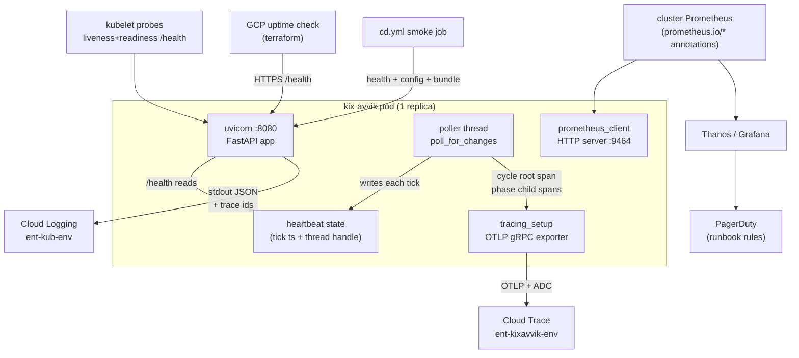

# Observability Hardening - Plan

## Goal Capsule

- **Objective:** Implement every P0 and P1 recommendation from `docs/observability/01-review-2026-08-30.md` (R1–R7 there) plus OpenTelemetry tracing with a per-poller-cycle root span, so the service is alertable, self-healing on poller death, and traceable before production traffic ramps.
- **Authority:** This plan governs implementation. The review document is background; where this plan refines it (metrics port, IAM path), this plan wins. Repo conventions in `CLAUDE.md` govern style, commit language, and BigQuery cost discipline.
- **Execution profile:** Single repo, single PR expected. Code units first (U1–U6), infra and CI units (U7–U9) independent, docs last (U10). Every Python change must keep the hermetic test suites green under `python <suite>.py`.
- **Stop conditions:** Stop and surface if (a) a new dependency cannot be installed in the distroless image via `disruptions/api/requirements.txt` alone, (b) the vendored common chart 1.22.0 does not render the prometheus scrape annotations as documented, or (c) an existing source-inspection test in `disruptions/api/test_poller_refresh.py` cannot be satisfied without weakening what it pins.
- **Tail ownership:** Rollout actions that cannot run from CI (Grafana rule creation, PagerDuty routing, IAM verification after `entur apply`, trace and metrics smoke in dev) are recorded in the runbook (U10); the Definition of Done requires a tracked follow-up issue with an owner for that tail, so "alertable" cannot silently stall at merge. Tracing is added here although the source review deferred it (its revisit-conditions are considered met by the user's direction, recorded in KTD3/KTD4's settlement annotations).

---

## Product Contract

### Summary

The app's logging is already golden-path (structured JSON, correct severities). This work adds the missing layers: a poller heartbeat that makes `/health` honest, a Prometheus metrics endpoint on an internal port with domain metrics, an in-app detector for silent labelling-job failure, log hygiene fixes, OpenTelemetry tracing to Google Cloud Trace with the poller cycle as a root span, an uptime check, a post-deploy smoke job, and a committed alert-rules runbook for Grafana/PagerDuty.

### Problem Frame

Today every failure mode is detected by a human reading logs or a traveller missing a push. The poller — one daemon thread carrying the whole product — can die silently while the pod stays Ready. The nightly labelling query can fail for 10 days and permanently lose verdicts. There are no metrics, so none of Entur's golden-path Grafana/PagerDuty alerting can fire. Traffic ramp multiplies the cost of each of these.

### Requirements

**Poller heartbeat and health**

- R1. The poller loop records a heartbeat timestamp unconditionally at the top of every iteration, independent of whether upstream SIRI-SX moved.
- R2. `GET /health` returns 503 when the poller thread has died or the heartbeat is older than 10 minutes; it returns 200 when the poller has not been started (hermetic tests, local runs without lifespan).
- R3. An uncaught exception in any thread is logged as a structured ERROR (`event="thread_died"`, thread name, traceback) through the JSON formatter instead of raw stderr.

**Metrics**

- R4. The app serves Prometheus metrics at `/metrics` on a dedicated internal port (9464), never on the public port 8080, and the Helm chart emits the matching `prometheus.io/*` scrape annotations.
- R5. Domain metrics cover: poller heartbeat and last-cycle timestamps, cycle duration, per-phase duration and result, push outcomes, LLM wording outcomes, decision-log write outcomes, and labelling freshness.
- R6. HTTP requests are counted and timed with bounded-cardinality labels (method, top path segment, status class).
- R7. Log records are counted by level, so "ERROR rate > 0" is alertable from Grafana without log-based metrics.

**Labelling freshness**

- R8. The app checks `disruptions.varsel_decision_outcomes` freshness (`MAX(labelled_at)`, bounded by the `call_date` partition) at most every 6 hours. The ERROR (`event="labelling_stale"`) is gated on evidence of work-to-label: labelling stale (> 48 h) **or absent** while `varsel_decisions` holds rows decided inside the same window → ERROR; no recent decision rows (tst, or a genuinely quiet period) → at most one non-ERROR notice per process. This one condition covers both false-positive modes (quiet weekend) and the false-negative mode (a prd outage outlasting the 10-day window would otherwise empty the result and silence the detector exactly when loss becomes permanent).

**Log hygiene**

- R9. `/health` requests no longer appear in the uvicorn access log.
- R10. The permanent-by-design `reisevalg_baselines_unavailable` condition logs WARNING at most once per process; repeats are INFO.
- R11. Web-push failure detail (status, host, body excerpt) reaches the structured push audit trail exactly once per failed send — no double-counting of `event="push"` records per delivery.
- R12. The root log level is configurable via a `LOG_LEVEL` env var, defaulting to INFO; no deployment changes its level in this work (privacy floor: `VARSEL_LLM_LOG_PROMPTS` stays inert).

**Tracing**

- R13. Tracing initializes from an explicit `tracing_setup.py` module, gated by a `TRACING_ENABLED` env var (default off), and fails open: any init error logs a warning and the app serves normally with no-op spans.
- R14. Spans export via OTLP gRPC to `telemetry.googleapis.com:443` authenticated with Application Default Credentials; the resource carries `service.name`, `gcp.project_id`, and an environment attribute.
- R15. Inbound FastAPI requests and outbound `requests`-library calls are auto-instrumented; `/health` is excluded (`/metrics` never transits FastAPI — no exclusion applies); BigQuery client spans (import-gated: the client emits them once the OTel API is importable and a provider is set — no extra package required) are accepted.
- R15b. Span attributes are sanitized before export: request hooks on both instrumentations strip query strings from URL attributes and redact the path of push-service client spans, so no device capability token, Web Push endpoint, or other query-borne secret reaches Cloud Trace. On that traveller-free basis the global OTLP endpoint is accepted (recorded here the way the Vertex `eu` endpoint decision was).
- R16. Each `_rebuild_all` poller cycle runs inside a root span with one child span per `_phase`, so a cycle renders as a single trace.
- R17. Log lines emitted inside a sampled span carry `logging.googleapis.com/trace`, `spanId`, and `trace_sampled` keys; lines outside any span carry none.
- R18. Sampling is set per environment through standard `OTEL_TRACES_SAMPLER` / `OTEL_TRACES_SAMPLER_ARG` env vars in Helm values: dev `parentbased_always_on`, tst and prd `parentbased_traceidratio` 0.1.
- R19. The runtime SA gains the trace-write roles and the required APIs are enabled, as code, with a documented post-apply verification step (grants are filtered silently).

**Operational safety nets**

- R20. Terraform defines an HTTPS uptime check on each environment's public host hitting `/health`, with a minimal Cloud Monitoring alert policy and email notification channel, created only where an email is configured.
- R21. `cd.yml` gains a post-deploy smoke job per environment: `/health` returns 200 within a bounded retry window, `/varsel-api/config` answers, and the JS bundle referenced by the served `/varsel` `index.html` is fetchable.
- R22. A committed runbook documents the Grafana alert rules (PromQL, labels, thresholds, `for` durations), the PagerDuty routing labels, and the manual setup steps.

### Scope Boundaries

- **Deferred to Follow-Up Work:** readiness/liveness split with distinct semantics; request-ID middleware; client-error reporting for `/demo`, `/historikk`, `/meldinger`; per-push structured logging for togvarsel rush rounds (aggregate metrics only here); tightening the uptime-check alerting into PagerDuty; a NetworkPolicy restricting port 9464 to the scraper namespace (today its trust boundary is the shared cluster's pod network — labels stay operational-only by convention); an outcome counter for webhook HTTP deliveries (phase metrics only in this work).
- **Out of scope:** creating the Grafana rules themselves (UI action, runbook documents it); replica/architecture changes (`forceReplicas: 1` stays); SLOs/SLODash; deleting or activating `VARSEL_LLM_LOG_PROMPTS`; front-end tracing.

### Assumptions

- LOG_LEVEL stays INFO in every environment; making dev DEBUG (which would activate prompt logging) is a privacy decision left to the team.
- The uptime check lives in the app project (`ent-kixavvik-<env>`), where the CD SA verifiably holds `roles/monitoring.editor`.
- Sampling ratios follow Entur's documented defaults; the app's real traffic (< 50 req/min) would tolerate 100 % but the defaults are kept for prd headroom.
- Metric names use a `kix_` prefix (custom metrics, per Prometheus naming conventions); Entur's dashboards key on `kube_*`/`container_*` for infra, which this work does not touch.
- Rush-forecast pushes are counted through the shared `_send_push` result counter; their per-push audit stays the aggregate `togvarsel_notify_round` log event.

---

## Planning Contract

### Key Technical Decisions

- KTD1. **`/health` becomes heartbeat-aware and 503s on a dead or stale poller.** (session-settled: user-approved — chosen over a readiness-only watchdog that leaves the pod Ready with a dead poller: both probes already point at `/health`, so a 503 trips liveness and the restart is the complete remedy.) The heartbeat is a module-level monotonic timestamp written at the top of each `poll_for_changes` iteration plus a module-level thread handle; the staleness threshold reads from `HEALTH_STALE_AFTER_S` (default 600 — 10× the 60 s tick; `0` disables the heartbeat check), the same env-var escape hatch as `METRICS_PORT`, so a mis-tripping probe is defused by a values-only deploy rather than an image rollback. Two clocks, never conflated: the monotonic timestamp serves the in-process age check; every exported `*_timestamp_seconds` gauge is set from Unix-epoch `time.time()`. To keep a *slow* upstream from becoming a crash loop (a BigQuery incident stretching one iteration past the threshold would otherwise restart the single replica in a cycle, where today it serves stale caches), the poller-path BigQuery calls get a client timeout below the threshold (~240 s) so slowness surfaces as the existing per-tick logged error while the heartbeat keeps beating; the 503 then still catches only a truly dead or hung thread. Before hardening the 600 s default, confirm the max observed `poller_cycle` ms in prd logs (available since 2026-08-21). `None` heartbeat with no thread handle means "poller not started" and stays 200 — hermetic tests construct `TestClient(main.app)` without lifespan. No BigQuery or upstream check enters the probe. Stated cost, accepted: with `forceReplicas: 1` and readiness on the same path, a stale poller removes the only replica from the Service while liveness restarts it, so every public surface is down for the restart window (~30 s detection + up to 300 s startup) — one remedy, not two bugs. Because R9 mutes `/health` in the access log, the handler itself logs a rate-limited structured record (`event="health_degraded"`, `reason`) on the 200→503 transition so pre-restart evidence survives.
- KTD2. **Metrics via `prometheus_client`, served on dedicated port 9464, scraped via chart annotations.** (session-settled: user-approved — chosen over Cloud Monitoring log-based metrics: Grafana/Thanos is Entur's recommended alerting path.) Refinement over the review's "/metrics route on the app": the host is `trafficType: public`, so anything on port 8080 is internet-reachable — `prometheus_client.start_http_server(9464)` (own daemon thread, started in lifespan) keeps metrics cluster-internal, and `common.container.prometheus.{enabled, path, port}` in the vendored chart 1.22.0 points the scraper at it (verified: `deployment.yaml` renders the `prometheus.io/*` pod annotations, and the Service/ingress expose only 8080 — which is what makes "cluster-internal" a fact rather than an assertion). One trap the chart does **not** catch: the port template falls back to `service.internalPort` (8080) before its `required` guard can ever fire, so an omitted `port` renders a silently broken scrape annotation, not a render error — the `helm template` assertion that `prometheus.io/port: "9464"` appears is therefore a mandatory verification gate, not optional. `metrics.start()` runs first in `lifespan`, before the BigQuery loads: annotation scraping targets the pod IP without waiting for Ready, so 9464 is the only window into the up-to-300 s startup.
- KTD3. **Tracing initializes in an explicit `tracing_setup.py`, gated by `TRACING_ENABLED`, failing open.** (session-settled: user-approved — chosen over the zero-code `opentelemetry-instrument` CLI wrapper: distroless has no shell, the CMD is `python -m uvicorn`, and explicit init matches the `logging_setup.py` pattern.) Default off so import stays safe without ADC (CI, laptops); with the flag off, `_phase`/cycle span helpers are no-ops via the OTel API's non-recording spans. Module-top imports are the OTel **API only**; the SDK, OTLP exporter, and instrumentors import lazily inside the flag-gated, try-wrapped `setup()`/`instrument_app()` — otherwise grpcio and four OTel distributions become import-time dependencies of every hermetic suite, and an exporter ImportError crashes `import main` outside the fail-open guard.
- KTD4. **Each `_rebuild_all` cycle is a root span with per-phase child spans.** (session-settled: user-directed — chosen over request-only tracing: the poller is where the latency lives, ~97 % BigQuery; a cycle-as-one-trace is the traced twin of `poller_phase`.) The root span opens in `_on_ingestion_change` around the existing timing/`finally` logging; `_phase` opens the child. Parent-based sampling then also governs the BigQuery client's automatic spans inside the cycle, bounding span volume in prd.
- KTD5. **`/health` is excluded from access logs and traces.** (session-settled: user-approved — chosen over leaving probe traffic in both channels: probes fire every ~5 s and dominate; Entur's tracing guide filters probe endpoints.) Access-log muting is a `logging.Filter` on `uvicorn.access` beside the existing `_AccessLogRedaction` (same 5-tuple `record.args` contract, same idempotent install idiom); trace exclusion is the FastAPI instrumentation's `excluded_urls` (a full-URL regex — anchor the pattern). `/metrics` needs no trace exclusion: it is served by `prometheus_client`'s own HTTP thread and never transits FastAPI, so no test may assert span-absence for it. The muting interacts with KTD1: the `/health` handler's own transition record is what keeps the 503s diagnosable.
- KTD6. **Alert rules ship as a committed runbook; the uptime check (plus its minimal alert policy) ships as Terraform.** (session-settled: user-approved — chosen over managing all alerts as `google_monitoring_alert_policy` resources: Entur documents Grafana as the recommended path and Cloud Monitoring as non-preferred.) The uptime check is the one piece with no Grafana equivalent; its Cloud Monitoring alert policy + email channel are the narrow carve-out that makes it detect rather than decorate, created conditionally on a configured email.
- KTD7. **Labelling-job failure is detected in-app.** (session-settled: user-approved — chosen over relying on transfer-config notifications alone: the in-app check catches all three documented silent-failure modes — config gone, SQL-copy divergence, schema breakage — and survives re-registration mistakes.) It runs as a fifth isolated block in `poll_for_changes` (not a `_rebuild_all` phase — `test_poller_refresh.py` pins that phase list by source inspection, including "servability is last"), rate-limited in-process to once per 6 h, querying `MAX(labelled_at)` with `WHERE call_date >= CURRENT_DATE() - 10` so the partition prune keeps it near-free.
- KTD8. **Tracing IAM goes in `.entur/application.yaml` `additionalRoles`, not Terraform; API enablement goes in Terraform.** Chosen over `google_project_iam_member` in `terraform/`: `terraform/firestore.tf` documents that the CD SA's project-IAM permission is CEL-conditioned on the platform's `assignable_iam_roles` list (this repo holds no copy), and that keeping project IAM out of `terraform/` is what keeps applies working — while `additionalRoles` is filtered only by `bad_roles_regex` (`^(roles/owner|roles/editor|roles/resourcemanager.*|roles/iam.*)$`), which the trace roles do not match. Grant **both** `roles/cloudtrace.agent` (Entur's tracing guide) and `roles/telemetry.tracesWriter` (Google's current Telemetry API docs) — the two sources disagree and both roles are harmless; verification is R19's post-apply `gcloud projects get-iam-policy` step because a filtered role drops silently. `google_project_service` for `telemetry.googleapis.com` and `cloudtrace.googleapis.com` follows the existing `firestore.tf` precedent (the CD SA holds `serviceusage.services.enable` through `roles/monitoring.editor`).
- KTD9. **OTLP gRPC exporter with hand-built ADC channel credentials.** Chosen over the deprecated `opentelemetry-exporter-gcp-trace` (its own release notes deprecate it in favor of OTLP) and over the beta `opentelemetry-exporter-credential-provider-gcp`: Google's migration guide documents `google.auth` `AuthMetadataPlugin` + `grpc.composite_channel_credentials` passed to `OTLPSpanExporter` as the supported path. Keep the SDK's default 30 s shutdown flush cap — the known failure mode is a shutdown hang against an unreachable endpoint, and the cap bounds it. Two known edges: the ADC plugin refreshes tokens via `requests` on gRPC's own thread, outside OTel's suppress-instrumentation context, so an occasional `oauth2.googleapis.com` span is expected (harmless; `OTEL_PYTHON_REQUESTS_EXCLUDED_URLS` is the later env-var fix); and the log-correlation trace key needs `GOOGLE_CLOUD_PROJECT` — the formatter omits the key when it is unset rather than emitting `projects/None/...`.
- KTD10. **HTTP metrics via a hand-rolled ASGI middleware, not `prometheus-fastapi-instrumentator`.** The instrumentator's current 8.x pins `starlette>=1.0.0,<2.0.0` — a compatibility gamble against `fastapi[standard]` — and the need is two metrics. The middleware labels by method, first path segment (allowlisted to the known mounts, else `other`), and status class, keeping cardinality bounded. Ordering is settled here: Starlette's `add_middleware` makes the last-added middleware outermost, and the metrics middleware plus `instrument_app` are added **after** `sso.RequireSSO` so both observe every request — including SSO rejections and the fail-closed 503 (`sso.py` documents `RequireSSO` as currently outermost; the observability layers now sit outside it, tracing outermost). The middleware passes non-http scopes (lifespan) through untouched — `RequireSSO.__call__` is the in-repo pattern.
- KTD11. **Metric increments live at the existing logging choke points.** Push: `varsel._send_push` (the single function every Web Push of every kind passes through) by `result`. LLM: `llm_message.write_message_detailed`'s return boundary (once per call, from the returned status — U3 owns the mechanics) by `provider`/`result`/`surface` — `surface` is a bounded label (`live`/`replay`/`webhook`/`pull`) derived from the function's existing `replay`/`caller` parameters, because `/meldinger` replay shares this choke point and a replay burst of `ungrounded` (the documented product of a prompt edit) must not fire the live-LLM alert. Decisions: `decisions.record()`'s three outcomes plus its exception path. Poller: `_on_ingestion_change`'s `finally` and `_phase`'s `finally`. Log levels: a counting `logging.Handler` appended to the root logger at configure time (after `logging_setup.setup()` has replaced handlers).
- KTD12. **`LOG_LEVEL` env support with INFO default and no deployment changes.** (session-settled: user-approved — the conservative floor from the review: activating DEBUG in dev would start writing traveller origin/destination prompts to Cloud Logging via `VARSEL_LLM_LOG_PROMPTS`, a privacy call this work does not make.) The interaction is documented at both switches.

### High-Level Technical Design

Health decision, in order: no thread handle recorded → 200 (`poller: not started`); thread handle exists and thread not alive → 503; heartbeat older than 600 s → 503; else 200. The 503 body names the reason — it is what the smoke job, the uptime check, and a human curl all read.

### Sequencing

U1 → U2 → U3 → U4 in that order **for single-PR file-conflict avoidance** (U1 and U4 both edit the poller loop; U3 and U6 touch the same functions) — the Unit Index's depends-on column is authoritative for *logical* dependency (U2 depends on nothing, U4 only on U2); U5 independent after U1 (shares `logging_setup.py`); U6 after U3 (touches the same poller functions); U7 and U8 are infra-only, any time; U9 any time; U10 last (names final metric names).

---

## Implementation Units

Unit index:

| U-ID | Title | Key files | Depends on |
|---|---|---|---|
| U1 | Poller heartbeat, health 503, thread excepthook | `disruptions/api/main.py`, `logging_setup.py` | — |
| U2 | Metrics module and internal exporter port | `disruptions/api/metrics.py`, `main.py`, Helm values | — |
| U3 | Domain metric instrumentation | `varsel.py`, `llm_message.py`, `decisions.py`, `main.py` | U2 |
| U4 | Labelling-freshness detector | `decisions.py`, `main.py` | U2 |
| U5 | Log hygiene | `logging_setup.py`, `reisevalg.py`, `varsel.py` | U1 |
| U6 | Tracing | `tracing_setup.py`, `main.py`, `logging_setup.py`, Helm values | U3 |
| U7 | Trace IAM and API enablement | `.entur/application.yaml`, `terraform/` | — |
| U8 | Uptime check | `terraform/` | — |
| U9 | Post-deploy smoke job | `.github/workflows/cd.yml` | — |
| U10 | Alert-rules runbook | `docs/observability/` | U2, U3 |

### U1. Poller heartbeat, health 503, thread excepthook

- **Goal:** A dead or wedged poller makes `/health` fail, so Kubernetes restarts the pod; a dying thread leaves a structured ERROR.
- **Requirements:** R1, R2, R3 (KTD1).
- **Files:** `disruptions/api/main.py`, `disruptions/api/logging_setup.py`, `disruptions/api/test_health_heartbeat.py` (new), `disruptions/api/test_poller_refresh.py` (may need touch-ups if its source-inspection regexes see the loop edits).
- **Approach:**
  1. Module-level heartbeat state in `main.py` following the existing module-global idiom (`main.py:211-213` shape): a monotonic timestamp and the thread object; `lifespan` stores the thread handle it already creates (`main.py:1450-1464`).
  2. `poll_for_changes` writes the timestamp at the top of every `while` iteration, before the four try/except blocks.
  3. `/health` (`main.py:2964-2973`) implements the ordered decision from the design section; the 503 body is `{"status": "...", "reason": "..."}`; the handler logs one structured record (`event="health_degraded"`, `reason`) per 200→503 transition — not per probe — on the app logger, since R9 mutes the access log (KTD1).
  4. `threading.excepthook` installed in `logging_setup.setup()`: logs ERROR with `event="thread_died"`, thread name, `exc_info`; does not re-raise.
  5. Staleness threshold from `HEALTH_STALE_AFTER_S` per KTD1 (default 600, `0` disables); poller-path BigQuery calls (`get_last_ingestion_time` and the `_rebuild_all` query jobs) gain a client timeout ~240 s per KTD1's crash-loop guard.
- **Patterns to follow:** module-global + writer idiom in `main.py`; `extra={"fields": {...}}` logging convention; test skeleton from `test_demo_api.py` (BigQuery stub before `import main`, no-lifespan `TestClient`, plain asserts, `_run()` at END).
- **Test scenarios:**
  - `/health` returns 200 with no poller started (the default `TestClient` state — pins hermetic-test compatibility).
  - With a fake dead thread handle installed, `/health` returns 503 and the body names the thread death.
  - With a live thread handle and a heartbeat older than 600 s, `/health` returns 503 naming staleness; fresher than 600 s returns 200.
  - A stale-heartbeat 503 emits exactly one `event="health_degraded"` record per transition — repeated probes while stale add none; recovery re-arms it.
  - `HEALTH_STALE_AFTER_S=0` disables the staleness branch (thread-death detection stays); an unset var uses 600.
  - `poll_for_changes` writes the heartbeat even when `get_last_ingestion_time` raises (stub raising client; reuse `test_poller_refresh.py`'s `_Recorder`/stub patterns).
  - `threading.excepthook`: start a thread that raises; assert one ERROR record with `event="thread_died"` and the exception text in `message` (capture via a handler on root).
- **Verification:** new suite passes standalone (`uv run ... python test_health_heartbeat.py`) and under the CI glob; existing `test_poller_refresh.py` still passes.

### U2. Metrics module and internal exporter port

- **Goal:** A `/metrics` endpoint exists on port 9464 with the metric registry, HTTP middleware, and log-level counter; the chart annotates the pod for scraping.
- **Requirements:** R4, R6, R7 (KTD2, KTD10, KTD11).
- **Files:** `disruptions/api/metrics.py` (new), `disruptions/api/main.py`, `disruptions/api/requirements.txt`, `pyproject.toml` (`api` dependency group), `.github/workflows/ci.yml` (`--with prometheus-client` in the suite loop), `helm/kix-avvik/values.yaml`, `disruptions/api/test_metrics.py` (new).
- **Approach:**
  1. `metrics.py` declares all metric objects at module scope (names below in U3/U10), a `start(port)` that calls `start_http_server`, a `configure()` that appends the level-counting `logging.Handler` to root, and the ASGI middleware class.
  2. `lifespan` calls `metrics.start(int(os.environ.get("METRICS_PORT", "9464")))` and `metrics.configure()` **first, before the BigQuery loads** (KTD2: 9464 is the only window into the 300 s startup); `configure()` is idempotent (the `_AccessLogRedaction` install idiom) because `logging_setup.setup()` wipes root handlers on re-run. Middleware added per KTD10's ordering — after `sso.RequireSSO`, so it is outside it. No lifespan → no HTTP server, but counters still work in tests via the registry.
  3. Path label: first path segment matched against an allowlist of the known mounts (`varsel-api`, `impact`, `historikk-api`, `meldinger-api`, `demo-api`, `togmelding-api`, `reisevalg-api`, `notification-api`, `health`, static mounts...), else `other`.
  4. Helm: `common.container.prometheus: {enabled: true, path: /metrics, port: 9464}` in `values.yaml` with the house-style comment (date, what it gates, rollback).
  5. Dependency lands in `requirements.txt` (with the conventional why-comment) **and** `pyproject.toml`'s `api` group; the ci.yml `--with` list gains `prometheus-client` (suites layering on `uv run --with`).
- **Patterns to follow:** `configure()` injection idiom (`decisions.py:109-112`); values.yaml comment style.
- **Test scenarios:**
  - A request through the middleware increments `kix_http_requests_total` with the expected method/path/status labels (assert via registry, no HTTP server).
  - An unknown path labels as `other`; a known mount labels by its segment (cardinality bound).
  - A `logger.error(...)` after `configure()` increments `kix_log_records_total{level="ERROR"}`; the counting handler never raises on a record with exotic args.
  - Re-running `logging_setup.setup()` then `metrics.configure()` leaves exactly one counting handler and counting still works (the wipe-and-reinstall contract).
  - A request rejected by a stubbed `RequireSSO` still increments `kix_http_requests_total` with its status class (the KTD10 ordering, pinned).
  - `start()` binds the port and `GET /metrics` on it returns `text/plain` exposition containing a known metric name (use an ephemeral port in the test).
  - Helm-side (mandatory, KTD2): `helm template` output contains the three `prometheus.io/*` annotations with `prometheus.io/port: "9464"` — the chart silently falls back to 8080 when the port is dropped, so this assertion is the only guard.
- **Verification:** new suite green standalone and in CI; `uv run ruff check .` clean; `helm template` renders annotations.

### U3. Domain metric instrumentation

- **Goal:** The review's domain metric set is live: poller, push, LLM, decision-write.
- **Requirements:** R5 (KTD11).
- **Files:** `disruptions/api/main.py`, `disruptions/api/varsel.py`, `disruptions/api/llm_message.py`, `disruptions/api/decisions.py`, `disruptions/api/metrics.py`, `disruptions/api/test_metrics.py`.
- **Approach:** increments beside the existing log calls, never replacing them:
  1. `_on_ingestion_change` `finally`: set `kix_poller_last_cycle_timestamp_seconds`, observe `kix_poller_cycle_duration_seconds`.
  2. `poll_for_changes` tick: set `kix_poller_last_tick_timestamp_seconds` at the same point as U1's heartbeat write — but from epoch `time.time()`, never the monotonic value (KTD1's two-clock rule; a monotonic export invalidates every `time() - gauge` age rule in the runbook).
  3. `_phase` `finally`: observe `kix_poller_phase_duration_seconds{phase}` and increment `kix_poller_phase_total{phase, result}`.
  4. `varsel._send_push`: `kix_push_total{result}` (`sent`/`gone`/`error`) — the one function every push of every kind passes through; no `kind` label (available in logs).
  5. `llm_message.write_message_detailed`: `kix_llm_message_total{provider, result, surface}` incremented **exactly once per call at the function's return boundary** from the returned `MessageResult.status` — not at the six log branches, which miss `truncated` (logged inside the backend helpers) and `unavailable` (not logged at all) and would double-count retry attempts. The returned status already carries every outcome; `surface` per KTD11.
  6. `decisions.record()`: `kix_decision_write_total{result}` for `ok`/`partial`/`error` (the raising path).
- **Patterns to follow:** keep `metrics` imports at module top per ruff isort; modules that must stay `main`-independent import `metrics` directly (it is a sibling with no `main` dependency, consistent with the no-import-of-main rule).
- **Test scenarios:**
  - A stubbed `_send_push` failure path increments `kix_push_total{result="error"}` exactly once per call.
  - `decisions.record()` with a stub client returning per-row errors increments `partial`; a raising client increments `error`; a clean insert increments `ok`.
  - Driving `_on_ingestion_change` with a stubbed `_rebuild_all` moves the cycle gauge and duration histogram (reuse `test_poller_refresh.py`'s `_run` harness shape).
  - `write_message_detailed` outcome branches increment with the right `result` label (reuse the existing llm_message test suite's stubbing approach for one representative branch per class: ok, error, rejected).
  - The `surface` label resolves `live` for the poller-shaped call, `replay` when `replay=True`, and the caller value for webhook/pull — and never takes an unbounded value.
- **Verification:** suites green; grep confirms no existing log line was removed or reworded (the events are operator contracts).

### U4. Labelling-freshness detector

- **Goal:** A silently failing `varsel-label-daily` scheduled query surfaces as a structured ERROR (and a metric) within hours, well inside the 10-day permanent-loss window.
- **Requirements:** R8 (KTD7).
- **Files:** `disruptions/api/decisions.py`, `disruptions/api/main.py`, `disruptions/api/metrics.py`, `disruptions/api/test_decisions_freshness.py` (new).
- **Approach:**
  1. `decisions.check_labelling_freshness()`: no-op unless `enabled()`; in-process rate limit (module timestamp, 6 h); query `SELECT MAX(labelled_at) AS latest FROM disruptions.varsel_decision_outcomes WHERE call_date >= CURRENT_DATE() - 10`.
  2. Outcomes per R8's work-to-label gate (the same partition-bounded query also returns a decision-rows aggregate): labelling stale or NULL **and** recent decision rows exist → ERROR `event="labelling_stale"` with `hours_stale` (or `reason="no_labelled_rows"`); no recent decision rows → one INFO per process; fresh → set `kix_labelling_last_success_timestamp_seconds`, log nothing.
  3. Query failure is caught and logged WARNING — the detector must never take the poller down (matches decisions.py's fail-open posture).
  4. Called from `poll_for_changes` as a fifth isolated try/except block after `togvarsel_outcomes.refresh()` — **not** a `_rebuild_all` phase (KTD7's test-pin constraint).
- **Test scenarios:**
  - Stub returning 3-day-old `labelled_at` with recent decision rows → exactly one ERROR record with `event="labelling_stale"`; a second call inside the rate window runs no query.
  - Stub returning NULL labelling **with** recent decision rows → ERROR (`reason="no_labelled_rows"`) — the prd-outage-past-the-window case must alert, not silence.
  - Stub returning stale-or-NULL labelling with **no** recent decision rows (tst / quiet period) → one INFO on first call, nothing on repeat, never ERROR.
  - Fresh timestamp → gauge set, no ERROR/INFO noise.
  - Raising client → WARNING, poller loop continues (drive via `poll_for_changes` one-iteration harness).
  - The emitted SQL contains the `call_date >=` bound (source or captured-query assertion — the cheap guard this repo uses for unexecutable SQL).
- **Verification:** new suite green; a manual dev BigQuery dry-run of the query is an operator step in the runbook, not CI.

### U5. Log hygiene

- **Goal:** The WARNING and access-log channels become trustworthy: no probe spam, no chronic warning, symmetric push audit, configurable level.
- **Requirements:** R9, R10, R11, R12 (KTD5, KTD12).
- **Files:** `disruptions/api/logging_setup.py`, `disruptions/api/reisevalg.py`, `disruptions/api/varsel.py`, `disruptions/api/togvarsel_notify.py` (only if the delivery-tuple shape changes), `disruptions/api/test_logging_setup.py` (new), existing varsel/reisevalg suites.
- **Approach:**
  1. A `logging.Filter` on `uvicorn.access` dropping records whose request line targets `/health` — beside `_AccessLogRedaction` (`logging_setup.py:60-76`), same 5-tuple args contract.
  2. `setup()` reads `LOG_LEVEL` (default `INFO`, invalid values fall back to INFO), with one interlock: when `VARSEL_LLM_LOG_PROMPTS` is truthy, a DEBUG floor is refused (fall back to INFO, log a structured ERROR naming the conflict) — activating traveller-prompt logging must always require deliberately touching the privacy flag in the same change, keeping KTD12's floor true under operator error. Document the interaction at both sites.
  3. `reisevalg.py:401-407`: once-per-process WARNING latch; repeats log INFO with the same `event` so existing queries still match.
  4. Push-failure detail: `_send_push` (`varsel.py:1970-1999`) returns failure detail (status/host/body excerpt) alongside its result so `_log_push` includes it as fields on the existing single `event="push"` record. The two prose warning lines in `_send_push` gain no `event` field (or are dropped once detail rides the audit record) — R11's exactly-once rule; `deliver_to_devices`' tuple consumers (`varsel.check_and_notify`, `togvarsel_notify.push_round`) must tolerate the extended shape.
- **Test scenarios:**
  - JSON contract pinned: keys, severity mapping, exception-in-one-entry, `_RESERVED` protection, `ensure_ascii=False` (the review's "no test covers logging_setup" gap).
  - A synthetic `uvicorn.access` record for `/health` is dropped; one for `/varsel-api/journeys` passes; the redaction filter still applies to passed records.
  - `LOG_LEVEL=DEBUG` in env → root level DEBUG; unset → INFO; garbage → INFO; DEBUG with `VARSEL_LLM_LOG_PROMPTS=true` → INFO plus one structured ERROR naming the interlock.
  - The push-failure body excerpt keeps its existing 400-char cap (pinned in the test) and passes through the JSON formatter without control-character breakage.
  - reisevalg latch: two consecutive unavailable refreshes → one WARNING then INFO.
  - A failed push produces exactly one `event="push"` record and it carries the status/host detail (drive `_send_push` with a stubbed `pywebpush` raising `WebPushException`).
- **Verification:** suites green; a grep for `event="push"` emitters confirms single ownership.

### U6. Tracing

- **Goal:** Sampled traces in Cloud Trace: inbound requests, outbound `requests` calls, BigQuery client spans, and the poller cycle as one root span with phase children; logs correlate to traces.
- **Requirements:** R13–R18 (KTD3, KTD4, KTD9; R19 is U7).
- **Files:** `disruptions/api/tracing_setup.py` (new), `disruptions/api/main.py`, `disruptions/api/logging_setup.py`, `disruptions/api/requirements.txt`, `pyproject.toml`, `.github/workflows/ci.yml` (`--with` additions), `helm/kix-avvik/values.yaml` + all three `helm/kix-avvik/env/values-kub-ent-*.yaml`, `disruptions/api/test_tracing_setup.py` (new).
- **Approach:**
  1. Dependencies: `opentelemetry-sdk`, `opentelemetry-exporter-otlp-proto-grpc`, `opentelemetry-instrumentation-fastapi`, `opentelemetry-instrumentation-requests` (contrib pinned in lockstep with the SDK, e.g. SDK 1.44 ↔ 0.65b0; exact pins at implementation), in both dependency files with why-comments.
  2. `tracing_setup.py`: `setup()` runs at import (module-scope call, `logging_setup` precedent; `logging_setup` sorts before it, so the fail-open WARNING is already JSON). Module top imports `opentelemetry.trace` (API) only; SDK, exporter, and instrumentors import inside the flag-gated `setup()`/`instrument_app()` (KTD3). Gated on `TRACING_ENABLED` truthy; builds resource (`service.name=kix-avvik`, `gcp.project_id` from `GOOGLE_CLOUD_PROJECT`, `environment` derived from the project suffix — `deployment.environment_label()` returns None in prd by design, so derive directly); sampler comes from the standard OTEL env vars (SDK-native); exporter per KTD9. Any exception → WARNING, tracing disabled, app serves (R13). Also exposes `span(name)` (no-op-safe via the OTel API's non-recording spans) and `instrument_app(app)` (FastAPI instrumentation with an anchored `excluded_urls` regex for `/health`) and calls `RequestsInstrumentor().instrument()` when enabled. Both instrumentations install R15b's sanitization hooks: a `server_request_hook` and a `request_hook` that strip query strings from every URL-carrying span attribute and redact the path of push-service client spans. BigQuery spans need no instrumentor — the client emits them once a provider exists (import-gated) — but U6's tests must prove they nest under the cycle span rather than assume it.
  3. `main.py`: `import tracing_setup` sorts alphabetically between `togvarsel_outcomes` and `varsel` (ruff isort, no escape needed — and it lands before `bq_client = bigquery.Client()` at `main.py:1468`, so the provider exists before any query); `tracing_setup.instrument_app(app)` after `app = FastAPI(...)`.
  4. Cycle span: `_on_ingestion_change` wraps its body in `tracing_setup.span("poller_cycle")`; `_phase` wraps its `yield` in `tracing_setup.span(name)`. Both no-op when disabled.
  5. `logging_setup.JsonFormatter`: guarded lazy import of `opentelemetry.trace`; when the current span context `is_valid`, emit the three `logging.googleapis.com/*` keys (trace as `projects/<project>/traces/<hex>`); omit the trace key when `GOOGLE_CLOUD_PROJECT` is unset (never `projects/None/...`); never raise from the formatter.
  6. Helm: base `values.yaml` sets `TRACING_ENABLED: "false"` (documented default-off); each env file sets `TRACING_ENABLED: "true"`, `OTEL_TRACES_SAMPLER` (`parentbased_always_on` dev; `parentbased_traceidratio` + `OTEL_TRACES_SAMPLER_ARG: "0.1"` tst/prd), house-style comments including the R19 dependency (no role → export errors in logs, harmless).
- **Patterns to follow:** `logging_setup.py`'s import-side-effect docstring style; values.yaml comment convention.
- **Test scenarios:**
  - With `TRACING_ENABLED` unset, importing `tracing_setup` configures nothing, `span()` is usable as a no-op, and no network/ADC access happens (the whole suite must stay hermetic).
  - With the flag on and an in-memory span exporter (SDK's `InMemorySpanExporter`, no network), `span("poller_cycle")` containing `span("rail_calls")` produces a parent/child pair.
  - `instrument_app` on a throwaway FastAPI app: a request to `/health` produces no span; a request to another route produces one (in-memory exporter).
  - Sanitization: a traced request to a route with `?device_id=X` produces a span whose attributes contain no `device_id`; a stubbed `requests` call shaped like a Web Push delivery produces a client span containing no endpoint token (R15b).
  - A span opened inside `span("poller_cycle")` by a stubbed BigQuery-shaped tracer call nests under the cycle root (provider-level proof that cycle traces will carry the BigQuery children).
  - JsonFormatter inside a recording span emits the three correlation keys with a `projects/.../traces/` prefix; outside a span emits none; with OTel absent-from-provider it never raises.
  - Setup with a poisoned env (e.g. unparsable sampler value or a raising exporter factory) logs WARNING and leaves the app importable (fail-open, R13).
- **Verification:** suites green with no ADC present (the CI condition); `uv run ruff check .` clean; runtime verification (a real trace in `ent-kixavvik-dev`) is a runbook rollout step.

### U7. Trace IAM and API enablement

- **Goal:** The runtime SA can write traces; the required APIs are on — as code, with the silent-filter trap documented.
- **Requirements:** R19 (KTD8).
- **Files:** `.entur/application.yaml`, `terraform/services.tf` (new, or folded into the existing API-enablement precedent), `terraform/env/*.tfvars` (unchanged unless variables are added).
- **Approach:** add `roles/cloudtrace.agent` and `roles/telemetry.tracesWriter` to `additionalRoles` with a comment naming both sources of truth and the verification recipe (`.entur/application.yaml:31-36` already documents it); `google_project_service` resources for `telemetry.googleapis.com` and `cloudtrace.googleapis.com` following the `firestore.tf` precedent (`disable_on_destroy = false`).
- **Test scenarios:** Test expectation: none — configuration; `terraform.yml` plans on the PR and CI validates YAML syntax. Post-apply verification (grants visible in `gcloud projects get-iam-policy`, then a trace visible in dev) is an operator step recorded in the runbook.
- **Verification:** terraform plan on the PR is clean; the application.yaml diff is comment-documented.

### U8. Uptime check

- **Goal:** Ingress/DNS/TLS/pod-death failures on the public host are detected outside the pod.
- **Requirements:** R20 (KTD6).
- **Files:** `terraform/monitoring.tf` (new), `terraform/variables.tf`, `terraform/env/dev.tfvars`, `terraform/env/tst.tfvars`, `terraform/env/prd.tfvars`.
- **Approach:** `google_monitoring_uptime_check_config` (HTTPS, path `/health`, host from a new `uptime_host` variable set per tfvars: `kix-avvik.dev.entur.io` / `kix-avvik.staging.entur.io` / `kix-avvik.entur.io`), in `module.init.app.project_id`; a `notification_email` variable (default `""`) conditionally creates `google_monitoring_notification_channel` + one `google_monitoring_alert_policy` on the uptime check's failure metric — the KTD6 carve-out. Set the email to the team group in dev and prd tfvars.
- **Test scenarios:** Test expectation: none — configuration; `terraform.yml` lint+plan is the gate.
- **Verification:** the PR plan validates **dev only** (`terraform.yml` plans a single environment per run; tst/prd are reached only via `workflow_dispatch`, which plans and applies in the same run). The dev plan shows the check plus channel/policy; tst (no email → no channel) and prd are verified on their dispatch runs' plan step before apply — recorded as an operator rollout step in the runbook, not a PR gate.

### U9. Post-deploy smoke job

- **Goal:** A deploy that serves nothing (or serves a broken bundle reference) fails its workflow run loudly instead of being discovered by a human.
- **Requirements:** R21.
- **Files:** `.github/workflows/cd.yml`.
- **Approach:** one new job per environment (`smoke-dev` etc.) with `needs: [deploy-<env>]` and **no `if:` guard at all** — the deploy jobs are reusable-workflow calls and cannot carry steps, and copying their `if:` expressions would reference `needs.build` outputs the smoke job's `needs` list does not expose, evaluating empty and silently skipping smoke on every push deploy; plain `needs` semantics already run smoke iff its deploy succeeded and skip it when the deploy was skipped or failed. Steps (plain `curl` on `ubuntu-24.04`): retry `GET https://<host>/health` until 200, bounded at **6 min** — the documented startup budget is up to 300 s, so a shorter window fails healthy deploys — which also exercises the new 503 semantics (a deploy whose poller never starts fails smoke); `GET /varsel-api/config` returns 200 and its environment label matches the deployed environment (`dev`/`tst` present, absent/null for prd — the review's original assertion, restored); fetch `/varsel/`, extract the `assets/index-*.js` script src, fetch it expecting 200 (the 2026-08-13 stale-bundle lesson, automated server-side). Both smoke endpoints sit outside `sso.PROTECTED_PREFIXES`, so no SSO handling or bypass is needed.
- **Test scenarios:** Test expectation: none — CI configuration; verified by the dev deploy on merge (the smoke job runs immediately and its pass/fail is the test).
- **Verification:** `actionlint`-clean if available; first dev deploy after merge shows the job green in the run.

### U10. Alert-rules runbook

- **Goal:** The Grafana/PagerDuty setup is a documented, reviewable artifact keyed to the real metric names, so R3-of-the-review becomes an hour of UI work, not archaeology.
- **Requirements:** R22 (KTD6).
- **Files:** `docs/observability/02-alert-rules-2026-09-11.md` (new; follows the `NN-kind-date` series convention).
- **Approach:** for each alert — poller staleness on the **tick heartbeat** (`time() - kix_poller_last_tick_timestamp_seconds > <threshold>`; the cycle gauge only moves when SIRI-SX moves, so alerting on it would page on every quiet night — it serves rebuild-freshness observation, not liveness), readiness failing, pod restarts, memory vs limit, ERROR-log rate (`kix_log_records_total{level="ERROR"}`), push error ratio, LLM error ratio, labelling staleness (metric absence/age, with explicit no-data alerting behavior so scrape loss pages rather than silently never firing), 5xx rate and p99 from the U2 HTTP metrics — one table row: PromQL (with `kubernetes_namespace="kix-avvik"`, `prometheus_group` selectors), threshold, `for`, severity, and the routing labels `service_name`/`env`/`severity`. Two selector rules the System-Wide Impact section forces: the 5xx-rate rule excludes `path="health"` (the deliberate probe 503s would double-fire beside the poller alert), and the LLM-error rule selects `surface="live"` (replay bursts are expected during prompt work). Plus: the Grafana folder/PagerDuty steps from Entur's alerting guide, the uptime-check/Terraform note, the post-apply IAM verification recipe, a **metrics-arrival step** (a named `kix_*` series queryable in Grafana Explore for dev before any rule is created — rules on series that never reached Thanos silently never fire), the tst/prd terraform-plan verification on their dispatch runs, and the trace smoke-check steps (a dev trace visible in `ent-kixavvik-dev` Trace Explorer).
- **Test scenarios:** Test expectation: none — documentation; correctness is the cross-check that every metric name cited exists in `metrics.py` (a grep the doc-review or PR review performs).
- **Verification:** every `kix_*` name in the doc greps in `metrics.py`.

---

## System-Wide Impact

- **Middleware stack order is settled at KTD10, restated here as the stack an implementer will see:** outermost→inner is OTel tracing → metrics → `RequireSSO` → CORS → routes. SSO-rejected requests (401/302, and the fail-closed 503 when `SSO_REQUIRED=true` is misconfigured) are counted and traced — the point of the ordering.
- **`/health` gains three consumers with different failure semantics:** both kube probes (5 s period, failureThreshold 6), the U8 uptime check, and the U9 smoke job. A stale heartbeat drops the single replica from the Service and restarts it in the same window — a poller-only failure now takes down every request-serving surface for the restart's duration (KTD1's accepted trade; stated so nobody reads the outage as a second bug). A fail-fast BigQuery outage does **not** trip this — per-tick error handling keeps the heartbeat beating; only a call hanging > 600 s inside one loop iteration does, and staleness measures the whole iteration (rebuild + the togvarsel trio + the U4 check), which is the intended definition of "wedged".
- **The deliberate `/health` 503s are 5xx rows in the new HTTP metrics** (~24/min while a stale-poller window lasts): the runbook's 5xx-rate rule excludes `path="health"` or it double-fires beside the poller-staleness alert (U10).
- **`uvicorn.access` carries two filters** (redaction rewrites and passes; the `/health` drop returns False). Both key on the same 5-tuple `record.args` contract, ignore anything else, and use the idempotent install idiom because `setup()` is re-runnable. Accepted side effect: uptime-check and smoke hits on `/health` also vanish from access logs — the handler's own `health_degraded` transition record (KTD1) is what preserves forensics.
- **`logging_setup.setup()` wipes root handlers**, including the U2 level-counting handler. `metrics.configure()` is idempotent and documented "call after `setup()`"; a suite that re-runs `setup()` must re-run `configure()`.
- **`threading.excepthook` becomes process-global at import time** for every suite that imports `logging_setup` transitively. It sees bare `threading.Thread` deaths only — exceptions inside `varsel`'s ThreadPoolExecutor pools land in Futures and never reach it (the existing retry budgets remain that coverage), and neither the main thread nor asyncio tasks route through it. Poller death is double-covered: excepthook ERROR plus the dead thread handle in `/health`.
- **`prometheus_client`'s default REGISTRY is process-global.** Across suites this is a non-issue — CI runs each `test_*.py` as its own interpreter. Within a suite: assert counter deltas, never absolutes, and never `importlib.reload(metrics)` (duplicate-timeseries ValueError). Only `lifespan` binds the real port; the registry works without it.
- **Port 9464 is cluster-internal but unauthenticated**, reachable from the pod network including before Ready. Metric label values must stay bounded and free of journey data — the path allowlist is that guarantee.
- **New import-time dependencies for every suite:** `varsel`/`llm_message`/`decisions` importing `metrics` makes `prometheus-client` mandatory the moment U2/U3 land (ci.yml `--with` list updated in the same unit). `tracing_setup` keeps module-top imports to `opentelemetry-api` only (KTD3), so grpcio never becomes an import-time requirement of `import main`; most suites need only `--with opentelemetry-api`, plus `opentelemetry-sdk` where a test uses the in-memory exporter.
- **Heartbeat concurrency:** one float and one thread handle, written by the poller thread, read by async handlers — single-assignment writes are atomic under the GIL, readers see old-or-new, and the health decision order (handle first, then timestamp) tolerates every interleaving. No lock; the `main.py` lock idiom guards compound structures, a scalar needs none.

---

## Verification Contract

| Gate | Command | Applies to |
|---|---|---|
| Lint | `uv run ruff check .` | U1–U6 |
| Hermetic suites (each must be run standalone — CI runs `python <suite>.py`, and the `__main__` runner must be the LAST thing in the file) | `cd disruptions/api && uv run --with fastapi --with httpx --with pydantic --with google-cloud-bigquery --with google-cloud-storage --with pywebpush --with google-cloud-firestore --with prometheus-client --with opentelemetry-api python <suite>.py` for every `test_*.py` (`opentelemetry-api` becomes a hard import of `main` via `tracing_setup`; add `opentelemetry-sdk` for the in-memory-exporter suites and any further `--with` entries new imports need; mirror every addition into `ci.yml`'s loop) | U1–U6 |
| Full existing suite regression | same loop over all `test_*.py` | U1–U6 |
| Helm rendering | CI's helm lint job; locally `helm template helm/kix-avvik -f helm/kix-avvik/env/values-kub-ent-dev.yaml` shows the `prometheus.io/*` annotations and OTEL env vars | U2, U6 |
| Terraform | `terraform.yml` lint+plan on the PR validates dev; tst/prd validate on their dispatch runs' plan step (single-environment-per-run workflow) | U7, U8 |
| No network in tests | every new suite passes with no ADC and no network (the CI condition) | U1–U6 |

Quality gates: no existing structured log event is renamed or removed (operator contract); new columns/queries respect the BigQuery cost conventions (`call_date` partition bound in U4); all new code comments in English.

---

## Definition of Done

- All ten units implemented; every suite green standalone and under the CI glob; ruff clean.
- New behavior covered by the enumerated test scenarios; no scenario silently dropped.
- Helm renders scrape annotations and OTEL env vars for all three environments; terraform plan clean for all three workspaces.
- The runbook cites only metric names that exist in `metrics.py`.
- No dead-end or experimental code left in the diff; the review document `01-review-2026-08-30.md` is untouched (point-in-time record).
- Operator rollout steps (Grafana rules, PagerDuty routing, IAM verification, metrics-arrival check, dev trace smoke, tst/prd terraform-plan review) are written in the runbook, **and a tracked follow-up issue enumerating them with a named owner is filed before merge** — executing them is post-merge operator work, but leaving them untracked would let the Problem Frame's opening condition survive the plan being marked done.

---

## Risks & Dependencies

- **Silent IAM filtering:** an `additionalRoles` entry matching the platform filter drops without error. Mitigation: KTD8 grants two roles from two authorities and R19 mandates post-apply verification; tracing meanwhile fails open (export errors are WARNINGs, pushes unaffected).
- **Source-inspection test pins:** `test_poller_refresh.py` pins `_rebuild_all`'s phase list and lifespan source by regex; U1/U4/U6 edit those functions. Mitigation: KTD7 keeps the freshness check out of `_rebuild_all`; expect small, deliberate test updates where a pin sees new lines — never weaken what a pin asserts.
- **BigQuery span volume:** the BigQuery client emits spans unconditionally once OTel is importable; ~18 phases × several API calls per cycle. Mitigation: parent-based sampling under the cycle root span (KTD4) bounds it in prd; dev's 100 % sampling is the observation window.
- **Double-instrumentation of BigQuery HTTP:** `RequestsInstrumentor` also spans the REST calls under the BigQuery client's own spans. Accepted (nested spans are informative); if volume bothers, `OTEL_PYTHON_REQUESTS_EXCLUDED_URLS` can exclude `bigquery.googleapis.com` later — an env-var change, not code.
- **Shutdown flush hang:** a gRPC exporter facing an unreachable endpoint can stall shutdown. Mitigation: keep the SDK's default 30 s cap (KTD9); the pod's grace period covers it.
- **prometheus_client port conflict in tests:** `start_http_server` binds a real port. Mitigation: only `lifespan` starts it; tests use ephemeral ports.
- **cd.yml smoke vs dispatch deploys:** tst/prd deploys are dispatch-only with an `image` input; smoke jobs carry no `if:` of their own — plain `needs` semantics skip them whenever their deploy was skipped or failed (copying the deploy guards would reference `needs.build` outputs the smoke job cannot see and silently skip smoke on every push, U9).

---

## Sources & Research

- `docs/observability/01-review-2026-08-30.md` — the review this implements; its Appendix A is the log-event contract that must not be renamed.
- Entur golden path (`entur/ai` repo): `guides/reference/observability.md` (probes, Python prometheus_client), `guides/reference/alerting.md` (rule shape, labels, PagerDuty), `guides/reference/tracing.md` (OTLP to telemetry.googleapis.com, sampling defaults, log correlation keys), `guides/platform/common-helm.md` (`container.prometheus`).
- Google Cloud: OTLP migration guide (`docs.cloud.google.com/trace/docs/migrate-to-otlp-endpoints`) — ADC channel-credential pattern, `gcp.project_id` resource attribute; Telemetry API overview — `roles/telemetry.tracesWriter`; structured-logging correlation keys.
- Library facts (verified 2026-09-11): OTel Python SDK 1.44.0 / contrib 0.65b0 lockstep; `opentelemetry-exporter-gcp-trace` deprecated; `prometheus_client` 0.26.0 `start_http_server`/`make_asgi_app`; `prometheus-fastapi-instrumentator` 8.1.0 pins `starlette>=1.0` (rejected, KTD10).
- Repo facts: `terraform/firestore.tf:21-36` (project IAM cannot live in terraform/), `.entur/application.yaml:12-44` (`additionalRoles` + `bad_roles_regex` + verify recipe), `common` chart 1.22.0 `values.yaml:182-190` and `deployment.yaml:63-67` (prometheus annotations), `ci.yml:80-93` (suite loop and `--with` list), `test_poller_refresh.py:509` (phase-list pin), `varsel.py:1970-1999` (`_send_push`), `llm_message.py:1151-1336` (`write_message_detailed` terminal branches), `decisions.py:493-522` (`record`), `create_varsel_decisions.sql:241` (`labelled_at`), `main.py:1810-1874` (`get_last_ingestion_time`, `poll_for_changes`), `main.py:1004-1070` (`_phase`, `_on_ingestion_change`).
