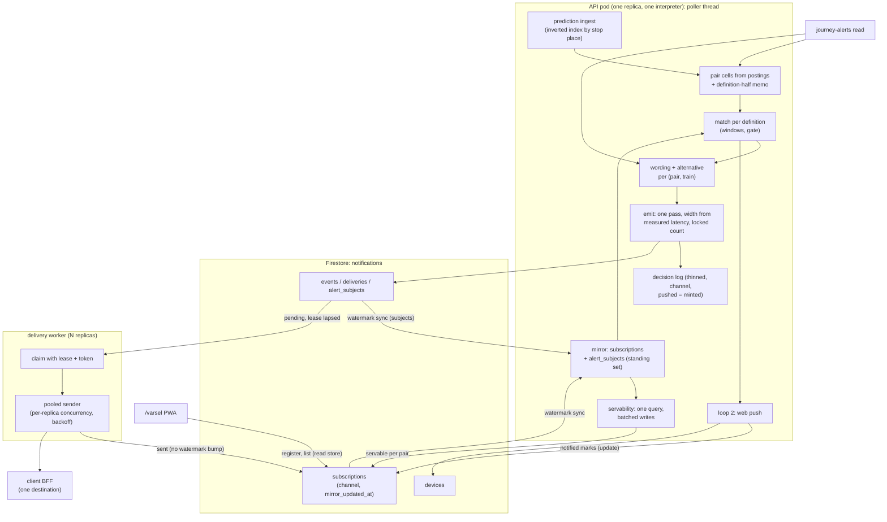
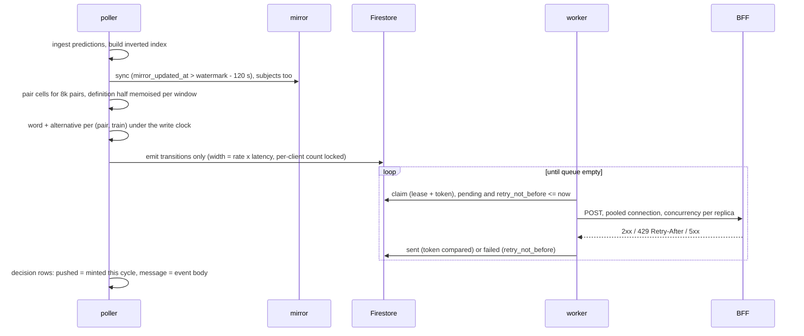

# Scale to 100k Commuters - Plan

## Goal Capsule

- **Objective:** The alerting stack behind `/varsel`, the webhook channel and the journey-alerts read serves 100 000 registered commuters, nearly all of them subscriptions of one credentialed client behind one destination, with the poller cycle still completing inside its ~295 s median period on its heaviest cycles: the late-evening prediction-cache peak and a bad morning.
- **Means:** Make the cycle's cost scale with distinct place pairs and distinct trains instead of registrations, replace the per-cycle full read of subscriptions with a watermark-synced mirror, move webhook delivery into its own Deployment behind a real lease, re-scope every per-destination bound to a per-client quota, and move `/varsel`'s own registrations into the same Firestore store so one mirror and one matcher serve both channels. Score webhook routes in the decision log at a thinned grain.
- **Authority:** This plan's Requirements own product behaviour and its KTDs own mechanism. `docs/operations/notification-webhooks.md` ("Scaling beyond the pilot", the retention table, the published-numbers table) is the operating contract and is edited in the same unit as any constant or clause it states. `CLAUDE.md` governs code, test and deployment conventions. The webhook plan's KTD10 (notification state never in `varsel_decisions` beyond definition grain) and R16 (no client data in routine logs) still bind.
- **Execution profile:** Land the load harness first and gate every later phase on a measurement from it. Every phase ends with a dev measurement recorded in the operations document before the next phase starts. Nothing in this plan is enabled for real users in prd before the privacy dependencies in Risks & Dependencies are answered.
- **Stop conditions:** Do not change the webhook wire contract (one event per POST, Standard Webhooks signing, the event payload). Do not add a second emit writer. Do not write client ids, destinations or callback URLs into `varsel_decisions`, any front-end bundle or any `data/queries` file (the contract test's token ban). Do not add `/notification-api` to `sso.PROTECTED_PREFIXES`. Do not release `firestore.rules` from Terraform. Do not run BigQuery from any test. Do not make `notification_pull` a dependency of `varsel`.
- **Tail ownership:** This repository owns every unit. Team Plattform owns the answer on a second Helm release through `gha-helm`. The product owner and the DPO own the real-user enablement gate.

---

## Product Contract

### Summary

Take the pilot-grade runtime topology to 100 000 commuters without touching the wire contract: an inverted prediction index so matching costs per place pair, wording and alternatives per train, a watermark mirror of subscriptions, delivery in its own Deployment with a lease, per-client quotas in place of per-destination caps, `/varsel` registrations in Firestore as `web_push` subscriptions, and webhook routes scored in the decision log with a channel discriminator.

### Problem Frame

Every ceiling in the stack is a constant sized for one poller thread and a few hundred registrations. The matcher scans every scored call of every situation once per journey definition per window per stop-ref pair, rebuilding two per-situation groupings on every scan (`impact._trip_cells`). prd measures it: 226 definitions cost 10–20 s of the pass from mid-afternoon to 01:00 Oslo, so a client at 500 definitions would cost 25–45 s per cycle. Subscriptions are read in full every cycle, capped at 2 000. Emit is one-wide, and its binding bound is not the 120-event count but a 6 s deadline that reserves 2 s per event, so it stops after about 4 s of claims: roughly 20 created events per cycle at the measured ~200 ms each. Delivery is four-wide and stops after about 9 s of its 20 s deadline, roughly 90 attempts at ~400 ms. Every per-destination bound (500 pending events, 50 attempts per cycle, skip-for-the-pass on the first failure) is a global cap once one client's 100 000 subscriptions share one destination. The create path counts a client's subscriptions by reading them inside a transaction, which is why the ceiling stops at 10 000. Servability asks BigQuery once per create and re-asks four subscriptions per cycle. `/varsel`'s own state is one JSON blob rewritten and uploaded to GCS under the lock the poller needs on every registration.

The operations document records the moves that unblock this, each behind a seam that already exists, and states that none touches the wire contract. Research for this plan found five things that list does not cover: the prediction cache generation moves on every rebuild that reaches it so no lazily filled cache survives a cycle, the per-definition cost after matching is serial Python on the pod's single core, emit binds before delivery does and its input is every matched (subscription, train) rather than the alert-worthy ones, every per-destination constant becomes global under one destination, and the delivery claim is not a lease. Since 2026-09-10 the pages that publish the decision log are behind Entur SSO, so scoring webhook routes is owed work rather than a deferral. The observability work that landed on 2026-09-11 then measured the baseline this plan sizes from (Measured baseline, in the Planning Contract): the heaviest cycle is the late evening, the pass is bound by one Python interpreter, registrations cluster less than first assumed, and the decision log already holds 1.5 GB at 226 definitions. A review against the code on 2026-09-12 then corrected four of the first draft's conclusions, each named where it lands: the emit and delivery ceilings are deadlines rather than counts, the pass cost follows the prediction cache through the day rather than peaking in one band, per-destination backoff already exists in three forms, and Journey Planner lookups are already shared per place pair.

### Requirements

**Capacity**

- R1. At 100 000 subscriptions the poller's non-BigQuery work in a cycle stays under 120 s at the ~295 s median period on both peaks: the late-evening cycle (largest prediction cache, the next morning's windows inside the horizon) and a bad morning. The matcher's cost is proportional to distinct place pairs, and the end-to-end interpreter time per definition fits 120 s divided by the measured count of distinct definitions: 3.4 ms at 35 000 definitions, 1.5 ms at 80 000. On a bad morning the same 120 s also holds the 30 s wording clock and emit's share, which KTD2 bounds at 80 s at the switch-trigger rate, so matching and rows must fit the remainder on that peak; the harness reports the three shares separately.
- R2. A cycle that mints ~21 000 transitions for ~13 000 alerted subscriptions (anchored on the worst morning of the past month: at 07:25 on 2026-09-08, 29 of 226 definitions were alert-worthy on 9 trains, 48 definition-train pairs in one cycle, scaled to 100 000 subscriptions; KTD2's 80 s emit share and the drain bound are stated in transitions) has every event minted inside that cycle and delivered to a destination answering under 0.5 s per POST within 10 minutes of the cycle's start; the drain time is stated as a formula of receiver latency, per-replica concurrency and replica count.
- R3. Subscription state and standing alert state reach the poller through an in-memory mirror synced on a watermark; a full read of either collection happens only at process start.
- R4. A client's active-subscription ceiling is counted by aggregation, and one client can hold 200 000 subscriptions.
- R5. Servability is answered for every pending place pair in one BigQuery query per cycle, the answers are written in batches, and the notification API's create path never asks BigQuery inline.
- R6. The journey-alerts read serves 50 requests per second sustained during the poller's match pass, from figures the pass itself warmed for every registered definition and from the same wording cache the cycle uses.

**Delivery**

- R7. Webhook delivery runs in its own Deployment, and any number of its replicas can drain the queue with at most one duplicate POST per delivery per worker crash.
- R8. Every per-destination ceiling becomes a per-client quota, and a destination that fails or throttles backs off for a stated duration instead of stopping the pass.
- R9. The webhook wire contract is unchanged: one event per POST, Standard Webhooks signature, the existing payload.

**Decision log**

- R10. Webhook routes are recorded in `varsel_decisions` with a channel discriminator and a subscription count, and `/historikk` and `/meldinger` cover both channels.
- R11. Sub-threshold and alert-worthy repeats are thinned by a stated rule that keeps every verdict, first-alert time, maximum probability and lead-time figure the pages compute today.
- R12. Every `/historikk` and `/meldinger` query is bounded by a partition-pruned view and carries a bytes cap derived from the measured thinned log.

**`/varsel` state**

- R13. `/varsel` devices and journeys live in the Firestore store as `web_push` subscriptions plus a device collection, served by the same mirror as webhook subscriptions, and no request-path write serializes or uploads the whole state.
- R14. Registrations move from the GCS blob to Firestore by a re-runnable import that runs only after the blob writer has stopped, and «Slett alt» keeps its semantics: nothing left in the live store, durable or 503, with the backup residual stated in the privacy text.
- R15. A journey registered on the request path is visible to that device's journey list on the next read, before the next poller cycle.

**Operations**

- R16. A load harness registers synthetic subscriptions and reports poller phase timings, CPU seconds and memory per phase, and every capacity claim in this plan is measured with it in dev before prd.
- R17. Every constant that moves is moved with its row in the published-numbers table, and the operations document's "Scaling beyond the pilot" section becomes a status table.
- R18. No routine log line carries a stop ref, an origin or a destination for any subscription; `varsel_service_check` is redacted; per-event and per-attempt webhook log records are aggregated per cycle. The Web Push `event="push"` record per attempt stays, because it is the delivery audit trail and browser delivery is not what scales here.

### Scope Boundaries

- The webhook wire contract, the event payload and the receiver packages under `integrations/` do not change. Batching several events into one POST would cut delivery cost further but is a contract change and stays out.
- Rushvarsel push rounds keep walking browser registrations through the same seam; nothing in this plan changes their policy.
- SSO is in place and is not touched.
- The observability layer landed on 2026-09-11 (#154, #162): the per-phase heartbeat and `/health` staleness, `disruptions/api/metrics.py`, OpenTelemetry tracing and the Grafana rules in `docs/observability/02-alert-rules-2026-09-11.md`. This plan reuses it, declares its own series in `metrics.py` under that module's bounded-label rule, and adds its own rules. It does not rebuild any of it.
- `/impact`'s public response shape is unchanged; it gains the index underneath.
- On a bad morning most first-cycle events carry the template wording. The wording clock (16 workers × 30 s at ~2.2 s per call) bounds model prose to roughly 200 trains per cycle whatever the count ceiling says; this plan accepts that and states it in the operations document rather than trying to raise it.

#### Deferred to Follow-Up Work

- Web-push delivery through the worker's `deliveries` queue (the `web_push` channel delivering from the worker instead of the poller's loop 2). This plan moves `/varsel`'s state, not its delivery; the per-situation `_notified` grain is imported verbatim and stays. Precondition when it comes: `cleanup_subscription`'s batched, non-transactional path must cascade to `web_push` events and deliveries.
- A per-day summary table `/historikk` and `/meldinger` read at scale instead of the groups view over raw rows. The 2026-09-11 measurement reopens this deferral: see the decision-log volume question under Open Questions.
- A per-client reserved tier on the journey-alerts read and the POST-body form of the read (open questions carried from the pull-read plan).
- A model-side change to what counts as alert-worthy; the anchored bad morning (~21 000 transitions for ~13 000 subscriptions in one cycle) is the input this plan sizes for, not a number it tries to lower.

---

## Planning Contract

### Measured baseline (2026-09-11)

Measured after the observability work landed. Phase timings come from `event="poller_cycle"` in prd over 2026-09-04 to 2026-09-11. Container CPU comes from GKE's one-minute samples, traces from Cloud Trace (prd samples 10 %, dev 100 %), row counts from `varsel_decisions`, registrations from the prd state blob, and Firestore timings from dev's `notification_emit` and `webhook_delivery_round` records against `kix-smoke`. Where a number here replaces one in the first draft, the KTD or unit that used it says so.

| Quantity | Measured | Source and n |
|---|---|---|
| Cycle period | p50 295 s, p10 ~125 s, p90 ~350 s | prd, 2 144 cycles |
| Cycle wall | p50 46–65 s and p90 57–77 s depending on time of day; max 260 s | prd, same cycles |
| BigQuery-bound phases | ~45–55 s of each cycle, almost no CPU: the traced wall is `getQueryResults` waits | prd and dev traces |
| `varsel_stops` | 6–7 s every cycle, independent of registrations | prd, same cycles |
| `varsel_notify` | p50 tracks the prediction cache through the weekday: 0.3 s at 04:00 Oslo, 2–3 s in the morning rush, 6 s at 12:00–13:00, 10–13 s from 15:00 to 23:00, 17–20 s at 00:00–01:00; weekend evenings about half; max 52 s | prd, 226 definitions, 2026-09-04 to 09-11 |
| Process CPU per cycle | 20–27 CPU-seconds per cycle on an ordinary weekday evening (2026-09-10, 22:30–01:00 Oslo), 5–13 CPU-seconds per cycle on the busiest morning of the past month (2026-09-08, 06:00–09:30); the sample minute also holds the cache build and `varsel_stops`; never above one core | prd, `kubernetes_io` container CPU, one-minute samples |
| Worst morning in a month | 2026-09-08: 20 alert-worthy trains, 53 pushed rows and 30 SX situations over the morning; the peak cycle at 07:25 matched 59 definitions, of which 29 (13 % of the 226 registered) were alert-worthy on 9 trains, 48 definition-train pairs, 29 pushed rows to 47 devices, 327 decision rows; `varsel_notify` max 17.1 s at a cache of ~300 trips. An ordinary evening cycle matches 84–87 definitions with 0–1 alert-worthy and 1 100–1 500 rows | prd decision log and cycles, 2026-08-12 to 09-11 |
| Prediction cache | 30–70 trips at 04:00–06:00, ~260–310 at 07:00–08:00, ~530 at 15:00, ~930 trips and ~1 100 situations at midnight, reset at 02:00 Oslo when the planned-today tables roll; the no-SX branch scores what ET has published inside −60/+720 min of now, so the size is set by the feed, not by registrations | prd, 2026-09-10 |
| Decision rows per cycle | p50 55–185 through the day; 1 100–1 500 at 22:00–02:00 from ~75 matched definitions; 88–95 % are sub-threshold no-SX subjects | prd, 2026-09-07 to 09-10 |
| Decision log | 1.48 M rows and 1.53 GB, ~1 KB per row; 74 000–93 000 rows a day, ~400 per definition per day | prd table |
| Registrations | 275 journeys on 226 definitions over 160 pairs; 147 device ids, of which 85 have a device record; 39 % of journeys have none | prd blob, 2026-09-11 |
| Process CPU | 0.02–0.08 cores averaged over five minutes; one-minute peaks 0.17 by day and 0.40 at the evening peak | prd, 24 h |
| Memory | 350–435 MiB working set against 2 048 MiB, which common chart 2.x sets as both request and limit | prd, 24 h |
| Event mint | ~170–270 ms per created event, one-wide, including the per-mint pending count (already a `count()` aggregation); observations with nothing standing cost about nothing (620 of them inside a 231 ms pass that created one event) | dev, 6 records with transitions |
| Emit and delivery ceilings today | Emit's `_EmitBudget` refuses a claim when 2 s cannot fit before its 6 s deadline, so ~4 s of claims: ~20 created events per cycle, far under `_MAX_EMITS_PER_CYCLE` 120. Delivery's budget reserves ~11 s under a 20 s deadline: ~9 s of claims, ~90 attempts at ~400 ms, under its 200 count | code (`reserved_budget.py`) and dev timings |
| Delivery attempt | ~400 ms for one attempt through a tunnelled laptop receiver (five in 595 ms four-wide); an empty round 49 ms p50 | dev, ~20 deliveries |
| Pull-read miss | p50 15 ms, p90 55 ms; 2 986 of 3 000 requests in the 2026-09-10 load test missed the figures cache | dev |
| Webhook load | 70–80 ms with no subscriptions in prd, 88 ms p50 with 18 in dev | prd, dev |

Four readings follow, and the KTDs below carry them.

- **The pass cost follows the prediction cache through the day; the late evening is the heaviest ordinary cycle, and a bad morning has not been observed at any scale.** `varsel_notify` p50 rises with the cache from 0.3 s at 04:00 to 10–13 s across the afternoon and evening and 17–20 s after midnight, when the next morning's commuter windows sit inside the 12 h horizon; Friday evenings run 2–3 s against Sunday's 9 s because Saturday morning has no weekday windows, which confirms the mechanism. The morning rush is cheap for matching because the cache is small then, and the busiest morning of the past month (2026-09-08, 17.1 s wall) burned 5–13 CPU-seconds per cycle against 20–27 on an ordinary evening: its wall was the wording clock and lookups, not the interpreter. So the plan carries two peaks that nothing measured can rank against each other at 100 000: the evening for matching and decision rows, and a bad morning for wording, emit and delivery. Every capacity gate names the peak it is measured in.
- **Today's cost per definition is ~65–120 ms of interpreter time at the evening peak.** That is 20–27 CPU-seconds per cycle over 226 definitions, and it is an upper bound: the sample shares its minute with the cache build and `varsel_stops`, and building the decision rows is a candidate for a large share. The pull read's 15 ms per miss is an independent reading of one definition's match at a mid-day cache, and the two agree in order of magnitude. U1's per-phase CPU histogram settles the split.
- **The matcher's cost is a per-definition scan over a network-sized cache.** The inverted index (KTD8) is therefore necessary, and building it is O(~20 000 calls) per cycle.
- **Today's emit and delivery ceilings are deadlines, not counts.** Both passes refuse a claim when their reserved worst case no longer fits, so the published 120 and 200 are unreachable and the real per-cycle throughput is about 20 events and 90 attempts. Widening a pool without moving its deadline changes nothing (KTD2, U9).
- **prd's registrations cluster far less than the first draft assumed.** They run 1.22 journeys per definition and 1.41 definitions per pair, against the ~2.9 and ~4.4 behind "35 000 definitions on 8 000 pairs". prd's registrations are test users rather than commuters, so the plan does not replace its numbers with these. It sizes on a range instead: 35 000 to 80 000 definitions.

A tenth of cycles start about two minutes after the previous one. A cycle longer than that gap delays the next one rather than failing, and the delay adds to the SX-to-notification lag of 1.5–9 minutes measured earlier. `varsel_stops` is a fixed 6–7 s per cycle that does not scale with registrations; reclaiming it is outside this plan.

### Key Technical Decisions

- KTD1. **One subscription per commuter, all behind one destination.** (session-settled: user-approved — chosen over one subscription per route with fan-out in the client's BFF: the API's stated grain; per-commuter windows and caps stay server-side, so the plan solves single-destination delivery and the 10 000 ceiling instead of moving them to the client.) Governs R1, R2, R4, R7, R8.
- KTD2. **Delivery in its own Deployment; emit stays on the poller as one pass, widened.** (session-settled: user-approved — chosen over one pod with a wider asynchronous pool: a bad morning must not compete with the cycle, and `deliveries` is already a queue.) Emit stays because moving it needs a per-cycle handoff artefact and a second mirror in the worker, while the pass already holds what emit needs. What keeps the pending-event ceiling exact is not one thread but one pass: the per-client pending count is read once per pass and decremented under a lock, and the next cycle's emit refuses to start until the previous pool has drained, so an abandoned pool never commits into a later cycle. Emit's input shrinks first: the pass carries one observation per (definition, train) plus recipient ids, the standing state is an in-memory set seeded from `alert_subjects` at start and updated by the poller's own commits, and a transaction is spent only where a lifecycle transition exists. The standing set also removes today's completeness cliff: `_standing` reads at most `MAX_ALERTS_SERVED` (4) subjects per subscription, so a subscription with more standing subjects is never complete and every one of its subjects takes a full transaction every cycle. Switch trigger: the harness shows `deferred` or `capped` above zero on two consecutive cycles, or a measured p50 below 250 emits per second; then emit moves to the worker fed by a per-cycle alert snapshot, as its own plan. **Pool width and deadline move together, and both are derived** (revised 2026-09-12). Today's emit is bound by `_EmitBudget`, which refuses a claim when its 2 s worst case cannot fit before a 6 s deadline, so the pass stops after ~4 s whatever `_MAX_EMITS_PER_CYCLE` says. In dev a created event costs ~170–270 ms one-wide, from six records against `kix-smoke`; that figure includes the per-mint pending count, already a `count()` aggregation, which this KTD replaces with the locked in-memory count. At 200 ms a 16-wide pool gives ~80 emits per second and would fire the switch trigger by construction. The width is therefore the target rate times the measured transaction latency, about 50–64 for 250 per second, capped by the Firestore write ramp (KTD16), and the pass deadline becomes 80 s (20 000 transitions at 250 per second), stated as emit's share of R1's bad-morning budget. A Firestore transaction is not pure socket wait: the body, the protobuf and the commit are interpreter time under KTD17, so the harness measures interpreter ms per transaction too, and at 3 ms each 20 000 transitions are 60 s of the one interpreter, which is the second reason the switch trigger exists. The operations document's 30 s reversal trigger, stated in the `notification_webhooks` phase's ms, is restated for the widened pass in U9. The measurement makes the review's open item on R2's grain more pressing: at 80 per second, 20 000 transitions take about 4 minutes and 60 000–80 000 take 12–17.
- KTD3. **`/varsel` registrations move into the Firestore store as `web_push` subscriptions.** (session-settled: user-directed — chosen over keeping them on the GCS blob at test-bed size: the store already reserves the channel, one mirror then serves both channels, and the blob's whole-state upload under the poller's lock is the defect.) The move is state only; delivery stays in loop 2 (Scope Boundaries). Governs R13, R14, R15.
- KTD4. **Webhook routes are scored at definition grain, thinned, under one subject per definition.** (session-settled: user-approved — chosen over leaving webhook-only routes unscored: at 100 000 commuters "unscored" would be the whole product, and the SSO precondition is met.) The groups view keeps grouping on the definition; `channel` is aggregated onto the subject ('browser', 'webhook' or 'both'), never in the GROUP BY, so a definition shared by both channels stays one matching decision. `pushed` means "a notification was issued on any channel": for a browser subject the push service's acceptance as today, for a webhook subject the event *minted*, read from the pass's own emit ledger on the cycle it happened, with `message` taken from the minted event's stored body so the quoted wording is the one the client received. A delivered mark is not used because it lags the mint by up to two cycles and a retired subject would read «ikke levert» for a delivered event. Prerequisite: today's browser `pushed` is keyed per (definition, situation) while rows are per (definition, situation, departure), so one push marks every train under its situation as pushed; U4 fixes the key before either channel's `pushed` is read as ground truth per train. `n_devices` stays browser-only beside a new `n_subscriptions`; a `both` row can say `pushed` with no browser push behind it, and the two LLM delivery switches can disagree during a rollout, both stated in the column descriptions. Clause 16 of the operations document's retention table (the webhook plan's requirement R19, "client alerts cannot be scored") is rewritten in the same unit. Governs R10, R11.
- KTD5. **The mirror syncs on a dedicated server-stamped watermark field, not a listener.** Chosen over `on_snapshot`: reconnect and resume behaviour of the Python client's watch is undocumented, an open client issue reports the watch thread dying without re-establishing, and a listener attach re-reads the whole collection while a watermark query scales with churn. The watermark field `mirror_updated_at` is `SERVER_TIMESTAMP`, written only by bodies that change what the mirror consumes (definition, status, servable, device tombstone); claims, sent marks and reservations do not touch it, so a bad-morning drain does not re-sync the collection. The query has no equality filter: it runs on the single-field index, tombstones reach the mirror, and `status`, `channel` and liveness are tested in Python. Every sync re-reads from `watermark − 120 s`, sized against transaction commit lag under retries rather than clock skew, and applies by document id idempotently; pages carry a cursor and a per-cycle limit. The startup full read pages outside the 4 s call deadline (`_CALL_DEADLINE_S` bounds gets, streams and aggregations, not transaction commits), and it runs on the poller thread after the port binds, never in `lifespan`. uvicorn binds only after `lifespan` returns, the chart's startup probe allows 300 s, and the BigQuery loads already spend much of that. The read beats the heartbeat once per page so `/health`'s 600 s staleness rule never sees one long phase. Until it completes, the webhook load reports `mirror_not_ready` and emit does nothing. Invariant: a document leaves the store only by TTL after an expiry the mirror tests from the document's own horizons, by a tombstone or an id-only deletion marker visible to the watermark query, or by in-process eviction by the deleter. `alert_subjects` is mirrored the same way for the standing set. Governs R3.
- KTD6. **Per-destination ceilings become per-client quotas, and the first-failure skip becomes a destination backoff.** Backoff is not new: a failed delivery already gets a durable per-delivery `retry_not_before` honouring `Retry-After` up to `RETRY_AFTER_CAP_S` (300 s), a 410 pauses the destination record, and `pending_deliveries` pages past throttled destinations up to `MAX_DELIVERY_SCAN_PER_CYCLE` since 2026-09-10. What this KTD changes is scope and one semantic: `MAX_PENDING_EVENTS_PER_DESTINATION`, `MAX_DELIVERY_ATTEMPTS_PER_DESTINATION_PER_CYCLE` and the pass-local `_Skips` set existed for fairness between clients, and under one destination they are global caps that stop the whole pass on the first failure. They ride on `notification_auth.Quotas` (pending events, deliveries per minute, concurrent deliveries per worker replica), and a 5xx, timeout or 429 sets a per-destination `retry_not_before` on the destination record, so later attempts in the same pass skip it without a pass-local set. The 410 pause is unchanged. Governs R8.
- KTD7. **A delivery lease in the claim body.** `_claim_body` writes `claimed_until = now + LEASE_S` and a claim token, refuses a delivery whose lease has not lapsed, and `_sent_body` and `_failed_body` compare the token so a lapsed holder's late write cannot overwrite a re-claim. Leased rows are filtered in Python on the page, since the query already carries a range on `retry_not_before` and claims are transactional. The body keeps the transaction-suite shape: clock and seed as arguments, read before write, no logging. A worker that dies after a successful POST and before `_sent_body` yields one re-POST; the receiver dedups on `event_id`, which is deterministic over (alert id, revision) with the same stored body bytes. At-least-once is already the published contract, and the same re-POST already happens single-replica when an abandoned attempt thread outlives its wait; the lease bounds it under several replicas rather than introducing it. Today `_claim_body` writes `claimed_at` and nothing reads it; the per-subscription reservation (`RESERVATION_TTL_S`) protects the daily cap, not the delivery, and stays. Per-subscription sharding across replicas rests on the lease, not on the in-process shard map. Governs R7.
- KTD8. **An inverted prediction index built at ingest, not a lazily filled pair cache.** `main.refresh_call_predictions_cache` runs on every rebuild that reaches it and stamps a new generation, so a cache keyed on the generation and filled on demand (which is `notification_pull._figures`' design, and why a pull miss costs a full match) would miss every cycle and cost 8 000 pair scans per cycle. The index `stop_ref → [(situation, (operator, jkey), call)]` is keyed per stop ref, not per place, because `match_journey` expands a place to `place_refs` and asks per pair of refs; it is built in the ingest loop at O(calls) per generation as a fourth `setdefault` beside `by_situation`, `by_key` and `by_jkey_index`, and handed to `impact` with the snapshot; a pair's eligible boarding and alighting calls come from two posting lists, keeping every boarding candidate per (operator, jkey) so `select="nearest"` still works, with `to_stop=None` as its own key. `for_trip` compares the snapshot's own `refreshed_at` and never takes a call from `main`. The definition half (windows, `catchable_after`, gate, worst per line) is memoised per generation on (pair, window tuple, weekday set) with the cycle's `now` injected: `match_journey(now=...)` already exists and the pull read already passes it, only the poller's `_match` leaves it defaulting to the wall clock, so this is one argument on one call site. Today's cost sits in `_trip_cells` rebuilding two per-situation groupings on every scan, once per definition per window per stop-ref pair; `for_trip(situation=...)` already narrows the scan and is unused by `varsel._impact`. The cache is bounded by the network, not by registrations: at most ~930 trips and ~1 100 situations at the midnight peak in prd. Building the index is therefore O(~20 000 calls) per cycle, trivial beside the BigQuery load. The definition-half memo pays only if windows cluster, and prd's test users run 1.22 journeys per definition, so the memo is an optimisation the harness measures and never an assumption inside R1's budget. Governs R1, R6.
- KTD9. **Wordings and alternatives are keyed on (place pair, situation, departure, cancelled, tomorrow, alternative identity, prompt version).** This is the shape `notification_pull._wording_key` already uses; the helper and `varsel._alternative_identity` move to `notification_wording`, a leaf both modules import, so `varsel` never depends on `notification_pull`. It is one key shape over two caches with a read-through order, not one cache: the read never writes poller state. The Journey Planner fetch is already shared across definitions on a pair: `alternatives._cache` keys on (from, to, arrive-by, anchor) with a 10-minute TTL and cross-thread single-flight, so two definitions on one pair spend one lookup today. What this KTD adds is the wording key and the write-budget order; `impact._alternatives_by_situation` keeps its per-train dedup and gains no cache of its own. The write budget is spent per (pair, train), soonest departure first. Governs R1, R6.
- KTD10. **Servability is one query per cycle over the mirror's distinct pending pairs.** A batch form of `_VARSEL_CONNECTIVITY_QUERY` takes `ARRAY<STRUCT<pair_id, from_refs, to_refs>>` joined through UNNEST and answers all pairs at once from the planned tables; answers are written per subscription in batched updates with `last_update_time` preconditions, one round trip per 200, bounded per cycle. The notification API's create path stops asking BigQuery: `servable` is null at create and set by a later cycle, which the contract already tolerates; a fresh 100 000-subscription load settles in about 50 cycles. The browser create path keeps its inline ask. `varsel.recheck_service` gets the per-cycle bound the webhook copy already has. Governs R5, R18.
- KTD11. **The create ceiling is a `count()` aggregation inside the create transaction.** The module already uses `query.count()` for the destination pending count with a stream fallback, so the pattern is established; the remaining stream count is `_create_body`'s. The count runs over `client_id == X AND channel == Y AND expires_at > now` on the composite index. It over-counts a subscription that `subscription_is_live` would retire on one of the two horizon fields, which only refuses a create early, the safe direction; the harness records the gap. `QUOTA_BOUNDS` for `max_active_subscriptions` rises to 200 000. Governs R4.
- KTD12. **`web_push` documents belong to a synthetic `browser` client with their own spec and lifecycle.** The spec validator refuses an empty `client_id` and quotas live on the client document, so `/varsel` becomes a client named `browser` seeded with device and journey quotas only, never a credential and never on `notification_auth`'s limiter path. `SubscriptionSpec` becomes a base of the five definition fields plus `channel`, with a webhook spec adding destination, external ref and test, and a web-push spec adding device id, the typed names and consent version; `validate`, the document builder and `subscription_is_live` dispatch on channel. `web_push` documents carry explicit horizons: lifetime only, refreshed by the device's page visits, with no inactivity horizon, because a commuter who never reopens the app must keep alerting. A device is its own collection (endpoint, keys, brand, created, tombstone reason); a journey document carries the journey fields, its per-situation notified marks (pruned lazily at mark-write time), pushed trains and daily push count, which makes the last two durable across restarts. Marks are written with `update`, never `set`, so a push in flight cannot resurrect an erased journey. Erasure is one transaction that reads the device's journeys inside the body and deletes device, journeys and marks together, then writes an id-only deletion marker with a 24 h TTL so the mirror and any out-of-process reader see the removal; partial failure fails whole and answers 503. The request path reads one device's journeys through an index on `(client_id, channel, device_id)` (R15). Canonicalization of stop refs moves to read time. The typed `from_name`/`to_name` stay browser-only and never reach a webhook event.
- KTD13. **Cutover is a startup import under the store backend, with a scheduled export as the rollback artefact.** `VARSEL_STATE_BACKEND` selects blob or store. The import runs as a startup step of the store-backed binary under the Recreate strategy, so the blob writer has stopped before it reads; it creates by document id and never overwrites, so a re-run cannot clobber marks the store has since accumulated. Every journey is imported, including the 39 % of prd's journeys with no device record (108 of 275 on 2026-09-11), which get a device document with no push subscription. A scheduled export writes the store back into the same single blob object, so rollback loses at most one export interval and an erasure reaches the rollback artefact; the blob is deleted at the end of the one-release window. Invariants: store journey count equals blob journey count; per-journey mark sets equal; every document carries `channel`, `client_id`, `status` and its horizons; stray marks whose journey no longer exists are counted and dropped. `scripts/make_device_report.py` reads the store.
- KTD14. **The outbound sender keeps a connection pool to the validated address.** Today every attempt resolves, validates and handshakes; at 20 000 events to one host that is the cost. The pool dials the validated literal with the original SNI and Host, re-resolves and re-validates on a TTL, and keeps the positive address test on every resolve. The destination record is cached for 60 s like the account lookup (today it is read from the store on every attempt, with only a pass-local copy in `_Skips`), so an attempt costs the claim, the event read, the POST and the sent write. Governs R2.
- KTD15. **Thinning rule.** A subject's row is written when the subject is first seen, on every alert-worthy/sub-threshold transition, on a new maximum impact probability, when a push is accepted or an event minted, when the subject retires (its situation ends in the stale sweep, or its train leaves the match because it can no longer be caught), and otherwise at most once per 15 minutes. `first_alert_at`, `et_cancelled`, `max_impact_probability`, `final_*` and the pushed wording keep their meaning because the rows they read are all kept and the closing row carries the last scored figures; `n_decisions` changes meaning and its description says so. Measured on 2026-09-11, 88–95 % of today's rows are sub-threshold no-SX subjects, and the late-evening cycles carry 1 100–1 500 rows from ~75 matched definitions. Thinning therefore acts almost entirely on no-SX repeats. It overrides a stated design intent: the `decisions` module docstring and the DDL header both say repeats across cycles are the point, the lead-time series, and the groups view's `n_decisions`, `first_decided_at`, `final_*` and the `et_cancelled` first-alerting-cycle pick all assume every cycle is present; U4 rewrites those statements with the rule. The ledger is its own structure, not an extension of `_message_meta`, which `_forget_message` drops the tick a subject eases below the gate, exactly when the rule needs the prior state. Whether a 15-minute interval is enough at 100 000 is the decision-log volume question under Open Questions. Governs R11.
- KTD16. **Single-field index exemptions on the write-heavy fields.** Every field auto-indexes today and `fieldOverrides` is empty, so each event write indexes the `payload` map and the `situations` array, and each delivered mark on a subscription mints a new indexed field path. `google_firestore_field` resources with an empty `index_config {}` exempt `payload`, `situations`, `delivered`, `daily_deliveries`, `daily_reservations` and the notified marks: an empty block is Firestore's exemption, which `terraform/firestore.tf`'s header calls a trap because on a TTL field it would also drop the TTL's index. Two tests pin today's shape and move with the unit: the one asserting `index_config {}` is absent from the Terraform, and `test_field_overrides_stay_empty_so_ttl_has_one_source_of_truth`. The harness measures write amplification with and without. Governs R2.
- KTD17. **The per-definition budget is interpreter time in one CPython process that the request path shares; the CPU request stays at 1.0.** (Revised 2026-09-11. The first draft raised the request to 2.0 as capacity.) The container runs one CPython 3.13 interpreter with the GIL. Under common chart 2.1.0 the pod has a CPU request and no CPU limit, so it can already burst when the node has room. Measured, the process never averages more than 0.4 cores over a minute, and the BigQuery phases burn almost nothing. Neither a larger request nor wider pools therefore buys Python throughput: pools buy wall clock only for socket waits, and a second core helps only code that releases the GIL. Everything after the index lookup (response models, message input, decision rows, subjects) is serial Python, and the request path, including R6's pull read, draws on the same interpreter. 120 s over 35 000–80 000 definitions is 3.4–1.5 ms per definition all-in, against ~65–120 ms today at the evening peak (Measured baseline). The plan measures interpreter time per definition with a profiler and a per-phase CPU histogram, builds the message input once per (pair, train) rather than per (definition, alert), and derives per-definition alerts from pair-level results. If the profiler shows the budget out of reach in one interpreter, the lever is a second process, splitting the poller from the API as its own plan, not a larger request; that plan must also change `/health`, which reports an API pod with no poller thread as healthy, and the CD smoke that relies on it. The measurement supports the review's open item asking for a per-phase ceilings table under R1. Governs R1, R6.
- KTD18. **The delivery worker is a second Helm release of the same chart, not an aliased second dependency.** (Added 2026-09-12.) Both routes are one-line changes in `cd.yml`: gha-helm's `deploy.yml` takes `release_name` and `values` for a second release, and `image_set_path` ("override when using aliased common chart dependencies") for an alias. The alias was rejected because `helm upgrade --wait` is release-wide, so a worker that never reaches Ready rolls back the API with it; because the four `required` values and the configmap would be repeated under `worker:` in every environment file; and because the chart's unprefixed `define`s register twice under two aliases. A second release named `kix-avvik-worker` renders its own Deployment, ConfigMap, PDB and VPA from the same chart with its own values file, which sets `container.args` (the distroless entrypoint is the interpreter, so args alone re-purpose the image; the chart renders `command` raw and it is avoided), `service.enabled: false`, `ingress.enabled: false`, probes on the worker's own health port (the chart's default tcpSocket startup probe on 8080 would kill it at 300 s), and a secret group holding only what delivery needs. The Team Plattform question shrinks to the service account. Governs R7.

### High-Level Technical Design

Runtime topology after the plan. The poller keeps one writer for emit and for the decision log; the worker is horizontally scalable.

Bad-morning sequence, with the bounds each step carries.

### Sequencing

Five phases, each opened by a harness measurement recorded in the operations document.

| Phase | Units | Gate that opens the next phase |
|---|---|---|
| A. Cycle affordability | U1, U2, U3, U4 | Harness at 10 000 definitions in the late-evening cache state, at two ratios (2 000 pairs, and prd's 1.41 definitions per pair): non-BigQuery cycle work under 60 s, interpreter time per definition within R1's budget at each ratio (profiler and per-phase CPU histogram), matcher phase proportional to pairs |
| B. Store at scale | U5, U6, U7, U8, U9, U10 | Harness at 100 000 subscriptions: mirror sync under 10 s on the cycle after a 20 000-delivery drain; 20 000 transitions emitted inside the cycle at p50 ≥ 250 emits per second, with the pool width derived from the measured transaction latency; servability for 8 000 pairs in one query with the writes batched |
| C. Worker | U11 | Worker drains 20 000 deliveries to a local receiver at 0.2 s per POST inside 4 minutes and reports the 2 s-per-POST case against the R2 formula; a slow receiver backs off without stalling the poller |
| D. `/varsel` on Firestore | U12, U13, U14 | Dev cutover with the device report byte-equal before and after import; «Slett alt» leaves nothing in the live store; an imported journey survives one mirror liveness pass |
| E. Read path and scoring | U15, U16 | Pull read at 50 rps during pass 1a on the real process with no poller-state write; `/historikk` shows a webhook-only definition with a verdict in dev |

Phase B's units U7 and U8 are independent of each other after U6; U9 depends on U6 and U7. Phase D depends on U5 and U6 only. U16 depends on U4, U6, U9 and U13 because the channel discriminator derives from the unified recipient view and `pushed` for a webhook subject reads U9's per-cycle emit ledger.

### Open Questions

**Resolved during planning**

- Emit placement: on the poller as one pass, widened (KTD2), with a rate-based switch trigger.
- Mirror mechanism: watermark query on a dedicated server-stamped field, no equality filter (KTD5).
- Groups view and `channel`: aggregated onto one subject per definition; `pushed` for webhook means minted (KTD4).
- Erasure for `web_push`: transactional hard delete plus an id-only deletion marker, not tombstone-and-redact (KTD12).
- Pair cache: an inverted index at ingest, not a lazily filled cache (KTD8).
- CPU request: stays at 1.0; the budget is interpreter time in one process (KTD17, revised after the 2026-09-11 measurement).
- Worker topology: a second Helm release of the same chart, not an aliased dependency (KTD18, 2026-09-12).
- Emit and delivery bounds: the deadlines are the real ceilings today, so U9 moves the deadline with the width (KTD2, 2026-09-12).

**Needs a decision (raised by the 2026-09-11 measurement)**

- **Decision-log volume at 100 000.** Measured today: ~400 rows per definition per day at ~1 KB each, 88–95 % of them sub-threshold no-SX subjects. At 35 000–80 000 definitions that is 14–32 M rows and 14–33 GB a day before thinning. KTD15's 15-minute interval cuts repeats by at most about three times, which leaves 5–11 GB a day and a 14-day `/historikk` window of ~70–150 GB per request. R12's bytes cap would then refuse the pages. Options: (a) bring the deferred per-day summary table into this plan, so the pages read aggregates; (b) thin sub-threshold no-SX subjects to first-seen, new-maximum and closing rows only, which keeps recall's denominator and drops the lead-time series for those subjects; (c) both. Recommendation: (c), with (b) in U4 because it is a rule and a constant, and (a) as a follow-on unit gated on U4's measured thinning ratio, which nobody knows yet. The `/meldinger` 2 GiB `maximum_bytes_billed` is now about 1.3 times the whole table, against about 11 times on 2026-08-21; its partition cover keeps real queries far below it.

**Carried from the 2026-09-12 document review (proposed, not applied)**

The headless `ce-doc-review` applied two fixes in place (U16's dependency on U9; R2 restated in
transitions). Everything below was *proposed* and left for the implementer: section, the claim, and
the change, with the reviewer's confidence. Nothing here is settled — a unit that reaches one of
these should resolve it there rather than assume the plan text is already right.

P1:

- **U1 / Phase B gate — the harness cannot reach 100 000 subscriptions through the API before U7** (100). The create path counts by reading inside its transaction and the per-client rate quota tops out at 10 000/min, so U6's verification is unrunnable as sequenced. Seed documents directly through the store's document builder above the API ceiling, keep API creation as a bounded mode, and say so in the gate.
- **U14 / KTD13 — the startup import resurrects registrations erased after the last export** (100). The import runs at every startup and creates by id without deleting while the export keeps rewriting the blob; dev restarts on every push. Make the import one-shot behind a store marker, run the export only while the store backend is active, and make re-import after a rollback an explicit operator command that honours deletion markers.
- **U4 step 3 / R12 — a BigQuery view cannot carry the request window's pruning bound** (75). Views take no parameters and four readers use different windows, so the pages still scan up to 180 days. Replace the in-view bound with a table function taking the window's dates (`varsel_decision_groups_between`), called by the three historikk queries and the labelling job; keep the view as its windowless wrapper.
- **U1 / U11 — the harness receiver cannot pass the sender's address, scheme and port checks** (75). The sender requires https, port 443 and a globally routable resolved address on every attempt, so the first harness run has every delivery refused and the tempting fix is a bypass the sender runs in prd. Expose the receiver on a public https:443 hostname and pin by test that no switch bypasses the validation.
- **U7 / KTD6 — the new quotas have no bounds entries and default to the per-destination caps** (75). The quota validator and reader iterate `QUOTA_BOUNDS`, so an unlisted field is never read back; "defaults equal today's constants" also keeps 500 pending events as the single client's cap. Add bounded pairs for the three new quotas, size the defaults for the single-client workload, and publish them.
- **U12 / KTD12 — nothing refuses a credential for the `browser` client** (75). Credential issuance checks only that the account exists and the per-client ceiling, so one operator command mints a bearer reaching every `/varsel` journey through the client-scoped routes. Reserve the id in issuance and authentication, seed it uncredentialed, and test the refusal.
- **U3 / KTD9 — pair-keyed wording leaves the logging policy unstated** (75). The policy is chosen per definition today and the new key names no definition, so a webhook-only route's origin and destination can land in dev's prompt log. Run the shared call under the webhook policy unless a browser registration on the pair is pending for that train, and test that no prompt record is emitted.
- **R11, R12 / KTD15 — the 15-minute thinning rule leaves R12 unsatisfiable** (75). The plan's own arithmetic under Open Questions: U4 would derive caps from a 5–11 GB-a-day log and `/historikk`'s window is refused by the cap R12 requires. Write option (b) into R11 and KTD15 now, defer the summary table gated on U4's measured ratio, and close the decision above.
- **Goal Capsule / Risks — the privacy answers gate all value but have no start date** (75). Implementation is not gated on the DPO and controller questions; real-user enablement is, so sixteen units can land and serve nobody. Raise them in Phase A beside U1, with the client's ramp numbers.
- **R1 / Objective — cycle work is bounded on the median period, notification lag is not** (75). 120 s of work plus ~50 s of BigQuery exceeds the p10 period and an overrun only delays the next cycle, so a gate can pass while a bad morning tells travellers later than today. Add R1a bounding SX-to-notification lag on the bad-morning shape to the measured 1.5–9 min baseline.

P2:

- **U7 / U8 — destination backoff is invisible through the 60 s destination cache** (75). The plan removes the pass-local skip that gives this visibility today, so a second replica keeps posting to a throttled receiver until its cache expires. Write through to the local cache on the backoff write and state the cross-replica lag in the runbook.
- **U2 step 2 / KTD8 — the definition memo carries the catchable cut but not the clock** (75). The pull read and the journey list pass their own clock, so the memo is either keyed on the clock and never shared or shows a departed train as catchable for up to a cycle. Memoise windows, gate and worst-per-line only; apply the catchable cut per call over the memo's short list.
- **KTD6 / U7 — the backoff base is unstated and the drain time depends on it** (75). R8 promises "a stated duration" while a receiver with a sporadic error rate pauses all 20 000 deliveries for an unstated time, outside the drain formula. State the initial backoff, pause a destination only after consecutive failures, and add error rate and base to the formula.
- **KTD7 / U8 — the ~15 s lease is under the attempt's real worst case** (75). The store's 4 s call deadline does not bound transaction commits, so a live worker under store pressure loses its lease mid-POST and a second replica duplicates with nothing having crashed. Derive the lease from the POST timeout, three store deadlines, the handshake and a margin, and count live lapses in the harness.
- **R6 / U15 — R6 is stated on registered definitions while the load is misses** (75). U15 itself says the app's favourites are mostly not registrations, so the gate measures the case that does not occur. Restate R6 on the miss path with a named share of the interpreter budget.
- **Scope Boundaries — no rule says which trains get model prose on a bad morning** (75). The bound is accepted and published; who it falls on is not decided, so the wording clock can be spent on trains with a handful of recipients. Spend it in descending subscriptions per (pair, train), soonest departure as tie-break.
- **Goal Capsule Means / Summary — the contract omits the emit widening the decisions carry** (75). KTD2 and U9 carry it and the summary does not, so a reader of the contract alone concludes the emit bottleneck is unaddressed. Name the widened, deadline-derived emit pass in Means and Summary.
- **KTD5 / U6 — no maximum mirror age below the deletion marker's 24 h TTL** (75). U6 keeps the previous mirror on failure and only alerts on age, so a sync outage longer than a day loses deletions for good and the poller keeps alerting revoked recipients. Force a full re-read when the watermark age exceeds a bound under 24 h, and hold emit until it completes.
- **U1 — spans have no data-redaction rule** (75). The redaction requirement covers log lines only, so sub-pass spans become a second store of stop refs, endpoints or prompt text for trace readers. Permit only bounded names, counts and timings as span attributes, under the metrics module's bounded-label rule.

Decisions the review raised (user judgment, recommendation *defer*):

- **Problem Frame — the demand source and ramp for 100 000 are unstated.** Every requirement is sized from the figure and the app team has not been asked, so there is no cut line if the first pilot is 2 000 commuters. A demand paragraph naming who committed to the figure and the ramp, with each phase gate tied to a ramp step.
- **R2 / Measured baseline — the bad-morning fraction comes from the test-user population.** The baseline itself declines to size clustering from this population, so a corridor closure over real commuter windows could alert several times 13 % and the switch trigger fires in prd instead of the harness. Run the synthetic morning at the anchored fraction *and* a corridor-closure fraction chosen with the product owner.
- **Scope Boundaries — the wire-contract freeze protects a contract with no external consumer yet.** The only client is the smoke client and the receivers are vendored from this repo, so batching — the cheapest delivery lever — is forgone without the owner choosing to. A dated decision point with the app team before their BFF integration is fixed.

FYI, recorded without a recommendation: Phase D is serialised behind Phase C with no dependency between them; the operating commitment to the app audience (availability, on-call) is unstated; per-cycle log aggregation leaves the client-facing delivery trail only in expiring documents; the destination cache TTL delays pause, move and rotate per replica and should be published; the export blob's scope and end of life are unstated; public `/varsel-api` writes become billed transactions with no per-minute ceiling; the harness bearer's source and revocation are unstated; the worker environment assertion should also exclude the auth pepper; Phase C's drain gate fails its own formula at one replica; replicas claim from one identically ordered page; dropping emit's subscription read weakens the deletion guarantee by one cycle; partition expiration needs an ALTER beside a saturated BEST-EFFORT section; a managed internal queue was never weighed against the Firestore lease; the harness envelope should name an upper-uniqueness case beside the two ratios; the worker's identity and secret scope remain open.

Residual concerns the review could not close: the 20–80× per-definition reduction R1 needs has no measurement showing it is reachable in one interpreter; whether `bq --parameter` can express the batched servability query's struct array is unverified; after a 20 000-transition morning the next subject sync re-reads what the standing set holds; the chart gives a second release the `application` service account by default. Also open: whether `deliveries_per_minute` is enforced per replica or client-global, and whether deleting a single web-push journey tombstones or hard-deletes with a marker.

**Deferred to implementation**

- The app team's peak read rate and favourites per stop pair (carried from the pull-read plan). U15 sizes for 50 rps and warms every registered definition until the number arrives.
- Whether the worker reuses the application service account or needs its own. Team Plattform question. The Helm and workflow shape is answered (KTD18): a second release through gha-helm's `release_name` and `values` inputs.
- Distinct definitions per 100 000 subscriptions. The first draft's 35 000 assumes window clustering that prd's test users do not show (1.22 journeys per definition). The app's window granularity decides it: free minutes, or a picker rounded to 15 minutes. Ask the app team together with the peak read rate. Until the answer arrives, the harness runs both ratios and R1 is sized on 35 000–80 000.
- The exact per-replica concurrency the BFF can take. U7 ships 32 as the default quota and the runbook's onboarding step sets it with the client.
- Whether the 15-minute thinning interval keeps `/meldinger`'s replay useful for the lead-time sweep; measure on dev after U4 and adjust the constant.
- Whether the `web_push` lifetime horizon needs a value other than the webhook 180 days; the privacy text in U14 states whichever is chosen.

---

## Implementation Units

### Unit Index

| U-ID | Title | Key files | Depends on |
|---|---|---|---|
| U1 | Load harness and cycle benchmark | `scripts/loadgen_subscriptions.py`, `scripts/bench_cycle.py`, `docs/operations/notification-webhooks.md` | — |
| U2 | Inverted prediction index and per-definition CPU budget | `disruptions/api/impact.py`, `disruptions/api/main.py`, `disruptions/api/varsel.py`, `disruptions/api/test_impact.py` | U1 |
| U3 | Wording and alternatives keyed per (pair, train) | `disruptions/api/notification_wording.py`, `disruptions/api/varsel.py`, `disruptions/api/notification_pull.py`, `disruptions/api/test_varsel_api.py` | U2 |
| U4 | Decision log: chunked writes, thinning, pruned view, bytes caps | `disruptions/api/decisions.py`, `disruptions/api/varsel.py`, `disruptions/api/historikk.py`, `disruptions/api/meldinger.py`, `disruptions/api/create_varsel_decisions.sql` | U1 |
| U5 | `channel` in the load path and its index | `disruptions/api/notification_store.py`, `disruptions/api/varsel.py`, `firestore.indexes.json`, `terraform/firestore.tf` | — |
| U6 | Subscription and subject mirror on a watermark | `disruptions/api/notification_store.py`, `disruptions/api/varsel.py`, `disruptions/api/notification_servability.py` | U5 |
| U7 | Per-client quotas, aggregation ceiling, backoff | `disruptions/api/notification_auth.py`, `disruptions/api/notification_store.py`, `disruptions/api/notification_events.py`, `disruptions/api/webhook_delivery.py` | U6 |
| U8 | Delivery lease and pooled sender | `disruptions/api/notification_store.py`, `disruptions/api/webhook_delivery.py`, `disruptions/api/webhook_sender.py` | U6 |
| U9 | Emit as one widened pass with index exemptions | `disruptions/api/notification_events.py`, `disruptions/api/notification_store.py`, `disruptions/api/varsel.py`, `terraform/firestore.tf` | U6, U7 |
| U10 | Servability in one query; bounded recheck; redacted and aggregated logs | `disruptions/api/main.py`, `disruptions/api/notification_servability.py`, `disruptions/api/notification_api.py`, `disruptions/api/varsel.py` | U6 |
| U11 | Delivery worker Deployment | `disruptions/api/webhook_worker.py`, `helm/kix-avvik/`, `.github/workflows/cd.yml`, `disruptions/api/main.py` | U7, U8 |
| U12 | Store shapes for `web_push` and devices | `disruptions/api/notification_store.py`, `disruptions/api/notification_auth.py`, `firestore.indexes.json`, `terraform/firestore.tf` | U5 |
| U13 | `/varsel` registration seam over the store | `disruptions/api/varsel_state.py`, `disruptions/api/varsel.py`, `disruptions/api/togvarsel_notify.py`, `disruptions/api/main.py` | U6, U12 |
| U14 | Cutover: startup import, export, switch, report, runbook | `scripts/export_varsel_state.py`, `scripts/make_device_report.py`, `helm/kix-avvik/env/`, `demo/avviksvarsel/src/personvern.ts` | U13 |
| U15 | Journey-alerts read at scale | `disruptions/api/notification_pull.py`, `disruptions/api/varsel.py`, `disruptions/api/test_notification_pull.py` | U2, U3 |
| U16 | Webhook routes in the decision log | `disruptions/api/varsel.py`, `disruptions/api/decisions.py`, `disruptions/api/create_varsel_decisions.sql`, `data/queries/label_varsel_decisions.sql` | U4, U6, U9, U13 |

### U1. Load harness and cycle benchmark

**Goal:** A repeatable way to put N synthetic subscriptions and M synthetic browser registrations into dev and read the poller's phase timings, CPU seconds and memory back, so every later unit's claim is a number.

**Requirements:** R16, R17.

**Dependencies:** none.

**Files:** create `scripts/loadgen_subscriptions.py`, `scripts/bench_cycle.py`, `scripts/test_loadgen.py`; modify `disruptions/api/main.py` (CPU seconds and RSS on `poller_phase`), `disruptions/api/metrics.py` (the per-phase CPU histogram, wider cycle buckets), `disruptions/api/varsel.py` and `disruptions/api/notification_store.py` (sub-pass and store spans), `disruptions/api/test_domain_metrics.py`, `disruptions/api/test_tracing_setup.py`, `docs/operations/notification-webhooks.md` (a "Capacity measurements" table under "Scaling beyond the pilot").

**Approach:**
1. The generator creates subscriptions through `POST /notification-api/v1/subscriptions` as a dedicated `loadtest` client (operator tool `create-client`), drawing pairs from the picker's stop list weighted by call count so the pair distribution resembles real commutes, with `--pairs`, `--count` and a window distribution that clusters on a few commuter windows, and a `--destination` pointing at a local receiver whose latency is configurable (0.2 s and 2 s).
2. Browser registrations go through `/varsel-api` with generated device ids and no push subscription, in the shape `scripts/make_device_report.py` reads.
3. `main._phase` reports process CPU seconds and RSS delta beside `ms` and observes the CPU into a new `kix_poller_phase_cpu_seconds{phase}` histogram declared in `metrics.py` (the `phase` label is the existing fixed vocabulary). The emit pass additionally reports interpreter ms per transaction (KTD2). `kix_poller_cycle_duration_seconds` gains 600 and 900 s buckets so a harness cycle past the median period is not a bare +Inf. The benchmark reads `poller_cycle` and `poller_phase` events from Cloud Logging in the cluster project (`gcloud logging read` or Kompass `read_logs` with `jsonPayload.event="poller_cycle"`). The `kix_*` series live in Thanos behind Grafana and are not in Google Managed Prometheus, checked on 2026-09-11, so a script cannot read them the same way. It prints per-phase p50/max wall, CPU and RSS beside the registration counts. A `--profile` mode runs one cycle under a profiler locally against a stubbed prediction cache and reports interpreter ms per definition.
4. Sub-pass spans. `check_and_notify`'s passes 1a, 1b and 1c, loop 2 and the decision-row build each open a child span through a `span` callable handed in by `varsel.configure` (`varsel` cannot import `main` or `tracing_setup`'s app wiring). The pools propagate context with `opentelemetry-instrumentation-threading` (not in `requirements.txt` today), so worker spans (Journey Planner, Vertex, pushes) join the cycle's trace instead of becoming independently sampled roots; `_phase` already opens a child span of `poller_cycle`. `notification_store._run_transaction` and the stream helper open one span per Firestore call. Today `varsel_notify` shows no child but the final insert, and the webhook phase shows none, so dev's 100 % sampled traces cannot yet say where a pass spends its time.
5. Two load shapes and two ratios. The evening shape runs the live dev harness at 22:00–01:00 Oslo, when the cache is at its daily maximum, and `--capture-cache` saves that hour's `call_predictions_today` rows for the local profile. The morning shape is a synthetic bad-morning snapshot with many alert-worthy trains. `--ratio plan|prd` picks the journeys-per-definition and definitions-per-pair ratios: the first draft's, or prd's measured 1.22 and 1.41.
6. Rows the table carries per run, each tagged with its shape and ratio: wall/CPU/RSS per phase, per-sub-pass wall from the trace, emits per second and Firestore round-trip p50, delivery drain time per receiver latency, mirror documents and bytes per sync, `/historikk` scanned bytes, figures-cache hit rate during pass 1a, Journey Planner lookups wanted versus spent, index write amplification, log lines per cycle.
7. Teardown deletes the `loadtest` client's subscriptions and the synthetic devices; the script refuses to run against prd.

**Patterns to follow:** `scripts/manage_notification_client.py` for the operator-tool shape; `scripts/make_device_report.py` for reading state; the Kompass filter recorded in memory (`jsonPayload.event`, not `jsonPayload.fields.event`).

**Test scenarios:**
- Given `--count 1000 --pairs 200`, the generator produces 1 000 definitions over exactly 200 distinct canonical pairs with windows drawn from the configured cluster.
- Given a project id ending in `-prd`, the generator exits non-zero before any request.
- Given a receiver configured at 2 s per POST answering 429 with `Retry-After: 30`, the local receiver records both and the benchmark reports them beside the phase timings.
- Given a log window with two cycles, the benchmark prints one row per phase with p50 and max wall, CPU and RSS.
- Given the profile mode over 1 000 stub definitions, the report lists CPU ms per definition and the top five functions by self time.
- Given a phase that runs, `kix_poller_phase_cpu_seconds_count{phase}` increments once and the observed value is not negative.
- Given tracing on and a 16-wide match pool, every worker span carries the cycle's trace id and has the pass span as an ancestor.
- Given `--ratio prd --count 1000`, the generator produces ~820 definitions over ~580 pairs.

**Verification:** A dev run at 1 000 subscriptions in the evening shape produces a measurements row with `varsel_notify`, `notification_webhooks` and `varsel_webhook_load` wall and CPU, a dev trace shows the sub-pass spans under `varsel_notify`, and teardown returns the client to zero subscriptions.

### U2. Inverted prediction index and per-definition CPU budget

**Goal:** Matching costs per place pair per generation, and the serial work after matching fits R1's interpreter budget per definition: 3.4 ms at the first draft's ratio, 1.5 ms at prd's.

**Requirements:** R1, R6. KTD8, KTD17.

**Dependencies:** U1.

**Files:** modify `disruptions/api/impact.py`, `disruptions/api/main.py`, `disruptions/api/varsel.py`, `disruptions/api/test_impact.py`, `disruptions/api/test_varsel_api.py`; create `scripts/bench_matcher.py`.

**Approach:**
1. `refresh_call_predictions_cache`'s ingest loop builds `by_stop_ref: {stop_ref: [(situation, (operator, jkey), call)]}` as a fourth `setdefault` beside `by_situation`, `by_key` and `by_jkey_index` (the last two serve only the alternatives scoring today) and hands it to `impact.configure`'s snapshot with `refreshed_at`. Keyed per stop ref, because `match_journey` asks per pair of `place_refs`.
2. `_trip_cells` splits: the pair half derives eligible (boarding candidates, alighting call) per (situation, (operator, jkey)) from the two posting lists, keeping every boarding candidate so `select="nearest"` works and treating `to_stop=None` as its own key; the definition half applies window bounds, `catchable_after`, the gate and worst-per-line. Both are memoised per generation in `impact` under their own lock: the pair half on (from ref, to ref), the definition half on (pair, window tuple, weekday set) with the cycle's `now` passed in by `check_and_notify` and `list_journeys`. `match_journey(now=...)` exists and `notification_pull` already passes it; `_match` in `check_and_notify` computes `cycle_now` and does not, which is the one call site to change.
3. `for_trip` compares the snapshot's `refreshed_at` and drops both memos on a change (a rebuild that raises before the cache step leaves the generation unchanged, which the compare handles); `main` never calls into `impact`'s cache.
4. `check_and_notify` derives per-definition alerts from the memoised definition half, builds `message_input` once per (pair, train) and reuses it across definitions, and stops materialising an `ImpactResponse` per (definition, situation) where the pair result already carries it.
5. `scripts/bench_matcher.py` builds a synthetic snapshot at the measured late-evening maximum (~930 trips, ~1 100 situations) or loads one U1 captured, and profiles the pass over 20 000 definitions twice: on 4 000 pairs with 50 distinct windows, and at prd's ratios. It reports interpreter ms per definition for each.
6. The pass beats the heartbeat once per chunk of definitions through a `beat` callable on `varsel.configure` (today `varsel_notify` is one `_phase` and beats only at its end), so a pass slowed by an unforeseen cost cannot trip `/health`'s 600 s staleness and restart the pod.

**Patterns to follow:** `_impact_snapshot`'s generation swap under `_call_pred_lock`; the ingest loop's existing `by_jkey_index` build for the O(calls) shape.

**Test scenarios:**
- Given two definitions on one pair with different windows, both results equal the pre-change `for_trip` output byte for byte.
- Given a snapshot with a new `refreshed_at`, the next `for_trip` on a memoised pair recomputes and the stale memo is gone.
- Given a `NO_ALIGHTING` call at `to_stop`, the pair half excludes that train exactly as today (pin with the existing boarding/alighting cases).
- Given `select="nearest"` with an `at` between two boarding candidates, the nearer one wins, as before the split.
- Given a `catchable_after` that drops the boarding call, the definition half drops the train while the pair memo still holds it.
- Given 200 definitions sharing one (pair, window, weekday set), the definition half is computed once.
- Given concurrent `for_trip` calls from three threads on one pair, the memo is built once and every result is correct.
- Given a pass slowed past the staleness threshold in a test, `/health` stays 200 because the pass beats per chunk.
- Integration: `varsel.match_journey` over collapsed refs (`place_refs` pairs) produces the same alerts and the same alternative back-fill as before.

**Verification:** The benchmark shows interpreter time within R1's budget at both ratios and the pass over 20 000 definitions under 60 s where the uncached pass takes minutes. After deploy, prd's late-evening `varsel_notify` is compared for the week before and after from `poller_cycle` (today p50 ~15 s at 23:00 Oslo).

### U3. Wording and alternatives keyed per (pair, train)

**Goal:** One wording and one alternative lookup per disrupted train per place pair, shared by the cycle, the card and the pull read.

**Requirements:** R1, R6. KTD9.

**Dependencies:** U2.

**Files:** modify `disruptions/api/notification_wording.py`, `disruptions/api/varsel.py`, `disruptions/api/notification_pull.py`, `disruptions/api/impact.py`, `disruptions/api/test_notification_wording.py`, `disruptions/api/test_varsel_api.py`, `disruptions/api/test_notification_pull.py`, `docs/operations/notification-webhooks.md`.

**Approach:**
1. `notification_pull._wording_key` and `varsel._alternative_identity` move to `notification_wording`; both `varsel` and `notification_pull` import them there.
2. `varsel._message_key` adopts the shape; `_messages`, `_alternatives`, `_message_attempts`, `_message_errors`, `_message_meta` move to the new key; the stale sweep, `_reconcile_caches`, `_journey_model`, `_record_decisions`' `message_llm` fill, `cached_wording_and_alternative` and `_subjects_for_key` read through it; `_reset_state` keeps every ledger listed.
3. The Journey Planner fetch is already shared per pair: `alternatives._cache` keys on (from, to, arrive-by, anchor), with a 10-minute TTL and single-flight across the match workers. This unit pins that with a test rather than adding a memo, and makes the poller's per-cycle fetch budget rotate per (pair, train) so a budget-capped train is the same train for every definition on the pair.
4. Pass 1b builds the write queue per (pair, train), soonest departure first across pairs; `_MAX_MESSAGES_PER_JOURNEY` becomes per pair; `_pending_pushes` decides whether any registration on the pair still needs the train.
5. The operations document states the bad-morning outcome: the wording clock bounds model prose to ~200 trains per cycle and the rest carry the template.

**Patterns to follow:** `notification_pull._wording_key`; the 2026-08-21 "wording per train" change's `_pending_pushes` reasoning.

**Test scenarios:**
- Given two definitions on one pair with different windows alerting on the same train, one backend call is made and both cards show identical text.
- Given the same train on two different pairs, two wordings are written.
- Given `PROMPT_VERSION` changes, the cache misses.
- Given a pull read for a pair the cycle worded, the read serves the cycle's wording with no enrichment call and writes nothing into `varsel`'s caches.
- Given a rejected reply, `_message_attempts` charges the (pair, train) key and a second definition on the pair does not re-ask.
- Given five definitions on one pair with the same disrupted train, one Journey Planner lookup is issued (pins today's `alternatives._cache` sharing).
- Import direction: `varsel` does not import `notification_pull` (source-inspection test).
- Integration: `_record_decisions` fills `message_llm` for every definition on the pair from the shared wording.

**Verification:** The harness at 10 000 definitions on 2 000 pairs shows backend calls and Journey Planner lookups counted per distinct train, and the `varsel_notify` phase stays under the write budget.

### U4. Decision log: chunked writes, thinning, pruned view, bytes caps

**Goal:** The decision log survives 100 000 subscriptions: two live defects fixed first, bounded insert requests, a stated thinning rule, a partition-pruned view, and derived query caps on both pages.

**Requirements:** R11, R12. KTD15.

**Dependencies:** U1.

**Files:** modify `disruptions/api/decisions.py`, `disruptions/api/varsel.py`, `disruptions/api/historikk.py`, `disruptions/api/meldinger.py`, `disruptions/api/create_varsel_decisions.sql`, `disruptions/api/historikk_decisions.sql`, `disruptions/api/historikk_summary.sql`, `disruptions/api/test_decisions.py`, `disruptions/api/test_varsel_api.py`, `disruptions/api/test_historikk.py`, `disruptions/api/test_meldinger.py`, `data/queries/validate_varsel_sql.sh`.

**Approach:**
0. Two defects found on 2026-09-12 land first, as their own commit. `historikk.py` sets no `maximum_bytes_billed` at all while `meldinger.py` and `rushhistorikk.py` cap at 2 GiB; it gets the same constant now and the derived one in step 4. And `pushed_keys` is `(journey_key, situation)` while rows are `(journey_key, situation, departure)`, so one push marks every train under its situation as pushed, into `pushed_any` and the view's quoted-wording pick; the key gains the departure, matching `_message_key`.
1. `decisions.record` splits rows into chunks under both 5 MB and 10 000 rows (the streaming API's documented limits are 10 MB and 50 000 rows per request; nothing in the repo states them) and logs one `varsel_decision_write` per chunk with the chunk index, including on the exception path, which today logs without the event field; a rejected chunk drops only its rows. Each `insert_rows_json` call keeps a literal `timeout=`, which `test_health_heartbeat.py` regex-pins.
2. `_record_decisions` keeps a per-subject ledger `(journey_key, situation, departure) → (last written at, last class, max probability, minted)` and writes by KTD15's rule; it is its own structure because `_message_meta` is dropped by `_forget_message` the tick a subject eases below the gate; the ledger joins the stale sweep and `_reset_state`, and takes `_state_lock` once per pass rather than once per alert as today; the closing row is written from the sweep when the situation ends and from the match when a train leaves it uncatchable. The `decisions` docstring and the DDL header, which state that repeats are the point, are rewritten with the rule.
3. `varsel_decision_groups` gains a `decided_at` bound inside the view (the window's `call_date` range plus one day either side, the derivation `meldinger_decisions.sql`, `meldinger_summary.sql`, `meldinger_messages.sql` and `decisions._FRESHNESS_SQL` already carry, and the escape hatch three file headers name) so the `/historikk` queries, which today bound only `call_date`, prune partitions; the view keeps its GROUP BY on (journey_digest, operator, jkey, call_date, stop_order, situation_number), the ET join key rather than `departure_time`. `varsel_decisions` gets a partition expiration (365 days) declared in `create_varsel_decisions.sql`; clustering stays `operator, situation_number`.
4. `historikk` and `meldinger` set `maximum_bytes_billed` from one constant derived as four times the measured pruned 14-day scan; both files carry the derivation and the harness measurement. The constant is derived only after the decision-log volume question (Open Questions) is answered from the measured thinning ratio, because at 100 000 the cap otherwise turns growth into refusals.
5. The column description for `n_decisions` says it counts written rows under the thinning rule; descriptions stay under 1 024 characters and the metadata-update cap of five per ten seconds per table is respected.

**Patterns to follow:** `_message_attempts` / `_message_errors` as ledgers that must be swept and reset; the `-- BEST-EFFORT SECTION` rule for description edits; `meldinger_decisions.sql`'s derived partition cover.

**Test scenarios:**
- Given 12 000 rows of 1 KB, `record` issues two insert calls and a rejection of the second drops only its rows.
- Given 60 000 rows of 100 bytes, `record` issues six insert calls.
- Given a subject seen on cycles at t, t+5, t+10, t+15, t+20 min with no class change and no new maximum, rows are written at t and t+15 only.
- Given a subject whose probability rises at t+10 without crossing the gate, a row is written at t+10.
- Given a subject that crosses the alert gate at t+5, a row is written at t+5.
- Given a push at t+10, a row with `pushed` true is written at t+10.
- Given two departures under one situation and a push for the first, only the first's row carries `pushed` true (the key fix in step 0).
- Given a `/historikk` request, the job config carries `maximum_bytes_billed` (step 0, before the derived value exists).
- Given a subject the stale sweep retires at t+40, a closing row is written with the last scored figures and class.
- Given a train that becomes uncatchable at t+25 while its situation lives, a closing row is written at t+25.
- Given a `/historikk` request, every BigQuery job carries the bytes cap (inspect the job config) and the view's SQL carries the `decided_at` bound (grep the uncommented text).
- Integration: `varsel_decision_groups`'s `first_alert_at`, `max_impact_probability`, `final_*` and pushed wording for a thinned subject equal the unthinned values on the same synthetic history.

**Verification:** The harness at 10 000 definitions shows rows per cycle under a third of the unthinned rate, `/historikk`'s scanned bytes recorded in the capacity table, and both pages render the same verdicts on dev before and after.

### U5. `channel` in the load path and its index

**Goal:** A `web_push` document can exist in `subscriptions` without being loaded as a webhook recipient.

**Requirements:** R13 (precondition).

**Dependencies:** none.

**Files:** modify `disruptions/api/notification_store.py`, `disruptions/api/varsel.py`, `firestore.indexes.json`, `terraform/firestore.tf`, `disruptions/api/test_notification_store.py`, `disruptions/api/test_varsel_api.py`.

**Approach:**
1. The `active_subscriptions` query (spec `load_active_subscriptions` in `QUERY_SPECS`; the function is `active_subscriptions`, read through `recipient_documents`) and `subscription_count` gain a `channel` equality, declared in `QUERY_SPECS` because `test_every_filter_goes_through_the_query_helper` forbids a filter outside `_query` (new composite indexes checked in and materialised through the existing `for_each`).
2. `as_recipient_document` carries `channel`; `varsel._parse_webhook_recipient` refuses any channel but `webhook` with a counted `unroutable` reason until U13 gives `web_push` its own parser.
3. `_new_subscription_doc` takes the channel from the spec instead of hardcoding it.

**Patterns to follow:** the bidirectional index tests (`test_every_query_in_the_module_has_a_checked_in_index`, `test_every_checked_in_index_belongs_to_a_query_and_a_collection_the_module_uses`); `terraform.yml`'s two `paths:` lists.

**Test scenarios:**
- Given a `web_push` document beside a webhook one, the recipient load returns only the webhook one.
- Given a `web_push` document, the client's subscription count for the webhook ceiling excludes it.
- Given the new query specs, every index is checked in and every checked-in index belongs to a query (the existing pair of tests stays green).
- Emulator: the load query with the `channel` equality runs against the emulator without `FailedPrecondition` once the index file is loaded.

**Verification:** `terraform plan` on the PR shows two new indexes and nothing else; the store suite passes in both CI jobs.

### U6. Subscription and subject mirror on a watermark

**Goal:** The poller reads subscriptions and standing alert state from an in-memory mirror; the per-cycle full read and both 2 000 ceilings go.

**Requirements:** R3, R17. KTD5.

**Dependencies:** U5.

**Files:** modify `disruptions/api/notification_store.py`, `disruptions/api/varsel.py`, `disruptions/api/notification_servability.py`, `disruptions/api/main.py`, `disruptions/api/test_notification_store.py`, `disruptions/api/test_varsel_api.py`, `disruptions/api/test_notification_servability.py`, `docs/operations/notification-webhooks.md`.

**Approach:**
1. A `mirror_updated_at = SERVER_TIMESTAMP` field is written by the bodies that change mirror-consumed fields (create, replace, delete, servability, device tombstone, the U12 deletion marker) and by no claim, sent or reservation body; the emulator suite pins which bodies write it.
2. A `SubscriptionMirror` in `notification_store`: startup paging with cursors (no stream deadline) on the poller thread after the port binds, beating the heartbeat once per page (KTD5), then per cycle a query `mirror_updated_at > watermark − 120 s ORDER BY mirror_updated_at` with a per-cycle page limit and a carried cursor, applied by document id; `status`, `channel` and `subscription_is_live` tested in Python; tombstones, deletion markers and expiries removed; the watermark advances to the newest value seen. Entries are slotted records, not dicts, so 100 000 of them cost ~50 MB.
3. The same mechanism mirrors `alert_subjects` into the standing set KTD2 needs (`alert_id → phase, below-threshold count`), seeded at startup and updated by the poller's own commits.
4. The provider callable `varsel` already takes returns the mirror's recipient documents; `_load_webhook_recipients` drops its 2 000 cap (today one un-paged `stream(limit=2000)` under the 4 s deadline, truncating silently past the cap) and its abandoned thread; the mirror stamps `recent_load` through the existing `_remember_load` so servability reuses it.
5. `MAX_SUBSCRIPTIONS_PER_CYCLE` and `_MAX_WEBHOOK_RECIPIENTS` are removed with their published-numbers rows and the test pinning them equal; `varsel_webhook_load` reports `mirror_size`, `synced`, `removed`, `watermark_age_s`, `pages`.
6. A sync failure keeps the previous mirror and logs it. The mirror's age is exported as `kix_mirror_age_seconds` from `metrics.py`, with a Grafana rule beside rule 2 that warns when it exceeds three median periods.

**Patterns to follow:** `alternatives._KeyedTTLCache`'s single-flight for the startup read; `_remember_load` / `recent_load`; `_prune_marks` for lazy pruning.

**Test scenarios:**
- Given 3 000 active documents at startup, the mirror holds all 3 000 after paging.
- Given one document updated after the watermark, the next sync applies only it.
- Given a document whose watermark value is 119 s behind the watermark, it is re-read and applied once (overlap plus dedupe).
- Given a tombstone or a deletion marker written after the watermark, the mirror drops the subscription.
- Given a document whose horizon passed with no write, the per-cycle liveness pass drops it.
- Given a sent mark on a subscription, the next sync does not re-read that document (the emulator suite pins that `_sent_body` and `_claim_body` leave `mirror_updated_at` untouched).
- Given a sync that raises, the previous mirror is served and the phase reports the failure.
- Given a 100 000-document startup read, the heartbeat moves once per page and the webhook load reports `mirror_not_ready` until the read completes.
- Given a subject document minted by the pass, the standing set reflects it before the next sync.
- Integration: `notification_servability._load` reuses the mirror's stamped load and issues no stream.

**Verification:** The harness at 100 000 subscriptions shows `varsel_webhook_load` under 5 s per cycle in steady state and under 10 s on the cycle after a 20 000-delivery drain, with documents and bytes per sync in the capacity table; the pod's working set stays under 70 % of its 2 048 MiB limit (Grafana rule 4 fires at 85 %); the published-numbers table has no 2 000 rows.

### U7. Per-client quotas, aggregation ceiling, backoff

**Goal:** One client behind one destination is bounded by its own quotas, counts its ceiling by aggregation, and is backed off rather than skipped when its destination fails.

**Requirements:** R4, R8, R17. KTD6, KTD11.

**Dependencies:** U6.

**Files:** modify `disruptions/api/notification_auth.py`, `disruptions/api/notification_store.py`, `disruptions/api/notification_events.py`, `disruptions/api/webhook_delivery.py`, `disruptions/api/webhook_sender.py`, `scripts/manage_notification_client.py`, `disruptions/api/test_notification_auth.py`, `disruptions/api/test_notification_store.py`, `disruptions/api/test_notification_events.py`, `disruptions/api/test_webhook_delivery.py`, `docs/operations/notification-webhooks.md`.

**Approach:**
1. `Quotas` gains `max_pending_events`, `deliveries_per_minute` and `concurrent_deliveries` (per worker replica, stated as such); `QUOTA_BOUNDS` raises `max_active_subscriptions` to 200 000; `set-quotas` sets the new fields; defaults equal today's constants.
2. `commit_event`'s pending count and `pending_deliveries`'s per-destination page use the client's quota; `MAX_PENDING_EVENTS_PER_DESTINATION` and `MAX_DELIVERY_ATTEMPTS_PER_DESTINATION_PER_CYCLE` are removed from the table.
3. `_create_body` counts through an aggregation inside the transaction (`client_id`, `channel`, `expires_at > now`); the four ceiling tests move to the aggregation.
4. `webhook_delivery._Skips` becomes a destination backoff: a 5xx, timeout or 429 writes `retry_not_before` on the destination record for `Retry-After` or a doubling default capped at `RETRY_AFTER_CAP_S` (the per-delivery `retry_not_before` the query already honours stays, as does the paging past throttled destinations); the pass continues with other destinations; the 410 pause is unchanged. `_Skips` today also fires on `not_deliverable` and on a signing failure; those two keep their pass-local skip.

**Patterns to follow:** `Quotas` seeding and `QUOTA_BOUNDS` reading; the transaction-body suite's rules for `_create_body`.

**Test scenarios:**
- Given a client at its `max_pending_events`, the next emit for it is refused and one for another client proceeds.
- Given a client with 150 000 live subscriptions and a ceiling of 200 000, create succeeds; at 200 000 it is refused before any write.
- Given tombstoned and expired documents, the aggregation count excludes them.
- Given a 429 with `Retry-After: 45`, the destination's `retry_not_before` is 45 s ahead and a second pending delivery to it in the same pass is not attempted.
- Given a 5xx, the backoff doubles per consecutive failure and stops at the cap; a 2xx resets it.
- Given a 410, the pause path is unchanged (pin the existing test).
- Integration: the published-numbers table parse passes with the two per-destination rows removed and the new quota defaults added.

**Verification:** The harness with a receiver answering 429 for one minute shows deliveries resuming after the header's delay and the poller's delivery phase never exceeding its deadline.

### U8. Delivery lease and pooled sender

**Goal:** Several worker replicas can claim from one queue safely, and 20 000 POSTs to one host reuse connections.

**Requirements:** R2, R7, R9, R17. KTD7, KTD14.

**Dependencies:** U6.

**Files:** modify `disruptions/api/notification_store.py`, `disruptions/api/webhook_delivery.py`, `disruptions/api/webhook_sender.py`, `disruptions/api/notification_auth.py`, `disruptions/api/test_notification_store.py`, `disruptions/api/test_webhook_delivery.py`, `disruptions/api/test_webhook_sender.py`, `docs/operations/notification-webhooks.md`.

**Approach:**
1. `_claim_body` reads `claimed_until` and the token, refuses a live lease, and writes `claimed_until = now + LEASE_S` (worst-case attempt plus margin, ~15 s) with a fresh token, replacing the write-only `claimed_at`; `_sent_body` and `_failed_body`, which today guard only on `state != "pending"`, compare the token and clear the lease; `pending_deliveries` filters leased rows in Python on the page; the per-subscription reservation for the daily cap is untouched. Published in the retention table as a number.
2. `_emit_body`'s subscription read goes: `subscription_version` is on the subject, and the mirror holds the subscription.
3. The destination record is cached for 60 s beside the account cache.
4. `webhook_sender` keeps a per-host pool of pinned connections: resolve and validate once per TTL (60 s), dial the validated literal with the original SNI and Host, re-validate every resolve; concurrency per destination from the client's per-replica quota.
5. `RESERVATION_TTL_S`'s rationale is rewritten for a worker with no pass period.

**Patterns to follow:** the transaction-body suite (`test_every_transaction_body_reads_before_it_writes`, run twice against one fake transaction); `_PinnedHTTPSConnection`'s positive address test; the account lookup's cache.

**Test scenarios:**
- Given a delivery claimed 5 s ago with a 15 s lease, a second claim is refused; 20 s later it succeeds with a new token.
- Given the claim body run twice with the same clock, it writes the same thing.
- Given a lapsed holder calling `_sent_body` with its old token after a re-claim, the write is refused and the re-claim's state stands.
- Given a host whose resolution changes to a metadata address mid-TTL, the next resolve refuses and the pool drops the connection.
- Given 100 deliveries to one host with concurrency 8, at most 8 are in flight and every request carries the original Host header.
- Given a connection reset mid-request, the attempt fails as retryable and the pool discards that connection.
- Given a worker that dies after a 2xx and before `_sent_body`, the re-claim re-POSTs once and the receiver's `event_id` dedup accepts one.
- Integration: two `deliver_pending` loops against one fake store deliver each pending row exactly once.

**Verification:** The harness shows 20 000 deliveries to the local receiver with one TLS handshake per pool slot per TTL rather than per attempt, and the attempt cost broken down as claim, event read, POST and sent write.

### U9. Emit as one widened pass with index exemptions

**Goal:** A bad morning's lifecycle transitions are emitted inside one cycle at 250 or more emits per second, with one pass and one writer.

**Requirements:** R2, R9, R17. KTD2, KTD7, KTD16.

**Dependencies:** U6, U7.

**Files:** modify `disruptions/api/notification_events.py`, `disruptions/api/notification_store.py`, `disruptions/api/varsel.py`, `terraform/firestore.tf`, `disruptions/api/test_notification_events.py`, `disruptions/api/test_notification_store.py`, `disruptions/api/test_varsel_api.py`, `docs/operations/notification-webhooks.md`.

**Approach:**
1. `PassOutcome` carries one observation per (definition, train) with its recipient ids instead of one `WebhookSubject` per (recipient, train); `_subjects_for_key` moves into emit, which fans out per recipient after consulting the mirror's standing set, so below-threshold observations are materialised only where a subject stands.
2. `_standing`'s client-wide pre-read and `MAX_SUBJECTS_PER_READ` go; `_close_run` reads the below-threshold count from the standing set so withdrawal does not fall back to the gap heuristic.
3. `emit` runs the per-subject transactions on a pool whose width is derived from the measured transaction latency (KTD2: target rate times p50 latency, starting at 64 and recorded in the published-numbers table), with a reserved-worst-case budget (`_EmitBudget`'s shape) whose deadline moves from 6 s to the 80 s emit share, because a width without the deadline changes nothing (today the 6 s deadline stops the pass after ~4 s of claims), and a heartbeat per chunk through the `beat` callable; the per-client pending count is read once per pass and decremented under a lock (`webhook_delivery._Counts`'s locked shape for `counts` and `over_quota`); `_MAX_EMITS_PER_CYCLE` becomes the budget's row in the table; the next cycle's emit refuses to start while the previous pool is draining and reports `overlap_refused`.
4. Index exemptions for `payload`, `situations`, `delivered`, `daily_deliveries`, `daily_reservations` and the notified marks as `google_firestore_field` resources in `terraform/firestore.tf`, mirrored in `firestore.indexes.json`'s `fieldOverrides`.
5. The pass's emit ledger (minted alert ids per cycle) is exposed to `_record_decisions` (U16) and logged as one `notification_emit` record per cycle with counts, not one `notification_event` per event.
6. The operations document's 30 s reversal trigger, stated in the `notification_webhooks` phase's ms, is restated for the widened pass: the trigger becomes emit's share exceeded (the pass ran to its deadline with `deferred` above zero) rather than a wall-clock ceiling that the widened pass exceeds by design. The two tests that pin the empty `fieldOverrides` and the absence of `index_config {}` move with step 4.

**Patterns to follow:** `varsel._WriteBudget`'s reserve-under-lock shape; the single-writer statements in the module header, rewritten as one-pass statements.

**Test scenarios:**
- Given 2 000 transitions and a fake store, emit completes inside the budget and mints each once.
- Given 200 000 observations of which 2 000 are transitions, emit spends 2 000 transactions and zero standing reads.
- Given a subject standing at `predicted`, an observation for `confirmed` mints a new revision and one for `predicted` mints nothing.
- Given a subject below threshold for the second consecutive cycle with the standing set carrying the count, the withdrawal mints without the gap fallback.
- Given the budget exhausted after 100 transitions, the rest are left for the next cycle and the phase reports `deferred`.
- Given a client over its pending quota, its transitions are skipped and others proceed; the pool's threads cannot over-admit past the quota.
- Given a previous pool still draining, the next emit refuses and reports `overlap_refused`.
- Given a transaction that raises `Aborted` on the first attempt, the retry mints once.
- Given the Terraform, `helm`-independent: `terraform plan` shows the field exemptions and the index tests still pass.
- Integration: the delivered mark written by `_sent_body` does not move the mirror's watermark and `_webhook_pending` decides from the standing set.

**Verification:** The harness measures emits per second p50, the transaction latency without the per-mint count query (dev's first reading, ~200–250 ms, included it) and Firestore round-trip p50 for 20 000 transitions, records write amplification with and without exemptions, and either meets 250 per second or records KTD2's switch trigger.

### U10. Servability in one query; bounded recheck; redacted and aggregated logs

**Goal:** Every pending pair is answered once per cycle from one BigQuery job with batched writes; no create asks BigQuery; the service-check log carries no refs; per-event and per-attempt records aggregate.

**Requirements:** R5, R18. KTD10.

**Dependencies:** U6.

**Files:** modify `disruptions/api/main.py`, `disruptions/api/notification_servability.py`, `disruptions/api/notification_api.py`, `disruptions/api/varsel.py`, `disruptions/api/webhook_delivery.py`, `disruptions/api/alternatives.py`, `disruptions/api/test_notification_servability.py`, `disruptions/api/test_varsel_api.py`, `disruptions/api/test_varsel_service.py`, `disruptions/api/test_webhook_delivery.py`, `data/queries/validate_varsel_sql.sh`, `docs/operations/notification-webhooks.md`.

**Approach:**
1. A batch form of the connectivity query takes `ARRAY<STRUCT<pair_id INT64, from_refs ARRAY<STRING>, to_refs ARRAY<STRING>>>` joined through UNNEST and returns forward and reverse per `pair_id`; registered in `validate_varsel_sql.sh` with its parameters.
2. `notification_servability.recheck` collects the distinct pending pairs from the mirror (`servable is not True`, stamp absent or 6 h old), runs the batch, and writes answers as batched updates with `last_update_time` preconditions, 200 per round trip, bounded at 2 000 writes per cycle; a precondition failure leaves the subscription due.
3. The notification API's create path skips `_record_servability`; the create response's `servable` is null and the contract document says a later cycle sets it and that a fresh load settles in ~50 cycles.
4. `varsel.recheck_service` gets a per-cycle count and deadline in the webhook copy's shape.
5. The `varsel_service_check` INFO line drops both refs from its message; structured fields carry a pair digest. `webhook_delivery` logs one `webhook_delivery_round` per pass with counts and per-destination outcomes instead of one `webhook_delivery` per attempt, and `alternatives` logs one refusal summary per cycle; the operations document's log-event table moves with them.

**Patterns to follow:** `historikk._place_refs` for array parameters (`IFNULL(ARRAY_LENGTH(@refs), 0)`); `notification_servability._sweep`'s reservation shape; `push_capped`'s once-per-cycle log.

**Test scenarios:**
- Given 3 000 pending pairs, one query is issued and the answers are written in 15 batches.
- Given a subscription updated between read and write, its precondition fails, the rest of the batch lands, and it stays due.
- Given a create request, no BigQuery call is made and the response carries `servable: null`.
- Given 500 browser journeys due for recheck, at most the per-cycle bound are asked and the rest stay due.
- Given an established verdict, the log record's message contains no `NSR:` token (grep the captured record).
- Given a pass of 300 attempts, one `webhook_delivery_round` record is emitted and no per-attempt record.
- Integration: a pair answered `unservable` reaches both a webhook subscription and a `web_push` journey on that pair.

**Verification:** The harness at 8 000 pairs shows the servability phase issuing one job under 5 s and its writes under 15 s; a grep of dev logs for `NSR:StopPlace` in `varsel_service_check` records returns nothing; log lines per cycle are in the capacity table.

### U11. Delivery worker Deployment

**Goal:** Webhook delivery runs in its own workload from the same image; the poller's delivery phase is off where the worker runs.

**Requirements:** R2, R7, R9. KTD2.

**Dependencies:** U7, U8.

**Files:** create `disruptions/api/webhook_worker.py`, `disruptions/api/test_webhook_worker.py`; create `helm/kix-avvik/env/worker-values-kub-ent-{dev,tst,prd}.yaml`; modify `helm/kix-avvik/values.yaml` (comments only), `disruptions/api/metrics.py`, `disruptions/api/main.py`, `disruptions/api/test_poller_refresh.py`, `.github/workflows/cd.yml`, `.entur/application.yaml` (if a second SA is needed), `docs/observability/02-alert-rules-2026-09-11.md`, `docs/operations/notification-webhooks.md`.

**Approach:**
1. `webhook_worker` is a `python -m` entrypoint that configures the store, auth and signing from the same env vars and loops `deliver_pending` with a short sleep when the queue is empty. It sets `kix_worker_last_tick_timestamp_seconds` (declared in `metrics.py`) on every loop, serves `/health` from a small HTTP server of its own with the same staleness rule as `main._poller_health`, and serves `metrics.start(9464)` for the scrape. The API's `/health` lives inside the FastAPI app and the worker has none.
2. A second Helm release `kix-avvik-worker` of the same chart (KTD18): `cd.yml` gains a second deploy job per environment calling gha-helm's `deploy.yml` with `release_name: kix-avvik-worker`, the same `image`, and a worker values file per environment (`helm/kix-avvik/env/worker-values-kub-ent-{dev,tst,prd}.yaml`) that sets `container.args` to the worker entrypoint, the same `appId`, `service.enabled: false`, `ingress.enabled: false`, `probes` on the worker's health port, the `prometheus` scrape block with its port stated, its own configmap and a secret group holding only what delivery needs. `image_set_path` keeps its default because the release has one `common` block. Replicas are set by hand, starting at 1: the `kix_*` series are in Thanos, not in Google Managed Prometheus, so common's HPA on custom metrics cannot see a backlog gauge (and `forceReplicas` disables the HPA anyway).
3. `main._rebuild_all` gates `deliver_pending` behind `NOTIFICATION_DELIVERY_WORKER_ENABLED`; emit and servability stay; `test_poller_refresh.py`'s phase-order pins are extended, keeping servability last.
4. Runbook: the drain formula `N × (t_post + t_store) ÷ (concurrency × replicas)` with the measured constants, how to scale replicas, how to pause a destination, what `webhook_delivery_round` looks like from the worker. `t_store` was 0.15 s in the first draft; dev measured ~0.2 s on 2026-09-11 (about 20 deliveries through a tunnelled receiver), and the harness replaces it. The measurement supports the review's open item that `deliveries_per_minute` is per replica, since the formula already multiplies by replicas.
5. Grafana: two rules join the runbook's table. `[env] Worker stopped` fires when the worker's tick is older than 900 s, with no data counted as alerting, in rule 1's shape. `[env] Delivery backlog` fires on the oldest pending delivery's age, from a `kix_delivery_backlog_age_seconds` gauge the worker sets.

**Patterns to follow:** `Dockerfile`'s CMD shape; the `notifications` ExternalSecret group; `main._beat` and `main._poller_health` for the heartbeat and staleness rule; `metrics.py`'s declare-once rule and `metrics.start`; the chart's `prometheus` block in `values.yaml`, including its warning that an omitted port silently points the scrape at 8080.

**Test scenarios:**
- Given an empty queue, the loop sleeps and the heartbeat still beats.
- Given the store unreachable, the loop logs and continues without exiting.
- Given the flag on, the poller's `notification_webhooks` phase emits and does not deliver; given it off, it does both (source-inspection test in the existing style).
- Given a SIGTERM mid-round, in-flight attempts finish or their leases lapse; no delivery is lost.
- Test expectation for the Helm values: `helm template` with the worker values file renders one Deployment and one ConfigMap named from the worker release, no Service or Ingress, a startup probe on the worker's health port rather than the chart's tcpSocket on 8080, scrape annotations with the port set, and no SSO or VAPID keys in its environment.
- Given the worker's loop stalled past the staleness threshold, its `/health` answers 503 and the tick gauge stops moving.

**Verification:** In dev, the worker drains 20 000 harness deliveries at 0.2 s per POST inside 4 minutes with the poller's delivery phase reporting zero attempts, the 2 s case is measured against the formula, `kubectl get deploy` shows both workloads Ready, and a deliberately failing worker deploy rolls back only its own release.

### U12. Store shapes for `web_push` and devices

**Goal:** The store can hold `/varsel`'s devices and journeys with the semantics `varsel` needs and a lifecycle of their own.

**Requirements:** R13, R14. KTD12.

**Dependencies:** U5.

**Files:** modify `disruptions/api/notification_store.py`, `disruptions/api/notification_auth.py`, `firestore.indexes.json`, `terraform/firestore.tf`, `disruptions/api/test_notification_store.py`, `disruptions/api/test_notification_auth.py`, `docs/operations/notification-webhooks.md`.

**Approach:**
1. `SubscriptionSpec` splits into the base plus a webhook spec and a web-push spec; `validate`, `_new_subscription_doc` and `subscription_is_live` dispatch on channel; `web_push` horizons are lifetime only.
2. A `devices` collection (device id, push subscription endpoint and keys, brand, created, tombstone reason and time) with a TTL field on tombstoned devices, and `web_push` subscriptions carrying `device_id`, the journey fields, `from_name`/`to_name`, consent version, service-check fields, `notified` (per situation, pruned at mark-write time), `pushed_trains`, `daily_pushes`.
3. A `browser` client seeded by the operator tool with device and journey quotas only, no credential, no delivery quotas.
4. Bodies: `upsert_device`, `delete_device_hard` (reads the device's journeys inside the transaction, deletes device, journeys and marks together, writes the id-only deletion marker with a 24 h TTL), `create_web_push_journey`, `delete_web_push_journey`, `mark_notified` and `record_push` (both `update`, raising `NotFound` on an erased journey); all in the transaction-suite shape; the unknown-id path on the public endpoint costs one bounded read.
5. Indexes: `(client_id, channel, device_id)` for one device's journeys; a TTL field config for the deletion marker collection.

**Patterns to follow:** `_new_subscription_doc`, `_delete_body`'s read-first idempotence, the retention table's clause-per-function shape.

**Test scenarios:**
- Given a device with three journeys, hard delete leaves no data document in either collection, writes one id-only marker, and a repeated delete is a no-op.
- Given a `create_journey` interleaved between the delete body's read and its commit, the transaction retries and the new journey is either deleted or the create is refused; no orphan remains.
- Given a `web_push` spec with a destination, validation refuses it; with none, it succeeds.
- Given an imported `web_push` document with a lifetime horizon and no inactivity horizon, `subscription_is_live` returns true.
- Given `mark_notified` run twice with one clock, the document is identical.
- Given `mark_notified` on an erased journey, it raises `NotFound` and creates nothing.
- Given a device over the `browser` client's device quota, upsert is refused before any write.
- Given the new queries, the bidirectional index tests pass.
- Emulator: one device's journeys query runs without `FailedPrecondition`.

**Verification:** The retention table gains rows for devices, `web_push` journeys and the deletion marker, and the contract test parses them.

### U13. `/varsel` registration seam over the store

**Goal:** `varsel` reads registrations from the mirror on the cycle and from the store on the request path, and writes them per document; no blob write on the request path.

**Requirements:** R13, R15. KTD12.

**Dependencies:** U6, U12.

**Files:** create `disruptions/api/varsel_state.py`, `disruptions/api/test_varsel_state.py`; modify `disruptions/api/varsel.py`, `disruptions/api/togvarsel_notify.py`, `disruptions/api/main.py`, `disruptions/api/test_varsel_api.py`, `disruptions/api/test_varsel.py`, `disruptions/api/test_togvarsel_notify.py`.

**Approach:**
1. `varsel_state` defines a `RegistrationStore` protocol for the request path (device upsert and delete, one device's journeys, create and delete journey, erase device) and the push-side writes (notified marks, pushed trains, daily pushes, tombstones), with two implementations: the blob (today's dicts, `_serialize_state`, `_apply_state`, `_save_state` moved wholesale into `varsel_state` so it never imports `varsel`) and the store (U12's bodies). `main.lifespan` picks the backend from `VARSEL_STATE_BACKEND` and hands it through `varsel.configure(registrations=...)`.
2. The cycle's read path is the mirror's `web_push` view merged with webhook recipients per `journey_key`, not the seam: one view over both channels; `by_journey_key` and the channel discriminator derive from it.
3. `list_journeys` and `create_journey` read one device's journeys through the seam (R15); loop 2 reads device documents and writes marks per push through the seam; `_canonicalize_journeys` is replaced by canonicalization at read; `journeys_snapshot` for `togvarsel_notify` reads the mirror view; round markers stay their own injected pair on `togvarsel_notify`.
4. What does not move: `_messages`, `_alternatives`, `_message_attempts`, `_message_errors`, `_message_meta`, `_stop_aliases`, `PassOutcome`; the `_notified` prune rule stays a rule applied at mark-write time.
5. `_MAX_DEVICES` and `_MAX_JOURNEYS` become the `browser` client's quotas under the store backend; the blob backend keeps the constants.
6. `_reset_state` resets the seam; the suites run every registration test against both backends.

**Patterns to follow:** `webhook_recipients_provider` injection in `main.lifespan`; `_parse_webhook_recipient` for read-time validation.

**Test scenarios:**
- Given a journey created on the request path, the same device's next `list_journeys` shows it before any cycle.
- Given a push sent, the journey's notified mark and the device's daily count are on their documents and the next cycle's `_pending_pushes` skips that situation.
- Given «Slett alt», the device, its journeys and marks are gone and the response is 200; given a store write failure, the response is 503 and nothing is partially deleted.
- Given a push in flight past `_prepare_alert`'s re-check when the journey is erased, the mark write raises and nothing is resurrected.
- Given an expired push subscription (410), `handle_gone_device` writes the tombstone reason on the device document.
- Given the blob backend, every existing registration test passes unchanged.
- Given a rush round, `togvarsel_notify.match_journeys` sees the same registrations through the mirror view.
- Import direction: `varsel_state` does not import `varsel` (source-inspection test).
- Integration: a cycle with both a webhook subscription and a `web_push` journey on one pair matches once and words once (the parity-by-call-count test extended).

**Verification:** No code path outside `varsel_state` calls `_save_state` on the request path (grep), and the `/varsel` suites pass against both backends.

### U14. Cutover: startup import, export, switch, report, runbook

**Goal:** Each environment moves to the store backend with a verified import, a scheduled rollback artefact and a stated rollback.

**Requirements:** R14. KTD13.

**Dependencies:** U13.

**Files:** create `scripts/export_varsel_state.py`, `scripts/test_export_varsel_state.py`, `disruptions/api/test_varsel_import.py`; modify `disruptions/api/varsel_state.py` (startup import), `scripts/make_device_report.py`, `helm/kix-avvik/values.yaml`, `helm/kix-avvik/env/values-kub-ent-{dev,tst,prd}.yaml`, `demo/avviksvarsel/src/personvern.ts`, `demo/togmelding/src/personvern.ts`, `disruptions/api/test_personvern_texts.py`, `docs/operations/notification-webhooks.md`, `CLAUDE.md`.

**Approach:**
1. The store backend's startup reads the blob once, inside `lifespan` before the port binds, so `/varsel` never serves a request before the import (R15). At prd's 275 journeys that is about 500 documents in batched writes, well inside the chart's 300 s startup probe beside the BigQuery loads, and the import logs its duration so a larger blob is noticed before it nears the probe. It creates devices and `web_push` journeys with their marks verbatim by document id without overwriting, gives a journey with no device record a device document with no push subscription, drops stray marks whose journey is gone and counts them, and refuses to serve until the invariants in KTD13 hold; it prints counts by collection and a report of any invariant failure.
2. `VARSEL_STATE_BACKEND` defaults to `gcs`; the cutover per environment is switch, restart (import runs at startup under Recreate), verify with the device report; the blob is kept for one release.
3. The export script writes the store back into the same blob object on a schedule (a CronJob from the chart, or the poller's six-hourly tick) so an erasure reaches the rollback artefact within one interval; the runbook names the interval as the rollback loss window and the release at which the blob is deleted.
4. The device report reads the store and prints the same shape, so the pre- and post-import reports are diffable.
5. The privacy texts and `CLAUDE.md`'s state-bucket bullet say where the data lives, that erasure is immediate in the live store and complete in backups within 35 days (prd's backup schedule), and what the durable daily cap and pushed trains mean for a restart.

**Patterns to follow:** `scripts/make_device_report.py`; the personvern parity tests; `terraform/firestore.tf`'s backup schedule for the residual number.

**Test scenarios:**
- Given a blob fixture with two devices, three journeys (one with no device record), four notified marks, one stray mark, one tombstone and round markers, the import writes exactly the expected documents, counts the stray mark, and a second run writes nothing new.
- Given an imported fixture, every journey document carries `channel`, `client_id`, `status` and a lifetime horizon and survives one mirror liveness pass.
- Given a mark already accumulated in the store, a re-run import does not overwrite it.
- Given both backends, the device report output is byte-equal for the same registrations.
- Given an erased device, the next export omits it from the blob.
- Given the switch set to an unknown value, startup fails closed with a clear error.

**Verification:** The dev cutover's before and after device reports are identical; a «Slett alt» in dev after cutover leaves no data document and the next export omits the device; the runbook section is in the operations document.

### U15. Journey-alerts read at scale

**Goal:** The read serves 50 rps during the poller's match pass from figures the pass warmed and the shared wording cache, without spending the poller's allowances.

**Requirements:** R6, R17.

**Dependencies:** U2, U3.

**Files:** modify `disruptions/api/notification_pull.py`, `disruptions/api/varsel.py`, `disruptions/api/test_notification_pull.py`, `docs/operations/notification-webhooks.md`, `docs/integrations/notification-api.md`.

**Approach:**
1. Pass 1a warms the read's figures cache for every registered definition in the same generation, so a favourite that is also a registration is a hit for the whole cycle; a miss computes only the definition half from U2's memo. Measured in dev on 2026-09-10, 2 986 of 3 000 load-test requests missed, at 15 ms p50 and 55 ms p90 per miss. The app's favourites are mostly not registrations, so warming does not reach them, and at today's miss cost 50 rps of misses would take ~0.75 s of interpreter time per second, most of the one interpreter the poller also needs (KTD17). U2's index is what brings a miss down. This unit measures per-miss interpreter time after U2 and publishes the sustainable rate, the interpreter share left by the poller divided by the per-miss time, beside `MAX_PER_MIN`.
2. `MAX_PER_MIN` rises from 300 to 3 000 and `FIGURES_CACHE_MAX` from 512 to 20 000; the `_coverage` set is built once per generation.
3. Enrichment consults the shared wording cache first; with U3 most reads are complete on the first request and the enrichment queue stays at its size.
4. The published-numbers rows and the client contract's stated ceilings move together.

**Patterns to follow:** the read's existing generation eviction on `refreshed_at`.

**Test scenarios:**
- Given a pair the cycle worded, the read returns `complete` with the cycle's wording and no enrichment task.
- Given a registered definition, the read is a figures-cache hit immediately after pass 1a without computing.
- Given 3 001 requests in a minute, the 3 001st is refused with the documented status.
- Given a cold prediction cache, the read still answers 503 `predictions_not_loaded`.
- Given 20 001 distinct definitions in one generation, the oldest figure is evicted and the read recomputes it from the memo.
- Integration: a burst of 300 reads moves neither `spent("browser")` nor `spent("webhook")`.

**Verification:** A 50 rps run against the real dev process during pass 1a, in the evening shape, shows p95 under 100 ms for complete reads, a figures-cache hit rate and the per-miss interpreter time in the capacity table, and no poller-state write. If 50 rps of misses does not fit, the published ceiling says so and R6 is restated with the user rather than met by raising `MAX_PER_MIN`.

### U16. Webhook routes in the decision log

**Goal:** `/historikk` and `/meldinger` cover webhook routes with a channel discriminator and `pushed` meaning minted.

**Requirements:** R10, R17. KTD4.

**Dependencies:** U4, U6, U9, U13.

**Files:** modify `disruptions/api/varsel.py`, `disruptions/api/decisions.py`, `disruptions/api/create_varsel_decisions.sql`, `data/queries/label_varsel_decisions.sql`, `data/queries/label_varsel_decisions.sh`, `disruptions/api/historikk_*.sql`, `disruptions/api/meldinger_*.sql`, `disruptions/api/historikk.py`, `disruptions/api/meldinger.py`, `demo/varselhistorikk/src/`, `demo/meldinger/src/`, `disruptions/api/test_decisions.py`, `disruptions/api/test_historikk.py`, `disruptions/api/test_meldinger.py`, `disruptions/api/test_notification_contract.py`, `docs/operations/notification-webhooks.md`.

**Approach:**
1. Columns `channel` (STRING: browser, webhook, both) and `n_subscriptions` (INT64) go last in both CREATEs with matching `ADD COLUMN IF NOT EXISTS`; the labelling INSERT names them; both transfer configs are updated in the same operation; `Decision` and `ReplayedMessage` gain the fields.
2. `_record_decisions` takes the unified recipient view per key (U13) and the pass's emit ledger (U9), replacing today's iteration over the browser-only `by_journey_key`: `pushed` for a webhook subject is true on the cycle its event was minted, with `message` from the minted event's stored body; `n_devices` stays browser-only; `n_subscriptions` is frozen into the outcomes table like `n_devices`. The DDL's `-- BEST-EFFORT SECTION` is at seven statements against the five-per-ten-seconds cap, so the two new column descriptions go in the CREATE and ALTER bodies only, and stale statements are pruned in the same edit.
3. The groups view aggregates `channel` and `n_subscriptions` onto the subject, grouping unchanged (KTD4).
4. Both pages gain a channel filter through `/filters`' vocabulary and show `n_subscriptions` beside `n_devices`; no front-end string contains a banned token.
5. Clause 16 of the operations document's retention table (the webhook plan's R19) and its KTD10 paragraph are rewritten: client alerts are scored at definition grain in the decision log, which holds no client identity; the retention table row for events is unchanged.

**Patterns to follow:** the 2026-08-05 column-addition sequence (ALTER plus two `bq update --transfer_config`); `historikk._with_place_names` for the redaction boundary.

**Test scenarios:**
- Given a webhook-only definition, one row per situation is written with `channel = 'webhook'`, `n_subscriptions = 1`, `n_devices = 0`.
- Given a definition with both channels, one row per situation with `channel = 'both'`.
- Given an event minted on cycle t, the t row carries `pushed` true and its `message` equals the event body's wording.
- Given a webhook subject minted and retired before any delivered mark, its rows still say `pushed`.
- Given the groups view on synthetic rows, one subject per definition with `channel` aggregated to `both` where either row said so.
- Given a `/historikk` request filtered to `webhook`, the summary rates describe that slice only.
- Given `build_row` over a recipient view, its key set intersects `NOTIFICATION_TOKENS` in nothing.
- Given the labelling INSERT, its column list equals the outcomes table's ordinal column list from `INFORMATION_SCHEMA.COLUMNS`, and each transfer config's stored query dry-runs.

**Verification:** In dev, a harness webhook-only definition shows on `/historikk` with a verdict after the nightly job, the transfer run state is SUCCEEDED, yesterday's group count with a resolved train matches the outcomes rows for that date, and the contract test passes with the rewritten clause.

---

## System-Wide Impact

- **Two processes write the store.** The poller (emit, marks, servability, `web_push` writes) and the worker (claims, sent, failed). Emit stays one pass and the decision log stays one writer; everything else is transactional per document. Only mirror-consumed fields move the watermark, so the worker's writes never re-sync the mirror. The store's own header ties the exactness of the per-destination pending ceiling to "exactly one writer, one replica under Recreate"; U9's locked per-client count is what replaces that argument, and the header is rewritten with it.
- **The prediction cache generation moves every cycle** and invalidates the index, both memos, the figures cache and the wording cache together; every cycle is the expensive case, and the harness measures it as such. The cache itself is network-sized (at most ~930 trips), so rebuilding it is cheap; the per-definition work behind it is not.
- **Liveness.** `/health` beats at the end of every phase and answers 503 when no phase has finished in 600 s (`HEALTH_STALE_AFTER_S`); the liveness probe turns that into a restart, and Grafana rule 1 fires at 900 s. Every new phase that can run long beats once per page or chunk: the mirror's startup read, emit, the servability batch and the decision-row build. The startup probe allows 300 s before the port binds, which bounds anything placed in `lifespan`.
- **`/varsel`'s request path changes shape**: from in-memory dict plus whole-blob upload to per-document store writes with one read per device list. Latency per request rises by a store round trip and the lock the poller holds no longer covers the request path.
- **The decision log grows and thins at once.** Rows per cycle fall by the thinning rule and rise by the webhook routes; the pruned view and the bytes caps are the guard, and the pages' meaning of `n_decisions` and `pushed` changes.
- **Auth boundary unchanged.** `/notification-api` stays public and credentialed per client; `/historikk` and `/meldinger` stay behind SSO; the new `browser` client is internal and never issued a credential.
- **Privacy surface.** The decision log now records the app's users' commutes at definition grain behind SSO (new exposure, gated below). `varsel_service_check` stops logging refs. A `web_push` document carries durable daily counts, pushed trains, horizons and the typed names the blob also held; backups keep an erased document for up to 35 days.
- **Memory in the API pod.** The measured working set is 350–435 MiB against 2 048 MiB, which common chart 2.x sets as both request and limit, and Grafana rule 4 fires at 85 %. The mirror, the standing set and the memos together therefore stay under ~1.3 GiB. The mirror at 100 000 slotted entries is ~50 MB; the pass no longer holds a `WebhookSubject` per (recipient, train); `alerts_by_key` and `message_inputs` are per (pair, train). RSS per phase is in the capacity table.
- **Operations.** A second Helm release to deploy, scale by hand and watch, with its own rollback. `metrics.py` gains `kix_poller_phase_cpu_seconds`, `kix_mirror_age_seconds`, `kix_delivery_backlog_age_seconds`, `kix_worker_last_tick_timestamp_seconds`, a lease-lapse counter and emit outcomes including `overlap_refused`, all under its bounded-label rule: no subscription, destination or journey id becomes a label value. The Grafana rules gain worker-stopped, delivery-backlog and mirror-age rules. Per-event and per-attempt webhook log records become per-cycle summaries.

---

## Risks & Dependencies

| Risk or dependency | Treatment |
|---|---|
| DPO finding 46 and the controller/processing-agreement question for client-path data are open | Implementation is not gated; enabling any real client in prd and enabling webhook scoring in prd are. Named in Definition of Done. |
| Whether a commute pattern is «Fortrolig» for the Gemini prompt is unsettled | The prompt carries the pair and departure and never carried the window. The classification decision is the DPO's; `VARSEL_LLM_PROVIDER=off` stays the kill switch. |
| The worker's service account (reuse `application` or its own) is a Team Plattform question | The Helm and workflow shape is settled by KTD18 (a second release through gha-helm's `release_name` input). Ask the service-account half in Phase B so Phase C is not blocked. |
| The worker's `roles/datastore.user` grant is filtered silently | Verify post-apply as the firestore.tf header describes. |
| Firestore's 500 writes/s ceiling on a collection with a heavily written indexed timestamp, and the 500/50/5 ramp on a cold burst | Index exemptions (KTD16) remove the write amplification; emit width is derived from the measured transaction latency (~200–250 ms in dev, KTD2) and capped by the ramp; the harness reports achieved writes per second. |
| Firestore pricing figures from research are unverified against the primary page | Order of magnitude only (naive full read ~$9–18/day at 100k; mirror two orders lower). Pull the SKU export for `europe-west1` as a Phase B verification step. |
| A new composite index that the PR plan identity cannot read breaks later plans | Indexes and field configs are `google_firestore_index` and `google_firestore_field` resources the plan identity already reads; do not add resource types outside that set. |
| Rollback from the store backend to the blob loses registrations since the last export | Bounded to one export interval (U14); interval named in the runbook. |
| Backups keep erased documents for 35 days | Stated in the privacy text; the live-store erasure is immediate. |
| `/historikk`'s view aggregates before filtering, so a bytes cap alone turns growth into 503s | U4 adds the `decided_at` bound inside the view and a partition expiration before deriving the cap. |
| The wording clock bounds model prose to ~200 trains per cycle | Accepted and published (Scope Boundaries); Vertex load stays ~40 calls per minute. |
| The period is set upstream: p50 295 s and p10 ~125 s, measured 2026-09-04 to 09-11 (it was 177 s in August) | R1 states the period it assumes. A cycle longer than the gap delays the next one and adds to the SX-to-notification lag rather than failing. If the period falls, the interpreter budget per definition is the lever, not the pools. |
| One interpreter serves both the poller and the request path | KTD17: the budget is interpreter time; the pull read's sustainable rate is published from measured per-miss time (U15); a second process is the fallback, as its own plan. |
| Emit's throughput today is set by its 6 s deadline, not its 120 count, and the same is true of delivery's 20 s | KTD2 and U9 move the deadline with the width and restate the reversal trigger; the harness reports emits per second and interpreter ms per transaction, so a widened pool that is interpreter-bound is seen rather than assumed. |
| A second release means two deploys can drift (image, configmap, secret groups) | Both deploy jobs take the same `image` input in one `cd.yml` run; the worker values file carries only what delivery needs, and `helm template` of both is in the Verification Contract. |
| A phase that runs 600 s restarts the pod through `/health` and liveness, and the startup probe allows 300 s before the port binds | Every long phase beats per page or chunk; the mirror's full read runs after bind (KTD5); the import fits in `lifespan` and logs its duration (U14). |
| Registrations may cluster far less than sized: prd shows 1.22 journeys per definition and 1.41 definitions per pair | R1 is sized on 35 000–80 000 definitions; the harness runs both ratios; the app team is asked for its window granularity (Open Questions). |
| The pass cost follows the prediction cache, so a gate measured in the morning sees a cache a third the size of the evening's; and no bad morning has been observed at any scale | Phase A's gate and U15's run use U1's evening shape for matching and rows; the synthetic bad-morning shape, anchored on the 2026-09-08 07:25 cycle, is the gate for wording, emit and delivery. |
| The decision log at 100 000 is 14–33 GB a day before thinning, and R12's caps would refuse the pages | Needs a decision (Open Questions); the caps are derived only after U4 measures the thinned rate. |
| Every removed or moved constant has a table row and possibly a prose clause | The contract test enforces the table; each unit's file list names the operations document so the prose moves in the same PR. |

---

## Verification Contract

| Gate | Command or check | Applies to |
|---|---|---|
| Python suites | `cd disruptions/api && for f in test_*.py; do uv run --with pywebpush --with google-cloud-firestore python "$f"; done` — every suite has its `__main__` runner at the end and the test count moves | every unit |
| Store emulator suite | `test_notification_store.py` under the Firestore emulator as `ci.yml` runs it | U5, U6, U7, U8, U9, U12 |
| Contract test | `test_notification_contract.py` (published-numbers table, log-event names, token ban, import isolation) | every unit touching `notification_*`, `webhook_*` or the operations document |
| SQL dry runs | `data/queries/validate_varsel_sql.sh` against dev, statement by statement | U4, U10, U16 |
| Node suites | `demo/avviksvarsel` `npm test`; `integrations/notifications-client` `npm test` and `verify:dist`; `integrations/firebase-notifications` emulator suite | U14, U15, U16 |
| Terraform | `terraform plan` on the PR shows only the intended indexes and field configs | U5, U9, U12 |
| Helm | `helm template` with each values file renders one Deployment and one ConfigMap per release, the worker without Service or Ingress and with its own secret group and probe port | U11 |
| Harness measurements | `scripts/bench_cycle.py` rows recorded in the operations document at each phase gate (Sequencing table), each tagged with its load shape and ratio, including interpreter ms per definition from the profiler and `kix_poller_phase_cpu_seconds` | phase gates |
| Liveness | each new long phase beats per page or chunk (test per unit); `/health` stays 200 through a harness run | U2, U6, U9, U11 |
| Grep pins | no `_save_state` call on the request path; no `NSR:` in `varsel_service_check` records; no per-destination constant left in the table; `varsel` imports neither `notification_pull` nor `varsel_state` imports `varsel`; the view's SQL carries the `decided_at` bound | U13, U10, U7, U3, U4 |

---

## Definition of Done

**Global**

- Every requirement R1–R18 is traced to a unit whose verification passed in dev, with the harness numbers in the operations document's capacity table.
- The "Scaling beyond the pilot" section is a status table naming each move, its unit and its measured result; retention clause 16 is rewritten; every published number matches its constant; the bad-morning template outcome is published.
- No dead-end code from abandoned approaches remains; every new ledger is in the stale sweep and in `_reset_state`.
- `CLAUDE.md`'s Avviksvarsel and webhook sections describe the store-backed state, the worker, the index at ingest and the channel discriminator.
- Real-user enablement in prd (any client beyond `kix-smoke`, and webhook scoring on `/historikk` in prd) waits for the DPO answer on finding 46 and the controller question; this is recorded as the last row of the status table, not assumed.

**Per unit**

| Unit | Done when |
|---|---|
| U1 | A dev run and teardown at 1 000 subscriptions is recorded with wall, CPU and RSS per phase, in both shapes; sub-pass spans show under `varsel_notify` in a dev trace |
| U2 | Profiler and the per-phase CPU histogram show interpreter time within R1's budget at both ratios; pair-proportional matcher; prd's late-evening `varsel_notify` compared for the week before and after |
| U3 | One wording and one Journey Planner lookup per (pair, train) on the harness; pull read serves it; import direction pinned |
| U4 | `/historikk` capped and `pushed` keyed per train first; rows per cycle under a third of unthinned; view pruned; caps derived; verdicts unchanged on dev |
| U5 | `terraform plan` shows the two indexes; a `web_push` document is not loaded as a recipient |
| U6 | Mirror sync under 5 s steady and under 10 s after a drain at 100 000; subjects mirrored; 2 000 rows gone from the table |
| U7 | Quotas seeded, aggregation ceiling at 200 000, backoff observed on the harness |
| U8 | Two drainers deliver each row once; token refuses a lapsed holder; pooled sender measured |
| U9 | 20 000 transitions emitted inside the cycle at p50 ≥ 250 per second with exemptions applied, or the switch trigger recorded |
| U10 | One servability job per cycle with batched writes; no refs in the log; one delivery record per pass |
| U11 | Worker release deployed by `cd.yml` in dev and rolls back alone; drains 20 000 in dev inside 4 minutes at 0.2 s per POST; formula published with the measured `t_store`; poller delivers nothing; worker-stopped and backlog rules live in Grafana |
| U12 | Retention table rows for devices, `web_push` and the marker; emulator suite green; horizons explicit |
| U13 | Both backends pass the `/varsel` suites; no request-path blob write; import direction pinned |
| U14 | Dev cutover with identical reports; export omits an erased device; runbook and privacy text written |
| U15 | 50 rps during pass 1a on the real process with no poller-state write, or the measured ceiling published and R6 restated; hit rate and per-miss interpreter time recorded |
| U16 | Webhook-only definition scored on `/historikk` in dev; transfer configs verified by dry run and run state |

---

## Sources

- `docs/operations/notification-webhooks.md` — "Scaling beyond the pilot" (the five moves and the two cap-driven costs), the retention table (clauses 12, 14, 16), the published-numbers table.
- `docs/plans/2026-09-08-001-feat-partner-notification-webhooks-plan.md` — KTD10 (decision log grain), R16 (log redaction), the single-writer argument, the rollback argument the `/varsel` move inverts.
- `docs/plans/2026-09-10-001-feat-journey-alert-pull-read-plan.md` — the pair-index follow-up, `_wording_key`'s shape, the open questions on read rate.
- `docs/plans/2026-09-11-001-feat-observability-hardening-plan.md`, landed as #154 and #162: `disruptions/api/metrics.py` (declare-once, bounded labels), `main._beat` and `main._poller_health` (per-phase heartbeat, 600 s staleness), `disruptions/api/tracing_setup.py`, `docs/observability/02-alert-rules-2026-09-11.md` (rules 1–11, Thanos selectors).
- Entur `common` Helm chart 2.1.0: `templates/_helpers.tpl` `resources` (a CPU limit only when `cpuLimit` or startup boost is set) and `probes` (startup tcpSocket, 300 × 1 s), `values.yaml` `releaseName` ("useful for multiple deployments"), `deployment.yaml` (`args` via `toYaml`, `command` raw; Recreate derived from `forceReplicas: 1`). gha-helm `deploy.yml` inputs `release_name`, `values`, `image_set_path` ("override when using aliased common chart dependencies").
- `disruptions/api/impact.py` `_trip_cells`, `for_trip`, `_alternatives_by_situation`; `disruptions/api/main.py` `refresh_call_predictions_cache` (runs every cycle, stamps the generation); `disruptions/api/varsel.py` `check_and_notify`, `_load_webhook_recipients`, `_record_decisions`, `_save_state`, `delete_device_data`; `disruptions/api/notification_store.py` `_claim_body`, `_create_body`, `commit_event`, `_emit_body`, `_not_expired`, `subscription_is_live`, `QUERY_SPECS`; `disruptions/api/notification_events.py` `_standing`, `_close_run`, `emit`; `disruptions/api/webhook_delivery.py` `_Skips`, `_Counts`; `disruptions/api/webhook_sender.py` `_PinnedHTTPSConnection`; `disruptions/api/notification_pull.py` `_wording_key`, `_cache_key`, `_claim`; `integrations/firebase-notifications/src/inbox.ts` (dedup on `event_id`); `terraform/firestore.tf` (PITR 7 days, backups 35 days in prd, empty `fieldOverrides`); `helm/kix-avvik/env/values-kub-ent-prd.yaml` (cpu 1.0).
- Google Cloud Firestore documentation: aggregation queries (transaction support, per-1 000-entries billing), best practices (500/50/5 ramp, indexed-timestamp 500 writes/s, sequential-id hotspots), transactions (10 MiB, `max_attempts=5`), TTL (24 h typical lag, billed as deletes), listen (no documented resume guarantee); `python-firestore` issue #399 (watch thread not re-establishing). BigQuery streaming insert limits (10 MB per request, 50 000 rows per request).
- First-draft measurements (superseded by the Measured baseline): poller cycle 49–60 s of work on a ~296 s period, `varsel_notify` 3.3–5.2 s at ~90 definitions, ~220 rows per definition per day, 903 k rows in `varsel_decisions`; dev: alert-worthy trains per journey-cycle p50 3 / p90 12.
- Code review of 2026-09-12 (four read-only passes over `impact.py`, `varsel.py`, `main.py`, `notification_pull.py`, `notification_store.py`, `notification_events.py`, `webhook_delivery.py`, `webhook_sender.py`, `decisions.py`, the SQL, the chart and the workflows): `reserved_budget.py` and the two budgets' deadlines; `_count_destination_deliveries`' `count()`; `alternatives._cache`'s key; `_standing`'s `MAX_ALERTS_SERVED`; `historikk.py`'s missing `maximum_bytes_billed`; `pushed_keys`' grain; `claimed_at` written and never read.
- Measured baseline, 2026-09-11 and 09-12: per-cycle alert-worthy definitions and pushes from `varsel_decisions` grouped by `snapshot_refreshed_at` for 2026-09-08 06:00–09:30 and 2026-09-10 22:00–01:30 Oslo; `kubernetes_io:container_cpu_core_usage_time{namespace_name="kix-avvik"}` for the same windows through Kompass; `gcloud logging read` of `jsonPayload.event="poller_cycle"` in `ent-kub-prd` from 2026-09-04 (2 144 cycles); the "Refreshed per-call predictions cache" log line for cache size; Cloud Trace `root:poller_cycle` in `ent-kixavvik-prd` and `ent-kixavvik-dev`; `kubernetes_io:container_cpu_core_usage_time` and `container_memory_used_bytes` for namespace `kix-avvik` in `ent-kub-prd`; `varsel_decisions` grouped by `snapshot_refreshed_at` (one cycle each, ~50 MB scanned); the prd state blob counted in memory; dev's `notification_emit`, `webhook_delivery_round` and `notification_pull` records since 2026-09-08.
