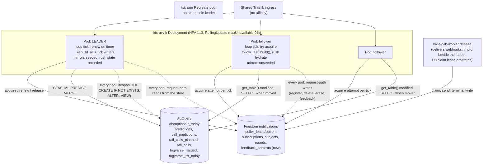
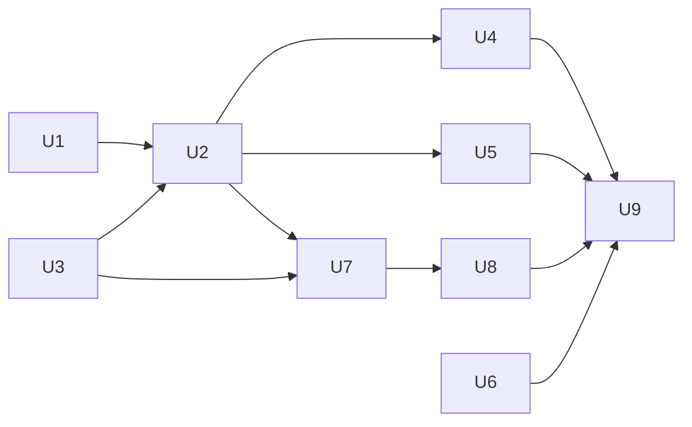

# Zero-Downtime Deploys and Autoscaling - Plan

## Goal Capsule

- **Objective:** Deploy the kix-avvik API with no serving gap and let it scale out under read load, while exactly one pod runs the poller cycle and sends notifications.
- **Authority:** This plan, then the repo's conventions (`CLAUDE.md`, `.claude/rules/*.md`), then the implementer's judgment. The user's confirmed scope decisions are recorded as `session-settled` Key Technical Decisions and are not re-opened.
- **Execution profile:** Code changes in `disruptions/api/`, Helm values and a render test under `helm/kix-avvik/`, Terraform for one Firestore TTL field, CI and CD workflow edits, documentation. Rollout to dev on push, prd by dispatch, in two deploys per environment (KTD15).
- **Stop conditions:** Do not add a second poller release. Do not add Kubernetes RBAC or a Kubernetes Lease. Do not change the webhook wire contract or the decision-log grain. Do not add a Firestore TTL policy to the lease document. Do not make `notification_pull` a dependency of `varsel`, and keep `poller_lease` free of sibling imports. Do not run BigQuery or Firestore from any hermetic test. Do not move tst off `forceReplicas: 1`. Do not merge an environment's RollingUpdate values before the lease-aware binary is verified live in that environment.
- **Tail ownership:** This repository owns every unit. The Grafana rules are created through the provisioning API as before (`docs/observability/02-alert-rules-2026-09-11.md`). The prd dispatch is the user's call after the dev measurements in U9.

---

## Product Contract

### Summary

Replace the single Recreate pod with a rolling-update Deployment behind a CPU autoscaler (min 1, max 3) in dev and prd.
Every pod serves every public route from the BigQuery `*_today` tables the poller builds, loading them on a tick.
One pod holds a singleton lease document in the Firestore `notifications` database and runs the whole poller cycle and every tick-time writer.
A pod is Ready once its prediction and timetable caches have loaded, and it has run the rest of the follower load set once before binding its port.
A leader releases the lease only after its poller thread has exited and its emit workers have drained, and a new leader seeds the mirrors and rush-forecast state before its first cycle.
The strategy switch is a second, values-only deploy per environment after the lease-aware binary is live there.
tst keeps one Recreate pod and the delivery worker release is untouched.

### Problem Frame

Today `deployment.forceReplicas: 1` makes the common chart render `strategy: Recreate`, so every deploy leaves no pod for about 40 s.
The warm start (PR 243) removed the 95 s of cold caches that followed, but the 40 s gap and the single pod remain.
Three claims rest on "one replica under Recreate": the browser push dedup marks, the webhook emit ledger's exactness, and the subscription mirror's exactness (`notification_store.apply_committed`).
A second pod today would double every BigQuery rebuild, race the `CREATE OR REPLACE` tables, and push every alert twice.
The public journey-alerts read for the Entur app's favourites panel is served from one pod's in-process cache, with no way to add capacity under a spike.

### Requirements

**Deploy without a serving gap**

- R1. A deploy to dev or prd serves every public route throughout, with no 5xx caused by the rollout.
- R2. A pod is Ready only once it can answer journey-alerts and journey-status and has loaded the rest of the follower load set once, so the rollout never routes traffic to a pod with empty caches.
- R3. A deploy hands the poller over: the old leader stops writing before the new leader's first write, and the first cycle after the rollout completes runs on the deployed SQL.

**One writer**

- R4. At any instant at most one pod runs `main._rebuild_all` and the tick-time writers (`togvarsel.refresh`, `togvarsel_notify.evaluate`, `togvarsel_outcomes.refresh`, `decisions.check_labelling_freshness`, the state export), and no browser push is sent twice across a handoff; a rush round whose fan-out was already in flight when the lease lapsed may be pushed again by the successor, the window the existing crash case already accepts (KTD8).
- R5. A leader that dies or stops making progress is replaced without operator action: within the lease TTL plus one tick when a Ready follower exists; at one replica, within the pod's liveness restart or replacement plus the TTL plus one tick.
- R6. A deployment without the store backend (tst, local runs, the hermetic test suites) behaves byte for byte as today: it is the sole leader and never touches a lease.

**Every pod serves every read**

- R7. journey-alerts and journey-status answer on any pod from the leader's tables, with `refreshed_at` and `as_of` equal across pods for the same table generation.
- R8. `/varsel` registration, listing, deletion, erasure and the journey card work on any pod, including a delete on the leader of a journey registered on another pod; the card on a non-leader pod shows the SX summary and no alternative (KTD11).
- R9. `/togmelding-api` and the `/varsel` rush outlook answer the same on every pod.
- R10. A first feedback tap resolves on any pod and captures once, for the `/varsel` card and the rush-forecast card alike.
- R11. Every other route keeps working on any pod; per-process caches and limiters are accepted as per pod (KTD12).

**Scale**

- R12. The Deployment scales on CPU between 1 and 3 pods, adding at most one pod per minute and removing pods only after a stable low.
- R13. A follower's BigQuery cost is bounded: it reads a table only when that table's modified time moved, and its daily read bytes are measured against the leader's own load bytes before prd.
- R14. Grafana alerts fire when no pod leads for five minutes and when more than one pod leads for a minute.
- R15. The documents that state the single-replica argument say the new one, the privacy record and the feedback README name the new store and the per-pod limits, and the lease has a runbook.

### Key Flows

- F1. Rolling deploy
  - **Trigger:** `cd.yml` deploys a new image to an environment already running the lease-aware binary (step B and later, KTD15).
  - **Steps:** A new pod starts and joins as a follower. It warms from the tables, runs the follower load set once, binds its port, and `/ready` answers 200. Kubernetes terminates an old pod. That pod's lifespan stops its poller thread at the next boundary, joins it, waits for the emit pass to drain, and releases the lease. A pod acquires at its next tick, seeds the mirrors and rush state, and runs a cold cycle. At two or more replicas the terminated pod may not be the leader, and the lease may pass through an old-template follower before it reaches a new pod.
  - **Outcome:** No request fails. Pushes pause for one tick plus a cold cycle per hop, as they do today per deploy.
  - **Covered by:** R1, R2, R3
- F2. Scale-out and scale-in
  - **Trigger:** CPU above target for the stabilisation window, or below it for ten minutes.
  - **Steps:** A follower starts, warms, turns Ready, serves. On scale-in Kubernetes usually removes the newest pod, which is a follower unless the leader restarted recently; the ordering is not guaranteed.
  - **Outcome:** Reads spread over pods; the leader keeps the cycle. A removed leader hands over as in F1.
  - **Covered by:** R12, R13
- F3. Leader loss
  - **Trigger:** The leader pod dies, is evicted, or stops beating.
  - **Steps:** Its lease lapses TTL after its last heartbeat. A follower acquires at its next tick, seeds, and runs a cold cycle. At one replica the pod is restarted or replaced first.
  - **Outcome:** Pushes resume within the R5 bound plus a cold cycle. Push marks are checked in the store before every send, so nothing is pushed twice.
  - **Covered by:** R4, R5
- F4. A traveller across pods
  - **Trigger:** A registration on pod A, a list or delete on pod B, a push cycle on the leader.
  - **Steps:** Request-path reads on every pod, the leader included, answer from the store. The leader's cycle learns a foreign create or delete at its next mirror sync, and re-checks the journey and its push marks in the store before each send.
  - **Outcome:** No push to a journey deleted on another pod; no registration missing from a list or refused on delete.
  - **Covered by:** R8

### Acceptance Examples

- AE1. **Covers R1, R2.** Given dev on the step B values, when a new image is deployed, then a route matrix (journey-alerts, journey-status, `/disruptions`, `/journey`, `/impact`, `/varsel-api/config`, `/varsel-api/stops`, `/togmelding-api/today`, the `/varsel/` page) polled through the whole rollout returns no 5xx, and `/ready` on the new pod answers 503 until both its prediction cache and its timetable spine have loaded.
- AE2. **Covers R3, R4.** Given a rollout, when the old leader receives SIGTERM mid-cycle, then its poller thread exits at the next boundary, no phase and no new push runs after `stop_event` is set, and the lease document shows the new holder only after the old thread has exited and its emit workers have drained or the shutdown deadline has passed.
- AE3. **Covers R4, R5.** Given two pods, when the leader pod is deleted gracefully (`kubectl delete pod`), then a `poller_lease` record with `result="released"` appears on it and `result="acquired"` on the other pod within one tick; and when the leader pod is instead killed before it can release (`kubectl delete pod --grace-period=1`), then no `released` record appears, `acquired` appears on the other pod within the lease TTL plus 60 s, its next `poller_cycle` completes, and the `event="push"` records over both windows hold at most one `result="sent"` per journey and situation.
- AE4. **Covers R6.** Given `VARSEL_STATE_BACKEND` unset, when the app starts, then no lease document is read or written, `poll_for_changes` runs every cycle as today, and the existing suites pass unchanged.
- AE5. **Covers R7.** Given two pods, when journey-alerts for the same definition is asked on each, then both carry the same `refreshed_at` for the same table generation.
- AE6. **Covers R8, F4.** Given a journey deleted on a follower while the leader is inside `varsel_notify`, when the leader reaches that journey's send, then the store read before the send finds it gone and nothing is sent; a delete landing during the send itself costs one push, no mark and no exception.
- AE7. **Covers R9.** Given a follower started after today's 06:30 forecast, when `/togmelding-api/today` is asked on it, then it lists the issues the leader recorded with the leader's `p` and `level`, and `/togmelding-api/outlook` for a registered device is non-empty where the leader's would be.
- AE8. **Covers R10.** Given a card rendered by pod A, when the first feedback tap lands on pod B, then it is accepted and persisted, not answered `expired`; a retry of that same tap against pod A captures nothing more; and after the device is erased on pod C, neither pod resolves the context.
- AE9. **Covers R14.** Given the leader pod deleted while two pods run, when the other acquires, then `sum(kix_poller_leader)` reads 1 within the next tick and the "two leaders" rule never fires; a gauge sum above 1 for less than the rule's one-minute pending window during a handoff after a stall is tolerated, and a firing is not. Given the store unreachable for six minutes, the "no leader" rule fires.

### Scope Boundaries

- The webhook delivery worker release, its claim lease and its drain formula are untouched; in prd the poller also delivers, and the claim lease already arbitrates that.
- tst stays `forceReplicas: 1` with readiness on `/health` and no leader smoke step; it has no store, no models and no tables.
- Custom-metric autoscaling is out: the `kix_*` series live in Thanos, not in Google Managed Prometheus.
- Session affinity on the shared Traefik ingress is out; the asset-skew window during a rollout is accepted (KTD13).
- An ingress-wide rate or cost budget is a platform ask and out of scope; the replica ceiling bounds the amplification of per-pod allowances at three (KTD12).

#### Deferred to Follow-Up Work

- A store-backed wording and alternative cache so every pod serves the push's wording on the card and the read (KTD11).
- A per-push send claim written before the send, which would make at-most-once a property of the store rather than of timing (Open Questions).
- A leadership-term fence on the publication of the `*_today` tables (Open Questions).
- Dividing per-process Gemini and Journey Planner allowances by the replica ceiling (KTD12).
- Skipping the cold ET rebuild on a same-image handoff, and deferring acquisition to a newer pod template during a rollout (Open Questions).
- Moving the lifespan DDL to lease acquisition (Risks).
- Beats inside a single long BigQuery wait (polling `job.result` in slices), should a 240 s query ever need to keep a lease on its own.

### Success Criteria

- One dev deploy with zero 5xx across the route matrix during the rollout, measured by a polling loop.
- One graceful and one forced leader loss in dev, each recovered inside its R5 bound with no duplicate `event="push"` record per journey and situation.
- One scale-out to three pods under synthetic journey-alerts load, with every pod answering 200, and a scale-in recorded (followers first is expected, not guaranteed).
- `sum(kix_poller_leader) == 1` over a full day in dev, then in prd, with the "two leaders" rule never firing.
- Follower BigQuery read bytes per day stated from `INFORMATION_SCHEMA.JOBS` after a dev day and compared against the leader's own load bytes; a follower reading more than the leader loads is a defect, not a number to record.
- The number of `acquired` records per rollout at two and three replicas, recorded.

### Dependencies and Assumptions

- dev and prd run `VARSEL_STATE_BACKEND=store` and `NOTIFICATION_WEBHOOKS_ENABLED=true`; the Firestore `notifications` database and `roles/datastore.user` exist in both. That role is project-scoped with no per-collection granularity, which the repo already records; the lease and feedback-context documents inherit it.
- The common chart stays at 2.1.0; its HPA, PDB and strategy templates are read from `helm/kix-avvik/charts/common-2.1.0.tgz`.
- gha-helm's `deploy.yml` takes one values file per release and no `--set`; the API release keeps its values file names so the lint matrix does not change.
- Pod clocks are NTP-synced; the 30 s margin in KTD4 absorbs seconds of skew.

### Open Questions

Deferred, none blocking:

- Should a per-push send claim be written in the store before each send, so at-most-once is a store property? Default: no. The successor's first cycle spends at least 50 s on BigQuery before its push phase, while the old leader's in-flight sends end within one push timeout of its last fence check, so the two cannot overlap in practice; build the claim if the push-log check in U9 ever shows a duplicate.
- Should each `*_today` rebuild publish through a leadership-term fence (a staging table copied into place only while the lease is held)? Default: no. Only a SIGKILL mid-query can leave an older snapshot, for one cycle, and the next cycle repairs it.
- Should a same-image handoff skip the cold ET rebuild (~20 GB of scans, two to three minutes of no pushes)? Default: no, today's "first cycle after a start rebuilds" stands; revisit if HPA churn makes handoffs frequent.
- Should a pod defer acquiring when the lease was released by a pod of a newer template, so a rollout at three replicas costs one cold cycle instead of up to three? Default: no; U9 counts the hops first.
- Does the privacy owner accept feedback contexts in Firestore, bound to a device, erased in the device's own erase transaction and expiring in 15 minutes? Default: yes; U8 updates the privacy record so the owner sees it.
- Is cookie affinity available on the shared ingress? Default: no; the asset-skew window and the card flicker on scaled-out pods are accepted.

---

## Planning Contract

### Key Technical Decisions

- KTD1. **One Deployment; the lease elects the leader.** Every API pod runs the same loop, and the pod holding the lease runs the cycle. (session-settled: user-approved — chosen over the poller as its own Recreate release: no lease would be needed, but gha-helm takes one values file per release, so the full API configmap would be duplicated per environment, and the in-app card would lose the model wording on every API pod.)
- KTD2. **The lease gates the whole cycle and every tick writer, not only the push.** `_rebuild_all` bills ~0.9 GB of ML.PREDICT and replaces six tables; two runners double the bill and race the replace. (session-settled: user-approved — chosen over gating the push alone.)
- KTD3. **The lease is one Firestore document, `poller_lease/current`, with a `held_until` field and no Firestore TTL.** Acquisition is one Firestore transaction that reads the document, refuses while another holder's `held_until` is in the future, and writes the new holder, token and `held_until` in the same commit, so two followers reaching a lapsed lease on the same tick cannot both acquire. It follows `_claim_body`'s shape (`notification_store.py:5606-5715`) and the `togvarsel_rounds/current` precedent for a singleton kept out of `COLLECTIONS`, so Terraform's TTL list and the index tests do not change. `held_until` is written from the holder's wall clock and compared against the acquirer's; KTD4's margin absorbs skew. Renew matches holder and token; release matches the holder alone, so a process whose last acquire committed but lost its acknowledgement can still release at shutdown. A release never deletes the document: it clears the holder and sets `held_until` to now, and writes nothing when the holder differs. The document's shape is additive-only across releases (KTD13), since two binaries share it during every rollout. (session-settled: user-approved — chosen over a GCS generation-match object and over a Kubernetes Lease: the namespace has no RoleBinding for the `application` service account, so a Kubernetes Lease is a platform ask and a new dependency.)
- KTD4. **The lease is a 300 s extension of the last heartbeat, renewed on a timer, fenced at every boundary; push dedup is store-exact.** Every renewal writes `held_until` as the last heartbeat's wall instant plus the TTL, and the local deadline is the last heartbeat's monotonic instant plus the TTL minus a 30 s margin (skew plus wait), so the lease lapses exactly TTL after the last beat however many renewals succeed: a wedged leader loses it 300 s after its last beat, and a healthy leader inside one 240 s BigQuery call keeps it. The renewal timer fires every 30 s on a helper thread while the heartbeat is younger than 250 s; at most one renewal is in flight, a renewal still in flight at the next period is skipped rather than queued, and each call carries the store's client deadline where the client offers one, so a hung store costs the lease after the margin, which is the outage behaviour wanted. Renewal does not ride on `_beat`: beat-driven renewal would demote a healthy leader whenever a throttled beat preceded a beat-less 240 s query. The check is made before every `_phase`, between the two queries of a phase that issues two (with a beat between them, so no wait is beat-less for more than 240 s), before every tick writer, before `deliver_to_devices` inside `check_and_notify`, per item inside that fan-out (no new send is submitted once it answers false; in-flight sends finish within `_PUSH_TIMEOUT_S` and are marked), and before `push_round`'s delivery: a demoted or stopping leader stops at the next boundary, issues no further `CREATE OR REPLACE` and submits no further push. The fan-out beats per completed send so a slow push service does not read as a wedge. What the TTL cannot fence is covered elsewhere: browser dedup is store-exact because the pre-send read (KTD7) also refuses a train the store already marks, and the successor's first cycle runs at least 50 s of BigQuery before its own sends while the old leader's in-flight sends end within one push timeout, so the two cannot overlap (a store-side send claim stays deferred); webhook writes are fenced by their transactional re-reads and U8's claim tokens, so at most `_EMIT_WORKERS` abandoned commits can land after a boundary and each is idempotent. Two tests pin the arithmetic: heartbeat gate plus margin under the TTL and TTL above the longest beat-less wait (240 s); and the post-stop drain (one `_PUSH_TIMEOUT_S` plus the mark writes) inside the grace minus the preStop and the shutdown margin. At one replica a wedged leader has no successor and recovers through the liveness restart at `HEALTH_STALE_AFTER_S` (600 s), after which the new process acquires once the lease has lapsed (R5).
- KTD5. **The lease exists only under `VARSEL_STATE_BACKEND=store`.** Gated on `main._varsel_store`, never on `notification_store.enabled()`: the base values name a database in every environment, so `enabled()` is true in tst where no database exists. Without the backend the loop uses a sole-leader stand-in and the process is byte for byte today's, which is what every existing suite asserts.
- KTD6. **Readiness is `/ready` = "prediction cache and timetable spine loaded once", after the lifespan has run the whole follower load set once; liveness stays `/health`.** Follower loads carry no age bound: `_WARM_PREDICTIONS_MAX_AGE` (10 min) was written for a dead predecessor under Recreate, and a live leader on a quiet night legitimately leaves tables older than that. Every pod stamps a cache with its source tables' modified time, the leader included (today the leader stamps the load instant, `main.py:834`), so `refreshed_at` agrees across pods and never moves backwards under round-robin. A cache built from two tables (call predictions from rail and bus; the spine from planned and removed) is stamped with the newer of the two and reloaded when either moved, so two loads with different contents never share a stamp: `impact`'s index guard, the figures cache and the wording key all key on a strictly newer stamp. The lifespan also runs line modes, the stop registry, the impact lookup, the SVV baselines, the rush hydrate and the station set once before binding, so a Ready pod answers every route and not only the two the probe checks. A process without the lease backend serves `/ready` as `/health`.
- KTD7. **The mirrors are the cycle's, owned by the leader, seeded on every acquisition and reset on every loss; request paths read the store.** Followers never seed, and a demoted pod resets, so the cycle's mirror reads (`all_journeys`, the push ledgers, the five `get_journey` call sites under `_state_lock`) come from a mirror only on the current leader. Request-path reads go to the store on every pod, the leader included, through a store-only accessor used by the delete route's ownership check and the lists: a journey registered on another pod would otherwise be missing from the leader's mirror until its next sync and refuse its own delete; the cycle keeps its mirror accessor so no store I/O enters `_state_lock`. Push marks do not stamp the watermark, so acquisition resets and seeds rather than syncs, or the new leader re-offers trains the interim leader pushed; the seed runs synchronously in `on_acquire`, beating between pages, before any tick writer. The seed runs whenever the store backend is on, not only when the webhook flag is. `apply_committed` keeps recording during a seed (the seed's race protection) and is a no-op only on a pod that never started one. The leader's pre-send re-check in `_prepare_alert` reads the subscription document from the store outside `_state_lock`, one read per push, and refuses both a gone journey and a train the store already marks notified. The subject mirror learns only from its own process's commits, so shutdown and loss wait for `notification_events`' pass lock before the lease is released, bounded by the shutdown deadline (KTD14); the emit pass's exactness claims hold per leadership term.
- KTD8. **Rush-forecast state is hydrated from its tables on every pod; computing and recording stay leader-only.** `togvarsel.refresh` rebuilds a shared table and MERGEs with no uniqueness guard, so it cannot run twice; `disruptions.togvarsel_issued` has carried `scope` and `reasons` since 2026-09-03 and is a full `Issue`. The leader hydrates after it records, so the page and the table agree on the leader too, which they do not today after a restart. A round's marker is persisted after its delivery, so a leader that loses the lease mid-round can see the round pushed again by its successor; the check before `push_round`'s delivery narrows that to a fan-out already in flight, the same window the existing crash case already accepts, and R4 says so.
- KTD9. **HPA on CPU, min 1, max 3, target 80 %, one pod per 60 s up, ten minutes stable before down; `maxUnavailable` the string `"0%"`; grace 270 s with a 5 s preStop and one shutdown deadline.** (session-settled: user-approved — chosen over custom metrics, which GMP cannot see, and over min 2, which would serve the SX-summary card on half of all requests.) The target sits above the leader's measured burn (≤0.4 cores in a peak minute against a 1.0 request in prd; dev's 0.5 request puts that peak at the target, which U9's stop criterion watches), so the cycle alone cannot trigger a scale-out; the chart's `| default 1` swallows an integer 0, hence the string; the grace covers the longest uninterruptible wait (one 240 s BigQuery call) plus the preStop. The lifespan takes one deadline at SIGTERM (grace minus the preStop minus a 10 s margin): it joins the thread up to it and skips the release if the thread is still alive (a phase is still running, so the successor waits out the TTL); it waits for the emit pass lock up to the remaining time and releases anyway on a timeout, since the leftover commits are idempotent (KTD7). A SIGKILL that lands leaves the lease unreleased and costs the successor the TTL plus a tick plus a cold cycle. The preStop covers endpoint removal, since uvicorn runs without a graceful-shutdown timeout and the image is distroless, so the hook is the image's own Python binary sleeping (Kubernetes' native `sleep` action is the alternative where the cluster enables it). Under Recreate the same grace lengthens a deploy's no-pod gap by up to one phase when the old pod is mid-query: that is step A, every rollback to `forceReplicas: 1`, and it is accepted; tst and any process without the lease backend keep today's 5 s join cap, since a sole leader has no successor to protect.
- KTD10. **Feedback contexts move to the store with a 15-minute TTL field, are bound to the device that rendered them, and are erased inside the device's own erase transaction.** Mint writes the document on every card render and keeps memory as a cache for fingerprint reuse; under the store backend `resolve` always reads the store, so an erasure on one pod is visible on every pod. A context holds the traveller's route and typed names for a render nobody tapped, which today lives only in one process's memory and would otherwise outlive «Slett alt», against clause 19 of the operations document. So the document names its `device_id`, the fingerprint includes the device so two travellers never share a context, `_erase_device_body` reads and deletes the device's contexts in the same transaction as the journeys (reads before writes, the body's existing rule), the nested maps are exempt from indexing while `expires_at` and `device_id` are not, and `resolve` returns only the snapshot fields so the device id never reaches the BigQuery row `persist` writes. The rush-forecast card mints without a device (it carries no traveller route), so the device id is optional and such a document is deleted by expiry alone. A first tap is claimed on the document in a transaction keyed by context and response id, so a submit retried against two pods captures once while a second traveller tapping a shared device-less rush context is not refused. The store-backed path is gated on the same condition as the lease (`_varsel_store`, KTD5), never on `notification_store.enabled()`, because tst names a database it does not have; a store write that fails falls back to the memory-only path and never raises into a card render. The privacy record and the feedback README gain the new store (U8). (session-settled: user-approved — chosen over documenting `expired` on a cross-pod first tap.)
- KTD11. **No shared wording cache in this plan.** `varsel._messages` and `_alternatives` are memory only, and sharing them needs the stamp change in KTD6 first. A non-leader pod's card shows the SX summary and no alternative; journey-alerts there words through its own PULL ledger. (session-settled: user-approved — chosen over building the store-backed cache now.)
- KTD12. **Per-process allowances stay per process; the replica ceiling is the multiplier bound.** The PULL wording ledger (120/2 000/10 000 per minute, hour and day), the Journey Planner fetch caps, the request limiters, the `/meldinger` replay budget and the feedback capture limits (60 per minute, 12 per context per minute, 2 000 per day) are each per pod, so three pods are three times each; the feedback README's verified 2 000-a-day ceiling becomes 6 000 and says so. Documented in the operations document with the ceiling as the bound. Gemini translation of operator text (`situation_english.update`) is leader-only, so followers do not translate the same ~400 situations a day.
- KTD13. **Three rollout contracts are accepted and documented.** A new follower loads tables the old leader built, so a column added to a table a loader reads ships the tolerant read one release ahead ("additive columns only for one release"); the lease document follows the same rule (unknown fields kept on write, new fields optional on read); and without session affinity a browser can fetch `index.html` from one pod and a hashed asset from another for the rollout minute.
- KTD14. **Shutdown and acquisition are explicit sequences.** On SIGTERM: set stop, let the thread exit at its next boundary, join up to the shutdown deadline, wait for the emit pass lock up to the deadline, release the lease unless the thread is still alive, clear the leader gauge, then exit. On acquisition, before the first cycle: reset and seed both mirrors, reload the rush round markers, hydrate rush state, force the next iteration to rebuild regardless of the ingestion stamp, log and set the leader gauge; if any step fails, release the lease, clear the gauge, and stay a follower for five ticks before trying again, so a partial store outage does not spin every pod through acquire and release each tick. On loss: reset both mirrors, log, clear the gauge. The first cycle is cold (ET gates unarmed), as after every start today.
- KTD15. **The switch to RollingUpdate is its own values-only deploy per environment, after the lease-aware binary is live there; the grace, the preStop, the readiness path and the moved `forceReplicas` key ship with the code.** The pod a rolling deploy replaces is the one running the previous spec: if its binary has no lease code it polls and pushes unconditionally beside the new leader, and if its spec has no grace it is killed after Kubernetes' 30 s default, mid-phase. `forceReplicas: 1` lives in the base `values.yaml` today and in no environment file, so there is nothing per-environment to drop and an edit to the base would flip prd on its next dispatch. So step A lands the code, `terminationGracePeriodSeconds: 270`, the preStop, readiness `/ready`, and moves `forceReplicas: 1` with its comment out of the base file into each of the three environment files (still Recreate everywhere, behaviour otherwise unchanged); step B, a later one-line change per environment, deletes that line from the environment's file while the base carries the rolling and HPA keys. A dispatch deploys the values at main's HEAD, so an environment's line is deleted on main only after its step A is verified live. The same ordering holds for a rollback: the line back first, the image second.
- KTD16. **`/ready` publishes the pod's role.** The body carries `role` and `lease_age_s` so the deploy smoke and an operator can see who leads through the public host; a pod's role is not sensitive, and the lease holder id is a pod name. The smoke's leader check runs for dev and prd only; tst has no role to report.
- KTD17. **The lease state machine is a stdlib-only leaf module with its store calls and callbacks injected.** `poller_lease.py` imports no sibling, pinned by a source test; the store bodies live in `notification_store` (U1); the `on_acquire` and `on_lose` callbacks are closures composed in `main.lifespan`, which already imports the store, `varsel_state`, `togvarsel` and `metrics`, so no cycle appears and `varsel` never sees `main`.

### High-Level Technical Design

Component shape:



A pod's role over its life:

```mermaid
stateDiagram-v2
  [*] --> Starting: lifespan: configure, warm from tables, follower load set, bind port
  Starting --> Follower: thread starts
  Follower --> Follower: tick: acquire refused, follow_last_build(), rush hydrate
  Follower --> Acquiring: tick: acquire ok (one transaction)
  Acquiring --> Leader: on_acquire ok (reset+seed mirrors, load_rounds, hydrate, force rebuild)
  Acquiring --> Follower: on_acquire failed: release, back off five ticks
  Leader --> Leader: timer renew while heartbeat fresh; cycle; tick writers
  Leader --> Follower: renew refused or local deadline passed: on_lose (reset mirrors, gauge 0)
  Leader --> Stopping: SIGTERM: stop set, deadline taken
  Follower --> Stopping: SIGTERM
  Stopping --> [*]: thread exits at next boundary; join to deadline; emit lock to deadline; release unless thread alive
```



Rolling deploy handoff from step B on, one old pod (at two or more replicas the first terminated pod may be a follower, and the lease may hop through an old-template pod before reaching a new one; step A itself is a Recreate deploy whose old pod has no lease and writes no `released` record):

```mermaid
sequenceDiagram
  participant Old as Old pod (leader)
  participant New as New pod
  participant FS as Firestore lease
  participant K as Kubernetes
  K->>New: start (surge 1)
  New->>New: lifespan: warm from tables, follower load set, bind
  New->>FS: acquire? refused (Old holds)
  New-->>K: /ready 200 (predictions and spine loaded)
  K->>Old: SIGTERM (preStop sleep 5 s; deadline taken)
  Old->>Old: stop set; cycle exits at next boundary; join; emit pass drained
  Old->>FS: release (holder matches)
  Old-->>K: exit
  New->>FS: acquire ok at next tick
  New->>New: on_acquire: reset+seed mirrors, load_rounds, hydrate rush state, force rebuild
  New->>New: first cycle (cold ET rebuild on the deployed SQL)
```

### System-Wide Impact

- **Every route reading poller-built memory now serves from any pod.** The follower load set is the four warm tables plus the impact lookup, line modes, the stop registry, the SVV baselines, the rush-forecast state and the station set, run once in the lifespan and then on the tick. Wording, alternatives, feedback snapshots in `_message_meta` and warmed figures stay per pod (KTD11).
- **Request-path writes happen on any pod.** Register, delete, erase, device upsert, `note_web_push_activity`, `/varsel-api/test`, feedback. All of them already write the store; what changes is that the leader's mirror learns them one cycle late, which the store reads on the request path and before each send cover (KTD7). The rush outlook's move to the device's store journeys means a public `/togmelding-api/outlook` read can trigger the weekly activity renewal write, as the `/varsel` journey list already does.
- **Five places claim "one replica under Recreate"**: `CLAUDE.md` (Single always-on instance), `.claude/rules/notification-webhooks.md` (the mirror and emit paragraphs), `.claude/rules/varsel.md`, `notification_auth.set_client_suspended`'s docstring and the operations document's "second replica" trigger. U8 rewrites them, and adds the new store to the privacy record and the feedback README.
- **Alerting.** Rules 1 and 2 already `max()` over pods. Followers keep beating, so rule 1 stays meaningful only for "no pod at all"; rule 2's gauge dips to the followers' zero during a handoff and recovers with the new leader's first cycle, inside its pending window; the new leader gauge carries "no leader" and "two leaders". `POLLER_LAST_CYCLE` stays leader-only. `MIRROR_AGE` exports 0 on followers, which reads as fresh; rule 2a is still not created, and its future query must `max()`. Rule 6's per-pod ERROR count is unchanged because the labelling check and the calendar error run on the leader only.
- **Metrics cardinality** is unchanged: the new gauge is unlabelled.
- **Firestore outage** now stops the cycle in dev and prd (no leader can renew), where today it costs only the mirror sync. Followers keep serving the last tables indefinitely while no pod leads, with `refreshed_at` ageing honestly; the "no leader" rule plus an operator is the recovery, where today's single pod restarted itself through liveness. New pods cannot start during the outage either, which the store backend already implied.
- **Deploy time** grows by the grace period only when the old pod is mid-query; typical is seconds. At two or more replicas a rollout may cost one cold cycle per hop.

### Risks and Dependencies

| Risk | Mitigation |
|---|---|
| A stalled leader resumes after another pod acquired | The lease lapses TTL after the last beat; the check runs at every boundary, between paired queries, before and inside the push fan-out and before a rush round's delivery (KTD4); push dedup is store-exact (KTD7); the successor's cold cycle separates its sends from the old leader's by construction |
| A healthy leader demotes itself on a slow BigQuery day | The lease extends the last beat by 300 s and a beat sits between paired queries, so no healthy wait is beat-less for more than 240 s (KTD4) |
| SIGKILL mid-query leaves a server-side CTAS that lands after the new leader's and puts an older snapshot in a `*_today` table for one cycle, and leaves the lease unreleased | Grace 270 s above the 240 s query timeout; a SIGKILL that still lands costs the successor TTL plus a tick plus a cold cycle (KTD9); a term-fenced publish stays deferred |
| Abandoned emit commits from the old leader land after the new leader seeded its subject mirror | Shutdown and loss wait for the emit pass lock up to the deadline (KTD7, KTD14); the residual is at most `_EMIT_WORKERS` idempotent commits, and a missed mint reads as `nothing_standing` for one cycle |
| The first rolling deploy replaces a lease-unaware pod, or a pod with the 30 s default grace | Two deploys: code, grace, preStop, `/ready` and the moved `forceReplicas` key under Recreate, then the one-line delete per environment (KTD15); the same order in reverse for a rollback |
| An environment's `forceReplicas` line is deleted on main before that environment's step A is live (a prd dispatch deploys main's HEAD values) | The line stays until step A is verified in that environment (KTD15); recovery is a dispatch from a branch or tag at the step A commit |
| A rollout at two or three replicas hops the lease through an old-template follower | Accepted: one cold cycle per hop, counted in U9; deferring acquisition to a newer template is an open question |
| A rush round is pushed twice when the leader loses the lease mid-fan-out | The lease is checked before `push_round`'s delivery; the residual is the fan-out in flight, the same window the existing crash case accepts, and R4 says so (KTD8) |
| A persistent acquisition failure spins every pod through acquire and release each tick | A failed `on_acquire` backs off five ticks (KTD14); the "no leader" rule is the signal |
| Lifespan DDL on a scale-out burst trips BigQuery's 5 metadata updates per 10 s per table, leaving `decisions._table_ready` false for 15 min on that pod | Scale-up policy of one pod per minute; `decisions.ensure_table` retries; moving the DDL to acquisition is deferred |
| A column added to a `*_today` table a loader reads stalls the rollout (new follower cannot load the old leader's table) | Deploy rule "additive columns only for one release" and tolerant reads on the prediction loaders (KTD13); `helm --wait` rolls back a stalled rollout |
| Scale-in or the cluster autoscaler evicts the leader (`safe-to-evict: true` on every pod; the newest-first ordering is not guaranteed) | Accepted: one handoff costs one cold cycle (~20 GB of ET scans, ~$0.15, two to three minutes of no pushes) |
| A feedback submit retried against two pods captures twice in PostHog, where events cannot be deleted | The first tap is claimed on the Firestore document in a transaction (KTD10) |
| A public request flood scales to three pods and triples the per-pod Gemini and Journey Planner ceilings | The replica ceiling bounds it at three times; allowances are documented with the multiplier (KTD12); an ingress-wide budget is a platform ask (Scope Boundaries) |
| Rolling back the feedback-context code together with its Terraform leaves route documents with no expiry | The TTL field config stays until a query shows the collection empty (U8 runbook) |
| Per-pod BigQuery read cost of follower loads | Loads only when `get_table().modified` moved (R13); measured against the leader's own load bytes in U9 |
| Dev CPU request 0.5 puts the leader's peak minute at the 80 % target | U9 stops promotion on a cycle-driven scale-out and raises dev's request to 1.0 first |
| Asset 404s during the rollout minute | Accepted; `_VersionedStaticFiles` already sends `no-cache` on `index.html`, a reload resolves it |

### Sequencing

U1 (lease in the store), U3 (follower loads and `/ready`) and U6 (feedback contexts) are independent. U2 (role loop) depends on U1 and U3. U4 (rush state) and U5 (mirror ownership) depend on U2's acquisition hook but not on each other. U7 (Helm, CI, CD) depends on U3's `/ready`; its step B values are deployed only after step A is live in the environment (KTD15). U8 (observability and docs) after U7. U9 (rollout and measurement) last, in two deploys per environment.



---

## Implementation Units

### U1. Poller lease document in the store

**Goal:** A singleton lease any pod can acquire, renew and release transactionally, extending the holder's last heartbeat by the TTL.

**Requirements:** R4, R5, R6

**Dependencies:** none

**Files:**
- `disruptions/api/notification_store.py`
- `disruptions/api/test_notification_store.py`

**Approach:**
1. Add the collection name and document id beside `ROUNDS`/`ROUNDS_DOC`, outside `COLLECTIONS`, and a `_Refs.lease()` accessor.
2. Add `POLLER_LEASE_S = 300.0` beside `DELIVERY_LEASE_S`, with KTD4's arithmetic in its comment: the lease is an extension of the last heartbeat; the heartbeat gate (250 s) plus the margin (30 s) is under the TTL; the TTL is above the longest beat-less wait (240 s) and under `HEALTH_STALE_AFTER_S` (600 s).
3. Write three bodies in `_claim_body`'s shape, each taking `now`, the heartbeat instant and the token as arguments and logging nothing: acquire (read first; refuse while `held_until > now` and the holder differs; otherwise set holder, token, `acquired_at`, `held_until = heartbeat + TTL`), renew (refuse unless holder and token match; set `held_until = heartbeat + TTL`), release (match the holder alone; clear the holder and set `held_until` to now; never delete; write nothing when the holder differs). Unknown fields on the document are preserved on every write (KTD13).
4. Public functions `acquire_poller_lease(holder, *, heartbeat, now=None)`, `renew_poller_lease(holder, token, *, heartbeat, now=None)`, `release_poller_lease(holder, *, now=None)`, `read_poller_lease()`; the token is minted outside the transaction; each returns the stored document's view (holder, `held_until`).
5. Register the three bodies in the two hand-maintained lists in the suite (`test_every_transaction_body_reads_before_it_writes`, `test_no_body_that_increments_a_counter_is_retry_sensitive`).

**Patterns to follow:** `_claim_body` and `claim_delivery` (`notification_store.py:5606-5742`); the `togvarsel_rounds/current` singleton; the "a body may run more than once" discipline (`_NoClockNoLog` in the suite).

**Test scenarios:**
- Acquire on an absent document returns `acquired` with the holder set and `held_until = heartbeat + POLLER_LEASE_S`.
- A second acquire by another holder five seconds later returns `refused` and writes nothing; the stored document is unchanged.
- An acquire by another holder at `heartbeat + POLLER_LEASE_S + 1` returns `acquired` with a new token.
- Renew with the right holder and token sets `held_until` to the given heartbeat plus the TTL, not to the renewal instant plus the TTL; renew with a stale token returns `lost` and writes nothing.
- Release by the holder clears the holder and sets `held_until` to now without deleting the document; release by another holder writes nothing.
- A document carrying an unknown field keeps it through acquire, renew and release.
- Each body run twice against two fake transactions under `_NoClockNoLog` yields identical results and writes.
- `client.fail_with` on acquire surfaces the store's exception to the caller unchanged.
- Emulator: eight threads acquire concurrently on an absent document; exactly one returns `acquired`, the rest `refused`, and the document names that one holder.
- The TTL constant satisfies KTD4's two inequalities (heartbeat gate plus margin under the TTL; TTL above 240 s and under 600 s), pinned as numbers.

**Verification:** `uv run ... python test_notification_store.py` passes with the printed count up by the new tests, both hermetically and under the emulator as `ci.yml` runs it.

### U2. Role-switching poller loop, fencing, shutdown and acquisition hook

**Goal:** Every pod runs the same loop; the lease holder runs the cycle and the tick writers; a non-holder only loads; handoff is safe on shutdown and on loss.

**Requirements:** R3, R4, R5, R6

**Dependencies:** U1, U3

**Files:**
- `disruptions/api/poller_lease.py` (new)
- `disruptions/api/main.py`
- `disruptions/api/varsel.py`
- `disruptions/api/togvarsel_notify.py`
- `disruptions/api/notification_store.py`
- `disruptions/api/metrics.py`
- `disruptions/api/test_poller_lease.py` (new)
- `disruptions/api/test_poller_refresh.py`
- `disruptions/api/test_health_heartbeat.py`
- `disruptions/api/test_varsel.py`
- `disruptions/api/test_togvarsel_notify.py`
- `disruptions/api/test_notification_store.py`
- `disruptions/api/test_metrics.py`

**Approach:**
1. `poller_lease.py` (stdlib only, KTD17) holds the state machine with the store calls and a heartbeat reader injected: `tick()` acquires when not held; a renewal timer on a helper thread renews every 30 s while the heartbeat age is under 250 s, with at most one renewal in flight and a still-running renewal skipped rather than queued; `held()` answers from the local monotonic deadline (last heartbeat plus TTL minus the 30 s margin, KTD4); `release()`; `on_acquire`/`on_lose` callbacks; a five-tick back-off after a failed acquisition. A `SoleLeader` stand-in answers `held()` true with no store (KTD5). The state is under a lock.
2. `poll_for_changes` calls `tick()` at the top of each iteration and branches on `held()`: the leader path is today's body; the follower path calls `follow_last_build()` (U3), the rush hydrate through an injected callable (a no-op until U4 supplies it) and the per-pod TTL refreshes, then sleeps. `on_acquire` forces the next iteration to rebuild regardless of the ingestion stamp and the spacing hold.
3. The lease-and-stop check is one call at the top of `_phase`, so a phase added later cannot forget it. It raises a dedicated `BaseException` subclass that the per-step `except Exception` blocks cannot swallow, caught once in `_on_ingestion_change`, which logs one `poller_lease` record with `result="lease_lost"` or `"stopping"` naming the phase it stopped before. A skipped phase emits no `poller_phase` record and no error metric. Phases that issue two queries (`call_predictions_cache`, `rail_removed_calls`) call the same check and `_beat` between them. The four tick writers get the same check.
4. `varsel.check_and_notify` takes a `should_continue` seam beside `beat`: checked before `deliver_to_devices` and per item inside it (`_deliver_device` returns without sending once it answers false; in-flight sends finish within `_PUSH_TIMEOUT_S` and are marked), and the fan-out beats per completed send. `togvarsel_notify.push_round` takes the same seam before its delivery, so its signature changes here and U4 only wires it.
5. `notification_store.reset_mirrors()` (the production counterpart of `reset_mirrors_for_tests`) is added here, since `on_acquire` and `on_lose` call it.
6. Lifespan `finally`: take the shutdown deadline (grace minus the preStop minus 10 s), set stop, join the thread up to the deadline, wait for `notification_events`' pass lock up to the remaining time, release the lease by holder unless the thread is still alive, clear the leader gauge. Under `SoleLeader` the join keeps its 5 s cap (KTD9).
7. `on_acquire`, composed as a closure in the lifespan, runs before the first leader cycle: `reset_mirrors` then `sync_mirrors` synchronously with `beat`, `varsel_state.load_rounds`, the rush hydrate callable, the forced-rebuild flag, log `result="acquired"`, set the gauge; any failure releases the lease, clears the gauge, logs `result="acquire_failed"`, and the pod stays a follower for five ticks. `on_lose` resets both mirrors, logs `result="lost"`, clears the gauge, and waits for the pass lock up to the same bound before the pod can acquire again.
8. `metrics.POLLER_LEADER` (`kix_poller_leader`, unlabelled, 0 or 1). `POLLER_LAST_CYCLE` stays leader-only by construction.
9. The holder id is the pod name from `HOSTNAME` plus a per-process suffix.
10. The lease is constructed in the lifespan only when `_varsel_store` is set; otherwise `SoleLeader`.

**Execution note:** Pin the loop's order with the source-ordering tests the suite already uses (`inspect.getsource` plus `.index`) before changing the loop body, so a later edit cannot quietly move a write ahead of the check.

**Patterns to follow:** `poll_for_changes` driven by `_Ticks(n)` and module-attribute swaps (`test_poller_refresh.py:289-356`); `_phase` exception semantics (`test_poller_refresh.py:219-249`); the bounded-wait-and-abandon pattern of `varsel._WEBHOOK_LOAD_TIMEOUT_S`; `_beat`'s two-clock rule; the import-set pin in `test_journey_status`.

**Test scenarios:**
- Scripted lease (held, held, lost, held) over four ticks: `on_change` runs on ticks 1, 2 and 4; `follow_last_build` runs on tick 3; the `calls` order is asserted.
- A tick where acquire raises logs the error, does not run the leader body, runs the follower body, and the loop continues.
- `held()` is false once the local deadline passes without a new heartbeat, even if the store never answered `lost`; the deadline is anchored on the last heartbeat, so a 5 s wait does not extend it and a renewal at heartbeat age 240 s does not either.
- The timer renews every 30 s while the heartbeat is fresh and stops renewing once the heartbeat age passes 250 s; a renewal still in flight at the next period is skipped and no second call is queued; two concurrent callers perform one store call.
- A renewal whose store call hangs returns within the bounded wait; the pass continues; the lease lapses at the local deadline if no later renewal lands.
- With `held()` turning false after `disruptions_sql`, `_rebuild_all` runs no later phase, issues no `predict_sql` query, emits no `poller_phase` error record, and logs `lease_lost` naming `predict_sql`; the same with the lease lost before `categories`, which sits inside a `try/except Exception`.
- With `stop_event` set between phases, the same skip happens with `result="stopping"`.
- With `held()` turning false between the two queries of `call_predictions_cache`, the second query is not issued; a beat is recorded between the two queries on a healthy run.
- A fan-out whose fake sends sleep past the local deadline submits no new send after `held()` turns false, marks the sends that completed, and beats once per completed send; the post-stop drain is one `_PUSH_TIMEOUT_S` plus the mark writes, pinned under the grace minus the preStop and the shutdown margin.
- `push_round` with a `should_continue` answering false before delivery sends nothing and writes no marker.
- The lifespan `finally` releases the lease only after the thread has exited and the emit pass lock is free; a lock that blocks past the deadline is released anyway and logged; a thread that blocks past the deadline leaves the lease unreleased; the gauge reads 0 after the release.
- Under `SoleLeader` the lifespan's join keeps its 5 s cap.
- `on_acquire` runs before the first cycle after an acquisition and after every re-acquisition; a failing `on_acquire` releases the lease, clears the gauge, and the pod does not acquire again for five ticks.
- `on_lose` leaves both mirrors not ready; `reset_mirrors` leaves both mirrors not ready and the next `sync_mirrors` seeds both.
- Without the store backend the loop never constructs a store lease, and every existing `test_poller_refresh` and `test_health_heartbeat` check passes unchanged.
- `poller_lease` imports no sibling module (source pin).
- `kix_poller_leader` reads 1 after `on_acquire` and 0 after `on_lose`; the metrics suite's declared-names test lists it.
- `/health` stays 200 on a follower whose loop beats and 503 on a follower whose loop stopped.
- A late `_mint` commit from the old holder after a new holder's mint for the same subject yields `unchanged` (store suite).

**Verification:** The suites pass with their counts up; a local run with the Firestore emulator and two processes on different ports shows one `acquired`, one `refused`, and a handoff when the holder is killed.

### U3. Follower loads, consistent stamps and `/ready`

**Goal:** A non-leader pod serves every read from the leader's tables, loads only when a table moved, and reports readiness honestly.

**Requirements:** R2, R7, R11, R13

**Dependencies:** none

**Files:**
- `disruptions/api/main.py`
- `disruptions/api/test_poller_refresh.py`
- `disruptions/api/test_health_heartbeat.py`

**Approach:**
1. Generalise `warm_caches_from_last_build` into `follow_last_build()`: for each cache, read the modified time of every source table and load only when the newer of them is newer than the stamp the cache holds; no age bound (KTD6). The call-prediction cache is stamped with the newer of `call_predictions_today` and `call_predictions_bus_today`; the spine with the newer of `rail_calls_planned_today` and `rail_calls_removed_today`; each reloads when either moved. The prediction loaders gain the same "same build" guard the spine and actuals already have.
2. The lifespan calls the same function, then the per-pod TTL loads (`refresh_impact_lookup`, `refresh_line_modes`, `refresh_varsel_stops`, `reisevalg.refresh_baselines`) and the rush hydrate and station-set callables (U4), once before binding the port, so a Ready pod answers every route.
3. The leader's own loads stamp the same way: `_rebuild_all` reads `get_table` after each CTAS and passes `built` to `refresh_disruptions_cache`, `refresh_call_predictions_cache`, `refresh_planned_spine` and `refresh_rail_actuals`.
4. Followers refresh on their TTLs: `refresh_impact_lookup`, `refresh_line_modes` (24 h), `refresh_varsel_stops` (the planned-table cadence) and `reisevalg.refresh_baselines`; the ET rebuild gates (`_planned_refreshed_at`, `_rail_calls_refreshed_at`, `_bus_planned_refreshed_at`) stay unarmed on followers.
5. `situation_english.update` runs only when the loader is called by the leader (a flag on the load), so followers read operator English off the table and translate nothing.
6. `GET /ready`: 200 when `_varsel_refreshed_at()` and `journey_status.spine_refreshed_at()` are both set, else 503 with a reason; the body carries `role` and `lease_age_s` (KTD16); when no lease backend is configured it returns `/health`'s answer. Liveness keeps `/health`.
7. Prediction row readers (`_row_to_cached`, `_call_pred_from_row`) read columns added after 2026-10-13 with a default, so a new follower can load an old leader's table (KTD13).

**Patterns to follow:** `_warm_client(ages, ...)` and the fake `get_table` in `test_poller_refresh.py:1405`; `refresh_planned_spine`'s `spine_refreshed_at() == built` guard; `impact._stop_ref_index_for`'s stamp-equality guard (`impact.py:1860-1875`).

**Test scenarios:**
- A follower tick with all source tables unchanged issues the metadata reads and zero queries.
- A follower tick where only `call_predictions_bus_today` moved reloads the call-prediction cache and stamps it with the bus table's modified time.
- Two loads whose source tables differ never carry the same stamp (the invariant test).
- A table older than 10 minutes is loaded on a follower tick (no age bound) and `refreshed_at` reports that age.
- The leader's cycle stamps `_call_pred_refreshed_at` with the newer table's modified time, not the load instant.
- The lifespan runs the follower load set (line modes included) before the port binds, in the order pinned by the source test.
- `/ready` answers 503 before the prediction load, 503 with the spine still unloaded, and 200 once both are loaded whatever their age; its body names the role; with no lease backend it equals `/health`.
- `situation_english.update` is called on the leader's load and not on a follower's.
- A prediction row lacking a post-2026-10-13 column loads with the default rather than raising.
- Line modes refresh on a follower after the TTL and not before.

**Verification:** Suites pass with counts up; in dev a follower pod's logs show `follow_last_build` records with `loaded` only on ticks where a table moved, and `bq ls -j` over an hour shows only SELECTs from that pod.

### U4. Rush-forecast state on every pod

**Goal:** `/togmelding-api` and the rush outlook answer the same on every pod, and a new leader serves what was recorded rather than a recompute.

**Requirements:** R9, R4

**Dependencies:** U2

**Files:**
- `disruptions/api/togvarsel.py`
- `disruptions/api/togvarsel_notify.py`
- `disruptions/api/main.py`
- `disruptions/api/test_togvarsel.py`
- `disruptions/api/test_togvarsel_notify.py`

**Approach:**
1. `togvarsel.load_issued(d)` fills `_state` read-only from `togvarsel_issued` (issue, p, level, scope, reasons, computed_at, late), `togvarsel_sx_today` and `togvarsel_calendar`, through the existing `_rows` helper; `generated_at` is the latest `computed_at`.
2. It is supplied to U2's hydrate seam: followers call it on each tick and the lifespan once before binding; `refresh()` stays leader-only and calls `load_issued` after it records, so the leader serves the table's row (KTD8); `on_acquire` calls it before the first cycle.
3. `togvarsel_notify.station_set` becomes a TTL-cached read any pod may make, independent of `evaluate`; `cached_station_set` reads it; the lifespan loads it once.
4. `rush_outlook(device_id)` reads the device's journeys through the store (`device_journeys`) rather than `journeys_snapshot`, which is empty on an unseeded mirror; the weekly activity renewal that read carries is the same one the `/varsel` journey list performs.
5. `push_round`'s `should_continue` seam (changed in U2) is wired to the lease here.

**Patterns to follow:** `_rows` (`togvarsel.py:481`); `_blank_state`; the TTL shape of `maybe_refresh_planned_calls`.

**Test scenarios:**
- `load_issued` on a day with three recorded issues builds `_state` with those three and the sx list; `build_melding` lists no `overdue_issues` for them.
- `load_issued` on a day with no rows leaves the overdue logic as today.
- The leader's `refresh` records an issue and then serves the recorded `p` and `level`, not the in-memory recompute, after a simulated restart.
- A follower tick never calls `_record_issue` or rebuilds `togvarsel_features_today`.
- `rush_outlook` for a device with journeys in the store answers on a pod whose mirror is not ready.
- `station_set` is read once per TTL on a follower and never triggers `evaluate`.

**Verification:** Suites pass; AE7 holds in dev on two pods.

### U5. Mirror ownership under several pods

**Goal:** The leader's mirror is exact for its own writes and safe against foreign ones; request paths never depend on a mirror; followers never hold one.

**Requirements:** R8, R4

**Dependencies:** U2

**Files:**
- `disruptions/api/notification_store.py`
- `disruptions/api/varsel_state.py`
- `disruptions/api/varsel.py`
- `disruptions/api/main.py`
- `disruptions/api/test_notification_store.py`
- `disruptions/api/test_varsel_state.py`
- `disruptions/api/test_varsel_api.py`

**Approach:**
1. `sync_mirrors` runs on the leader whenever `_varsel_store` is set or the webhook channel is on; today it is gated on the webhook flag alone, which under the store backend with the flag off leaves `all_journeys()` empty.
2. `SubscriptionMirror` gains a `seeding` state: `apply_committed` and `drop_committed` keep recording while seeding or seeded (the seed's race protection, `notification_store.py:2759-2795`) and return without touching `_entries` or `_local_applied` on a pod that never started a seed, so a follower's request-path commits do not accumulate.
3. `StoreRegistrations` gains a store-only accessor for one registration, used by the delete route's ownership check (`varsel.py:6402`) and the lists; the cycle's five `get_journey` call sites under `_state_lock` keep the mirror accessor, so no store I/O enters the lock.
4. The pre-send re-check in `varsel._prepare_alert` reads the subscription document from the store outside `_state_lock`, and refuses when it is gone or when its `notified` already holds the situation (or `pushed_trains` the tag); the collection-time check stays on the mirror. The store already answers NotFound on a mark after a delete and `StoreRegistrations` swallows it, so no further change there.
5. `StoreRegistrations` docstrings and the module header's "one replica under Recreate" sentences state the new rule: the mirror is the leader's cycle view, exact for the leader's own writes, one cycle late for foreign ones, with the pre-send store read closing the push case.

**Patterns to follow:** `_store()` and `_seeded_mirror` fixtures in `test_varsel_state.py:567-593`; `test_the_cycle_reads_nothing_at_all_from_an_unseeded_mirror`.

**Test scenarios:**
- With `webhook_enabled` false and the store backend on, the cycle's mirror sync runs and `all_journeys()` is non-empty after it.
- `apply_committed` on a never-seeded mirror leaves `_entries` and `_local_applied` empty; during a seed it records; on a seeded one it applies as before.
- A delete on the leader of a journey created on another pod (present in the store, absent from the mirror) returns 200.
- A journey deleted in the store after the mirror seeded is not sent: the pre-send read returns None and no `mark_notified` is written.
- A journey whose store document already marks the situation notified is not sent again, even when the mirror says otherwise.
- A journey present in both is sent and marked once; a delete landing during the send yields one push, no mark, no exception.
- The pre-send read does not hold `_state_lock`, and the cycle's mirror call sites make no store call.
- The source-pin tests over the mirroring body sets still pass unchanged.

**Verification:** Suites pass; AE6 holds in dev.

### U6. Feedback contexts in the store

**Goal:** A first feedback tap resolves on any pod, captures once, and is erased with the device, for the `/varsel` card and the rush-forecast card alike.

**Requirements:** R10

**Dependencies:** none

**Files:**
- `disruptions/api/feedback_contexts.py`
- `disruptions/api/feedback.py`
- `disruptions/api/notification_store.py`
- `disruptions/api/varsel.py`
- `disruptions/api/togvarsel.py`
- `disruptions/api/test_feedback_contexts.py`
- `disruptions/api/test_feedback.py`
- `disruptions/api/test_notification_store.py`
- `disruptions/api/test_togvarsel.py`
- `terraform/firestore.tf`

**Approach:**
1. A `feedback_contexts` collection in `COLLECTIONS` with an `expires_at` TTL field in Terraform, like the four existing TTL configs; document id is the context id; body is the canonical snapshot, the fingerprint, the optional `device_id` and `expires_at = now + 15 min`. Index exemptions for the nested maps and long text fields as `firestore.tf:164-202` does; `expires_at` and `device_id` stay indexed.
2. `mint` takes an optional device id (`varsel`'s card render has it; `togvarsel._with_feedback_context` passes none), includes it in the fingerprint so two devices never share a context, writes the document, and keeps the memory entry as a cache for fingerprint reuse.
3. Under the store backend `resolve` reads the store on every call and refuses an expired or deleted document; it returns only the snapshot fields, never the device id, so `persist`'s BigQuery row is unchanged.
4. A revision-1 submit claims the document in a transaction, keyed by context and response id (`claims.<response_id>` set once); a second claim for the same pair answers `throttled`, so a retry against another pod captures nothing more, while a different response id on a shared device-less rush context is admitted (KTD10). `persist` keeps its BigQuery write keyed by `row_ids`. The PWA's response id must stay stable across its retries, which U9 verifies against the deployed front-end.
5. `_erase_device_body` reads the device's contexts and deletes them in the same transaction as the journey tombstones, reads before writes; a context without a device is left to expire.
6. The store-backed path is enabled by the same gate as the lease (`main._varsel_store`), injected at configure time; without it (tst, local runs, hermetic tests) the module behaves as today. A store write that fails logs and falls back to the memory-only entry, so `mint` never raises into a card render.

**Patterns to follow:** The TTL-field entries and the `COLLECTIONS`-versus-Terraform test (`test_notification_store.py:1855`); `ROUNDS` for a document outside the query specs; `_erase_device_body`'s read-then-delete loop (`notification_store.py:3705-3760`).

**Test scenarios:**
- Mint on one process and resolve on a fresh process (memory cleared) returns the snapshot from the store, without the device id.
- Resolve of a document past `expires_at` returns None; resolve after the document was deleted returns None even when the local memory still holds the entry.
- Mint reuses the id for a byte-identical snapshot from the same device within the lease, from memory, without a second store write; two devices rendering identical snapshots get distinct context ids.
- A rush-forecast card's context, minted with no device, resolves in a fresh process.
- A second revision-1 submit for the same context and response id, on a process with no memory of it, answers `throttled` and captures nothing; a submit with a different response id on the same device-less rush context is admitted and captured once.
- Erasing a device after a card render deletes its contexts inside the erase transaction, leaves another device's identical context resolvable, and leaves the rush card's device-less context untouched.
- The BigQuery row `persist` writes never carries a device id.
- With the gate off (no `_varsel_store`) the memory-only path is unchanged and the existing suite passes, even when a database name is configured.
- A store write that raises during `mint` logs once and the render still gets a memory-only context id.
- The Terraform TTL list and `COLLECTIONS` agree on the new collection, and the exemption spec covers the nested maps but not `expires_at` or `device_id` (the existing pin tests).
- Emulator: mint, read back, claim once, second claim refused, erase removes it in one transaction.

**Verification:** Suites pass; a local `terraform plan -var-file=env/dev.tfvars` shows one TTL field add, the exemptions, and nothing else (pushes to main get no PR plan; `terraform.yml` applies on the push); AE8 in dev.

### U7. Helm, CI render test and CD smoke

**Goal:** The API Deployment rolls, scales and probes as designed in dev and prd, with the shape pinned by a render test and the deploy smoke checking readiness and a leader.

**Requirements:** R1, R2, R12, R14

**Dependencies:** U2, U3

**Files:**
- `helm/kix-avvik/values.yaml`
- `helm/kix-avvik/env/values-kub-ent-dev.yaml`
- `helm/kix-avvik/env/values-kub-ent-prd.yaml`
- `helm/kix-avvik/env/values-kub-ent-tst.yaml`
- `helm/kix-avvik/test/api_render.sh` (new)
- `.github/workflows/ci.yml`
- `.github/workflows/cd.yml`
- `disruptions/api/test_notification_contract.py`

**Approach:**
1. Step A values, in the code commit: `terminationGracePeriodSeconds: 270`, `container.lifecycle.preStop` running the image's own Python binary by absolute path for a 5 s sleep, readiness `probes.readiness.path: /ready` for dev and prd (tst keeps `/health`); `forceReplicas: 1` and its comment move out of the base `values.yaml` into each of the three environment files, so every environment is still Recreate (KTD15). The base file gains the rolling and HPA keys: `deployment.minReplicas: 1` (keeps the PDB at 0 %), `maxUnavailable: "0%"`, `hpa.spec` carrying the CPU metric at 80 %, `behavior.scaleUp` one pod per 60 s with a 120 s window, `behavior.scaleDown` stabilisation 600 s, and `minReplicas: 1` and `maxReplicas: 3` inside the spec, because the chart's `hpa.spec` branch renders neither; these stay inert while an environment file carries `forceReplicas`.
2. Step B, one line per environment, merged only after step A is verified live there: delete `forceReplicas: 1` from that environment's file.
3. tst keeps `forceReplicas: 1` and readiness `/health` permanently, with the reason (no store, no tables).
4. `api_render.sh` renders dev, prd and tst and asserts the shape each file is in: the base file carries no `forceReplicas`; a file still carrying it renders `Recreate`, `replicas: 1`, no HPA, grace 270 and a preStop hook (readiness `/ready` for dev and prd, `/health` for tst); a file without it renders `strategy.type: RollingUpdate`, `maxUnavailable: 0%`, `maxSurge: 1`, no `replicas:`, one HPA with min 1 and max 3 and `scaleTargetRef` naming the release, `minAvailable: 0%` on the PDB, the same probes, grace and hook; tst always renders `Recreate` and no HPA. Fails when helm is absent.
5. `ci.yml` helm-render runs both scripts; the contract test asserts both lines.
6. `cd.yml` smoke for dev and prd: after `/health`, poll `/ready` until 200, then poll `/ready`'s body until some answer reports `role: leader`, for up to six minutes after `helm --wait` returns (grace plus a tick plus margin, since `--wait` returns when the new pod is Ready, before the old one has released). `smoke-tst` keeps its `/health` check only.

**Execution note:** Verify with `helm template` on all three values files before pushing; the chart's `| default 1` on `maxUnavailable`, the HPA `minReplicas` default of 2 and the `hpa.spec` branch dropping min and max are the silent misrenders to look for.

**Patterns to follow:** `helm/kix-avvik/test/worker_render.sh`; the `cd.yml` smoke steps.

**Test scenarios:**
- `api_render.sh` passes on the committed values and fails when `maxUnavailable` is an integer 0 (renders 1), when the base file carries `forceReplicas` (prd would flip with dev), when `hpa.spec` omits `minReplicas` or `maxReplicas`, when the grace or the preStop is missing from a file still under Recreate, and when tst drops its override (renders an HPA).
- The contract test finds both render-script lines in `ci.yml` and `helm-render` gating `docker`.
- Test expectation for the smoke step: a dry run against dev after U9's first deploy; no hermetic test.

**Verification:** `helm template` outputs reviewed; `ci.yml` green; the first dev deploy's smoke job passes with the new steps.

### U8. Observability and documents

**Goal:** Operators see who leads and are paged when nobody or two do; the documents stating the single-replica argument state the new one; the privacy record and the feedback README name the new store and limits; the lease has a runbook.

**Requirements:** R14, R15

**Dependencies:** U7

**Files:**
- `docs/observability/02-alert-rules-2026-09-11.md`
- `docs/observability/alert-dashboard.json`
- `docs/operations/notification-webhooks.md`
- `docs/operations/poller-lease.md` (new)
- `docs/personvern/2026-08-28-varsel-tilbakemelding-personvernvurdering.md`
- `data/feedback/README.md`
- `CLAUDE.md`
- `.claude/rules/notification-webhooks.md`
- `.claude/rules/varsel.md`
- `disruptions/api/notification_auth.py` (docstring)

**Approach:**
1. Two Grafana rules per environment: "no leader" (`sum(kix_poller_leader{...})` below 1 for 5 m, no data → Alerting, errors → Error) and "two leaders" (`sum(...)` above 1 for 1 m, no data → Normal), hand-built as a query node plus a threshold node with `reducer: last` (never imported: the importer's math node made five rules unable to fire), created through the provisioning API with `X-Disable-Provenance` and the `alerts-kix` contact point, in each environment's own folder and group, and proven able to fire with a forced evaluation (`* 0` and `+ 1`) before being left unmodified; rules 4 and 5 descriptions lose "single replica"; a leader panel on the dashboard showing `sum` beside `count`, since the worker pod also exports the name as 0. The "two leaders" description says what it measures: two pods that each believe they lead, which a stalled leader does until its next boundary, so a sum above 1 for less than the pending minute during a handoff after a stall is tolerated and a firing is not; AE9 and U9's stop criterion use the firing, never the instantaneous sum. The "no leader" description says it fires on a SIGKILLed handoff (TTL plus a tick exceeds its pending window), which is correct.
2. `docs/operations/poller-lease.md`: what the lease is, how to read the holder (`/ready` body, the `poller_lease` log records, the gauge), how to force a handoff (delete the leader pod, never the document, which overlaps for up to 35 s), what a Firestore outage does, the deploy contracts of KTD13 and the two-step rollout of KTD15 with its pre-deploy audits (live strategy and grace, rendered manifests, the Firestore database and TTLs, the `browser` account, the lease document's state, no new loader columns, the `poller_cycle` baseline), the expected rule 2 dip during a handoff, the per-pod allowance multiplier of KTD12, the rollback order (the `forceReplicas` line first, the image second; a stalled rollout is left to `helm --wait`'s own rollback and never cancelled; the lease document needs no cleanup, an expired lease is acquirable; keep the feedback-context TTL config until a query shows the collection empty), and that tst has no lease.
3. `CLAUDE.md`'s "Single always-on instance" bullet becomes the lease rule with a pointer to the new document; the operations document's "second replica" trigger becomes "a second leader"; its retention table gains a row for feedback contexts (15 min enforced on read, physical deletion within Firestore's lag, deleted in the device's erase transaction) and clause 19 names them; the privacy record's store list gains Firestore and says the live context is linked to a device id until it expires, and the feedback README states the per-pod limits and the 6 000-a-day effective ceiling at three replicas (KTD12); the rule files' "one replica under Recreate" sentences are rewritten at each occurrence; `set_client_suspended`'s docstring says the clear reaches one pod and the TTL is the bound.
4. The `poller_lease` log event is emitted from `main`, outside the `notification_*`/`webhook_*` namespace, so the operations document's event table is not required to list it.

**Test scenarios:**
- Test expectation: none -- documentation and dashboards; the contract test's grep over the operations document must still pass.

**Verification:** Both rules exist in dev and prd with the route test passed; `rg "one replica under Recreate|forceReplicas: 1" CLAUDE.md .claude/rules docs/operations` returns only the lease document's description of the rollout and tst.

### U9. Rollout and measurement

**Goal:** Prove the design in dev before prd, with numbers.

**Requirements:** R1, R3, R5, R12, R13

**Dependencies:** U4, U5, U6, U8

**Files:**
- `docs/operations/poller-lease.md` (measurements section)

**Approach:**
1. Step A: push the code with the grace, preStop, `/ready` and the moved `forceReplicas` lines; confirm the single dev pod logs `poller_lease` `acquired` (no `released`, the old binary had no lease), `/ready` answers 200 with `role: leader` through a port-forward (the image is distroless), one `poller_cycle` per period, and `sum(kix_poller_leader)` is 1. Step B: delete dev's `forceReplicas` line and watch the first rolling deploy while polling the route matrix of AE1 at one request per second in total across three or more stop pairs (the per-pair limiter is 30 per minute per pod, so one pair at 1 rps measures 429s, not the rollout), counting 5xx only; record the count (expect 0), the handoff time from the old pod's `released` to the new pod's `acquired`, and the first cycle's duration (KTD15).
2. Delete the leader pod gracefully; record time to `acquired`. Then kill the leader before it can release (`--grace-period=1`); record time to `acquired` and the absence of `released`. For both, run the duplicate check over the `event="push"` log records for the window: at most one `result="sent"` per journey and situation, grouped by pod. Repeat the forced case with a SIGTERM taken during a slow fan-out (a synthetic slow push endpoint in dev). Also confirm against the deployed `/varsel` bundle that a retried feedback submit reuses its response id, which U6's claim rests on.
3. Load journey-alerts (a small script or `hey` against three distinct definitions at ~50 rps for ten minutes); record scale-out time, per-pod 200s, and the scale-in order. With three pods, deploy once more and count `acquired` records for the rollout.
4. Read `INFORMATION_SCHEMA.JOBS_BY_PROJECT` for one day: bytes billed by follower SELECTs against the leader's own load bytes; a follower reading more than the leader loads is a defect to fix before prd.
5. Watch `sum(kix_poller_leader)` for a day. Then promote to prd in the same two steps, after both new rules exist and are route-tested in prd: `gh workflow run terraform.yml -f environment=prd` first and confirm the apply (prd Terraform is dispatch-only, and without it prd's feedback contexts are never deleted); dispatch `cd.yml` with the image in SHORT form (`kix-avvik:main.<date>-SHA<sha>`) and prd's `forceReplicas` line still in place; confirm `acquired` on the single pod; only then delete prd's line and dispatch again; repeat steps 1 and 5. Stop and do not promote if dev showed any `lease_lost` without a cause, two pods emitting `poller_cycle` in one window, the "two leaders" rule firing, a rollout that needed the automatic rollback, or a cycle-driven scale-out (raise dev's CPU request to 1.0 first).

**Test scenarios:**
- Test expectation: none -- operational verification; the measurements land in the operations document.

**Verification:** The Success Criteria figures are recorded; prd deployed and stable for a day.

---

## Verification Contract

| Gate | Command or check | Units |
|---|---|---|
| API suites | `cd disruptions/api && for suite in test_*.py; do uv run --with fastapi --with httpx --with pydantic --with google-cloud-bigquery --with google-cloud-storage --with pywebpush --with google-cloud-firestore --with prometheus-client --with opentelemetry-api --with opentelemetry-sdk --with opentelemetry-instrumentation-fastapi --with opentelemetry-instrumentation-requests --with opentelemetry-instrumentation-threading python "$suite"; done` with each printed count up where a suite changed | U1-U6 |
| Store under the emulator | `firebase emulators:exec --project demo-kix --only firestore --config ../../firebase.json 'uv run ... python test_notification_store.py'` from `disruptions/api` | U1, U5, U6 |
| Helm render | `bash helm/kix-avvik/test/api_render.sh` and `bash helm/kix-avvik/test/worker_render.sh` | U7 |
| Helm lint | `ci.yml`'s `helm-lint` matrix | U7 |
| Node suites | `ci.yml`'s three Node jobs (unchanged, must stay green) | U7 |
| Terraform | a local `terraform plan -var-file=env/dev.tfvars` shows one TTL field add plus the exemptions and nothing else; `terraform.yml` applies on the push to dev and by dispatch to prd before prd's step A | U6, U9 |
| Dev rollout | step A: `acquired` on the single pod and `/ready` 200 with `role: leader`; step B: zero 5xx across the route matrix during the deploy, `/ready` 503 then 200 on the new pod, one `released` then one `acquired`, no `lease_lost`, no `health_degraded` | U9 |
| Leader loss | graceful: `released` then `acquired` within one tick; forced: no `released`, `acquired` within 360 s; the `event="push"` records over both windows hold at most one `sent` per journey and situation | U9 |
| Scale | three pods under load, all answering; scale-in order recorded; `acquired` count per rollout at three pods recorded | U9 |
| Follower cost | follower SELECT bytes per day at or below the leader's own load bytes | U9 |
| Leader count | `sum(kix_poller_leader) == 1` for 24 h in dev, then prd; the "two leaders" rule never fires | U9 |

---

## Definition of Done

- Every unit's test scenarios implemented and the suites above green, with printed counts up in each changed suite.
- A dev deploy with zero 5xx across the route matrix and a clean handoff recorded in the operations document.
- A graceful and a forced leader loss in dev, each recovered inside its R5 bound with no duplicate push in the log records.
- A scale-out to three pods and back, with the follower's daily BigQuery read bytes, the comparison against the leader's load bytes, and the rollout's hop count recorded.
- Both Grafana rules live in dev and prd, route-tested.
- `CLAUDE.md`, the two rule files, the operations document, the privacy record, the feedback README and the new lease document state the leader rule and the new store; no document still claims one replica under Recreate except for tst and the rollout's own description.
- prd deployed by dispatch in two steps and `sum(kix_poller_leader) == 1` for a day with the "two leaders" rule silent.
- No abandoned-approach code left in the diff; `ripwire --quality-delta` shows nothing made worse.

---

## Sources and Research

- Chart mechanics read from the vendored `helm/kix-avvik/charts/common-2.1.0.tgz`: `deployment.yaml` (Recreate iff `forceReplicas == 1`; `maxUnavailable | default 1`; `lifecycle` passthrough), `hpa.yaml` (`hpa.spec` replaces the whole spec and renders neither min nor max; CPU default 70; `minReplicas` default 2), `pdb.yaml` (0 % at effective min 1); `forceReplicas: 1` sits in `helm/kix-avvik/values.yaml:40` and in no API environment file.
- gha-helm `deploy.yml` inputs: `values`, `release_name`, `image_set_path`, no `--set`; deploy timeout default 30 minutes with helm's at half.
- Lease precedent: `notification_store._claim_body`/`claim_delivery` (`notification_store.py:5606-5742`), `DELIVERY_LEASE_S`, and the suite's transaction harness (`test_notification_store.py:253-510`); the `togvarsel_rounds/current` singleton (`notification_store.py:106-109`).
- Beat sites and renewal arithmetic: `main.py:2926-2992` (loop), `main.py:1591` (`_phase` finally), `varsel.py:767, 4959, 5331` (pass drains), `notification_events.py:1126-1140` (emit), `deliver_to_devices` (`varsel.py:2696-2741`, one `pool.map`, no beat, marks after return at `varsel.py:5547-5561`), `_POLLER_QUERY_TIMEOUT_S` (`main.py:272`), `call_predictions_cache`'s two queries (`main.py:811-820`).
- Poller and health harness: `test_poller_refresh.py:23-29, 219-356, 1405`; `test_health_heartbeat.py:35-47, 203-211, 293`.
- Mirror semantics: `SubscriptionMirror.apply_committed` and the seed's race protection (`notification_store.py:2617-2654, 2759-2795`), `MIRROR_STAMPING_BODIES` (`notification_store.py:500-508`), `StoreRegistrations.get_journey`/`all_journeys`/`_ledgers` (`varsel_state.py:1120-1235`), the cycle's five `get_journey` sites under the lock (`varsel.py:5433, 5511, 5519, 5558, 5605`) and the delete route's (`varsel.py:6402`), the pre-send re-check (`varsel.py:5446-5463, 5541-5545`), the `sync_mirrors` gate (`main.py:1803`).
- Emit pass lifetime: `notification_events.emit` wait and abandoned commits (`notification_events.py:885-905, 1128-1137, 1240-1265`).
- Rush state: `togvarsel.refresh`/`_record_issue`/`issued_today` (`togvarsel.py:486-661`), `togvarsel._with_feedback_context` minting without a device (`togvarsel.py:803-808`), `togvarsel_notify.station_set`/`rush_outlook`/`push_round` marker order (`togvarsel_notify.py:71, 252-271, 491-770`).
- Feedback contexts: `feedback_contexts.mint/resolve/persist` (`feedback_contexts.py:77-142`), `feedback.submit` and `_claim` (`feedback.py:182-290`), the snapshot's fields (`varsel.py:6114-6144`), clause 19 (`docs/operations/notification-webhooks.md:1491`), the privacy record (`docs/personvern/2026-08-28-varsel-tilbakemelding-personvernvurdering.md`), the verified 2 000-a-day budget (`data/feedback/README.md`, step 6).
- Warm start and stamps: `warm_caches_from_last_build` (`main.py:857-890`), `_WARM_PREDICTIONS_MAX_AGE` (`main.py:854`), `refresh_call_predictions_cache`'s stamp (`main.py:834`), `impact._stop_ref_index_for` (`impact.py:1860-1875`), `notification_pull._enter_generation` (`notification_pull.py:579`).
- Alert aggregation: `docs/observability/02-alert-rules-2026-09-11.md` ("`max()` wraps every unlabelled gauge"; the importer's math node).
- Prior decisions: `docs/observability/01-review-2026-08-30.md` ("external cache/lease" as the zero-downtime prerequisite); `docs/plans/2026-09-11-002-feat-scale-to-100k-commuters-plan.md` (KTD7 delivery lease, KTD18 second release); `docs/operations/notification-webhooks.md` ("a second replica appears" as a reversal trigger).
- Kubernetes RBAC check (2026-10-13): the `kix-avvik` namespace carries RoleBindings for contributors, CI and GitHub Actions only, none for the `application` service account.
