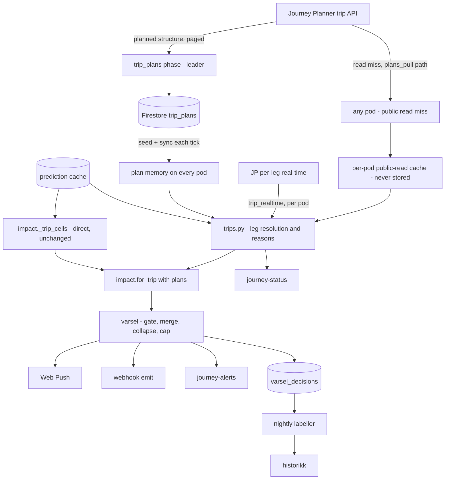
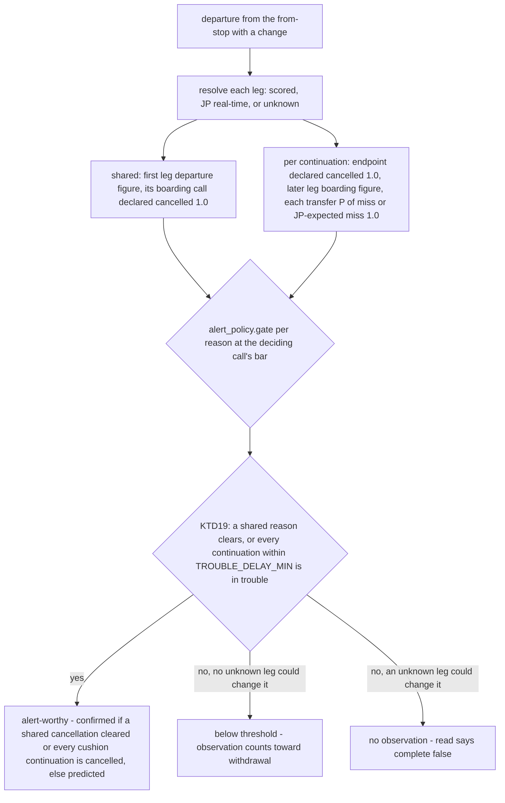
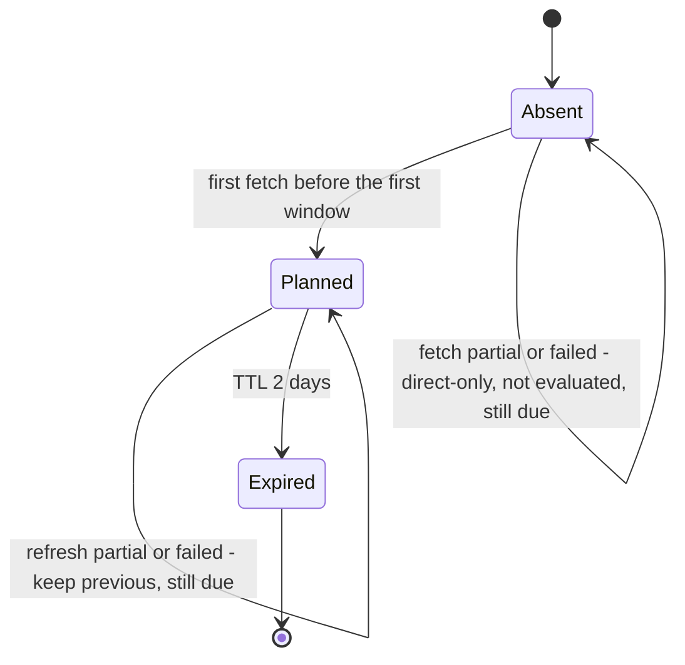

# Multi-leg journeys - Plan

## Goal Capsule

- **Objective:** a registered definition's departures with a change alert, read and grade end to end on every surface, using the same five input fields as today. Journey Planner (JP) finds the trips with a change. Our predictions decide what is late. On a window with direct trains, a trip with a change counts only when it beats waiting for the next direct train (KTD20).
- **Surfaces:** `/varsel` (PWA and its API), webhook subscriptions and events under `/notification-api/v1`, the public `GET /notification-api/v1/journey-alerts` read, and the public `GET /notification-api/v1/journey-status` read.
- **Authority, highest first:** the user's confirmed scope (the Product Contract Key Decisions and the labeled KTDs), then the Product Contract requirements, then the other KTDs, then the units. Repo conventions in `CLAUDE.md` and `.claude/rules/*.md` bind every unit. Read `.claude/rules/varsel.md`, `.claude/rules/notification-webhooks.md` and `.claude/rules/historikk.md` with the Read tool before touching their surfaces.
- **Stop conditions:**
  - JP cannot return a planned trip structure that includes cancelled departures (KTD1). Stop and report; do not build on the realtime-routed answer.
  - The flag-off path cannot stay byte-identical to today, apart from the two always-present schema fields R16 names.
  - A change needs a new equality on an existing Firestore query (a ~7-minute guarded outage per index). Stop and split it into two merges.
  - A BigQuery operation would cost more than $10.
- **Execution profile:** one worktree (`feat/multi-leg-journeys`), stacked branches, one session. Everything ships behind `TRIP_PLANS_ENABLED`, off in every environment until U12 turns it on in dev. prd stays off until the U12 dev review meets its pass marks and the owner turns it on.
- **Tail ownership:** the owner turns the flag on in prd once the U12 dev review meets its pass marks, and runs the scheduled-query re-registration in U11 in dev and prd in one sitting.

---

## Product Contract

### Summary

A registered trip is no longer limited to direct trains. Journey Planner finds the trips with a change for the window. Where direct trains run, a trip with a change counts only when it arrives before the next direct train would. Each departure from the from-stop is judged on whether it gets the traveller to the destination. That covers a cancelled leg, a missed connection, a late later leg, and legs we do not score, judged from JP's real-time data. The alert says so and suggests an alternative that may use other legs. Direct trains keep today's verdicts.

### Problem Frame

The matcher pairs a boarding call and an alighting call on one vehicle journey (`impact._trip_cells`, `impact._Generation._pair`). A trip that needs a change has no such pair. So it never alerts, and the contract says it "reads as calm however bad the day is" (`docs/integrations/notification-api.md`, Not in scope). `/varsel` shows the same gap as a «krever en direkteavgang» service warning. A commuter from Lier who changes at Drammen, or a Ruter bus rider feeding a Vy train at Oslo S, gets nothing.

The alternative-journey lookup already asks JP for trips with changes and scores their legs against our predictions (`alternatives.fetch_candidates`, `impact._score_candidate`). It never checks whether a connection holds, and it only runs after a direct train is already disrupted.

How many travellers this reaches is read in U12, before prd: today's count of registrations, both channels, whose record carries `no_direct_service`, the flag behind the «krever en direkteavgang» warning. That count falling after prd turns on is the reach measure.

### Key Decisions

- KD1. **JP discovers the legs; every client keeps sending five fields.** (session-settled: user-directed — chosen over a client-supplied ordered stop chain: the client describes from-place, to-place, weekdays and period as today, and we find the legs.) Governs R1, R2.
- KD2. **`/varsel` is in scope beside the notification API.** (session-settled: user-directed — chosen over the notification API alone.) Governs R14.
- KD3. **The alert is about a departure from the from-stop, judged end to end, and it may suggest other legs; direct pairs get the same treatment.** (session-settled: user-directed — chosen over per-leg alerts with missed-connection detection deferred.) Governs R5, R6, R7, R8, R9.

### Requirements

**Trip discovery**

- R1. The journey definition stays `from_stop`, `to_stop`, `begin`, `end`, `days` on every surface, with today's validation and canonicalisation.
- R2. JP finds the trips with one or more changes from the origin to the destination in the window. Direct trains stay on today's matcher (KTD3). On a window with direct departures, a trip with a change is a subject only when it arrives before the next running direct departure would; otherwise it is offered only as an alternative (KTD20).
- R3. A trip with a change is watched when at least one of its legs is a Vy or SJ train, the operators we score on every call. Whether a leg is scored is decided per leg per cycle: scored while the prediction cache holds its calls, otherwise judged from JP real-time (KTD8). A trip with no Vy or SJ leg is outside coverage and is reported as not evaluated, never as calm.
- R4. With the flag on, when JP gives no plan, every surface serves today's direct-only answer and says that trips with a change were not evaluated. With the flag off, no text changes, and only R16's `coverage.transfers` field carries `not_evaluated`. The one exception is servability, which keeps its last verdict (KTD15).

**The alert**

- R5. The alert subject is a departure from the from-stop: the first leg's boarding call. One subject per first-leg departure.
- R6. A subject with a change is judged end to end. The reasons are the first leg's departure, a declared cancellation of any ridden leg's boarding or alighting call, a later leg's boarding call, a missed connection, and an unscored leg's JP real-time state (KTD6). A ridden leg on a train Vy removed from today's plan is handled as a removed direct train is.
- R7. The alert tells the traveller whether this departure gets them to the destination, names the leg or transfer at fault, and gives the expected arrival when it is known.
- R8. The alert's alternative may use other legs or another departure. That includes the same first leg with a later connection.
- R9. A direct train keeps today's verdict. A trip with a change may be offered as its alternative.
- R10. Alerts go out only before the first leg departs, as for a direct train today.
- R11. A trip subject shares the registration's daily cap of four with direct alerts.
- R18. A broken change on the planned route does not alert when the same first train still reaches the destination through another planned continuation less than 10 minutes after the planned arrival, and that continuation is not in trouble itself (KTD19).

**Surfaces**

- R12. Webhook events and journey-alerts entries carry the trip facts in `payload`. The envelope does not change, and every addition is additive for existing receivers.
- R13. journey-status lists today's trips with a change in the window, keyed on the first leg and graded end to end. A leg with no data is grey, never green.
- R14. The `/varsel` PWA shows the trip on the alert card and on the «I dag» strip. The service warning stops claiming that a direct departure is required.

**Measurement**

- R15. The decision log records trip decisions at today's grain. The nightly labeller records whether the connection held and the actual arrival delay at the destination. `/historikk` shows trips with a change as their own segment.

**Rollout and privacy**

- R16. `TRIP_PLANS_ENABLED` per environment. Off means today's behaviour on every surface, with two exceptions the strict schemas need: journey-alerts and journey-status carry `coverage.transfers` as `not_evaluated`, and journey-status carries `trip: null` on every train (KTD13). No wording changes, because the trip prompt is used only on trip inputs (KTD12).
- R17. No log line carries a trip's stops or times; logs carry `pair_digest`. The plan store holds no registration, client or device data.

### Acceptance Examples

- AE1. **Covers R2, R5, R6, R7.** Given Lier → Oslo S at 07:00-08:00, where the R13 07:11 is direct and the R13 07:17 continues as R12 07:30 from Drammen with 4 min of slack and reaches Oslo S before the next direct departure after 07:17 does, and an operator message names the 07:17, when our forecast says the 07:17 is 5 min or more late at Drammen with a probability above 0.65 (Vy's bar with a message; 0.85 without one), then the 07:17 alerts as a predicted missed connection at Drammen, and the 07:11 is judged as today.
- AE2. **Covers R6, R8.** Given a trip whose second leg's boarding call ET has declared cancelled, and no other continuation of the first train reaching the destination within 10 minutes of it, when the poller runs, then the subject is confirmed and the alternative may be the same first leg with a later connection.
- AE3. **Covers R6.** Given a missed-connection forecast where the connecting train is also predicted late, so the connection holds, when the connecting train's own boarding figure clears its bar, then the subject alerts on the second leg instead of withdrawing.
- AE4. **Covers R3, R6.** Given a Ruter bus that no operator message names, feeding a Vy train, when JP real-time says the bus arrives 12 min late against 6 min of slack, then the subject alerts as predicted. When JP real-time is missing for the bus, it neither alerts nor withdraws, and the read says it is incomplete.
- AE5. **Covers R4.** Given the flag on and JP unreachable all morning, when a definition is read, then direct trains are answered as today and the answer says trips with a change were not evaluated. A pair served only with a change is not reported calm.
- AE6. **Covers R16.** Given the flag off, then no event payload has a `trip` key, the only response changes are R16's two schema fields, every `message_input` is byte-identical to today's, the servability texts are today's, and the plan fetch counter stays at zero.
- AE7. **Covers R9, R11.** Given a local train that reaches the destination itself and that JP also offers with a change to a faster express, then there is one subject for that departure and the direct verdict decides it.
- AE8. **Covers R10, R13.** Given a connection that breaks after the first leg has departed, then no push or event goes out, and the strip shows the trip red.
- AE9. **Covers R15.** Given a labelled trip whose second leg has no recorded call, then «connection held» is NULL. A declared cancellation of the second leg's boarding call labels it FALSE.
- AE10. **Covers R5.** Given a plan refresh that no longer returns a trip with a standing predicted subject, then the trip stays in the day's plan and is judged until its first leg departs, and nothing is withdrawn because of the refresh.
- AE11. **Covers R6, R18.** Given a first train from A that the plan continues two ways, changing at B to reach D at 08:00 or staying on to C to reach D at 08:06, when our forecast says the change at B is likely missed and the change at C is not, then no alert goes out and the strip does not show the trip red. When the C continuation reaches D at 08:12 instead, or its own change is also likely missed, the subject alerts as a predicted missed connection at B.
- AE12. **Covers R2, R9.** Given a window with direct departures, when a trip with a change arrives at the destination after the next direct departure after it would, then it is not a subject, and it may be offered as an alternative.
- AE13. **Covers R6.** Given a trip whose connecting train Vy removes from today's plan after the plan was fetched, and no continuation within 10 minutes, then the strip shows the trip as taken out of the plan and the morning digest names it, and no per-train push or webhook event goes out.

### Scope Boundaries

**Deferred for later**

- Alerts after the first leg has departed, and alternatives searched from a transfer stop (Outstanding Question Q1).
- Dated or ticket-bound itineraries, and client-supplied legs or via stops.
- Trips with only unscored operators, and direct trips on unscored operators judged from JP real-time. Both are new operator coverage.
- Narrowing the alternative scorer's `risky` to the ridden segment. Today it reads every call of every leg's whole journey.
- An LLM-written combined trip summary beyond the template and the existing prompt.

**Outside this product's identity**

- Replacing Journey Planner's routing, or routing ourselves.
- Native app or BFF work, which belongs to the client.

**Deferred to Follow-Up Work**

- A capacity agreement with the JP team before the plan traffic passes ~5 000 distinct pairs a day (Risks).
- A calibrated connection-miss model if the measured precision of KTD7's figure lands under the 0.8 bar, or its recall reading (U12) falls short of the direct segment's.
- Sharing JP real-time for unscored legs across pods through the store, if three pods' fetches become a measured cost.
- `/demo` and Rushvarsel keep direct-only behaviour.
- A prd shadow stage, if dev has not reached U12's minimum counts after four weeks with the flag on: prd evaluates trips and logs their decisions, and nothing traveller-facing changes. It needs a third flag state and an answer for what the reads show, so it is designed only when that trigger fires.

### Dependencies

- `p_arr_ge5` and `p_dep_ge5` are already emitted by `predict_calls.sql` and `predict_calls_bus.sql`. KTD7 only loads them, and never reads the served medians, so the open PR 361 (the 3-minute median floor) does not touch it.
- JP v3 GraphQL (`https://api.entur.io/journey-planner/v3/graphql`) with `ET-Client-Name: entur-kixavvik`.
- Firestore database `notifications` in dev and prd. tst has no store (KTD2).

### Outstanding Questions

All are deferred and non-blocking. The default is parity with today's direct-train behaviour, and the owner can redirect any of them.

- Q1. Should a traveller already on the first leg be told when the connection breaks? Default: no (R10). It needs alternatives from the transfer stop and a subject that lives past its first departure.
- Q2. Should a changed connection or reason mint a new webhook revision? Default: no. A revision is minted only on a lifecycle transition, and the payload carries the latest reason (KTD11).
- Q3. Is a cancelled second leg confirmed even when the next connection arrives a few minutes later? Resolved by KTD19: when a continuation of the same first train reaches the destination less than 10 minutes later and is not in trouble, nothing alerts. Otherwise the subject is confirmed, as a cancelled direct train is.
- Q4. Nynorsk wording for the missed-connection verb. The owner reviews it before the flag goes on in prd, as for the 2026-10-22 nynorsk texts.

### Sources

- Live JP checks (2026-10-24): Lier → Oslo S returned R13 07:17 → Drammen → R12 07:30 with a 2 min walk. Drøbak → Asker returned bus 500 → Oslo bussterminal → walk → Oslo S → R12. Every transit leg carried `serviceJourney.id`, `datedServiceJourney.id`, `operatingDay` and `serviceDate`. `interchangeFrom`/`interchangeTo` were null on every change. JP returns child stop places (Lier 426, Oslo S 337). The router's minimum is the walk plus `transferSlack` (default 120 s).
- `docs/plans/2026-09-07-1506-feat-journey-notification-webhooks-plan.md` R3 and AE2 (each leg at both ends; uncovered legs never safe), superseded by KD3 on missed connections.
- `docs/plans/2026-08-06-001-feat-alternative-journey-selection-plan.md` (multi-leg candidates, `risky`, reach set by `searchWindow`).
- `docs/plans/2026-10-22-001-feat-shared-translation-store-plan.md` (the leader-writes, every-pod-follows Firestore pattern KTD2 copies).
- Memory notes: `served-p50-has-3-min-floor`, `p-cancel-live-overconfidence`, `et-expected-times-unused` (ET expected times are optimistic at every lead), `trip-cells-pair-within-one-situation`.

---

## Planning Contract

### Key Technical Decisions

**Trip structure**

- KTD1. **JP supplies the structure a few times a day; our predictions decide lateness; no plan means direct-only.** (session-settled: user-approved — chosen over asking JP live every cycle and using its real-time estimates: we measured that our forecasts outrank ET's expected times at every lead.)
  - One trip set per canonical pair and Oslo date. The registered windows are fetch ranges, never keys, so every definition on a pair sees the same trips. That is what keeps KTD9's per-(pair, train) wording and alternative caches consistent.
  - The fetch asks for the planned structure, with cancelled departures included and flagged. The exact JP arguments are an execution-time unknown (Deferred implementation notes). A realtime-routed answer hides exactly the trips we must judge, so it is not acceptable.
  - The fetch paginates through `nextPageCursor` until the range is covered, with a page bound. It returns `complete`, `partial` (the page bound was reached, or a later page failed) or `failed`.
  - The leader fetches in a new poller phase, `trip_plans`, placed before `varsel_notify`. It covers only pairs with a registered definition (both channels). A date's plan is fetched when one of its windows first appears in `varsel.journey_windows`, which for a morning window is the evening before, and it is refreshed every `PLAN_REFRESH_S` (3 h). Fetches are spread across cycles under a phase deadline.
  - The plan also keeps the direct patterns' first-leg journeys and planned arrivals, which KTD3 and KTD20 read. They are not subjects.
  - Any pod may fetch a plan for a public read that misses, on its own fetch path (KTD18), outside the read's enrichment pool. Only a `complete` fetch enters a count-bounded per-pod cache with a published maximum; a `partial` or `failed` one leaves the read at `not_evaluated` with `complete: false`. That plan is never written to the store, and is never refreshed by the leader. The read does not wait on the fetch beyond its existing `wait` budget.
  - Only a `complete` fetch is merged: it alone extends the covered ranges and marks trips `dropped`. A `partial` or `failed` fetch keeps the previous plan unchanged, adds no trips, and leaves the range due for the next cycle. Merging part of a day would read the unfetched part as covered, or drop trips that were only on the pages never fetched. With no plan at all, the definition is direct-only, and surfaces say so (R4).
- KTD2. **Plans are shared through a Firestore collection, `trip_plans`, using the translation-store pattern.** Only the leader writes, and every pod seeds in the lifespan and syncs on each tick (`situation_english.follow`, `notification_store.seed_situation_translations`). A plan fetched for a public read stays in its pod (KTD1).
  - A write is a transactional merge of a `complete` fetch (KTD1), never a replace. It unions the stored and the written trips, keeps every `dropped` mark, unions the covered fetch ranges, and lets the fetch time decide only per-trip fields.
  - A window outside the covered ranges is a miss: reads answer `not_evaluated` with `complete: false`, and the pair becomes due for that range.
  - Documents are keyed by an unsalted SHA-256 of `from|to|oslo_date`, as `situation_english._digest` keys translations, so every pod finds the same document. The key is never logged; logs carry `pair_digest`. Documents hold trips (stops, lines, journeys and times), the direct patterns' journeys and arrivals, and the covered fetch ranges. They hold no registration, client or device data (R17).
  - TTL is 2 days on an `expires_at` field. The large `trips` map is exempt from automatic indexes, as `translations` is.
  - Requests read memory only. A store failure falls back to the pod's memory and never fails a tick.
  - tst has no store, so its single pod keeps plans in memory.
- KTD3. **Direct trains stay on today's matcher; JP adds only trips with a change.** A pattern whose first-leg journey is itself direct for the pair is dropped before judging: it is one of the plan's direct patterns, or `_trip_cells`' eligibility check admits it before per-line selection. The direct verdict then decides that departure, because the traveller can stay on board (AE7), whether or not the direct train survives per-situation selection. U5 merges the two subject sets in `varsel.match_journey` after `worst_by_situation`, keyed by a source-independent departure key (operator, journey, aimed departure at the from-stop). With the flag off, or with no plan, the merge has nothing to add, so the fallback is today's path by construction.
  - **Conflict with an approved call-out:** the approved scope said the watched departures are "the trips Journey Planner itself proposes". This KTD keeps every direct train that `_trip_cells` finds, even when JP's `timetableView` would drop it as dominated. People ride dominated trains, and existing registrations must not lose alerts. Revisit only if the owner wants JP's filter applied to direct trains too.
- KTD20. **On a window with direct departures, a trip with a change is a subject only when it beats waiting for the next direct train.** (session-settled: user-approved — chosen over every trip JP returns being a subject, which can spend the daily cap of four on round-about trips the commuter does not ride, and over subjects only on windows with no direct departure, which drops trips with a change that are faster.)
  - The comparison is on planned times. The trip's arrival at the destination is compared with the earliest planned arrival of any direct departure that leaves the from-stop at or after the trip's first-leg departure.
  - A direct departure does not count when its boarding or alighting call is declared cancelled (ET or JP), or when its train is taken out of today's plan (`KIX:PlanRemoved:`). That state is read from the prediction cache at judge time, where a removed train appears as a `KIX:PlanRemoved:` cancellation, never from the plan document.
  - A trip that arrives earlier is a subject. One that does not is offered only as an alternative (R9). A trip with no counting direct departure after it in the plan's range is a subject.
  - The comparison runs every cycle, so a cancellation can make a trip a subject during the day. A trip with a standing alert on a definition stays a subject for it until its first leg departs, so a lifted cancellation never leaves the alert without a subject to withdraw it. U5's merge reads that from the alert state varsel and the webhook store already keep, so it survives a leader change, and no new state is written.
  - The direct departures come from the plan's direct patterns (KTD1). JP's dominance filter drops a direct train only in favour of one that leaves no earlier and arrives no later, so it cannot change the earliest arrival. When that better train is cancelled, the comparison falls back to the next direct departure the plan holds, which can only make the trip a subject more often.
  - Under KTD19 the trip's arrival is its planned continuation's, the earliest-arriving one.

**Judging a trip**

- KTD4. **Trip evaluation lives in a new module, `disruptions/api/trips.py`, which `impact` imports.** `impact.for_trip` gains an opt-in `plans` argument, so `/varsel` still makes one provider call per window and `/impact`'s public contract is unchanged by default. `journey_status` keeps its pinned import set and reaches trip grading through `impact`. Plans, real-time data, the call lookup (as `impact.configure(call_lookup=...)` already takes it) and a read-miss fetch trigger are injected through `configure`, so `trips` imports nothing from `impact`. `trip_plans.py` (JP fetch, store, phase, real-time fetch) is imported by `main` only; `notification_pull` and `journey_status` reach it only through the injected trigger.
- KTD5. **The subject's identity is the first leg's boarding call, in today's envelope fields.** A scored first leg uses its `CallPred` identity. An unscored first leg takes its identity from the plan leg: codespace, `jkey` through `alternatives.cache_key`, stop place, stop position and aimed departure. That identity is pinned in the plan, so a `CallPred` that appears later in the day does not change the key. `alert_id`, the push tag, `one_alert_per_train` and the cap all work unchanged.
- KTD6. **Every reason enters the one gate, `alert_policy.gate`, as a figure.** Each reason is gated at the deciding call's operator threshold and `has_situation`. The subject is alert-worthy when any reason clears its bar. A certainty is 1.0, as `impact._unreachable_departure_prediction` already does for a cancelled destination. There is no second rule, and the `is_material` ban and its grep stay.

  | Reason | Figure | Phase |
  |---|---|---|
  | First leg's departure | `p_impact_dep` of the boarding call, as today | predicted |
  | A ridden leg's boarding or alighting call declared cancelled (ET or JP) | 1.0 | confirmed |
  | A later leg's boarding call | that call's `p_impact_dep` | predicted |
  | Missed connection, scored arriving call | P(miss), from KTD7 | predicted |
  | Missed connection, unscored arriving leg | 1.0 when JP's expected times miss (KTD8) | predicted |

  Only endpoints of ridden legs count, and only declarations, mirroring `_destination_cancelled`. A cancelled call in the middle of a leg is not a reason.

  A ridden leg on a train Vy removed from today's plan (`KIX:PlanRemoved:`) is not this table's declaration. It is handled as a removed direct train is: the strip shows the trip «tatt ut av rutetabellen», the morning digest names it, and it never becomes a per-train push or webhook event (`notification_wording.is_plan_removed`). KTD19's cushion applies first. The plan holds such a trip only if it was fetched before the cut, which KTD1's evening-before fetch and KTD11's never-remove rule give for a cut published after that fetch. `ponytail:` a cut published before the first fetch is invisible. Upgrade path: compare against the pair's previous same-weekday plan.

  When several continuations share the first leg, KTD19 composes the gate's per-reason verdicts across them. The composition adds no rule beside the gate, and the `is_material` ban and its grep are untouched.

  Where the deciding figure is recorded:
  - The decision row's `impact_probability`, `alert_threshold` and `alertworthy` are the deciding reason's figure and the bar the gate applied to it. Recording one number and applying another is the failure `alert_policy.gate`'s docstring forbids. `Alert` carries the deciding pair as `deciding_probability` and `deciding_threshold`, beside the boarding call's `impact_probability` and `alert_threshold`. `decisions.py` records the deciding pair when it is set, and `_alert_severity` ranks trip alerts on it, so `worst_by_situation` and `one_alert_per_train` never rank a broken connection as a calm train.
  - `payload.probabilities` stays the boarding call's figures, as the schema defines them. An unscored first leg has no figures, so under a predicted phase its keys carry null, and the deciding figure rides in `payload.trip.problem`. A confirmed reason follows the destination-cancelled overwrite (1.0, 1.0, null delays), which the schema already states for `confirmed`.
  - The deciding figure and its bar for a predicted trip reason ride in `payload.trip.problem` (KTD13). KTD8's "1.0, predicted" therefore never appears in `payload.probabilities`, and the coherence rule pinned in `test_the_synthetic_event_is_a_coherent_confirmed_cancellation` and `wireContract.test.mjs` holds.
- KTD7. **A missed connection is read off the arriving call's calibrated survival points and gated like any figure.** (session-settled: user-approved — chosen over building and calibrating a connection-miss probability first: precision is measured after launch on `/historikk`.)
  - The slack is the next leg's aimed departure, minus the arriving leg's aimed arrival, minus the walk, minus JP's transfer slack (120 s). KTD8's JP-expected miss keeps the 120 s as margin instead.
  - When the connecting call is scored, add to the slack the largest of 5, 10 and 20 minutes whose departure exceedance (`p_dep_ge5`, `p_dep_ge10`, `p_dep_ge20`) is at least 0.5, and nothing when none is. That is a lower bound on its median departure delay that never reads the stack's 0-5 minute segment.
  - P(miss) is the arrival-delay survival at that slack, read off the stack's own points: `p_arr_ge5`, `p_arr_ge10` and `p_arr_ge20`, linear between them, and `p_arr_ge20` beyond 20 minutes. Below 5 minutes it is held flat at `p_arr_ge5`, which understates the miss: the safe side for a figure with no calibration of its own.
  - The stack's 0-5 minute segment, a straight line from certainty at zero, is never read; it is what put a 3-minute floor under the served median. The served p50 and p90 are not read either, because they come off the same curve.
  - `p_arr_ge5` and `p_dep_ge5` join `CallPred` (`impact.py`) and its loader (`main.py`) with a default of None. Where one is missing, the curve starts at the 10-minute point, held flat below it.
  - `ponytail:` the two legs' delays are treated as independent. A corridor where both trains are late together reads too pessimistic. Upgrade path: a joint figure, if the measured precision asks for it.
- KTD8. **An unscored leg is judged from JP real-time data, in three states.** (session-settled: user-approved — chosen over assuming unscored legs run on time.)
  - Each pod fetches JP's expected times and cancellations in batched per-leg queries per tick. It covers the unscored legs of watched trips boarding within the look-ahead, and of every trip journey-status lists today within its window. Registered pairs' legs go first, and legs of pairs only a public read wants fill what remains. The leader does this in a `trip_realtime` phase, and a follower does it on its tick.
  - Each leg is in one of three states, decided per leg per cycle: scored while the prediction cache holds its calls (our figures), JP real-time, or unknown. A Ruter bus is therefore scored while an operator message names it, and judged from JP otherwise.
  - A leg JP answers with `realtime: false` is unknown, not on time: JP then copies the aimed times into the expected ones.
  - An answer older than `REALTIME_MAX_AGE_S` (360 s) makes the leg unknown. The leader refreshes in its cycle just before `varsel_notify`, so a verdict normally reads an answer seconds old, and reads between cycles see one up to a cycle period old (120-185 s). 360 s is about two leader cycles: one failed refresh does not blank a leg, and a second does. Our own figures still take precedence while the prediction cache scores the leg.
  - A JP-declared cancellation is 1.0, confirmed. A miss by JP's own expected times is 1.0, predicted. This is the one place a non-model number enters the gate.
  - A JP-expected miss is the arriving leg's expected arrival plus the walk passing the next leg's aimed departure. JP's 120 s transfer slack is left in as margin, unlike KTD7's slack, because JP builds trips at its minimum transfer and a few seconds of delay would otherwise fire a certainty. ET's expected times are measured optimistic for Vy rail only (memory `et-expected-times-unused`), so U12 counts how often a JP-expected miss on a bus leg was followed by a connection that held.
  - An unknown leg emits no reason, and reads report `complete: false`. It blocks withdrawal only of a subject whose standing reason sits on that leg or its transfer. A subject standing on another leg's figure withdraws as today when that figure falls.
- KTD9. **After a missed connection, the subject's own expected arrival comes from the plan, never invented.** It is the earliest feasible sibling pattern in the plan that shares the first leg. If none exists, the arrival is unknown (null). When several patterns share a first leg, the earliest-arriving planned continuation is the route the alert describes, KTD19 decides whether its trouble alerts, and the siblings are alternatives. A sibling is feasible when it is not in trouble under KTD19.
  - `ponytail:` siblings come from the day's plan only, not a fresh search from the transfer stop. Upgrade path: an arrive-by search from the transfer stop, with Q1.
- KTD19. **A broken continuation alerts only when no other continuation of the same first train gets the traveller there in time.** (session-settled: user-approved — chosen over alerting on a broken change regardless of the fallback: the alert says whether this departure reaches the destination, KD3.)
  - It applies only when the plan has several continuations sharing the first leg. That includes the same first leg with a later connection at the same transfer stop. Different first trains are separate subjects and are unaffected, and a direct first train keeps its direct verdict (AE7).
  - The subject's reasons split in two. The shared reasons are the first leg's departure and a declared cancellation of its boarding call, and they are never cushioned. Every other reason belongs to one continuation: the first leg's alighting call, the change, and the later legs' boarding calls and endpoints. Continuations that alight the first train at the same stop each carry that alighting call's reason, so a declared cancellation there puts all of them in trouble together.
  - A continuation is in trouble when any of its reasons clears its own bar in `alert_policy.gate`. Verdicts are composed, never figures, because continuations can end on operators with different bars.
  - The cushion set is the continuations whose planned arrival at the destination is less than `alert_policy.TROUBLE_DELAY_MIN` (10 min) after the earliest planned arrival. That constant is already the one definition of trouble behind every surface, and `p_impact_dep` predicts the same event: cancelled or 10+ minutes late.
  - The subject is alert-worthy when a shared reason clears, or when every continuation in the cushion set is in trouble.
  - The phase is confirmed when a shared declared cancellation clears, or when every continuation in the cushion set is in trouble through a declared cancellation. Otherwise it is predicted. A cancelled second leg beside a healthy continuation is not a confirmed problem reaching the destination.
  - The recorded figure and bar are the binding ones. When a shared reason clears, it is recorded. Otherwise the record is the cushion-set continuation whose strongest clearing reason clears by the least, with that reason's figure and bar: below its bar, that number would have stopped the alert.
  - With no sibling in the plan, the cushion set is the planned continuation alone, and the verdict is KTD6's, unchanged.
  - The rule engages only if U1's fetch returns siblings. JP's dominance filter drops a same-departure, later-arrival pattern, so U1 records whether the chosen arguments return them.
- KTD10. **The alternative lookup learns trips.**
  - For a trip subject, `affected_refs` holds the broken leg or legs, not the first leg. "Same first leg, later connection" can then compete.
  - The trip competes as the original, with its end-to-end expected arrival.
  - Candidates with a change get KTD7's transfer check. This also changes the alternatives that direct alerts get, and the alternative identity is part of `wording_key`, so the check sits behind the flag.
- KTD11. **The lifecycle keeps today's rules.**
  - A subject is catchable until its first leg departs (R10).
  - A `complete` refresh adds trips and never removes a trip from the day's plan. A trip a `complete` refresh no longer returns is marked `dropped` and is still judged until its first leg departs (AE10).
  - A changed reason or connection mints no revision, because only a lifecycle transition does (Q2). A cancelled later leg is confirmed, unless a continuation within 10 minutes is not in trouble, in which case nothing alerts (KTD19, Q3).
  - The reason kind and the leg or transfer index (0-based, KTD13) are a thinning keep-reason in the decision log, so a reason change is recorded.

**Wording and contract**

- KTD12. **Wording gains trip facts only for subjects with a change.**
  - `message_input` gains the transfer stop, the planned slack, the reason kind, the legs and the expected arrival, only on a trip with a change. A direct train's input stays byte-identical.
  - `wording_key` gains the reason kind and the leg or transfer index (0-based, KTD13). They are categorical, never continuous figures, to avoid flapping.
  - A new outcome verb for a missed connection goes into `outcome_verb`, `_VERB_ORDER` and all three summary vocabularies (`_NB`, `_EN`, `_NN`). The template gets a transfer detail line, as `DESTINATION_CANCELLED` has.
  - The trip rule lives in a second system prompt with its own version, used only when `message_input` carries trip facts. `_SYSTEM_PROMPT` and `PROMPT_VERSION` do not change, so no direct wording moves on the deploy. One selector, `llm_message.prompt_version_for(message_input)`, replaces every read of `PROMPT_VERSION`: `notification_wording`'s wording key, `notification_pull`'s, and `meldinger`'s replay key and stored-version comparison. Replay the trip prompt on both Gemini models through `/meldinger` before merging.
  - Replies over 300 characters are discarded, so assume the template carries most trip alerts.
- KTD13. **Trip facts ride in `payload.trip`, present only on a subject with a change.** It is absent on direct trains and everywhere with the flag off. It carries the legs, the transfers, the expected arrival at the destination, and the problem: the reason kind, the leg or transfer index, and the deciding figure with its bar (KTD6).
  - Under KTD19 the problem names the planned continuation's reason, which is what breaks the ride the traveller planned. The deciding figure and bar beside it may come from a sibling continuation, the binding one.
  - `payload.arrival` keeps its meaning, the same vehicle journey at the destination, so it is null on a trip with a change.
  - The envelope, `payload.call` and `payload.probabilities` do not change. Their key sets are pinned in Python and TypeScript.
  - `effect` gains `missed_connection`. A confirmed phase is `cancelled`, as today. A predicted subject whose planned continuation breaks at a transfer, by a missed connection or by a cancelled later leg whose cushion is only predicted to fail, is `missed_connection`, whatever its boarding delay. Otherwise today's rule holds. The value is additive on the wire, but the published vocabulary and the typed client's literal union must change.
  - journey-alerts' `coverage` gains a `transfers` field. It is `none` when the plan has no trip with a change in the window, and `not_evaluated` when there is no plan, the window is outside its covered ranges, or none of its trips with a change is watched (R3). Otherwise it is `evaluated`. journey-status's coverage carries the same field.
  - journey-status's `TrainStatus` gains `trip`, required and nullable, null on a direct train.
  - Both models are `extra="forbid"` with `required == properties`, so both fields are present with the flag off (`not_evaluated` and null; R16). These are strict-schema additions, and the contract's changelog must say so.
  - The schema generator handles no `oneOf` or `$defs`, so `trip` is a plain object.
  - The trip shape is defined once, in `alternatives.py` beside `AlternativeLeg`, whose widened form is its leg. It holds the legs in travel order, the transfers (stop place, walk, planned slack), the expected arrival, and the problem. Legs and transfers are numbered from 0: transfer `i` sits between legs `i` and `i+1`. `payload.trip`, `TrainStatus.trip` and the `/varsel-api` models serialise this one definition. `journey_status` reaches it through `impact`, which already imports `alternatives`' models, so its pinned import set holds.
- KTD14. **journey-status grades trips with a change from the plan, leg by leg.**
  - Rail legs are graded from the spine, actuals and predictions as today. Other legs are graded from our predictions while scored, and otherwise from JP real-time, which U4 fetches for every trip journey-status lists (KTD8). An unknown leg is grey.
  - A trip's level follows KTD19's verdict. A broken planned continuation whose cushion holds is graded on the cushion's arrival, so the strip never shows red where the alert stays silent.
  - `test_the_train_set_agrees_with_the_push_matchers_eligibility` is re-pinned, so that the strip's trip set equals the matcher's set over both paths.
  - A request never touches the network. A pod without the plan starts the background fetch through the injected trigger (KTD4), into its per-pod cache, and answers `not_evaluated` for trips with a change.
- KTD15. **Servability widens only with the flag.** With the flag on, a definition is servable when it has a direct trip or a watched trip with a change. The service warning text and the webhook `servable` description change accordingly. With the flag off, both are byte-identical. With the flag on and JP down, the last verdict stands, and the text says that trips with a change were not evaluated.
  - With the flag on and no plan yet for the pair, the transfer half of the verdict stays unestablished. The re-check is due as soon as the pair's plan lands, without waiting out the six-hour interval, so a definition served only with a change does not carry the warning for hours after registration.

**Measurement**

- KTD16. **The decision log keeps its grain and gains trip columns; the labeller learns connections.** (session-settled: user-approved — chosen over scoring trips with a change on their first leg only.)
  - The grain stays one definition × one situation × one first-leg departure.
  - `varsel_decisions` gains a legs snapshot, the reason kind, the leg or transfer index (0-based, KTD13) and P(miss), appended last.
  - `varsel_decision_outcomes` gains «connection held» (BOOL) and the actual arrival delay at the destination (INT64 minutes).
  - The two columns have different scopes. «connection held» covers only the planned continuation's transfers. It is TRUE when every one held: the arriving leg's realized arrival plus the walk is no later than the connecting leg's realized departure. It is FALSE when one did not, or when a ridden leg's boarding or alighting call was declared cancelled. It is NULL only when a leg went unrecorded and none failed; FALSE beats NULL.
  - The arrival delay covers every continuation in the legs snapshot, which holds every continuation the verdict was taken over (KTD19). It is the earliest realized arrival across them, minus the earliest planned arrival, in whole minutes. Trouble for a trip is that delay reaching `TROUBLE_DELAY_MIN` or every continuation broken, with honest NULLs, so a cushioned trip that stayed silent never counts as a missed alert.
  - The labeller joins each leg's realized calls, using the `destination_cancelled_et` CTE as the model. An unrecorded leg is NULL, never TRUE. A declared cancellation is FALSE.
  - `/historikk` adds a «med bytte» segment, discriminated on the legs column and tested before every provenance branch in all six CASE copies.
  - The groups view aggregates the new columns and never groups on them.
  - Order: deploy first (the startup `ADD COLUMN IF NOT EXISTS`), then `bq update --transfer_config` in dev and prd in one sitting.

**Rollout and cost**

- KTD17. **One flag, `TRIP_PLANS_ENABLED`, read per call from the configmap, default off.** Off means zero plan and real-time fetches, no `payload.trip` key, today's `message_input`, servability, alternatives and summaries, and only R16's two schema fields beyond today's responses. U12 turns it on in dev; the owner turns it on in prd once the U12 dev review meets its pass marks.
- KTD18. **JP traffic gets its own fetch paths, and the numbers are published.**
  - Add `plans`, `plans_pull` and `realtime` rows to `alternatives._FETCH_CEILINGS`, each with a per-minute ceiling, so plan traffic can never eat the alternative lookups' share.
  - Publish the constants (ceilings, `PLAN_REFRESH_S`, `REALTIME_MAX_AGE_S`, look-ahead, page bound, the per-pod public-read plan cache bound) in the parsed constants table of `docs/operations/notification-webhooks.md`.
  - Volume is a few requests per registered pair per day plus a few batched real-time requests per pod per tick. At ~160 pairs in prd today that is about 1 000 plan requests a day. Public-read plans are counted apart, bounded by `plans_pull`'s ceiling and the per-pod cache.

### High-Level Technical Design

Data flow, from JP to the surfaces:

The verdict for one first-leg departure with a change:

The lifecycle of one day's plan for one pair:

### System-Wide Impact

- **Poller cycle:** two new phases. `trip_plans` runs under its own deadline and is spread across cycles. `trip_realtime` makes one batched request. Both are logged by `main._phase` as `poller_phase`.
- **Memory:** plans are held per pair per day on every pod. Measure the footprint in dev before prd.
- **Firestore:** one new collection, a few writes per pair per day, and one seed plus one sync per tick per pod. Index exemptions and the TTL field go in `terraform/firestore.tf`. `firestore.rules` does not change, because the database stays deny-all for client SDKs.
- **JP:** new outbound traffic on three budgeted paths (KTD18).
- **Wording:** none for direct trains. Trip alerts are worded through a separate trip prompt with its own version (KTD12).
- **BigQuery:** new columns on two tables. The labeller's ET scan grows with arrival columns, so dry-run it for bytes. The registered scheduled query must be re-registered in dev and prd.
- **Integrators:** additive payload changes. The strict-schema additions to `coverage` and `TrainStatus` are announced in the contract's changelog.
- **Privacy:** decision rows gain transfer stops, in the same class as today's origin and destination, behind SSO. Logs gain no stops (R17).

### Risks

| Risk | Mitigation |
|---|---|
| KTD7's figure has no calibration of its own and may fire too often or too rarely | The flag ships in dev first. The «med bytte» segment on `/historikk` measures precision, U12 reads recall, and the calibrated model is a named follow-up |
| `p_cancel` is overconfident at non-origin calls past stop 5, which is where transfers sit (memory `p-cancel-live-overconfidence`) | Read the «med bytte» segment by reason kind before prd |
| JP volume at the 100k target is 75-170k requests a day | Budgets per path. Ask the JP team before passing ~5 000 pairs (follow-up) |
| JP's planned-structure arguments do not behave as needed | Stop condition. Verified in U1 against live JP before anything builds on it |
| JP drops a same-departure, later-arrival continuation as dominated, so KTD19 never engages | U1 records whether the chosen arguments return several continuations of one first train. Without them, alerts follow KTD6 alone, which is today's plan |
| Bus `jkey` is not date-scoped, so tomorrow's leg can resolve to today's calls | Resolve on stop place plus aimed time, with JP's `serviceDate` on each leg (U3) |
| The trip prompt's wordings are new and unproven | Replayed on both Gemini models through `/meldinger` before merging (KTD12). Most trip alerts fall back to the template anyway |
| The scheduled query breaks when outcome columns are added | U11's fixed order, in one sitting |
| A silent JP outage leaves every pair direct-only for days, and nobody notices because the answers stay valid | `trip_plans_fetch` logs `complete`, `partial` or `failed` per fetch. The dev review reads the share that is not `complete`, and a Grafana rule on that share is hand-built in U12 (memory `alerts-go-to-slack`) |
| A page bound too low for a peak hour makes a pair `partial` on every fetch, so it is never evaluated and retried every cycle | The same share and rule count `partial`. U1 sizes the bound from a measured peak-hour reply |

### Deferred implementation notes

- Which JP `trip` arguments give a planned structure with cancelled departures included. The property needed: a cancelled or late leg 1 does not remove the trip from the answer.
- Whether JP's `stopPositionInPattern` equals ET's call order for VYG, or differs by a constant. Verify against a VYG journey in U1. Normalise, or derive `stop_order` from the prediction cache when the leg is scored.
- The exact batched real-time query (aliases over `datedServiceJourney(id)` or `serviceJourney(id)`), its page size, and the look-ahead value.
- How many patterns a peak hour returns per page, which sets the page bound.
- The plan footprint per pair, measured in dev.

---

## Implementation Units

| U-ID | Title | Files touched | Depends on |
|---|---|---|---|
| U1 | JP trip-plan fetch and parse | `disruptions/api/trip_plans.py`, `disruptions/api/alternatives.py` | — |
| U2 | Plan store, phase and follow | `disruptions/api/trip_plans.py`, `disruptions/api/notification_store.py`, `disruptions/api/main.py`, `terraform/firestore.tf` | U1 |
| U3 | Leg resolution and trip verdict | `disruptions/api/trips.py`, `disruptions/api/impact.py`, `disruptions/api/alternatives.py`, `disruptions/api/main.py` | U1 |
| U4 | JP real-time for unscored legs | `disruptions/api/trip_plans.py`, `disruptions/api/main.py`, `disruptions/api/trips.py` | U1, U3 |
| U5 | varsel wiring, lifecycle, servability, flag | `disruptions/api/varsel.py`, `disruptions/api/main.py` | U2, U3, U4 |
| U6 | Alternatives for trips | `disruptions/api/impact.py` | U3, U5 |
| U7 | Wording | `disruptions/api/llm_message.py`, `disruptions/api/notification_wording.py`, `disruptions/api/notification_pull.py`, `disruptions/api/meldinger.py` | U5 |
| U8 | Webhook payload, journey-alerts and contracts | `disruptions/api/varsel.py`, `disruptions/api/notification_api.py`, `disruptions/api/notification_pull.py`, `contracts/notifications/v1/*`, `integrations/notifications-client/*` | U5, U7 |
| U9 | journey-status for trips | `disruptions/api/journey_status.py`, `disruptions/api/notification_pull.py`, `disruptions/api/main.py`, `contracts/notifications/v1/openapi.json` | U2, U3, U4 |
| U10 | `/varsel` PWA | `demo/avviksvarsel/src/*`, `disruptions/api/varsel.py` | U5, U9 |
| U11 | Decision log, labeller, `/historikk` | `disruptions/api/decisions.py`, `disruptions/api/create_varsel_decisions.sql`, `data/queries/label_varsel_decisions.sql`, `disruptions/api/historikk_*.sql`, `disruptions/api/meldinger_summary.sql`, `data/queries/message_wording_comparison.sql` | U5 |
| U12 | Docs, rules, Helm flag, dev rollout | `docs/integrations/*`, `docs/operations/notification-webhooks.md`, `.claude/rules/*.md`, `CLAUDE.md`, `helm/kix-avvik/env/values-kub-ent-*.yaml` | U1-U11 |

### U1. JP trip-plan fetch and parse

**Goal:** fetch one Oslo day's trips with a change for a canonical pair and a set of fetch ranges, and parse them into per-leg records that carry identity.

**Requirements:** R2, R17; KTD1, KTD3, KTD5, KTD18, KTD20.

**Dependencies:** none.

**Files:**
- Create `disruptions/api/trip_plans.py` and `disruptions/api/test_trip_plans.py`.
- Modify `disruptions/api/alternatives.py`: new `_FETCH_CEILINGS` rows only.

**Approach:**
1. Write a trip query beside `alternatives._TRIP_QUERY`, reusing its leg selection. Add `serviceDate`, quay and stop-place ids, stop position in pattern, and the call-level cancellation and realtime flags. Never request `estimatedCalls`.
2. Verify the planned-structure arguments against live JP before parsing anything (stop condition). Record what was verified in the module docstring. Also record whether the answer holds several continuations of one first train: without them KTD19 never engages. That is reported, not a stop.
3. Page through `nextPageCursor` until the fetch range is covered, up to the page bound. Return the trips with a result of `complete`, `partial` or `failed` (KTD1). Size the page bound from a recorded peak-hour reply.
4. Parse each pattern with at least one change into a trip with ordered legs. Each leg carries operator codespace, `jkey` (through `alternatives.cache_key`, including the SJN rewrite), line, board and alight stop places and quays, positions, aimed times, `serviceDate`, mode, walk to the next leg, and cancellation. Patterns that are walk-only, or board somewhere other than the from-stop's place set, are dropped. Direct patterns are not trips, but their first-leg journey, departure and planned arrival are kept for KTD3 and KTD20.
5. Go through `alternatives._post_json`, so the egress guard, the `errors` envelope handling and `ET-Client-Name` hold. Log `trip_plans_fetch` with `pair_digest`, never refs.

**Patterns to follow:** `alternatives.fetch_candidates` and `parse_candidates` (fail open, outcome reporting); `main.refresh_line_modes` (a daily JP phase).

**Test scenarios:**
- A recorded Lier → Oslo S reply parses into one trip with two legs, Drammen as the transfer, a 2 min walk, and VYG identities for both legs.
- A recorded bus-then-train reply parses its RUT leg's `DatedServiceJourney` into the same `(operator, jkey)` form the prediction cache uses.
- Direct and walk-only patterns are not trips, and a direct pattern's journey, departure and arrival are kept.
- A pattern boarding at a stop outside the from-stop's place set is not a trip.
- A two-page reply is followed to the second page and is `complete`. Pagination stops at the page bound, and that result is `partial`.
- A GraphQL `errors` envelope, a timeout and a malformed leg each fail open with no trips, a logged reason and the result `failed`. A failure on the second page is `partial`, never `complete`.
- Under the test process, a fetch never reaches the network.
- The `plans` path refuses a fetch past its per-minute ceiling, and the alternative lookups' `poller` path is untouched.
- No log record from the module contains a stop ref or a departure time.

**Verification:** `test_trip_plans.py` passes under the CI loop. A recorded live reply is committed as the fixture, and the module docstring names the verified JP arguments and the stop-order convention.

### U2. Plan store, phase and follow

**Goal:** the leader keeps one plan per pair per Oslo day current, and every pod holds the same plans in memory.

**Requirements:** R2, R4, R17; KTD1, KTD2, KTD11.

**Dependencies:** U1.

**Files:**
- Modify `disruptions/api/trip_plans.py`, `disruptions/api/notification_store.py` (collection, seed/sync specs, write body), `disruptions/api/main.py` (phase, lifespan seed, follower tick) and `terraform/firestore.tf` (TTL field, index exemption).
- Tests: `disruptions/api/test_trip_plans.py`, `disruptions/api/test_notification_store.py`, `disruptions/api/test_poller_refresh.py`.

**Approach:**
1. Add `trip_plans` to `notification_store.COLLECTIONS` with seed and sync specs modelled on `situation_translations`. The write body is a transactional merge (KTD2): it unions trips, `dropped` marks and covered ranges, and never replaces.
2. In `main._rebuild_all`, add a `trip_plans` phase before `varsel_notify`, gated on the flag. Collect the pairs and fetch ranges from registered definitions (both channels) only; a pair only a public read wants is never on this list. A date is due when one of its windows first appears in `varsel.journey_windows`, and a range is due when it falls outside the stored covered ranges. Fetch what is due under the phase deadline.
3. A `complete` refresh merges into the day's plan: it adds new trips, marks trips JP no longer returns as `dropped`, and never removes one (KTD11). A `partial` or `failed` one changes nothing and leaves the range due.
4. Seed in the lifespan beside `follow_last_build`, and sync on each follower tick. The leader re-seeds on taking the lease.
5. In tst (no store), keep plans in memory on the single pod.

**Patterns to follow:** `situation_english.follow` and `update`; the `notification_mirror` phase placement; the Oslo-date due gate (memory `oslo-utc-gate-and-latch`: the gate's timezone and its latch key must match).

**Test scenarios:**
- A pair registered for 07:00-08:00 is fetched for tomorrow on the evening cycle that first offers tomorrow's window, and not again before `PLAN_REFRESH_S`.
- Two definitions on one pair with different windows share one plan whose ranges cover both.
- A 22:00-01:00 window belongs to the Oslo date it begins on. Its fetch range crosses midnight, and the due gate and its latch key both use the Oslo date.
- A publicly read pair that nobody registered is absent from the store and from the next cycle's fetch list. Its plan lives only in the reading pod's bounded cache.
- A definition registered mid-day with a window outside the stored ranges reads `not_evaluated` with `complete: false`, and the pair is due for that range on the next cycle.
- A refresh that omits a trip keeps it, marked `dropped`, and adds a newly returned one. Covers AE10.
- Two writes with different covered ranges merge: both ranges and both sets of trips survive, and every `dropped` mark is kept.
- A `partial` or `failed` fetch keeps the previous plan: no range is extended, no trip is added or marked `dropped`, and the range is due again on the next cycle. A pair with no plan yields "not evaluated" to its readers.
- A pair whose fetch is `partial` on every cycle stays `not_evaluated`, and each attempt logs `partial`.
- A follower's sync picks up a plan the leader wrote, and a store failure leaves the follower's memory intact and the tick healthy.
- With the flag off, the phase is absent from `poller_cycle.phases`, and the fetch counter stays at zero. Covers AE6.
- The index-exemption spec table matches `QUERY_SPECS` in both directions after the new collection is added.
- The emulator-backed run creates, syncs and expires a plan through the real client.

**Verification:** store and poller suites pass, including the emulator run. `terraform plan` on the PR shows only the TTL field and the index exemption.

### U3. Leg resolution and trip verdict

**Goal:** given a plan and the prediction cache, produce trip cells for first-leg departures with a change, with each reason's figure and phase, beside today's direct cells.

**Requirements:** R2, R3, R5, R6, R7, R9, R18; KD3, KTD3-KTD7, KTD9, KTD19, KTD20.

**Dependencies:** U1.

**Files:**
- Create `disruptions/api/trips.py` and `disruptions/api/test_trips.py`.
- Modify `disruptions/api/impact.py` (the `for_trip` opt-in argument; `CallPred` gains `p_arr_ge5` and `p_dep_ge5`), `disruptions/api/main.py` (their loader line and the `trips.configure` injection) and `disruptions/api/test_impact.py`.
- Modify `disruptions/api/alternatives.py`: widen `AlternativeLeg` with stop places, aimed times and per-leg cancellation (additive), and add the one trip shape beside it (KTD13).

**Approach:**
1. Resolve each leg's board and alight calls through `impact._lookup_journey_calls`. Match on the stop place within the canonical place set, the aimed time and the leg's `serviceDate`, never on stop place alone (the undated bus `jkey` trap). Mark each leg scored, JP real-time or unknown. The real-time state comes through a reader that U3 defines and `configure` injects. Until U4 fills it, the reader answers unknown for every leg.
2. Compute the reasons and figures of KTD6. P(miss) follows KTD7, and the subject's expected arrival follows KTD9. Where continuations share the first leg, compose the per-reason verdicts per KTD19.
3. Watch a trip only when R3 holds, and on a window with direct departures only when KTD20 lets it be a subject. Drop every pattern whose first-leg journey is direct for the pair (KTD3), through one helper that U5 and U9 both call, so the strip and the matcher agree.
4. Return trip cells through `for_trip(plans=...)` beside the per-situation worst cells, never inside that selection. A trip cell must not displace a direct train that shares its situation, for example on a second-leg line suspension. The direct `_trip_cells` path is untouched. Trip cells are returned unmerged; U5 owns the merge (KTD3).
5. Attach each reason to the situation of the call that drove it. A reason driven by a removed train therefore attaches to its `KIX:PlanRemoved:` situation, which the existing `is_plan_removed` guards keep out of pushes and events (KTD6). A JP-sourced reason with no `CallPred` attaches to a synthetic `KIX:Trip:<operator>:<jkey>` situation, so every row still has a situation number. That situation carries `has_situation = False`, `report_type = None`, and fixed bokmål, English and nynorsk texts defined in `notification_wording` beside `PLAN_REMOVED_PREFIX`, fed through `situation_english.update`'s provided-text path. `has_situation = False` selects the 0.85 bar and the «Mulig avvik» head, so the trip template owns that case's wording (U7).

**Execution note:** start with characterization tests that pin today's `for_trip` output for direct-only fixtures. Then add the trip path test-first.

**Patterns to follow:** `impact._score_candidate` (resolving legs to calls); `_destination_cancelled` and `_unreachable_departure_prediction` (certainty as 1.0); the pruned-vs-full-scan oracle in `test_impact.py`.

**Test scenarios:**
- Covers AE1. The 07:17, named by an operator message, with `p_arr_ge5` = 0.8 at Drammen against 4 minutes of slack yields P(miss) = 0.8, a missed-connection reason above the 0.65 VYG bar. The direct 07:11 is unchanged.
- Covers AE3. The connecting train predicted 8 minutes late shifts the slack so P(miss) is under the bar, while its own boarding figure clears, so the reason is the later leg's boarding.
- Covers AE2. A declared cancellation of leg 2's boarding call is 1.0 and confirmed. A cancelled call in the middle of leg 1 is no reason.
- P(miss) moves with the slack: with `p_arr_ge5` = 0.8 and `p_arr_ge10` = 0.45, 1, 4 and 8 minutes of slack give 0.8, 0.8 and 0.59. With `p_arr_ge5` missing, every slack under 10 minutes gives `p_arr_ge10`.
- A scored connecting train with `p_dep_ge5` = 0.6 and `p_dep_ge10` = 0.3 adds 5 minutes to the slack. One with `p_dep_ge5` = 0.4 adds nothing.
- A no-SX arriving call is gated at 0.85, not 0.65.
- A bus leg on tomorrow's `serviceDate` does not resolve to today's calls on the same `jkey`.
- A trip with no Vy or SJ leg is not watched. A trip with one Vy leg is. A Ruter leg with calls in the prediction cache is scored on that cycle, and is judged from JP on the next cycle once its message has ended.
- Covers AE7. A first leg that reaches the destination itself and also has a change is dropped as a trip, even when the direct train is not its situation's worst, so the direct verdict decides it.
- Covers AE12. On a window with a direct departure, a trip arriving after the next direct departure after it would is not a subject. One arriving before it is, and so is one with no direct departure after it.
- With the only direct departure after a trip declared cancelled, or taken out of the plan, the trip is a subject. When the cancellation is lifted, it is no longer one, unless it already has a standing alert (U5).
- Covers AE13. A ridden leg on a `KIX:PlanRemoved:` train attaches the reason to that situation, unless a continuation within 10 minutes holds.
- A `KIX:Trip:` situation carries `has_situation` false, no report type, and texts in all three languages.
- Two patterns sharing a first leg: judged on the earliest-arriving continuation. After a missed connection the expected arrival is the next sibling's, or null when there is none.
- Covers AE11. A likely miss at B beside a healthy continuation via C that arrives 6 minutes later yields no alert.
- The same with the C continuation also in trouble alerts, and the recorded figure and bar are those of the continuation that clears by the least.
- A continuation arriving 10 or more minutes after the planned arrival does not cushion, and the subject alerts as it would without it.
- A late departure of the shared first train is never cushioned.
- A declared cancellation of the second leg's boarding call beside a healthy continuation within 10 minutes yields no alert. With that continuation also cancelled, the subject is confirmed.
- A later connection at B within 10 minutes cushions like a continuation through another transfer stop.
- A declared cancellation of the first train's call at B puts every continuation alighting at B in trouble, so a later connection at B never cushions the planned one. A continuation staying on to C still can.
- With the real-time reader left as U3's stub, every unscored leg is unknown, and no reason is drawn from it.
- `for_trip` without `plans` returns exactly what it returned before, byte for byte, and the pruned and full-scan oracles agree with plans given.

**Verification:** `test_trips.py` and `test_impact.py` pass, and the characterization tests are unchanged.

### U4. JP real-time for unscored legs

**Goal:** each pod knows JP's expected times and cancellations for unscored legs boarding soon, so U3 can judge them.

**Requirements:** R3, R6, R13; KTD8, KTD14, KTD18.

**Dependencies:** U1, U3.

**Files:**
- Modify `disruptions/api/trip_plans.py`, `disruptions/api/main.py` (the `trip_realtime` phase and the follower tick, and injecting the filled reader) and `disruptions/api/trips.py` (only if the reader U3 defined needs a field).
- Tests: `disruptions/api/test_trip_plans.py`, `disruptions/api/test_trips.py`.

**Approach:**
1. Collect the legs not scored this cycle: of watched trips boarding within the look-ahead, and of every trip journey-status lists today within its window. Registered pairs' legs go first, then public-read pairs' (KTD8).
2. Fetch their real-time state in batched requests per tick on the `realtime` path. The leader does this in its cycle and a follower on its tick.
3. Keep the answer per pod with its fetch time. A leg missing from the answer, answered more than `REALTIME_MAX_AGE_S` ago, or answered with `realtime: false` is unknown (KTD8).
4. Judge a JP-expected miss with JP's 120 s transfer slack left in as margin (KTD8).

**Patterns to follow:** `alternatives._post_json`; the per-path refusal logging in `alternatives._count_refusal`.

**Test scenarios:**
- Covers AE4. A JP answer saying the bus arrives 12 minutes late against 6 minutes of slack yields a predicted reason at 1.0. A JP cancellation of the bus yields confirmed.
- A JP-expected arrival 30 s late, on a trip JP built at its minimum transfer, is no miss, because the 120 s transfer slack is margin.
- A leg absent from the answer, answered with `realtime: false`, or answered more than `REALTIME_MAX_AGE_S` ago, is unknown and grey, never on time. One answered within it is used. A subject standing on that leg's reason is not withdrawn after two cycles of unknown. A subject standing on the first train's figure withdraws when that figure falls, with the later leg still unknown.
- With the batch bound reached, registered pairs' legs are fetched and public-read pairs' legs wait.
- A new leader's first cycle, with an empty real-time cache, makes no withdrawal.
- The batch size is bounded, and the `realtime` path ceiling refuses past its limit without touching the `plans` path.
- With the flag off, no real-time fetch happens.

**Verification:** suites pass. Dev shows one `trip_realtime` phase per cycle with a bounded duration.

### U5. varsel wiring, lifecycle, servability, flag

**Goal:** the poller and every `/varsel` read use the trip path when the flag is on, with today's gate, collapse, cap and lifecycle.

**Requirements:** R4, R5, R10, R11, R14, R16; KTD3, KTD6, KTD11, KTD15, KTD17.

**Dependencies:** U2, U3, U4.

**Files:**
- Modify `disruptions/api/varsel.py` (`match_journey`, `_collect_alerts`, `Alert` trip fields, `trip_cancelled`, `_observations_for_key`, servability, `ImpactProvider`) and `disruptions/api/main.py` (`_varsel_impact` passes plans; the flag reader).
- Tests: `disruptions/api/test_varsel.py`, `disruptions/api/test_varsel_api.py`, `disruptions/api/test_varsel_service.py`.

**Approach:**
1. Widen `ImpactProvider` and `main._varsel_impact` with the plans argument. Widen every hand-written provider stub in the same change (memory `exact-arity-test-stubs`).
2. `Alert` gains the trip fields, the reason kind, the leg or transfer index, and `deciding_probability` and `deciding_threshold` (KTD6). `_alert_severity` ranks trip alerts on the deciding pair. `trip_cancelled` becomes true when the phase is confirmed (KTD19), so `phase` follows; `effect` takes `missed_connection` per KTD13.
3. Own the KTD3 merge: add trip subjects after `worst_by_situation`, keyed per KTD3, from U3's unmerged cells. Keep a trip that KTD20 no longer admits while the definition holds a standing alert on it, read from the existing alert state. The cap, `_take_slot` and `_webhook_pending` stay unchanged.
4. Servability and the «krever en direkteavgang» warning follow KTD15 and U10's copy table. With the flag on and no plan yet, leave the transfer half unestablished, and make the re-check due when the pair's plan lands.
5. Read the flag through one function, per call.

**Patterns to follow:** how `destination_cancelled` was threaded through `Alert` (PR 340); the one-match-one-wording parity tests.

**Test scenarios:**
- A browser and a webhook recipient on one definition with a trip subject get one match and one wording between them, asserted by call count. The provider is still called once per window.
- A trip subject spends one of the registration's four daily slots, soonest first, beside direct alerts.
- A trip that became a subject when the direct train after it was cancelled, and that alerted, stays a subject after the cancellation is lifted, also across a leader change, and withdraws by today's rules.
- Covers AE8. After the first leg's departure the subject is no longer catchable, and no push or event goes out.
- A confirmed reason makes the subject's phase `confirmed`. A predicted reason keeps `predicted`. A reason change on a standing subject that keeps its phase mints nothing.
- A trip alert's decision row and severity rank use the deciding pair, while its `impact_probability` stays the boarding call's.
- A definition served only with a change, registered before its pair has a plan, loses the warning on the cycle after the plan lands.
- Covers AE13. A trip reason on a `KIX:PlanRemoved:` train produces no push and no event.
- Covers AE5. With no plan, the definition's alerts equal today's, and the servability answer says trips with a change were not evaluated.
- An exception inside trip evaluation for one definition is logged, and that definition still gets its direct alerts on the same cycle. Other definitions are unaffected.
- A pair served only with a change is servable with the flag on, and keeps today's warning text with the flag off.
- Covers AE6. With the flag off, the whole `/varsel` suite's expectations are unchanged, including `message_input` and the warning text.

**Verification:** varsel suites pass with their test counts moved by the new checks, and the parity call-count tests pass unchanged.

### U6. Alternatives for trips

**Goal:** a trip subject's alternative can be the same first leg with a later connection, and every candidate with a change is checked for its connection.

**Requirements:** R8, R9; KTD9, KTD10.

**Dependencies:** U3, U5.

**Files:**
- Modify `disruptions/api/impact.py` (`_alternatives_by_situation`, `_original_candidate`, `_score_candidate`, `_best_remaining_journey`). Use `AlternativeLeg` as U3 widened it.
- Tests: `disruptions/api/test_alternatives.py`, `disruptions/api/test_impact.py`.

**Approach:**
1. For a trip subject, put the broken legs in `affected_refs`.
2. Build the original from the trip, with its expected arrival from KTD9.
3. Apply KTD7's check to candidates with a change, behind the flag.

**Test scenarios:**
- Covers AE2. With leg 2 cancelled, the same first leg with the next connection can win.
- A candidate with a change whose connection is predicted missed is `risky`, and its expected arrival is the sibling's or null.
- A trip whose expected arrival is unknown is not beaten by a candidate on the strength of the unknown alone.
- With the flag off, a direct alert's alternative is unchanged on the existing fixtures.

**Verification:** alternatives and impact suites pass. The existing selection fixtures are unchanged with the flag off.

### U7. Wording

**Goal:** a trip alert says whether the traveller gets there, where the problem is, and the expected arrival, in the template, the model wording and the summary sentence.

**Requirements:** R7; KTD12.

**Dependencies:** U5.

**Files:**
- Modify `disruptions/api/llm_message.py` (`build_message_input`, a second trip system prompt with its own version, `prompt_version_for`), `disruptions/api/notification_wording.py` (`wording_key`, `outcome_verb`, `_VERB_ORDER`, vocabularies, `deterministic_body`, title, the fixed `KIX:Trip:` texts), and `disruptions/api/notification_pull.py` and `disruptions/api/meldinger.py` (read the version through `prompt_version_for`).
- Tests: `disruptions/api/test_llm_message.py`, `disruptions/api/test_notification_wording.py`, `disruptions/api/test_meldinger.py`.

**Approach:** follow KTD12. Keep every number in the input that the text may quote, or `_is_grounded` refuses the reply. Keep one builder, so `/meldinger` replays stay valid.

**Test scenarios:**
- A direct train's `message_input` and `wording_key` are byte-identical to today's fixtures, and `PROMPT_VERSION` is unchanged.
- A trip input is worded with the trip prompt and keyed on its version. A `/meldinger` replay of a stored trip row compares against that version, and a direct row against `PROMPT_VERSION`.
- Covers AE1. A missed connection at Drammen renders a title and body naming the transfer stop and the expected arrival, in bokmål, English and nynorsk summary vocabularies.
- A reason change from first-leg delay to a cancelled leg 2 changes `wording_key`, so the old wording is not served.
- The summary counts a missed connection under its own verb in its `_VERB_ORDER` place.
- A reply over 300 characters falls back to the template.
- A `/meldinger` replay of a stored trip input reproduces the template.

**Verification:** suites pass, and the trip prompt is replayed on both Gemini models with the results attached to the PR.

### U8. Webhook payload, journey-alerts and contracts

**Goal:** events and journey-alerts entries carry `payload.trip`, `coverage` says whether trips with a change were evaluated, and the published contracts, samples and vendored client match.

**Requirements:** R4, R12, R16; KTD13.

**Dependencies:** U5, U7.

**Files:**
- Modify `disruptions/api/varsel.py` (`_webhook_payload`), `disruptions/api/notification_api.py` (`_synthetic_event`), `disruptions/api/notification_pull.py` (`CoverageOut`; plan fetch on read miss through the enrichment wait), `contracts/notifications/v1/event.schema.json`, `contracts/notifications/v1/openapi.json`, `contracts/notifications/v1/test-event-sample.json`, the vendored copies under `integrations/notifications-client/contracts/`, and `integrations/notifications-client/src/contracts.generated.ts` (generated).
- Tests: `disruptions/api/test_notification_api.py`, `disruptions/api/test_notification_pull.py`, `disruptions/api/test_notification_contract.py`, `integrations/notifications-client/test/wireContract.test.mjs`.

**Approach:**
1. Add `trip` in both payload producers in the same change.
2. Regenerate the sample from `_synthetic_event`, which stays a direct train, so no `trip` key.
3. Copy the schemas byte-identically into the vendored package and run `npm run generate`.
4. On a read miss, start the plan fetch through the injected trigger (KTD4), outside the enrichment pool, as one flight per pair and Oslo date into the per-pod cache. Only a `complete` fetch is cached. Answer `transfers: not_evaluated` with `complete: false` until one lands.
5. Always carry `coverage.transfers`, as `not_evaluated` with the flag off (R16).

**Patterns to follow:** the `payload.destination` and `payload.arrival` additions; the synthetic-payload shape test.

**Test scenarios:**
- A trip subject's event carries `payload.trip` with legs, transfers, the expected arrival and the problem. `payload.trip` is the dump of KTD13's one trip model, and the problem's index counts from 0. `payload.arrival` is null. The envelope and `payload.call` key sets are unchanged.
- A predicted missed-connection event keeps the boarding call's figures in `payload.probabilities`, and carries P(miss) and its bar in `payload.trip.problem`. A JP-expected miss never puts 1.0 in `payload.probabilities` under `predicted`.
- A subject whose binding figure comes from a sibling continuation names the planned continuation's reason in `payload.trip.problem`, with the sibling's figure and bar beside it. `payload.probabilities` stays the boarding call's.
- Covers AE6. A direct subject and every subject with the flag off carry no `payload.trip` key, and every journey-alerts response with the flag off carries `coverage.transfers = not_evaluated`.
- A predicted missed-connection event carries `effect = missed_connection` even with zero boarding delay, and a confirmed trip carries `cancelled`.
- A subject with an unscored first leg carries null figures under the pinned `payload.probabilities` keys, and its deciding figure in `payload.trip.problem`.
- A publicly read pair's plan fetch never reaches the store and never holds an enrichment worker.
- The committed sample still matches the producer, and the vendored copies match byte for byte (`generate:check`).
- A journey-alerts read for an unplanned pair answers direct trains, `coverage.transfers = not_evaluated` and `complete: false`. The next read after the plan lands lists the trip.
- `coverage.transfers` is `none` for a pair whose plan has no trip with a change in the window, `not_evaluated` when all of them are unwatched or the window is outside the covered ranges, and `evaluated` otherwise.
- The read path's plan fetch spends `plans_pull` and never `plans` or `poller`.

**Verification:** Python and Node contract suites pass, and the OpenAPI document lists the new `coverage` field with `required == properties`.

### U9. journey-status for trips

**Goal:** the strip and the public read list today's trips with a change, graded end to end.

**Requirements:** R13, R16, R18; KTD6, KTD13, KTD14, KTD19.

**Dependencies:** U2, U3, U4.

**Files:**
- Modify `disruptions/api/journey_status.py` (`TrainStatus.trip`, trip grading, injected plans and real-time), `disruptions/api/notification_pull.py` (`journey_status_read`), `disruptions/api/main.py` (injection) and `contracts/notifications/v1/openapi.json`.
- Tests: `disruptions/api/test_journey_status.py`, `disruptions/api/test_notification_pull.py`, `disruptions/api/test_notification_api.py`.

**Approach:**
1. List trips from the day's plan for the window, including those already run, keyed on the first leg, through U3's helper, so direct first legs are dropped and the trip set equals the matcher's. A trip with a ridden leg on a removed train joins `removed_today`, the morning digest's set (KTD6).
2. Grade each leg (KTD14). The trip's `level` is red for a confirmed reason or an observed missed connection, and otherwise follows today's delay bands on the end-to-end arrival. A broken planned continuation whose KTD19 cushion holds is graded on the cushion's arrival. `state` follows today's rules applied to the trip's last leg.
3. Re-pin the eligibility parity test over both paths, and keep the import-set pin.
4. `TrainStatus.trip` is required and nullable, and journey-status coverage carries `transfers` (KTD13), both present with the flag off.

**Test scenarios:**
- A bus-then-train trip lists with the bus leg graded from JP real-time and the train from the spine.
- A leg with no data is grey, and the trip is never green while a leg is grey.
- Covers AE8. An observed missed connection after departure shows red.
- Covers AE11. A broken planned continuation whose cushion holds is not red, and the strip's verdict equals the matcher's.
- A pair served only with a change and with no plan answers `not_evaluated`, not an empty calm list.
- The strip's trip set equals the matcher's set for a fixture day with both direct trains and trips with a change.
- `journey_status`'s import set is still exactly the pinned one.
- With the flag off, the response equals today's fixtures apart from `trip: null` on every train and `coverage.transfers = not_evaluated` (R16).
- `TrainStatus` keeps `required == properties` with `trip` in both, pinned in `test_notification_api.py`.
- `TrainStatus.trip` is KTD13's one trip model, so its key set equals `payload.trip`'s.
- Covers AE13. A trip whose connecting train is taken out of the plan shows «tatt ut av rutetabellen», and the morning digest's set includes it.

**Verification:** suites pass, and the OpenAPI `TrainStatus` lists `trip` as required and nullable.

### U10. `/varsel` PWA

**Goal:** the alert card and the «I dag» strip show a trip with a change, and the texts stop requiring a direct departure.

**Requirements:** R4, R13, R14; KD2, KTD14, KTD15, KTD19.

**Dependencies:** U5, U9.

**Files:**
- Modify `demo/avviksvarsel/src/api.ts`, `demo/avviksvarsel/src/format.ts`, `demo/avviksvarsel/src/components/JourneyCard.tsx`, `demo/avviksvarsel/src/components/DagensReise.tsx` and `demo/avviksvarsel/src/components/dagensReiseModel.ts`.
- Create a pure trip-rendering model module beside `dagensReiseModel.ts` and `demo/avviksvarsel/test/tripModel.test.mjs`.
- Modify `disruptions/api/varsel.py` (`/varsel-api` models, optional fields).

**Approach:**
1. Put the leg rendering in a pure model so `node --test` reaches it.
2. Reuse `AlternativeBox`'s leg presentation for the trip itself.
3. Make every new API field optional, following the `api.ts` convention.
4. Add a parity check between `format.ts`'s `LEG_MODE_NOUN` and `notification_wording`'s table, in the pattern `levels.ts` already has.
5. Keep the PWA reading through `/varsel-api` only.
6. Render trip rows by the state table and the card in the order below. Every state has a text, so no state is told by colour alone, and the legs are an ordered list read in travel order.
7. Use the copy table below for the not-evaluated and service texts.

**Trip-row states on the «I dag» strip.** The levels are the strip's own four. Red is what the gate says, as for a direct train, so the strip never calls red what the push would not.

| State | Level | Row text |
|---|---|---|
| Every leg known, nothing in trouble | green | «ventet i rute», with «Bytte i Drammen» under the train |
| Expected late at the destination within the yellow band, not alert-worthy | yellow | «ventet N min forsinket fram» |
| A leg unknown, nothing else in trouble | grey | «ikke vurdert», and «mangler sanntid» on the leg |
| Change likely missed, before departure | red | «fare for å miste byttet i Drammen» |
| Later leg cancelled | red | «toget videre fra Drammen er innstilt» |
| Later leg's train taken out of the plan | red | «toget videre fra Drammen er tatt ut av rutetabellen» |
| Planned change breaks, a continuation within 10 min holds (KTD19) | by the continuation's arrival | «fram HH:MM via Asker» |
| Change missed after departure (AE8) | red | «byttet i Drammen ble ikke nådd» |
| Arrived | by the arrival delay, as today | «kom fram i rute» or «kom fram N min forsinket» |
| First leg is a direct train (AE7) | the direct row | today's text, and no trip row |
| Pair not evaluated: no plan, or the window outside it | no trip rows | the not-evaluated line under the strip |

**Alert card order for a trip.**
1. The verdict: whether this departure gets the traveller there, as the template's title says it.
2. The leg or transfer at fault.
3. The expected arrival at the destination, or «ankomst ukjent» when KTD9 gives none.
4. The legs as an ordered list in travel order. With more than two legs, the middle ones collapse to «+N bytter», which opens on tap.
5. The alternative box, as today, below a divider and under its own heading, so the trip and the alternative never read as one.

**Copy.** The PWA is bokmål only. English appears in the webhook `servable` description and the contract docs. Nynorsk appears only in the alert summary vocabulary (U7), where the new verb is owner-reviewed under Q4.

| Case | Where | Bokmål | English |
|---|---|---|---|
| Trips with a change not evaluated | under the strip, and the card's footnote | «Reiser med bytte er ikke vurdert ennå.» | «Trips with a change have not been evaluated yet.» |
| Served only with a change | nowhere: no warning | — | — |
| No direct departure, and no plan yet or JP down | the service warning, replacing «varsler krever en direkteavgang» | «Vi fant ingen direkteavganger mellom disse stoppene i dag, og reiser med bytte er ikke vurdert ennå.» | «No direct departures between these stops today, and trips with a change have not been evaluated yet.» |
| Nothing we can alert on: no direct departure, no watched trip | the service warning | «Vi fant ingen avganger mellom disse stoppene i dag som vi kan varsle om. Sjekk at du valgte riktige stoppesteder.» | «No departures between these stops today that we can alert on. Check that the stops are right.» |
| A leg without live data | strip row and card leg | «mangler sanntid» | — |

**Test scenarios:**
- The trip model renders «Bytte i Drammen» with the legs in order, and names the problem leg or transfer.
- The strip model shows a trip with a change keyed on its first leg, and grey for an unknown leg.
- The card's driver texts match the template's body for a trip alert, word for word.
- The `LEG_MODE_NOUN` parity check fails when one table gains a mode the other lacks.
- A response without the new fields renders as today.
- Every row of the state table renders its text and level, and a trip with an unknown leg is never green.
- A trip with three legs collapses the middle one to «+1 bytte», and the card keeps the order above.
- The warning texts match the copy table word for word with the flag on, and are today's with the flag off.

**Verification:** `npm test` in `demo/avviksvarsel` passes, and the dev PWA shows a seeded trip alert (memory `view-frontends-locally`).

### U11. Decision log, labeller, `/historikk`

**Goal:** trip decisions are recorded, labelled by whether the connection held, and segmented on `/historikk`.

**Requirements:** R15, R18; KTD16, KTD19.

**Dependencies:** U5.

**Files:**
- Modify `disruptions/api/decisions.py`, `disruptions/api/create_varsel_decisions.sql`, `data/queries/label_varsel_decisions.sql`, `disruptions/api/historikk_summary.sql`, `disruptions/api/historikk_decisions.sql`, `disruptions/api/meldinger_summary.sql` and `data/queries/message_wording_comparison.sql`. The last three hold the six provenance CASE copies, two each.
- Tests: `disruptions/api/test_decisions.py`, `disruptions/api/test_historikk.py`, `disruptions/api/test_meldinger.py`.

**Approach:**
1. Add the columns last in both CREATEs, with `ADD COLUMN IF NOT EXISTS`.
2. Make the reason kind and the leg or transfer index a thinning keep-reason. Record the `Alert`'s `deciding_probability` and `deciding_threshold` as `impact_probability` and `alert_threshold` when they are set (KTD6).
3. Extend the labeller per leg and across the continuations in the legs snapshot (KTD16), with honest NULLs. Dry-run every changed query for bytes, and never chain a dry run with a real run.
4. Add the «med bytte» branch first in every provenance CASE copy, and aggregate the new columns in the groups view.
5. Record the operator step in the PR body: deploy, then `bq update --transfer_config` in dev and prd in one sitting.

**Patterns to follow:** the `destination_cancelled` column addition (PR 340); the `destination_cancelled_et` CTE.

**Test scenarios:**
- A trip decision row carries the legs snapshot, the reason kind, the leg or transfer index and P(miss). A direct row carries NULL there and is otherwise unchanged.
- A trip row's `impact_probability` and `alert_threshold` are the deciding reason's figure and bar (KTD6), so `/historikk` precision is computed over what the gate applied. They come from the `Alert`'s deciding pair, never its boarding figures.
- A reason change on a thinned cycle writes a fresh row.
- Covers AE9. The labeller's «connection held» is NULL for an unrecorded leg and FALSE for a declared cancellation.
- A planned continuation with two changes labels TRUE when both held, NULL when one held and the other leg went unrecorded, and FALSE when one held and the other failed.
- The arrival delay is a whole number of minutes, taken across every continuation in the snapshot, while «connection held» reads only the planned one.
- A trip whose planned connection broke while a continuation within 10 minutes held is labelled with that continuation's arrival delay: «connection held» is FALSE, and the trip is not trouble.
- The labelling INSERT's column list equals the outcomes table's ordinal list, with the new columns last.
- A trip row lands in «med bytte» in every CASE copy, never in `relayed` or `predicted`.
- The groups view keeps its exact column set for the labeller's `SELECT *`.

**Verification:** suites pass, and dry runs succeed with byte estimates recorded in the PR.

### U12. Docs, rules, Helm flag, dev rollout

**Goal:** contracts and operating notes describe the trip path, and dev runs it.

**Requirements:** R12, R16; KTD13, KTD17, KTD18.

**Dependencies:** U1-U11.

**Files:**
- Modify `docs/integrations/notification-api.md` (Not in scope, journey-alerts coverage, journey-status, envelope `stop_place`, payload, `effect` vocabulary, servability, changelog), `docs/integrations/firebase-bff.md`, `docs/operations/notification-webhooks.md` (constants table, new log events, phases), `.claude/rules/varsel.md`, `.claude/rules/notification-webhooks.md`, `.claude/rules/historikk.md`, `CLAUDE.md`, and `helm/kix-avvik/env/values-kub-ent-{dev,tst,prd}.yaml` (`TRIP_PLANS_ENABLED`: `"true"` in dev, `"false"` elsewhere).
- Tests: `disruptions/api/test_notification_contract.py` (log events and constants named in the ops doc).

**Approach:**
1. Rewrite the sentences that say a trip with a change reads as calm. In the journey-status section, rewrite «render a GO-Ahead or bus trip as outside the answer» and the meaning of `coverage.operators`, since a bus leg now appears inside a listed trip. Fix the stale `["VYG"]` there; the code returns VYG and SJN.
2. Name every new log event in the ops doc's table. Hand-build a Grafana rule that fires when more than 5 % of `trip_plans_fetch` results over the last 24 h are not `complete` (`partial` or `failed`), and only when the window holds at least 20 fetches, since the fetches cluster in a few hours of the day. Route it to the `alerts-kix` Slack contact point.
3. Merge with dev on, and observe.
4. The dev review gates prd: phase timings, JP request counts, plan footprint, a real Lier → Oslo S definition on all four surfaces, and the first «med bytte» rows on `/historikk` after a nightly label.
5. prd turns on only when the review meets every pass mark below, read over the same days in dev:

   | Mark | Pass when | Read only once |
   |---|---|---|
   | Precision on «med bytte» | at least 0.8, the bar the direct segments clear | 30 labelled «med bytte» alerts |
   | Recall on «med bytte» | the share of labelled trouble trips (KTD16's arrival rule) that alerted is no lower than the direct segments' share | 30 labelled trouble trips with a change |
   | JP plan fetches | under 5 % of `trip_plans_fetch` results are `partial` or `failed` | the whole review period |

   Recall is also read by reason kind. A mark that misses its count is not met, so prd waits. The calibrated connection-miss model is due when precision or recall misses its mark.
6. The review also reads, without a mark:
   - How often a JP-expected miss on a bus leg was followed by a connection that held (KTD8).
   - The reach count: prd registrations, both channels, carrying `no_direct_service`. Read it before prd turns on, and again after.

**Test expectation:** the contract test that pins log events and constants to the ops doc; otherwise none, since this is docs and config.

**Verification:** the dev review list and each pass mark's reading, with its count, are recorded on the PR. prd stays off until every mark is met and the owner turns it on.

---

## Verification Contract

| Gate | Command or check | Applies to |
|---|---|---|
| Lint | `uv run ruff check .` | all Python units |
| API suites | the "Run API test suites" loop in `.github/workflows/ci.yml`: each `disruptions/api/test_*.py` as its own process with the listed `--with` packages. Confirm the test count moved for every touched suite (memory `python-suite-needs-main-runner`) | U1-U12 |
| Store emulator | the emulator-backed `test_notification_store.py` step in `ci.yml` | U2 |
| Node | `npm test` in `demo/avviksvarsel`; `npm test`, `npm run generate:check` and `npm run verify:dist` in `integrations/notifications-client`; `npm test`, `npm run test:emulator` and `npm run verify:dist` in `integrations/firebase-notifications` | U8, U10 |
| SQL | `data/queries/validate_varsel_sql.sh`, plus `bq query --dry_run` for every changed query, recording bytes. Never chained with a real run | U11 |
| Terraform | the PR plan from `.github/workflows/terraform.yml` shows only the new TTL field and index exemption | U2 |
| Live JP | the verified planned-structure arguments and the stop-order convention, recorded in `trip_plans.py` | U1 |
| Wording replay | the trip prompt replayed on both Gemini models through `/meldinger`, results on the PR | U7 |
| Dev review | `poller_cycle.phases` shows `trip_plans` and `trip_realtime` within their deadlines; JP request counts per path; plan footprint; one real Lier → Oslo S definition correct on all four surfaces; the three pass marks (precision at least 0.8 over 30 alerts, recall no lower than direct over 30 trouble trips, under 5 % of plan fetches not `complete`); the JP-miss and reach readings; flag-off prd unchanged apart from R16's two fields | U12 |

---

## Definition of Done

- Every unit's test scenarios exist and pass under the CI loop. The Node suites pass.
- With the flag off, every surface's fixtures are byte-identical to today's, except R16's two schema fields (AE6).
- The planned-structure JP arguments are verified live and recorded (U1).
- The contract documents, the ops doc and the rules files describe the trip path, and the contract changelog names the strict-schema additions.
- Dev runs with the flag on, and the U12 dev review is recorded, with its three pass marks and their counts, and the JP-miss and reach readings. prd stays off.
- The scheduled query is re-registered in dev and prd in the same sitting as the outcome columns' deploy (U11).
- No abandoned-attempt code, stubs or experimental flags are left in the diff.
