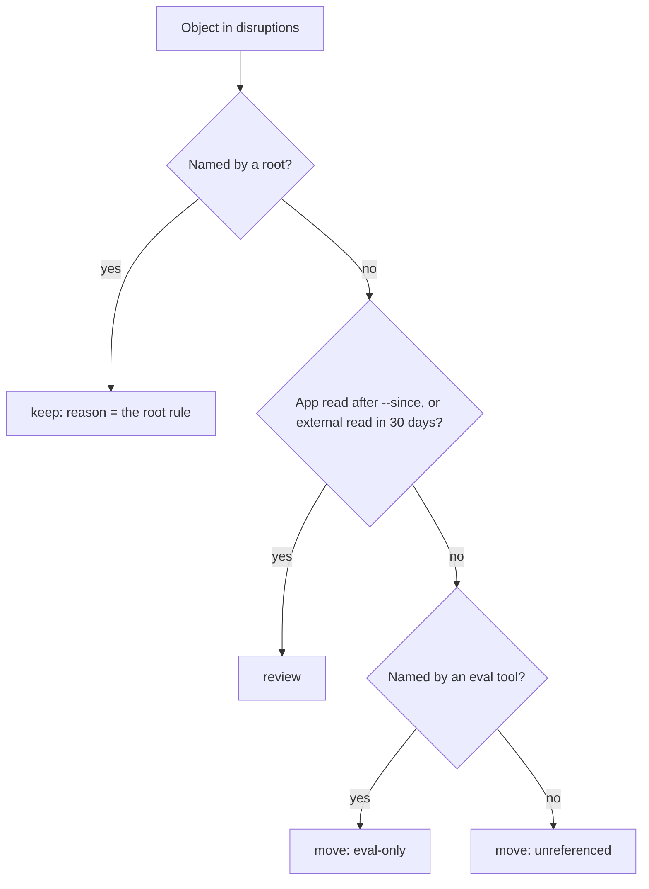
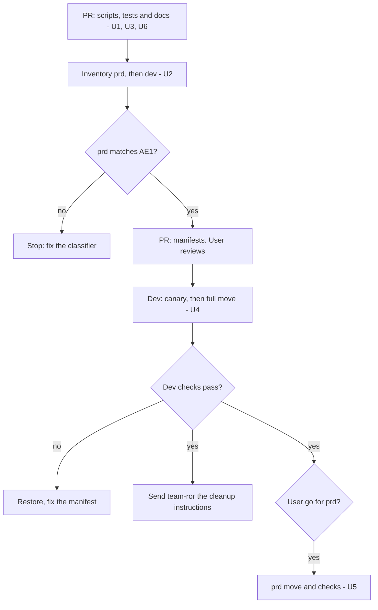

# BigQuery obsolete-object cleanup - Plan

## Goal Capsule

- **Objective:** move every object in the `disruptions` dataset of `ent-kixavvik-prd` and `ent-kixavvik-dev` that is not in use into a new `disruptions_obsolete` dataset in the same project, with a reviewed manifest as the record.
- **Authority:** the Product Contract's R-IDs decide what stays and what moves. KTDs decide the mechanism. A unit overrides neither.
- **Execution profile:** two scripts with hermetic tests (U1, U3) and a docs unit (U6) land in one PR. U2, U4 and U5 are operator steps run with the user present.
- **Stop conditions:**
  - No `--apply` in either project before the user has approved the manifests by merging the PR that commits them.
  - prd moves only after dev's verification (U4) has passed and the user gives a separate go.
  - Stop and report if the prd inventory's non-`keep` rows are not exactly AE1's 50 objects. A `review` row among the 50 is allowed: it is resolved at the manifest review.
  - The mover refuses a manifest whose environment does not match `--project`.
  - Stop, restore and report if any post-move check in the Verification Contract fails.
- **Tail ownership:** `ce-work` builds U1, U3 and U6 and opens their PR. It runs the U2 inventory and opens the manifest PR, then stops. The user runs or approves every `--apply`.

---

## Product Contract

### Summary

Create `disruptions_obsolete` in each project.
Classify each object in `disruptions` as `keep`, `move` or `review`, from the repo's code and each project's own scheduled queries and access logs.
Commit the result as one manifest per project and review it.
Then move the `move` rows: copy, verify, delete the source.
Dev goes first, prd second.

### Problem Frame

`disruptions` holds 557 objects in dev and 151 in prd.
Most of dev is experiments (about 160 `exp_` objects) and superseded model families.
prd still holds 50 objects that its deployed code stopped reading with PR 392 and PR 395.
team-ror is taking the service over as smart-avvik.
A dataset that mixes served, retrain and dead objects hides what the service needs.

### Key Decisions

- Keep everything needed to retrain the models prd serves. Governs R4. (session-settled: user-directed — chosen over treating retrain inputs as unused because prd never reads them: the service must stay retrainable after the handover.)
- Multi-leg journeys count as a prd feature, because `TRIP_PLANS_ENABLED` will be on in prd soon. Its miss-model refit (`trips._MISS_*`, `data/queries/transfer_miss_backtest.py`) is therefore a retrain procedure under R4, not a separate exception. Governs R4. (session-settled: user-directed — chosen over keeping the refit inputs as a dev-only carve-out while the flag is off in prd.)
- Keep the `demo_*` tables. Governs R5. (session-settled: user-approved — chosen over moving `demo_*` because `/demo` had no page loads in 30 days: deployed code reads them and a daily job refreshes them, so retiring `/demo` is a separate decision.)
- "Team" means members of `sg-dig-team-ki-eksperimentering@entur.no`. Reads by jobs in team-ror's `ent-smartavvik-*` projects raise nothing: their 2026-11-06 job copied every dev object once, which says nothing about use. Governs R6. (session-settled: user-directed — chosen over counting that copy as an external read, which would make nearly every dev candidate `review` until early December, and over counting everyone at Entur as team, which would leave the external-read check protecting no one.)
- team-ror cleans up their own copy from our dev manifest, following written instructions. Their copy is not a gate on our move. Governs U6. (session-settled: user-directed — chosen over sending them the manifest before the move and waiting for them.)
- `disruptions_obsolete` has no automatic expiry. Governs R1. (session-settled: user-approved — chosen over expiring moved objects after about 90 days: deleting them stays a later, explicit decision.)
- Scope is both projects, copy then delete, with a reviewed manifest before anything moves. Governs R2, R8, R9. (session-settled: user-approved — chosen over moving straight from a query result: the review is the only check on the classifier before data moves.)

### Requirements

**Datasets**

- R1. Each project has a dataset `disruptions_obsolete` in location `EU`, with no default table expiry.
- R2. Nothing is deleted for good. Every moved object exists in `disruptions_obsolete` under its own name.

**Classification**

- R3. In prd, keep every object the deployed code names, every object a prd scheduled query names, every object `data/queries/copy_runtime_to_prd.sh` copies into prd, and every object the operational export `data/feedback/export_varsel_feedback.py` names.
- R4. In dev, keep the R3 set as it applies to dev, plus every object a retrain-procedure file names. The multi-leg miss-model refit is one: `data/queries/transfer_miss_backtest.py` and `.sql` keep `exp_transfer_pairs`, `exp_etcmp6_fair_scored`, `leadtime_eval_calls`, `leadtime_scored` and the calibration models they read. No committed code builds `exp_etcmp6_fair_scored`, so a move would lose the refit for good.
- R5. In dev, keep the `demo_*` tables.
- R6. Mark an object `review` instead of `move` when the project's service account read it inside the evidence window, or when an external principal read it in the last 30 days. A principal is `team` when it is a member of `sg-dig-team-ki-eksperimentering@entur.no`. A read by a job in an `ent-smartavvik-*` project is `handover` and raises nothing. Every other principal is `external`.
- R7. Every other object moves.

**Review and record**

- R8. A committed manifest per project lists every object with its verdict, the reason, and read evidence that names no person.
- R9. No object moves before the user approves the manifest. Every `review` row gets an explicit `keep` or `move` at that review.

**Move**

- R10. A move copies the object, verifies the copy, then deletes the source. A source whose copy does not verify stays where it is.
- R11. No move breaks either environment's poller cycle, scheduled queries, prd promotion or retrain procedure.
- R12. One documented command restores a moved object.

### Acceptance Examples

- AE1. Covers R3, R7.
  - **Given:** prd's 151 objects and an evidence cutoff of 2026-11-07T12:54Z, the PR 395 deploy.
  - **When:** the inventory runs.
  - **Then:** with no read evidence, exactly 50 rows are `move`: the 45 `*_platt_nosx*` models, `dur_init_reopen`, `impact_remaining_noet`, `duration_quantiles`, `category_line_hour_impact` and `predictions_today`. Every other row is `keep`. With live evidence, some of the 50 may be `review` instead.
- AE2. Covers R4.
  - **Given:** dev.
  - **When:** the inventory runs.
  - **Then:** the 45 `*_platt_nosx*` models are `keep`, because `create_nosx_platt_weights.sql` builds prd's `nosx_platt_weights` from them. `training_calls`, `bus_calls` and `disruptions` are `keep`. `exp_etcmp6_fair_scored` and `exp_transfer_pairs` are `keep` with reason `retrain`, although `transfer_miss_backtest.py` names them only as `{DS}.<name>`.
- AE3. Covers R6.
  - **Given:** an object no keep rule names, which dev's service account read three days ago.
  - **Then:** its verdict is `review`, with reason `app-read`.
- AE4. Covers R10.
  - **Given:** a table whose copy has a different row count from the source.
  - **Then:** the mover leaves the source in place, reports `FAILED` and exits non-zero.
- AE5. Covers R9, R10.
  - **Given:** a `move` row whose object was modified after the manifest recorded it.
  - **Then:** the mover skips it and reports `changed-since-manifest`.

### Scope Boundaries

- **Out of scope:** tst, which has no objects. Dev's `togvarsel` dataset. prd's `disruptions_backup_20260820`. Permanent deletion.
- **Eval-only inputs move.** `training_calls_pooled`, the `_pooled` model family (not `_pooled_all`) and the `exp_etcmp_*` tables are read only by `eval/pooled-model-train-eval.py` and `data/queries/et_expected_eval.py`. `/eval` keeps serving its committed snapshots. Re-rendering those two notebooks would need a restore first. The manifest gives these rows the reason `eval-only`, so the review can keep them. A keep root always wins over this rule: `exp_etcmp6_fair_scored` stays because the miss-model refit reads it.
- **team-ror's copy in `ent-smartavvik-dev`.** We do not touch it. team-ror deletes from it themselves (U6). Their prd copy holds only the decision log (`varsel_decisions`, `varsel_decision_outcomes`), which stays.

#### Deferred to Follow-Up Work

- `CLAUDE.md` says the app creates the `disruptions` dataset at startup. Nothing in the code does.
- `docs/operations/RETRAIN.md` says `copy_runtime_to_prd.sh` copies 73 models and 14 tables. The script copies 71 and 12.
- Reader grants on `disruptions_obsolete` (KTD12).
- A separate dataset for future experiments, so `disruptions` stays clean.

### Dependencies

- PR 395 runs in prd. Done 2026-11-07: `cd.yml` finished at 12:53Z, the seven routes return 404, and the poller phases `predict_sql`, `disruptions_cache`, `impact_lookup` and `svv_baselines` are gone from prd cycles.

---

## Planning Contract

### Key Technical Decisions

- KTD1. **Static roots decide `keep`; logs only raise `review`.** The JOBS view lists models but not views or routines. Retraining reads its inputs about once a quarter, so a 60-day read window would move them. A root is a file or SQL text whose name tokens keep the named objects. A name token is `disruptions.<name>`, or `{VAR}.<name>` where `VAR` is assigned a string literal ending in `disruptions` in the same file. `transfer_miss_backtest.py` sets `DS = "ent-kixavvik-dev.disruptions"` and writes every table as `{DS}.<name>`; the plain `disruptions.<name>` rule sees none of them. The roots are in the High-Level Technical Design.
- KTD2. **The retrain rule keeps every object a retrain file names, read or written.** Separating reads from writes would need a SQL parser. Keeping too much is the safe error. Instantiates the retrain Key Decision. Cites R4.
- KTD3. **The retrain file list is data in the inventory script.** It includes `data/queries/transfer_miss_backtest.py` and `.sql`, the miss-model refit `RETRAIN.md` lists. Two tests guard the list: every listed path exists, and every `.sql`, `.sh` or `.py` file that `docs/operations/RETRAIN.md` names in backticks is either listed or in an explicit not-a-retrain-input set. Parsing the runbook at run time would tie the classifier to prose.
- KTD4. **A `{...}` placeholder in a name is a wildcard.** `togvarsel.py` builds `togvarsel_m_{model}`. `transfer_miss_backtest.py` builds `{side}_ge{t}_platt{suffix}`. A wildcard keeps every object it matches. That keeps a few extra objects, which is the safe direction. A name made only of placeholders, such as `{name}`, is ignored: as a wildcard it would keep everything.
- KTD5. **`copy_runtime_to_prd.sh --list` prints the copy sources and exits.** The script builds its model list in bash loops, which a regex reads badly. With `--list`, the copy list has one owner.
- KTD6. **Service-account reads count from the PR 395 deploy in each environment.** `--since` sets the start. It is 2026-11-07T12:54Z in prd, the minute after `cd.yml` finished deploying 20e00f2 at 12:53Z, and 2026-11-07T12:38Z in dev. Before those times both accounts read the duration objects every cycle, so an earlier start would turn them into `review` rows. The inventory runs no earlier than 2026-11-10T13:00Z. The window then holds every daily scheduled query and one weekday, because 2026-11-07 is a Saturday and Rushvarsel runs on weekdays. The poller reads every 2-3 minutes, so the window covers it many times over. Human reads by the team are shown but change no verdict.
- KTD7. **The manifest is one CSV per project:** `docs/operations/bigquery-obsolete/manifest-<env>.csv`. Columns, in this order: `name`, `type`, `size_gb`, `modified`, `verdict`, `reason`, `evidence`. `type` is `TABLE`, `VIEW`, `MODEL` or `ROUTINE`, or `EXTERNAL` or a bare type number for anything else; the mover moves only `TABLE` and `MODEL`. team-ror's cleanup instructions split rows on commas and rely on this order and on no comma in the first five columns. Evidence uses role buckets and dates. It never holds an e-mail address or query text. The buckets:
  - `app`: the project's own service account.
  - `team`: a member of `sg-dig-team-ki-eksperimentering@entur.no`. The inventory runs `gcloud identity groups memberships check-transitive-membership` once per distinct principal; the search call is denied to us, and a denial means "not a member". Before the first lookup it checks the operator's own account. If that check fails, the login has expired and the inventory stops, because every principal would otherwise read as `external`.
  - `handover`: a job in an `ent-smartavvik-*` project, read from the audit entry's job name. Raises nothing.
  - `external`: everyone else. Raises `review`.
- KTD8. **The scripts use the Python BigQuery client under ADC.** ADC works today; the `bq` login has expired. The inventory also needs `google-cloud-logging` for the audit log and `google-cloud-bigquery-datatransfer` for the scheduled-query SQL. Both go in the `dev` dependency group, which `ci.yml`'s `uv sync` installs. The scripts import them inside the functions that call them, and the tests inject fake clients. The copy API accepts a model as the copy source. Whether the client's `copy_table` passes a model through is unverified. If a model copy is rejected, models go through `bq cp`, as in `copy_runtime_to_prd.sh`. U3 owns that fallback, and it needs `gcloud auth login` first.
- KTD9. **The mover handles tables and models only.** It refuses views and routines. Each project has one view (`varsel_decision_groups`) and one table function (`varsel_decision_groups_between`). Deployed code names both, so both stay.
- KTD10. **Verify before deleting.** The copy must have the source's type. For tables, the row count and logical bytes must also match. The mover never overwrites a destination. A rerun skips objects already moved and finishes any object that was copied but not yet deleted.
- KTD11. **Dev moves first.** Dev is the test-bed and has the larger, less certain move set. A dev mistake costs dev serving and retraining, not prd. prd's 50 objects follow, already pinned by AE1.
- KTD12. **No reader grants on `disruptions_obsolete`.** No reader needs it. Someone who needs a moved object back asks for `--restore`, which puts it in `disruptions`, where their existing grant reads it. That includes team-ror after they delete their copy. Project-level roles still apply. A later grant is one more `google_bigquery_dataset_iam_member` in `terraform/bigquery_iam.tf`.

### High-Level Technical Design

Classification of one object:

The roots in each project:

| Root | prd | dev | Rule in `reason` |
|---|---|---|---|
| Deployed code: `disruptions/api/**/*.py` and `*.sql` | yes | yes | `deployed` |
| Scheduled-query SQL read from the project's transfer configs | yes | yes | `scheduled-query` |
| `copy_runtime_to_prd.sh --list` | yes | yes | `prd-copy` |
| `data/feedback/export_varsel_feedback.py` | yes | yes | `operational` |
| Retrain-procedure files (KTD3), including the miss-model refit | no | yes | `retrain` |
| `demo_*` and their builders `create_demo_predictions.sql`, `extend_demo_recent_daily.sql` | no | yes | `demo` |

The scheduled queries live in BigQuery. Each transfer config holds its own copy of the SQL. Today they are `demo-copy-daily` and `varsel-label-daily` in prd, and `demo-recent-daily` and `varsel-label-daily` in dev.

The eval tools are `eval/*.py` and `data/queries/et_expected_eval.py`.

Rollout:

### Assumptions

- A dry run reports a missing model in `ML.PREDICT` or `ML.WEIGHTS` as an error. V5 depends on it, and it is unverified. U4's canary tests it: a dry run against the canary model passes before the move and must fail after it.
- The data-access audit log holds 30 days of read entries in each project, as the 2026-11-07 readers check found. A table read is a `tableDataRead` entry and a model read is a `modelDataRead` entry.

---

## Implementation Units

### U1. Inventory script

- **Goal:** classify every object in one project's `disruptions` and write the manifest.
- **Requirements:** R3–R8. KTD1–KTD7.
- **Dependencies:** none.
- **Files:**
  - `scripts/bq_obsolete_inventory.py` (new)
  - `scripts/test_bq_obsolete_inventory.py` (new)
  - `scripts/fixtures/bq_obsolete_roots.json` (new): the root name tokens when U1 is written
  - `scripts/fixtures/bq_obsolete_prd_2026-11-07.json` (new): prd's object list and scheduled-query tokens on 2026-11-07, for AE1
  - `data/queries/copy_runtime_to_prd.sh` (add `--list`)
  - `pyproject.toml` and `uv.lock` (KTD8's two libraries in the `dev` group)
- **Approach:**
  1. Add `--list` to `copy_runtime_to_prd.sh`. It prints `MODELS` and `TABLES`, one name per line, and exits before any `bq` call.
  2. List the project's tables, views, models and routines with type, size and modified time.
  3. Collect root name tokens from the files and texts in the HTD roots table (KTD1). Turn `{...}` placeholders into wildcards and drop placeholder-only names (KTD4). `--dump-roots` writes the repo-file tokens as JSON and exits. Run it once while writing U1 to produce the AE1 fixture; regenerate it only on purpose.
  4. Collect evidence. Service-account reads come from `region-eu.INFORMATION_SCHEMA.JOBS_BY_PROJECT.referenced_tables` after `--since`. Other reads come from the data-access audit log for 30 days, both `protoPayload.metadata.tableDataRead` and `protoPayload.metadata.modelDataRead`. Bucket each principal as KTD7 says. Do not write principals out.
  5. Classify each object as the HTD flowchart shows. Write the CSV sorted by verdict, then name.
  6. Print a summary: counts and GB per verdict and reason.
- **Patterns to follow:**
  - `data/queries/togvarsel/regrade_outcomes.py`: argparse, a required `--project`, `bigquery.Client(project=…)` under ADC.
  - `scripts/test_loadgen.py`: a hermetic suite with an injected client, `_run()` collecting the `test_*` functions, and a `__main__` runner.
- **Test scenarios:**
  - Covers AE1. Use prd's object names as of 2026-11-07 and the frozen root tokens in `scripts/fixtures/bq_obsolete_roots.json`, with fixture transfer-config SQL, empty evidence and the AE1 cutoff. Exactly AE1's 50 rows are `move`. The test does not scan the live tree, so a later code change cannot turn CI red; V3 runs the live scan once.
  - Covers AE2. With dev fixture names, the `*_platt_nosx*` models, `training_calls`, `bus_calls` and `disruptions` are `keep`, with reason `retrain` or `prd-copy`.
  - Covers AE2. Scanning `data/queries/transfer_miss_backtest.py` keeps `exp_etcmp6_fair_scored` and `exp_transfer_pairs`, with reason `retrain`.
  - A file with `X = "proj.other_dataset"` and `{X}.foo` keeps nothing. A file with `{DS}.{name}` and no literal part keeps nothing.
  - Code that names `togvarsel_m_{model}` keeps both `togvarsel_m_am0630` and a leftover `togvarsel_m_cand_x`.
  - An object named both by a retrain file and by `eval/pooled-model-train-eval.py` is `keep`, with reason `retrain`.
  - Covers AE3. A service-account read after `--since` makes an unrooted object `review`. The same read before `--since` leaves it `move`.
  - An external read in the last 30 days makes an unrooted object `review`, with reason `external-read`. This holds for a `tableDataRead` entry and for a `modelDataRead` entry.
  - A read by a job in `ent-smartavvik-dev` leaves an unrooted object `move`, with `handover` in its evidence.
  - A read by a principal the membership check confirms leaves an unrooted object `move`, with `team` in its evidence.
  - When the membership check fails for the operator's own account, the inventory exits non-zero before writing a manifest.
  - The written manifest contains no `@` and no query text.
  - An object named only by `eval/pooled-model-train-eval.py` is `move`, with reason `eval-only`.
  - Every path in the retrain list exists in the tree.
  - Every backticked `.sql`, `.sh` or `.py` file in `RETRAIN.md` is in the retrain list or the not-a-retrain-input set.
  - `copy_runtime_to_prd.sh --list` prints 71 models and 12 tables. It makes no `bq` call: run it with a `bq` stub on `PATH` that fails.
  - A view and a table function in the object list are `keep`, with reason `deployed`.
- **Verification:**
  - The suite passes when run as `ci.yml` runs `scripts/test_*.py`.
  - A run against dev writes only the manifest file.

### U2. Run the inventory and review the manifests

- **Goal:** both manifests committed and approved, with no `review` row left.
- **Requirements:** R8, R9. AE1.
- **Dependencies:** U1 merged.
- **Files:**
  - `docs/operations/bigquery-obsolete/manifest-prd.csv` (new)
  - `docs/operations/bigquery-obsolete/manifest-dev.csv` (new)
- **Approach:**
  1. Run no earlier than 2026-11-10T13:00Z (KTD6). Run `gcloud auth login` first, for the membership check.
  2. Run in prd with `--since 2026-11-07T12:54Z`. Stop if the non-`keep` rows are not exactly AE1's 50.
  3. Run in dev with `--since 2026-11-07T12:38Z`.
  4. Open a PR with both manifests. The PR body gives counts and GB per verdict, and lists every `review` and `eval-only` row.
  5. The user sets `keep` or `move` on each `review` row, in the PR.
- **Execution note:** `ce-work` stops at this gate. It opens the PR but does not merge it.
- **Test expectation:** none. This is an operator step; U1's tests cover the classifier.
- **Verification:** the manifest PR is merged with no `review` rows.

### U3. Mover script

- **Goal:** move the manifest's `move` rows from `disruptions` to `disruptions_obsolete`, and restore named objects.
- **Requirements:** R1, R2, R9, R10, R12. KTD8–KTD10.
- **Dependencies:** none. It is built alongside U1.
- **Files:**
  - `scripts/bq_obsolete_move.py` (new)
  - `scripts/test_bq_obsolete_move.py` (new)
- **Approach:**
  1. Arguments: `--project` (required, no default), `--manifest`, `--only NAME…`, `--restore` and `--apply`. Without `--apply` it is a dry run.
  2. Create `disruptions_obsolete` if it is missing: location `EU`, a description naming the manifest, no default expiry. Mirror `data/queries/copy_runtime_to_prd.sh:102-108`.
  3. Refuse to run when the manifest's file name (`manifest-<env>.csv`) does not match `--project` (`ent-kixavvik-<env>`). Refuse `--apply` while the manifest has a `review` row.
  4. For each `move` row:
     - Check that the source exists and has the manifest's type.
     - Check that its modified time is not later than the row's. Compare at whole-second precision; the inventory writes `modified` as UTC ISO 8601 to the second.
     - Skip it if it is already moved: absent from the source dataset and present in the destination.
     - When both exist, skip it as `recreated-since-move` if the source was created after the destination. A retrain or experiment made a new object under the old name.
  5. Copy without overwriting. Verify (KTD10). Then delete the source.
  6. Print one line per object: `moved`, `skipped (<reason>)` or `FAILED`. Exit 1 if any object failed. Keep going after a failure.
  7. `--restore --only NAME…` copies back from `disruptions_obsolete` to `disruptions` and deletes the copy in `disruptions_obsolete`. It skips the modified-time check, because the copy's modified time is the move time.
- **Execution note:** in U4's canary, confirm that the client's copy job accepts a model. If it rejects one, add the `bq cp` path for models in this script before U4 goes on (KTD8). It needs `gcloud auth login`.
- **Patterns to follow:** the same as U1. The per-object `ok`/`FAILED` lines in `data/queries/copy_runtime_to_prd.sh:110-123`.
- **Test scenarios:**
  - A dry run makes no copy, delete or create call and prints what it would do.
  - A table is copied, its row count and bytes match, and only then is the source deleted.
  - A model is copied, its model type matches, and the source is deleted as a model.
  - Covers AE4. A row-count mismatch leaves the source, prints `FAILED`, processes the remaining rows and exits 1.
  - A copy that raises leads to no delete and a `FAILED` line.
  - Covers AE5. A source modified after its manifest row is skipped with `changed-since-manifest`.
  - A second run after a complete run makes no calls and reports every row `already-moved`.
  - When both the source and the destination exist, the destination is not overwritten. Verify; delete the source if they match, otherwise `FAILED`.
  - When both exist and the source was created after the destination, nothing is deleted and the row is `skipped (recreated-since-move)`.
  - `--manifest manifest-dev.csv --project ent-kixavvik-prd` exits non-zero before any call.
  - A view or routine row is refused before any call.
  - `--only` limits the run to the named rows. A name that is not a `move` row is an error.
  - `keep` rows are never touched. A manifest with a `review` row refuses `--apply`.
  - A missing destination dataset is created in `EU` with no default expiry. An existing one is left as it is.
  - `--restore --only NAME` puts the object back in `disruptions` without the modified-time check.
- **Verification:** the suite passes when run as `ci.yml` runs it.

### U4. Move dev and verify

- **Goal:** dev's `move` rows are in `disruptions_obsolete` and nothing in dev broke.
- **Requirements:** R2, R10, R11.
- **Dependencies:** U2 merged, U3 merged.
- **Files:** none.
- **Approach:**
  1. Canary: pick one `exp_` model and one partitioned `exp_` table.
     - Before the move, dry-run `SELECT * FROM ML.WEIGHTS(MODEL disruptions.<model>)`. It must pass.
     - Move both with `--only`. Check that both are in `disruptions_obsolete` and gone from `disruptions`. This also settles KTD8's model question.
     - Dry-run the same query again. It must fail with not-found. If it passes, a dry run does not catch a missing model, so V4 and V5 cannot prove the move safe: stop and report.
     - Restore the model with `--restore --only <model>` and leave it restored. On this manifest the mover skips it as `changed-since-manifest`, and V8 accounts for it. This tests the RUNBOOK's restore command.
  2. Run the full dev move.
  3. Run gates V4–V8. Dev has `TRIP_PLANS_ENABLED` on, so V5 covers the multi-leg phases `trip_plans` and `trip_realtime`.
  4. If a gate fails, restore the objects involved with `--restore` and correct the manifest in a follow-up PR.
  5. When V4–V8 pass, send team-ror `docs/operations/bigquery-obsolete/team-ror-cleanup.md` and the merged dev manifest.
- **Execution note:** `ce-work` stops before this unit. The user runs or approves each `--apply`.
- **Test expectation:** none. This is an operator step.
- **Verification:** V4–V8 pass in dev.

### U5. Move prd and verify

- **Goal:** prd's 50 `move` rows are in `disruptions_obsolete` and prd still serves.
- **Requirements:** R2, R10, R11.
- **Dependencies:** U4 passed and a separate user go.
- **Files:** none.
- **Approach:** the same steps as U4 with the prd manifest. Run V4–V6 and V8 in prd.
- **Execution note:** run it with the user present. This is the production change.
- **Test expectation:** none. This is an operator step.
- **Verification:** V4–V6 and V8 pass in prd.

### U6. Document the dataset

- **Goal:** the next maintainer knows what `disruptions_obsolete` is, how to restore from it, and how to keep the inventory's lists current. team-ror knows how to clean up their copy.
- **Requirements:** R12.
- **Dependencies:** none. It lands with U1 and U3.
- **Files:**
  - `docs/operations/RUNBOOK.md`
  - `docs/operations/RETRAIN.md`
  - `docs/operations/bigquery-obsolete/team-ror-cleanup.md` (new, written 2026-11-07)
- **Approach:**
  - **`RUNBOOK.md`:** a short section on what `disruptions_obsolete` holds, where the manifests are, the restore command, and the fact that deleting its contents is a later decision.
  - **`RETRAIN.md`:** one line saying that a new retrain input must be added to the inventory's retrain list. U1's test fails until it is.
  - **`team-ror-cleanup.md`:** how team-ror deletes our dev manifest's `move` rows from their copy in `ent-smartavvik-dev`, with a dry run first. It says when to start (after U4 passes) and how to get an object back.
- **Test expectation:** none. Docs only.
- **Verification:** the RUNBOOK's restore command matches U3's arguments. The cleanup file's column positions match KTD7's column order.

---

## Verification Contract

| Gate | Check | Applies to |
|---|---|---|
| V1 | `uv run python test_bq_obsolete_inventory.py` and `uv run python test_bq_obsolete_move.py`, run from `scripts/` as `ci.yml` does. Each reports its test count. | U1, U3 |
| V2 | `ruff check .` is clean. | U1, U3 |
| V3 | The prd inventory, scanning the live tree, has exactly AE1's 50 objects as its non-`keep` rows. | U2 |
| V4 | Dry-run every `.sql` file in deployed code and in the retrain list against the project. None reports a missing object. The report lists the files a dry run cannot cover, such as `10_train_models.sql`'s `EXECUTE IMMEDIATE FORMAT` names and files with query parameters. Wildcard roots cover those. | U4, U5 |
| V5 | The next two `poller_cycle` events show the same phase set as before the move and no phase error. Read them from `ent-kub-<env>`, namespace `kix-avvik`. | U4, U5 |
| V6 | The next run of each scheduled query succeeded. | U4, U5 |
| V7 | Every name that `copy_runtime_to_prd.sh --list` prints exists in dev's `disruptions`. | U4 |
| V8 | `disruptions_obsolete` holds exactly the manifest's `move` rows, minus any restored and not moved again. `disruptions` holds the `keep` rows, the restored rows, and objects created after the manifest. | U4, U5 |

Dry runs and copy jobs within `EU` are free. The JOBS query is the only billed read, at about 10 MB.

## Definition of Done

- Both projects have `disruptions_obsolete`, holding exactly their manifest's `move` rows.
- V1–V8 pass.
- `RUNBOOK.md` documents the restore command, and the command works: the U4 canary used it.
- team-ror received the cleanup instructions and the merged dev manifest after the dev move passed.
- The two scripts, their tests and the docs are merged. The diff holds no code from approaches that were dropped.

| Unit | Done when |
|---|---|
| U1 | Tests pass, including AE1's known-answer test. |
| U2 | The manifest PR is merged with no `review` row. |
| U3 | Tests pass, including AE4 and AE5. |
| U4 | The canary's second dry run failed, V4–V8 pass in dev, and team-ror has the instructions. |
| U5 | V4–V6 and V8 pass in prd. |
| U6 | The restore section matches U3's arguments, and the cleanup file exists. |

---

## Risks

| Risk | Mitigation |
|---|---|
| A name built at run time escapes the static scan, and a moved object breaks a cycle. | Service-account reads raise `review` (R6). Dev goes first. V4 and V5. One-command restore. |
| team-ror deletes an object from their copy that they still need. | The instructions tell them to check their own code first. `disruptions_obsolete` keeps every moved object, and `--restore` brings one back (KTD12). |
| A `{VAR}.<name>` root with another binding style escapes KTD1, as `transfer_miss_backtest.py` nearly did. | The AE2 test pins the known case. The manifest review lists every `move` row with its reason. |
| Retrain inputs are read about once a quarter, so the logs miss them. | The static retrain rule (KTD2) does not depend on reads. |
| A copy restarts the 90-day clock for long-term storage pricing. | Moved bytes bill at the active rate for 90 days, about USD 0.01 per GB per month extra. |
| A retrain or experiment later recreates a moved object in `disruptions`. | Harmless. The next inventory shows it. |

## System-Wide Impact

- **team-sd** reads `disruptions` and `categories` in dev with a snapshot script. Both stay.
- **team-ror** reads both projects. Their 2026-11-06 copy of dev raises nothing (R6). They clean it up themselves from the dev manifest (U6).
- **Multi-leg journeys** read nothing from BigQuery when serving: `trips.py` and `trip_plans.py` make no BigQuery calls. Turning `TRIP_PLANS_ENABLED` on in prd needs no object either move touches. Only the miss-model refit reads `disruptions`, in dev (R4).
- **`/eval`** keeps serving its snapshots. Two notebooks need a restore before re-rendering (Scope Boundaries).
- **`scripts/alert_triage.py`** sends ad-hoc SELECTs every 10 minutes under a developer's credentials, with no fixed table list. Its reads show as `team` evidence, so the manifest review is the check on them.

## Sources

- `data/queries/copy_runtime_to_prd.sh`: the copy list, dataset creation, and the per-object output.
- `docs/operations/RETRAIN.md`: the retrain procedure the KTD3 list mirrors.
- `data/queries/transfer_miss_backtest.py`: the miss-model refit inputs, named as `{DS}.<name>`, including `exp_etcmp6_fair_scored`, which no committed file builds.
- `disruptions/api/togvarsel.py` and `disruptions/api/predict_calls.sql`: dynamic and literal model names.
- `terraform/bigquery_iam.tf` and `terraform/env/*.tfvars`: reader grants, and team-ror's copy from dev.
- The BigQuery model-copy documentation (docs.cloud.google.com/bigquery/docs/managing-models): a copy job takes a model as `copy.sourceTable`.
